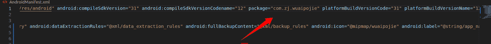
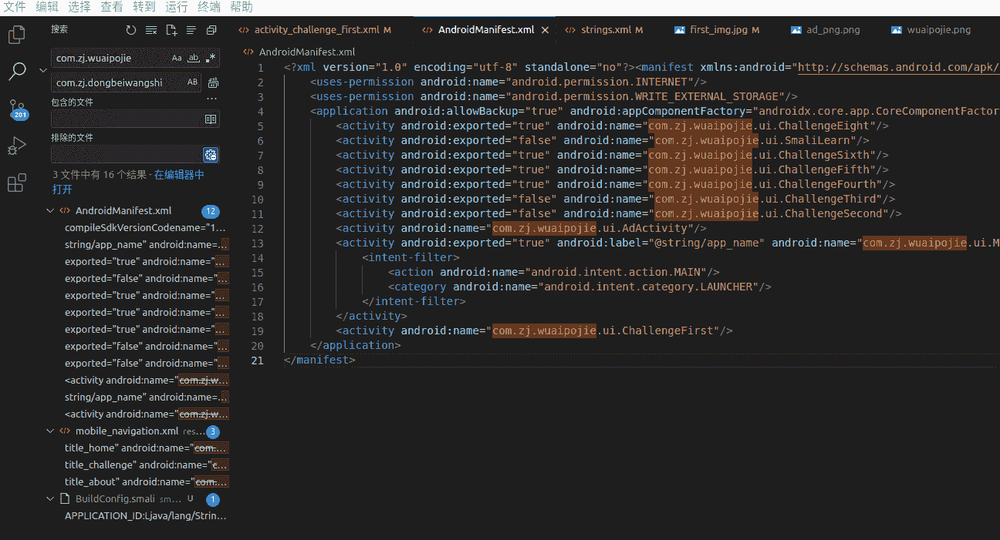
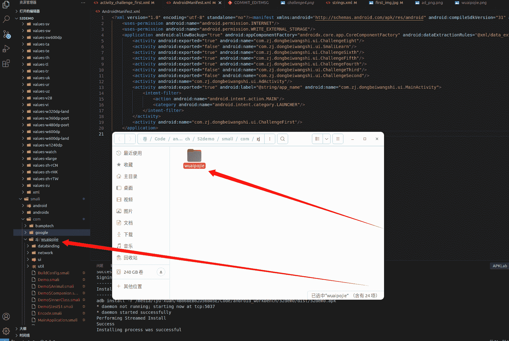
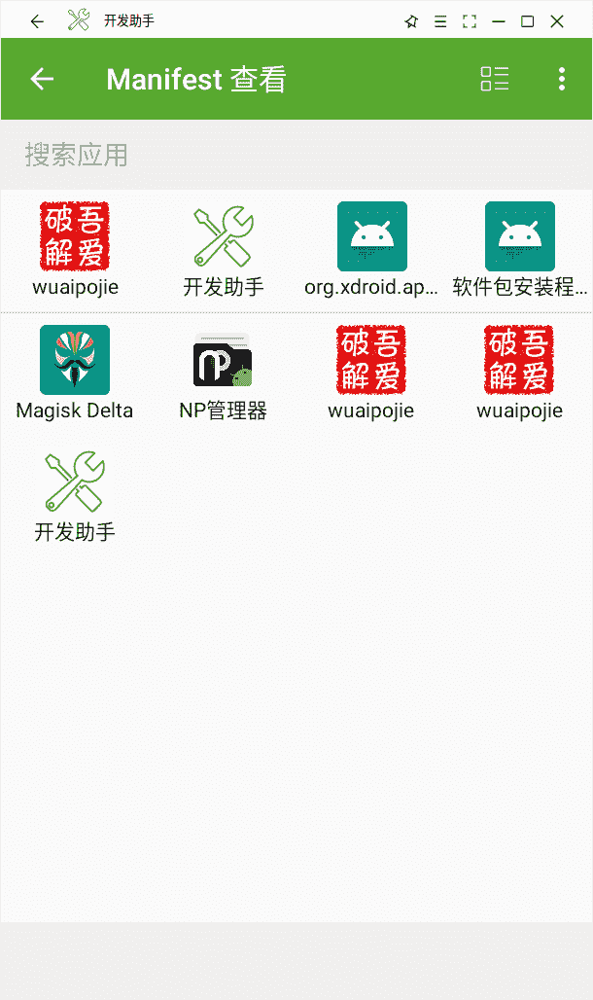
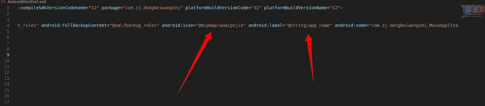
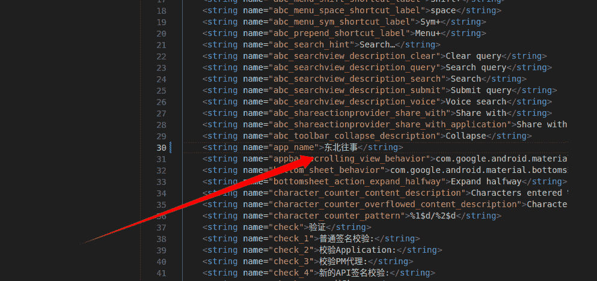
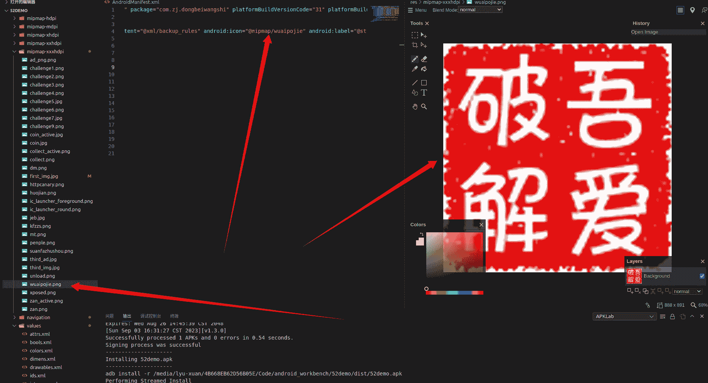
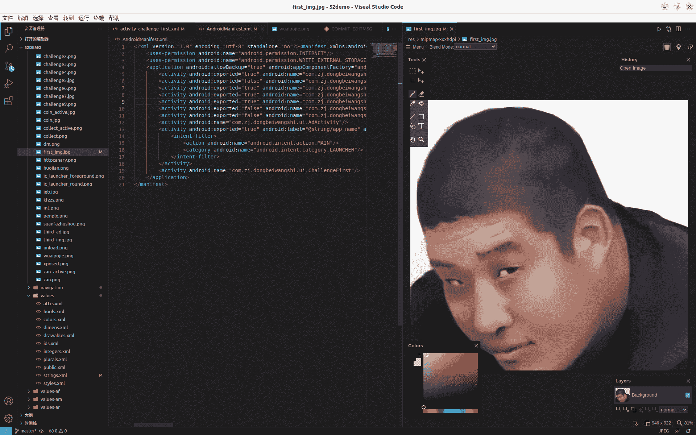
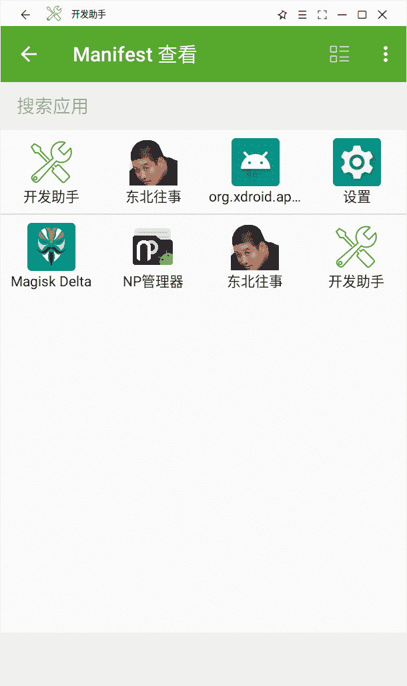

# [Android 原创] Android逆向学习（二）vscode进行双开与图标修改

- 原帖: https://www.52pojie.cn/forum.php?mod=viewthread&tid=1828975
- 抓取时间: 2026-11-01T21:40:05

## Android逆向学习（二）vscode进行双开与图标修改

### 写在前面

这其实应该还是吾爱的第一个作业，但是写完上一个博客的时候已经比较晚了，如果继续敲机械键盘吵到室友，我怕我看不到明天的太阳，所以我决定分成两篇博客来进行学习

注意：我希望我的博客可以是不管是从那一篇开始看都可以学会，所以在我的每一篇博客中都会重复提到前面的很多内容，所以如果您感觉我的博客十分啰嗦请见谅

### 一、环境准备

老样子，我使用的还是linux系统（ubuntu 22.04）,vscode,以及xdroid，主要的插件都和上一次一样，这里就不再讲软件如何配置的，详细请见上一篇博客

### 二、实现双开

#### 1、什么是双开

双开就是在一个android机器中同时安装和运行两个相同的软件，实现双开的方法有很多，这里我们就讲最简单的一个就是修改包名，让系统认为这是两个不同的软件，这个的实现方法也很简单，我们只需要修改相应文件下的包名就可以了

#### 2、开始替换包名

首先我们打开`AndroidManifest.xml`这个文件，这个文件了解过android开发的都知道，这里面就是这个apk应用的简单介绍，比如名字图标等，我们首先就要修改这个包名，包名在这个位置

然后我们在vscode左侧查找这个包名，`com.zj.wuaipojie`全部替换为`com.zj.dongbeiwangshi`（东北往事）

然后我们还需要把`smali`里面的`Lcom/zj/wuaipojie`换成`Lcom/zj/dongbeiwangshi`

共有99个文件的1453个地方需要修改

然后我们还需要修改一下包的结构，就是之前的结构是`com.zj.wuaipojie`，把文件目录换成`com.zj.dongbeiwangshi`

然后我们右键`apktool.yml`重新打包签名安装一下，这里会有两个bug请注意，具体方法在前一篇博客中

然后我们就会发现出现了两个wuaipojie

其中一个的包名已经被换成了`dongbeiwangshi`

正常运行也是没有任何问题的（运行方法也在上一篇博客中，这是一个xdroid的bug）

### 三、修改软件名和图标

上面我们已经完成双开，这里我们开始对包名和图标进行修改

需要修改的是这两个地方

还是修改`app_name`，看到`@string`了，我们就去`value`下找到这个`string.xml`进行修改

然后在图标里我们找到了这个东西

我们在网上找个png图片替换调它，这样看起来就顺眼多了

然后我们打包安装就可以看到这种情况了

如果你发现安装后还是没变的话先卸载掉之前的软件就可以了

希望这篇博客可以帮到你，祝学习顺利！！！
