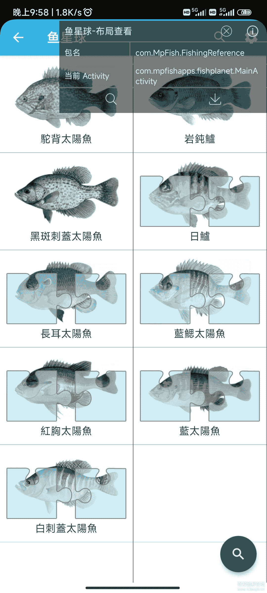
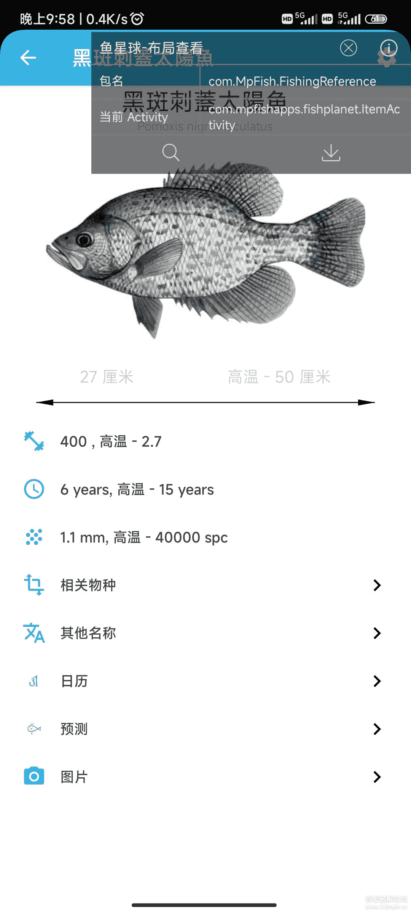
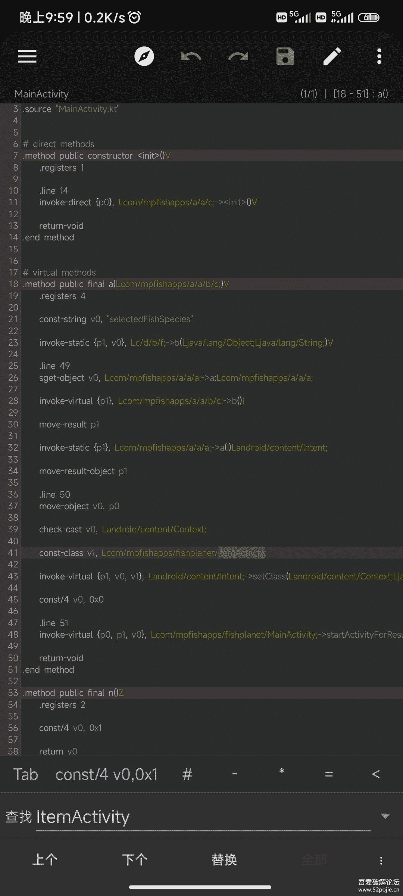
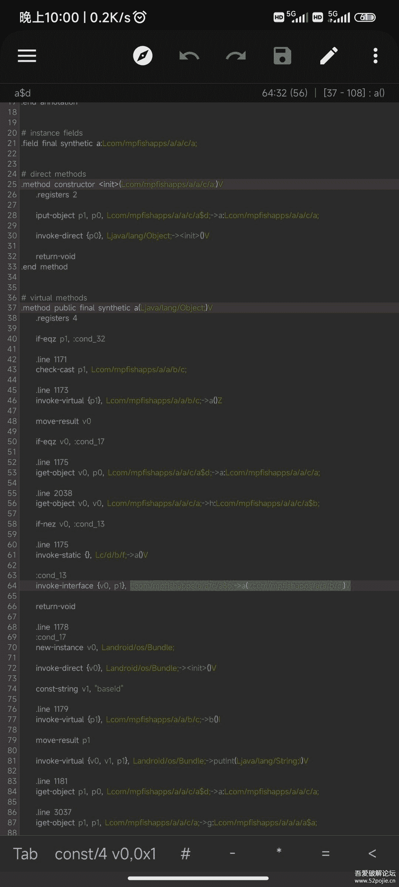
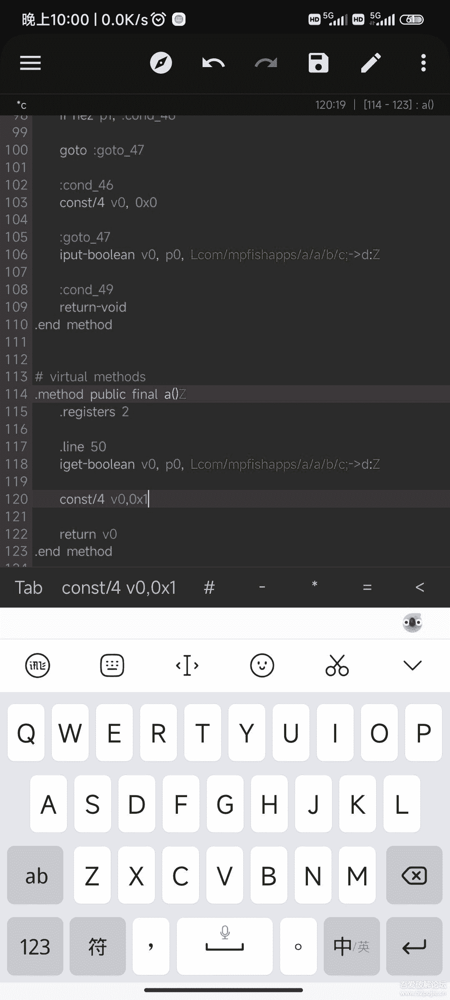
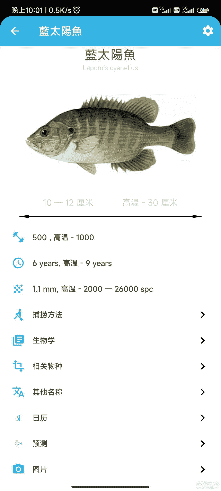
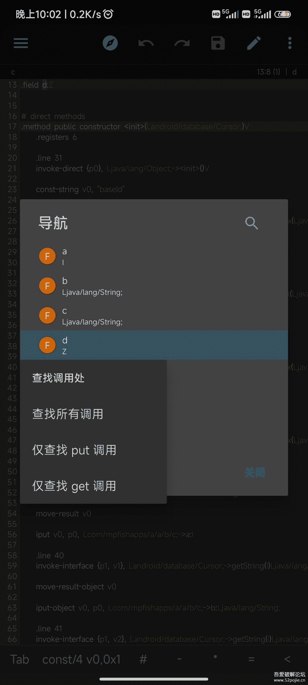
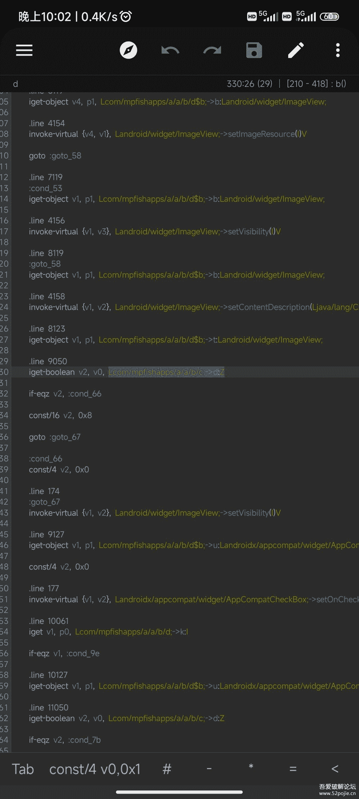
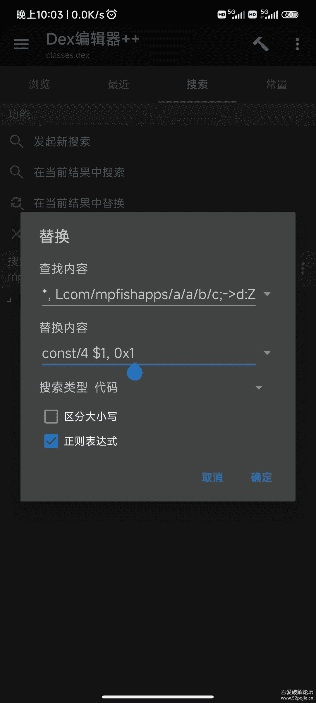

# [Android 原创] 【实战破解】鱼星球

- 原帖: https://www.52pojie.cn/forum.php?mod=viewthread&tid=1831383
- 抓取时间: 2026-11-01T21:39:55

进入软件可以看见一些是锁住的，一些是可以进入详情页面的，那就是从预览的活动界面跳转到详情的活动界面，那可不可以把那些锁住强制跳转到详情页呢？

于是看看预览界面的`Activity`和详情页的`Activity`



1.jpg (263.68 KB, 下载次数: 2)

[href="forum.php?mod=attachment&aid=MjY0MTUzNnw2MzY4MDk1ZnwxNzkzNTY5MTkzfDE2ODA4NnwxODMxMzgz&nothumb=yes" target="_blank"](https://www.52pojie.cn/forum.php?mod=attachment&aid=MjY0MTUzNnw2MzY4MDk1ZnwxNzkzNTY5MTkzfDE2ODA4NnwxODMxMzgz&nothumb=yes)

2023-9-8 21:11 上传



2.jpg (187.38 KB, 下载次数: 2)

[href="forum.php?mod=attachment&aid=MjY0MTUzN3xmN2FiZGU0MHwxNzkzNTY5MTkzfDE2ODA4NnwxODMxMzgz&nothumb=yes" target="_blank"](https://www.52pojie.cn/forum.php?mod=attachment&aid=MjY0MTUzN3xmN2FiZGU0MHwxNzkzNTY5MTkzfDE2ODA4NnwxODMxMzgz&nothumb=yes)

2023-9-8 21:11 上传

可以看见是从`MainActivity`跳转到`ItemActivity`

那就去代码里看看怎么实现的


3.jpg (166.07 KB, 下载次数: 0)

[href="forum.php?mod=attachment&aid=MjY0MTUzOHxmYTdiOWE3ZHwxNzkzNTY5MTkzfDE2ODA4NnwxODMxMzgz&nothumb=yes" target="_blank"](https://www.52pojie.cn/forum.php?mod=attachment&aid=MjY0MTUzOHxmYTdiOWE3ZHwxNzkzNTY5MTkzfDE2ODA4NnwxODMxMzgz&nothumb=yes)

2023-9-8 21:12 上传



4.jpg (193.28 KB, 下载次数: 2)

[href="forum.php?mod=attachment&aid=MjY0MTUzOXxkMjZiNjU5M3wxNzkzNTY5MTkzfDE2ODA4NnwxODMxMzgz&nothumb=yes" target="_blank"](https://www.52pojie.cn/forum.php?mod=attachment&aid=MjY0MTUzOXxkMjZiNjU5M3wxNzkzNTY5MTkzfDE2ODA4NnwxODMxMzgz&nothumb=yes)

2023-9-8 21:12 上传

这里可以看见在`a()`方法实现了从`MainActivity`跳转到了`ItemActivity`的那查找一下`a()`方法的调用



5.jpg (201.66 KB, 下载次数: 2)

[href="forum.php?mod=attachment&aid=MjY0MTU0MHxmZGQwMGQ3OHwxNzkzNTY5MTkzfDE2ODA4NnwxODMxMzgz&nothumb=yes" target="_blank"](https://www.52pojie.cn/forum.php?mod=attachment&aid=MjY0MTU0MHxmZGQwMGQ3OHwxNzkzNTY5MTkzfDE2ODA4NnwxODMxMzgz&nothumb=yes)

2023-9-8 21:12 上传

这里讲解一下`smali`代码：（上图）我们需要的是跳转到`cond_13`，在58行如果`v0`不等于0就跳转到`cond_13`，但是，如果58行没有实现跳转，那会继续往下执行，也会执行到`a()`方法的调用，而且执行了上面58行方法并不会影响传入`a()`方法的参数，因此58行可以不用看，但是上面的第50行如果实现了跳转就会调到`cond_17`，代码不会执行到`a()`方法的调用，因此50行的判断是关键，而50行的意思是如果`v0 = 0`就会跳转到`cond_17`，我们不能让它跳转，需要使`v0`不等于0，可以看到48行`move-result v0`，和46行的`a()`方法的调用，那就是`v0 = c.a()`我们进去`a()`方法强制返回1即可



6.jpg (186.56 KB, 下载次数: 2)

[href="forum.php?mod=attachment&aid=MjY0MTU0MXwyZDgzNjdkNXwxNzkzNTY5MTkzfDE2ODA4NnwxODMxMzgz&nothumb=yes" target="_blank"](https://www.52pojie.cn/forum.php?mod=attachment&aid=MjY0MTU0MXwyZDgzNjdkNXwxNzkzNTY5MTkzfDE2ODA4NnwxODMxMzgz&nothumb=yes)

2023-9-8 21:13 上传

，签名进入软件，虽然有锁的图案，但是点进去也是可以看见详情的，那就是我们强制跳转到详情页的思路实现了。



7.jpg (157.06 KB, 下载次数: 2)

[href="forum.php?mod=attachment&aid=MjY0MTU0MnwyNWNiM2I2ZnwxNzkzNTY5MTkzfDE2ODA4NnwxODMxMzgz&nothumb=yes" target="_blank"](https://www.52pojie.cn/forum.php?mod=attachment&aid=MjY0MTU0MnwyNWNiM2I2ZnwxNzkzNTY5MTkzfDE2ODA4NnwxODMxMzgz&nothumb=yes)

2023-9-8 21:13 上传

现在思考如何去掉锁的图案，上图刚刚我们强制赋值1，如果我们没有强制赋值1的返回话，就是从`d`字段拿到值返回，也就是`v0 = this.d`(118行)，那么`d`字段应该就是判断是否解锁的标志，我们找找`d`字段的`get`调用，看看它在其它地方有什么作用。



9.jpg (147.95 KB, 下载次数: 2)

[href="forum.php?mod=attachment&aid=MjY0MTU0NHwxZGMxNzQwM3wxNzkzNTY5MTkzfDE2ODA4NnwxODMxMzgz&nothumb=yes" target="_blank"](https://www.52pojie.cn/forum.php?mod=attachment&aid=MjY0MTU0NHwxZGMxNzQwM3wxNzkzNTY5MTkzfDE2ODA4NnwxODMxMzgz&nothumb=yes)

2023-9-8 21:13 上传



10.jpg (214.17 KB, 下载次数: 2)

[href="forum.php?mod=attachment&aid=MjY0MTU0NXwyNWIzMzRiNnwxNzkzNTY5MTkzfDE2ODA4NnwxODMxMzgz&nothumb=yes" target="_blank"](https://www.52pojie.cn/forum.php?mod=attachment&aid=MjY0MTU0NXwyNWIzMzRiNnwxNzkzNTY5MTkzfDE2ODA4NnwxODMxMzgz&nothumb=yes)

2023-9-8 21:14 上传

到这里看见34行的`0x8`，和39行的`0x0`，和43行的`setVisibility`已经很明显了，在43行的`setVisibility`的调用可以理解成`setVisibility(v2)`，如果`setVisibility(0)`就显示布局，如果`setVisibility(8)`就隐藏布局且不占空间，那可以大胆猜测这里就是控制锁的显示和隐藏，我们要让`v2 = 8`，使得锁的那个布局隐藏，再看34行，意思是`v2 = 8`，这是我们想要的，再看32行有这个判断，这句判断是如果`v2 = 0`就跳转到`cond_66`，而`cond_66`这里是使`v2 = 0`，这刚好是`setVisibility(0)`，显示了布局，这是我们不想要的。因此我们需要的是不能让32行的判断成立，再看30行，`v2`得值是从这行来的，因此我们直接正则表达式查找这句代码

```
iget-boolean (.*), .*, Lcom/mpfishapps/a/a/b/c;->d:Z
```

全部赋值成不为0即可



11.jpg (117.1 KB, 下载次数: 2)

[href="forum.php?mod=attachment&aid=MjY0MTU0NnwyNjkzOWFlNnwxNzkzNTY5MTkzfDE2ODA4NnwxODMxMzgz&nothumb=yes" target="_blank"](https://www.52pojie.cn/forum.php?mod=attachment&aid=MjY0MTU0NnwyNjkzOWFlNnwxNzkzNTY5MTkzfDE2ODA4NnwxODMxMzgz&nothumb=yes)

2023-9-8 21:15 上传

最后前面安装，锁的图案已经去除


12.jpg (238.5 KB, 下载次数: 2)

[href="forum.php?mod=attachment&aid=MjY0MTU0N3xiMDQ1MmViZXwxNzkzNTY5MTkzfDE2ODA4NnwxODMxMzgz&nothumb=yes" target="_blank"](https://www.52pojie.cn/forum.php?mod=attachment&aid=MjY0MTU0N3xiMDQ1MmViZXwxNzkzNTY5MTkzfDE2ODA4NnwxODMxMzgz&nothumb=yes)

2023-9-8 21:15 上传
