# [Android 原创] Xposed新版本某信发消息

- 原帖: https://www.52pojie.cn/forum.php?mod=viewthread&tid=1831484
- 抓取时间: 2026-11-01T21:39:51

最近在研究新版本某信发消息功能，下面先把发文字消息的逆向流程分享一下，有不足之处，请各位大佬指正。

第一步，还是老方法，用DDMS跟踪发消息时的点击事件。

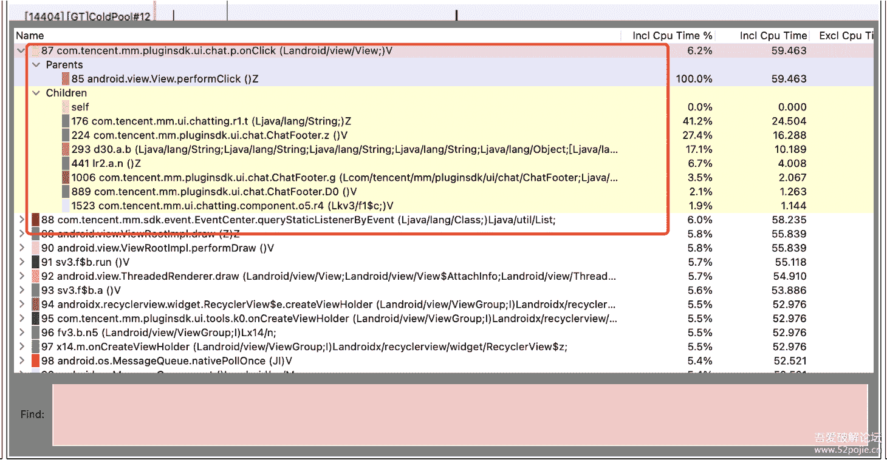

然后去jadx里查这块代码。

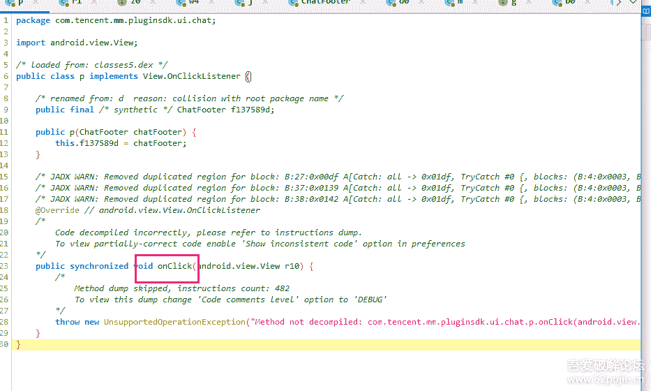

没反编译出来`onClick`里的代码。可以去MT管理器里看看。

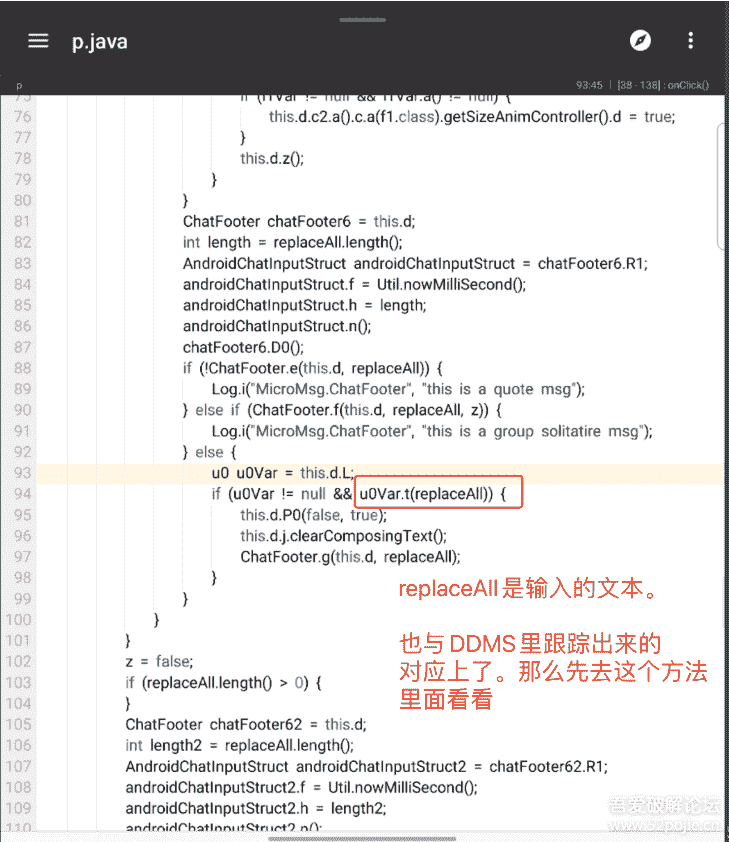

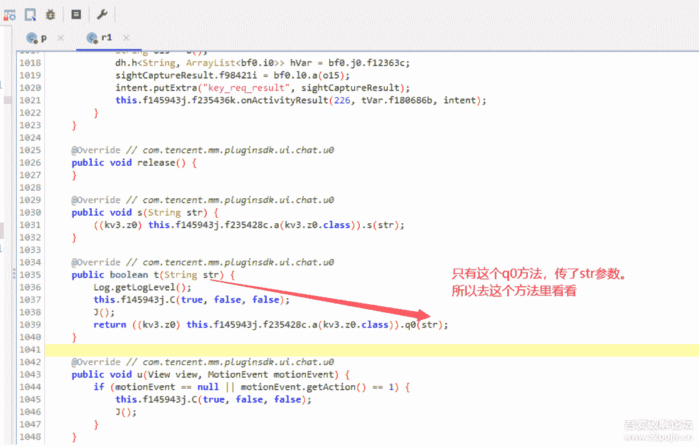

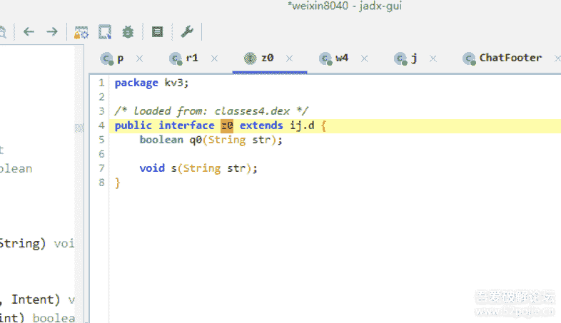

找出来是个接口。右键查找用例，去看这个接口的实现类。

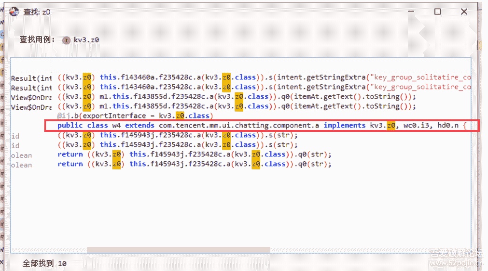

看到只有这一个类，实现了这个接口。

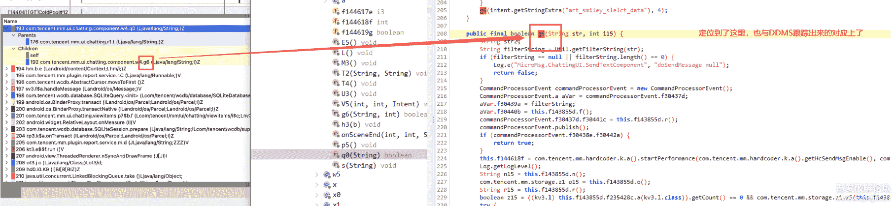

现在主要分析这个`g6`方法。

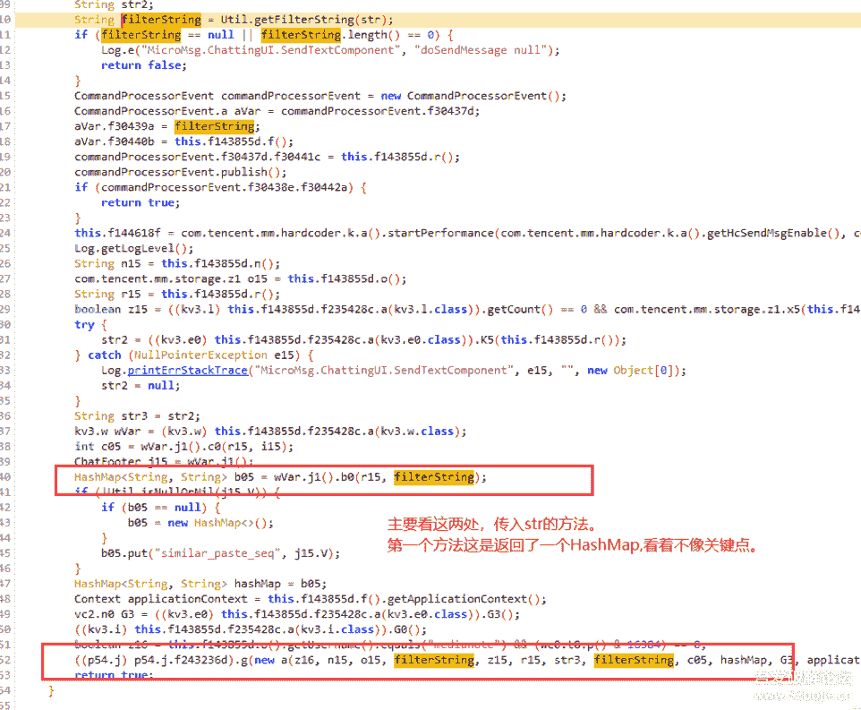

为了确认一下，下面用AS动态调试

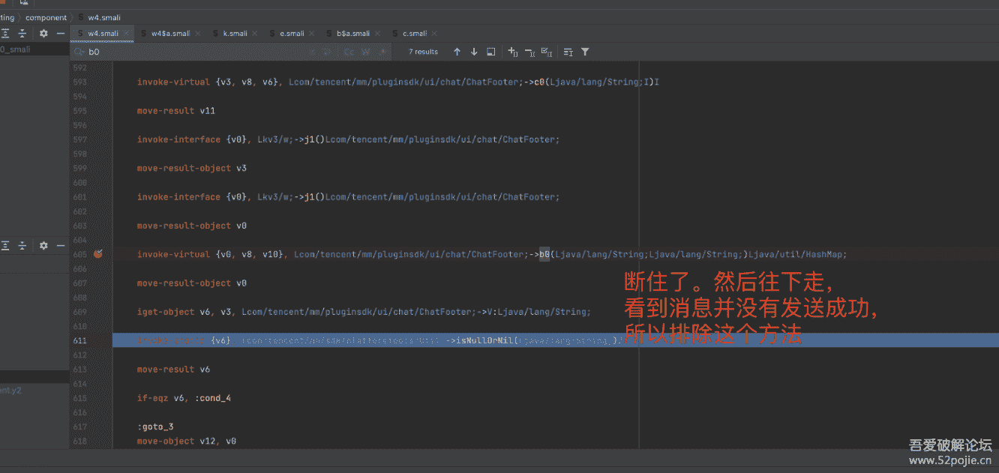

然后进入下面的`g`方法里。

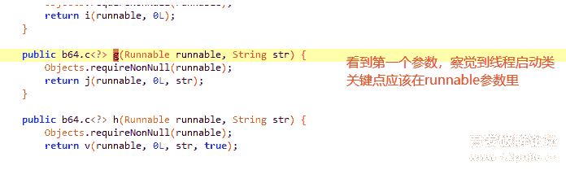

去DDMS里找这个`run`方法里的调用流程。也可以AS动态调试。我这里用的DDMS，还方便点。

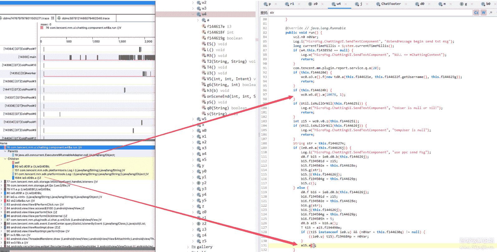

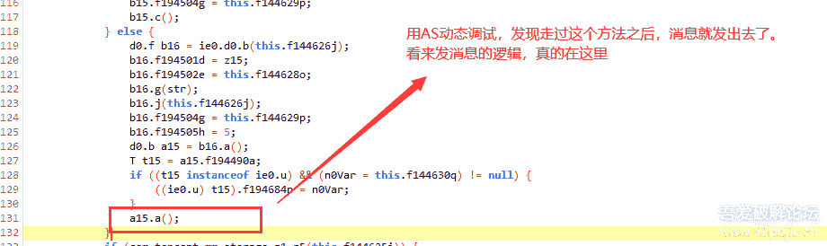

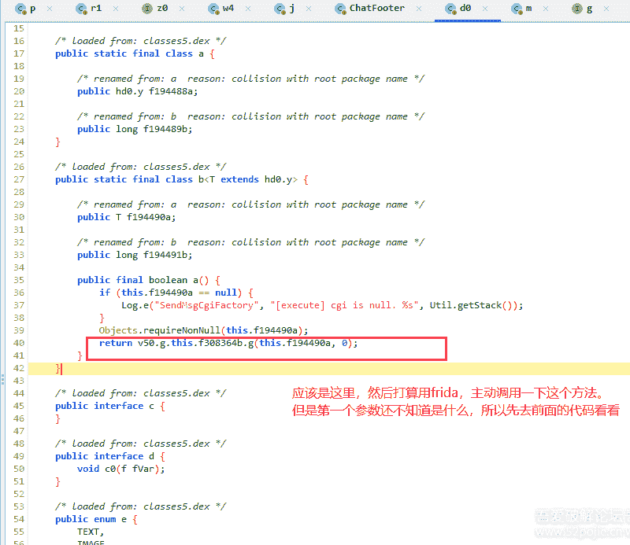

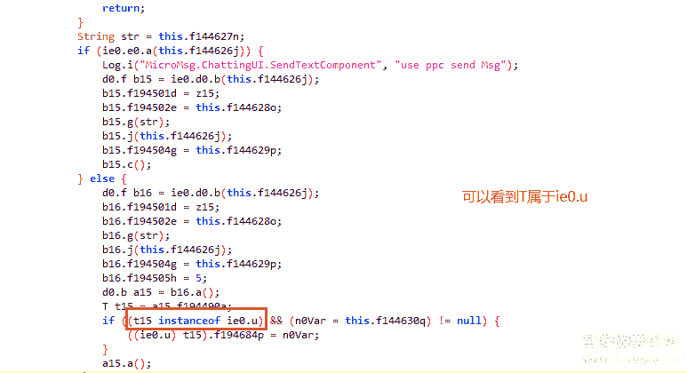

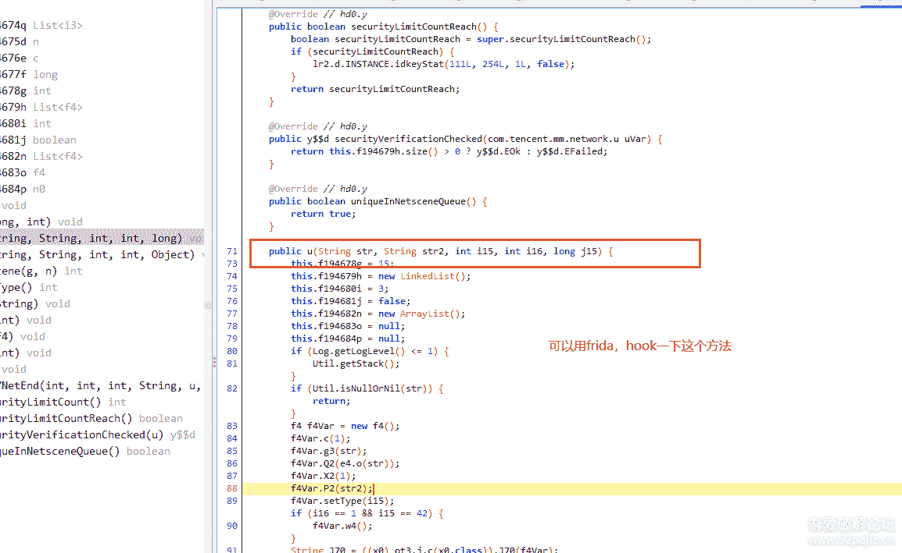

```javascript
// 在java空间中加载
 Java.perform(function () {
     if (Java.available) {//判断是否在java空间
         let u = Java.use("ie0.u");
         u["$init"].overload('java.lang.String', 'java.lang.String', 'int', 'int', 'java.lang.Object').implementation = function (str, str2, i15, i16, obj) {
             console.log(`u.$init is called: str=${str}, str2=${str2}, i15=${i15}, i16=${i16}, obj=${obj}`);
             this["$init"](str, str2, i15, i16, obj);
             // printStacks("send text==========")
         };
```

hook到了创建`ie0.u`对象的构造方法，所传的参数。

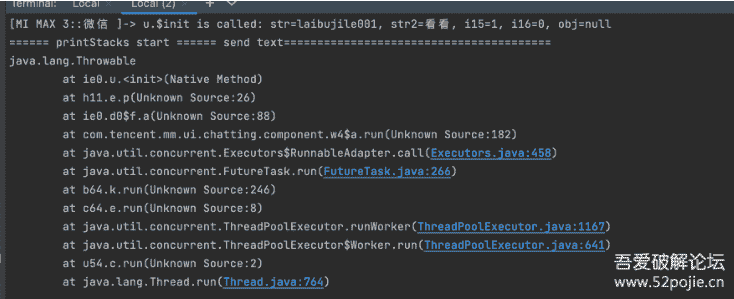

然后就是想办法调用`hd0.b0`类里的`g`方法。方法里第一个参数传上面构造好的`ie0.u`对象，第二个参数传0

看到它是个动态方法。所以先要把`hd0.b0`对象拿到，才能调这个方法。

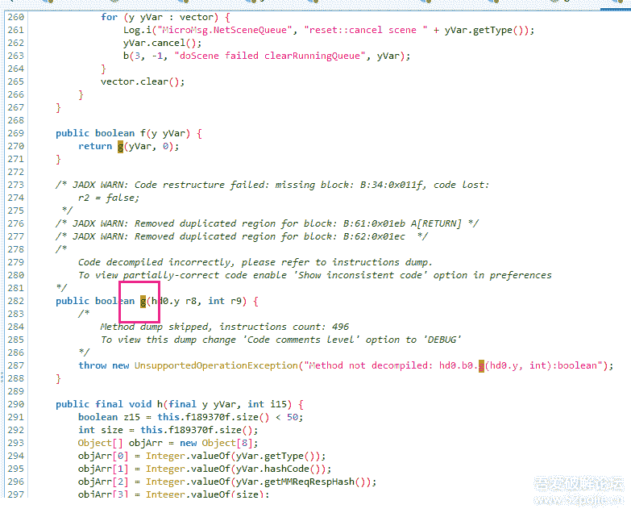

可以从内存里取这个对象，然后再主动调用。代码如下：

```javascript
let SQLiteDatabase = Java.use("com.tencent.wcdb.database.SQLiteDatabase");

           SQLiteDatabase["insertWithOnConflict"].implementation = function (str, str2, contentValues, i15) {

               console.log(`SQLiteDatabase.insertWithOnConflict is called: str=${str}, str2=${str2}, contentValues=${contentValues}, i15=${i15}`);

               let result = this["insertWithOnConflict"](str, str2, contentValues, i15);

               console.log(`SQLiteDatabase.insertWithOnConflict result=${result}`);
```


```
let content = contentValues.get("content");

console.log(`content ====>${content}`);

if (content == null) {
    return result;
}

if (content.toString() === 'sendtext') {//对方发来sendtext后，再回复他
    let talker = contentValues.get("talker");
    console.log(`talker ====>${talker}`);
    let uObj = Java.use("ie0.u").$new(talker, '测试0', 1, 0, null);
    Java.choose("hd0.b0",{
        onComplete: function(){},
        onMatch: function(instance){// 遍历所有的对象并调用
            instance.g(uObj,0);
        }
    })
}

return result;
};
```

运行`frida`脚本，测试成功！
