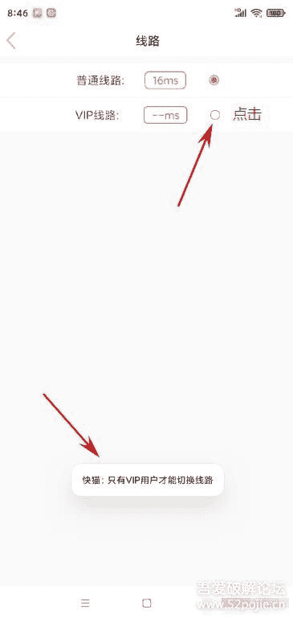
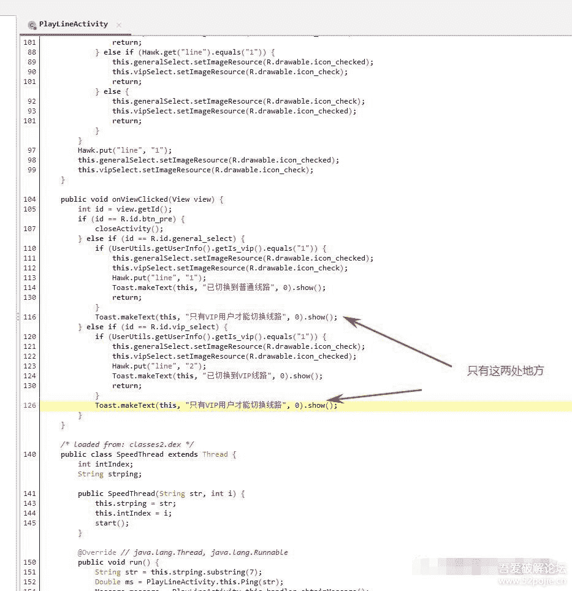
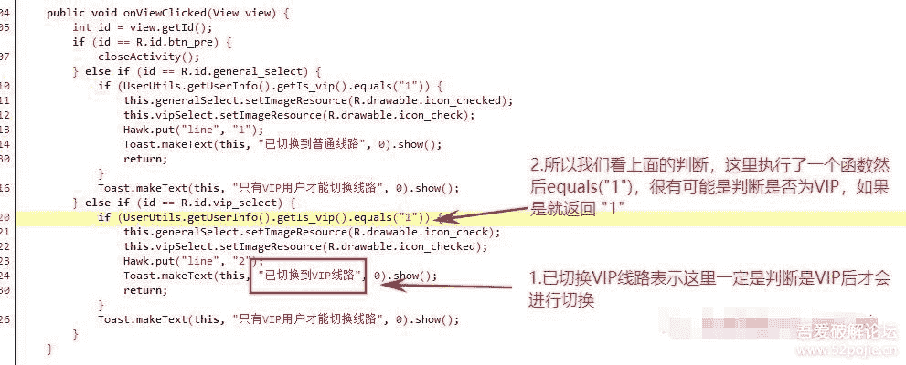
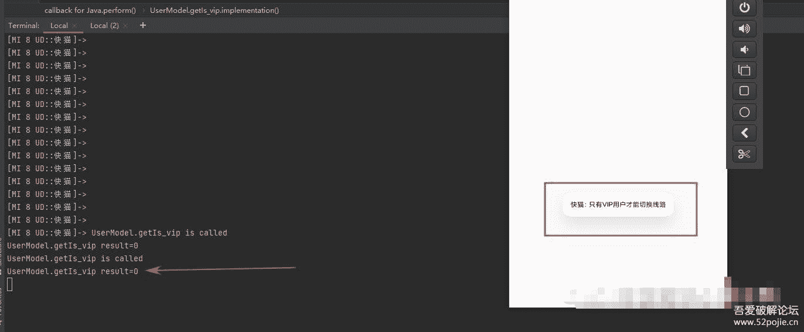
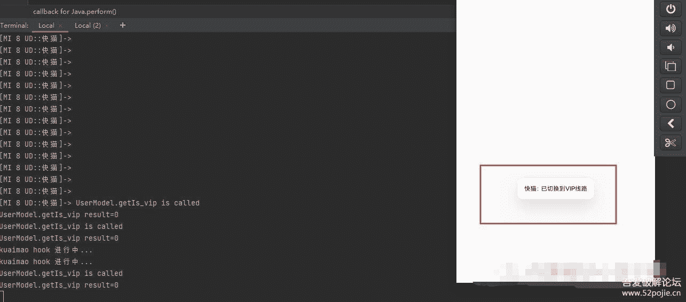
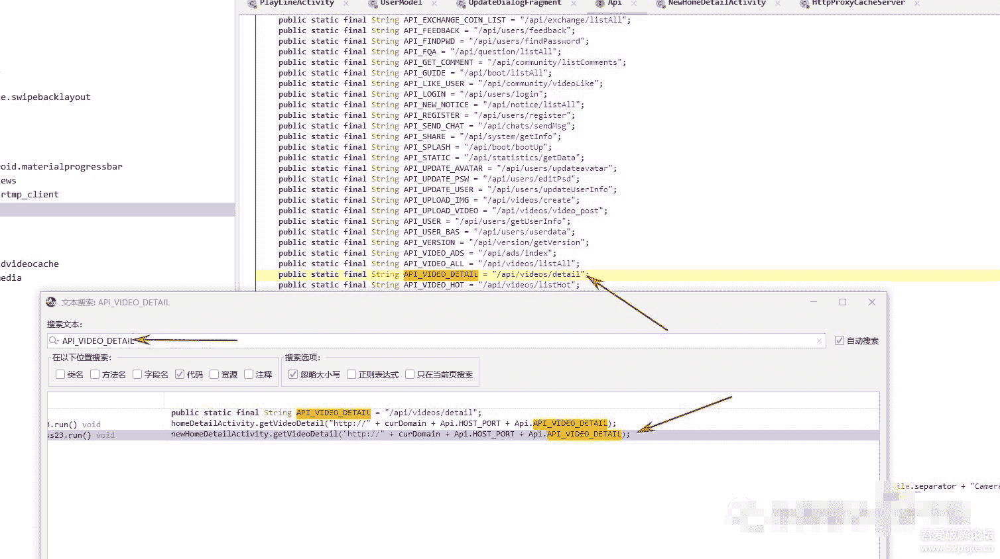
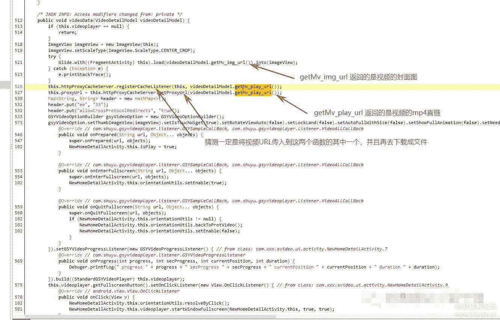
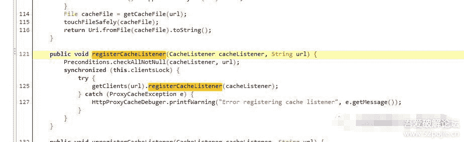
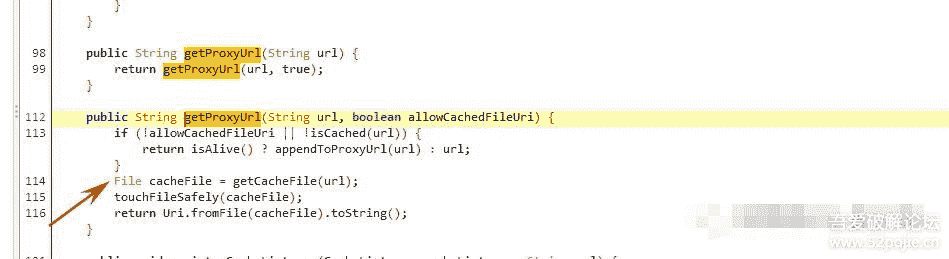

# [Android 原创] 某猫APP VIP、视频缓存逆向分析

- 原帖: https://www.52pojie.cn/forum.php?mod=viewthread&tid=1832092
- 抓取时间: 2026-11-01T21:39:37

之前发的图片中带有公众号名称被删帖，所以重新发一次，新人小白第一次发帖勿喷

声明：本文只作学习研究，禁止用于非法用途，否则后果自负，如有侵权，请告知删除，谢谢！

1. 这篇分析过程 教程 可 VIP，实际上VIP和普通没区别
2. 已修改取消了将视频缓存到相册的操作，避免打开相册社死
3. 自己实践之后，不要传播APP！不要传播APP！不要传播APP！

## 一、定位



在APP的线路切换中选择VIP线路，会弹出 `只有VIP用户才能切换线路` 的提示框

打开 `jadx` 对APP进行反编译，搜索代码 `只有VIP用户才能切换线路`



## 二、hook



直接hook `getIs_vip` 函数

```javascript
// 判断vip
let UserModel = Java.use("com.xxx.svideo.model.UserModel");
UserModel["getIs_vip"].implementation = function () {
console.log(`UserModel.getIs_vip is called`);
let result = this["getIs_vip"]();
console.log(`UserModel.getIs_vip result=${result}`);
return result;
};
```

hook结果打印



可以看到 `result` = 0的，通过分析刚刚的代码，当返回值为 "1" 时则为VIP用户，修改一下hook代码，让它一直返回 "1"

```javascript
// 判断vip
let UserModel = Java.use("com.xxx.svideo.model.UserModel");
UserModel["getIs_vip"].implementation = function () {
console.log(`UserModel.getIs_vip is called`);
let result = this["getIs_vip"]();
console.log(`UserModel.getIs_vip result=${result}`);
return "1";
};
```



在APP中每看一个视频都会缓存到手机的相册中，为了防止打开相册社死，以下将把缓存的函数给hook掉

## 视频缓存 - 一、定位



进去之后发现都是和视频相关的，于是就仔细的找了一下，就发现了 `videoData` 这个函数



进到第一个函数没看到我想看到的



进到第二个函数，终于看到了 `File`，`getProxyUrl` 这个函数大概应该（没细看）：根据第一个url去下载成文件，并且返回一个本地的url连接，那么我们可以不去执行这个函数，直接将参数1也就是原始的URL直接返回



## 视频缓存 - 二、hook

```javascript
// 这个函数应该的作用（没细看）：根据mp4url去下载到一个文件中，然后返回本地的一个url，为了防止打开相册社死，我们在hook代码中不去执行这个函数，
// 而是把参数1的url直接返回获取，这样子就不会中下载文件的操作，避免社死
let HttpProxyCacheServer = Java.use("com.danikula.videocache.HttpProxyCacheServer");
HttpProxyCacheServer["getProxyUrl"].overload('java.lang.String', 'boolean').implementation = function (url, allowCachedFileUri) {
    // console.log(`HttpProxyCacheServer.getProxyUrl is called: url=${url}, allowCachedFileUri=${allowCachedFileUri}`);
    // let result = this["getProxyUrl"](url, allowCachedFileUri);
    // console.log(`HttpProxyCacheServer.getProxyUrl result=${result}`);
    return url;
};
```

完整hook代码

```javascript
// @AuThor : 
// @Contact :  
// Frida Hook
// Frida代码提示的配置 npm i @types/frida-gum

/*
启动
frida -U -F -l hook_vip.js -o ./log/hook_vip.txt
frida -U -f com.xxxxx.app -l hook_vip.js -o ./log/hook_vip.txt --no-pause
*/

Java.perform(function () {
    console.log("kuaimao hook 进行中...")
    // 打印调用栈，主动调用，静态函数
    function showStack() {
        showSeparator();
        console.log(Java.use("android.util.Log").getStackTraceString(Java.use("java.lang.Throwable").$new()));
    }
    function showSeparator() {
        console.log("");
    }
    // 判断vip
    let UserModel = Java.use("com.xxx.svideo.model.UserModel");
    UserModel["getIs_vip"].implementation = function () {
        // console.log(`是否为VIP.getIs_vip is called`);
        let result = this["getIs_vip"]();
        console.log(`是否为VIP.getIs_vip result=${result}`);
        return "1";
    };
    // 打印部分请求地址
    // let NewHomeDetailActivity = Java.use("com.xxx.svideo.ui.activity.NewHomeDetailActivity");
    // NewHomeDetailActivity["getVideoDetail"].implementation = function (path) {
    //     console.log(`NewHomeDetailActivity.getVideoDetail is called: path=${path}`);
    //     this["getVideoDetail"](path);
    // };
    // 获取视频ID
    let VideoModel = Java.use("com.xxx.svideo.model.VideoModel");
    VideoModel["getMv_id"].implementation = function () {
        let result = this["getMv_id"]();
        console.log(`视频ID VideoModel.getMv_id result=${result}`);
        return result;
    };
    // post请求的一些参数
    // var jSONObject = Java.use("org.json.JSONObject")
    // jSONObject.toString.overload().implementation = function () {
    //     let result = this.toString();
    //     console.log("jSONObject.put",result);
    //     return result;
    // }
    // 视频data总函数位置，下载
    // NewHomeDetailActivity["videoData"].implementation = function (videoDetailModel) {
    //     console.log(`NewHomeDetailActivity.videoData is called: videoDetailModel=${videoDetailModel}`);
    //     this["videoData"](videoDetailModel);
    // };
    // 具体封面图
    let VideoDetailModel = Java.use("com.xxx.svideo.model.VideoDetailModel");
    VideoDetailModel["getMv_img_url"].implementation = function () {
        let result = this["getMv_img_url"]();
        console.log(`jpg封面.getMv_img_url result=${result}`);
        return result;
    };
    // 具体mp4视频
    VideoDetailModel["getMv_play_url"].implementation = function () {
```


## Hook 代码

```javascript
        let result = this["getMv_play_url"]();
        console.log(`mp4视频.getMv_play_url result=${result}`);
        return result;
    };

    // 这个函数应该的作用（没细看）：根据mp4url去下载到一个文件中，然后返回本地的一个url，为了防止打开相册社死，我们在hook代码中不去执行这个函数，
    // 而是把参数1的url直接返回获取，这样子就不会中下载文件的操作，避免社死

    let HttpProxyCacheServer = Java.use("com.danikula.videocache.HttpProxyCacheServer");
    HttpProxyCacheServer["getProxyUrl"].overload('java.lang.String', 'boolean').implementation = function (url, allowCachedFileUri) {
        // console.log(`HttpProxyCacheServer.getProxyUrl is called: url=${url}, allowCachedFileUri=${allowCachedFileUri}`);
        // let result = this["getProxyUrl"](url, allowCachedFileUri);
        // console.log(`HttpProxyCacheServer.getProxyUrl result=${result}`);
        return url;
    };
})
```

## 打包成 APP

如果想打包成 APP，可以使用 MT管理器 或者 NP管理器 去修改 `smali` 代码；修改起来也是比较简单的，这里就不写教程了。
