# [Android 原创] 【散装破文】如何有效率的去除软件广告（一）

- 原帖: https://www.52pojie.cn/forum.php?mod=viewthread&tid=1832287
- 抓取时间: 2026-11-01T21:39:36

有人说需要前三节课程，由于原图已没保存，所以都是直接搬过来的。

散装系列：是以日常实用小技巧所展开的系列

论坛上有不少去除广告教学，但是大部分的教学只告诉你怎么改，却没告诉你怎么找，往往导致初学者们遇到没见过的广告就不会了，再不然就各种花里胡哨的改法，不但兼容性不好，而且也不干净。就只为了炫技而炫，却从没往核心去说，导致很多初学者们只知其一，不知其二。即使学了，依旧迷茫。

首先来了解一下广告是如何在app里运作，并如何正确的指向开发者。

如果一位开发者需要从广告中获得收益，他首先必须到对应的广告平台申请一枚身份，并且把自己开发的软件包名填入进去，以获取对应的`appid`来对接到软件sdk里。这样平台才会知道是从谁的软件里被投放广告了，也才能知道是来自何人的收益。唯有这样，广告也才能在app里正常运作。

然而对于一个修改者来说，广告平台众多，大大小小就有上百号，很难都对每个广告商如数家珍。所以需要学会的是即使面对第一次见的广告，依然可以淡若自如。

现在来实际操作吧，演示软件是一个看小说app，从gp（googleplay）下载的。

从图里可以看到软件有个下幅广告和全屏广告。

152052la31wqxb71lqqeqo.jpg (54.72 KB, 下载次数: 2)  
[href="forum.php?mod=attachment&aid=MjY0MjIxMXwwOTllYWU4ZHwxNzkzNTY5MTc0fDE2ODA4NnwxODMyMjg3&nothumb=yes" target="_blank"](https://www.52pojie.cn/forum.php?mod=attachment&aid=MjY0MjIxMXwwOTllYWU4ZHwxNzkzNTY5MTc0fDE2ODA4NnwxODMyMjg3&nothumb=yes)  
2023-9-11 14:56 上传

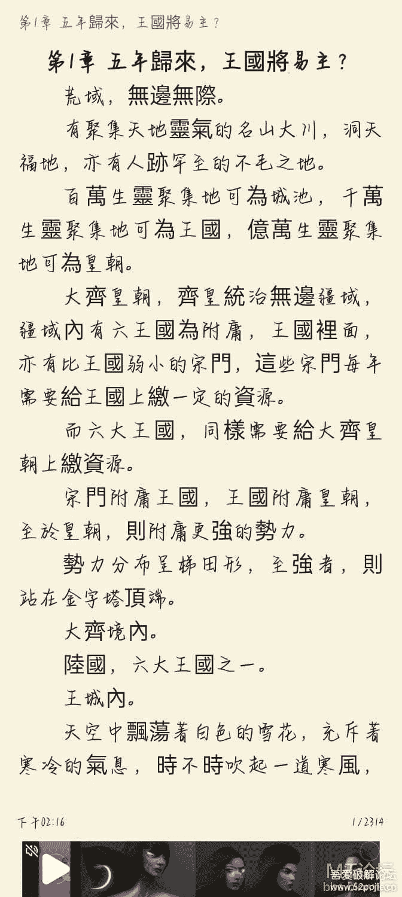

152122w66yuho0ybheg67o.jpg (138.96 KB, 下载次数: 2)  
[href="forum.php?mod=attachment&aid=MjY0MjIxMnxiMmE2MDVhYXwxNzkzNTY5MTc0fDE2ODA4NnwxODMyMjg3&nothumb=yes" target="_blank"](https://www.52pojie.cn/forum.php?mod=attachment&aid=MjY0MjIxMnxiMmE2MDVhYXwxNzkzNTY5MTc0fDE2ODA4NnwxODMyMjg3&nothumb=yes)  
2023-9-11 14:56 上传

但是广告商又那么多，该如何定位呢?这课就先教大家如何快速定位吧。

这里需要借助小黄鸟，但不需要具备一个抓包环境，只需要能进行正常拦截即可。

首先打开小黄鸟并启动，接着直接打开要去除广告的软件即可。

不被信任的https链接都会被列入异常名单里。

152252x28qtd7nymjt12mj.jpg (19.48 KB, 下载次数: 2)  
[href="forum.php?mod=attachment&aid=MjY0MjIxM3wzNjJmMzY3NnwxNzkzNTY5MTc0fDE2ODA4NnwxODMyMjg3&nothumb=yes" target="_blank"](https://www.52pojie.cn/forum.php?mod=attachment&aid=MjY0MjIxM3wzNjJmMzY3NnwxNzkzNTY5MTc0fDE2ODA4NnwxODMyMjg3&nothumb=yes)  
2023-9-11 14:56 上传

然后从下到上按顺序看，首先是umeng（友盟统计），tradplusad（聚合广告），pangolin（穿山甲广告）。

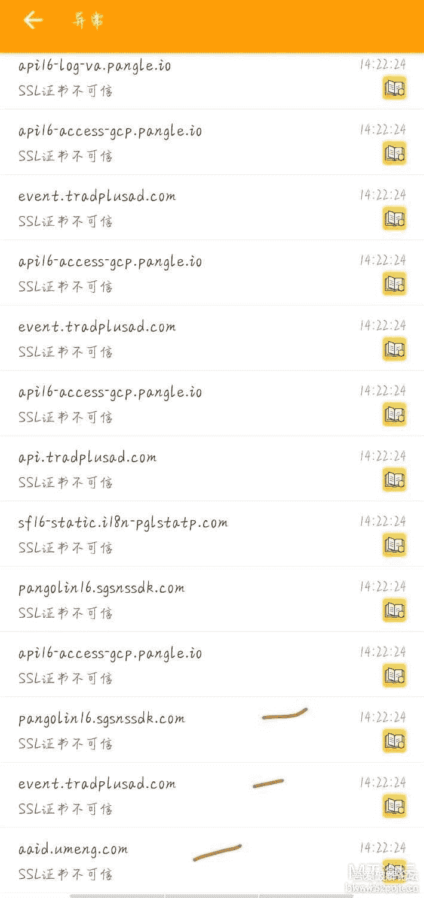

152310g4qttc5qptdtl5d4.jpg (95.94 KB, 下载次数: 1)  
[href="forum.php?mod=attachment&aid=MjY0MjIxNHwzZjE3ZTUwN3wxNzkzNTY5MTc0fDE2ODA4NnwxODMyMjg3&nothumb=yes" target="_blank"](https://www.52pojie.cn/forum.php?mod=attachment&aid=MjY0MjIxNHwzZjE3ZTUwN3wxNzkzNTY5MTc0fDE2ODA4NnwxODMyMjg3&nothumb=yes)  
2023-9-11 14:56 上传

那么现在就当不认识tradplus是哪家广告吧，但是它出现在pangolin之前，所以先对它进行处理。可是现在又不了解它，该怎么做呢?

这时候就得依赖谷歌或者百度等等搜索引擎，然而要怎么搜索呢? 这里需要进行搜索的是tradplus的开发相关，而不是去除tradplus广告相关信息。因为只有知道如何开发，才能知道需要去除的是什么。而不是盲目的把相关字眼去除就等于移除了广告。

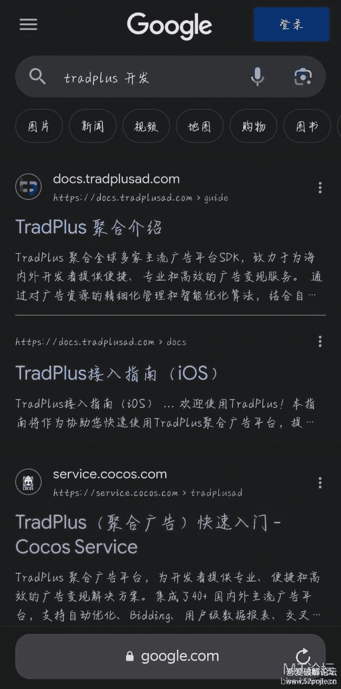

152431zanq1ancyydsnqm3.jpg (116.53 KB, 下载次数: 2)  
[href="forum.php?mod=attachment&aid=MjY0MjIxNXw4ZGE3MWE3NHwxNzkzNTY5MTc0fDE2ODA4NnwxODMyMjg3&nothumb=yes" target="_blank"](https://www.52pojie.cn/forum.php?mod=attachment&aid=MjY0MjIxNXw4ZGE3MWE3NHwxNzkzNTY5MTc0fDE2ODA4NnwxODMyMjg3&nothumb=yes)  
2023-9-11 14:56 上传

进入到图中的开发手册里，但是作为修改者并不需要进行开发，所以不需要全面的去了解整个流程。只需要找出广告的对接过程。

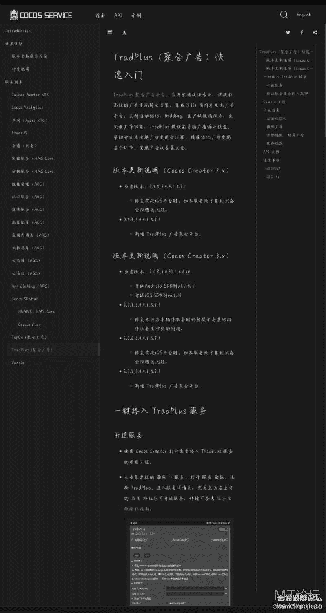

152522fczfggyresb6c5k5.jpg (86.32 KB, 下载次数: 4)  
[href="forum.php?mod=attachment&aid=MjY0MjIxNnwzYmYzYTQ5NXwxNzkzNTY5MTc0fDE2ODA4NnwxODMyMjg3&nothumb=yes" target="_blank"](https://www.52pojie.cn/forum.php?mod=attachment&aid=MjY0MjIxNnwzYmYzYTQ5NXwxNzkzNTY5MTc0fDE2ODA4NnwxODMyMjg3&nothumb=yes)  
2023-9-11 14:56 上传

从上面文中有提及，如果要把广告对接到软件里，需要把`appid`写进去，那么在软件里就会有个配置过程，也就是初始化过程。只有完成了初始化过程，广告才会在软件里生效。所以只需要从开发手册了解初始化的过程，再将其处理，就能达到了去除广告的效果。

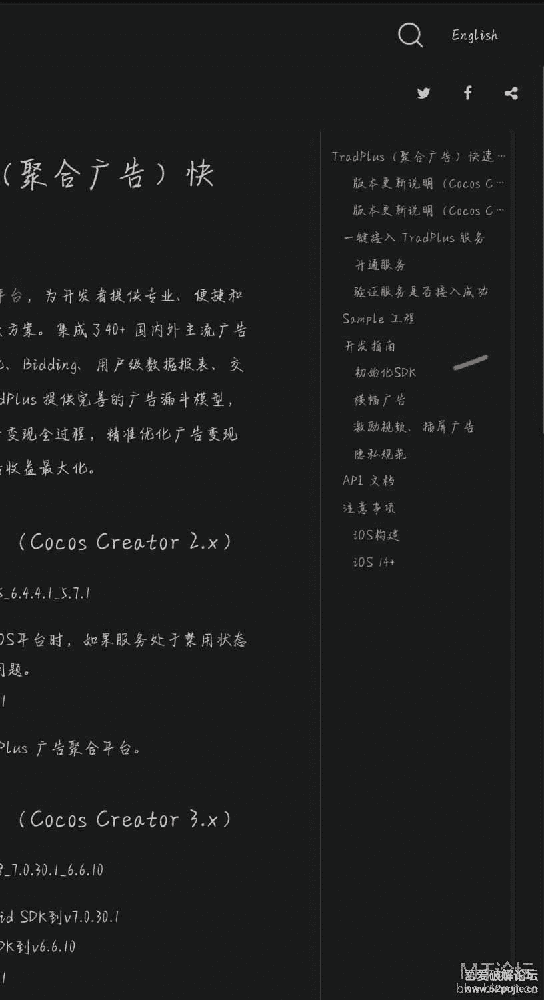

152614j33mjjgy3zr3ukjj.jpg (75.75 KB, 下载次数: 2)  
[href="forum.php?mod=attachment&aid=MjY0MjIxN3xlMWVjNjE3N3wxNzkzNTY5MTc0fDE2ODA4NnwxODMyMjg3&nothumb=yes" target="_blank"](https://www.52pojie.cn/forum.php?mod=attachment&aid=MjY0MjIxN3xlMWVjNjE3N3wxNzkzNTY5MTc0fDE2ODA4NnwxODMyMjg3&nothumb=yes)  
2023-9-11 14:56 上传

从图中可以知道，tradplus广告初始化需要调用`initSdk`进行初始化配置。现在可以使用反编译进行定位了。

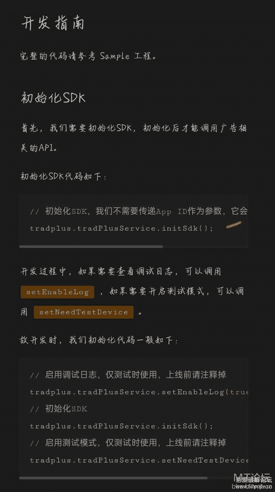

152735pdsazssb7ajsqsb1.jpg (93.23 KB, 下载次数: 1)  
[href="forum.php?mod=attachment&aid=MjY0MjIxOHxhOGZmYTg2YXwxNzkzNTY5MTc0fDE2ODA4NnwxODMyMjg3&nothumb=yes" target="_blank"](https://www.52pojie.cn/forum.php?mod=attachment&aid=MjY0MjIxOHxhOGZmYTg2YXwxNzkzNTY5MTc0fDE2ODA4NnwxODMyMjg3&nothumb=yes)  
2023-9-11 14:56 上传

由于要找的是`initSdk`方法，并不需要找何处调用，所以在关键词前面加个空格进行搜索。

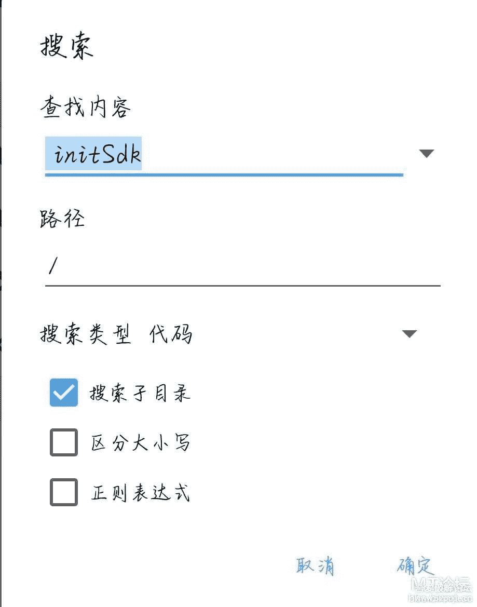

152743y55kelrlhl3wkaee.jpg (51.37 KB, 下载次数: 1)  
[href="forum.php?mod=attachment&aid=MjY0MjIxOXw2M2M3MjhjZXwxNzkzNTY5MTc0fDE2ODA4NnwxODMyMjg3&nothumb=yes" target="_blank"](https://www.52pojie.cn/forum.php?mod=attachment&aid=MjY0MjIxOXw2M2M3MjhjZXwxNzkzNTY5MTc0fDE2ODA4NnwxODMyMjg3&nothumb=yes)  
2023-9-11 14:56 上传

得出结果一共有13个，但是包名都是在ads里，所以不需要排除，直接把方法名内的代码都删了吧。

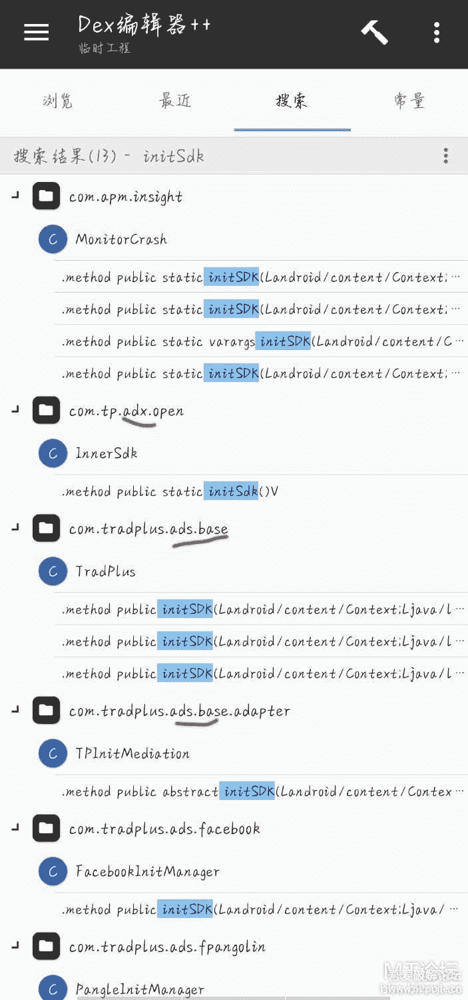

152840y44sfz3u6npuy28o.jpg (119.29 KB, 下载次数: 0)  
[href="forum.php?mod=attachment&aid=MjY0MjIyMHw1MzQ2YjQ1MXwxNzkzNTY5MTc0fDE2ODA4NnwxODMyMjg3&nothumb=yes" target="_blank"](https://www.52pojie.cn/forum.php?mod=attachment&aid=MjY0MjIyMHw1MzQ2YjQ1MXwxNzkzNTY5MTc0fDE2ODA4NnwxODMyMjg3&nothumb=yes)  
2023-9-11 14:56 上传

而且可以看到在tradplus里还包含了对pangolin和facebook广告进行初始化，所以这些都可以删了。

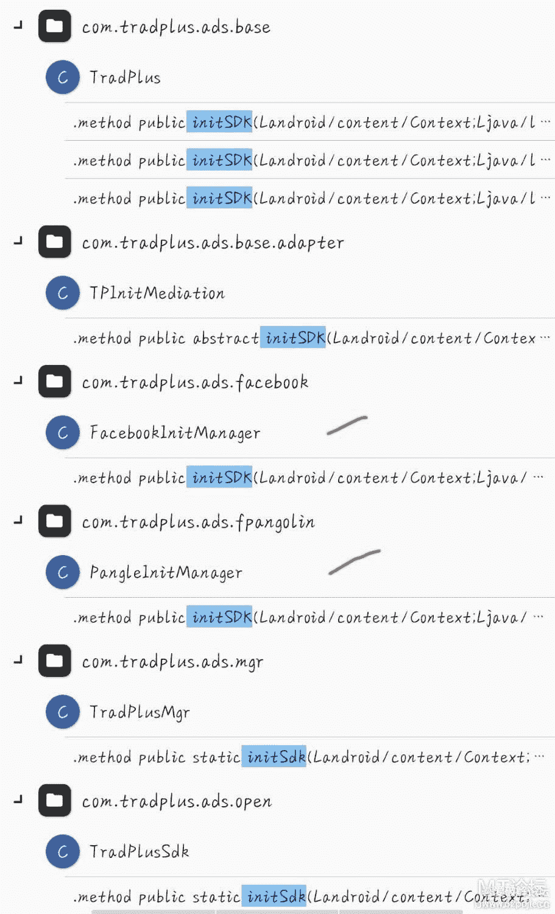

152913l73swrrj1jtis6rs.jpg (133.27 KB, 下载次数: 1)  
[href="forum.php?mod=attachment&aid=MjY0MjIyMXw5NDdhM2RjOXwxNzkzNTY5MTc0fDE2ODA4NnwxODMyMjg3&nothumb=yes" target="_blank"](https://www.52pojie.cn/forum.php?mod=attachment&aid=MjY0MjIyMXw5NDdhM2RjOXwxNzkzNTY5MTc0fDE2ODA4NnwxODMyMjg3&nothumb=yes)  
2023-9-11 14:56 上传

把后面为`v`（全称`void`）的代码都删除，如图所示。

修改前：

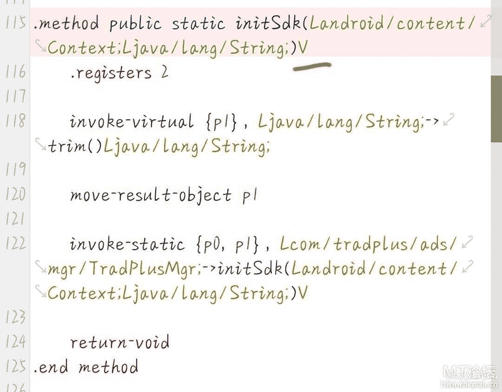

152958kohnfb2aaamfam9s.jpg (85.2 KB, 下载次数: 2)  
[href="forum.php?mod=attachment&aid=MjY0MjIyMnwzMTAwODgxNXwxNzkzNTY5MTc0fDE2ODA4NnwxODMyMjg3&nothumb=yes" target="_blank"](https://www.52pojie.cn/forum.php?mod=attachment&aid=MjY0MjIyMnwzMTAwODgxNXwxNzkzNTY5MTc0fDE2ODA4NnwxODMyMjg3&nothumb=yes)  
2023-9-11 14:56 上传

修改后：

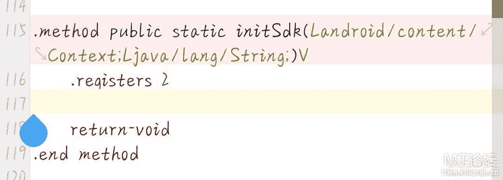

153033zpm9mqo1cjl9sjpq.jpg (35.95 KB, 下载次数: 1)  
[href="forum.php?mod=attachment&aid=MjY0MjIyM3xjMjlkNmQwNHwxNzkzNTY5MTc0fDE2ODA4NnwxODMyMjg3&nothumb=yes" target="_blank"](https://www.52pojie.cn/forum.php?mod=attachment&aid=MjY0MjIyM3xjMjlkNmQwNHwxNzkzNTY5MTc0fDE2ODA4NnwxODMyMjg3&nothumb=yes)  
2023-9-11 14:56 上传

其余修改：

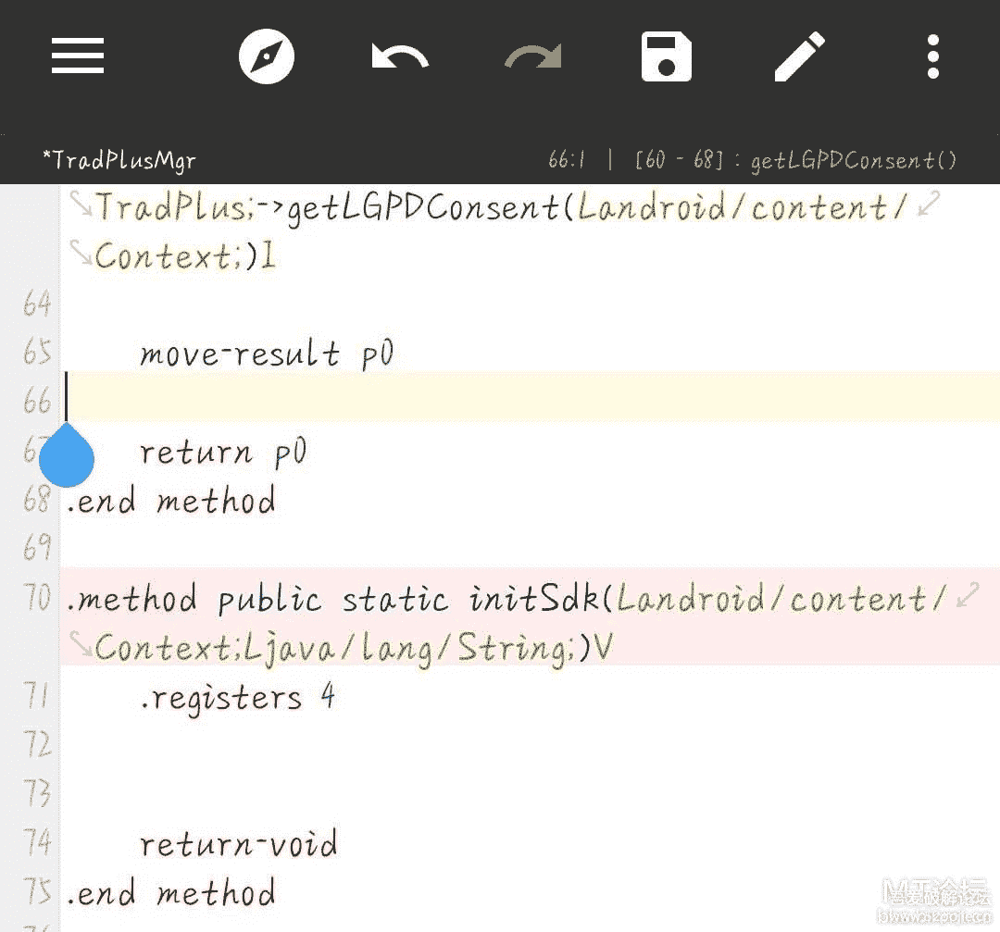

153103bnr4rrxk767ni5ns.jpg (79.25 KB, 下载次数: 2)  
[href="forum.php?mod=attachment&aid=MjY0MjIyNHxjMDhiNDU4OXwxNzkzNTY5MTc0fDE2ODA4NnwxODMyMjg3&nothumb=yes" target="_blank"](https://www.52pojie.cn/forum.php?mod=attachment&aid=MjY0MjIyNHxjMDhiNDU4OXwxNzkzNTY5MTc0fDE2ODA4NnwxODMyMjg3&nothumb=yes)  
2023-9-11 14:56 上传

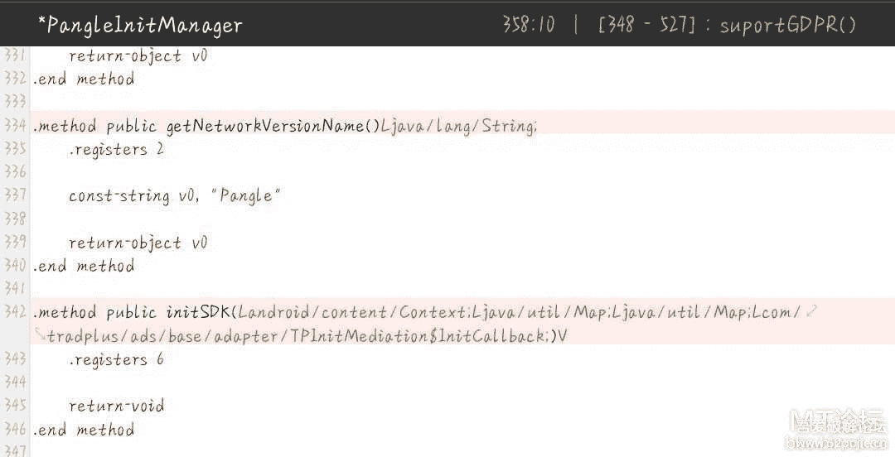

153112uiyjikiq992i9iam.jpg (50.74 KB, 下载次数: 2)  
[href="forum.php?mod=attachment&aid=MjY0MjIyNXwwYTc1NzcxMXwxNzkzNTY5MTc0fDE2ODA4NnwxODMyMjg3&nothumb=yes" target="_blank"](https://www.52pojie.cn/forum.php?mod=attachment&aid=MjY0MjIyNXwwYTc1NzcxMXwxNzkzNTY5MTc0fDE2ODA4NnwxODMyMjg3&nothumb=yes)  
2023-9-11 14:56 上传

这里我就不一一演示了。请自行把相关代码都删了吧。最后来看看效果。

在图中可以看到广告没了。并且小黄鸟异常里也没有多余的广告链接了。至此完成了一次广告去除。

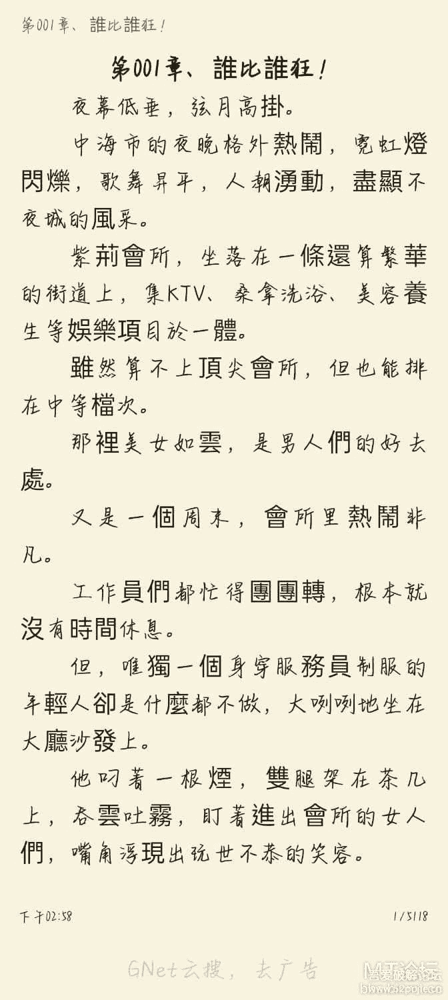

153143p7h007hrr77qrzrl.jpg (124.19 KB, 下载次数: 1)  
[href="forum.php?mod=attachment&aid=MjY0MjIyNnwwOTIxODAzMHwxNzkzNTY5MTc0fDE2ODA4NnwxODMyMjg3&nothumb=yes" target="_blank"](https://www.52pojie.cn/forum.php?mod=attachment&aid=MjY0MjIyNnwwOTIxODAzMHwxNzkzNTY5MTc0fDE2ODA4NnwxODMyMjg3&nothumb=yes)  
2023-9-11 14:56 上传

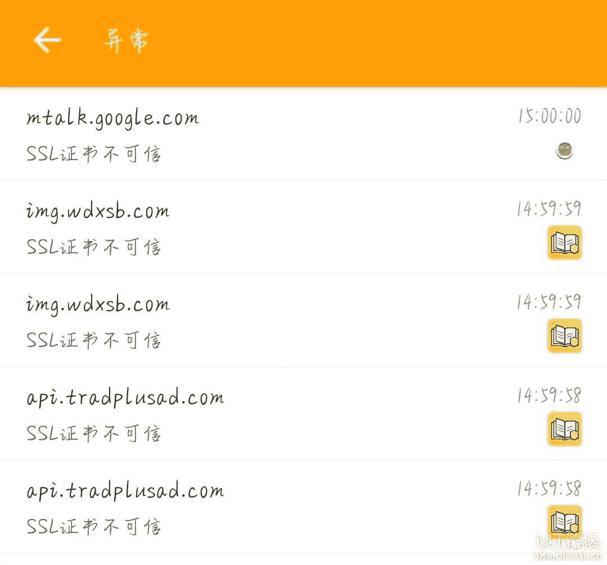

153153oxnhuulxrxlxuorz.jpg (64.87 KB, 下载次数: 1)

[`href="forum.php?mod=attachment&aid=MjY0MjIyN3xiOWMxYzQwOXwxNzkzNTY5MTc0fDE2ODA4NnwxODMyMjg3&nothumb=yes" target="_blank"`](https://www.52pojie.cn/forum.php?mod=attachment&aid=MjY0MjIyN3xiOWMxYzQwOXwxNzkzNTY5MTc0fDE2ODA4NnwxODMyMjg3&nothumb=yes)

2023-9-11 14:57 上传
