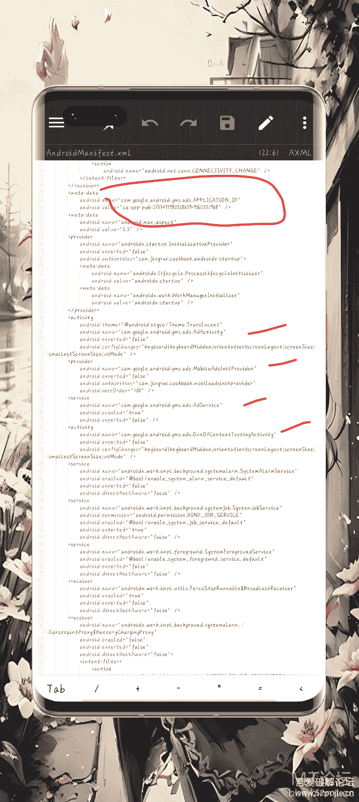
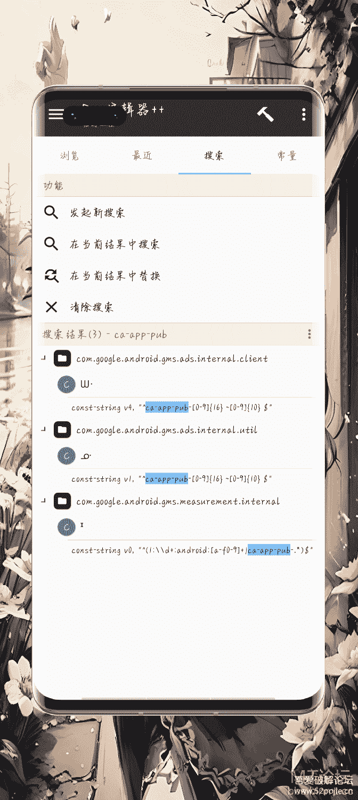
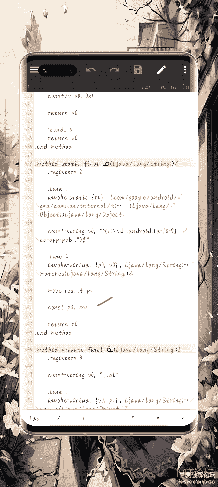
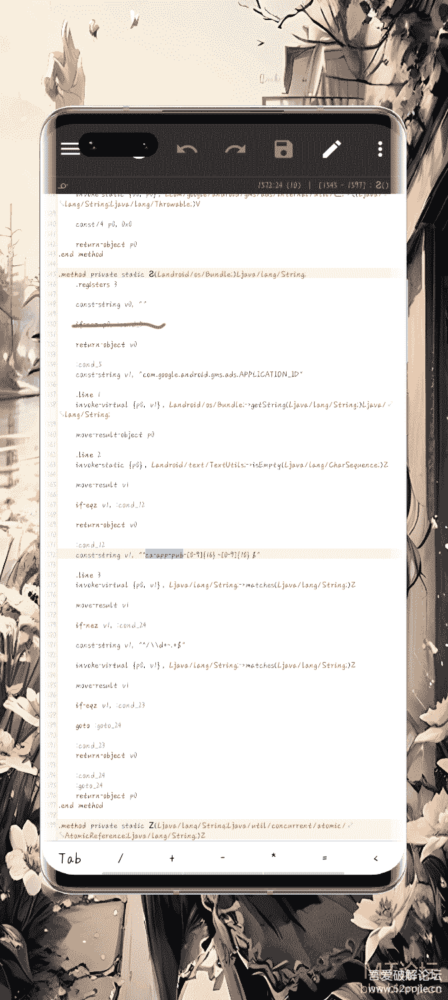
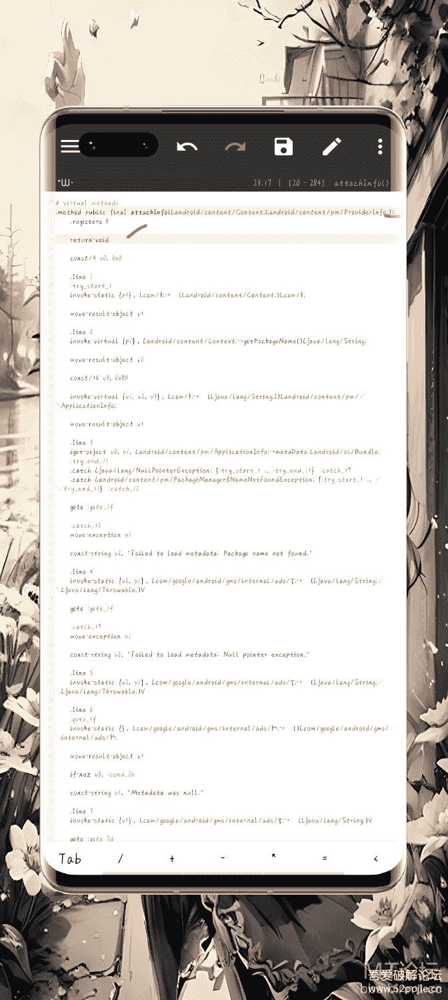
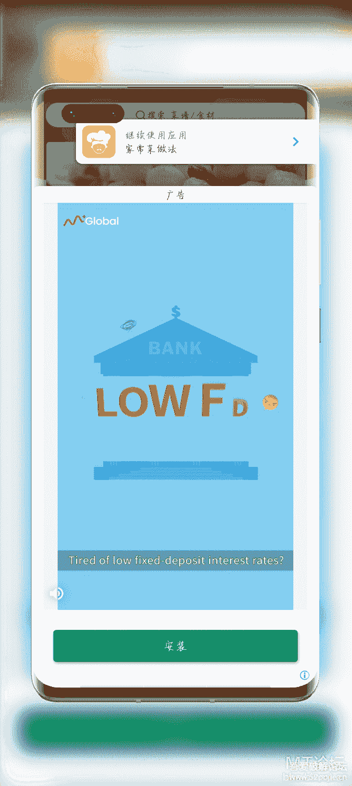
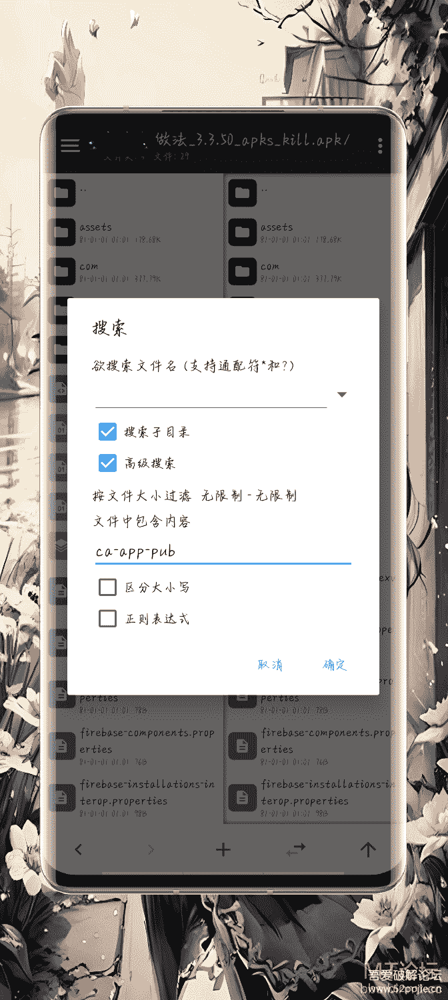
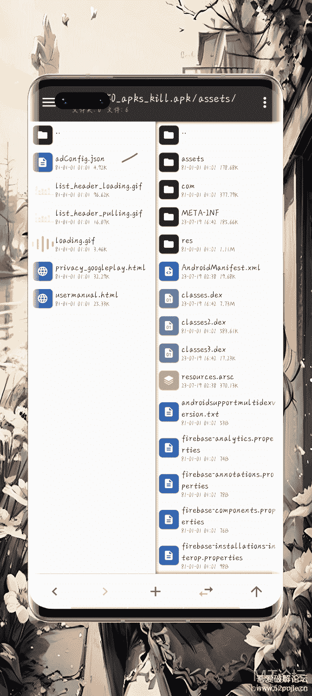
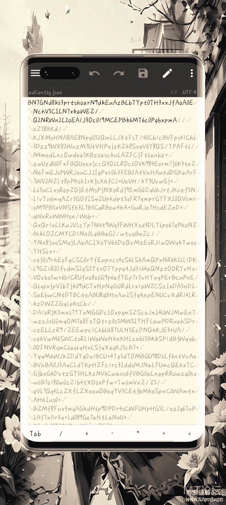
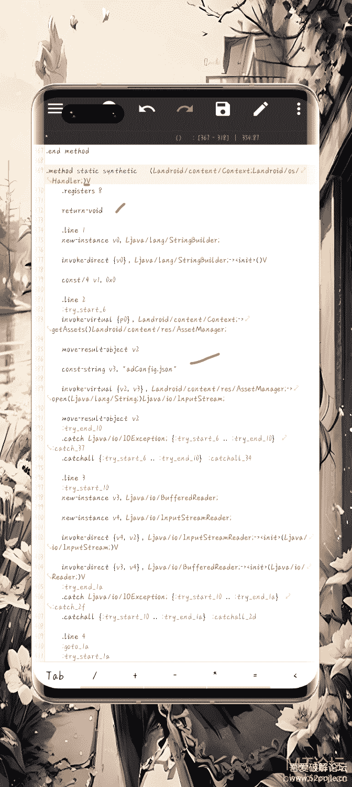

# [Android 原创] 【散装破文】如何有效率的去除软件广告（二）

- 原帖：`https://www.52pojie.cn/forum.php?mod=viewthread&tid=1832303`
- 抓取时间：2026-11-01T21:39:34

有人说需要前三节课程，由于原图已没保存，所以都是直接搬过来的。

散装系列：是以日常实用小技巧所展开的系列

上一节课已经说明了广告的实现原理，并且应该也学会了如何快速定位，但是处理广告手法并不是只有一种。`appid`在上节课并未演示，所以这次就通过`appid`处理吧。

这次演示的软件是一款家常菜谱，同样也是从gp下载。

那么开始吧。

本次广告只有一家，就是google自家的，先来看看广告吧。

## 广告配置与`appid`定位

然而凡接入第三方sdk都必须在`AndroidMainfest.xml`里进行配置，平常看到的穿山甲广告，快手广告，qq广告等等都是属于第三方广告sdk，所以查看`AndroidMainfest`也能对软件植入了哪家广告一目了然。

图中的`AndroidMainfest`里可以看见，圈圈处就是广告的`appid`，google的都是以`ca-app-pub`作为开头(具体看google广告的开发手册，上节课已讲过，这节课就不再演示。)，至于标记处就是接入广告的配置。

所以只需要将`ca-app-pub`开头的`appid`删除掉即可完成移除广告。但是google会对`appid`进行检测，仅仅删除`appid`会导致闪退。至此还需要对`dex`部分进行修改。

## 修改`dex`中的`appid`检测

在`dex`里搜索`ca-app-pub`可以得出3个结果，从下到上逐一看。

第一个是`Boolean`返回值，比较字符串是否匹配，这里强制让它返回0。

第二个则是返回`appid`字符串类型，这里直接把红线割掉的那个跳转删除，让它返回一个空白即可。

第三个是一个`void`，可以直接在方法入口加个`return-void`即可，不让代码继续往下执行。

当都完成后，就可以安装了。

==============安装中==============

啊～怎么还有广告呀?掉链子了。T.T所有广告都完整的还在，并未去除成功。

## 排查其他来源与清除缓存

既然从`AndroidMainfest`里只看到一家广告，所以深信着可能是还存在其他的`appid`，配置里的只是个幌子。

这时选择了对整个包进行搜索，看看是不是哪里漏掉了？可是并未找到相关结果。说明`resources.arsc`里并没有存放着`appid`。

那么可以以此推断可能性，可能`appid`被加密了，又或者`appid`是通过联网动态加载。有了这些前提的假设，接下来就要再假设开发者可能存放的位置，不外是`assest`目录里，`dex`里，网络数据里。

结果从`assest`里看到了一个名为`adConfig`的文件，`ad`开头很明显和广告有关。`Config`中文意思则是配置，全称就是广告配置。

打开一看，确实经过加密了。要解密吗?不需要，只需要找出哪里调用它就好。

`dex`里搜索出来的结果只有一个。

它在一个`void`类型的方法里，那么就别让它读取了，直接在方法入口`return-void`即可。

经历了千辛万苦之后，总算完成了。再次安装打开。

咦，还有广告T.T 尴尬了。

其实是因为google的广告sdk在初次启动的时候会写入缓存，所以后续修改后会导致看不见效果。只要把缓存清除了重新打开就好了。

此次教学就到这里，效果如图。

