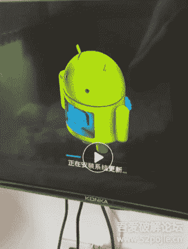
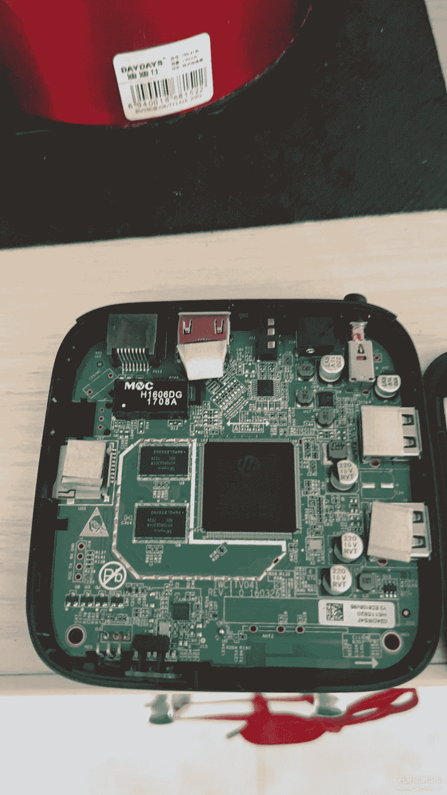
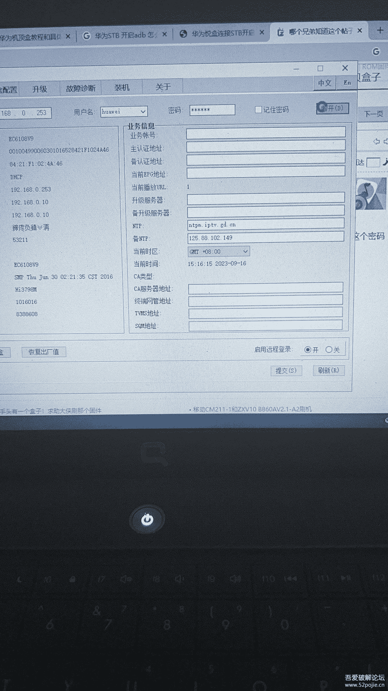
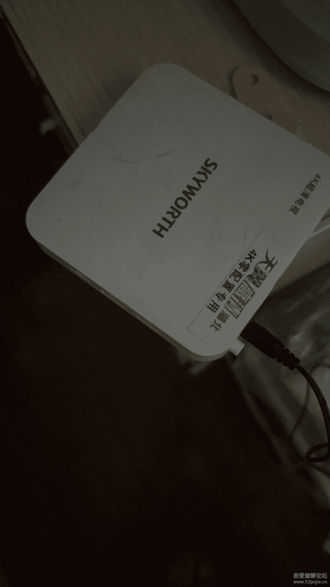
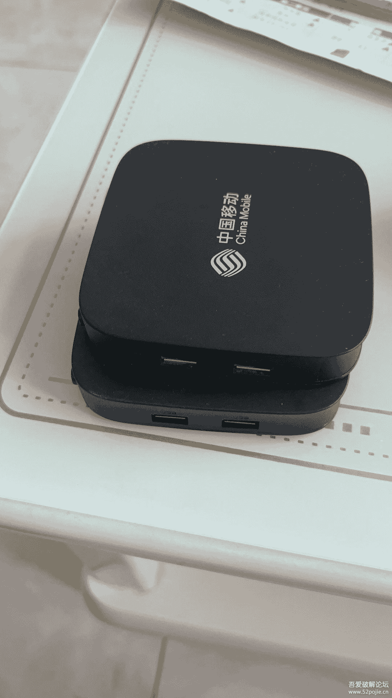
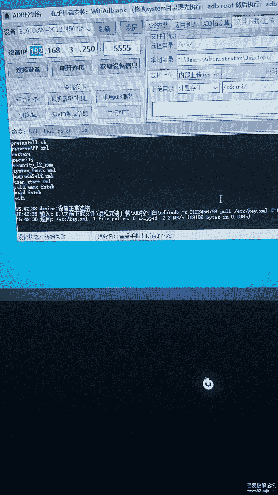

# [Android 原创] 替换机顶盒遥控器编码实现一个遥控器控制一批机顶盒

- 原帖: https://www.52pojie.cn/forum.php?mod=viewthread&tid=1835823
- 抓取时间: 2026-11-01T21:39:21

最近刷了几台运营商的iptv机顶盒，都是没有原装遥控器的。
分别是华为和创维的机顶盒，都刷好了，但是都没遥控器。
这可把我愁死了。记得之前修改过车机方控的代码，就想着是不是遥控器也可有修改呢。
通过查阅资料得知机顶盒红外开遥控器代码`/etc/key.xml`，只要机顶盒开启了`adb`就能提取出来。
正好手里头有多余的烽火Fiberhome烽火HG680-R的遥控器，于是先重家里面的机顶盒提取了遥控器代码。
然后哪一台机顶盒做了个实验，华为悦盒写入烽火HG680-R机顶盒提取的`key.xml`，
`adb push /key.xml /etc/key.xml`这样去覆盖机顶盒之前的遥控器代码
经过测试完美适配，把家里多余的遥控器给废物利用了。这个办法也可以应急，可以实现一个遥控器控制家里的所有机顶盒。

## 使用工具

本帖用到的工具分别是：
华为STB `STBManageTool.exe`
`adb` `adb控制台.exe`
这些工具论坛有人分享过，我就不再重复上链接了。

刷机过程精彩图片展示，如果违规请版主通知整改。







## 核心操作

核心是需要机顶盒打开`adb`，然后执行下面的指令
```
adb push /key.xml /etc/key.xml
```
