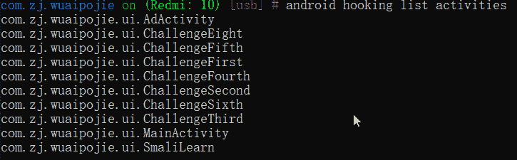
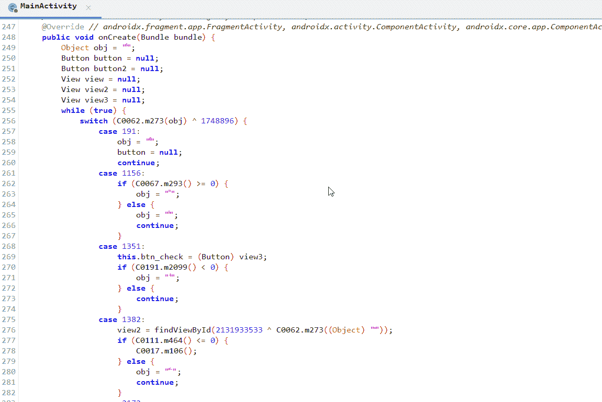
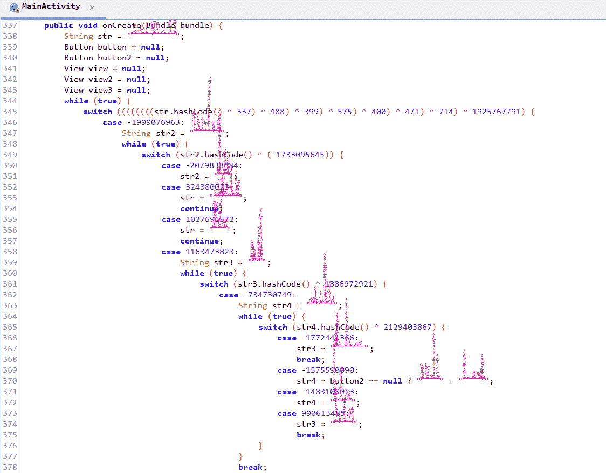
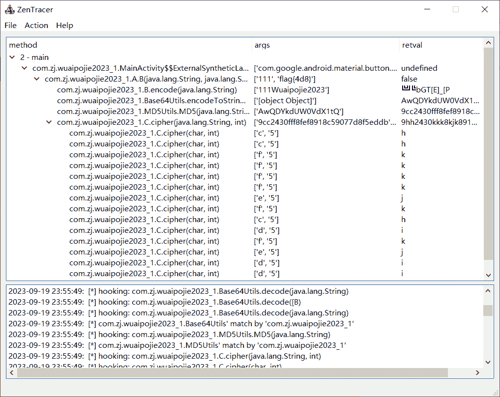
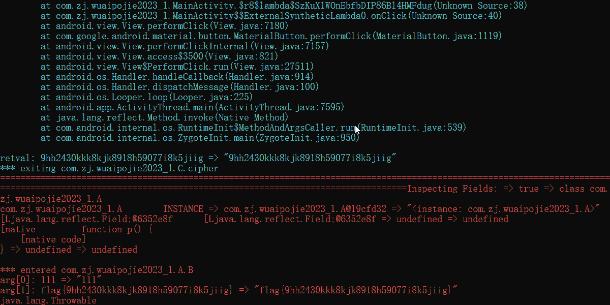

# [Android 原创] 《安卓逆向这档事》十四、是时候学习一下Frida一把梭了(中)

- 原帖: https://www.52pojie.cn/forum.php?mod=viewthread&tid=1838539
- 抓取时间: 2026-11-01T21:39:18


## 一、课程目标

1. 配置`objection`环境
2. 了解`objection`常用Api
3. 了解`frida_java_trace`工具分析控制流混淆

## 二、工具

1. 教程Demo(更新)
2. `jadx-gui`
3. `VS Code`
4. `IDLE`

## 三、课程内容

### 1.objection

#### 1.什么是objection

`objection`是基于`frida`的命令行hook集合工具, 可以让你不写代码, 敲几句命令就可以对java函数的高颗粒度hook, 还支持RPC调用。可以实现诸如内存搜索、类和模块搜索、方法hook打印参数返回值调用栈等常用功能，是一个非常方便的，逆向必备、内存漫游神器。

[`https://github.com/sensepost/objection`](https://github.com/sensepost/objection)

#### 2.objection环境配置

已不更新，要和`frida`的版本匹配。

`python`使用的版本建议大于3.8，不然可能会报错，或者你调低`frida`以及`objection`的版本。

```
pip install objection==1.11.0
pip install frida-tools==9.2.4
```

`frida` 版本：`14.2.18`

#### 3.objection快速上手

1. `help` 命令注释

执行 `objection --help`（`help` 命令）：

```
Checking for a newer version of objection...

Usage: objection [OPTIONS] COMMAND [ARGS]...

       _   _         _   _

   ___| |_|_|___ ___| |_|_|___ ___

  | . | . | | -_|  _|  _| | . |   |

  |___|___| |___|___|_| |_|___|_|_|

        |___|(object)inject(ion)

       Runtime Mobile Exploration

          by: @leonjza from @sensepost

  默认情况下，通信将通过USB进行，除非提供了`--network`选项。

选项:

  -N, --network            使用网络连接而不是USB连接。

  -h, --host TEXT          [默认: 127.0.0.1]

  -p, --port INTEGER       [默认: 27042]

  -ah, --api-host TEXT     [默认: 127.0.0.1]

  -ap, --api-port INTEGER  [默认: 8888]

  -g, --gadget TEXT        要连接的Frida Gadget/进程的名称。 [默认: Gadget]

  -S, --serial TEXT        要连接的设备序列号。

  -d, --debug              启用带有详细输出的调试模式。(在堆栈跟踪中包括代{过}{滤}理源图)

  --help                   显示此消息并退出。

命令:

  api          以无头模式启动objection API服务器。

  device-type  获取关于已连接设备的信息。

  explore      启动objection探索REPL。

  patchapk     使用frida-gadget.so补丁一个APK。

  patchipa     使用FridaGadget dylib补丁一个IPA。

  run          运行单个objection命令。

  signapk      使用objection密钥对APK进行Zipalign和签名。

  version      打印当前版本并退出。
```

2. 注入命令

```
objection -g 包名 explore
```

- `help`：不知道当前命令的效果是什么，在当前命令前加 `help`，比如 `help env`，回车之后会出现当前命令的解释信息。
- 按空格：不知道输入什么就按空格，会有提示出来。
- `jobs`：可以进行多项hook。
- 日志：`objection`的日志文件生成在 `C:\Users\Administrator\.objection`。

启动前就hook：

```
objection -g 进程名 explore --startup-command "android hooking watch class 路径.类名"
```

#### 4.objection基础api

- `memory list modules` - 查看内存中加载的库

```
memory list modules
Save the output by adding `--json modules.json` to this command
Name                                                              Base          Size                 Path
----------------------------------------------------------------  ------------  -------------------  ------------------------------------------------------------------------------
app_process64                                                     0x57867c9000  40960 (40.0 KiB)     /system/bin/app_process64
linker64                                                          0x72e326a000  229376 (224.0 KiB)   /system/bin/linker64
libandroid_runtime.so                                             0x72e164e000  2113536 (2.0 MiB)    /system/lib64/libandroid_runtime.so
libbase.so                                                        0x72dfa67000  81920 (80.0 KiB)     /system/lib64/libbase.so
libbinder.so                                                      0x72dec1c000  643072 (628.0 KiB)   /system/lib64/libbinder.so
libcutils.so                                                      0x72de269000  86016 (84.0 KiB)     /system/lib64/libcutils.so
libhidlbase.so                                                    0x72df4cc000  692224 (676.0 KiB)   /system/lib64/libhidlbase.so
liblog.so                                                         0x72e0be1000  98304 (96.0 KiB)     /system/lib64/liblog
```

- `memory list exports so名称` - 查看库的导出函数

```
memory list exports liblog.so

Save the output by adding `--json exports.json` to this command

Type      Name                                  Address

--------  ------------------------------------  ------------

function  android_log_write_int32               0x72e0be77c8

function  android_log_write_list_begin          0x72e0be76f0

function  __android_log_bswrite                 0x72e0be9bd8

function  __android_log_security                0x72e0bf2144

function  __android_log_bwrite                  0x72e0be9a18

function  android_log_reset                     0x72e0be75ec

function  android_log_write_string8             0x72e0be7a38

function  android_logger_list_free              0x72e0be8c04

function  __android_log_print                   0x72e0be9728

function  __android_logger_property_get_bool    0x72e0bf2248

function  android_logger_get_id                 0x72e0be8270

function  android_logger_set_prune_list         0x72e0be8948
```

- `android hooking list activities` - 查看内存中加载的activity
- `android hooking list services` - 查看内存中加载的services



- `android intent launch_activity 类名` - 启动activity或service（可以用于一些没有验证的activity，在一些简单的ctf中有时候可以出奇效）
- 关闭ssl校验 `android sslpinning disable`
- 关闭root检测 `android root disable`

#### 5.objection内存漫游

- 内存搜刮类实例

执行 `android heap search instances 类名`：

```
android heap search instances 类名(命令)
Class instance enumeration complete for com.zj.wuaipojie.Demo  
 Hashcode  Class                  toString()
---------  ---------------------  -----------------------------
215120583  com.zj.wuaipojie.Demo  com.zj.wuaipojie.Demo@cd27ac7
```

- 调用实例的方法

调用 `android heap execute getPublicInt(实例的hashcode+方法名)`。

如果是带参数的方法，则需要进入编辑器环境：

```
android heap evaluate
console.log(clazz.a("吾爱破解"));
```

按住 `esc + enter` 触发。

- `android hooking list classes` - 列出内存中所有的类（结果比静态分析的更准确）

```
android hooking list classes
tw.idv.palatis.xappdebug.MainApplication
tw.idv.palatis.xappdebug.xposed.HookMain
tw.idv.palatis.xappdebug.xposed.HookMain$a
tw.idv.palatis.xappdebug.xposed.HookMain$b
tw.idv.palatis.xappdebug.xposed.HookMain$c
tw.idv.palatis.xappdebug.xposed.HookMain$d
tw.idv.palatis.xappdebug.xposed.HookSelf
u
v
void
w
xposed.dummy.XResourcesSuperClass
xposed.dummy.XTypedArraySuperClass

Found 10798 classes
```

- `android hooking search classes 关键类名` - 在内存中所有已加载的类中搜索包含特定关键词的类

```
android hooking search classes wuaipojie
Note that Java classes are only loaded when they are used, so if the expected class has not been found, it might not have been loaded yet.

com.zj.wuaipojie.Demo
com.zj.wuaipojie.Demo$Animal
com.zj.wuaipojie.Demo$Companion
com.zj.wuaipojie.Demo$InnerClass
com.zj.wuaipojie.Demo$test$1
com.zj.wuaipojie.MainApplication
com.zj.wuaipojie.databinding.ActivityMainBinding
... 

Found 38 classes
```

- `android hooking search methods 关键方法名` - 在内存中所有已加载的类的方法中搜索包含特定关键词的方法（一般不建议使用，特别耗时，还可能崩溃）
- `android hooking list class_methods 类名` - 内存漫游类中的所有方法


# 6. objectionHook

## hook类的所有方法

```bash
android hooking list class_methods com.zj.wuaipojie.ui.ChallengeSixth
private static final void com.zj.wuaipojie.ui.ChallengeSixth.onCreate$lambda-0(com.zj.wuaipojie.ui.ChallengeSixth,android.view.View)
private static final void com.zj.wuaipojie.ui.ChallengeSixth.onCreate$lambda-1(com.zj.wuaipojie.ui.ChallengeSixth,android.view.View)
private static final void com.zj.wuaipojie.ui.ChallengeSixth.onCreate$lambda-2(com.zj.wuaipojie.ui.ChallengeSixth,android.view.View)
private static final void com.zj.wuaipojie.ui.ChallengeSixth.onCreate$lambda-3(com.zj.wuaipojie.ui.ChallengeSixth,android.view.View)
protected void com.zj.wuaipojie.ui.ChallengeSixth.onCreate(android.os.Bundle)
public final java.lang.String com.zj.wuaipojie.ui.ChallengeSixth.hexToString(java.lang.String)
public final java.lang.String com.zj.wuaipojie.ui.ChallengeSixth.unicodeToString(java.lang.String)
public final void com.zj.wuaipojie.ui.ChallengeSixth.toastPrint(java.lang.String)
public static void com.zj.wuaipojie.ui.ChallengeSixth.$r8$lambda$1lrkrgiCEFWXZDHzLRibYURG1h8(com.zj.wuaipojie.ui.ChallengeSixth,android.view.View)
public static void com.zj.wuaipojie.ui.ChallengeSixth.$r8$lambda$IUqwMqbTKaOGiTaeOmvy_GjNBso(com.zj.wuaipojie.ui.ChallengeSixth,android.view.View)
public static void com.zj.wuaipojie.ui.ChallengeSixth.$r8$lambda$Kc_cRYZjjhjsTl6GYNHbgD-i6sE(com.zj.wuaipojie.ui.ChallengeSixth,android.view.View)
public static void com.zj.wuaipojie.ui.ChallengeSixth.$r8$lambda$PDKm2AfziZQo6Lv1HEFkJWkUsoE(com.zj.wuaipojie.ui.ChallengeSixth,android.view.View)

Found 12 method(s)
```

命令：`android hooking list class_methods com.zj.wuaipojie.ui.ChallengeSixth`

## hook方法的参数、返回值和调用栈

```bash
android hooking watch class_method 类名.方法名 --dump-args --dump-return --dump-backtrace
```

## hook类的构造方法

命令：`android hooking watch class_method 类名.$init`

## hook方法的所有重载

```bash
android hooking watch class_method 类名.方法名
```

# 2. trace实战java控制流混淆

样本展示:





项目地址:

https://github.com/CodingGay/BlackObfuscator

## 对抗方法

### ZenTracer

https://github.com/hluwa/ZenTracer

缺点:无法打印调用栈，无法hook构造函数



因为以长久不更新，故新版frida不兼容，下面是我跑起来的版本

`python==3.8.8`

`frida==14.2.18`

`frida-tools==9.2.4`

还需要安装`pyqt5`的库

```bash
//使用说明
1.运行server端
2.点击action
3.点击Match Regex设置过滤标签
4.输入包名(或者方法名等可以过滤的标签)，点击add
5.点击action的start
6.点击应用触发相应的逻辑
7.可左上角fils-Export JSON来导出日志分析
```

### r0tracer

https://github.com/r0ysue/r0tracer

兼容最新版本



```javascript
//A. 简易trace单个类
//traceClass("com.zj.wuaipojie2023_1.MainActivity")

//B. 黑白名单trace多个函数，第一个参数是白名单(包含关键字)，第二个参数是黑名单(不包含的关键字)
hook("com.zj.wuaipojie2023_1", "$");

//hook("ViewController","UI")

//C. 报某个类找不到时，将某个类名填写到第三个参数，比如找不到com.roysue.check类。（前两个参数依旧是黑白名单）
// hook("com.roysue.check"," ","com.roysue.check");

//D. 新增hookALL() 打开这个模式的情况下，会hook属于app自己的所有业务类，小型app可用 ，中大型app几乎会崩溃，经不起
// hookALL()

//日志输出
frida -U -f 【2023春节】解题领红包之四 -l r0tracer.js -o Log.txt
```

# 五、答疑

待更新

# 六、视频及课件地址

https://pan.baidu.com/s/1cFWTLn14jeWfpXxlx3syYw?pwd=nqu9
https://www.aliyundrive.com/s/TJoKMK6du6x
https://www.bilibili.com/video/BV1wT411N7sV/?spm_id_from=333.788&vd_source=6dde16dc6479f00694baaf73a2225452

PS:解压密码都是52pj，阿里云由于不能分享压缩包，所以下载exe文件，双击自解压

# 七、其他章节

https://www.52pojie.cn/thread-1695141-1-1.html
https://www.52pojie.cn/thread-1695796-1-1.html
https://www.52pojie.cn/thread-1701353-1-1.html
https://www.52pojie.cn/thread-1706691-1-1.html
https://www.52pojie.cn/thread-1714727-1-1.html
https://www.52pojie.cn/thread-1731181-1-1.html
https://www.52pojie.cn/thread-1740944-1-1.html
https://www.52pojie.cn/thread-1748081-1-1.html
https://www.52pojie.cn/thread-1762225-1-1.html
https://www.52pojie.cn/thread-1787667-1-1.html
https://www.52pojie.cn/thread-1809646-1-1.html
https://www.52pojie.cn/thread-1814917-1-1.html
https://www.52pojie.cn/thread-1823118-1-1.html

# 八、参考文档

https://www.anquanke.com/post/id/197657
