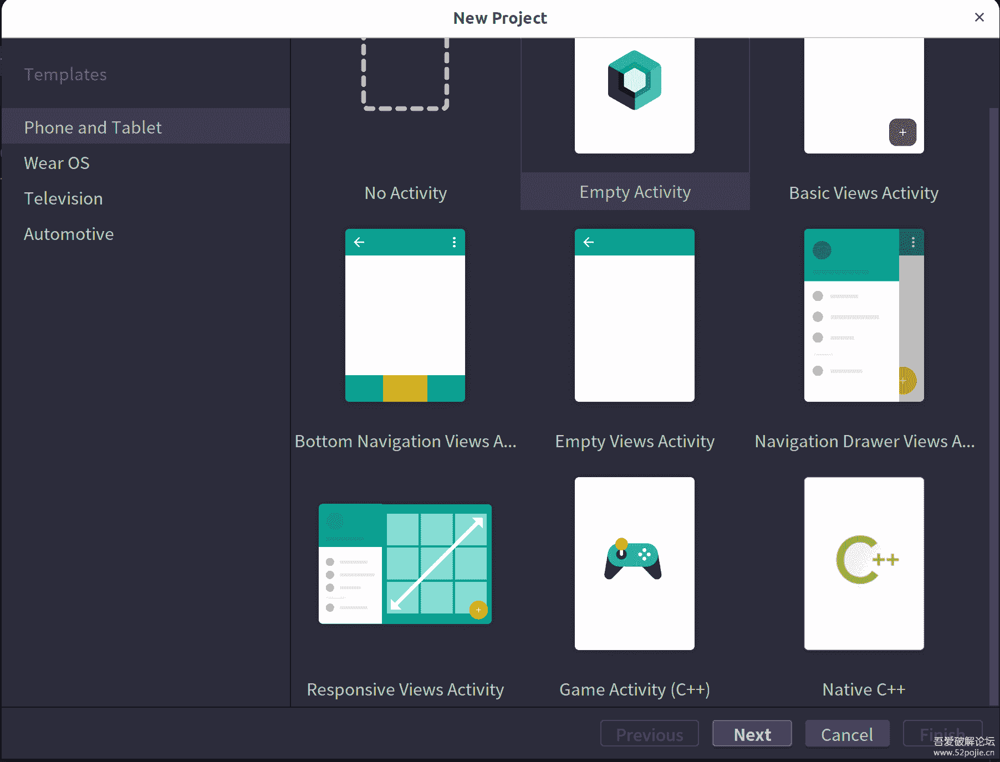
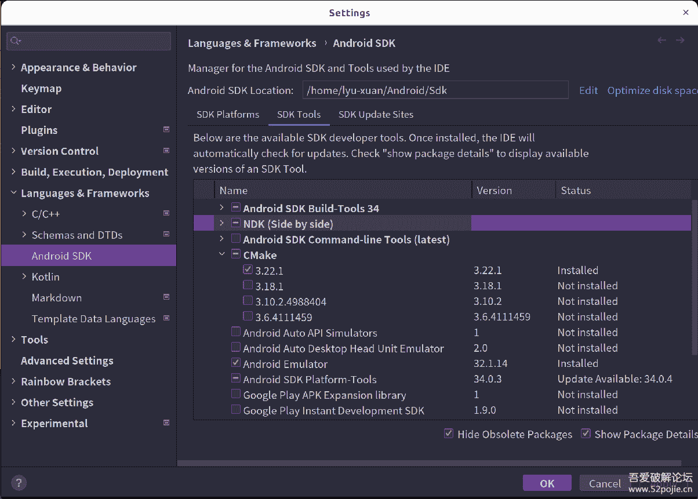
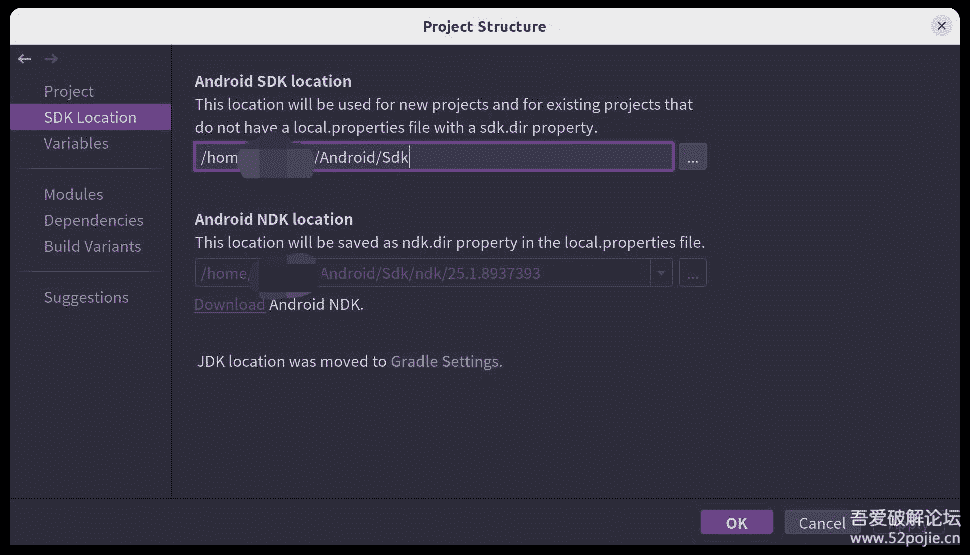
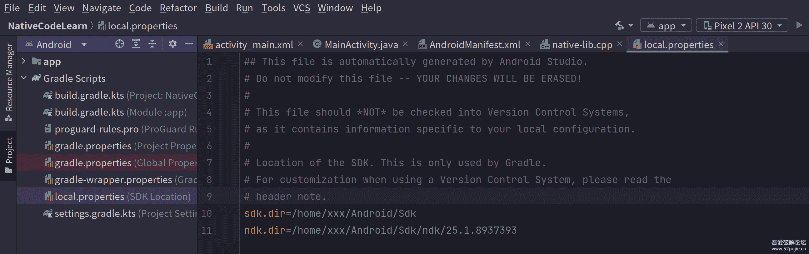
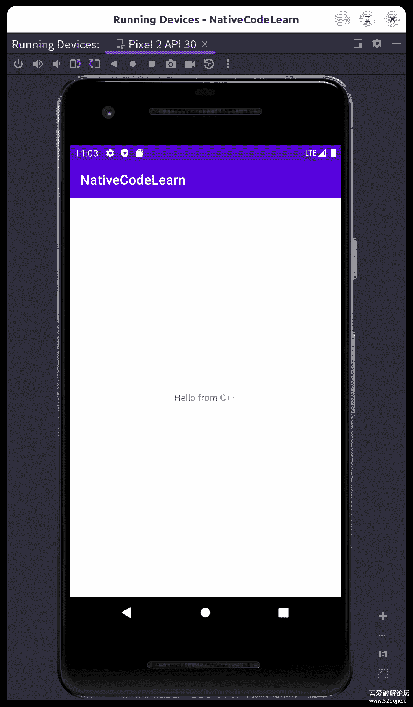

# [Android 原创] Android逆向学习（番外二）native code开发环境配置

- 原帖: https://www.52pojie.cn/forum.php?mod=viewthread&tid=1840501
- 抓取时间: 2026-11-01T21:39:07

## Android Native Code开发学习（一）

本教程为native code学习笔记，希望能够帮到有需要的人
我的电脑系统为ubuntu 22.04，当然windows也是可以的，区别不大
写这个博客原因是因为看到正己大大的博客中有人不了解如何在apk中加入C或C++代码，所以就打算把`NDK`内容给发上来

### 环境配置

首先我们新建一个native C++项目

然后我们下载`NDK`和`CMake`

注意，有时候我们下载完成后还是会显示没有`NDK`，就是会有一个空指针错误，面对这种情况我们就需要手动指定`NDK`的目录，如果没有出现这种情况请忽略。下面介绍两种手动指定方法。

#### NDK指定方法一（好像有bug有时不能用）

直接在下面的`NDK`位置选择，但大多数时候都是灰色的不能修改，这不知道是不是bug还是说就是这样，所以建议直接用下一种方法

#### NDK指定方法二

直接在`local.properties`中修改路径，如果没有`ndk.dir`的话自己手动加上就可以。

然后我们重新`sync`一下就可以了，如果你不知道`sync`是啥，上图

就是这个可爱的大象，大象大象你的鼻子为什么这么长～

然后我们点一下运行

注意，可能会有问题就是让你下载最新的`build tool`，按它的提示下载就可以了
