# [Android 原创] 微信隐藏性别（手把手小白篇）

- 原帖：<https://www.52pojie.cn/forum.php?mod=viewthread&tid=1840519>
- 抓取时间：2026-11-01T21:39:05

本篇教程是在模拟器下进行的，如果手机的话需要ROOT。

## 1. 所需软件

1. 雷电模拟器9.0.59（设置里开启ROOT权限）
2. GG修改器：[https://gameguardian.net/download](https://gameguardian.net/download)；安装之后会有两个图标，SW（软件加速）、HW（硬件加速），两个随便用哪个都可以
3. 微信8.0.2（模拟器商店下载就行）

## 2. 打开GG和微信并附加微信主进程

打开GG和微信，在`微信-更多信息`这里点GG图标附加微信主进程，内存占用最大的那个就是。

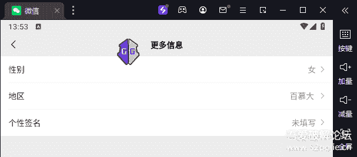

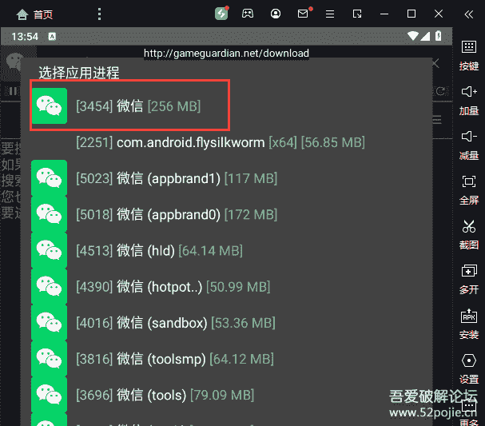

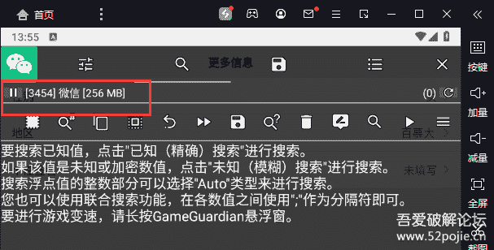

## 3. 搜索性别值

然后根据图中步骤设置点击搜索，看你选择的性别是什么，男就搜1，女就搜2，我上面是选的女，值填2，搜索。

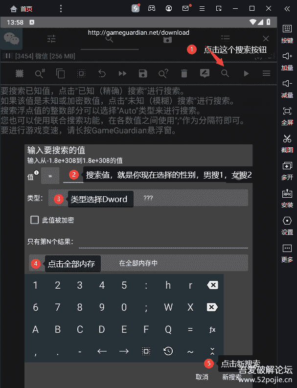

## 4. 更改性别并改善

然后更改性别，在点击搜索更改值，点击改善。

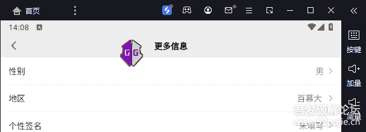

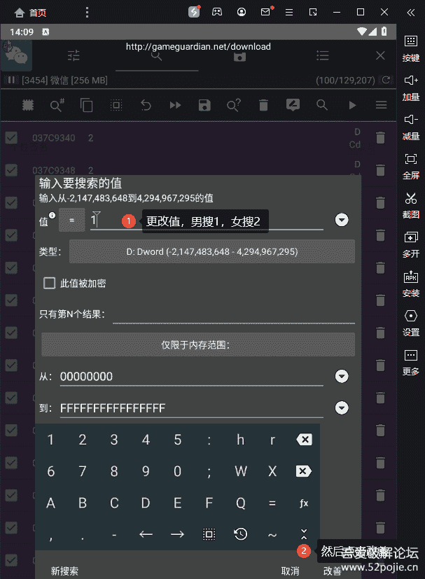

## 5. 重复搜索

重复第三步第四步，直到搜索结果剩余1-3个左右，然后根据下面图片步骤进行。

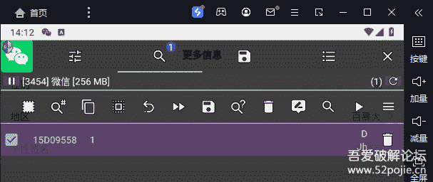

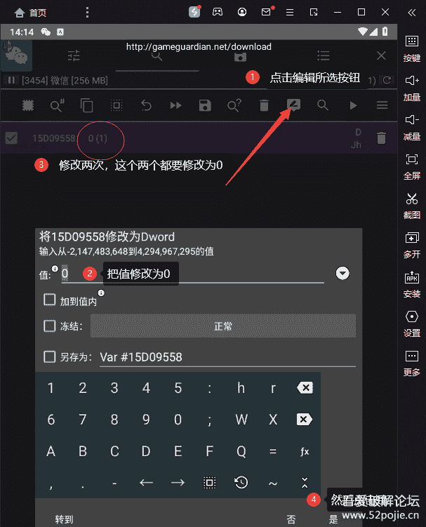

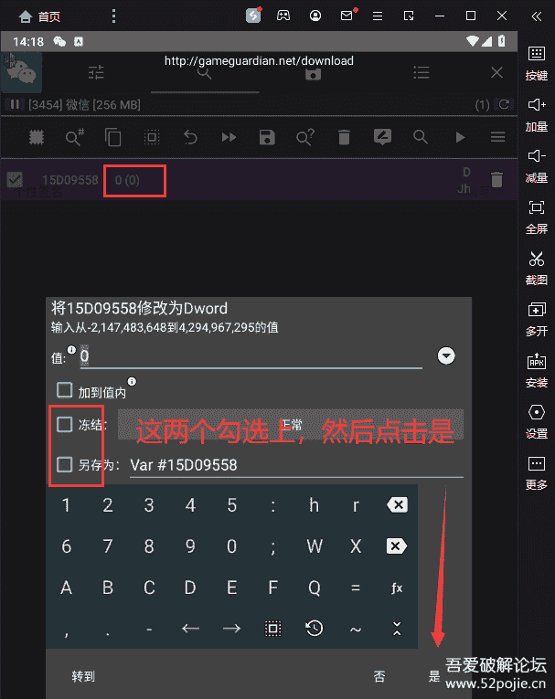

## 6. 返回并确认性别已隐藏

然后直接返回上一级到个人信息页面，在点击更多信息，性别就变成默认没有选择的了，别人那里也看不到你的性别了。

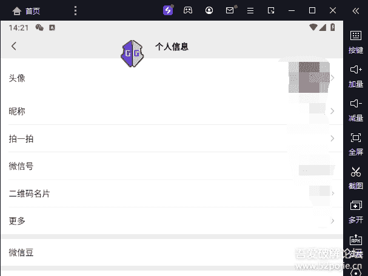

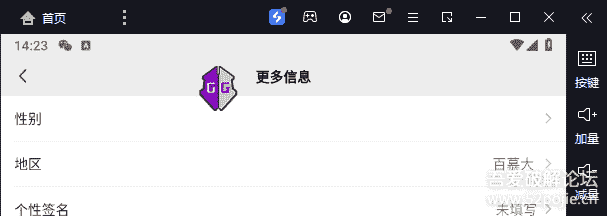

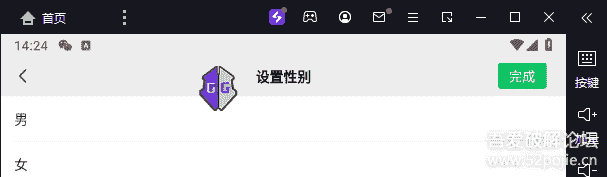

转载请注明出处

如有违规，请版主删帖
