# [Android 原创] 利用DNS欺骗绕过抓包检测

- 原帖: https://www.52pojie.cn/forum.php?mod=viewthread&tid=1842061
- 抓取时间: 2026-11-01T21:38:52

## 利用DNS欺骗绕过抓包检测

昨天帖子被管理删了，现在重发

## 情况说明

IOS某软件的代-理检测，无论使用WiFi的代-理还是威屁~恩都会显示如下图，并且点击后自动退出软件。

我们通过某种方式知道了软件的API服务器为`v3-api.china-****.cn`，我们需要抓包的就是这个网址。

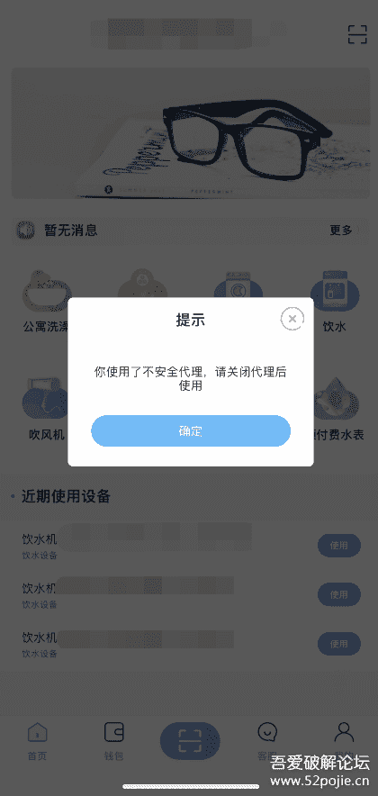

`1.png` (115.98 KB, 下载次数: 0)

[附件链接](https://www.52pojie.cn/forum.php?mod=attachment&aid=MjY0ODA2NnwyZmVjMDM0NnwxNzkzNTY5MTMwfDE2ODA4NnwxODQyMDYx&nothumb=yes)

2023-10-10 11:02 上传

**DNS欺骗示例图**

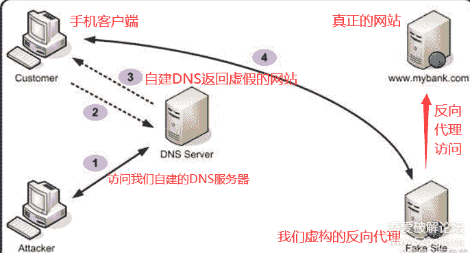

`2.png` (149.64 KB, 下载次数: 0)

[附件链接](https://www.52pojie.cn/forum.php?mod=attachment&aid=MjY0ODA2N3w0ZWZlMjIyOXwxNzkzNTY5MTMwfDE2ODA4NnwxODQyMDYx&nothumb=yes)

2023-10-10 11:02 上传

客户端使用自建的DNS服务器，DNS服务器返回我们反向代-理后的虚假的网站。

## 目录

需要`python`环境

1. 自建DNS服务器
2. 自建反向代-理网站
3. 反向代-理网站自签名SSL证书
4. 手机上的设置

## 1.自建DNS服务器

### 获取本机IP

我们先用`cmd`的`ipconfig`命令获取本机的内网地址

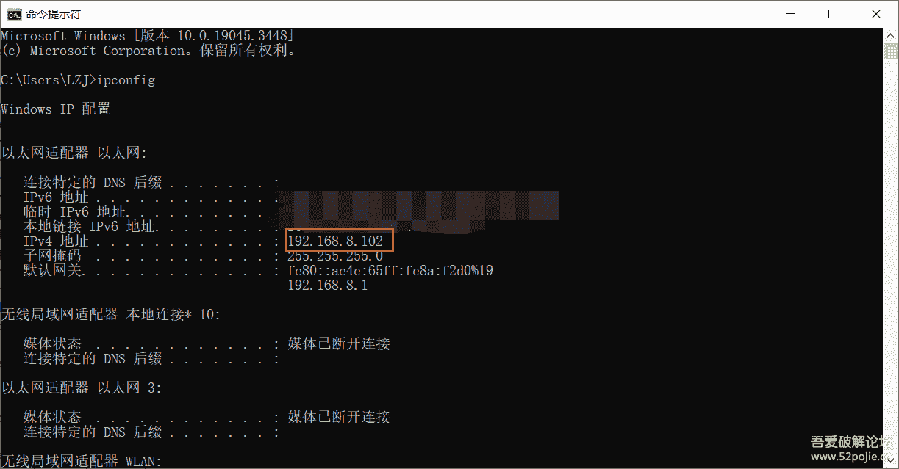

`3.png` (75.39 KB, 下载次数: 1)

[附件链接](https://www.52pojie.cn/forum.php?mod=attachment&aid=MjY0ODA2OHwyZmMyNTUwNnwxNzkzNTY5MTMwfDE2ODA4NnwxODQyMDYx&nothumb=yes)

2023-10-10 11:02 上传

### 搭建DNS服务器

简单写了个`python`的代码，复制以下代码然后保存成`.py`文件，并修改需要代-理的网站和内网IP。


# DNS 服务器实现

```python
import logging
import socket
from dns.resolver import Resolver
from dnslib import DNSRecord, QTYPE, RD, SOA, DNSHeader, RR, A

class DNSServe(object):
    mydns = {}
    def __init__(self,dns1="119.29.29.29",dns2="114.114.114.114"):
        self.dns_resolver = Resolver()
        self.dns_resolver.nameservers = [dns1, dns2]
        self.udp_sock = socket.socket(socket.AF_INET, socket.SOCK_DGRAM)
        self.udp_sock.bind(('', 53))
        LOG_FORMAT = "%(asctime)s - %(levelname)s - %(message)s"
        logging.basicConfig(level=logging.DEBUG, format=LOG_FORMAT)
        logging.info('dns server is started')
    def start(self):
        while True:
            message, address = self.udp_sock.recvfrom(8192)
            self.dns_handler(self.udp_sock, message, address)
    def add_dns(self,domain, ip):
        self.mydns.update({domain: ip})
        logging.info(f'添加记录成功\t"{domain}":"{ip}"')
    def get_ip_from_domain(self,domain):
        domain = domain.lower().strip()
        try:
            if domain in self.mydns:
                dns = self.mydns.get(domain)
            else:
                dns = self.dns_resolver.resolve(domain, 'A')[0].to_text()
            return dns
        except:
            return None
    def reply_for_not_found(self,income_record):
        header = DNSHeader(id=income_record.header.id, bitmap=income_record.header.bitmap, qr=1)
        header.set_rcode(0)
        record = DNSRecord(header, q=income_record.q)
        return record
    def reply_for_A(self,income_record, ip, ttl=None):
        r_data = A(ip)
        header = DNSHeader(id=income_record.header.id, bitmap=income_record.header.bitmap, qr=1)
        domain = income_record.q.qname
        query_type_int = QTYPE.reverse.get('A') or income_record.q.qtype
        record = DNSRecord(header, q=income_record.q, a=RR(domain, query_type_int, rdata=r_data, ttl=ttl))
        return record
    def dns_handler(self,s, message, address):
        try:
            income_record = DNSRecord.parse(message)
        except:
            logging.error('from %s, parse error' % address)
            return
        try:
            qtype = QTYPE.get(income_record.q.qtype)
        except:
            qtype = 'unknown'
        domain = str(income_record.q.qname).strip('.')
        info = '%s -- %s, from %s' % (qtype, domain, address)
        if qtype == 'A':
            ip = self.get_ip_from_domain(domain)
            if ip:
                response = self.reply_for_A(income_record, ip=ip, ttl=60)
                s.sendto(response.pack(), address)
                return logging.info(info)
        response = self.reply_for_not_found(income_record)
        s.sendto(response.pack(), address)
        logging.info(info)

if __name__ == '__main__':
    server = DNSServe()
    server.add_dns('baidu.com', '2.2.2.2')
    server.add_dns('v3-api.china-****.cn', '192.168.8.102')
    server.start()
```

只要在`server.add_dns('baidu.com', '2.2.2.2')`下面增加代码就行。

`v3-api.china-****.cn`就是需要代-理软件的API服务器，`192.168.8.102`是上面获取的内网地址。

启动DNS服务器后，本机电脑使用`cmd`的`nslookup`命令测试一下DNS服务器是否正常运行。

## 启动 DNS 服务器

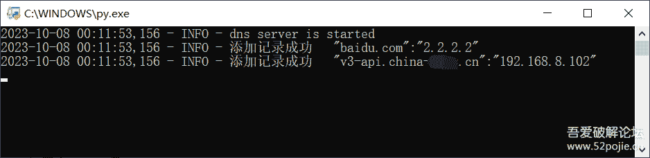

4.png (26.7 KB, 下载次数: 1)

[href="forum.php?mod=attachment&aid=MjY0ODA2OXwzYTRjMjM1ZnwxNzkzNTY5MTMwfDE2ODA4NnwxODQyMDYx&nothumb=yes" target="_blank"](https://www.52pojie.cn/forum.php?mod=attachment&aid=MjY0ODA2OXwzYTRjMjM1ZnwxNzkzNTY5MTMwfDE2ODA4NnwxODQyMDYx&nothumb=yes)

2023-10-10 11:02 上传

## 使用 cmd 的 nslookup 命令指定自建 dns 服务器获取的记录

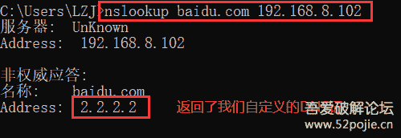

5.png (21.76 KB, 下载次数: 1)

[href="forum.php?mod=attachment&aid=MjY0ODA3MHwyNTU0YjYyN3wxNzkzNTY5MTMwfDE2ODA4NnwxODQyMDYx&nothumb=yes" target="_blank"](https://www.52pojie.cn/forum.php?mod=attachment&aid=MjY0ODA3MHwyNTU0YjYyN3wxNzkzNTY5MTMwfDE2ODA4NnwxODQyMDYx&nothumb=yes)

2023-10-10 11:02 上传

# 自建反向代理网站

## 安装依赖

直接下载我提供的包，解压后在目录下打开`cmd`使用`pip install -r requirements.txt`安装依赖包

直接打开`app.py`运行成功后打开 `http://127.0.0.1`，如果成功打开，那就代表反向代-理成功了。

[//ldz2020.lanzoue.com/i1F3N1b6erej" target="_blank" rel="noopener noreferrer nofollow"](https://ldz2020.lanzoue.com/i1F3N1b6erej:rel="nofollow noopener" href="https)

## 运行 app.py

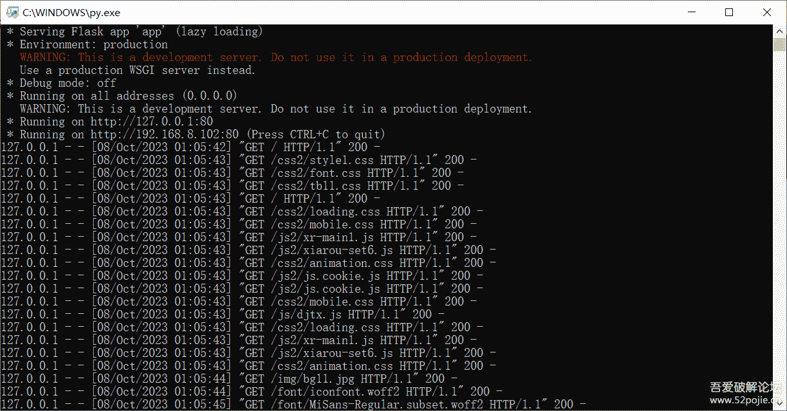

6.png (130.59 KB, 下载次数: 2)

[href="forum.php?mod=attachment&aid=MjY0ODA3MXwwZjIwZTMwYXwxNzkzNTY5MTMwfDE2ODA4NnwxODQyMDYx&nothumb=yes" target="_blank"](https://www.52pojie.cn/forum.php?mod=attachment&aid=MjY0ODA3MXwwZjIwZTMwYXwxNzkzNTY5MTMwfDE2ODA4NnwxODQyMDYx&nothumb=yes)

2023-10-10 11:02 上传

## 修改配置

我们需要修改项目中的`app.py`文件，让项目代-理到我们想要抓包的网站。

修改反向代-理的网站后，因为我们需要抓包，所以服务器还得经过我们的`Fiddler`代-理，修改后的代码如下。

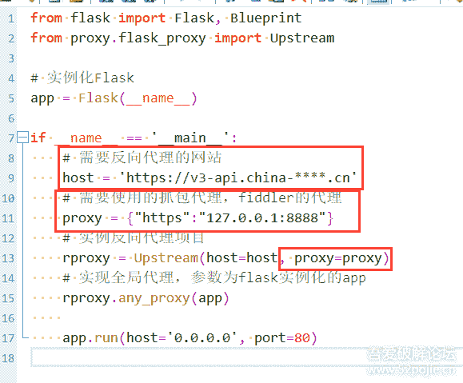

7.png (47.83 KB, 下载次数: 1)

[href="forum.php?mod=attachment&aid=MjY0ODA3Mnw5ZjQ3NzEwOXwxNzkzNTY5MTMwfDE2ODA4NnwxODQyMDYx&nothumb=yes" target="_blank"](https://www.52pojie.cn/forum.php?mod=attachment&aid=MjY0ODA3Mnw5ZjQ3NzEwOXwxNzkzNTY5MTMwfDE2ODA4NnwxODQyMDYx&nothumb=yes)

2023-10-10 11:02 上传

打开`Fiddler`需要把捕获通信关闭，否则无法正常使用。

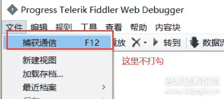

7-1.png (46.74 KB, 下载次数: 1)

[href="forum.php?mod=attachment&aid=MjY0ODA3M3w4MmNiYjE3ZnwxNzkzNTY5MTMwfDE2ODA4NnwxODQyMDYx&nothumb=yes" target="_blank"](https://www.52pojie.cn/forum.php?mod=attachment&aid=MjY0ODA3M3w4MmNiYjE3ZnwxNzkzNTY5MTMwfDE2ODA4NnwxODQyMDYx&nothumb=yes)

2023-10-10 11:02 上传

重新运行`app.py`，再次访问`http://127.0.0.1`，`Fiddler`出现抓包的数据

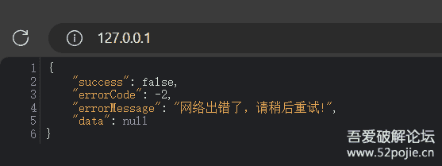

8.png (12.91 KB, 下载次数: 1)

[href="forum.php?mod=attachment&aid=MjY0ODA3NHw1ZDAyMGYxZXwxNzkzNTY5MTMwfDE2ODA4NnwxODQyMDYx&nothumb=yes" target="_blank"](https://www.52pojie.cn/forum.php?mod=attachment&aid=MjY0ODA3NHw1ZDAyMGYxZXwxNzkzNTY5MTMwfDE2ODA4NnwxODQyMDYx&nothumb=yes)

2023-10-10 11:02 上传

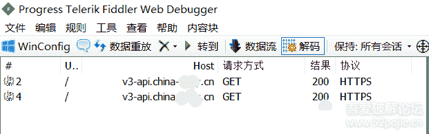

9.png (26.89 KB, 下载次数: 1)

[href="forum.php?mod=attachment&aid=MjY0ODA3NXw3Y2MyMjBlZnwxNzkzNTY5MTMwfDE2ODA4NnwxODQyMDYx&nothumb=yes" target="_blank"](https://www.52pojie.cn/forum.php?mod=attachment&aid=MjY0ODA3NXw3Y2MyMjBlZnwxNzkzNTY5MTMwfDE2ODA4NnwxODQyMDYx&nothumb=yes)

2023-10-10 11:02 上传

# 反向代理网站自签名 SSL 证书

虽然成功反向代-理了api服务器的网站，但是在软件客户端使用了HTTPS协议加密，我们需要自签名证书然后设备信任后才可以访问。

这里我们先自签名反向代-理网站的证书。

我们需要使用另外一个工具`mkcert` [//ldz2020.lanzoue.com/iPg171b38suh" target="_blank" rel="noopener noreferrer nofollow"](https://ldz2020.lanzoue.com/iPg171b38suh:rel="nofollow noopener" href="https)

## 生成自签证书

解压`mkcert.exe`文件到文件夹后，用`cmd`打开当前目录，输入命令生成证书。

在控制台中命令行输入： `mkcert.exe v3-api.china-****.cn`

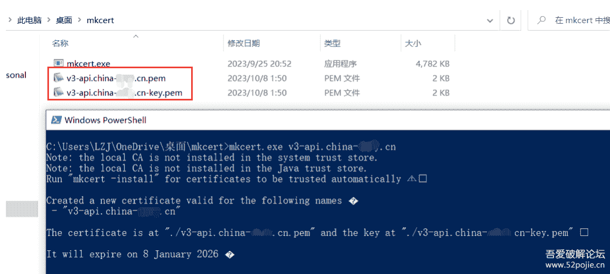

10.png (165.88 KB, 下载次数: 0)

[href="forum.php?mod=attachment&aid=MjY0ODA3Nnw1NGUzY2Q1N3wxNzkzNTY5MTMwfDE2ODA4NnwxODQyMDYx&nothumb=yes" target="_blank"](https://www.52pojie.cn/forum.php?mod=attachment&aid=MjY0ODA3Nnw1NGUzY2Q1N3wxNzkzNTY5MTMwfDE2ODA4NnwxODQyMDYx&nothumb=yes)

2023-10-10 11:02 上传

## 服务器配置证书

生成了`./v3-api.china-****.cn.pem`证书文件和`./v3-api.china-****.cn-key.pem`私钥文件

把这两个文件更名成`server.pem`和`server-key.pem`并移动到反向代-理服务器的目录下。

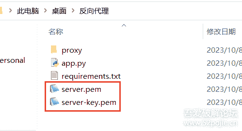

11.png (21.81 KB, 下载次数: 1)

[href="forum.php?mod=attachment&aid=MjY0ODA3N3xkODgyYmI2ZHwxNzkzNTY5MTMwfDE2ODA4NnwxODQyMDYx&nothumb=yes" target="_blank"](https://www.52pojie.cn/forum.php?mod=attachment&aid=MjY0ODA3N3xkODgyYmI2ZHwxNzkzNTY5MTMwfDE2ODA4NnwxODQyMDYx&nothumb=yes)

2023-10-10 11:02 上传

修改文件`app.py`，把代码替换成`app.run(host='0.0.0.0', port=443, ssl_context=('server.pem', 'server-key.pem'))`

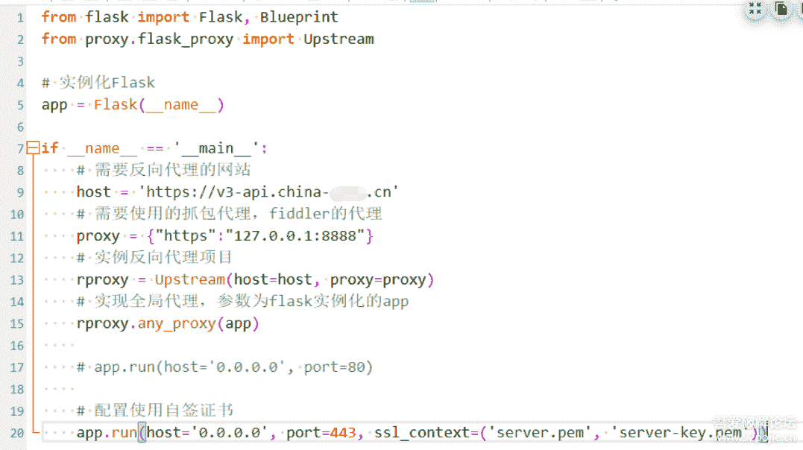

12.png (166.49 KB, 下载次数: 0)

[href="forum.php?mod=attachment&aid=MjY0ODA3OHw4MjNmMDMwZHwxNzkzNTY5MTMwfDE2ODA4NnwxODQyMDYx&nothumb=yes" target="_blank"](https://www.52pojie.cn/forum.php?mod=attachment&aid=MjY0ODA3OHw4MjNmMDMwZHwxNzkzNTY5MTMwfDE2ODA4NnwxODQyMDYx&nothumb=yes)

2023-10-10 11:02 上传

## 发放证书

现在局域网访问测试地址会出现警告页面，我们把CA证书给手机客户端安装就可以了。

命令行查看`mkcert`的CA证书所在位置

命令行输入：`mkcert -CAROOT`

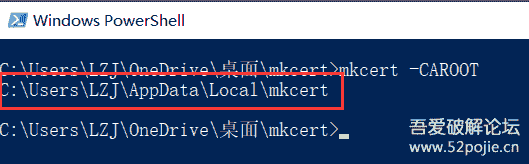

13.png (20.12 KB, 下载次数: 1)

[href="forum.php?mod=attachment&aid=MjY0ODA3OXwwMjcxOTk5YXwxNzkzNTY5MTMwfDE2ODA4NnwxODQyMDYx&nothumb=yes" target="_blank"](https://www.52pojie.cn/forum.php?mod=attachment&aid=MjY0ODA3OXwwMjcxOTk5YXwxNzkzNTY5MTMwfDE2ODA4NnwxODQyMDYx&nothumb=yes)

2023-10-10 11:02 上传

打开这个目录我们就可以看到CA证书了。

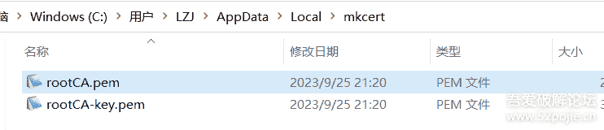

14.png (20.31 KB, 下载次数: 1)

[href="forum.php?mod=attachment&aid=MjY0ODA4MHxiNzc1ZTgxM3wxNzkzNTY5MTMwfDE2ODA4NnwxODQyMDYx&nothumb=yes" target="_blank"](https://www.52pojie.cn/forum.php?mod=attachment&aid=MjY0ODA4MHxiNzc1ZTgxM3wxNzkzNTY5MTMwfDE2ODA4NnwxODQyMDYx&nothumb=yes)

2023-10-10 11:02 上传

# 手机客户端上的设置

## 信任证书

我们上面的`rootCA.pem`发送到手机，安装并信任，安卓的话另外百度搜索。

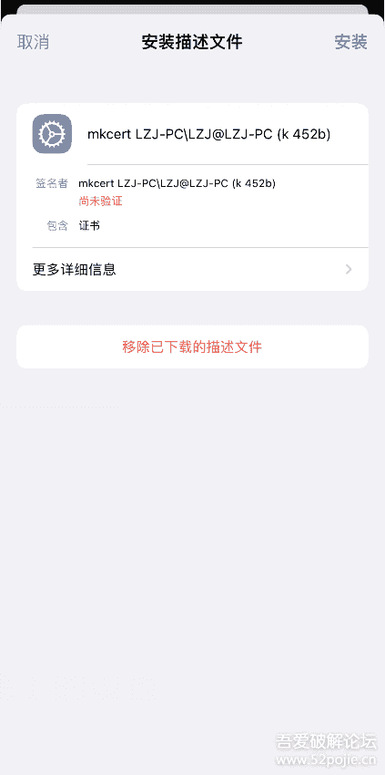

15.png (44.04 KB, 下载次数: 1)

[href="forum.php?mod=attachment&aid=MjY0ODA4OHwxZmNkODJiM3wxNzkzNTY5MTMwfDE2ODA4NnwxODQyMDYx&nothumb=yes" target="_blank"](https://www.52pojie.cn/forum.php?mod=attachment&aid=MjY0ODA4OHwxZmNkODJiM3wxNzkzNTY5MTMwfDE2ODA4NnwxODQyMDYx&nothumb=yes)

2023-10-10 11:04 上传

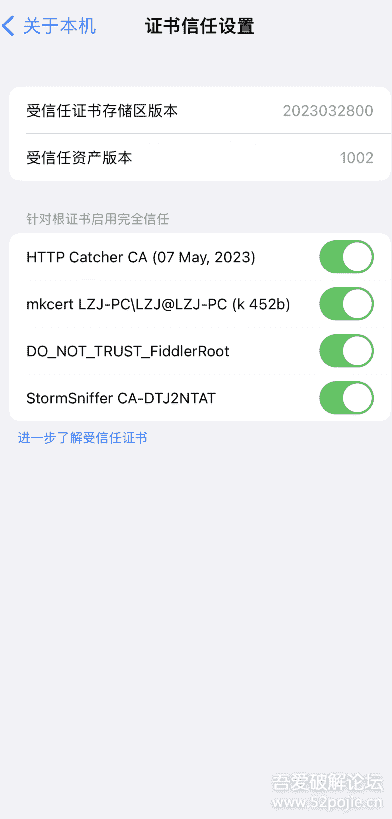

16.png (56.92 KB, 下载次数: 1)

[href="forum.php?mod=attachment&aid=MjY0ODA4Mnw3Nzc4ZDNlMHwxNzkzNTY5MTMwfDE2ODA4NnwxODQyMDYx&nothumb=yes" target="_blank"](https://www.52pojie.cn/forum.php?mod=attachment&aid=MjY0ODA4Mnw3Nzc4ZDNlMHwxNzkzNTY5MTMwfDE2ODA4NnwxODQyMDYx&nothumb=yes)

2023-10-10 11:02 上传

## 设置 DNS 服务器

保持iPhone和电脑主机在同一局域网里，并且DNS服务器和反向代-理服务器和`Fiddler`都打开，打开无线局域网-WiFi名感叹号-配置DNS-手动，多余的DNS删掉，把我们内网的IP填入进去，点击存储。

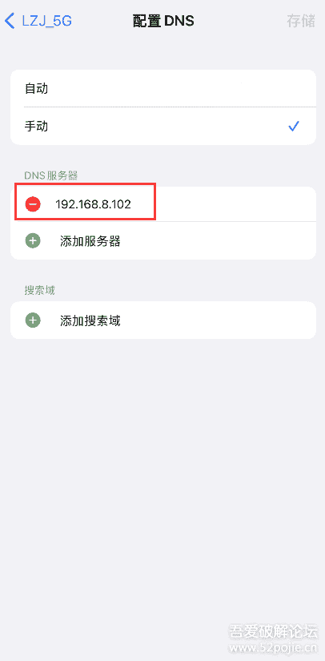

18.png (34.76 KB, 下载次数: 1)

[href="forum.php?mod=attachment&aid=MjY0ODA4M3xmYjI5ZjI2OHwxNzkzNTY5MTMwfDE2ODA4NnwxODQyMDYx&nothumb=yes" target="_blank"](https://www.52pojie.cn/forum.php?mod=attachment&aid=MjY0ODA4M3xmYjI5ZjI2OHwxNzkzNTY5MTMwfDE2ODA4NnwxODQyMDYx&nothumb=yes)

2023-10-10 11:02 上传

## 完成

最后我们打开之前不能使用抓包的网站，可以看到成功打开了，同时DNS服务器，反向代-理服务器，还有`Fiddler`都有数据产生，接下来大家就可以自由发挥了

### DNS 服务器

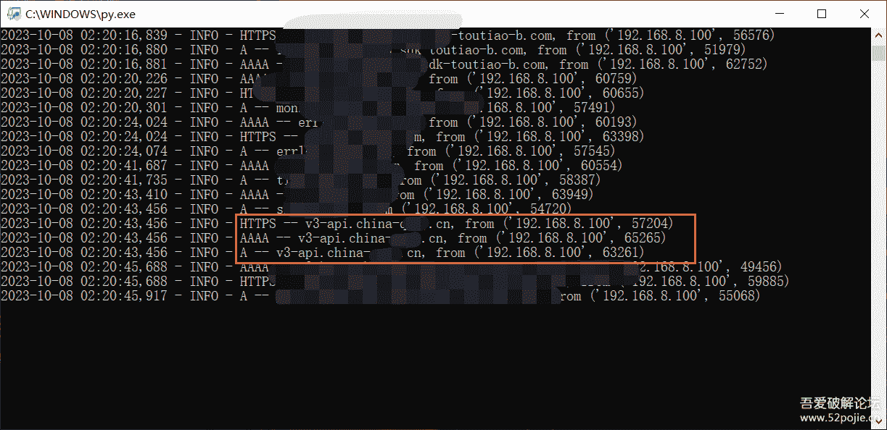

19.png (100.54 KB, 下载次数: 0)

[href="forum.php?mod=attachment&aid=MjY0ODA4NHxlZTYzYWE0M3wxNzkzNTY5MTMwfDE2ODA4NnwxODQyMDYx&nothumb=yes" target="_blank"](https://www.52pojie.cn/forum.php?mod=attachment&aid=MjY0ODA4NHxlZTYzYWE0M3wxNzkzNTY5MTMwfDE2ODA4NnwxODQyMDYx&nothumb=yes)

2023-10-10 11:02 上传

### 反向代-理服务器

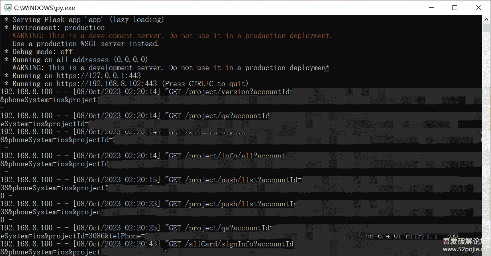

19-1.png (112.6 KB, 下载次数: 0)

[href="forum.php?mod=attachment&aid=MjY0ODA5MHxmMWQ4Njk2Y3wxNzkzNTY5MTMwfDE2ODA4NnwxODQyMDYx&nothumb=yes" target="_blank"](https://www.52pojie.cn/forum.php?mod=attachment&aid=MjY0ODA5MHxmMWQ4Njk2Y3wxNzkzNTY5MTMwfDE2ODA4NnwxODQyMDYx&nothumb=yes)

2023-10-10 11:05 上传

### Fiddler

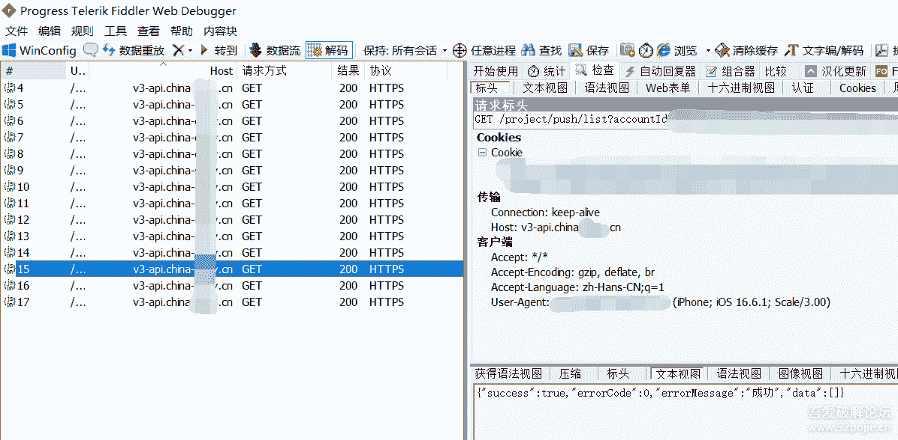

20.png (88.72 KB, 下载次数: 1)

[href="forum.php?mod=attachment&aid=MjY0ODA4NnwyZWY5MmIwYnwxNzkzNTY5MTMwfDE2ODA4NnwxODQyMDYx&nothumb=yes" target="_blank"](https://www.52pojie.cn/forum.php?mod=attachment&aid=MjY0ODA4NnwyZWY5MmIwYnwxNzkzNTY5MTMwfDE2ODA4NnwxODQyMDYx&nothumb=yes)

2023-10-10 11:03 上传

### 数据修改


21.png (114.19 KB, 下载次数: 1)

[href="forum.php?mod=attachment&aid=MjY0ODA4N3wxYWZkMzE3OXwxNzkzNTY5MTMwfDE2ODA4NnwxODQyMDYx&nothumb=yes" target="_blank"](https://www.52pojie.cn/forum.php?mod=attachment&aid=MjY0ODA4N3wxYWZkMzE3OXwxNzkzNTY5MTMwfDE2ODA4NnwxODQyMDYx&nothumb=yes)

2023-10-10 11:03 上传

此方法只是提供一种思路，实际上这种方式繁琐且无法过双向证书认证的app，如果有更好的方法，麻烦与我分享
