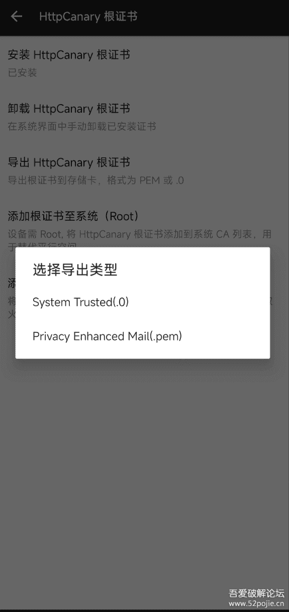
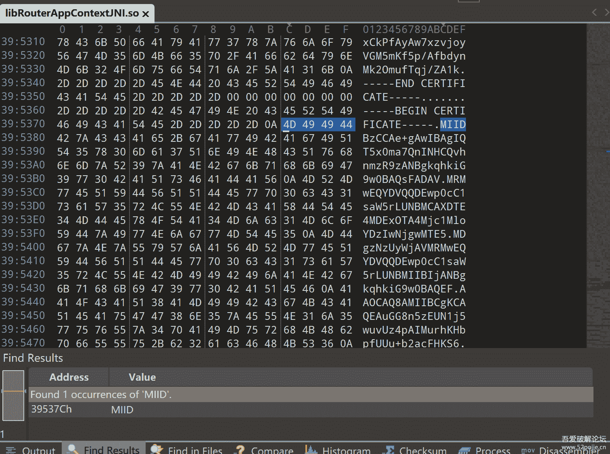
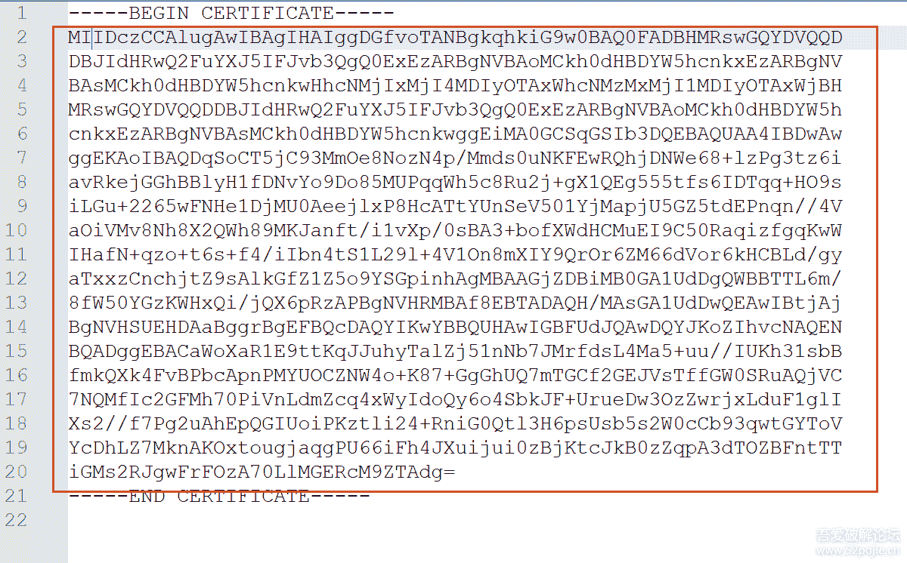

# [Android 分享] 记录某app难忘的抓包之旅

- 原帖: https://www.52pojie.cn/forum.php?mod=viewthread&tid=1843146
- 抓取时间: 2026-11-01T21:38:48

今天群友发了个app，问我可不可以抓包，app是水星WiFi的app，我本着天下还能有抓不到的包的想法，折腾了三个小时，抓包成功，在此记录一下本次难忘的抓包之旅。

首先，拿到app，发现无壳，无签名校验，然后直接lsp模块打开`justtrustme`，然后小黄鸟尝试抓包，发现app会提示网络错误。

然后全局搜索`https`字样，全部替换成了`http`，由于目标app是rn写的，所以把`index.bound`的js里面的`https`也都替换了，再次尝试，还是抓不到包，黄鸟提示app不信任系统证书，要你去替换app内部的证书。

现在目标清晰了，寻找app内部的证书，看到目标app的内部有几个`pem`文件，寻思直接替换呗，发现无用。

最后全局搜索了一下`.pem`，发现了一个`so`，名称为`libRouterAppContextJNI.so`，ida打开一看，别有一番天地，里面各种证书绑定啥的，操作了半天，最后用16进制编辑器替换掉了他原来的`pem`证书（这里的证书长度和黄鸟的长度不一样，怎么办呢，尾部补空格呗）

最后打开app，发现提示无网络，这是正常的，因为`pem`被替换了，他不信任原本的证书了，打开黄鸟代{过}{滤}理，发现可以正常抓包，至此，抓包成功，本帖结束。

## 2024-01-08更新

最近看到有人不会替换`so`里面的证书文件，所以单独写一下教程：

去小黄鸟的设置里选择 “导出HttpCanary 根证书”，然后选择`pem`格式，会看到提示导出成功，这时候把`pem`文件发送到电脑上备用。

然后安装`010editor`或者其他16进制编辑器（可以在爱盘下载）

然后用`010editor`打开`libRouterAppContextJNI.so`文件，然后搜索 “-----BEGIN CERTIFICATE-----” 关键字，会找到多处，这个时候，复制`pem`文件中的base64部分的数据，替换掉原来的数据（这里因为要对齐数据，所以后面我会提供一个python脚本操作）

把`so`和`pem`放到脚本同目录，运行如下脚本，执行替换操作，然后替换`so`，先打开黄鸟开启抓包，再打开对应的软件，可能会提示app使用了自签名证书，这时候右上角导入就行了，如果没替换`so`，会提示下图的 目标应用使用了非系统的CA证书，无法抓包。

```
import os
PemFilename='HttpCanary.pem'
SoFilename='libRouterAppContextJNI.so'
SoBakFilename='libRouterAppContextJNI_bak.so'

ReplaceContentStart='-----BEGIN CERTIFICATE-----'
ReplaceContentEnd='-----END CERTIFICATE-----'

def FindMid(text,start,end):
    startIndex=text.find(start)
    endIndex=text.find(end,startIndex+len(start))
    return text[startIndex+len(start):endIndex]
    
def PadPem(pemdata,length):
    if(length
```


[href="forum.php?mod=attachment&aid=MjY2ODcwM3xlZWE0MjIxM3wxNzkzNTY5MTI2fDE2ODA4NnwxODQzMTQ2" target="_blank"](https://www.52pojie.cn/forum.php?mod=attachment&aid=MjY2ODcwM3xlZWE0MjIxM3wxNzkzNTY5MTI2fDE2ODA4NnwxODQzMTQ2)

(996 Bytes, 下载次数: 22)

2024-1-8 17:05 上传

点击文件名下载附件

下载积分: 吾爱币 -1 CB



image.png (94.64 KB, 下载次数: 1)

[href="forum.php?mod=attachment&aid=MjY2ODY2OHwzZWMxYzJjY3wxNzkzNTY5MTI2fDE2ODA4NnwxODQzMTQ2&nothumb=yes" target="_blank"](https://www.52pojie.cn/forum.php?mod=attachment&aid=MjY2ODY2OHwzZWMxYzJjY3wxNzkzNTY5MTI2fDE2ODA4NnwxODQzMTQ2&nothumb=yes)

2024-1-8 15:27 上传


image.png (130.18 KB, 下载次数: 0)

[href="forum.php?mod=attachment&aid=MjY2ODY2OXxjNGE2YzE0ZnwxNzkzNTY5MTI2fDE2ODA4NnwxODQzMTQ2&nothumb=yes" target="_blank"](https://www.52pojie.cn/forum.php?mod=attachment&aid=MjY2ODY2OXxjNGE2YzE0ZnwxNzkzNTY5MTI2fDE2ODA4NnwxODQzMTQ2&nothumb=yes)

2024-1-8 15:29 上传



image.png (208.83 KB, 下载次数: 0)

[href="forum.php?mod=attachment&aid=MjY2ODY3MHw0MTdkM2M5OXwxNzkzNTY5MTI2fDE2ODA4NnwxODQzMTQ2&nothumb=yes" target="_blank"](https://www.52pojie.cn/forum.php?mod=attachment&aid=MjY2ODY3MHw0MTdkM2M5OXwxNzkzNTY5MTI2fDE2ODA4NnwxODQzMTQ2&nothumb=yes)

2024-1-8 15:34 上传



image.png (244.89 KB, 下载次数: 1)

[href="forum.php?mod=attachment&aid=MjY2ODY3MXw4MmU3ZTE2Y3wxNzkzNTY5MTI2fDE2ODA4NnwxODQzMTQ2&nothumb=yes" target="_blank"](https://www.52pojie.cn/forum.php?mod=attachment&aid=MjY2ODY3MXw4MmU3ZTE2Y3wxNzkzNTY5MTI2fDE2ODA4NnwxODQzMTQ2&nothumb=yes)

2024-1-8 15:35 上传


image.png (90.55 KB, 下载次数: 1)

[href="forum.php?mod=attachment&aid=MjY2ODcwNHw4YTQ2NmM5OXwxNzkzNTY5MTI2fDE2ODA4NnwxODQzMTQ2&nothumb=yes" target="_blank"](https://www.52pojie.cn/forum.php?mod=attachment&aid=MjY2ODcwNHw4YTQ2NmM5OXwxNzkzNTY5MTI2fDE2ODA4NnwxODQzMTQ2&nothumb=yes)

2024-1-8 17:06 上传


image.png (137.52 KB, 下载次数: 0)

[href="forum.php?mod=attachment&aid=MjY2ODcwNXwxYmMzNzFhM3wxNzkzNTY5MTI2fDE2ODA4NnwxODQzMTQ2&nothumb=yes" target="_blank"](https://www.52pojie.cn/forum.php?mod=attachment&aid=MjY2ODcwNXwxYmMzNzFhM3wxNzkzNTY5MTI2fDE2ODA4NnwxODQzMTQ2&nothumb=yes)

2024-1-8 17:07 上传
