# [Android 分享] 新手记录 ida 调试安卓 so 踩坑

- 原帖：https://www.52pojie.cn/forum.php?mod=viewthread&tid=1847985
- 抓取时间：2026-11-01T21:38:31

标签：新手记录ida调试安卓so踩坑

## 环境及工具

- `IDA_Pro_7.7`
- window10
- 真机 Pexel XL(root)
- 系统 andrioid9
- Andrioid Device Monitor（非必须）

## 准备工作

### 1. 将调试服务放入安卓机器

在 IDA 安装目录下找到 `dbgsrv/android_server64`。

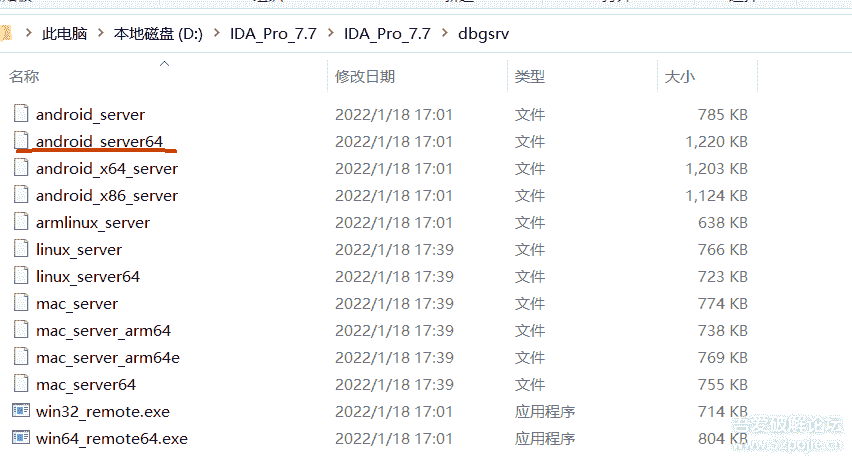

执行命令将调试服务放入安卓机器。打开 `cmd` 到当前目录。

1. `adb push andrioid_server64 /data/local/tmp/as`，将服务 push 入安卓机器中并且改名为 `as`。
2. `adb shell`，进入安卓命令行。
3. `su`，切换 root 权限。
4. `cd /data/local/tmp`，进入目录。
5. `chmod 777 andrioid_server64`，修改 `andrioid_server64` 权限。
6. `./andrioid_server64 -p12345`，启动服务；`-p` 为启动端口参数，可以不加，不加默认就是 `23946` 端口。

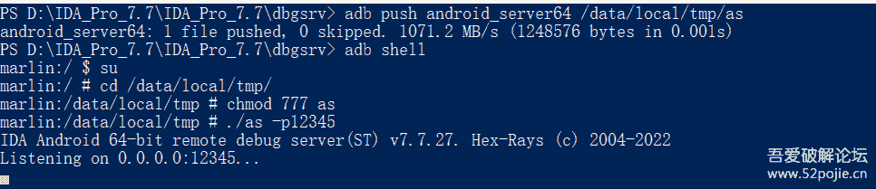

7. `adb forward tcp:12345 tcp:12345`，打开新的 `cmd` 转发端口。

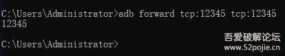

### 2. 启动 IDA 及其他设置

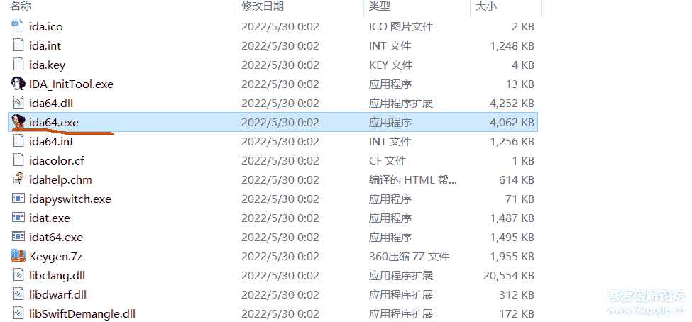

我这里是 64 位的，所以启动 `ida64.exe`。

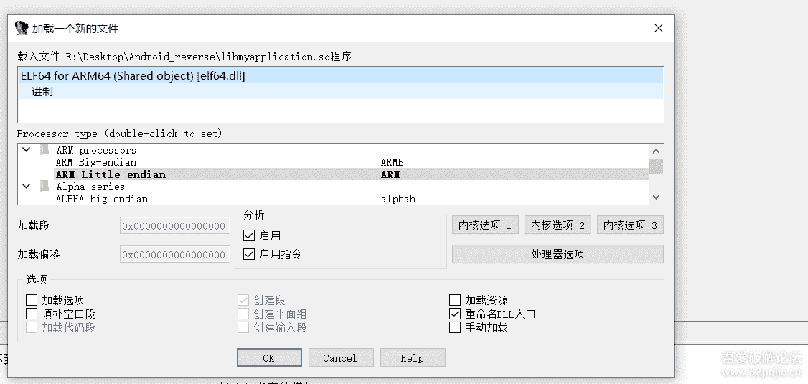

打开需要调试的 so。

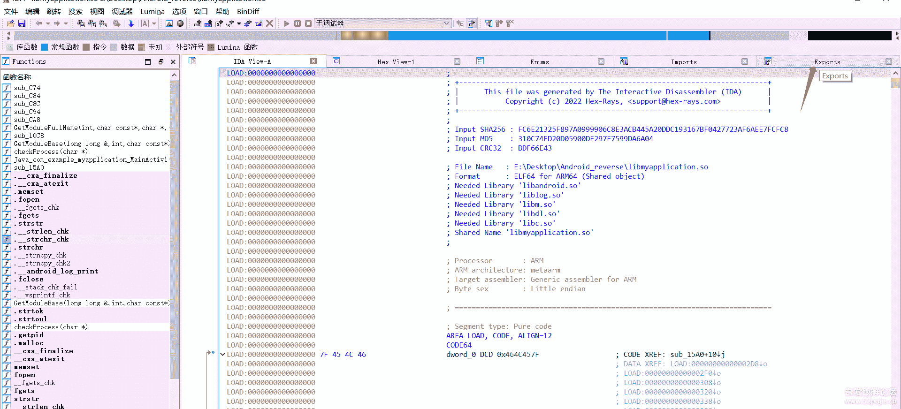

点 `exports` 找到需要调试的代码。

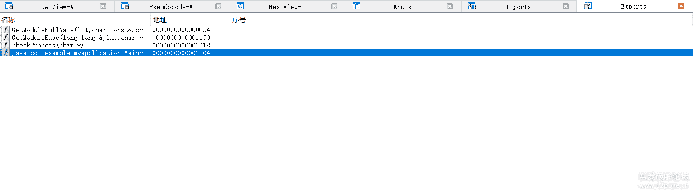

我这里是 demo，所以就在导出函数里面。

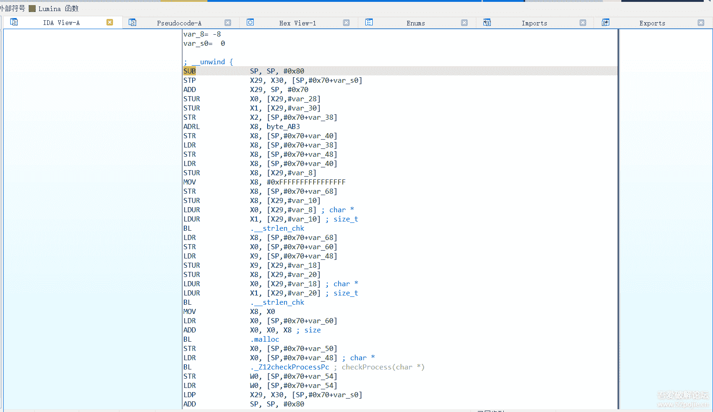

双击进入汇编。

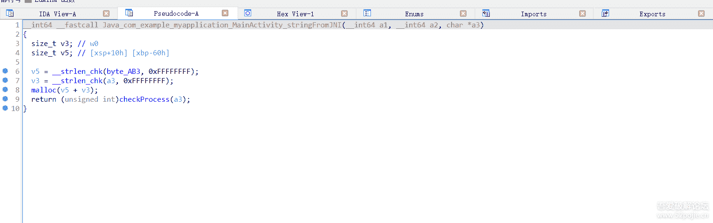

按 `Tab` 键进入伪 C 代码。

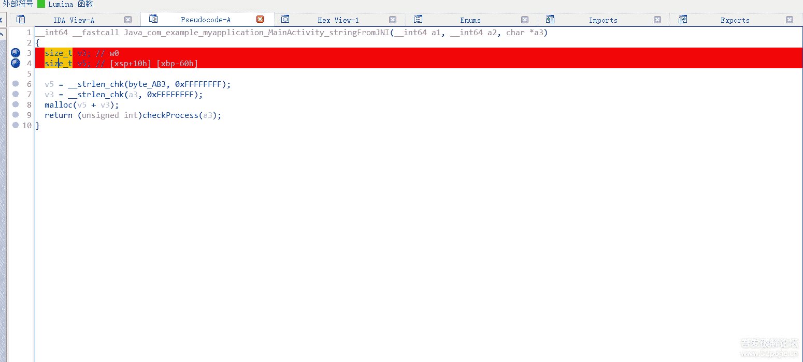

按 `F2` 打上需要调试的代码 debugger。

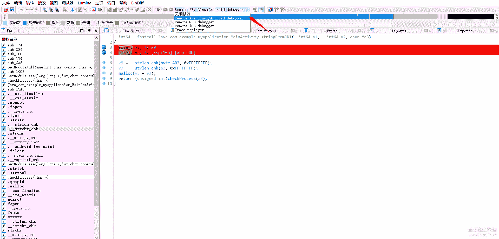

真机调试模式选择这个。

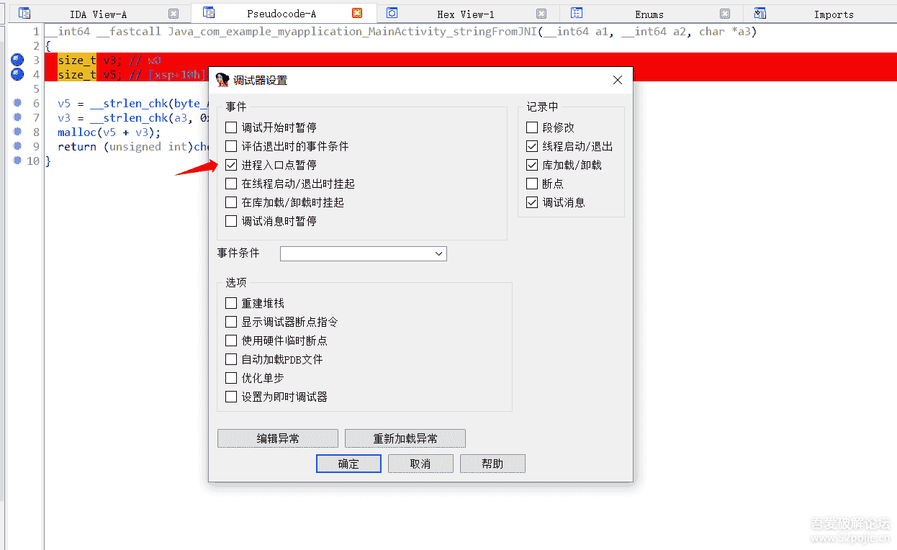

简单调试点击这个就好了，不要点击倒数第二个“在库加载/写在时挂起”（当时就是看了其他教程点击了这个，结果发现这个是库加载的时候就会挂起在断点上，导致迟迟 debugger 不到自己设置的点上——小白踩坑）。

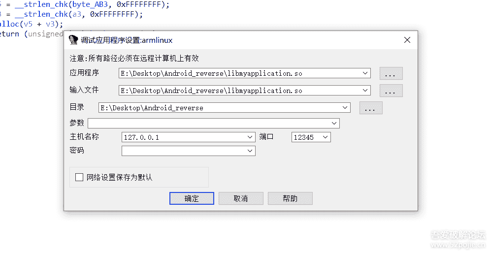

主机 `localhost/127.0.0.1` 都可以，端口就是刚刚转发出去的端口，这里是 `12345`。

### 3. 将 apk 设置为 debugger 模式

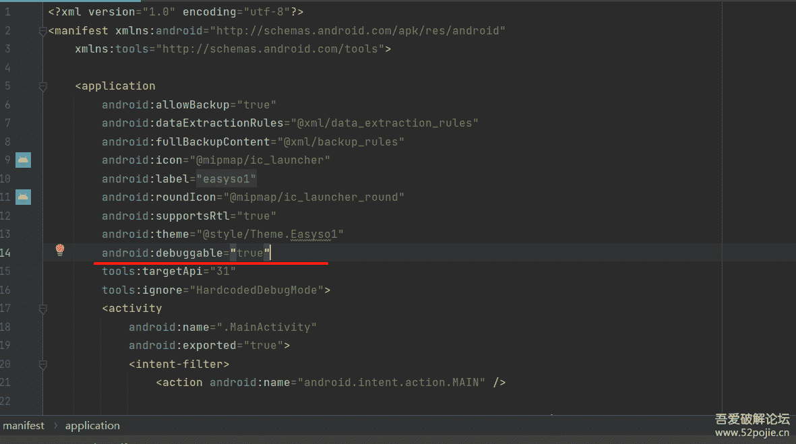

`adb shell am start -n "com.example.myapplication/com.example.myapplication.MainActivity" -D`。这里 `""` 里面的是 apk 的入口。

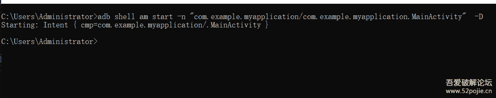

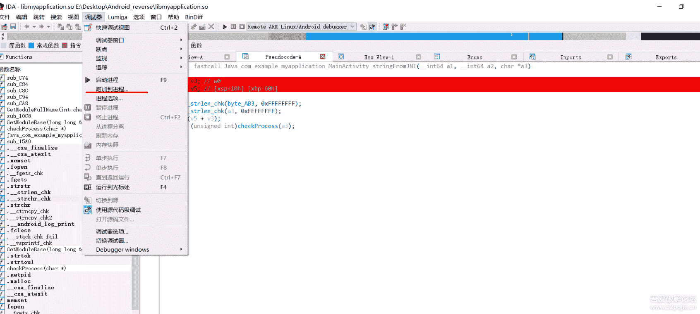

附加到进程。

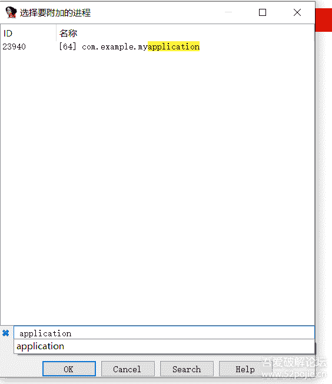

选择要调试的进程，这里可以用 `Ctrl+F` 搜索。

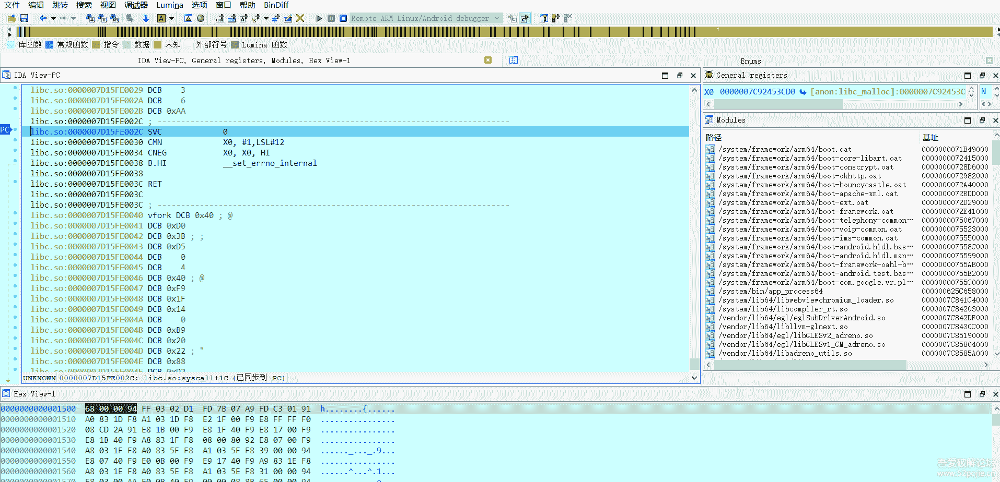

加载完对应东西后会在这里断住。

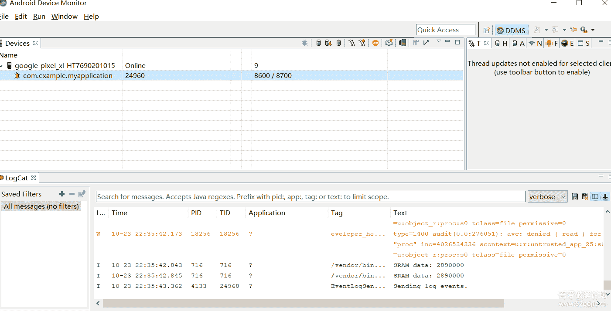

2023-10-24 10:53 上传

打开`Andrioid Device Monitor` 我这里安装了`andrioid SDK` 所以对应的`tools/lib`下有对应的`monitor` 这里有一个坑 就是 这个`monitor` 只有安装了`JDK1.8`才可以打开 其他版本会报错

`jdb -connect com.sun.jdi.SocketAttach:port=8700,hostname=localhost` 执行命令

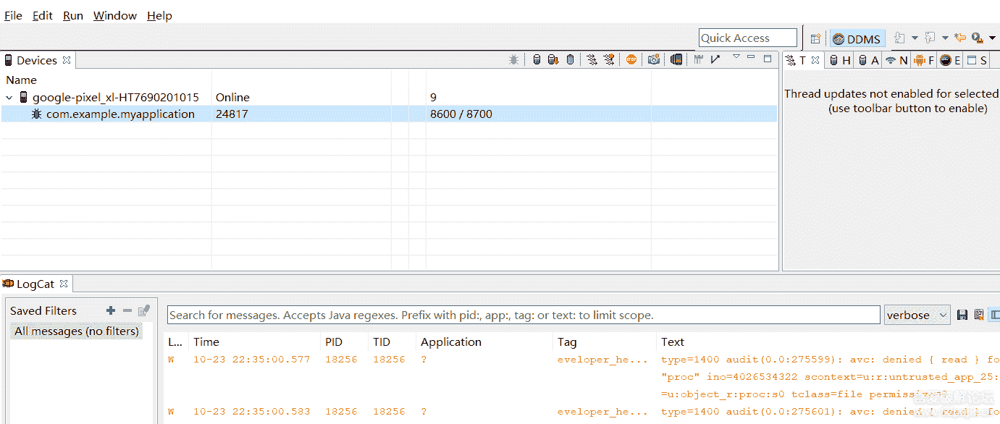

`image-19.png` (53.89 KB, 下载次数: 2)

2023-10-24 10:53 上传

等待初始化就可以了

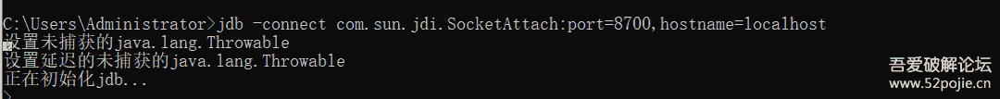

`image-21.png` (22.33 KB, 下载次数: 2)

2023-10-24 10:53 上传

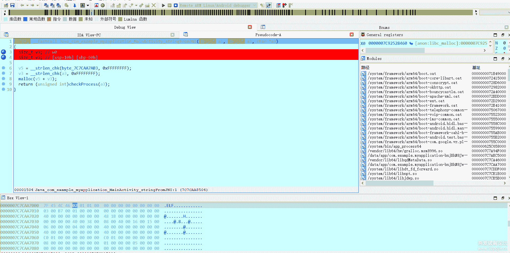

`image-22.png` (134.86 KB, 下载次数: 2)

2023-10-24 10:53 上传

这样就可以了 已经进入打的断点里面了

### 这里最需要注意的就是

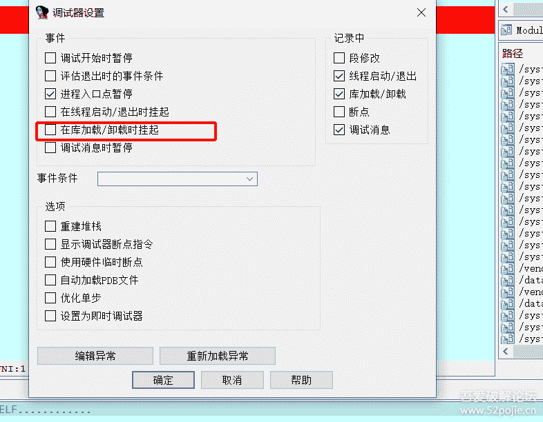

`image-23.png` (51.91 KB, 下载次数: 1)

2023-10-24 10:53 上传

选项 新手应该是暂时不需要的 这里是库加载的时候就会挂起/卸载断点 新手第一次调试不用勾选这个
