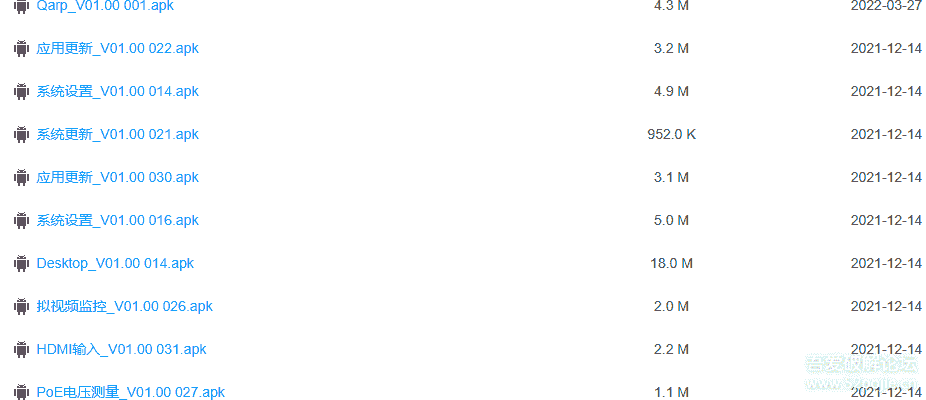
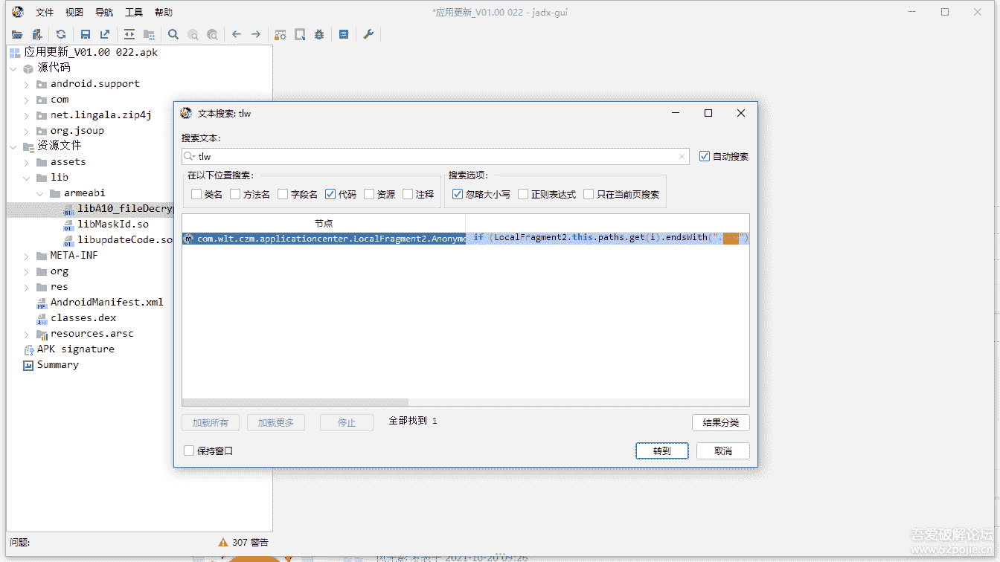
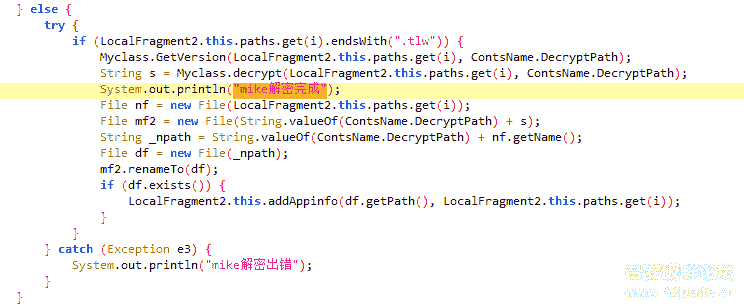
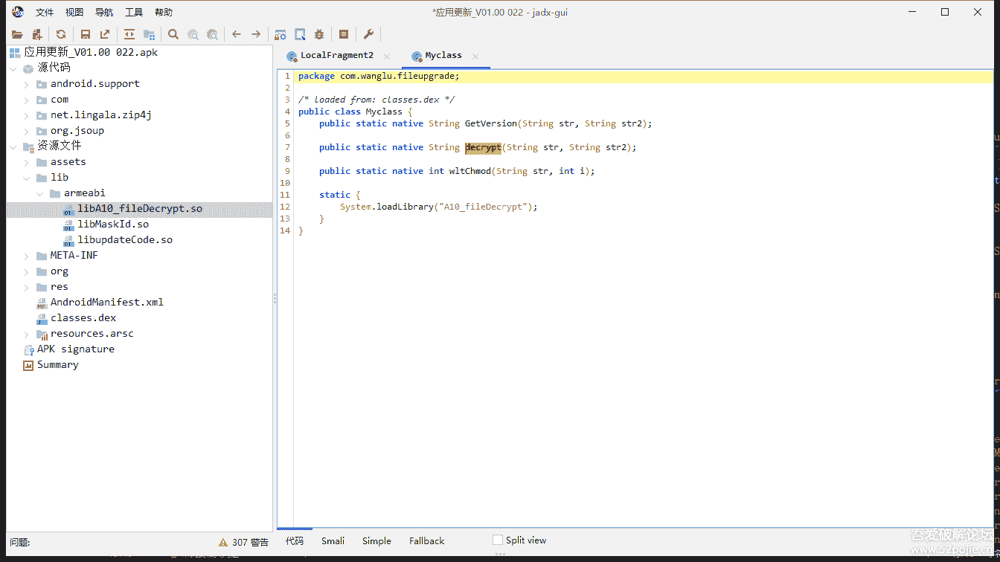
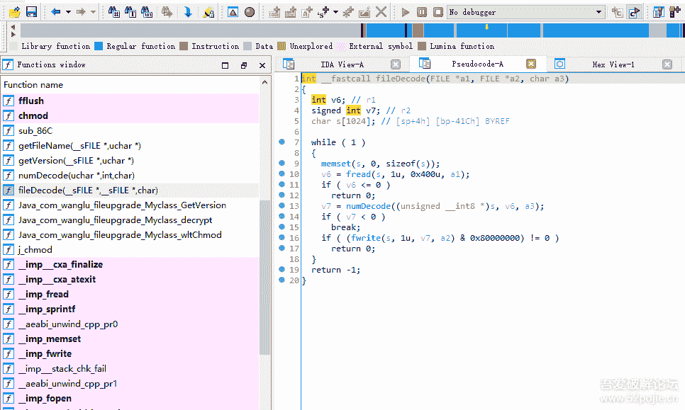
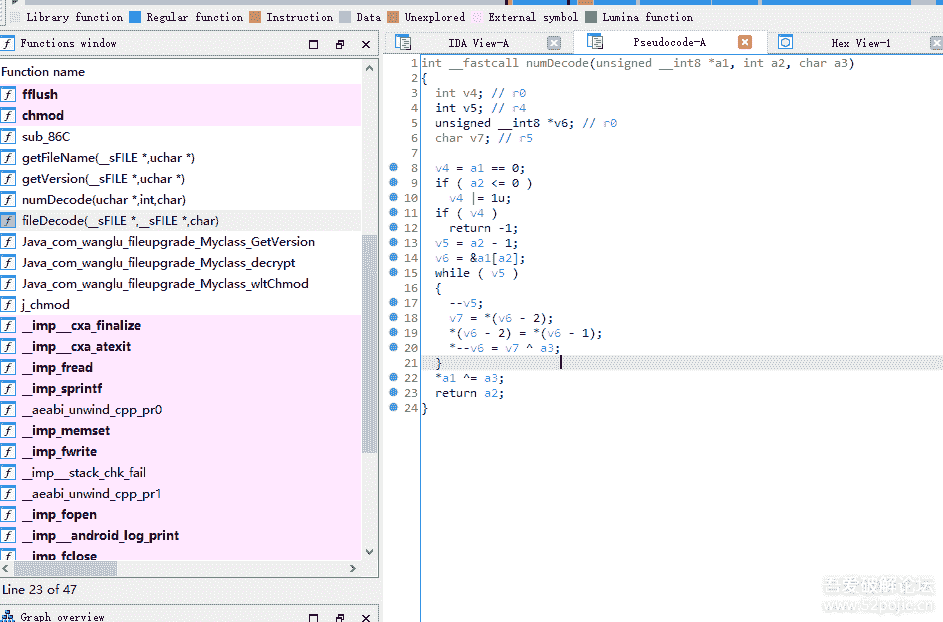
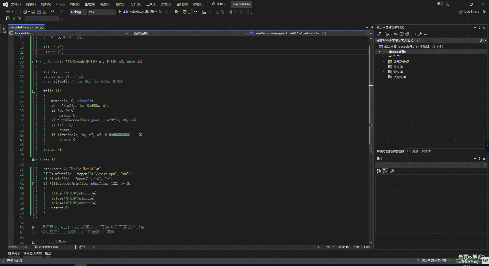
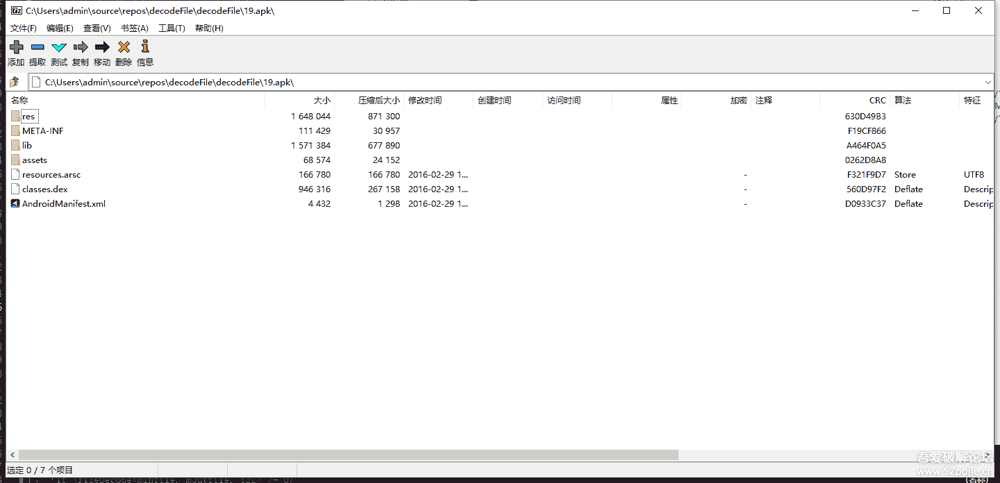

# [Android 分享] 解密工程宝上的`tlw`格式文件

- 原帖: [https://www.52pojie.cn/forum.php?mod=viewthread&tid=1851017](https://www.52pojie.cn/forum.php?mod=viewthread&tid=1851017)
- 抓取时间: `2026-11-01T21:38:22`

今天下午有朋友发给我一个`tlw`格式的文件，说是`apk`加密生成的，是工程宝上面用的软件，想让我解密一下。

在论坛搜索了一下，有如下未解决的帖子：[https://www.52pojie.cn/forum.php?mod=viewthread&tid=951092&highlight=tlw](https://www.52pojie.cn/forum.php?mod=viewthread&tid=951092&highlight=tlw)。

于是乎，自己动手，丰衣足食。

首先，百度搜索了一下网路通工程宝相关资料，发现在某论坛上有人上传了相关的`apk`和`tlw`格式的文件。

通过猜想，估计他的应用更新是通过其他`apk`负责的，于是找到了如下软件：



`ac76fed47d589cf5464d4a1806014e8a.png` (35.5 KB, 下载次数: 1)

[https://www.52pojie.cn/forum.php?mod=attachment&aid=MjY1Mjg2OXw5NjZjMzNlNXwxNzkzNTY5MTAwfDE2ODA4NnwxODUxMDE3&nothumb=yes](https://www.52pojie.cn/forum.php?mod=attachment&aid=MjY1Mjg2OXw5NjZjMzNlNXwxNzkzNTY5MTAwfDE2ODA4NnwxODUxMDE3&nothumb=yes)

2023-10-31 19:23 上传

下载`应用更新.apk`，搜索`tlw`，果然搜索到一个关键字：



`a03cf02335f07b54070efdff5e64dc84.png` (73.79 KB, 下载次数: 1)

[https://www.52pojie.cn/forum.php?mod=attachment&aid=MjY1Mjg3MHw5MjM4MDhjOHwxNzkzNTY5MTAwfDE2ODA4NnwxODUxMDE3&nothumb=yes](https://www.52pojie.cn/forum.php?mod=attachment&aid=MjY1Mjg3MHw5MjM4MDhjOHwxNzkzNTY5MTAwfDE2ODA4NnwxODUxMDE3&nothumb=yes)

2023-10-31 19:24 上传

然后发现他走到了`so`里面：



`2ec90f6682d351daf57c18e52d083223.png` (31.54 KB, 下载次数: 2)

[https://www.52pojie.cn/forum.php?mod=attachment&aid=MjY1Mjg3MnxkOTk1NWU1MHwxNzkzNTY5MTAwfDE2ODA4NnwxODUxMDE3&nothumb=yes](https://www.52pojie.cn/forum.php?mod=attachment&aid=MjY1Mjg3MnxkOTk1NWU1MHwxNzkzNTY5MTAwfDE2ODA4NnwxODUxMDE3&nothumb=yes)

2023-10-31 19:25 上传



`f80e95c4da19d718fe42e37723fec540.png` (66.77 KB, 下载次数: 1)

[https://www.52pojie.cn/forum.php?mod=attachment&aid=MjY1Mjg3M3w4MmRhN2YwYnwxNzkzNTY5MTAwfDE2ODA4NnwxODUxMDE3&nothumb=yes](https://www.52pojie.cn/forum.php?mod=attachment&aid=MjY1Mjg3M3w4MmRhN2YwYnwxNzkzNTY5MTAwfDE2ODA4NnwxODUxMDE3&nothumb=yes)

2023-10-31 19:25 上传

此时，去`so`里面一探究竟：



`13718769fb7b657f378a50206c1e9edd.png` (77.37 KB, 下载次数: 1)

[https://www.52pojie.cn/forum.php?mod=attachment&aid=MjY1Mjg3NHxhNjRlYjk4ZHwxNzkzNTY5MTAwfDE2ODA4NnwxODUxMDE3&nothumb=yes](https://www.52pojie.cn/forum.php?mod=attachment&aid=MjY1Mjg3NHxhNjRlYjk4ZHwxNzkzNTY5MTAwfDE2ODA4NnwxODUxMDE3&nothumb=yes)

2023-10-31 19:25 上传



`996739fb2ec9bc425fb2bf98d8983ca9.png` (68.75 KB, 下载次数: 0)

[https://www.52pojie.cn/forum.php?mod=attachment&aid=MjY1Mjg3NXxmNGEzYTZjNXwxNzkzNTY5MTAwfDE2ODA4NnwxODUxMDE3&nothumb=yes](https://www.52pojie.cn/forum.php?mod=attachment&aid=MjY1Mjg3NXxmNGEzYTZjNXwxNzkzNTY5MTAwfDE2ODA4NnwxODUxMDE3&nothumb=yes)

2023-10-31 19:25 上传

发现他是异或加密的，只是规则比较复杂一些。

上C++：



`5bdc504ee8587d55b299bb14c1e5b50d.png` (186.47 KB, 下载次数: 1)

[https://www.52pojie.cn/forum.php?mod=attachment&aid=MjY1Mjg3NnxlYTBiYzdjOXwxNzkzNTY5MTAwfDE2ODA4NnwxODUxMDE3&nothumb=yes](https://www.52pojie.cn/forum.php?mod=attachment&aid=MjY1Mjg3NnxlYTBiYzdjOXwxNzkzNTY5MTAwfDE2ODA4NnwxODUxMDE3&nothumb=yes)

2023-10-31 19:26 上传

测试解密失败，于是卡在这里很久。

后来通过分析标准`zip`文件和解密出来的文件的区别，发现有些部分的数据具有相似性，于是推断是不是异或的`key`错了，而且从这个`key122`可以看出，可能是版本号，于是尝试降级`key`，降级到109的时候，成功解密。



`094c4060c12b8fc2e86566a885fe58e7.png` (53.63 KB, 下载次数: 0)

[https://www.52pojie.cn/forum.php?mod=attachment&aid=MjY1Mjg3N3xmNDRiNTJkZnwxNzkzNTY5MTAwfDE2ODA4NnwxODUxMDE3&nothumb=yes](https://www.52pojie.cn/forum.php?mod=attachment&aid=MjY1Mjg3N3xmNDRiNTJkZnwxNzkzNTY5MTAwfDE2ODA4NnwxODUxMDE3&nothumb=yes)

2023-10-31 19:27 上传

这个时候`apk`就可以打开了。

然后把脚本翻译成Python。

[Python] 纯文本查看 复制代码

```python
import os

def numDecode(a1, a2, a3):
    v4 = 0
    if a1 == 0:
        v4 = 1
    if a2 <= 0:
        v4 |= 1
    if v4:
        return -1
    v5 = a2 - 1
    v6 = a2
    a1=list(a1)
    while v5:
        v5 -= 1
        v7 = a1[v6-2]
        a1[v6-2]=a1[v6-1]
        v6=v6-1
        a1[v6] =v7 ^ a3
    a1[0] ^= a3
    return bytes(a1)

def main():
    filename='d:\\1.tlw'
    file=open(filename,'rb')
    t=file.read(1)
    ver=b''
    ver=ver+t
    while(ord(t)!=59):
        t=file.read(1)
        ver=ver+t
    print(ver)
    name = file.read(4)
    print(name)
    
    #temp=file.read(0xF4)
    #print(temp)
    alldata=b''
    #print(file.read(0x20).hex())
    while(1):
        s = file.read(0x400); 
        if(s==b''):
            break
        v7 = numDecode(s, len(s), 109);
        alldata+=v7
    open('out.apk','wb').write(alldata)
main()
```

尝试了一下，同样解密成功，顺便加上了加密的代码，在附件中，至此本帖结束。

题外话：似乎没有在百度上搜索到`tlw`格式的解密方式，感觉这可能是全网首发的`tlw`格式解密吧。
