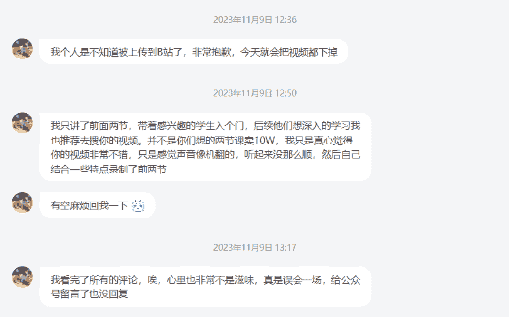
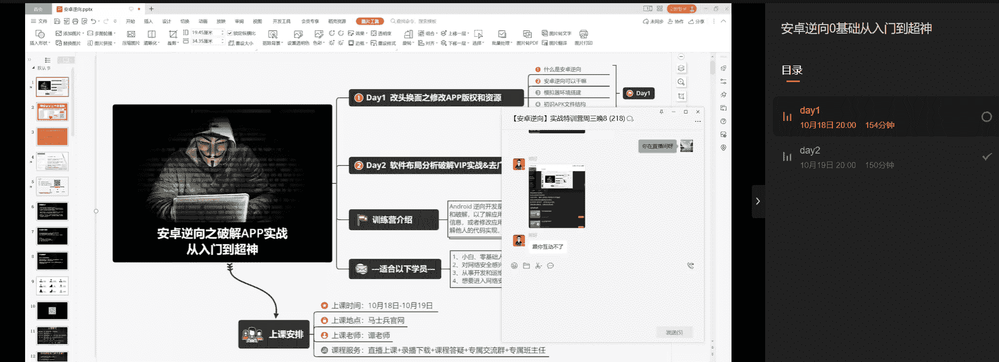

# [Android 原创] 《安卓逆向这档事》十六、是时候学习一下Frida一把梭了(终)

- 原帖：https://www.52pojie.cn/forum.php?mod=viewthread&tid=1859820
- 抓取时间：2026-11-01T21:38:05


## 题外话（盗课后续）

吃瓜地址：[https://www.52pojie.cn/thread-1854492-1-1.html](https://www.52pojie.cn/thread-1854492-1-1.html)

盗版课程地址：[https://www.mashibing.com/live/2520](https://www.mashibing.com/live/2520)






PS：感谢北京金诚同达（沈阳）律师事务所-黄律师一直无偿帮我解疑

吾爱破解论坛官方B站号：[https://space.bilibili.com/544451485](https://space.bilibili.com/544451485)

我的B站号：[https://space.bilibili.com/337859280](https://space.bilibili.com/337859280)

《安卓逆向这档事》视频教程地址：[https://www.bilibili.com/video/BV1wT411N7sV](https://www.bilibili.com/video/BV1wT411N7sV)

教程开源地址：[https://github.com/ZJ595/AndroidReverse](https://github.com/ZJ595/AndroidReverse)

## 一、课程目标

1. 了解Frida-Native-Hook读写、主动调用
2. 了解常见的`frida_trace`工具
3. 了解控制流混淆对抗新思路

## 二、工具

1. 教程Demo(更新)
2. `jadx-gui`
3. VS Code
4. `jeb`

## 三、课程内容

### 1.Frida写数据

```javascript
//一般写在app的私有目录里，不然会报错:failed to open file (Permission denied)(实际上就是权限不足)
var file_path = "/data/user/0/com.zj.wuaipojie/test.txt";
var file_handle = new File(file_path, "wb");
if (file_handle && file_handle != null) {
        file_handle.write(data); //写入数据
        file_handle.flush(); //刷新
        file_handle.close(); //关闭
}
```

### 2.Frida_inlineHook与读写汇编

什么是inlinehook？

Inline hook（内联钩子）是一种在程序运行时修改函数执行流程的技术。它通过修改函数的原始代码，将目标函数的执行路径重定向到自定义的代码段，从而实现对目标函数的拦截和修改。

简单来说就是可以对任意地址的指令进行hook读写操作。

常见inlinehook框架：

- [https://github.com/ele7enxxh/Android-Inline-Hook](https://github.com/ele7enxxh/Android-Inline-Hook)
- [https://github.com/asLody/whale](https://github.com/asLody/whale)
- [https://github.com/jmpews/Dobby](https://github.com/jmpews/Dobby)
- [http://www.cydiasubstrate.com/](http://www.cydiasubstrate.com/)

PS：Frida的inlinehook不是太稳定，崩溃是基操，另外新版的frida兼容性会比较好

```javascript
function inline_hook() {
    var soAddr = Module.findBaseAddress("lib52pojie.so");
    if (soAddr) {
        var func_addr = soAddr.add(0x10428);
        Java.perform(function () {
            Interceptor.attach(func_addr, {
                onEnter: function (args) {
                    console.log(this.context.x22); //注意此时就没有args概念了
                    this.context.x22 = ptr(1); //赋值方法参考上一节课
                },
                onLeave: function (retval) {
                }
            }
            )
        })
    }
}
```

将地址的指令解析成汇编：

```javascript
var soAddr = Module.findBaseAddress("lib52pojie.so");
var codeAddr = Instruction.parse(soAddr.add(0x10428));
console.log(codeAddr.toString());
```

Frida Api：[https://armconverter.com/](https://armconverter.com/)

```javascript
var soAddr = Module.findBaseAddress("lib52pojie.so");
var codeAddr = soAddr.add(0x10428);
Memory.patchCode(codeAddr, 4, function(code) {
const writer = new Arm64Writer(code, { pc: codeAddr });
writer.putBytes(hexToBytes("20008052"));
writer.flush();
});
function hexToBytes(str) {
var pos = 0;
var len = str.length;
if (len % 2 != 0) {
    return null;
}
len /= 2;
var hexA = new Array();
for (var i = 0; i
```

### 3.普通函数与jni函数的主动调用

[https://frida.re/docs/javascript-api/#nativefunction](https://frida.re/docs/javascript-api/#nativefunction)

| 数据类型 | 描述 |
| --- | --- |
| `void` |  |
