# [Android 原创] 新手入门，某作文应用 `sign` 参数分析

- 原帖：<https://www.52pojie.cn/forum.php?mod=viewthread&tid=1860448>
- 抓取时间：2026-11-01T21:38:00

## 抓包与初步观察

安装，开启 charles，打开 app。

然后随机点击一篇文章。

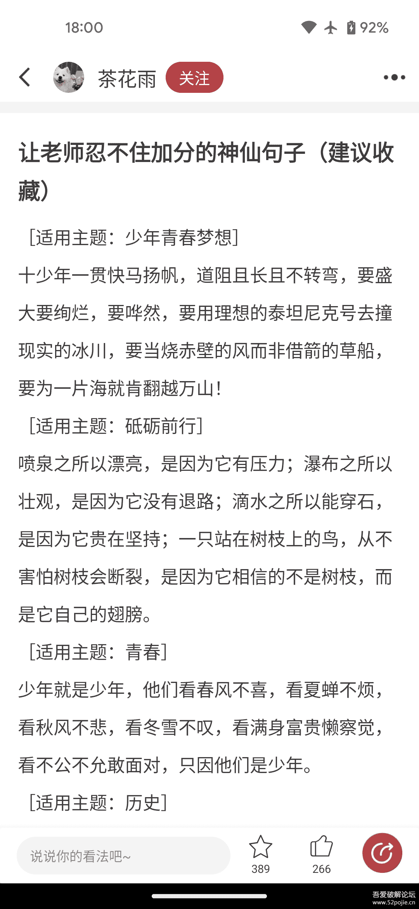

查看 charles，发现请求有 `sign` 参数（图片已脱敏处理）。

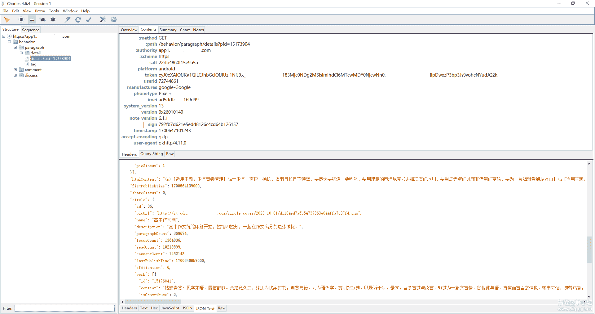

## 查壳与脱壳

查壳。

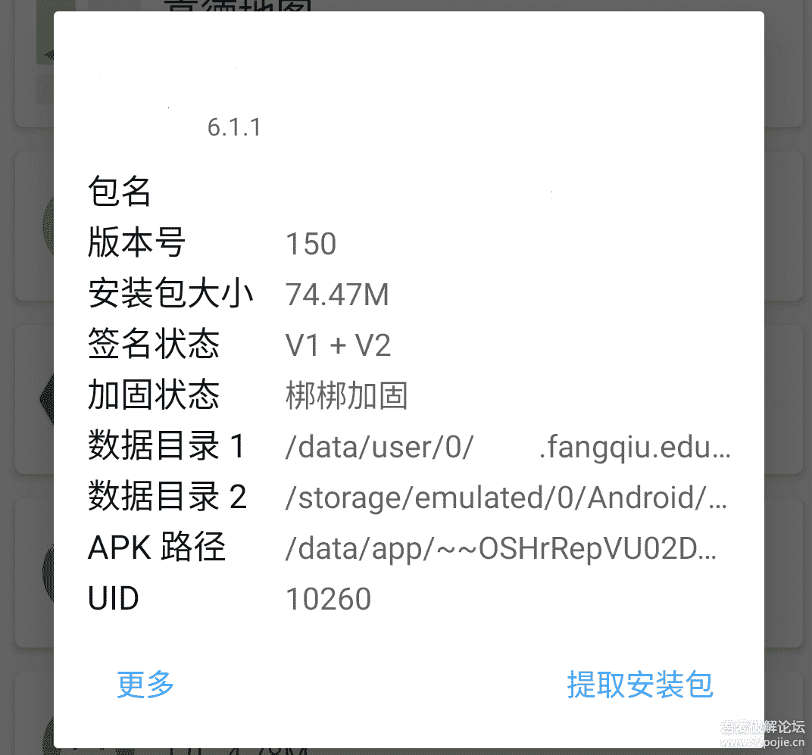

壳代码。

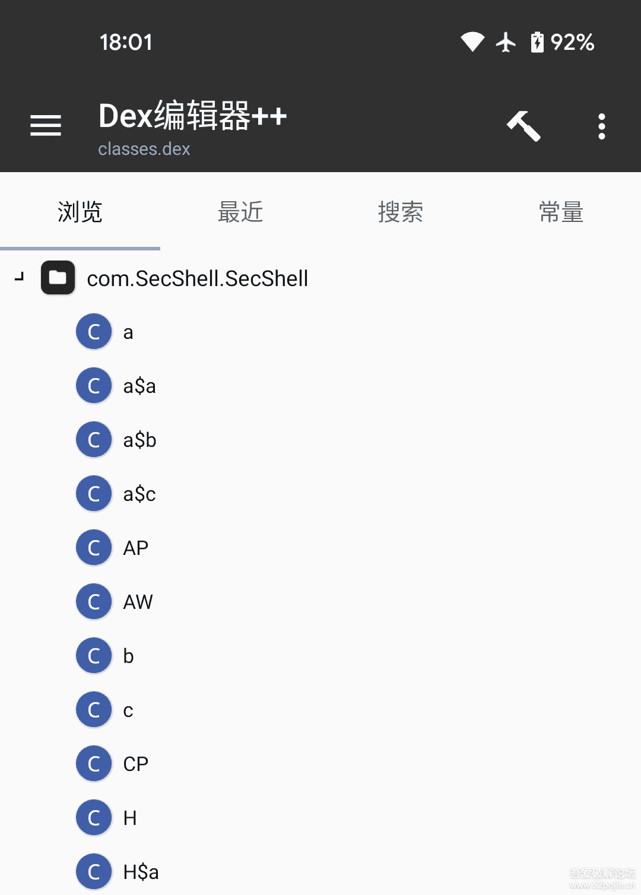

（不是本文重点，这里略过）打开脱壳的 `dex`。

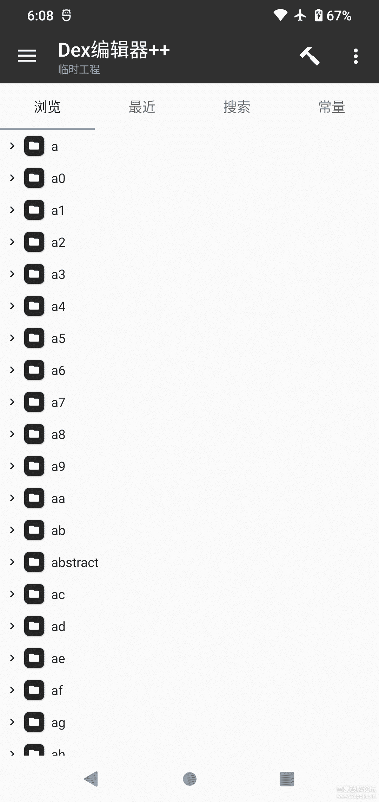

## 定位 `sign` 生成逻辑

搜索字符串 `sign`。

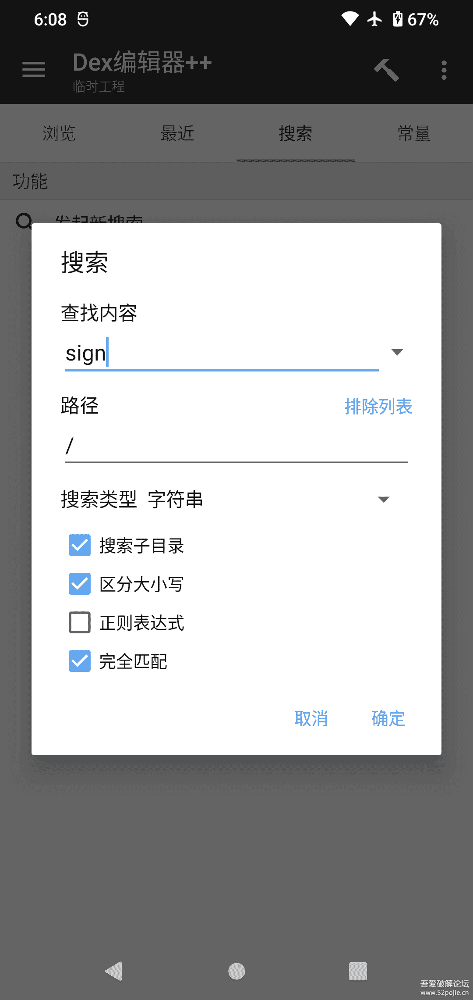

结果很多。

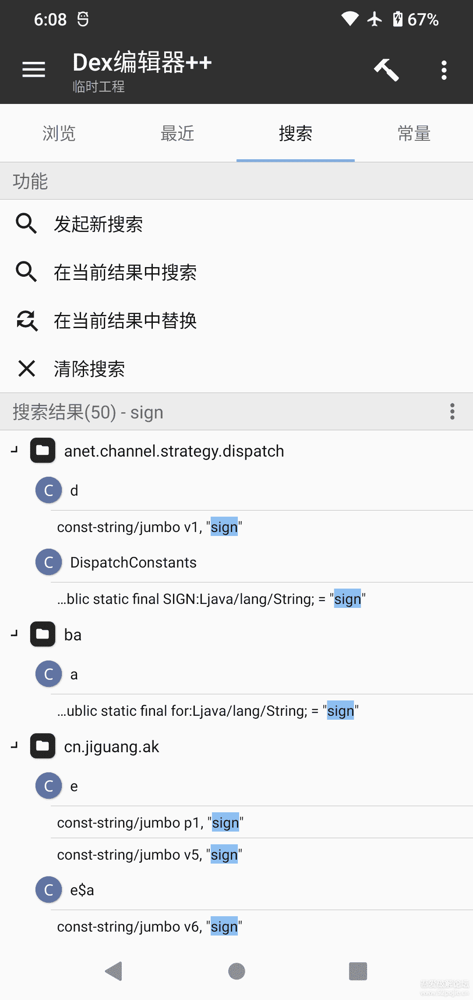

继续搜索 `timestamp`。

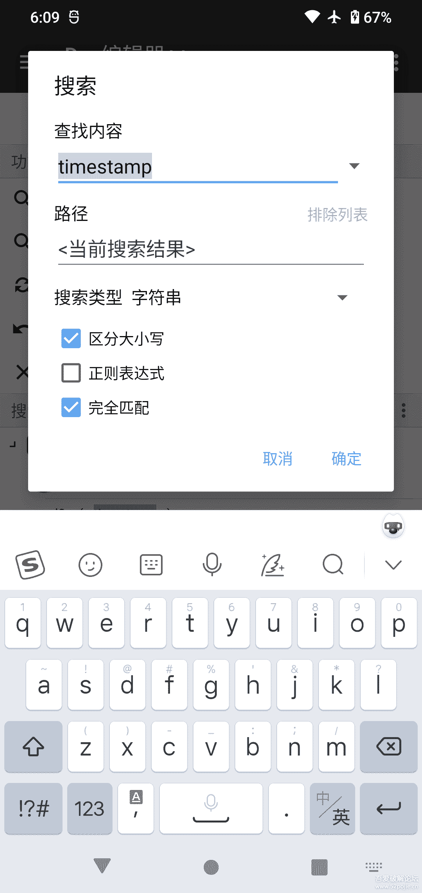

搜索结果只有几个，这里暂时不分析其他结果（与加密无关的类），直接打开最后那个类，转成 `java` 代码。

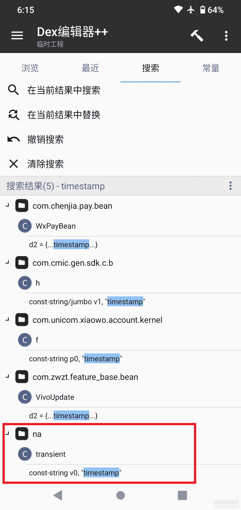

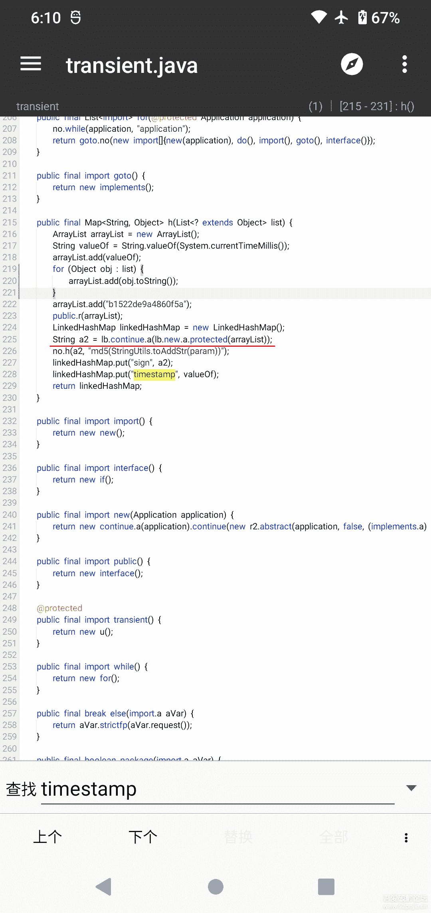

可以看到 `sign` 参数由此方法生成。切换 `smail` 跳转过去。

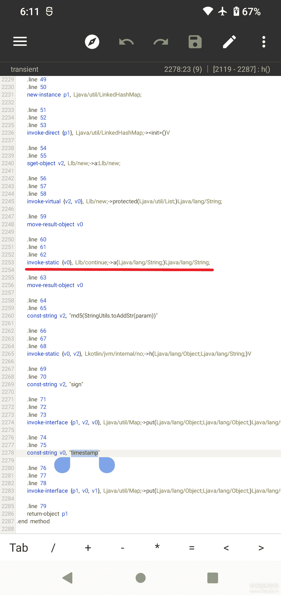

标准 `MD5`，反编译有点问题，应为 `int`。

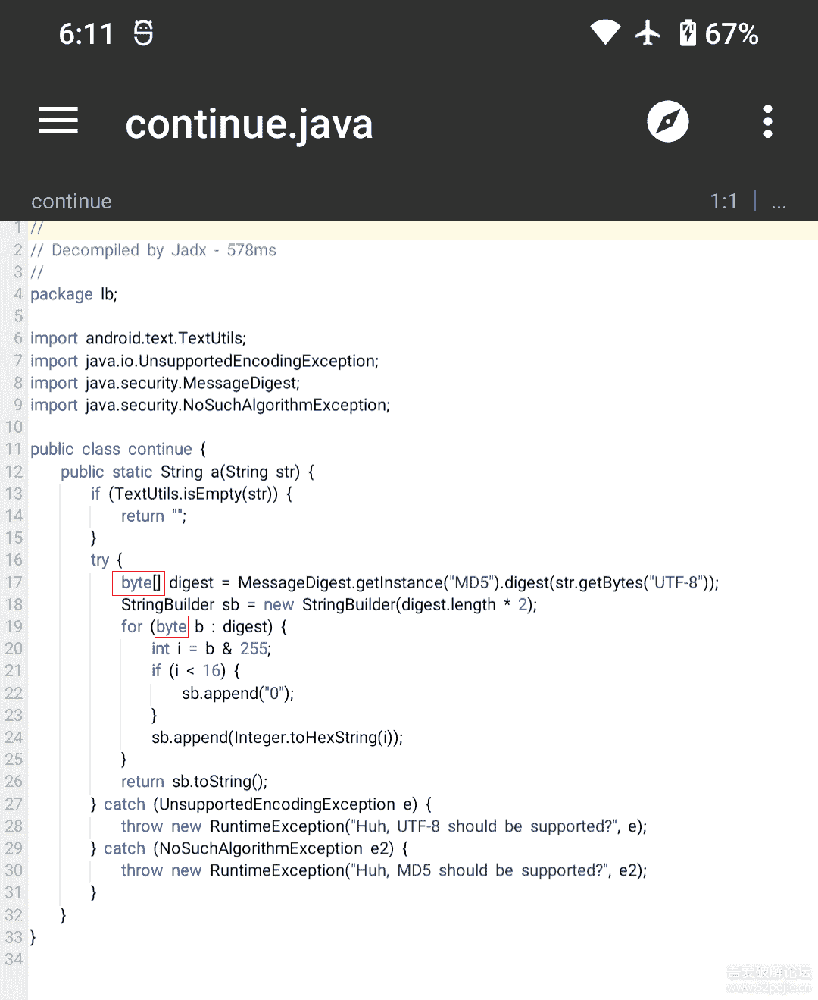

看看 `protected` 方法。

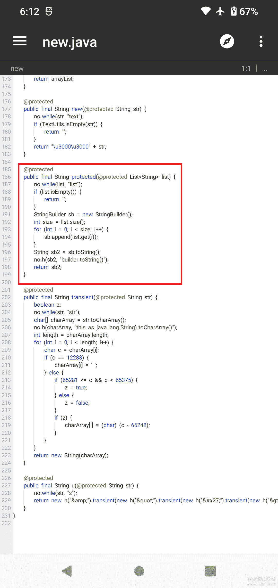

把 `List` 转成了 `String`。

## 结束

分析结束，谢谢大家。

本文仅供学习交流，其他用途后果自负。

新人第一篇，如有不足，敬请指正。
