# [Android 原创] 记一次蓝狐视频系列的逆向

- 原帖: https://www.52pojie.cn/forum.php?mod=viewthread&tid=1862995
- 抓取时间: 2026-11-01T21:36:41

## 工具

本次在PC端实现，但PC端的解包工具修改并未有Android端的管理器好用，故在模拟器完成

用到的工具有MT管理器、算法助手、`jadx`

## 正文开始

### 过root检测

先注明一下，修改前先过签名校验（MT管理器或者NP管理器都有提供这个一键功能），原因看文章就会知道了

（1）先试试直接打开APP，发现闪退（注明，设备已root）

（2）进算法助手拦截闪退看看，顺便定位闪退位置（这里提一下，定位是修改的基础，你只有定位到了修改点才能修改，所以掌握定位手法是逆向比较重要的一环）

image-20231128125542646.png (112.82 KB, 下载次数: 3)
[附件](https://www.52pojie.cn/forum.php?mod=attachment&aid=MjY2MDI4NHwzYTVkZTRmMXwxNzkzNTY4OTk5fDE2ODA4NnwxODYyOTk1&nothumb=yes)
2023-11-29 12:17 上传

（3）点右上角打开软件，发现卡住在启动界面

image-20231128130058810.png (83.84 KB, 下载次数: 2)
[附件](https://www.52pojie.cn/forum.php?mod=attachment&aid=MjY2MDI4NXwzNWQ2ZGE2MHwxNzkzNTY4OTk5fDE2ODA4NnwxODYyOTk1&nothumb=yes)
2023-11-29 12:17 上传

（4）进算法助手查看拦截日志，发现在启动类的`initData`(初始化数据)方法里面执行了`finish`

image-20231128130156358.png (56.52 KB, 下载次数: 2)
[附件](https://www.52pojie.cn/forum.php?mod=attachment&aid=MjY2MDI4NnxhM2YyYWQ2Y3wxNzkzNTY4OTk5fDE2ODA4NnwxODYyOTk1&nothumb=yes)
2023-11-29 12:17 上传

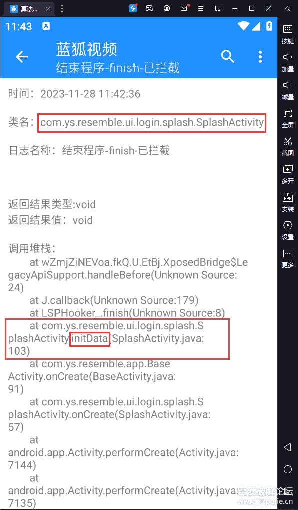
image-20231128130303145.png (190.64 KB, 下载次数: 3)
[附件](https://www.52pojie.cn/forum.php?mod=attachment&aid=MjY2MDI4N3w5YmViYmFmY3wxNzkzNTY4OTk5fDE2ODA4NnwxODYyOTk1&nothumb=yes)
2023-11-29 12:17 上传

（5）接下来将安装包拉到`jadx`里面解包并搜索这个类名定位方法（MT类名搜索一样的，不过没有我这登录转不了Java）

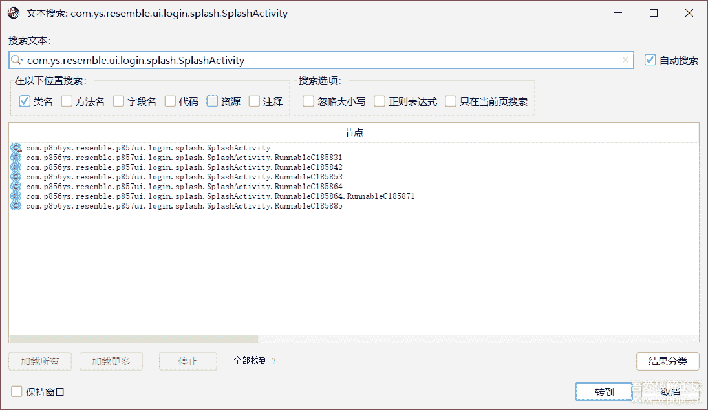
image-20231128155120498.png (70.29 KB, 下载次数: 1)
[附件](https://www.52pojie.cn/forum.php?mod=attachment&aid=MjY2MDI4OXw1YmRiNmNjOHwxNzkzNTY4OTk5fDE2ODA4NnwxODYyOTk1&nothumb=yes)
2023-11-29 12:19 上传

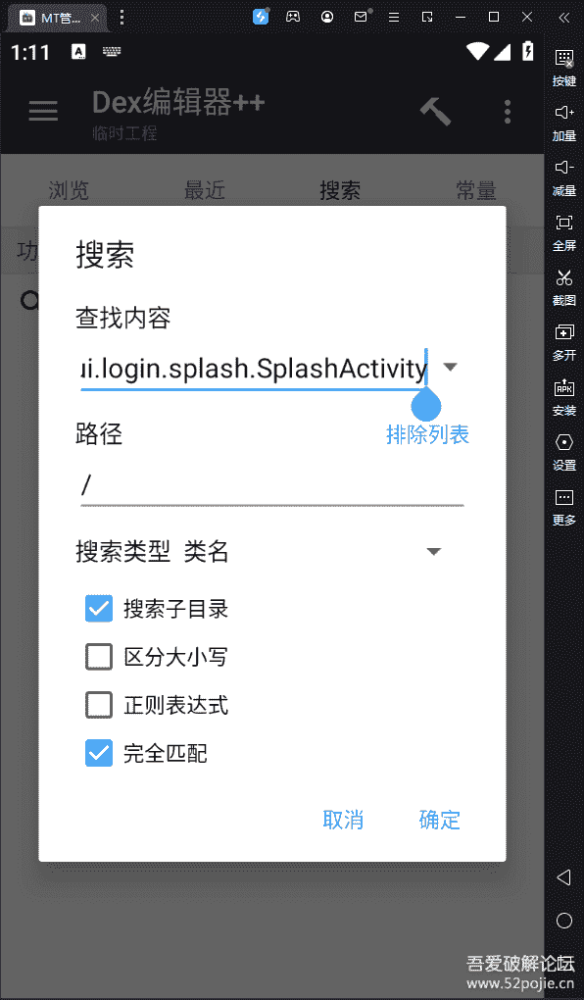
image-20231128155856940.png (90.1 KB, 下载次数: 4)
[附件](https://www.52pojie.cn/forum.php?mod=attachment&aid=MjY2MDI4OHw4OGI2M2ExOHwxNzkzNTY4OTk5fDE2ODA4NnwxODYyOTk1&nothumb=yes)
2023-11-29 12:19 上传

image-20231128155943284.png (97.53 KB, 下载次数: 2)
[附件](https://www.52pojie.cn/forum.php?mod=attachment&aid=MjY2MDI5MXw3YWE5ODE1OHwxNzkzNTY4OTk5fDE2ODA4NnwxODYyOTk1&nothumb=yes)
2023-11-29 12:22 上传

（6）MT就转Java，我这`jadx`就直接看这个闪退的方法，发现很明显的有两个判断，这里有两个选择

1. 把这两个`if`语句删除，让它直接跳过这两个`finish`从而进入软件，但是你不能保证后面在其他活动里面它再次调用的时候它还是`false`
2. 将这里的`if`语句的判断方法赋值`false`，后面再检测也将会是`false`

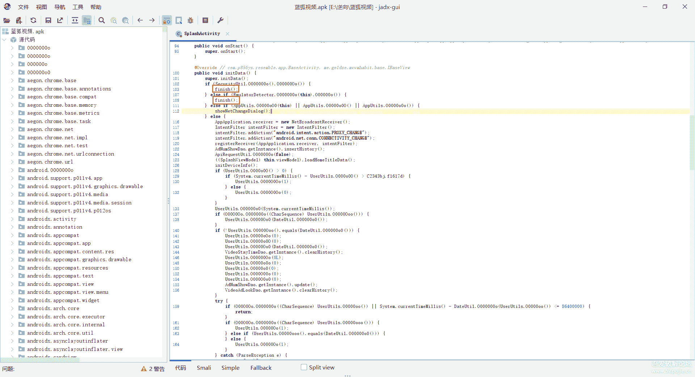
image-20231128155458321.png (274.42 KB, 下载次数: 2)
[附件](https://www.52pojie.cn/forum.php?mod=attachment&aid=MjY2MDI5MHw1YzUzMTNjYXwxNzkzNTY4OTk5fDE2ODA4NnwxODYyOTk1&nothumb=yes)
2023-11-29 12:19 上传

（7）安卓`ctrl`键并点击第一个判断方法跳转查看

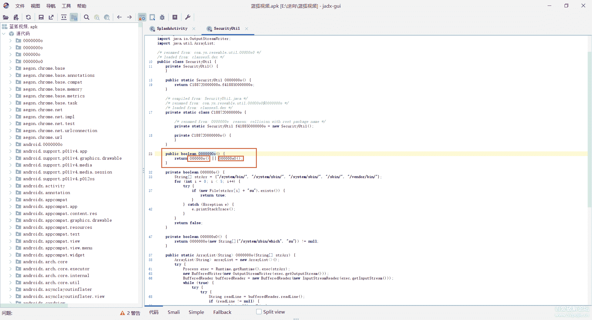
image-20231128160726901.png (245.76 KB, 下载次数: 2)
[附件](https://www.52pojie.cn/forum.php?mod=attachment&aid=MjY2MDI5MnwyNGZjZjI1Y3wxNzkzNTY4OTk5fDE2ODA4NnwxODYyOTk1&nothumb=yes)
2023-11-29 12:24 上传

发现这里第一个判断方法是由两个方法组成，两个任意一个返回`true`将会返回`true`，所以要将这两个方法都返回`false`

所以，依旧是按住`ctrl`键跳转，发现是这个方法，通过阅读发现它循环这几个路径查看是否有`su`文件，这个是常见的root检测手段

所以第一个`finish`是用来检测root的

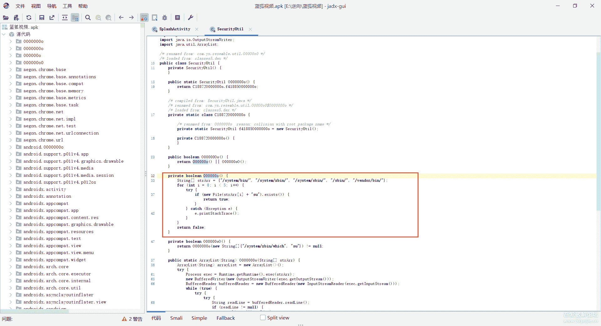
image-20231128160941766.png (246.55 KB, 下载次数: 3)
[附件](https://www.52pojie.cn/forum.php?mod=attachment&aid=MjY2MDI5M3xlYTRkMWE1N3wxNzkzNTY4OTk5fDE2ODA4NnwxODYyOTk1&nothumb=yes)
2023-11-29 12:24 上传

跳转另外一个方法，通过阅读代码可以判断依旧是root检测的代码

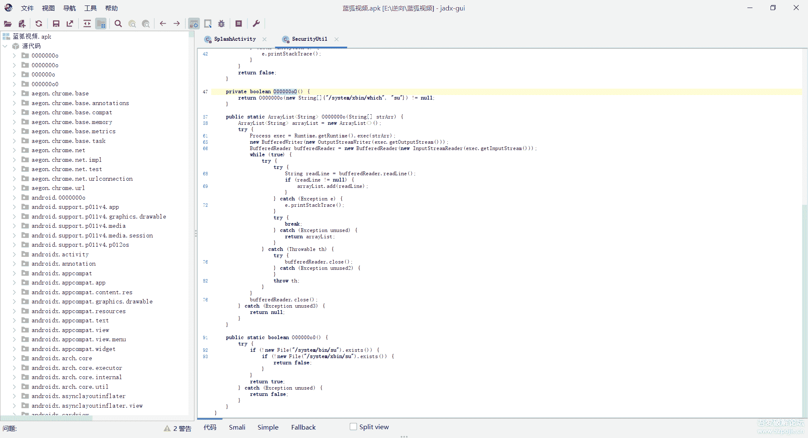
image-20231128161354298.png (226.02 KB, 下载次数: 2)
[附件](https://www.52pojie.cn/forum.php?mod=attachment&aid=MjY2MDI5NHw3MWY1ZWQ3N3wxNzkzNTY4OTk5fDE2ODA4NnwxODYyOTk1&nothumb=yes)
2023-11-29 12:26 上传

接下来用MT管理器进行修改

找到`initData`方法并找到第一条`if`判断的是`v0`，并且`v0`调用的方法是返回一个布尔值，故跳转这个方法

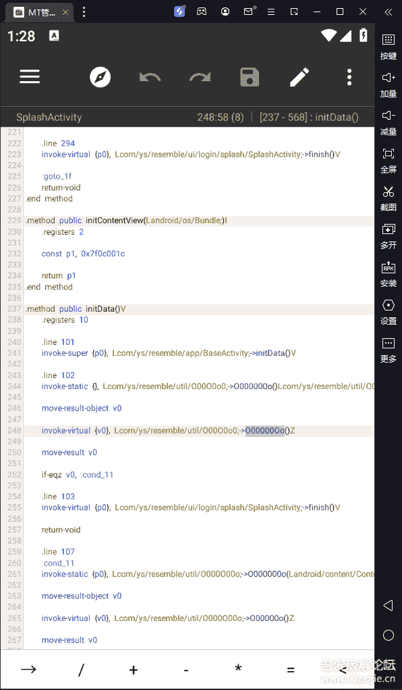
image-20231128161704199.png (170.81 KB, 下载次数: 3)
[附件](https://www.52pojie.cn/forum.php?mod=attachment&aid=MjY2MDI5NnxlMWE0Mjc1OHwxNzkzNTY4OTk5fDE2ODA4NnwxODYyOTk1&nothumb=yes)
2023-11-29 12:27 上传

跳转到后发现确实和之前分析的一样，拥有两个返回布尔值的方法，也就是检测root的那两个方法，两个方法跳转并更改

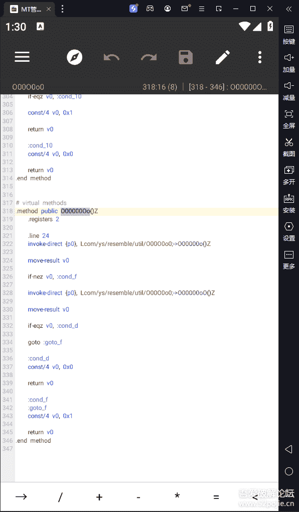
image-20231128161859594.png (117.46 KB, 下载次数: 2)
[附件](https://www.52pojie.cn/forum.php?mod=attachment&aid=MjY2MDI5N3w4ZmUxM2Q5MnwxNzkzNTY4OTk5fDE2ODA4NnwxODYyOTk1&nothumb=yes)
2023-11-29 12:27 上传

跳转第一个方法

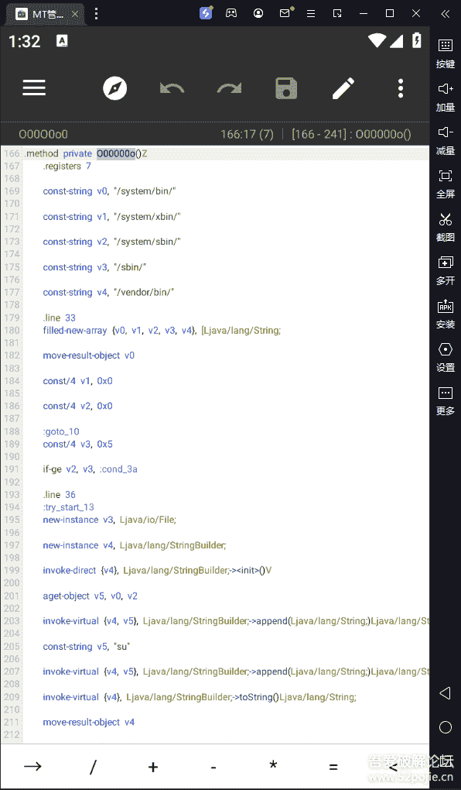
image-20231128162023330.png (158.63 KB, 下载次数: 2)
[附件](https://www.52pojie.cn/forum.php?mod=attachment&aid=MjY2MDI5OHxkYjMyMGJkM3wxNzkzNTY4OTk5fDE2ODA4NnwxODYyOTk1&nothumb=yes)
2023-11-29 12:27 上传

发现返回有两种可能，一个是`v1`，一个是`v0`，`v1`上面看是赋值0，所以只需要改`v0`这个返回结果为0就实现了都返回`false`了，不清楚这样改的意义的可以改完以后转Java查看一下

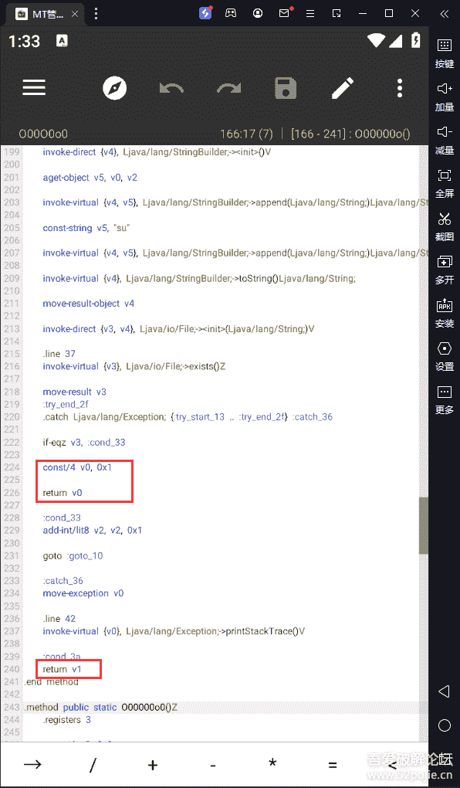
image-20231128162250105.png (166.07 KB, 下载次数: 3)
[附件](https://www.52pojie.cn/forum.php?mod=attachment&aid=MjY2MDI5OXw3MjNiMGJkMnwxNzkzNTY4OTk5fDE2ODA4NnwxODYyOTk1&nothumb=yes)
2023-11-29 12:27 上传

改成这样

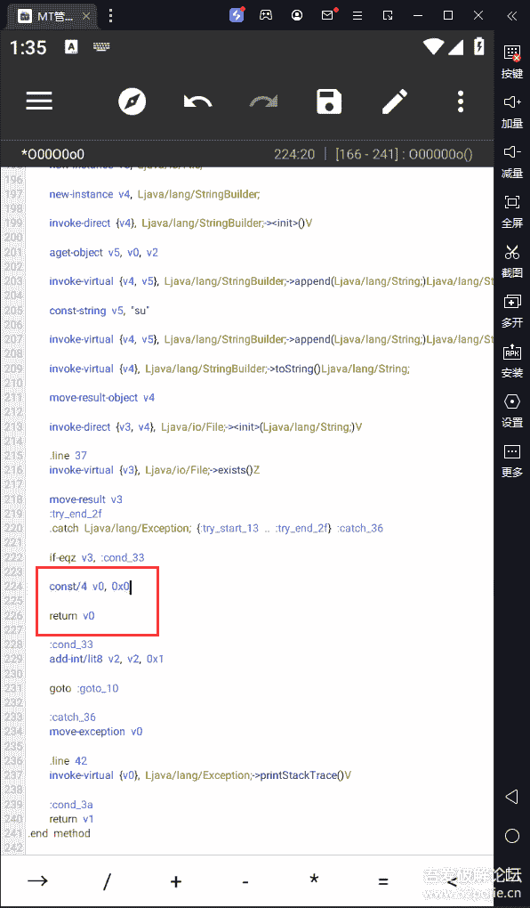
image-20231128162333161.png (165.84 KB, 下载次数: 2)
[附件](https://www.52pojie.cn/forum.php?mod=attachment&aid=MjY2MDMwMHw2ZmY4ZDc3N3wxNzkzNTY4OTk5fDE2ODA4NnwxODYyOTk1&nothumb=yes)
2023-11-29 12:27 上传

然后跳转第二个方法

这个返回就更明显了，直接就是`v0`，直接将前面的`v0`赋值0就OK了

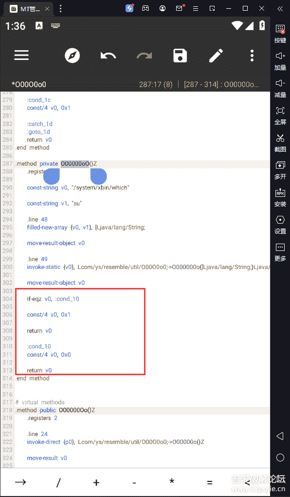
image-20231128162524012.png (137.83 KB, 下载次数: 3)
[附件](https://www.52pojie.cn/forum.php?mod=attachment&aid=MjY2MDMwMXw0YjZlN2Q5NnwxNzkzNTY4OTk5fDE2ODA4NnwxODYyOTk1&nothumb=yes)
2023-11-29 12:27 上传

改成

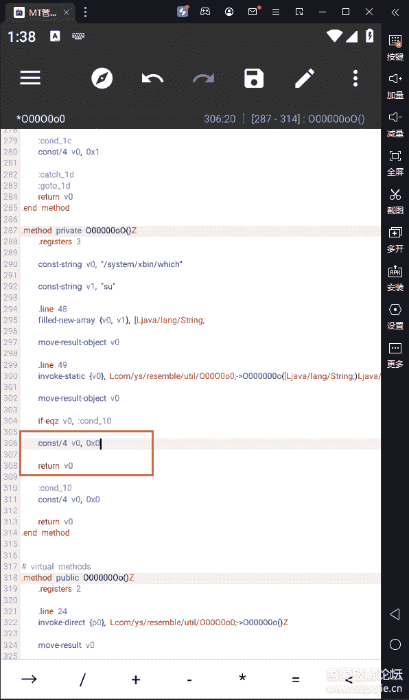
image-20231128162546483.png (136.97 KB, 下载次数: 3)

[href="forum.php?mod=attachment&aid=MjY2MDI5NXw5ZTg4MDg3ZHwxNzkzNTY4OTk5fDE2ODA4NnwxODYyOTk1&nothumb=yes" target="_blank"](https://www.52pojie.cn/forum.php?mod=attachment&aid=MjY2MDI5NXw5ZTg4MDg3ZHwxNzkzNTY4OTk5fDE2ODA4NnwxODYyOTk1&nothumb=yes)

2023-11-29 12:27 上传

这样这两个方法都返回false了，所以这个方法也会返回false，也就是过了root检测了，正常root闪退手机就能进去了

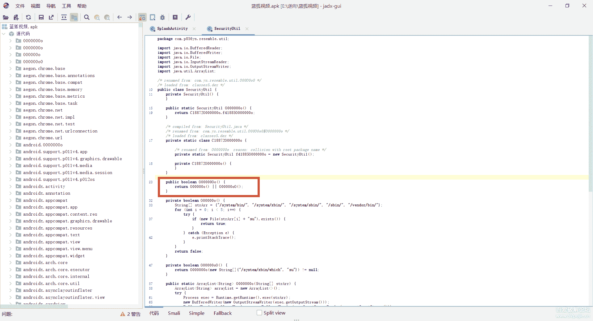
`image-20231128162650538.png` (248 KB, 下载次数: 1)

[href="forum.php?mod=attachment&aid=MjY2MDMwM3xjYzhlOGRjNXwxNzkzNTY4OTk5fDE2ODA4NnwxODYyOTk1&nothumb=yes" target="_blank"](https://www.52pojie.cn/forum.php?mod=attachment&aid=MjY2MDMwM3xjYzhlOGRjNXwxNzkzNTY4OTk5fDE2ODA4NnwxODYyOTk1&nothumb=yes)

2023-11-29 12:31 上传

## 过虚拟机检测

（1）过完root检测我重新打包安装并打开该软件，发现依旧闪退，而且闪退位置依旧是那个位置，这不得不怀疑是第二个`finish`

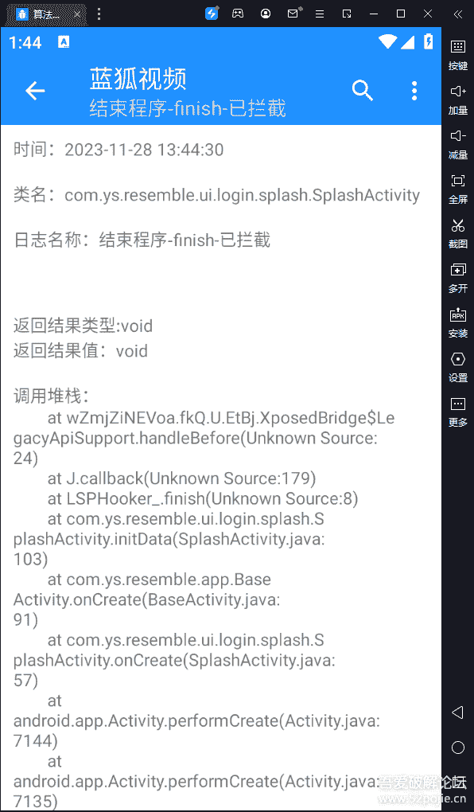
`image-20231128163224874.png` (190.71 KB, 下载次数: 2)

[href="forum.php?mod=attachment&aid=MjY2MDMwNHwyZmNjYjM3YXwxNzkzNTY4OTk5fDE2ODA4NnwxODYyOTk1&nothumb=yes" target="_blank"](https://www.52pojie.cn/forum.php?mod=attachment&aid=MjY2MDMwNHwyZmNjYjM3YXwxNzkzNTY4OTk5fDE2ODA4NnwxODYyOTk1&nothumb=yes)

2023-11-29 12:31 上传

（2）如之前操作并跳转第二个判断方法

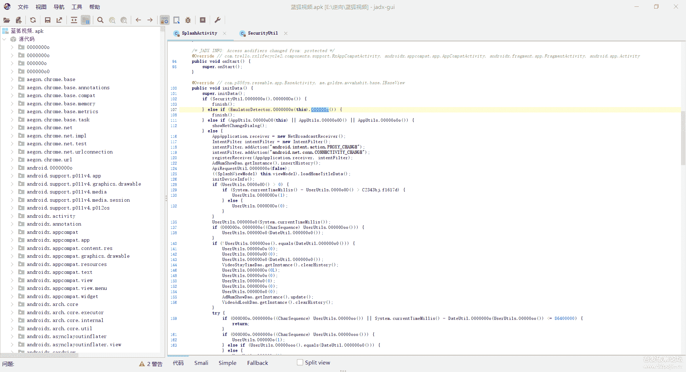
`image-20231128163340904.png` (281.06 KB, 下载次数: 3)

[href="forum.php?mod=attachment&aid=MjY2MDMwNXxkMDgxNDliOHwxNzkzNTY4OTk5fDE2ODA4NnwxODYyOTk1&nothumb=yes" target="_blank"](https://www.52pojie.cn/forum.php?mod=attachment&aid=MjY2MDMwNXxkMDgxNDliOHwxNzkzNTY4OTk5fDE2ODA4NnwxODYyOTk1&nothumb=yes)

2023-11-29 12:32 上传

发现有多个判断条件

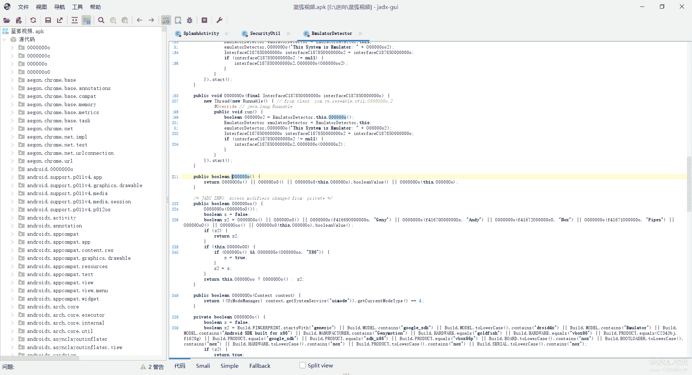
`image-20231128163413564.png` (281.2 KB, 下载次数: 3)

[href="forum.php?mod=attachment&aid=MjY2MDMwNnw2YzQwY2M1YnwxNzkzNTY4OTk5fDE2ODA4NnwxODYyOTk1&nothumb=yes" target="_blank"](https://www.52pojie.cn/forum.php?mod=attachment&aid=MjY2MDMwNnw2YzQwY2M1YnwxNzkzNTY4OTk5fDE2ODA4NnwxODYyOTk1&nothumb=yes)

2023-11-29 12:32 上传

让我们逐个查看

首先看第一个

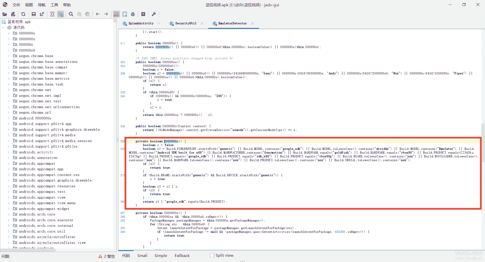
`image-20231128163523807.png` (266.48 KB, 下载次数: 3)

[href="forum.php?mod=attachment&aid=MjY2MDMwN3wzZWNjNGMxMXwxNzkzNTY4OTk5fDE2ODA4NnwxODYyOTk1&nothumb=yes" target="_blank"](https://www.52pojie.cn/forum.php?mod=attachment&aid=MjY2MDMwN3wzZWNjNGMxMXwxNzkzNTY4OTk5fDE2ODA4NnwxODYyOTk1&nothumb=yes)

2023-11-29 12:33 上传

该方法首先检查了一系列与模拟器相关的特征，例如设备的型号（`Build.MODEL`）、制造商（`Build.MANUFACTURER`）、硬件信息（`Build.HARDWARE`）、产品信息（`Build.PRODUCT`）、串号（`Build.SERIAL`）等。如果其中任何一个特征满足模拟器的特征，则将标记为模拟器环境，并且返回true，这个很明显是一个虚拟机判断的方法。

我们接着看下面几个方法

`image-20231128164117363.png` (18.03 KB, 下载次数: 4)

[href="forum.php?mod=attachment&aid=MjY2MDMwOHxkNzAyNzljMnwxNzkzNTY4OTk5fDE2ODA4NnwxODYyOTk1&nothumb=yes" target="_blank"](https://www.52pojie.cn/forum.php?mod=attachment&aid=MjY2MDMwOHxkNzAyNzljMnwxNzkzNTY4OTk5fDE2ODA4NnwxODYyOTk1&nothumb=yes)

2023-11-29 12:33 上传

这个方法是用于检测特定条件的私有Java方法。

`image-20231128164205042.png` (16.05 KB, 下载次数: 3)

[href="forum.php?mod=attachment&aid=MjY2MDMwOXw2NDYzODRlY3wxNzkzNTY4OTk5fDE2ODA4NnwxODYyOTk1&nothumb=yes" target="_blank"](https://www.52pojie.cn/forum.php?mod=attachment&aid=MjY2MDMwOXw2NDYzODRlY3wxNzkzNTY4OTk5fDE2ODA4NnwxODYyOTk1&nothumb=yes)

2023-11-29 12:33 上传

这个方法是用来检查设备是否支持计步器传感器。

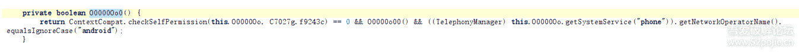
`image-20231128164015915.png` (21.82 KB, 下载次数: 3)

[href="forum.php?mod=attachment&aid=MjY2MDMxMHw3MDkzOWJjMXwxNzkzNTY4OTk5fDE2ODA4NnwxODYyOTk1&nothumb=yes" target="_blank"](https://www.52pojie.cn/forum.php?mod=attachment&aid=MjY2MDMxMHw3MDkzOWJjMXwxNzkzNTY4OTk5fDE2ODA4NnwxODYyOTk1&nothumb=yes)

2023-11-29 12:33 上传

这个方法是用于检查当前设备的 UI 模式是否为汽车模式。

这些方法通过大致判断都是用于检测你现在的环境是否是真机环境，不是真机环境将会闪退。

所以我们依旧进入MT管理器进行修改这些方法返回false值，实现过虚拟机检测

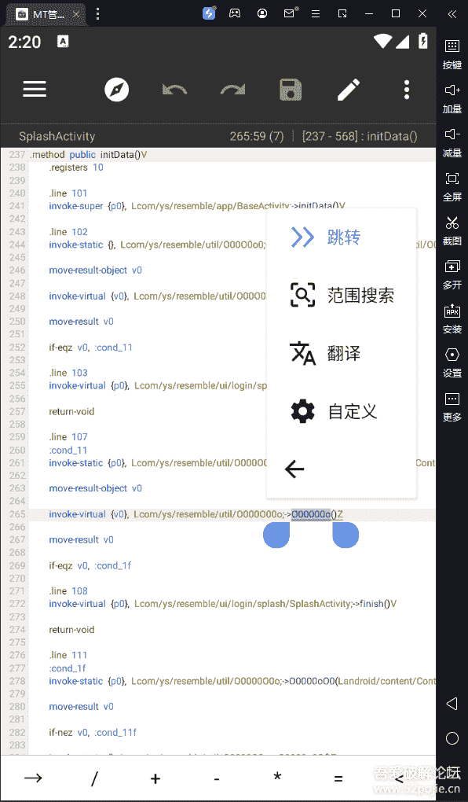
`image-20231128170831634.png` (177.49 KB, 下载次数: 3)

[href="forum.php?mod=attachment&aid=MjY2MDMxMXxmMDc1Mzk1M3wxNzkzNTY4OTk5fDE2ODA4NnwxODYyOTk1&nothumb=yes" target="_blank"](https://www.52pojie.cn/forum.php?mod=attachment&aid=MjY2MDMxMXxmMDc1Mzk1M3wxNzkzNTY4OTk5fDE2ODA4NnwxODYyOTk1&nothumb=yes)

2023-11-29 12:34 上传

剩下一个布尔值的方法，直接跳转

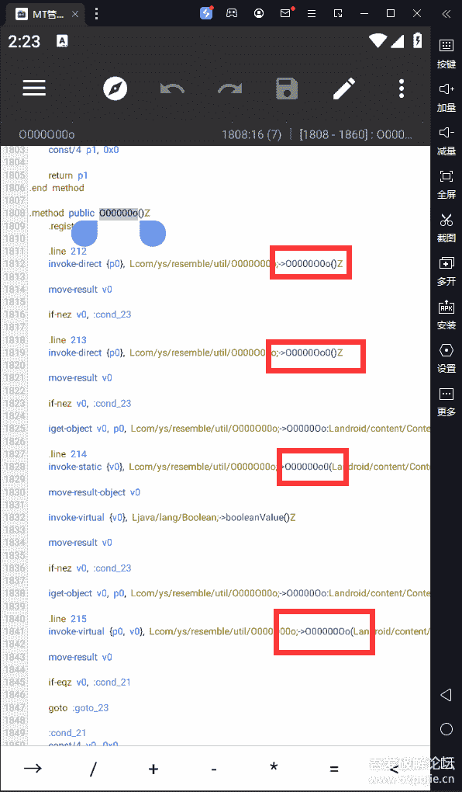
`image-20231128171122214.png` (171.84 KB, 下载次数: 3)

[href="forum.php?mod=attachment&aid=MjY2MDMxMnxkNDJkMDk4Y3wxNzkzNTY4OTk5fDE2ODA4NnwxODYyOTk1&nothumb=yes" target="_blank"](https://www.52pojie.cn/forum.php?mod=attachment&aid=MjY2MDMxMnxkNDJkMDk4Y3wxNzkzNTY4OTk5fDE2ODA4NnwxODYyOTk1&nothumb=yes)

2023-11-29 12:34 上传

将这几个都改成false

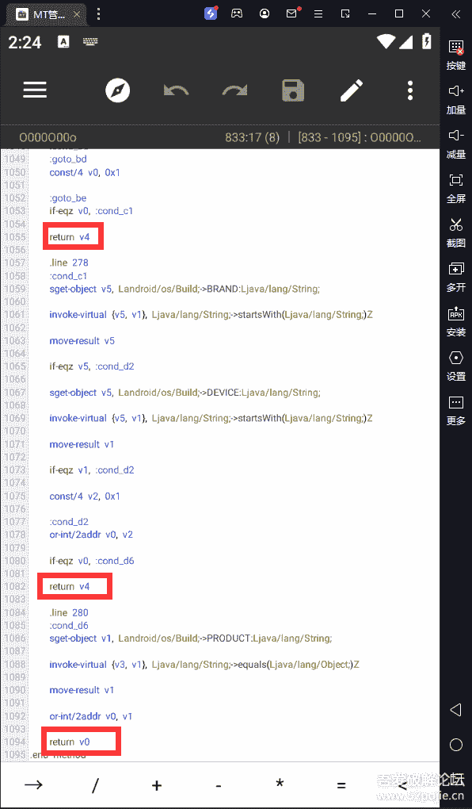
`image-20231128171241676.png` (151.43 KB, 下载次数: 2)

[href="forum.php?mod=attachment&aid=MjY2MDMxM3w4Yzk1NmZlMHwxNzkzNTY4OTk5fDE2ODA4NnwxODYyOTk1&nothumb=yes" target="_blank"](https://www.52pojie.cn/forum.php?mod=attachment&aid=MjY2MDMxM3w4Yzk1NmZlMHwxNzkzNTY4OTk5fDE2ODA4NnwxODYyOTk1&nothumb=yes)

2023-11-29 12:34 上传

第一个方法有三处是返回的，将对应返回的寄存器赋值0就好

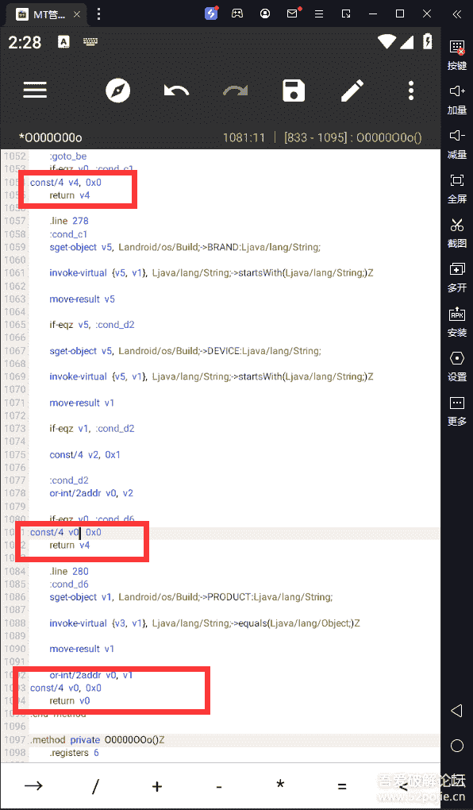
`image-20231128171606568.png` (156.6 KB, 下载次数: 2)

[href="forum.php?mod=attachment&aid=MjY2MDMxNHxhNTM2OGYwNHwxNzkzNTY4OTk5fDE2ODA4NnwxODYyOTk1&nothumb=yes" target="_blank"](https://www.52pojie.cn/forum.php?mod=attachment&aid=MjY2MDMxNHxhNTM2OGYwNHwxNzkzNTY4OTk5fDE2ODA4NnwxODYyOTk1&nothumb=yes)

2023-11-29 12:34 上传

第二个方法照样是直接赋值0就好，将红框里的赋值0

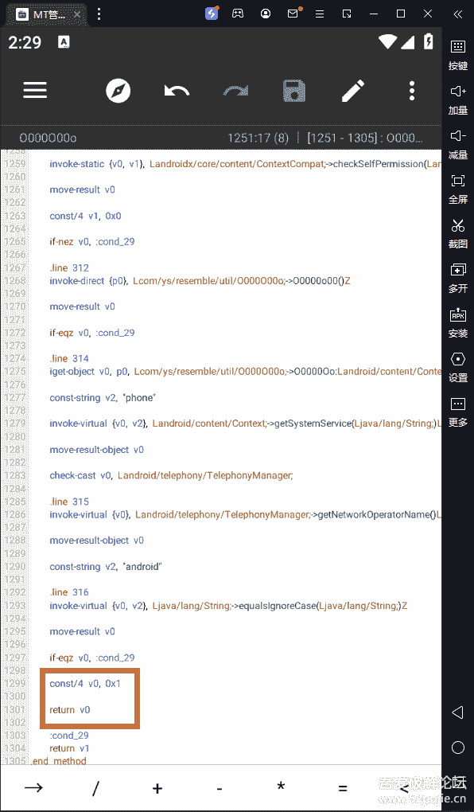
`image-20231128171731400.png` (171.23 KB, 下载次数: 3)

[href="forum.php?mod=attachment&aid=MjY2MDMxNXxlYWIyYjE3NXwxNzkzNTY4OTk5fDE2ODA4NnwxODYyOTk1&nothumb=yes" target="_blank"](https://www.52pojie.cn/forum.php?mod=attachment&aid=MjY2MDMxNXxlYWIyYjE3NXwxNzkzNTY4OTk5fDE2ODA4NnwxODYyOTk1&nothumb=yes)

2023-11-29 12:34 上传

第三个方法也是很明显有一个是返回true的地方，直接赋值0就好

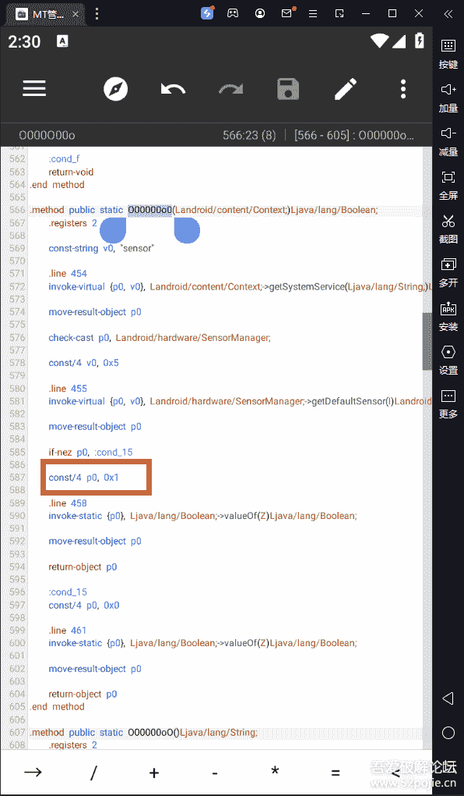
`image-20231128171949933.png` (168.89 KB, 下载次数: 3)

[href="forum.php?mod=attachment&aid=MjY2MDMxNnxlNjMyY2E0NHwxNzkzNTY4OTk5fDE2ODA4NnwxODYyOTk1&nothumb=yes" target="_blank"](https://www.52pojie.cn/forum.php?mod=attachment&aid=MjY2MDMxNnxlNjMyY2E0NHwxNzkzNTY4OTk5fDE2ODA4NnwxODYyOTk1&nothumb=yes)

2023-11-29 12:34 上传

第四个方法依旧是一样赋值就全部赋值完成了

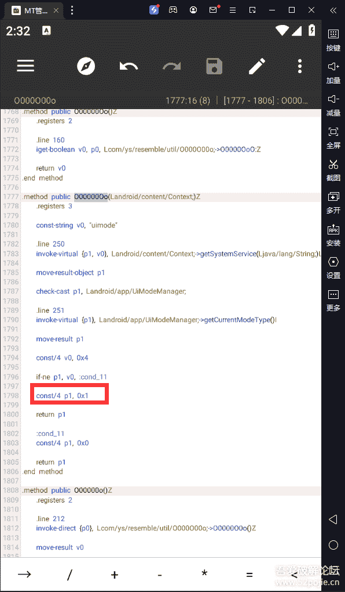
`image-20231128172054936.png` (155.65 KB, 下载次数: 3)

[href="forum.php?mod=attachment&aid=MjY2MDMxN3xmM2ZlZTViN3wxNzkzNTY4OTk5fDE2ODA4NnwxODYyOTk1&nothumb=yes" target="_blank"](https://www.52pojie.cn/forum.php?mod=attachment&aid=MjY2MDMxN3xmM2ZlZTViN3wxNzkzNTY4OTk5fDE2ODA4NnwxODYyOTk1&nothumb=yes)

2023-11-29 12:34 上传

（3）保存打包安装并打开，成功进入界面，不过就是广告有亿点点多

`image-20231128172250196.png` (347.5 KB, 下载次数: 2)

[href="forum.php?mod=attachment&aid=MjY2MDMyMHxiOWJmM2E4YnwxNzkzNTY4OTk5fDE2ODA4NnwxODYyOTk1&nothumb=yes" target="_blank"](https://www.52pojie.cn/forum.php?mod=attachment&aid=MjY2MDMyMHxiOWJmM2E4YnwxNzkzNTY4OTk5fDE2ODA4NnwxODYyOTk1&nothumb=yes)

2023-11-29 12:35 上传

## 去广告

（1）首先，点开软件会有一个开屏广告，这里会有一个活动跳转，那广告肯定是在两个活动的衔接代码之前，这样就可以定位广告代码在哪个类里面

（2）打开MT管理器的活动记录器来记录软件活动记录，并打开软件进行活动记录，发现一个很明显的广告标识

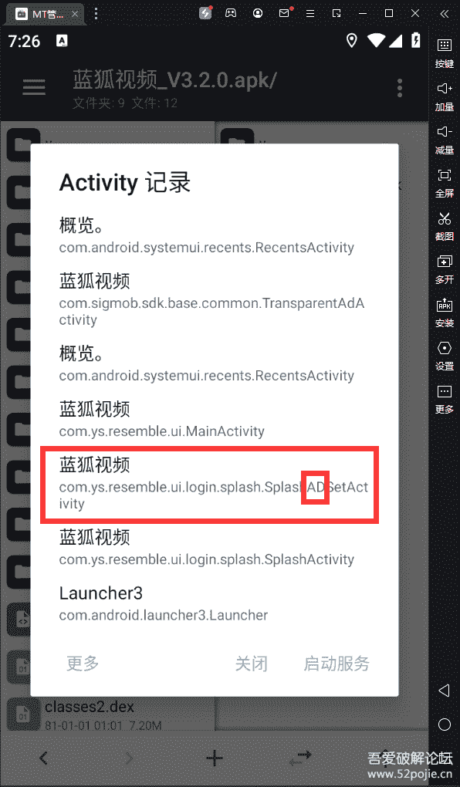
`image-20231128223225229.png` (148.55 KB, 下载次数: 2)

[href="forum.php?mod=attachment&aid=MjY2MDMyMXw2NzkzYTg1MnwxNzkzNTY4OTk5fDE2ODA4NnwxODYyOTk1&nothumb=yes" target="_blank"](https://www.52pojie.cn/forum.php?mod=attachment&aid=MjY2MDMyMXw2NzkzYTg1MnwxNzkzNTY4OTk5fDE2ODA4NnwxODYyOTk1&nothumb=yes)

2023-11-29 12:36 上传

（3）在jadx里面搜索这个类名并分析一下

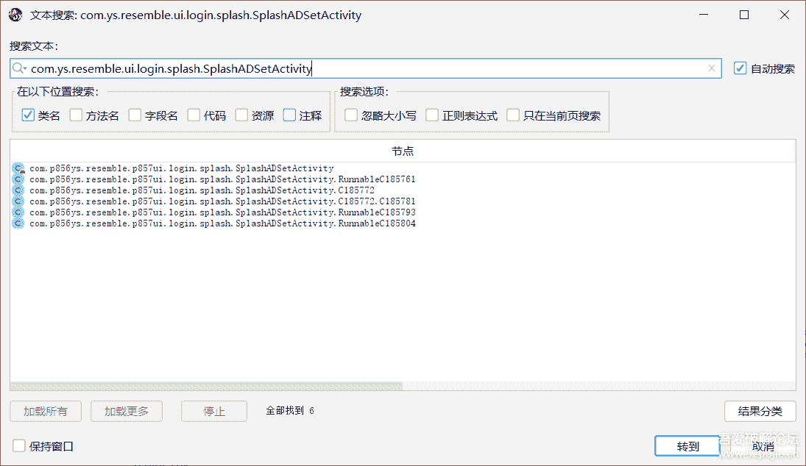
`image-20231128223430158.png` (67.55 KB, 下载次数: 1)

[`forum.php?mod=attachment&aid=MjY2MDMyM3xiY2M5ZTRjMnwxNzkzNTY4OTk5fDE2ODA4NnwxODYyOTk1&nothumb=yes`](https://www.52pojie.cn/forum.php?mod=attachment&aid=MjY2MDMyM3xiY2M5ZTRjMnwxNzkzNTY4OTk5fDE2ODA4NnwxODYyOTk1&nothumb=yes)

2023-11-29 12:36 上传

点进去发现有几个可疑的字眼

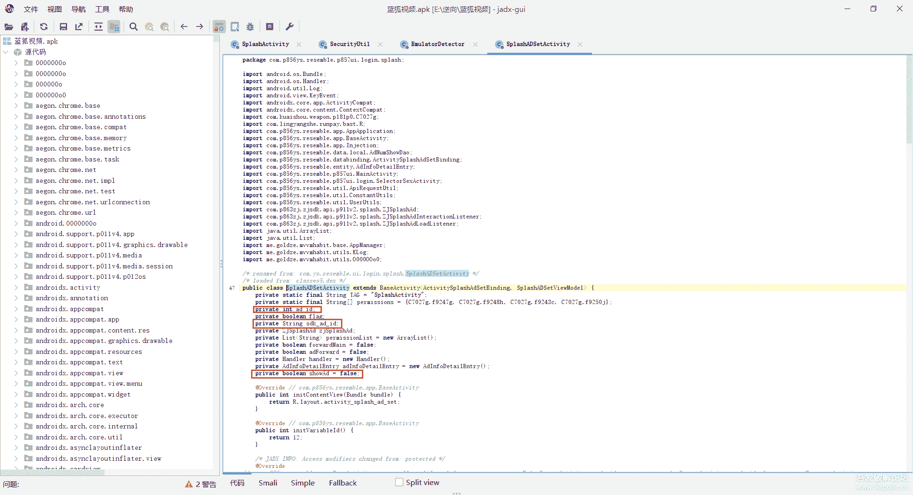

`image-20231128223557457.png` (320.7 KB, 下载次数: 4)

[`forum.php?mod=attachment&aid=MjY2MDMyNHwwOGExYmQ3ZXwxNzkzNTY4OTk5fDE2ODA4NnwxODYyOTk1&nothumb=yes`](https://www.52pojie.cn/forum.php?mod=attachment&aid=MjY2MDMyNHwwOGExYmQ3ZXwxNzkzNTY4OTk5fDE2ODA4NnwxODYyOTk1&nothumb=yes)

2023-11-29 12:37 上传

点击这些可疑字眼标记颜色看看在这个类哪里使用了，发现这个广告ID是通过一个类获取的，并且是在这个`initData`（初始化数据）方法里面，所以可以尝试不给正确的广告ID实现广告未初始化达到去广告的效果

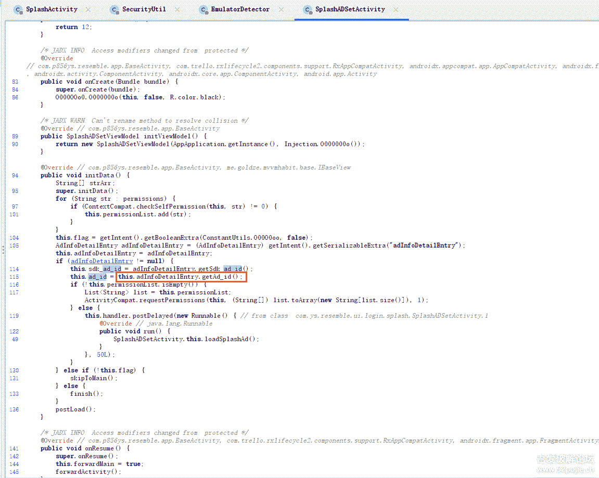

`image-20231128223843642.png` (166.53 KB, 下载次数: 3)

[`forum.php?mod=attachment&aid=MjY2MDMyNXw3ODM2YzVjN3wxNzkzNTY4OTk5fDE2ODA4NnwxODYyOTk1&nothumb=yes`](https://www.52pojie.cn/forum.php?mod=attachment&aid=MjY2MDMyNXw3ODM2YzVjN3wxNzkzNTY4OTk5fDE2ODA4NnwxODYyOTk1&nothumb=yes)

2023-11-29 12:38 上传

（4）进入MT管理器来修改ID来尝试是否有效

`image-20231128224247676.png` (102.42 KB, 下载次数: 4)

[`forum.php?mod=attachment&aid=MjY2MDMyOHxiZWY2ODM1OXwxNzkzNTY4OTk5fDE2ODA4NnwxODYyOTk1&nothumb=yes`](https://www.52pojie.cn/forum.php?mod=attachment&aid=MjY2MDMyOHxiZWY2ODM1OXwxNzkzNTY4OTk5fDE2ODA4NnwxODYyOTk1&nothumb=yes)

2023-11-29 12:38 上传

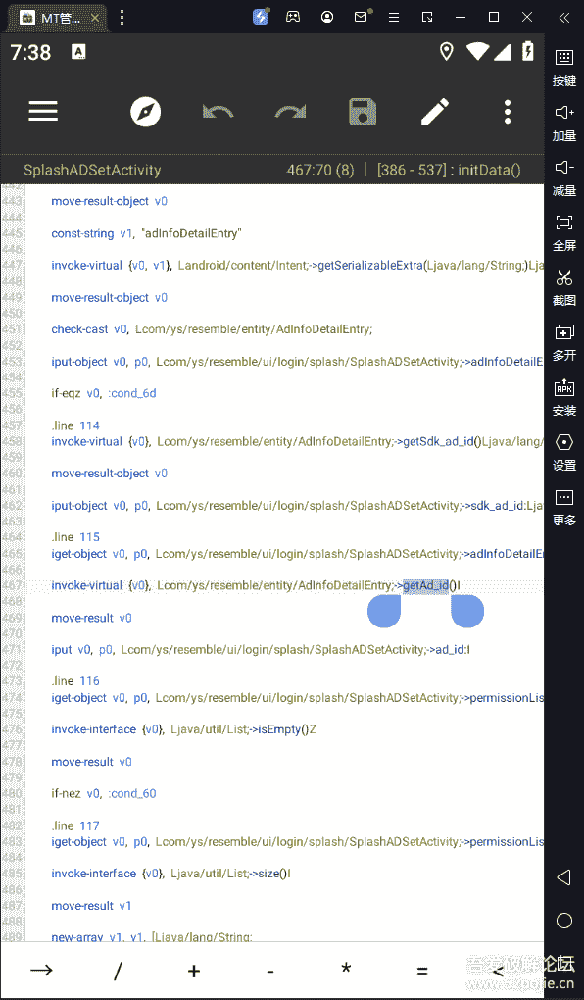

`image-20231128224418106.png` (208.65 KB, 下载次数: 3)

[`forum.php?mod=attachment&aid=MjY2MDMyNnwyZjZiNGYyM3wxNzkzNTY4OTk5fDE2ODA4NnwxODYyOTk1&nothumb=yes`](https://www.52pojie.cn/forum.php?mod=attachment&aid=MjY2MDMyNnwyZjZiNGYyM3wxNzkzNTY4OTk5fDE2ODA4NnwxODYyOTk1&nothumb=yes)

2023-11-29 12:38 上传

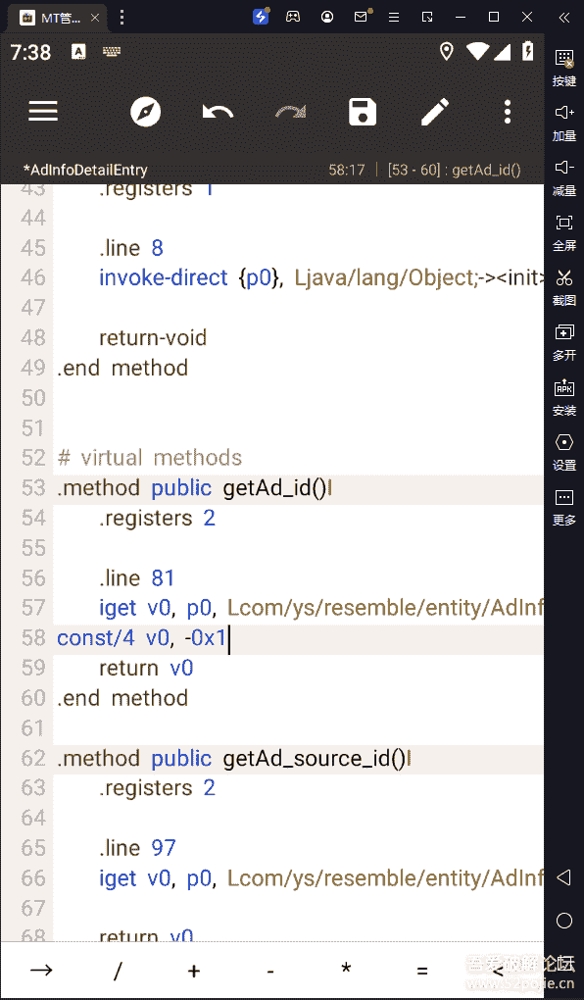

`image-20231128224358934.png` (150.12 KB, 下载次数: 3)

[`forum.php?mod=attachment&aid=MjY2MDMyOXw3NzZhNWY5MHwxNzkzNTY4OTk5fDE2ODA4NnwxODYyOTk1&nothumb=yes`](https://www.52pojie.cn/forum.php?mod=attachment&aid=MjY2MDMyOXw3NzZhNWY5MHwxNzkzNTY4OTk5fDE2ODA4NnwxODYyOTk1&nothumb=yes)

2023-11-29 12:38 上传

这里发现还有一个方法，返回广告资源ID的，直接给他也赋值 `-1`

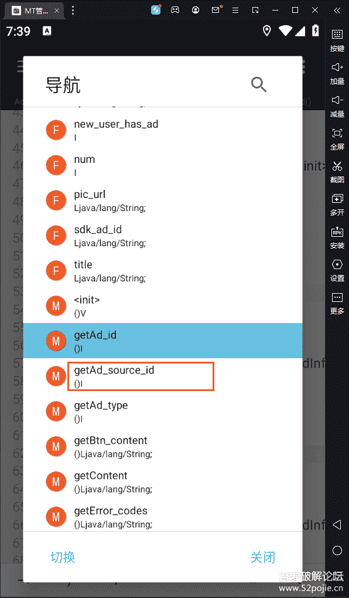

`image-20231128224544765.png` (122.32 KB, 下载次数: 4)

[`forum.php?mod=attachment&aid=MjY2MDMyN3xlMTQzMWIyZHwxNzkzNTY4OTk5fDE2ODA4NnwxODYyOTk1&nothumb=yes`](https://www.52pojie.cn/forum.php?mod=attachment&aid=MjY2MDMyN3xlMTQzMWIyZHwxNzkzNTY4OTk5fDE2ODA4NnwxODYyOTk1&nothumb=yes)

2023-11-29 12:38 上传

（5）保存一下退出试试发现启动页广告和软件内广告都没有了，但是开始播放视频的时候却是要求你看广告

（6）这里有一个推广机制，通过推广就能免除这个看广告的过程，所以可以通过这个突破点来实现去广告

（7）搜索推广这个字符串

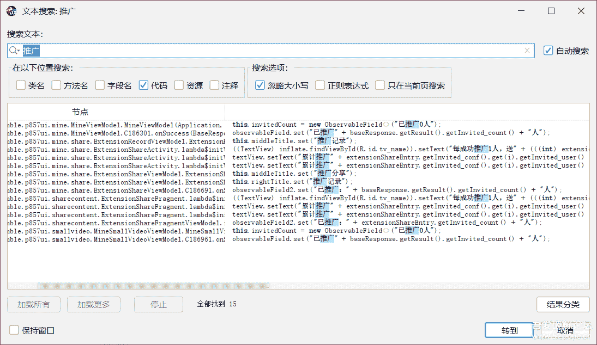

`image-20231128230622069.png` (152.6 KB, 下载次数: 2)

[`forum.php?mod=attachment&aid=MjY2MDMzNXxhM2VlYTdhNHwxNzkzNTY4OTk5fDE2ODA4NnwxODYyOTk1&nothumb=yes`](https://www.52pojie.cn/forum.php?mod=attachment&aid=MjY2MDMzNXxhM2VlYTdhNHwxNzkzNTY4OTk5fDE2ODA4NnwxODYyOTk1&nothumb=yes)

2023-11-29 12:40 上传

经过我逐个排查，选择最后一个发现有一个免广告至...，并且这里有个明显的`getIs_vip`方法，就可以判断这里是关键位置了

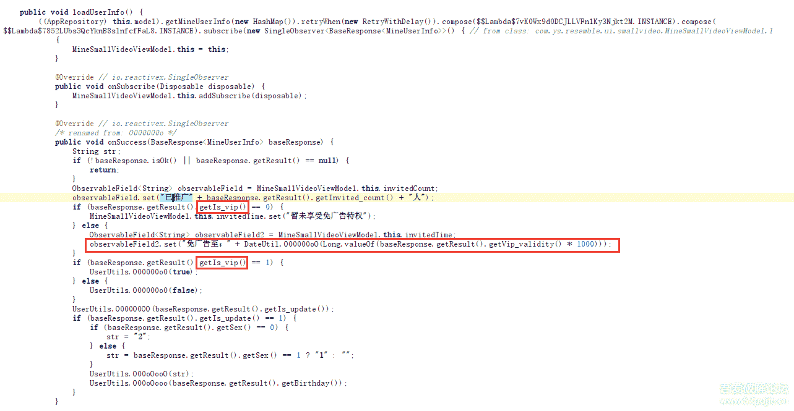

`image-20231128230845918.png` (124.69 KB, 下载次数: 4)

[`forum.php?mod=attachment&aid=MjY2MDMzNnw5MmYyMDRhOXwxNzkzNTY4OTk5fDE2ODA4NnwxODYyOTk1&nothumb=yes`](https://www.52pojie.cn/forum.php?mod=attachment&aid=MjY2MDMzNnw5MmYyMDRhOXwxNzkzNTY4OTk5fDE2ODA4NnwxODYyOTk1&nothumb=yes)

2023-11-29 12:40 上传

这里赋值 `0` 将显示没有免广告权限，并且下面等于 `1` 将传一个`true`方法过去，所以修改大致就是将这个`getIs_vip`赋值 `1`，我们去MT管理器更改一下测试一下结果

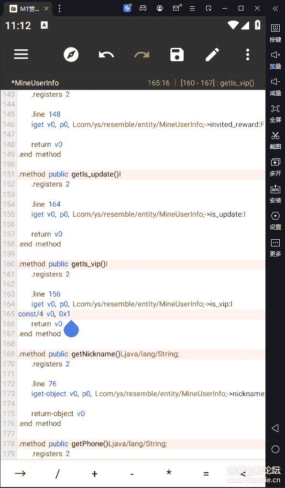

`image-20231128231256503.png` (159.56 KB, 下载次数: 4)

[`forum.php?mod=attachment&aid=MjY2MDMzOHw5YzU5MmY3MXwxNzkzNTY4OTk5fDE2ODA4NnwxODYyOTk1&nothumb=yes`](https://www.52pojie.cn/forum.php?mod=attachment&aid=MjY2MDMzOHw5YzU5MmY3MXwxNzkzNTY4OTk5fDE2ODA4NnwxODYyOTk1&nothumb=yes)

2023-11-29 12:41 上传

果然没有那个看广告才能看视频的限制了，但是视频播放不出来，这是签名校验导致的，这是试出来的结果，所以我先注明了先过签名校验，去广告部分到此告一段落了

`image-20231128231438217.png` (108.5 KB, 下载次数: 1)

[`forum.php?mod=attachment&aid=MjY2MDMzOXxiYWUyNGExNnwxNzkzNTY4OTk5fDE2ODA4NnwxODYyOTk1&nothumb=yes`](https://www.52pojie.cn/forum.php?mod=attachment&aid=MjY2MDMzOXxiYWUyNGExNnwxNzkzNTY4OTk5fDE2ODA4NnwxODYyOTk1&nothumb=yes)

2023-11-29 12:41 上传

## 番外 去除V*N检测

`image-20231128233308834.png` (94.9 KB, 下载次数: 2)

[`forum.php?mod=attachment&aid=MjY2MDM0MnxiN2U3ZGMwM3wxNzkzNTY4OTk5fDE2ODA4NnwxODYyOTk1&nothumb=yes`](https://www.52pojie.cn/forum.php?mod=attachment&aid=MjY2MDM0MnxiN2U3ZGMwM3wxNzkzNTY4OTk5fDE2ODA4NnwxODYyOTk1&nothumb=yes)

2023-11-29 12:41 上传

（1）`jadx`直接搜索这个关键字，在资源处搜索到一处资源文件，那么弹出的必定用到这个xml文件

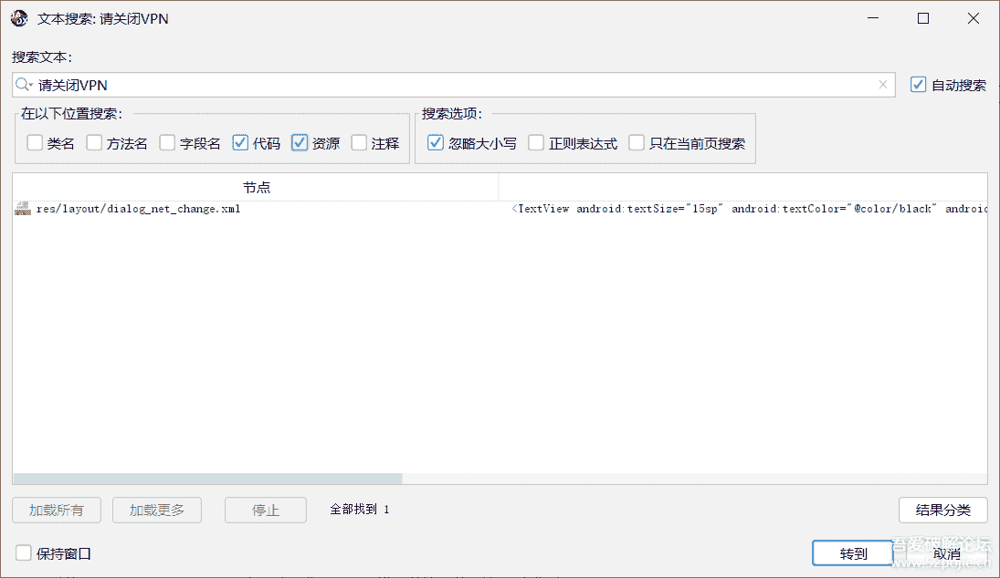

`image-20231128233409765.png` (42.07 KB, 下载次数: 3)

[`forum.php?mod=attachment&aid=MjY2MDM0M3w4MTE1NWUzMnwxNzkzNTY4OTk5fDE2ODA4NnwxODYyOTk1&nothumb=yes`](https://www.52pojie.cn/forum.php?mod=attachment&aid=MjY2MDM0M3w4MTE1NWUzMnwxNzkzNTY4OTk5fDE2ODA4NnwxODYyOTk1&nothumb=yes)

2023-11-29 12:41 上传

（2）直接搜索这个xml文件的文件名

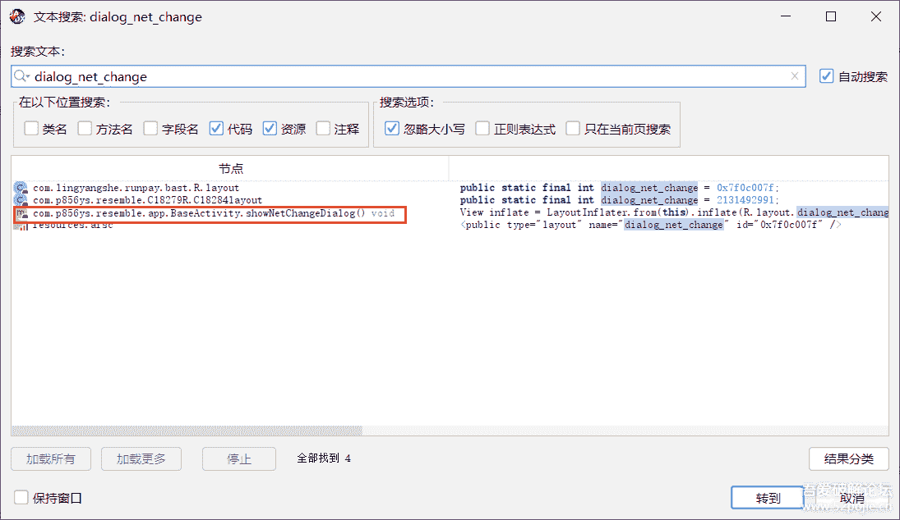

`image-20231128233633728.png` (65.41 KB, 下载次数: 3)

[`forum.php?mod=attachment&aid=MjY2MDM0NXw5NGE0YTg5M3wxNzkzNTY4OTk5fDE2ODA4NnwxODYyOTk1&nothumb=yes`](https://www.52pojie.cn/forum.php?mod=attachment&aid=MjY2MDM0NXw5NGE0YTg5M3wxNzkzNTY4OTk5fDE2ODA4NnwxODYyOTk1&nothumb=yes)

2023-11-29 12:42 上传

这个方法挺眼熟，在一开始`finish`的时候就碰到过，查看其调用发现还真的是在那里

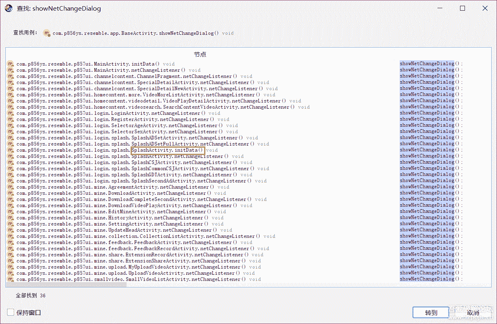

`image-20231128233811221.png` (293.08 KB, 下载次数: 3)

[`forum.php?mod=attachment&aid=MjY2MDM0NnwzN2M0YWQ3ZHwxNzkzNTY4OTk5fDE2ODA4NnwxODYyOTk1&nothumb=yes`](https://www.52pojie.cn/forum.php?mod=attachment&aid=MjY2MDM0NnwzN2M0YWQ3ZHwxNzkzNTY4OTk5fDE2ODA4NnwxODYyOTk1&nothumb=yes)

2023-11-29 12:42 上传

那就如之前检测ROOT和虚拟机的方法一般改这个的判断结果为`false`就好

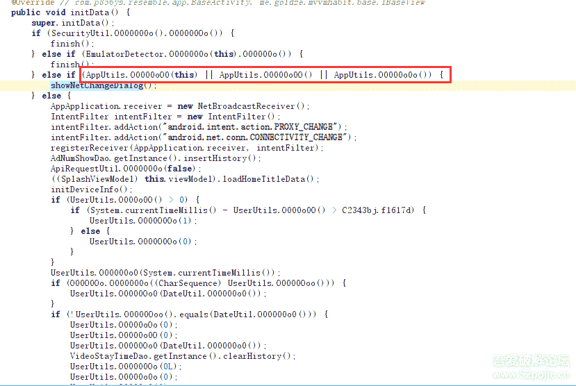

`image-20231128233909053.png` (98.04 KB, 下载次数: 3)

[`forum.php?mod=attachment&aid=MjY2MDM0N3w1MjNjY2Q3MHwxNzkzNTY4OTk5fDE2ODA4NnwxODYyOTk1&nothumb=yes`](https://www.52pojie.cn/forum.php?mod=attachment&aid=MjY2MDM0N3w1MjNjY2Q3MHwxNzkzNTY4OTk5fDE2ODA4NnwxODYyOTk1&nothumb=yes)

2023-11-29 12:43 上传

跳转过去，分析一下语句都是VN检测的，那就修改这几处为`false`就能实现过VN检测了

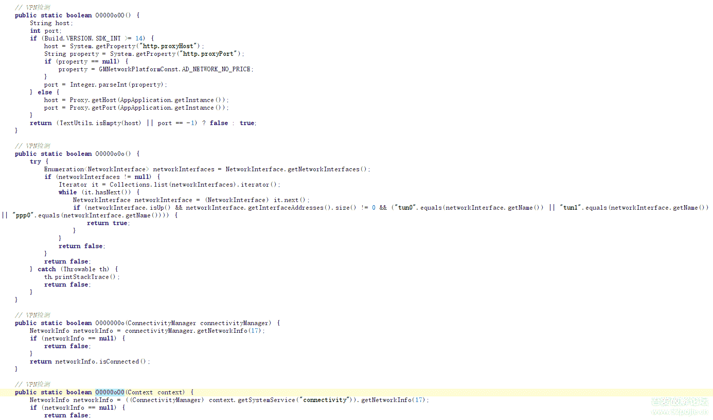

`image-20231128234716779.png` (119.58 KB, 下载次数: 3)

[`forum.php?mod=attachment&aid=MjY2MDM0OXxiOTUwN2FjZnwxNzkzNTY4OTk5fDE2ODA4NnwxODYyOTk1&nothumb=yes`](https://www.52pojie.cn/forum.php?mod=attachment&aid=MjY2MDM0OXxiOTUwN2FjZnwxNzkzNTY4OTk5fDE2ODA4NnwxODYyOTk1&nothumb=yes)

2023-11-29 12:44 上传

（2）去MT管理器改一下，尝试一下是否成功

`image-20231128234859200.png` (15.18 KB, 下载次数: 3)

[`forum.php?mod=attachment&aid=MjY2MDM1NHxjY2U0ZmFjZXwxNzkzNTY4OTk5fDE2ODA4NnwxODYyOTk1&nothumb=yes`](https://www.52pojie.cn/forum.php?mod=attachment&aid=MjY2MDM1NHxjY2U0ZmFjZXwxNzkzNTY4OTk5fDE2ODA4NnwxODYyOTk1&nothumb=yes)

2023-11-29 12:44 上传

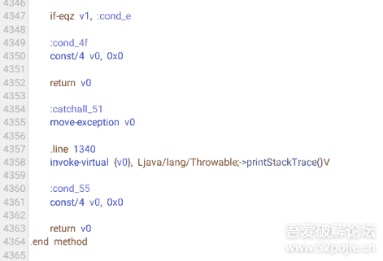

`image-20231128234754559.png` (43.42 KB, 下载次数: 3)

[href="forum.php?mod=attachment&aid=MjY2MDM1MXxkNjNlOWFmM3wxNzkzNTY4OTk5fDE2ODA4NnwxODYyOTk1&nothumb=yes" target="_blank"](https://www.52pojie.cn/forum.php?mod=attachment&aid=MjY2MDM1MXxkNjNlOWFmM3wxNzkzNTY4OTk5fDE2ODA4NnwxODYyOTk1&nothumb=yes)

2023-11-29 12:44 上传

`image-20231128234829500.png` (4.91 KB, 下载次数: 3)

[href="forum.php?mod=attachment&aid=MjY2MDM1MnxhMTgyYTUzMHwxNzkzNTY4OTk5fDE2ODA4NnwxODYyOTk1&nothumb=yes" target="_blank"](https://www.52pojie.cn/forum.php?mod=attachment&aid=MjY2MDM1MnxhMTgyYTUzMHwxNzkzNTY4OTk5fDE2ODA4NnwxODYyOTk1&nothumb=yes)

2023-11-29 12:44 上传

`image-20231128234845310.png` (14.83 KB, 下载次数: 4)

[href="forum.php?mod=attachment&aid=MjY2MDM1M3xhZmE5OGQyOHwxNzkzNTY4OTk5fDE2ODA4NnwxODYyOTk1&nothumb=yes" target="_blank"](https://www.52pojie.cn/forum.php?mod=attachment&aid=MjY2MDM1M3xhZmE5OGQyOHwxNzkzNTY4OTk5fDE2ODA4NnwxODYyOTk1&nothumb=yes)

2023-11-29 12:44 上传

`image-20231128234933612.png` (418.52 KB, 下载次数: 2)

[href="forum.php?mod=attachment&aid=MjY2MDM1MHw5ZWI4ZjY2ZHwxNzkzNTY4OTk5fDE2ODA4NnwxODYyOTk1&nothumb=yes" target="_blank"](https://www.52pojie.cn/forum.php?mod=attachment&aid=MjY2MDM1MHw5ZWI4ZjY2ZHwxNzkzNTY4OTk5fDE2ODA4NnwxODYyOTk1&nothumb=yes)

2023-11-29 12:44 上传

完美进入

### 图省事的这里写有现成的Hook模块

[`//luren.tech/2.0.apk`](https://luren.tech/2.0.apk)
