# [Android 原创] 安卓逆向劝退指南1

原帖：[https://www.52pojie.cn/forum.php?mod=viewthread&tid=1863873](https://www.52pojie.cn/forum.php?mod=viewthread&tid=1863873)

抓取时间：2026-11-01T21:36:31

## 写作原因

说一下写这系列的原因：第一肯定是因为有空；其次是介于短视频的发展，很多懂哥在抖音或者 B 站上面看到了很多使用 `mt管理器` 会员的视频，觉得安卓逆向不过如此么。然后自己动手过后，就是为啥闪退？怎么进去直接黑屏？我就改了个包名，啥都没动啊。所以希望看了这篇文章，能让大家千万不要相信营销号。

  
[附件下载](https://www.52pojie.cn/forum.php?mod=attachment&aid=MjY2MDc0N3w5OTU0MDBlMnwxNzkzNTY4OTg5fDE2ODA4NnwxODYzODcz&nothumb=yes) *2023-11-30 23:10 上传*

从我自己角度来说，个人感觉安卓逆向的学习曲线是比较陡峭的，外加这一块也比较独立。经常打靶机的小伙伴，可能还会在靶机里遇到 `pwn` 提权或者 `re` 获得账号密码的情况，联动安卓逆向的靶机目前我是真没见过。

  
[附件下载](https://www.52pojie.cn/forum.php?mod=attachment&aid=MjY2MDc0OHxmMjdiOWUwNnwxNzkzNTY4OTg5fDE2ODA4NnwxODYzODcz&nothumb=yes) *2023-11-30 23:11 上传*

所以这篇文章的主要目的就是劝退，我会写得比较细致，让大家体会到江湖的险恶。

  
[附件下载](https://www.52pojie.cn/forum.php?mod=attachment&aid=MjY2MDc0OXxhZWVlM2JmM3wxNzkzNTY4OTg5fDE2ODA4NnwxODYzODcz&nothumb=yes) *2023-11-30 23:12 上传*

## 题目信息

题目链接：[https://github.com/wm-team/WMCTF-2023/tree/main/Reverse/ezAndroid](https://github.com/wm-team/WMCTF-2023/tree/main/Reverse/ezAndroid)

## 初步分析

首先就是最常见的：直接把 `apk` 拖入 `jadx`，发现两个 `native` 函数，打开 `ida`。

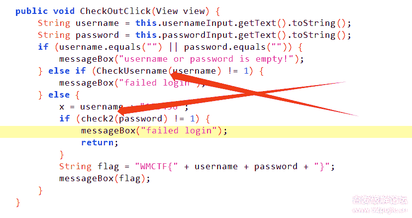  
[附件下载](https://www.52pojie.cn/forum.php?mod=attachment&aid=MjY2MDc1MXw2Nzg1NzQ2ZHwxNzkzNTY4OTg5fDE2ODA4NnwxODYzODcz&nothumb=yes) *2023-11-30 23:13 上传*

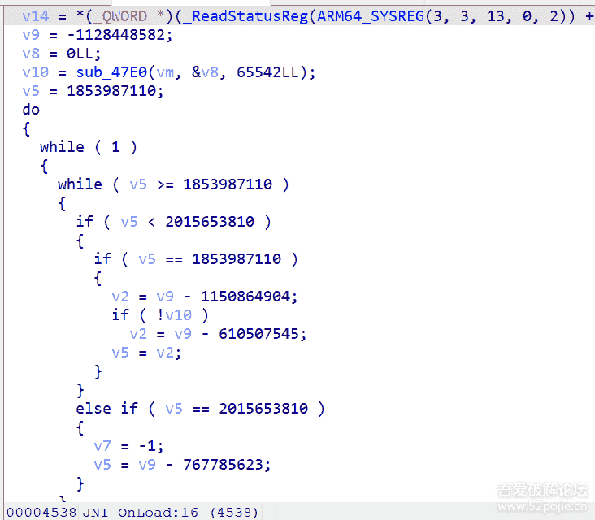  
[附件下载](https://www.52pojie.cn/forum.php?mod=attachment&aid=MjY2MDc1M3wzMTg3NTZmZnwxNzkzNTY4OTg5fDE2ODA4NnwxODYzODcz&nothumb=yes) *2023-11-30 23:14 上传*

## 查看 `jni_onload` 与 `init`

很显然是动态注册。查看 `jni_onload`，看这个架势是有混淆的，不过还能看。

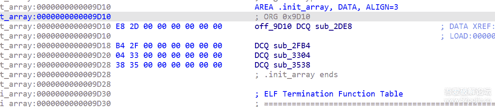  
[附件下载](https://www.52pojie.cn/forum.php?mod=attachment&aid=MjY2MDc1NHwzNzU4MmMwMnwxNzkzNTY4OTg5fDE2ODA4NnwxODYzODcz&nothumb=yes) *2023-11-30 23:15 上传*

先看一下 `init`，发现有四个函数，一个一个看。第一个是在往 `.bss` 区域塞数据（劝退点：什么是 `bss` 区域）。

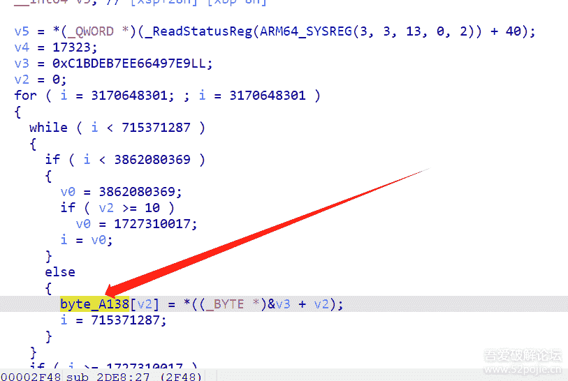  
[附件下载](https://www.52pojie.cn/forum.php?mod=attachment&aid=MjY2MDc3MXwzOWViYTMxMXwxNzkzNTY4OTg5fDE2ODA4NnwxODYzODcz&nothumb=yes) *2023-11-30 23:41 上传*

第二个函数像是在换表。

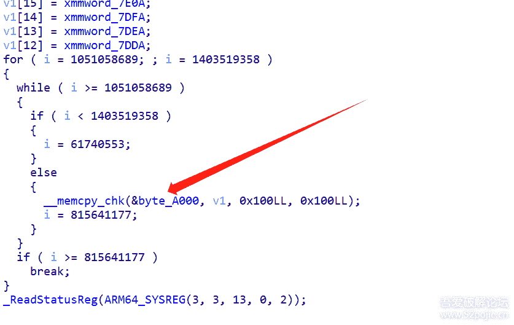  
[附件下载](https://www.52pojie.cn/forum.php?mod=attachment&aid=MjY2MDc1Nnw3ZTJmN2EyNHwxNzkzNTY4OTg5fDE2ODA4NnwxODYzODcz&nothumb=yes) *2023-11-30 23:15 上传*

看看第三个，看着也是在初始化。

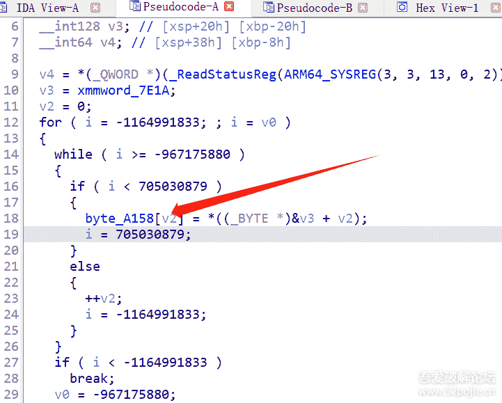  
[附件下载](https://www.52pojie.cn/forum.php?mod=attachment&aid=MjY2MDc1N3wwODQ4ZjY3ZnwxNzkzNTY4OTg5fDE2ODA4NnwxODYzODcz&nothumb=yes) *2023-11-30 23:15 上传*

最后是第四个，看这个图片，有经验的就知道估计是反调试……别问为什么，要问就问自己为什么不知道。一路跟进去虽然有混淆，但是逻辑还是比较简单的。

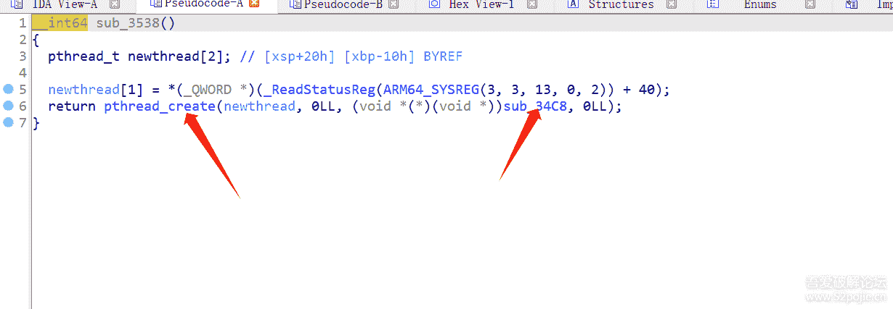  
[附件下载](https://www.52pojie.cn/forum.php?mod=attachment&aid=MjY2MDc1OHw1ODEyMGJhMHwxNzkzNTY4OTg5fDE2ODA4NnwxODYzODcz&nothumb=yes) *2023-11-30 23:16 上传*

## 反调试

就是简单的一个 `strstr` 检测 `frida` 的反调试，所以直接 `hook` `libso` 里面的 `strstr` 函数就行了（别问我脚本，要不然就不叫劝退指南了）。

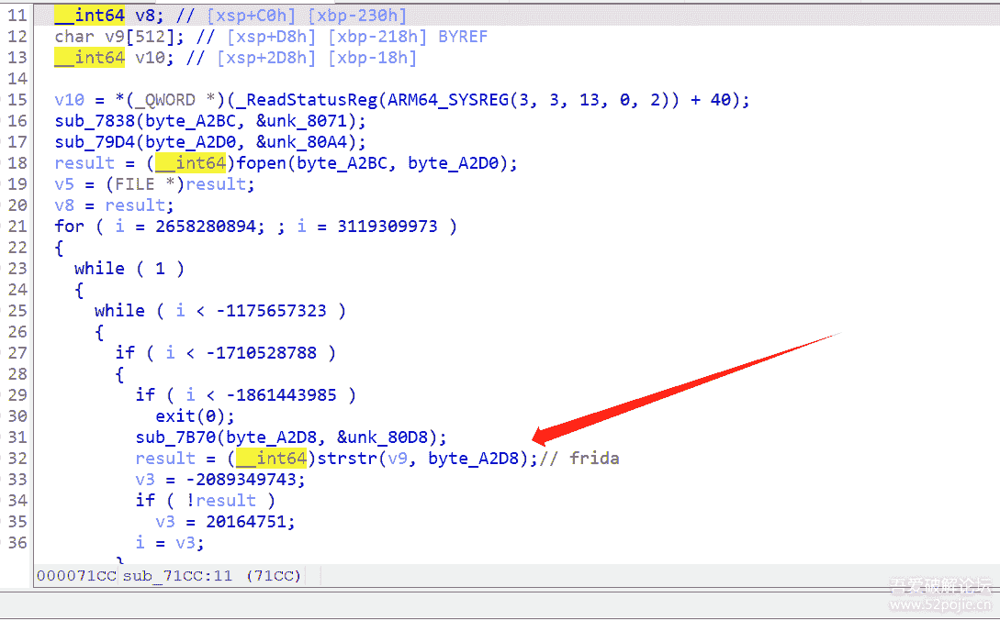  
[附件下载](https://www.52pojie.cn/forum.php?mod=attachment&aid=MjY2MDc1OXwwZmQ3NTZhOHwxNzkzNTY4OTg5fDE2ODA4NnwxODYzODcz&nothumb=yes) *2023-11-30 23:16 上传*

## 动态注册与栈上变量

看完 `init` 段就该看正文了。先使用 `frida` 直接过了反调试，后面很多字段就可以直接 `hook` 出来。我 `hook` 了几个给大家看看，至于动态注册的流程我就不赘述了。

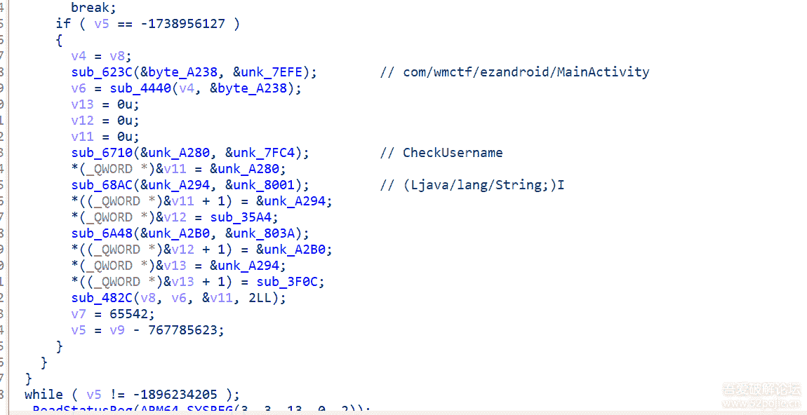  
[附件下载](https://www.52pojie.cn/forum.php?mod=attachment&aid=MjY2MDc2MXwzZGJmNjA0OXwxNzkzNTY4OTg5fDE2ODA4NnwxODYzODcz&nothumb=yes) *2023-11-30 23:17 上传*

可能会有很多新手会发现：明明用到了 `v12`、`v13`，怎么注册的时候只有 `v11`？这是因为它们在一个栈上，而且是连续的。混淆的时候经常会出现这种情况，打 `pwn` 的选手应该会对这个非常熟悉。是的，这又是一个劝退点。

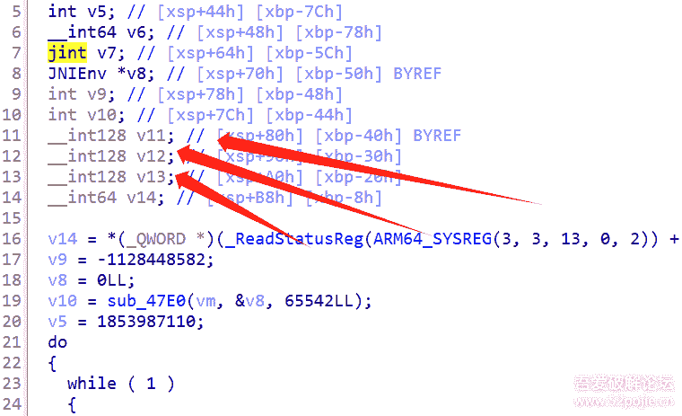  
[附件下载](https://www.52pojie.cn/forum.php?mod=attachment&aid=MjY2MDc2MnxlZTRhYWQxNXwxNzkzNTY4OTg5fDE2ODA4NnwxODYzODcz&nothumb=yes) *2023-11-30 23:17 上传*

## 分析 `CheckUsername`

接着往下看，很显然 `sub_35A4` 就是我们要找的 `CheckUsername` 的地址。直接进入函数，一大堆蛇皮混淆。这种情况下，最好的办法就是直接倒着看：有个 `memcmp` 函数，那么很显然这个 `username` 应该是写死的。那么逻辑应该就是先加密完，然后再与写定的值进行比较。如此一来，`sub_6C2C` 就相当可疑。自己可以尝试查看一下 `sub_6C2C` 参数的交叉引用，你会发现这个最核心的逻辑就在这个函数上。

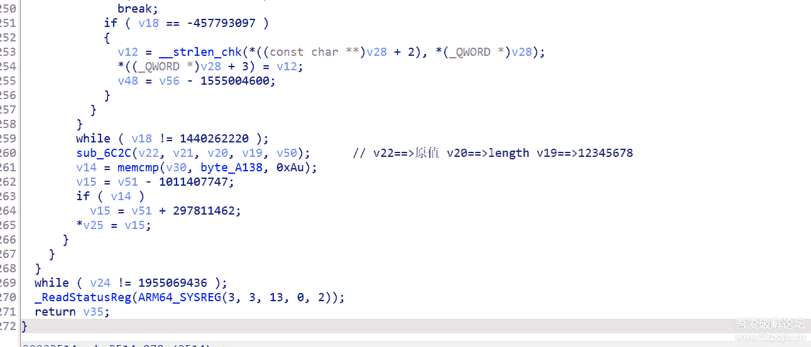  
[附件下载](https://www.52pojie.cn/forum.php?mod=attachment&aid=MjY2MDc2M3wyOWIwOGEwY3wxNzkzNTY4OTg5fDE2ODA4NnwxODYzODcz&nothumb=yes) *2023-11-30 23:20 上传*

## `rc4` 魔改

进入 `sub_6C2C` 函数后，一看就是 `rc4` 算法，明晃晃的 `256`，看不出来的可以劝退。用 `CyberChef` 测试过后，带入 `app` 发现不对，还是 `return false`。是的，能解出来值，但是不对，好像被魔改了……如果对 `rc4` 算法有研究的，估计一眼就看出来；看不出来也可以用土办法。你已经知道账号的位数了，是 10 位的，那么自己传 10 个 1，进去然后和正经算法做个对比，就知道是多了一层异或。真正出问题的地方在于这里。

他多异或了一层下标。

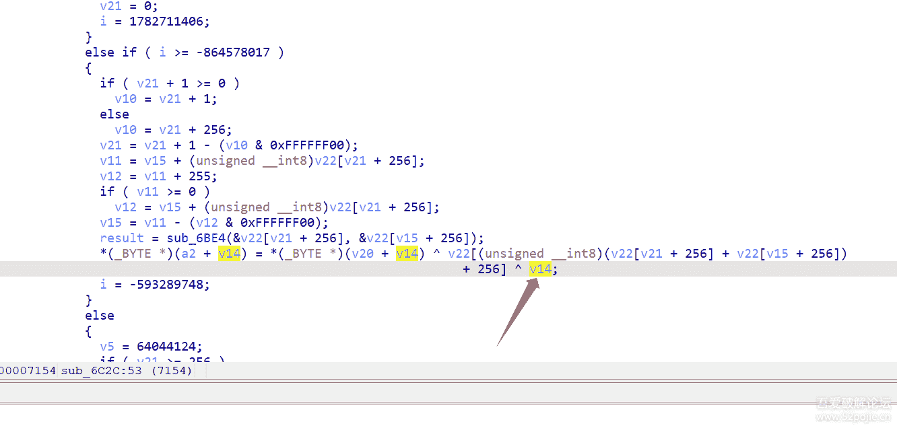  
[附件下载](https://www.52pojie.cn/forum.php?mod=attachment&aid=MjY2MDc2NHw1YmYxZDIzMnwxNzkzNTY4OTg5fDE2ODA4NnwxODYzODcz&nothumb=yes) *2023-11-30 23:21 上传*

## 分析 `check2`

于是我们可以获得账号 `Re_1s_eaSy`。根据 Java 层的逻辑走，我们可以发现 `x = Re_1s_eaSy123456`，但是这个完全没有交叉引用，这就很奇怪。先把这个放一边，去看 `check2` 函数 `sub_3F0C`。拉到最下面，熟悉的 `memcmp` 函数。一般当 `username` 写死了，那么密码一般也是写死的，当然了，不排除使用 `timestamp` 当随机变量的。这种在实战中非常常见。如果使用 `timestamp` 当作随机变量，再加上强一点的混淆，这道题目就会变难不少。

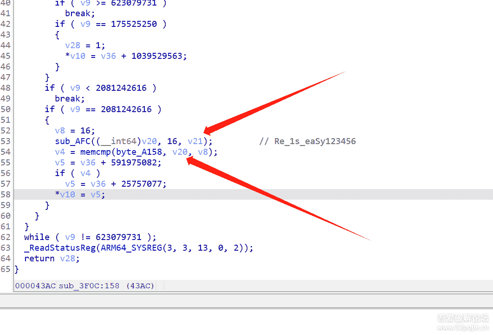  
[附件下载](https://www.52pojie.cn/forum.php?mod=attachment&aid=MjY2MDc2NXxjNjQ0MGRhMHwxNzkzNTY4OTg5fDE2ODA4NnwxODYzODcz&nothumb=yes) *2023-11-30 23:21 上传*

仔细看的话，很容易就看出来了，这个密码最后加密出来是 16 位的，而且通过交叉引用一路往上跟踪，就可以获得从 `native` 层调用这个 `x` 的流程。

## 密码算法初探

首先需要判断这个是什么算法。最开始我们发现了一个 `s` 盒修改的点，这是一个由 `256` 个元素的 `s` 盒，外加密钥 `Re_1s_eaSy123456` 也是凑足了 `128` 位的长度，

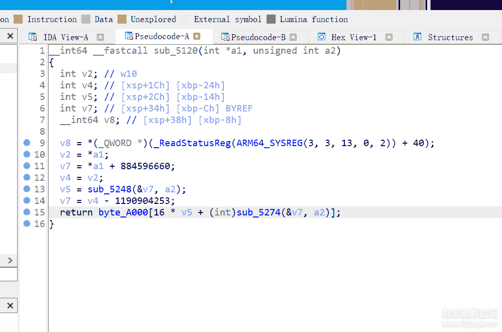

`微信图片_20231130225542.png` (60.79 KB, 下载次数: 3)

[href="forum.php?mod=attachment&aid=MjY2MDc2N3xjNTZiMjlmMHwxNzkzNTY4OTg5fDE2ODA4NnwxODYzODcz&nothumb=yes" target="_blank"](https://www.52pojie.cn/forum.php?mod=attachment&aid=MjY2MDc2N3xjNTZiMjlmMHwxNzkzNTY4OTg5fDE2ODA4NnwxODYzODcz&nothumb=yes)

2023-11-30 23:22 上传

容易联想到的就是aes换了s盒，如果结果尝试出来不行，那么只能硬着头皮继续分析，比较幸运的是，这题就到此为止了。总的来说感觉这题考察的点还是相当多的，动态注册，反调试，代码混淆，算法魔改。就一般实战的原生安卓app如果不是特别牛逼的大厂或者企业级加固也就差不多这样了，最多就弄个防抓包。而且实战中rc4用的其实不怎么多（不知道为啥ctf总喜欢弄两个rc4），aes还是不少的，换表可以注意一下。

`byebye.jpg` (11.77 KB, 下载次数: 2)

[href="forum.php?mod=attachment&aid=MjY2MDc2OHxhNjhhMTJkM3wxNzkzNTY4OTg5fDE2ODA4NnwxODYzODcz&nothumb=yes" target="_blank"](https://www.52pojie.cn/forum.php?mod=attachment&aid=MjY2MDc2OHxhNjhhMTJkM3wxNzkzNTY4OTg5fDE2ODA4NnwxODYzODcz&nothumb=yes)

2023-11-30 23:24 上传
