# [Android 原创] `dida清单.apk` 逆向思路

- 原帖: https://www.52pojie.cn/forum.php?mod=viewthread&tid=1864838
- 抓取时间: 2026-11-01T21:36:24

小白一名，找个 app 练手。
安装包浏览器直接搜，或者应用宝。

`14.png` (23.5 KB, 下载次数: 0)

## 拿到一个应用，如何通过已有的东西，快速定位到关键代码？

拿到一个应用，如何通过已有的东西，快速定位到关键代码？
已有的东西是什么；打开一个应用，有多个页面和各种控件。
可以用控件作为突破口。
通过控件定位到它的事件处理逻辑。
核心思路：
还是这个思路

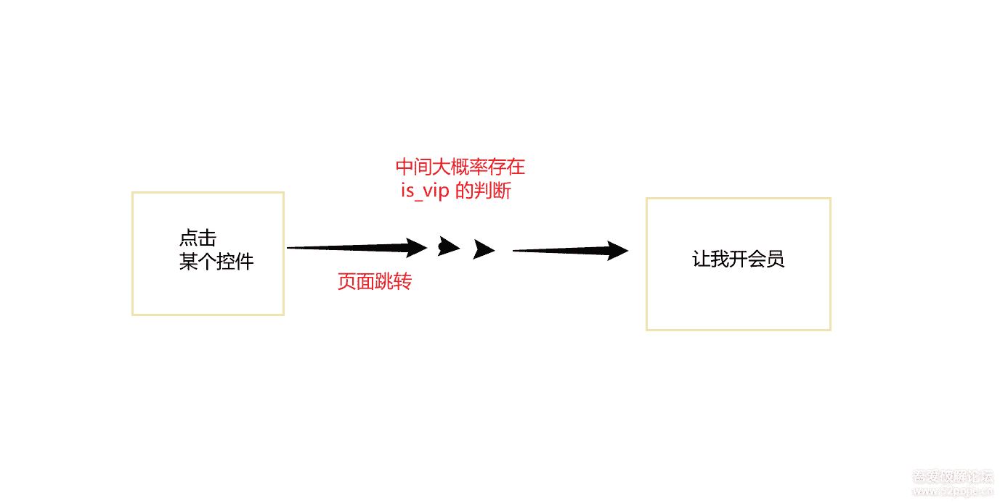
`07.png` (35.71 KB, 下载次数: 1)

## 第一步，打开应用找到符合上图条件的控件

点击使用按钮，跳转到开通会员页面。

`1.png` (382.71 KB, 下载次数: 1)

## 第二步，使用开发助手，找到控件的 `id`

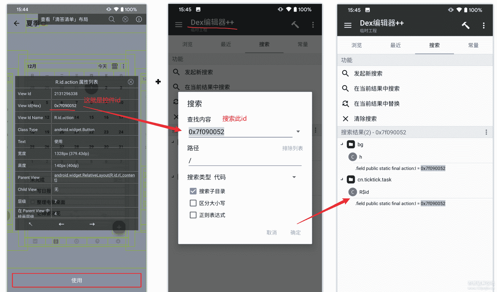
`2.png` (442.19 KB, 下载次数: 2)

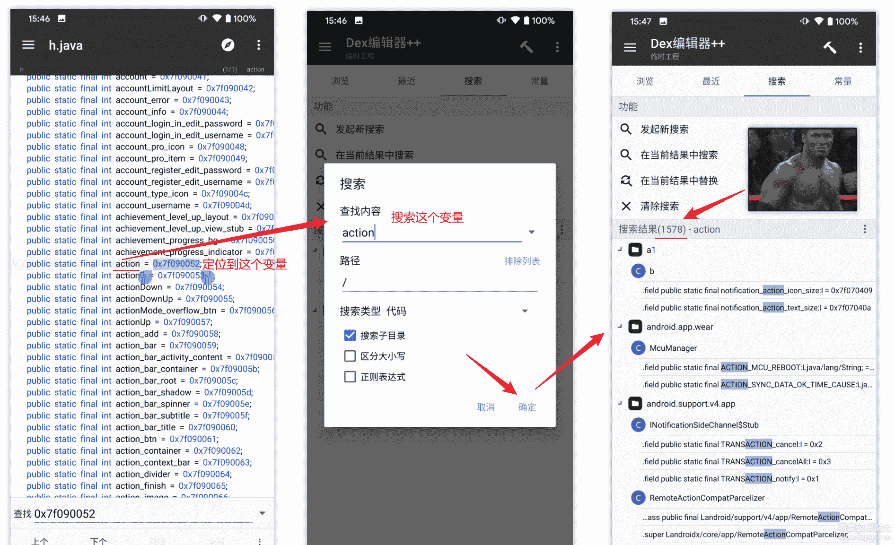
`3.png` (892.21 KB, 下载次数: 1)

`105726jrbb8h8bhdlkmjbo.png` (254.52 KB, 下载次数: 2)

### 问题：Java 在一个类中如何使用另一个类中的变量，或方法？

`Java`，在一个类中如何使用另一个类中的变量，或方法？
->导包

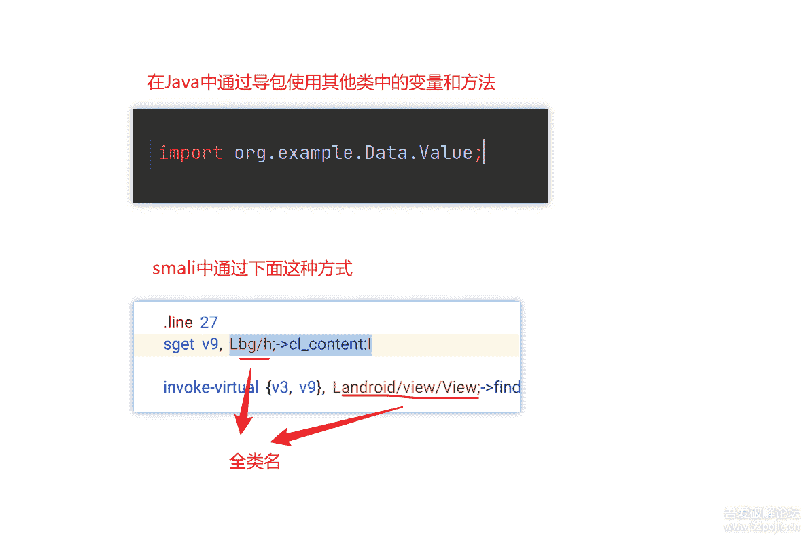
`4.png` (81.35 KB, 下载次数: 2)

所以，不妨搜一下它的全类名。

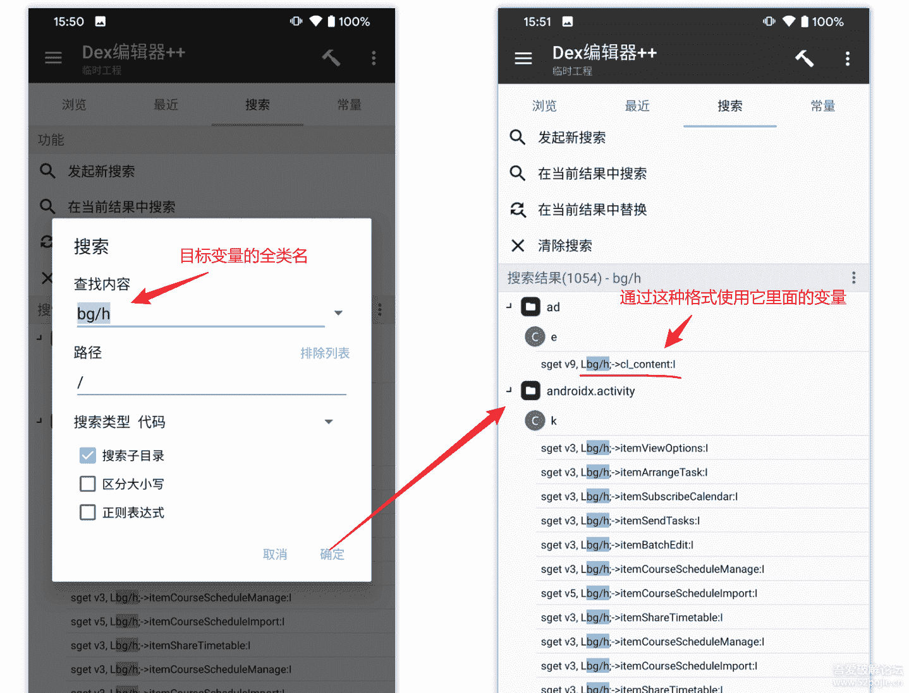
`5.png` (349.4 KB, 下载次数: 3)

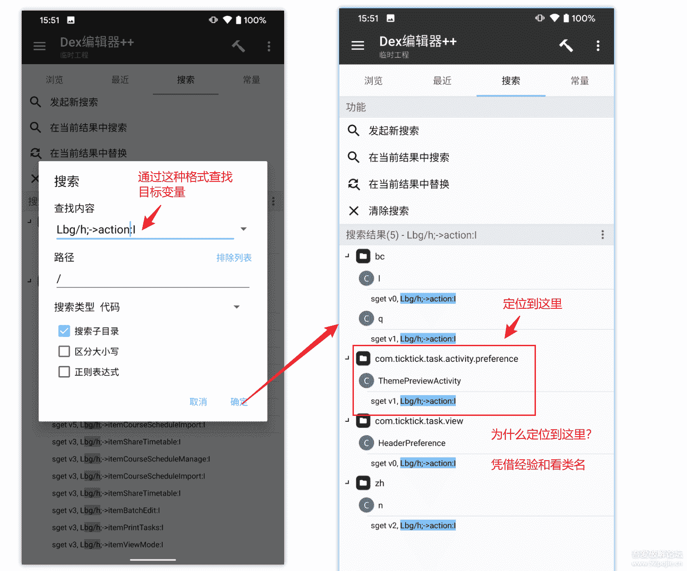
`6.png` (341.01 KB, 下载次数: 2)

到这里基本上就可以定位到目标代码了，前提是它没有混淆。

`7.png` (560.65 KB, 下载次数: 1)

## 第三步，进入代码，分析处理逻辑

后面我就加速了。
首先要找到事件监听。

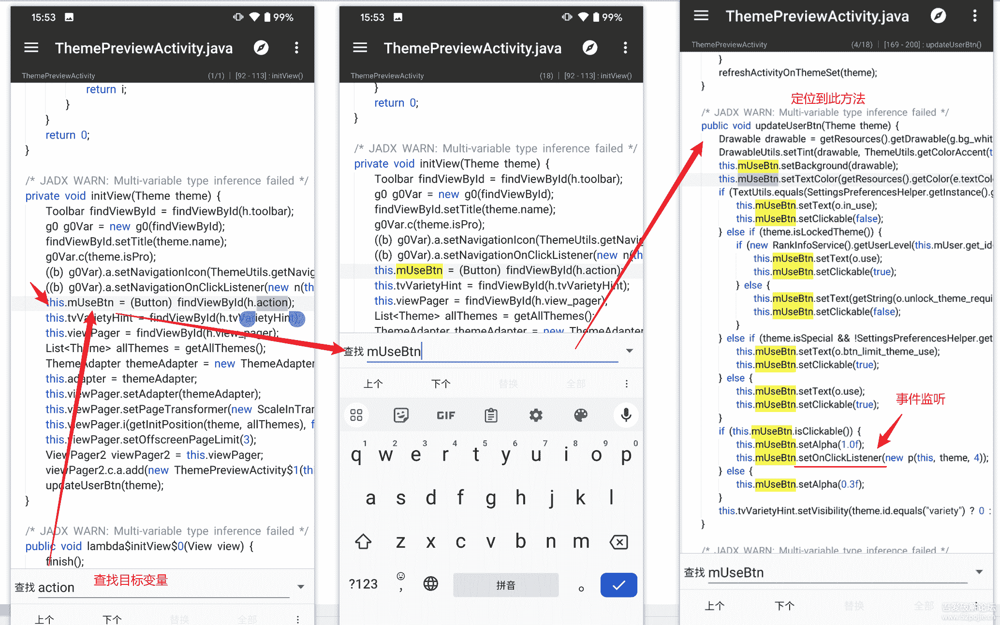
`8.png` (1 MB, 下载次数: 2)

再找到处理事件的代码，

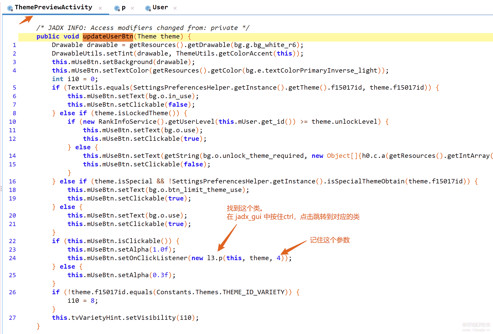
`9.png` (187.37 KB, 下载次数: 2)

next,

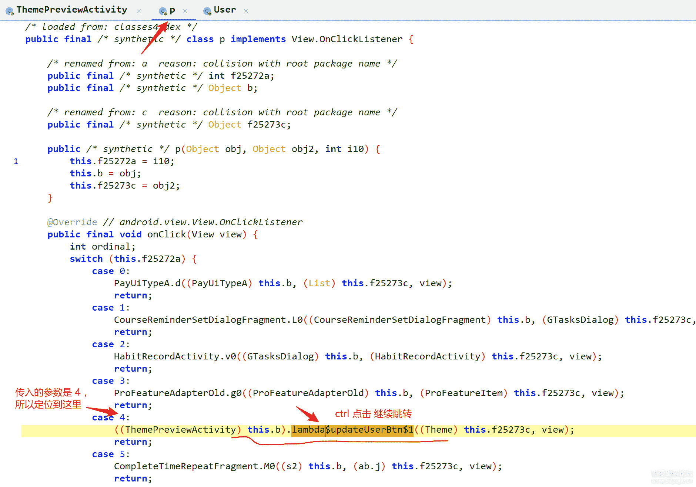
`10.png` (163.02 KB, 下载次数: 1)

在 mt 管理器中查看上图中的类，方便阅读

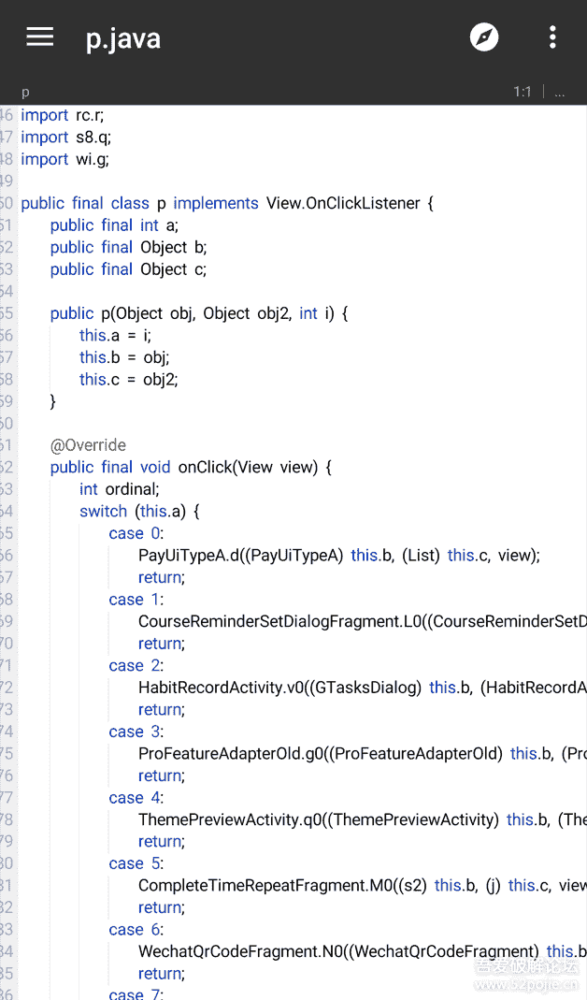
`13.png` (203.42 KB, 下载次数: 2)

最后，

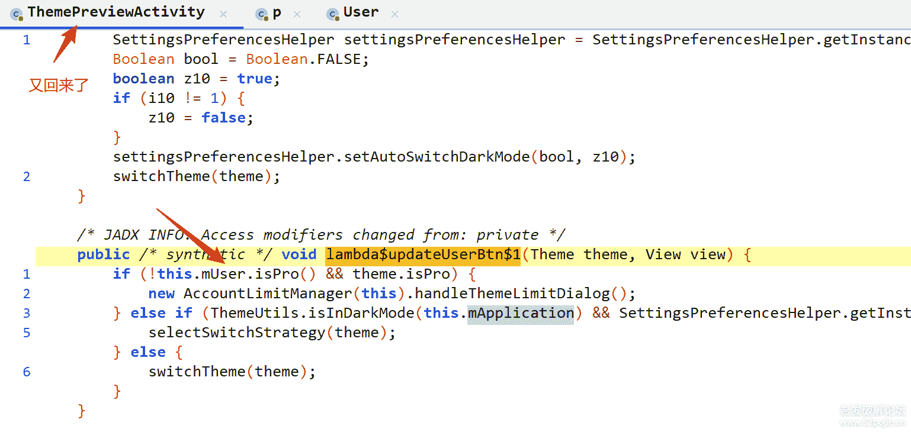
`11.png` (81.89 KB, 下载次数: 2)

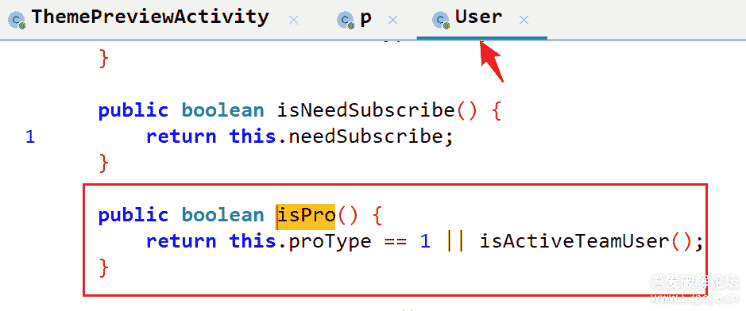
`12.png` (29.57 KB, 下载次数: 2)

到这就结束了。
感谢观看。

## 补充方法

可以修改 `smali` 代码，也可以用 `lsp hook`，实现 https://www.52pojie.cn。
还有一种更暴力的方法。抓包重写
尝试抓了一下它的包，响应体是明文的，直接重写响应体就行了。
就不展开说了。

## 最后

这篇帖子，没有具体说改那行代码，因为没意义。
如何快速定位到关键代码，远比直接告诉你改那行代码有意义。
over !!!
