# [Android 脱壳] 安卓加壳脱壳原理-简单概要

- 原帖: https://www.52pojie.cn/forum.php?mod=viewthread&tid=1865310
- 抓取时间: 2026-11-01T21:36:23

## 安卓加壳脱壳原理大白话

> 踏麻的，遇到加壳的app怎么解决，我刚入行就遇到了加壳的app，马上就去论坛搜索：apk加壳了怎么办、xxx脱壳。不是我说 我作为一个刚入行的小白自学了一些课程摩拳擦掌想来查收一下自己成果就这么对我。
>
> ————摘抄自小白的心理活动

或许你刚接触安卓逆向不久，或许你还没接触，或许你接触很久了但是只会用工具脱壳？ 没错你就读本篇文章吧，一读一个准。

### 笔者废话

很久没在咱论坛输出文章了 时隔一年，很抱歉消失了这么久，我回来了，这一次属于我的我要拿回来，本次笔者会用大白话来给各位表达什么是加壳，与脱壳的原理，分为几个主题：什么是加壳技术、加壳技术的迭代过程，脱壳原理，笔者废话二。想说很多废话，这些废话留到废话二说，感谢您阅读本篇本章，话说本章只说vmp技术出来之前的脱壳原理


QQ图片20231205011444.jpg (1.29 KB, 下载次数: 4)

[href="forum.php?mod=attachment&aid=MjY2MTY2N3wxMTVmMTA5N3wxNzkzNTY4OTgwfDE2ODA4NnwxODY1MzEw&nothumb=yes" target="_blank"](https://www.52pojie.cn/forum.php?mod=attachment&aid=MjY2MTY2N3wxMTVmMTA5N3wxNzkzNTY4OTgwfDE2ODA4NnwxODY1MzEw&nothumb=yes)

2023-12-5 02:18 上传

### 加壳有什么用？为什么大厂app不加壳

简单来说就是给apk增加安全性，但是现在我们可以打开手机随机选中几个app，然后查看是否有加壳，注意这里选择的app是大厂的app，例如DY、MT、TB、王者荣耀、百度网盘，那这些app都是不加壳的，那为什么这些大厂他们的app不加壳呢，不是加壳给apk本身增加了安全性吗？

是的，原则上加壳确实能给apk本身带来诸多的安全性和增加被不法分子利用的可能性，但是在考虑到例如一万个人当中可能也就那么几个人会对这些app进行分析牟不牟利且不说，我作为一个大厂我就算不加壳我就不能有其他的手段来保护我的资产吗？是吧，如果真有这么容易解决一个大厂的app，那要我们这些真正想要做安全研究的人怎么办，那还有一个最主要的问题就是，这些app本身就是我们日常生活中都会使用的 而且是频繁的，而一个app加壳后最大影响的就是用户在使用过程中的体验，各位可以下载个中国移动看看，真的是一动不动，我每次用他们的app就想怒喷一堆垃圾话。

### 加壳技术的迭代过程

我整体分为以下4个过程

#### 一代壳：代码混淆

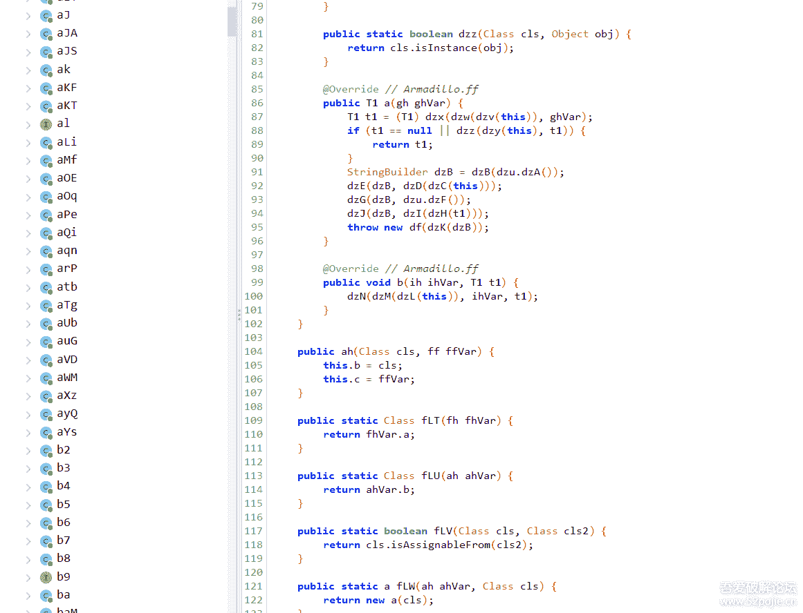

image-20231204211101765.png (108.87 KB, 下载次数: 4)

[href="forum.php?mod=attachment&aid=MjY2MTY2OXxlN2NmYzM2MXwxNzkzNTY4OTgwfDE2ODA4NnwxODY1MzEw&nothumb=yes" target="_blank"](https://www.52pojie.cn/forum.php?mod=attachment&aid=MjY2MTY2OXxlN2NmYzM2MXwxNzkzNTY4OTgwfDE2ODA4NnwxODY1MzEw&nothumb=yes)

2023-12-5 02:19 上传

#### 二代壳：动态加载dex，也叫做dex整体加固

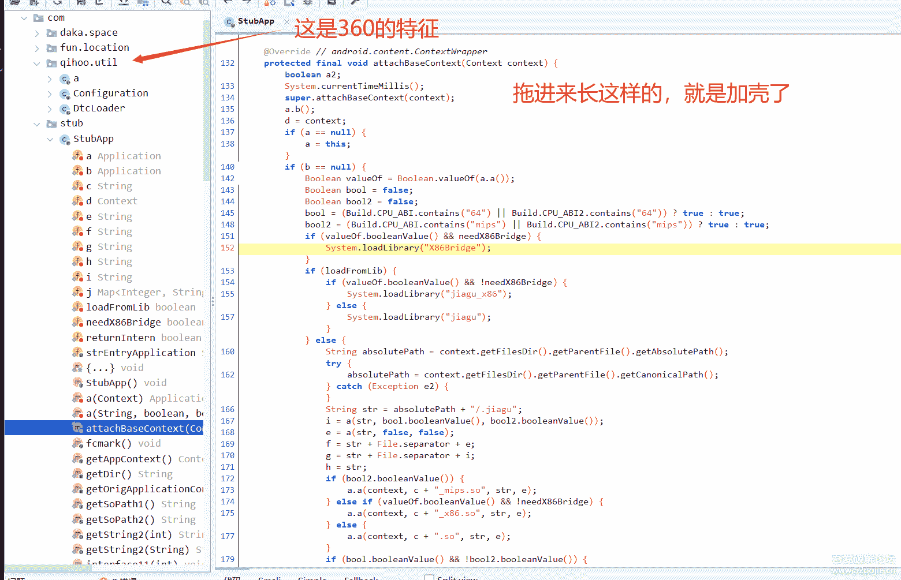

image-20231204211327338.png (189.43 KB, 下载次数: 7)

[href="forum.php?mod=attachment&aid=MjY2MTY2OHwyMjMxYjkxNXwxNzkzNTY4OTgwfDE2ODA4NnwxODY1MzEw&nothumb=yes" target="_blank"](https://www.52pojie.cn/forum.php?mod=attachment&aid=MjY2MTY2OHwyMjMxYjkxNXwxNzkzNTY4OTgwfDE2ODA4NnwxODY1MzEw&nothumb=yes)

2023-12-5 02:19 上传

#### 三代壳：基于二代上做了函数抽取（也就是你把二代壳脱了之后，有些函数明明是有内容的也你却看不到，只有当函数在我们实际操作中被函数执行的时候才会修复填入函数中）这里的找不到例子就这样吧 这里是函数抽象化了，

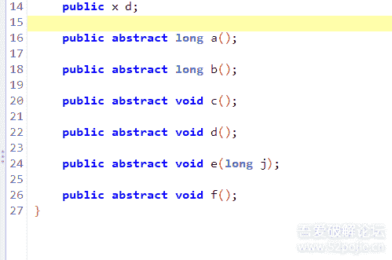

image-20231204211550025.png (20.11 KB, 下载次数: 4)

[href="forum.php?mod=attachment&aid=MjY2MTY3MHxiNGIxMjVmYXwxNzkzNTY4OTgwfDE2ODA4NnwxODY1MzEw&nothumb=yes" target="_blank"](https://www.52pojie.cn/forum.php?mod=attachment&aid=MjY2MTY3MHxiNGIxMjVmYXwxNzkzNTY4OTgwfDE2ODA4NnwxODY1MzEw&nothumb=yes)

2023-12-5 02:19 上传

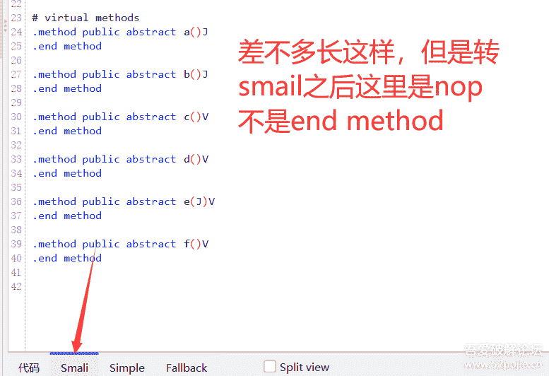

image-20231204211637874.png (49.38 KB, 下载次数: 4)

[href="forum.php?mod=attachment&aid=MjY2MTY3MXw3NDVlZTg3OHwxNzkzNTY4OTgwfDE2ODA4NnwxODY1MzEw&nothumb=yes" target="_blank"](https://www.52pojie.cn/forum.php?mod=attachment&aid=MjY2MTY3MXw3NDVlZTg3OHwxNzkzNTY4OTgwfDE2ODA4NnwxODY1MzEw&nothumb=yes)

2023-12-5 02:19 上传

#### 四代壳：VMP保护（虚拟化保护，简单说就是：本来操作系统就是帮你加载app然后帮你解释执行，但是VMP保护他就偏不要系统帮你解释执行，他要自己解释自己，自己有个解释器自己解释自己）

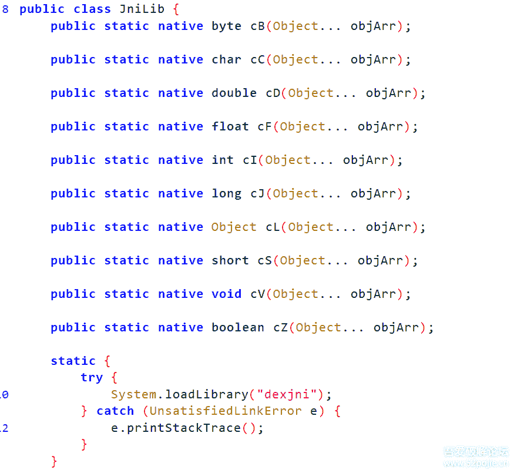

01.jpg (65.13 KB, 下载次数: 4)

[href="forum.php?mod=attachment&aid=MjY2MTY3Mnw3NWNjODEzZnwxNzkzNTY4OTgwfDE2ODA4NnwxODY1MzEw&nothumb=yes" target="_blank"](https://www.52pojie.cn/forum.php?mod=attachment&aid=MjY2MTY3Mnw3NWNjODEzZnwxNzkzNTY4OTgwfDE2ODA4NnwxODY1MzEw&nothumb=yes)

2023-12-5 02:20 上传

#### 四代壳：dex2c

（这个叫做dex to c，保护方式如名字，转c代码执行，将 Java 代码进行词法 , 句法分析 , 生成对应的 C / C++ 文件 , 然后交叉编译为 SO 动态库 ）这里无图 但是dex2c的保护跟上面那张图你拖进`jadx`里面看是差不多的

四代壳只会出现在企业版也就是加固厂商的收费版才会有，其他的基本都是一二三代壳

### 脱壳原理

在进程加载app开始加载进内存之后会加载相对应的class是吧， 那加载这个class就是由一个加载器来加载的，这个加载器就叫做`classloader`（类加载器）注意了这里说的是Java的类加载器，还有Android的类加载器

然后这个`classloader`又有不同的`classloader`，还有个机制叫做双亲委派，我们先讲又哪些`classloader`

`Bootstrap classLoader`（根类加载器）负责加载系统核心库例如(`java.lang.String`)等

`ExtClassLoader`（拓展类加载器）负责加载`jre/lib/ext`目录下的一些扩展的jar

`AppClassLoader`（应用类加载器）负责加载应用程序的主函数类

ok，这些加载器说完，接下来要说怎么加载这个dex了

#### 双亲委派

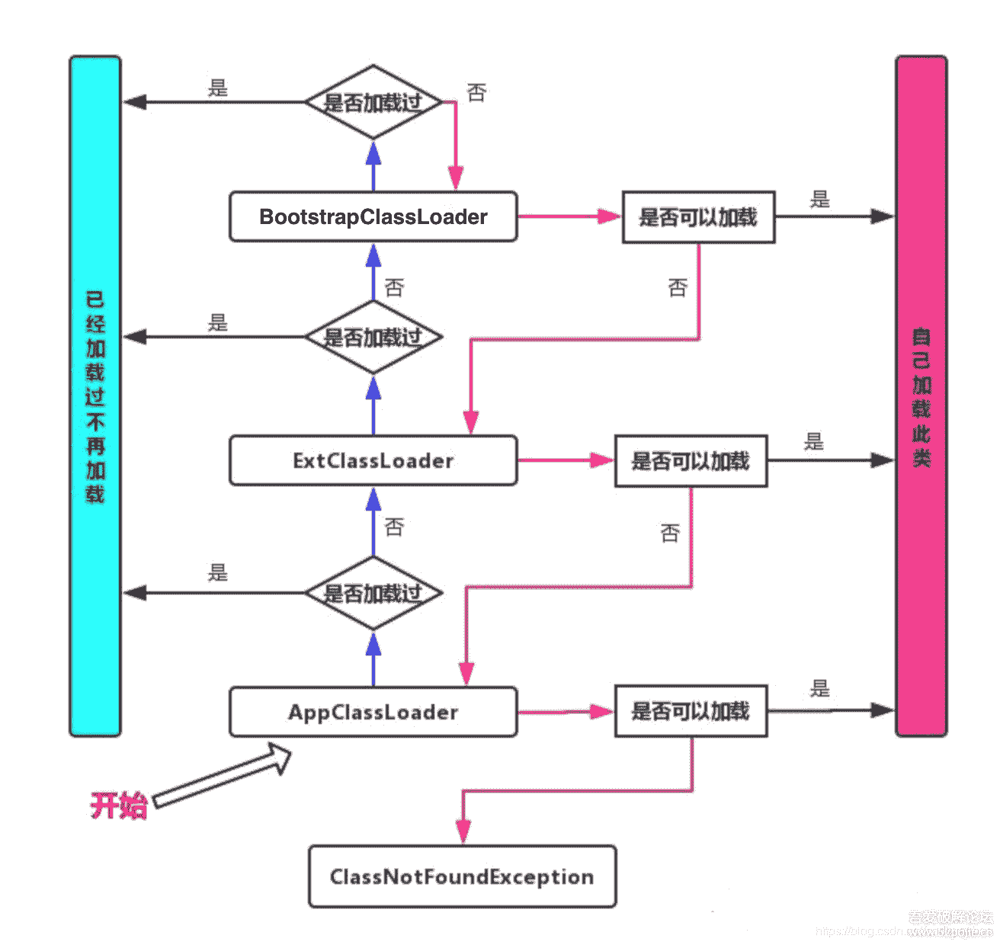

20201217213314510.png (375.85 KB, 下载次数: 5)

[href="forum.php?mod=attachment&aid=MjY2MTY3M3wyM2M0NDY4M3wxNzkzNTY4OTgwfDE2ODA4NnwxODY1MzEw&nothumb=yes" target="_blank"](https://www.52pojie.cn/forum.php?mod=attachment&aid=MjY2MTY3M3wyM2M0NDY4M3wxNzkzNTY4OTgwfDE2ODA4NnwxODY1MzEw&nothumb=yes)

2023-12-5 02:20 上传

OK上面是Java的类加载器说明 下面贴Android的类加载器

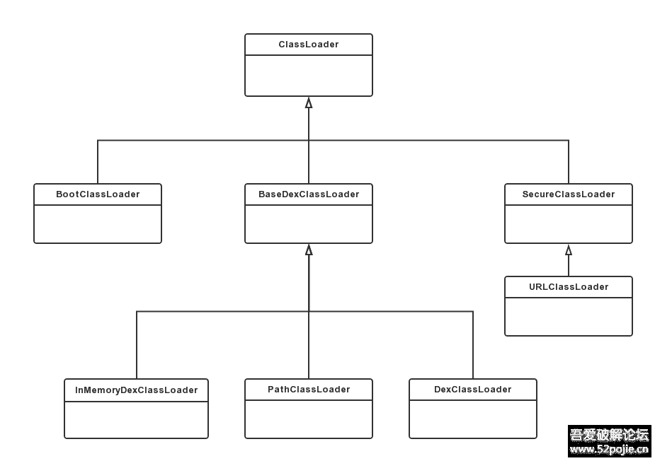

R-C.png (12.64 KB, 下载次数: 6)

[href="forum.php?mod=attachment&aid=MjY2MTY3NHxkZTg4NWJkN3wxNzkzNTY4OTgwfDE2ODA4NnwxODY1MzEw&nothumb=yes" target="_blank"](https://www.52pojie.cn/forum.php?mod=attachment&aid=MjY2MTY3NHxkZTg4NWJkN3wxNzkzNTY4OTgwfDE2ODA4NnwxODY1MzEw&nothumb=yes)

2023-12-5 02:21 上传

为了区别上图加载器的区别，下面是通过代码调试给读者展示一下这些加载器都会加载一些什么


# Android 类加载器分析与脱壳实践

## MainActivity 代码示例

```java
public class MainActivity extends AppCompatActivity {

    @Override
    protected void onCreate(Bundle savedInstanceState) {
        super.onCreate(savedInstanceState);
        setContentView(R.layout.activity_main);
        ClassLoader mainActivityClassloader = MainActivity.class.getClassLoader();
        Log.v("wanbai", "MainActivity的类加载加载器:" + "hashcode:" + mainActivityClassloader.hashCode() + " classLoader:" + mainActivityClassloader);
        ClassLoader contextClassloader = Context.class.getClassLoader();
        Log.v("wanbai", "Context的类加载加载器:" + " hashcode:" + contextClassloader.hashCode() + " classLoader:" + contextClassloader);
        ClassLoader listViewClassLoader = ListView.class.getClassLoader();
        Log.v("wanbai", "ListView的类加载器:" + " hashcode:" + listViewClassLoader.hashCode() + " classLoader:" + listViewClassLoader);
        ClassLoader activityContextImplClassloader = getClassLoader();
        Log.v("wanbai", "应用程序默认加载器:" + " hashcode:" + activityContextImplClassloader.hashCode() + " classLoader:" + activityContextImplClassloader);
        ClassLoader systemClassLoader = ClassLoader.getSystemClassLoader();
        Log.v("wanbai", "系统类加载器:" + " hashcode:" + systemClassLoader.hashCode() + " classLoader:" + systemClassLoader);

        ClassLoader threadClassLoader = Thread.currentThread().getContextClassLoader();
        Log.v("wanbai", "当前线程的classloader:" + " hashcode:" + threadClassLoader.hashCode() + " classLoader:" + threadClassLoader);

        Log.v("wanbai", "打印应用程序默认加载器的委派机制:");
        ClassLoader classLoader = activityContextImplClassloader;
        while (classLoader != null) {
            Log.v("wanbai", "-------------- hashcode:" + classLoader.hashCode() + " classLoader:" + classLoader);
            classLoader = classLoader.getParent();
        }

        Log.v("wanbai", "打印系统加载器的委派机制:");
        classLoader = systemClassLoader;
        while (classLoader != null) {
            Log.v("wanbai", "-------------- hashcode:" + classLoader.hashCode() + " classLoader:" + classLoader);
            classLoader = classLoader.getParent();
        }
    }
}
```

## 运行输出

```text
//output
2022-07-05 23:59:05.907 12751-12751/com.jacyzhou.testclassloader V/wanbai: MainActivity的类加载加载器:hashcode:103503071 classLoader:dalvik.system.PathClassLoader[DexPathList[[dex file "/data/data/com.jacyzhou.testclassloader/code_cache/.overlay/base.apk/classes3.dex", zip file "/data/app/~~-zyoGfdd08ao7hNbYHwNRg==/com.jacyzhou.testclassloader-q7ppfKhpXIRYCacSsnIsyQ==/base.apk"],nativeLibraryDirectories=[/data/app/~~-zyoGfdd08ao7hNbYHwNRg==/com.jacyzhou.testclassloader-q7ppfKhpXIRYCacSsnIsyQ==/lib/arm64, /system/lib64, /system_ext/lib64]]]
2022-07-05 23:59:05.907 12751-12751/com.jacyzhou.testclassloader V/wanbai: Context的类加载加载器: hashcode:227159363 classLoader:java.lang.BootClassLoader@d8a2d43
2022-07-05 23:59:05.907 12751-12751/com.jacyzhou.testclassloader V/wanbai: ListView的类加载器: hashcode:227159363 classLoader:java.lang.BootClassLoader@d8a2d43
2022-07-05 23:59:05.907 12751-12751/com.jacyzhou.testclassloader V/wanbai: 应用程序默认加载器: hashcode:103503071 classLoader:dalvik.system.PathClassLoader[DexPathList[[dex file "/data/data/com.jacyzhou.testclassloader/code_cache/.overlay/base.apk/classes3.dex", zip file "/data/app/~~-zyoGfdd08ao7hNbYHwNRg==/com.jacyzhou.testclassloader-q7ppfKhpXIRYCacSsnIsyQ==/base.apk"],nativeLibraryDirectories=[/data/app/~~-zyoGfdd08ao7hNbYHwNRg==/com.jacyzhou.testclassloader-q7ppfKhpXIRYCacSsnIsyQ==/lib/arm64, /system/lib64, /system_ext/lib64]]]
2022-07-05 23:59:05.907 12751-12751/com.jacyzhou.testclassloader V/wanbai: 系统类加载器: hashcode:130630956 classLoader:dalvik.system.PathClassLoader[DexPathList[[directory "."],nativeLibraryDirectories=[/system/lib64, /system_ext/lib64, /system/lib64, /system_ext/lib64]]]
2022-07-05 23:59:05.907 12751-12751/com.jacyzhou.testclassloader V/wanbai: 当前线程的classloader: hashcode:103503071 classLoader:dalvik.system.PathClassLoader[DexPathList[[dex file "/data/data/com.jacyzhou.testclassloader/code_cache/.overlay/base.apk/classes3.dex", zip file "/data/app/~~-zyoGfdd08ao7hNbYHwNRg==/com.jacyzhou.testclassloader-q7ppfKhpXIRYCacSsnIsyQ==/base.apk"],nativeLibraryDirectories=[/data/app/~~-zyoGfdd08ao7hNbYHwNRg==/com.jacyzhou.testclassloader-q7ppfKhpXIRYCacSsnIsyQ==/lib/arm64, /system/lib64, /system_ext/lib64]]]
2022-07-05 23:59:05.907 12751-12751/com.jacyzhou.testclassloader V/wanbai: 打印应用程序默认加载器的委派机制:
2022-07-05 23:59:05.907 12751-12751/com.jacyzhou.testclassloader V/wanbai: -------------- hashcode:103503071 classLoader:dalvik.system.PathClassLoader[DexPathList[[dex file "/data/data/com.jacyzhou.testclassloader/code_cache/.overlay/base.apk/classes3.dex", zip file "/data/app/~~-zyoGfdd08ao7hNbYHwNRg==/com.jacyzhou.testclassloader-q7ppfKhpXIRYCacSsnIsyQ==/base.apk"],nativeLibraryDirectories=[/data/app/~~-zyoGfdd08ao7hNbYHwNRg==/com.jacyzhou.testclassloader-q7ppfKhpXIRYCacSsnIsyQ==/lib/arm64, /system/lib64, /system_ext/lib64]]]
2022-07-05 23:59:05.907 12751-12751/com.jacyzhou.testclassloader V/wanbai: -------------- hashcode:227159363 classLoader:java.lang.BootClassLoader@d8a2d43
2022-07-05 23:59:05.907 12751-12751/com.jacyzhou.testclassloader V/wanbai: 打印系统加载器的委派机制:
2022-07-05 23:59:05.907 12751-12751/com.jacyzhou.testclassloader V/wanbai: -------------- hashcode:130630956 classLoader:dalvik.system.PathClassLoader[DexPathList[[directory "."],nativeLibraryDirectories=[/system/lib64, /system_ext/lib64, /system/lib64, /system_ext/lib64]]]
2022-07-05 23:59:05.907 12751-12751/com.jacyzhou.testclassloader V/wanbai: -------------- hashcode:227159363 classLoader:java.lang.BootClassLoader@d8a2d43
```

## 双亲委派机制说明

当一个`dex`文件要加载 首先在`DexClassloader`开始，`DexClassloader`收到（提前这个`dex`不是自己已经加载过）这个`dex` 先丢给自己的父类加载也就是`BaseDexClassloader`问他是否加载过，如果加载过就返回无需再加载，如果没加载就继续找自己的父类，可以理解为儿子找爸爸，爸爸找自己的爸爸也就是儿子的爷爷，询问到爷爷那里时，爷爷说这个没加载过但是我不会加载就会丢给自己的儿子加载，如果`BaseDexClassloader`也说不会加载，那就是`DexClassloader`自己进行加载了，如果加载失败了就会抛出异常，

如上就是双亲委派的机制说明，这里说的很简单 如果深入`Android`系统源码中更能明白更多，但是我怕有些读者基础不好看不懂这里就不贴源码了 感兴趣可以自己去搜一下

回归正题，为什么我们要说这个类加载器呢，因为二三代壳都是从这里的基础上做的，那具体怎么开始加载这个`dex`的就要分析壳代码了，这里就不带大家分析壳代码，具体流程大概：内存运行`apk`——>进入壳代码——>执行`OnCreate`函数——>进入`native`层执行把`dex`文件解密并加载到内存中——>`ClassLoader`执行——>加载完毕运行原本`app`的代码

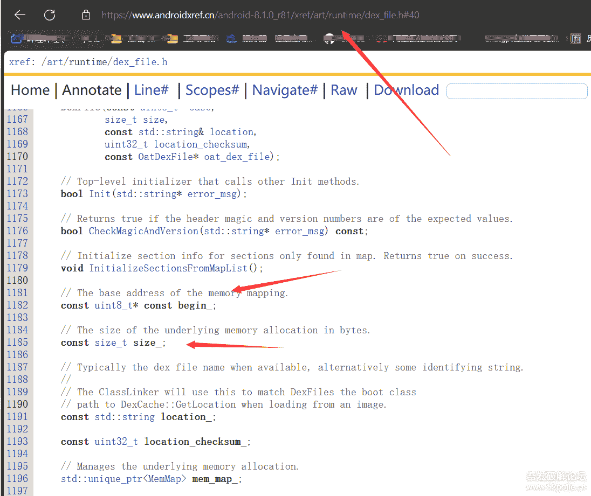

image-20231204235516456.png (185.49 KB, 下载次数: 5)

[href="forum.php?mod=attachment&aid=MjY2MTY3NXxlMzU2MzlmN3wxNzkzNTY4OTgwfDE2ODA4NnwxODY1MzEw&nothumb=yes" target="_blank"](https://www.52pojie.cn/forum.php?mod=attachment&aid=MjY2MTY3NXxlMzU2MzlmN3wxNzkzNTY4OTgwfDE2ODA4NnwxODY1MzEw&nothumb=yes)

2023-12-5 02:21 上传

## 脱壳关键对象

这里是`DexFile`的定义，也是我们脱壳的关键对象，具体寻找方式读者动手能力强可以找一下，寻找方式：寻找定义(`Definition`) `DexClassLoader`开始找，`DexFile`这个对象在源码中很多处有使用到，也就是说脱壳点是很多的，`DexFile`里面定义有两个常量，一个`begin_`即`dex`在内存中的位置，而`size`则是`dex`的文件大小，根据大小和起始位置也就是`begin`，就能把整个完整的`dex`文件从内存中`dump`下来，而且对象里面的成员函数提供了获取这两个成员变量以便调用，这也是二代壳的脱壳方式

下面贴一张`DexFile`的搜索结果是很多的，这是在`libcore`中进行的搜索，也可以从这里插入我们自己写的代码进行脱壳

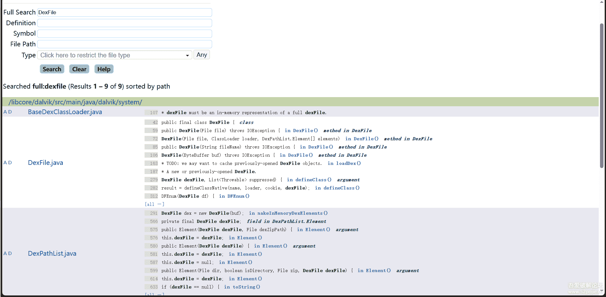

image-20231205003751547.png (84.64 KB, 下载次数: 6)

[href="forum.php?mod=attachment&aid=MjY2MTY3NnwyYzE0YzU5NXwxNzkzNTY4OTgwfDE2ODA4NnwxODY1MzEw&nothumb=yes" target="_blank"](https://www.52pojie.cn/forum.php?mod=attachment&aid=MjY2MTY3NnwyYzE0YzU5NXwxNzkzNTY4OTgwfDE2ODA4NnwxODY1MzEw&nothumb=yes)

2023-12-5 02:22 上传

下面这张是`Android`全部源码中搜索出来的结果，下面会介绍一个稳定的脱壳点

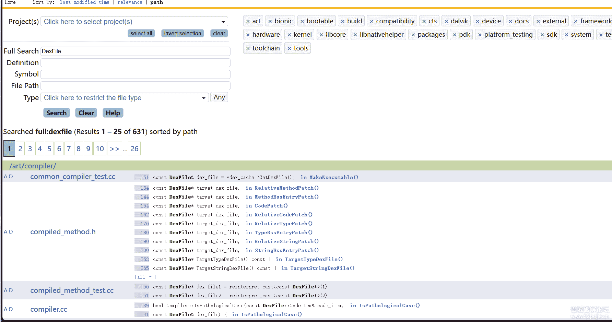

image-20231205003918569.png (100.24 KB, 下载次数: 5)

[href="forum.php?mod=attachment&aid=MjY2MTY3N3wwM2FlNzU4NnwxNzkzNTY4OTgwfDE2ODA4NnwxODY1MzEw&nothumb=yes" target="_blank"](https://www.52pojie.cn/forum.php?mod=attachment&aid=MjY2MTY3N3wwM2FlNzU4NnwxNzkzNTY4OTgwfDE2ODA4NnwxODY1MzEw&nothumb=yes)

2023-12-5 02:22 上传

```c
static inline JValue Execute(Thread* self, const DexFile::CodeItem* code_item,
                             ShadowFrame& shadow_frame, JValue result_register) {
      //addcodestart
    char *dexfilepath=(char*)malloc(sizeof(char)*1000);   
    if(dexfilepath!=nullptr)
    {
    //先ArtMethod
}
```


## 代码片段一

```
    ArtMethod* artmethod=shadow_frame.GetMethod();

    //拿到DexFile

    const DexFile* dex_file = artmethod->GetDexFile();

    //拿到Begin和size  随后进行dump和保存

    const uint8_t* begin_=dex_file->Begin();  // Start of data.

    size_t size_=dex_file->Size();  // Length of data.

    int size_int_=(int)size_;

    int fcmdline =-1;

    char szCmdline[64]= {0};

    char szProcName[256] = {0};

    int procid = getpid();

    sprintf(szCmdline,"/proc/%d/cmdline", procid);

    fcmdline = open(szCmdline, O_RDONLY,0644);

    if(fcmdline >0)

    {

        read(fcmdline, szProcName,256);

        close(fcmdline);

    }

    if(szProcName[0])

    {

            memset(dexfilepath,0,1000);               

            sprintf(dexfilepath,"/sdcard/%s_%d_dexfile.dex",szProcName,size_int_);     

            int dexfilefp=open(dexfilepath,O_RDONLY,0666);

            if(dexfilefp>0){

                                close(dexfilefp);

                                dexfilefp=0;

                            }else{

                                        int fp=open(dexfilepath,O_CREAT|O_APPEND|O_RDWR,0666);

                                        if(fp>0)

                                        {

                                            write(fp,(void*)begin_,size_);

                                            fsync(fp); 

                                            close(fp);  

                                            }  

                                }

    }

    if(dexfilepath!=nullptr)

    {

        free(dexfilepath);

        dexfilepath=nullptr;

    }                        

   }

 //addcodeend
```

## 代码片段二

```
  DCHECK(!shadow_frame.GetMethod()->IsAbstract());
  DCHECK(!shadow_frame.GetMethod()->IsNative());
  shadow_frame.GetMethod()->GetDeclaringClass()->AssertInitializedOrInitializingInThread(self);
  bool transaction_active = Runtime::Current()->IsActiveTransaction();
  if (LIKELY(shadow_frame.GetMethod()->IsPreverified())) {
    // Enter the "without access check" interpreter.
    if (kInterpreterImplKind == kSwitchImpl) {
      if (transaction_active) {
        return ExecuteSwitchImpl(self, code_item, shadow_frame, result_register);
      } else {
        return ExecuteSwitchImpl(self, code_item, shadow_frame, result_register);
      }
    } else {
      DCHECK_EQ(kInterpreterImplKind, kComputedGotoImplKind);
      if (transaction_active) {
        return ExecuteGotoImpl(self, code_item, shadow_frame, result_register);
      } else {
        return ExecuteGotoImpl(self, code_item, shadow_frame, result_register);
      }
    }
  } else {
    // Enter the "with access check" interpreter.
    if (kInterpreterImplKind == kSwitchImpl) {
      if (transaction_active) {
        return ExecuteSwitchImpl(self, code_item, shadow_frame, result_register);
      } else {
        return ExecuteSwitchImpl(self, code_item, shadow_frame, result_register);
      }
    } else {
      DCHECK_EQ(kInterpreterImplKind, kComputedGotoImplKind);
      if (transaction_active) {
        return ExecuteGotoImpl(self, code_item, shadow_frame, result_register);
      } else {
        return ExecuteGotoImpl(self, code_item, shadow_frame, result_register);
      }
    }
  }
}
```

### 第三代加壳：函数抽取

接下来是第三代加壳也就是函数抽取了，在第二代壳的基础上，我们要处理得更多一些，因为函数被抽空了，这里我们只讲思路，不讲实现，如果有机会以后给读者讲解完整，

那第三代抽取壳，我们就得知道`dex`的文件结构了，具体这里就不贴了，大家可以网上搜一下了解一下`dex`的文件结构，简单来说就是第三代抽取壳，我们需要拿到`code_item`，`code_item`里面有函数的偏移，寄存器个数，使用的寄存器分别是谁以及函数的索引，索引就是函数的所在位置，然后我们拿到这个偏移就可以通过`hook`的方式来主动调来修复`dex`

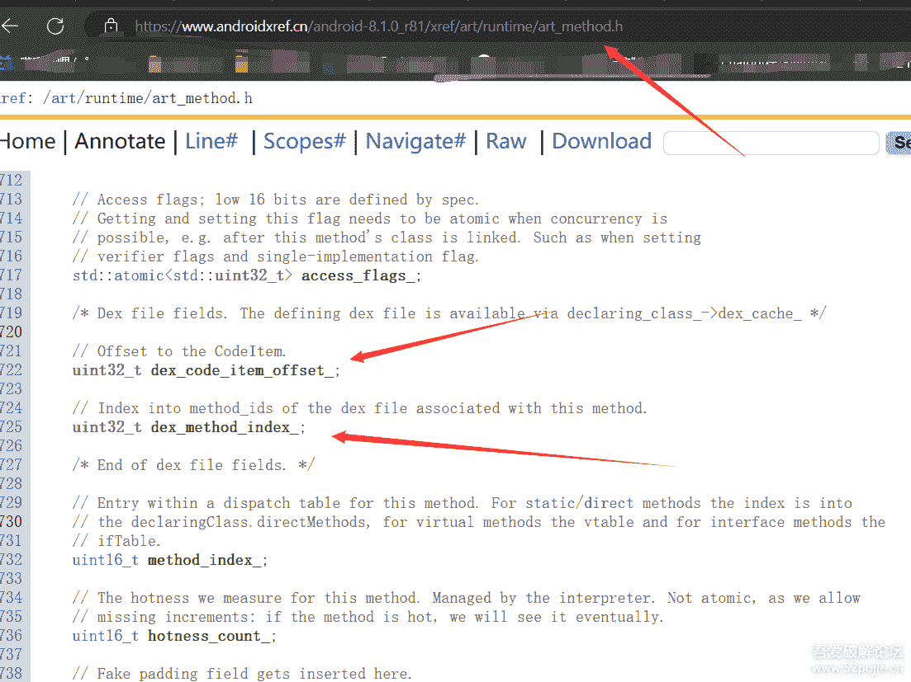

image-20231204233521992.png (167.12 KB, 下载次数: 4)

[href="forum.php?mod=attachment&aid=MjY2MTY3OHxmOGI2OGVmY3wxNzkzNTY4OTgwfDE2ODA4NnwxODY1MzEw&nothumb=yes" target="_blank"](https://www.52pojie.cn/forum.php?mod=attachment&aid=MjY2MTY3OHxmOGI2OGVmY3wxNzkzNTY4OTgwfDE2ODA4NnwxODY1MzEw&nothumb=yes)

2023-12-5 02:23 上传

### 笔者废话2

很感谢能看到这里，很久没输出过帖子了，这次写得挺差的。距离上次投稿已经一年了，消失的一年时间内我在疯狂的提升自己，安卓`frida` `hook`百例会继续更新，但是光用`frida`也不知道能不能更新百例感觉任重道远，有空就写点类似于原理的？感觉还是原理有意思哈。

### 文中部分摘抄文章地址

[//www.52pojie.cn/thread-1026370-1-1.html" target="_blank" rel="noopener noreferrer nofollow"](https://www.52pojie.cn/thread-1026370-1-1.html:href="https)

[//zhuanlan.zhihu.com/p/136083521" target="_blank" rel="noopener noreferrer nofollow"](https://zhuanlan.zhihu.com/p/136083521:rel="nofollow noopener" href="https)
