# [Android 分享] 雷电模拟器+`fiddler`+`adb` 实现https 抓包(系统证书) 【看本贴就够了!】

> 原帖：https://www.52pojie.cn/forum.php?mod=viewthread&tid=1869498  
> 抓取时间：2026-11-01T21:36:09

## ① 安装工具

安装雷电模拟器、`fiddler`、`platform-tools`，百度搜索安装即可。本帖雷电模拟器使用较新版本，系统安卓9。

## ② 统一 `adb` 版本

雷电模拟器路径里的 `adb.exe` 需要和 `platform-tools` 里的 `adb.exe` 统一，用 `platform-tools` 里的 `adb.exe` 覆盖雷电模拟器里的，这一步避免一些不匹配的问题。

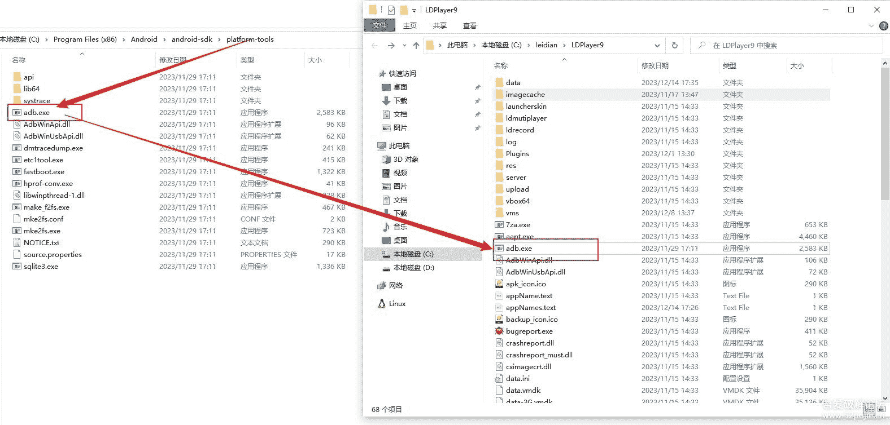

[1.jpg (177.88 KB, 下载次数: 3)](https://www.52pojie.cn/forum.php?mod=attachment&aid=MjY2NDIyN3w0ZWY0Y2VmN3wxNzkzNTY4OTY3fDE2ODA4NnwxODY5NDk4&nothumb=yes)

2023-12-15 16:37 上传

## ③ `fiddler` 配置

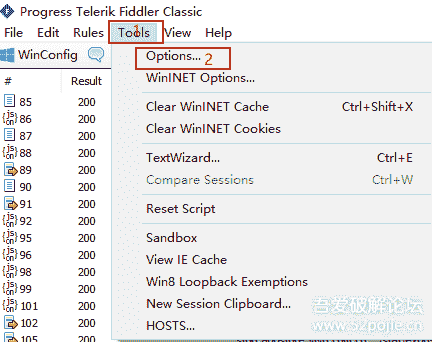

[2.png (29.68 KB, 下载次数: 3)](https://www.52pojie.cn/forum.php?mod=attachment&aid=MjY2NDIyOHxhMmFlM2U1NXwxNzkzNTY4OTY3fDE2ODA4NnwxODY5NDk4&nothumb=yes)

2023-12-15 16:38 上传

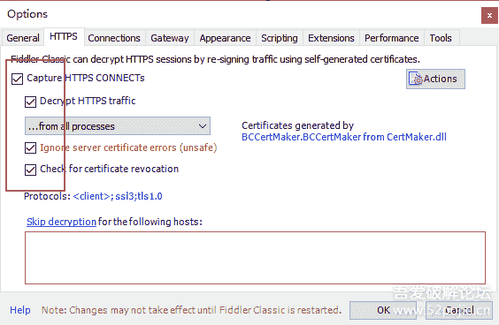

[3.png (27.08 KB, 下载次数: 3)](https://www.52pojie.cn/forum.php?mod=attachment&aid=MjY2NDIzMHwxZWRiYTEyOHwxNzkzNTY4OTY3fDE2ODA4NnwxODY5NDk4&nothumb=yes)

2023-12-15 16:38 上传

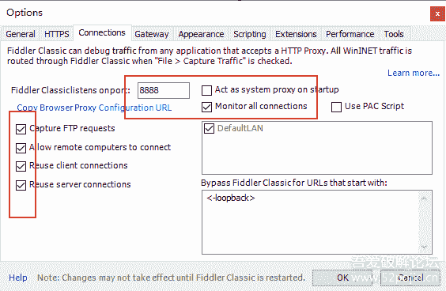

[4.png (28.62 KB, 下载次数: 2)](https://www.52pojie.cn/forum.php?mod=attachment&aid=MjY2NDIzMXwzYjZmOTM4NXwxNzkzNTY4OTY3fDE2ODA4NnwxODY5NDk4&nothumb=yes)

2023-12-15 16:38 上传

我这里端口 `8888`，view 勾选第一个。

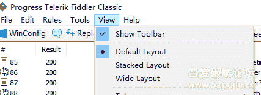

[5.png (18.18 KB, 下载次数: 1)](https://www.52pojie.cn/forum.php?mod=attachment&aid=MjY2NDIzMnw0YTNiYWUzOHwxNzkzNTY4OTY3fDE2ODA4NnwxODY5NDk4&nothumb=yes)

2023-12-15 16:38 上传

右上角出现 online，第一个 IP 即为本机 IP，一会配置模拟器要用。

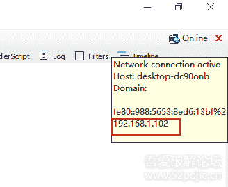

[6.png (12.83 KB, 下载次数: 3)](https://www.52pojie.cn/forum.php?mod=attachment&aid=MjY2NDIzM3w2ZDVmZmE3YnwxNzkzNTY4OTY3fDE2ODA4NnwxODY5NDk4&nothumb=yes)

2023-12-15 16:38 上传

`fiddler` 地址：`192.168.1.102:8888`

## ④ 雷电模拟器配置

无需设置桥联。

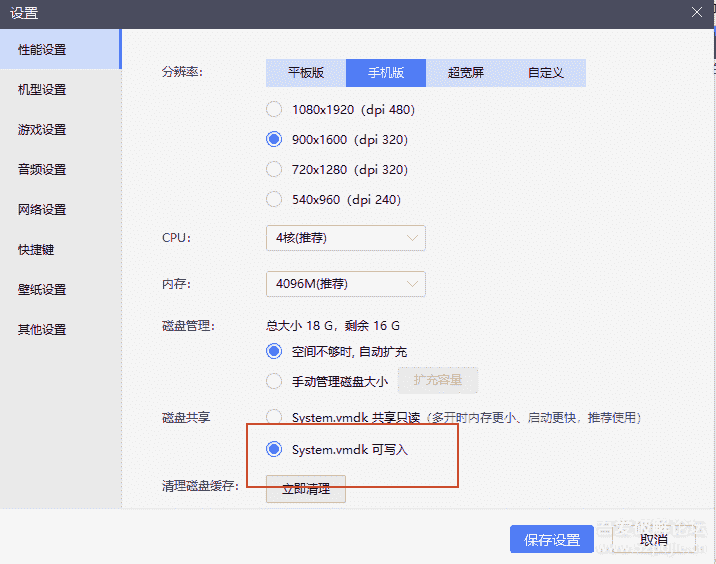

[7.png (48.26 KB, 下载次数: 1)](https://www.52pojie.cn/forum.php?mod=attachment&aid=MjY2NDIzNHwyNmZhNDc1MnwxNzkzNTY4OTY3fDE2ODA4NnwxODY5NDk4&nothumb=yes)

2023-12-15 16:38 上传

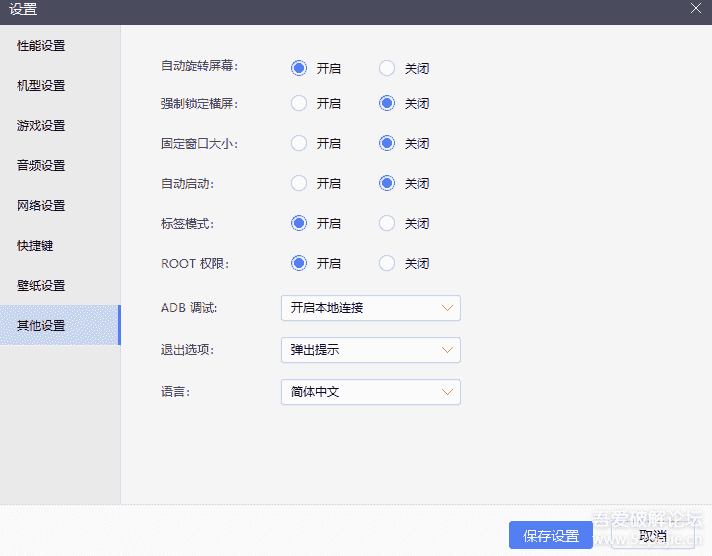

[8.png (39.92 KB, 下载次数: 1)](https://www.52pojie.cn/forum.php?mod=attachment&aid=MjY2NDIzNXw2ZWFkODkyM3wxNzkzNTY4OTY3fDE2ODA4NnwxODY5NDk4&nothumb=yes)

2023-12-15 16:38 上传

设置代理，浏览器访问 `fiddler` 地址：`192.168.1.102:8888`，安装证书，点击下载的证书文件即可安装，命名随意。

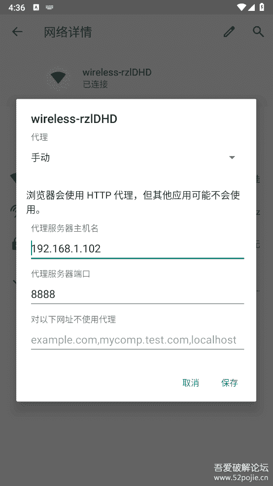

[9.png (73.22 KB, 下载次数: 2)](https://www.52pojie.cn/forum.php?mod=attachment&aid=MjY2NDIzNnw5MTk0Mjg2Y3wxNzkzNTY4OTY3fDE2ODA4NnwxODY5NDk4&nothumb=yes)

2023-12-15 16:39 上传

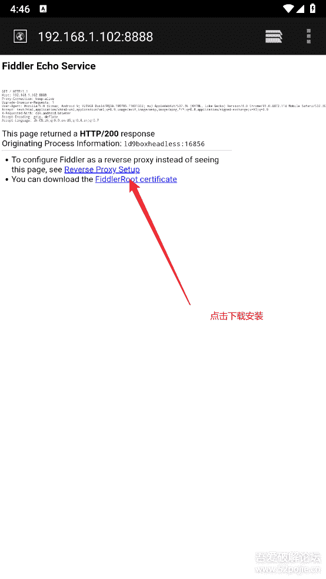

[image.png (75.49 KB, 下载次数: 2)](https://www.52pojie.cn/forum.php?mod=attachment&aid=MjY2NDI0MHw4Y2NjZThlYXwxNzkzNTY4OTY3fDE2ODA4NnwxODY5NDk4&nothumb=yes)

2023-12-15 16:47 上传

## ⑤ `adb` 配置系统证书

用户证书目录：`/data/misc/user/0/cacerts-added/`

系统证书目录：`/system/etc/security/cacerts/`

第④步已安装的 `fiddler` 证书目前在用户证书目录，需要将 `/data/misc/user/0/cacerts-added/` 的证书文件移动到 `/system/etc/security/cacerts/`，使其变为信任证书。

在 `cmd` 命令行执行（在 Windows 窗口运行）：

```bash
# 进入 adb shell 工具
adb root
adb remount
adb shell

# 切换 root 用户
gracelte:/ $ su

# 查看用户证书安装的名称
127|gracelte:/ # ls /data/misc/user/0/cacerts-added/
e5c3944b.0

# 将用户证书挪至系统证书目录
gracelte:/ # mv /data/misc/user/0/cacerts-added/e5c3944b.0 /system/etc/security/cacerts/
```

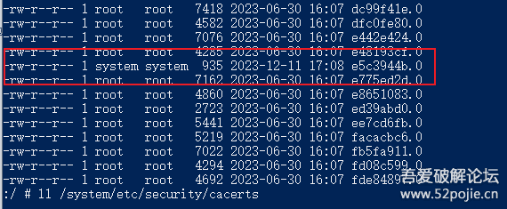

[image.png (18.36 KB, 下载次数: 1)](https://www.52pojie.cn/forum.php?mod=attachment&aid=MjY2NDIzOXxmZTcyY2ZkYnwxNzkzNTY4OTY3fDE2ODA4NnwxODY5NDk4&nothumb=yes)

2023-12-15 16:46 上传

现在就可以去抓包 app 了，包括应用商店都可以抓包。
