# [Android 原创] Key Attestation 密钥认证流程和饶过思路

- 原帖: https://www.52pojie.cn/forum.php?mod=viewthread&tid=1873264
- 抓取时间: 2026-11-01T21:35:54

## bypassKeyAttestation

### Key Attestation 密钥认证

官方文档介绍：[Android Keystore attestation](https://source.android.com/docs/security/features/keystore/attestation)，

个人理解，硬件提供加密功能，同时该硬件模块也会反映设备的软硬件的安全环境。

不想自己实现一套代码的，可以直接用开源的：[KeyAttestation](https://github.com/vvb2060/KeyAttestation)

功能入口：[KeyAttestation](https://github.com/vvb2060/KeyAttestation) 中的`HomeViewModel.kt`的`doAttestation()`方法：

#### 获取证书链

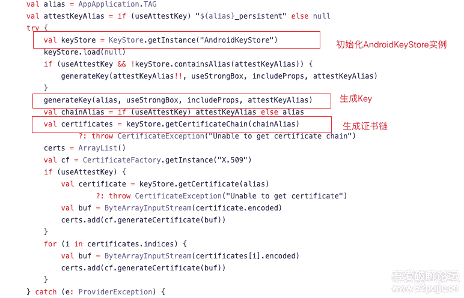

image-20231207102826652.png (123.61 KB, 下载次数: 3) [下载](https://www.52pojie.cn/forum.php?mod=attachment&aid=MjY2NjUxOXwyNTc0MjIyYnwxNzkzNTY4OTUyfDE2ODA4NnwxODczMjY0&nothumb=yes)

2023-12-26 19:30 上传

#### 解析证书链

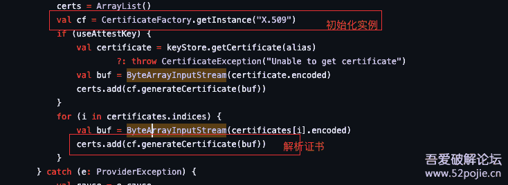

image-20231206194902623.png (61.5 KB, 下载次数: 2) [下载](https://www.52pojie.cn/forum.php?mod=attachment&aid=MjY2NjQ5NnxlZjQ2ZjBhMXwxNzkzNTY4OTUyfDE2ODA4NnwxODczMjY0&nothumb=yes)

2023-12-26 18:39 上传

#### 对证书链进行校验

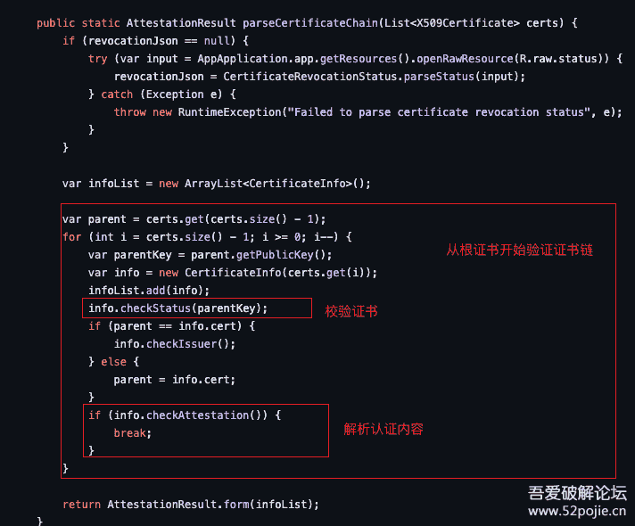

image-20231206204618107.png (103.01 KB, 下载次数: 3) [下载](https://www.52pojie.cn/forum.php?mod=attachment&aid=MjY2NjQ5N3w1Mjc1NzlhN3wxNzkzNTY4OTUyfDE2ODA4NnwxODczMjY0&nothumb=yes)

2023-12-26 18:39 上传

#### 解析extension，获取设备的状态

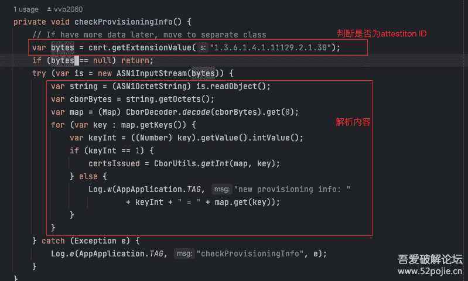

image-20231206204803506.png (85.29 KB, 下载次数: 3) [下载](https://www.52pojie.cn/forum.php?mod=attachment&aid=MjY2NjQ5OHwxZmNmNzkzY3wxNzkzNTY4OTUyfDE2ODA4NnwxODczMjY0&nothumb=yes)

2023-12-26 18:39 上传

格式规范文档：[Key Attestation extension](https://source.android.com/docs/security/features/keystore/attestation-extension)

简单看下解析extension的内容

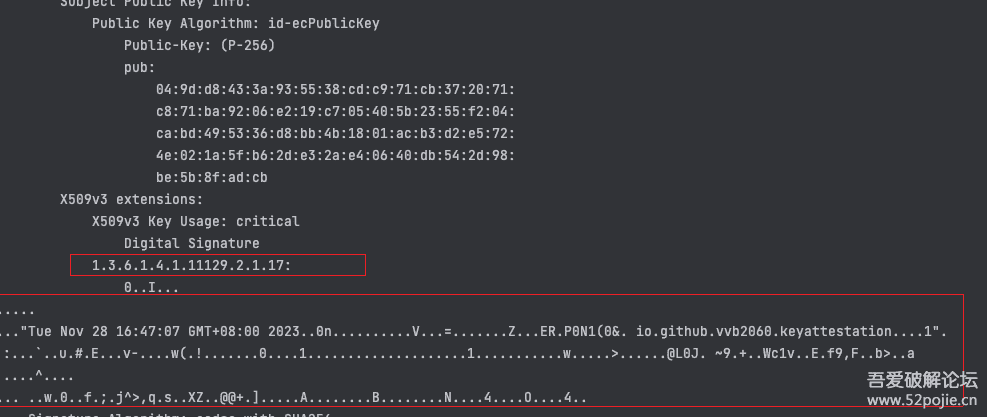

image-20231206205018254.png (59.93 KB, 下载次数: 2) [下载](https://www.52pojie.cn/forum.php?mod=attachment&aid=MjY2NjQ5OXwzZTEwMjIwM3wxNzkzNTY4OTUyfDE2ODA4NnwxODczMjY0&nothumb=yes)

2023-12-26 18:39 上传

解析后部分数据

```text
Attest version: Keymaster version 4.1
Attest security: StrongBox
Verified boot Key: AAAAAAAAAAAAAAAAAAAAAAAAAAAAAAAAAAAAAAAAAAA= (base64)
Device locked: false
Verified boot state: Unverified

//Hash for boot
//Hashtree metadata for system
//Hashtree metadata for vendor
Verified boot hash: nDqAWissOCsw+aWEm7cEcAkCvQngEE+ypQ75UWakxt4= (base64)
```

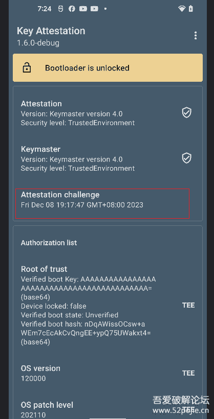

image-20231208192355224.png (81.87 KB, 下载次数: 1) [下载](https://www.52pojie.cn/forum.php?mod=attachment&aid=MjY2NjUwMHxmOTNhNzRhY3wxNzkzNTY4OTUyfDE2ODA4NnwxODczMjY0&nothumb=yes)

2023-12-26 18:40 上传

### 饶过手段

思路比较简单，替换到整条证书链为一个正常设备的证书链即可：

- 可以通过hook java层代码
- 写一个magisk插件 [bypasskeyattestation](https://github.com/doom-man/bypasskeyattestation)

hook java层已经比较熟练了，由于后续期望强化对异常设备的检测，大多对抗检测的工具又是走magisk插件实现的，打算用magisk插件实现一遍。

参考 [PlayIntegrityFix](https://github.com/chiteroman/PlayIntegrityFix) 大佬写的插件进行学习，对大佬拙劣的模仿。

#### 准备证书

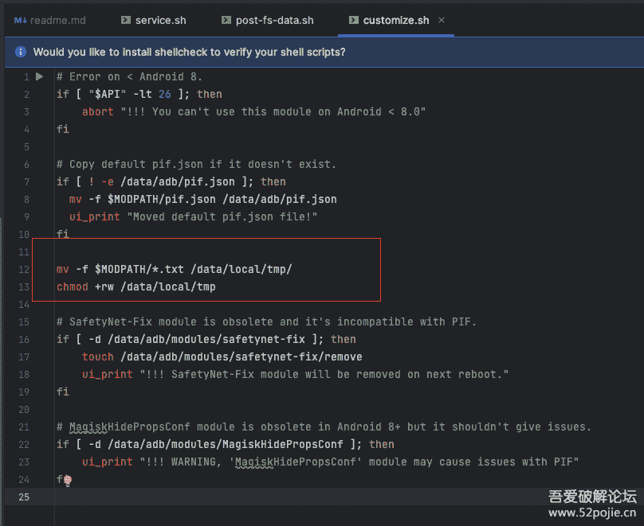

image-20231206205854947.png (91.14 KB, 下载次数: 2) [下载](https://www.52pojie.cn/forum.php?mod=attachment&aid=MjY2NjUwMnxkNDE5YzRhZXwxNzkzNTY4OTUyfDE2ODA4NnwxODczMjY0&nothumb=yes)

2023-12-26 18:42 上传

将证书文件移动`/data/local/tmp`下，并提供读权限；

#### 注入目标进程

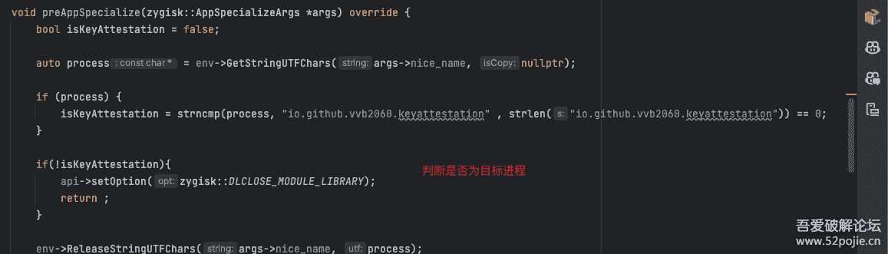

image-20231206210101742.png (64.22 KB, 下载次数: 2) [下载](https://www.52pojie.cn/forum.php?mod=attachment&aid=MjY2NjUwM3w4ZDI3NmZkM3wxNzkzNTY4OTUyfDE2ODA4NnwxODczMjY0&nothumb=yes)

2023-12-26 18:42 上传

代码入口在`cpp/main.cpp`

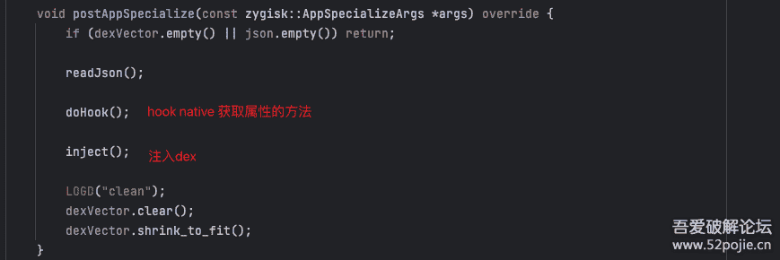

image-20231206210830493.png (38.53 KB, 下载次数: 2) [下载](https://www.52pojie.cn/forum.php?mod=attachment&aid=MjY2NjUwNHw4M2Q3ODdjMHwxNzkzNTY4OTUyfDE2ODA4NnwxODczMjY0&nothumb=yes)

2023-12-26 18:43 上传

#### 替换证书链

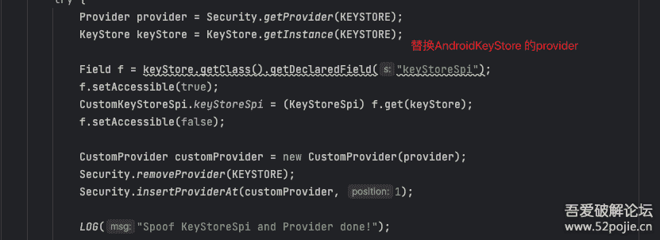

image-20231206210430273.png (59.47 KB, 下载次数: 1) [下载](https://www.52pojie.cn/forum.php?mod=attachment&aid=MjY2NjUwNXxlNGI3ZDJmOXwxNzkzNTY4OTUyfDE2ODA4NnwxODczMjY0&nothumb=yes)

2023-12-26 18:43 上传

`CustomKeyStoreSpi.java`

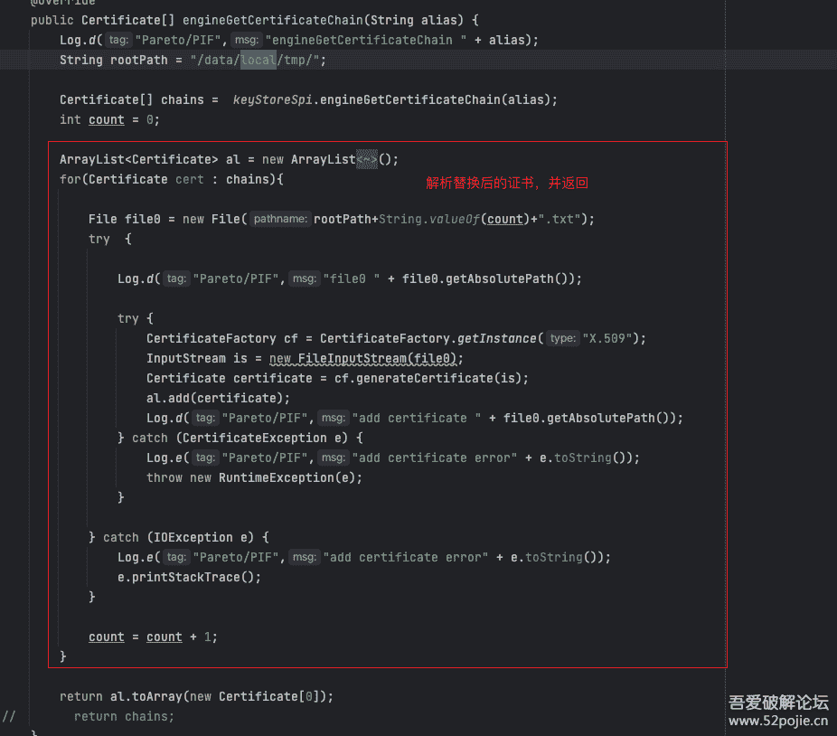

image-20231206210320245.png (117.99 KB, 下载次数: 1) [下载](https://www.52pojie.cn/forum.php?mod=attachment&aid=MjY2NjUwN3xmZGY2YmEwM3wxNzkzNTY4OTUyfDE2ODA4NnwxODczMjY0&nothumb=yes)

2023-12-26 18:43 上传

替换后效果

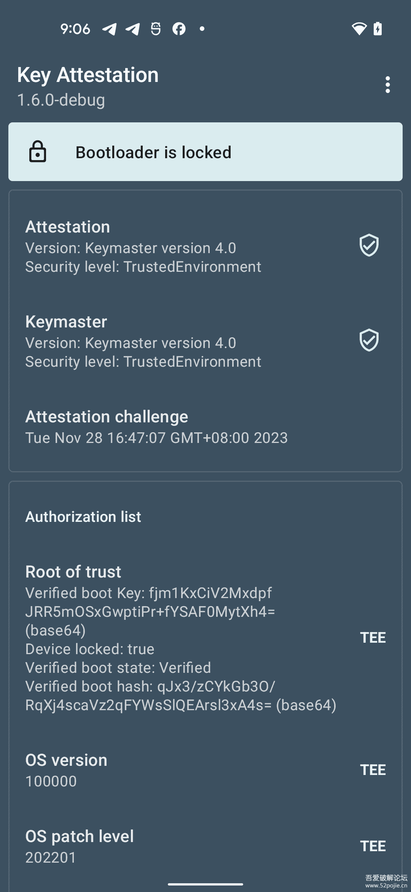

image-20231206210517186.png (223.59 KB, 下载次数: 2) [下载](https://www.52pojie.cn/forum.php?mod=attachment&aid=MjY2NjUwOHwxM2UzYjIyZHwxNzkzNTY4OTUyfDE2ODA4NnwxODczMjY0&nothumb=yes)

2023-12-26 18:43 上传

#### 结语

我认为设备异常判定，即使各大厂商去自研解决方案，也应该去学习了解系统层面提供的安全检测手段 和 官方在用的判定方案。
