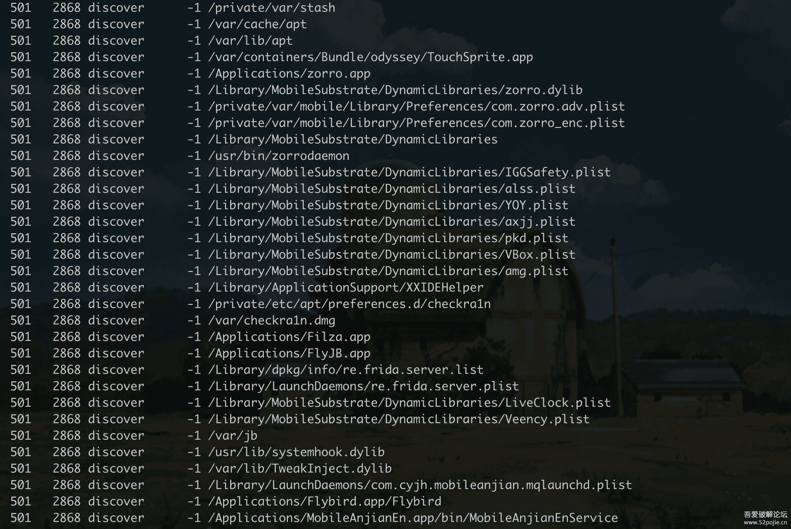

# [iOS 原创] 分享一个使用MAC调试iOS APP的小技巧

- 原帖: https://www.52pojie.cn/forum.php?mod=viewthread&tid=1874574
- 抓取时间: 2026-11-01T21:35:50

由于隐私合规的问题,需要对介入的第三方的SDK进行审计,防止这些SDK获取一些不该获取信息,但是常规的检测手段有限,不能监控到SDK利用的所有手段.

众所周知,在使用苹果芯片的MAC上面可以直接调试iOS APP,unix上面有各种监听进程的工具,这时候我们可以借助 unix 上面的工具实现我们的目的.

比如说 `dtrace` 可以监听各种系统调用

`dtrace` 的名字暗示了自己的脚本，`dtrace` 使用了 `D` 语言作为脚本语言,简单介绍一下 `dtrace` 用法。

如果我们要监听一个进程所有的 `syscall` 调用,首先，我们需要创建一个叫 `syscall.d` 文件

```
syscall::read:entry
{
        printf ("%s called read, asking for %d bytes\n", execname, arg2);
}
```

其中 `execname` 代表了进程名字

终端运行 `sudo dtrace -s syscall.d` 脚本,这样子不管SDK是用调用函数还是调用`syscall`,或者调用`svc`,甚至隐式调用`svc`都可以被 `dtrace`监听到.也可以在脚本中加入 `ustack();` 打印调用堆栈,方便向上查找调用点,扩展功能大家自行百度`dtrace`的用法.

在 `unix` 还有一个好用的工具 `opensnoop`,`opensnoop` 可以监视特定进程的文件打开操作,也是基于`dtrace`封装实现的

基本用法 `sudo opensnoop -n` 其中 `process_name` 为需要监听的进程名字

比如我随便监听一个APP



17038313434162.jpg (448.96 KB, 下载次数: 2)

[href="forum.php?mod=attachment&aid=MjY2NzAyOHxhMzUyYjQzZHwxNzkzNTY4OTQ4fDE2ODA4NnwxODc0NTc0&nothumb=yes" target="_blank"](https://www.52pojie.cn/forum.php?mod=attachment&aid=MjY2NzAyOHxhMzUyYjQzZHwxNzkzNTY4OTQ4fDE2ODA4NnwxODc0NTc0&nothumb=yes)

2023-12-29 14:29 上传

可以看到APP对这些文件进行读写操作,用来检测越狱,其中包括常见的越狱文件检测,`frida`检测,新机APP检测

本文仅做抛转引玉,更多操作大家可以自行扩展
