# [Android 原创] Android逆向学习（六）绕过app签名校验，通过`frida`，io重定向

- 原帖：[https://www.52pojie.cn/forum.php?mod=viewthread&tid=1878652](https://www.52pojie.cn/forum.php?mod=viewthread&tid=1878652)
- 抓取时间：2026-11-01T21:35:43

## 一、写在前面

这是吾爱破解正己大大教程的第五个作业，然后我的系统还是ubuntu，建议先看一下上一个博客，关于动态调试的，因为我这才发现动态调试是真的有很大用处，然后我们开始今天的教程（拖更很久了,实在不好意思，科研的任务比较重，抽空出一期博客，这一节博客问题其实挺多的，如果有不对的地方请指出，不胜感激）

## 二、任务目标

- 破解签名，使程序可以正常运行

## 三、实现方法

### 1. 破解签名防止闪退

我们先简单看一下这个反编译之后的java文件

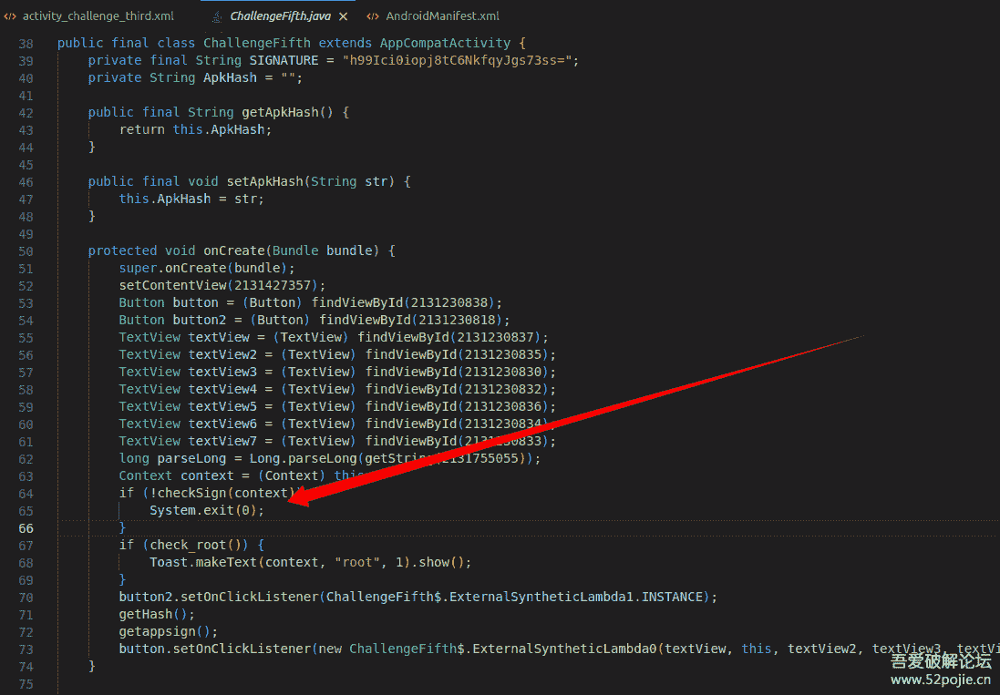

`20231004205012.png` (206.08 KB, 下载次数: 5)，2024-1-9 21:57 上传；[附件链接](https://www.52pojie.cn/forum.php?mod=attachment&aid=MjY2ODg5MnxjNDBmZTg0NXwxNzkzNTY4OTQwfDE2ODA4NnwxODc4NjUy&nothumb=yes)

这里有个`check`，以及`system`终结的一个代码

解决方法具体有两种，一种简单的方法就是直接更改函数的返回值，让他只返回`true`

我们分析一下`checkSign`的代码

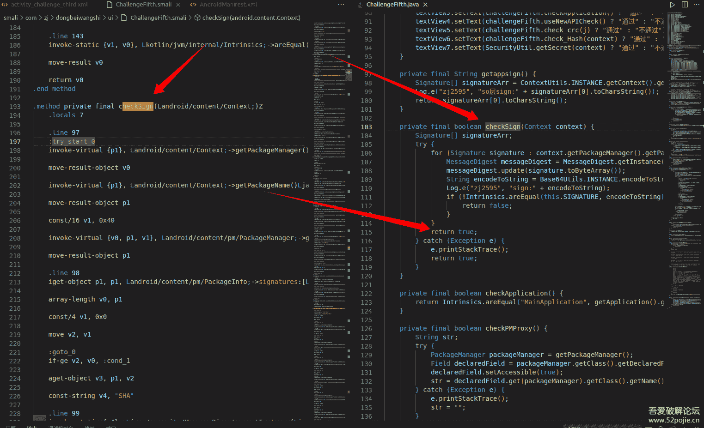

`20231004205325.png` (462.52 KB, 下载次数: 4)，2024-1-9 21:57 上传；[附件链接](https://www.52pojie.cn/forum.php?mod=attachment&aid=MjY2ODg5M3w5OWJmMTRlZXwxNzkzNTY4OTQwfDE2ODA4NnwxODc4NjUy&nothumb=yes)

最主要就是修改这个地方，把`false`改成`true`

我们发现`areEqual`调用后有一个分支，就说明改变这个分支就可以了

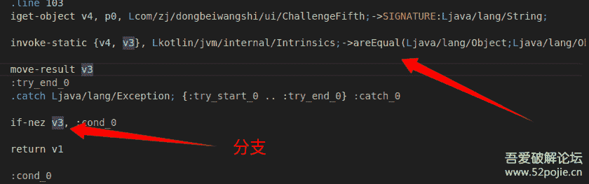

`20231004205711.png` (50.82 KB, 下载次数: 6)，2024-1-9 21:57 上传；[附件链接](https://www.52pojie.cn/forum.php?mod=attachment&aid=MjY2ODg5NHwzNjRlNDYyZHwxNzkzNTY4OTQwfDE2ODA4NnwxODc4NjUy&nothumb=yes)

我们直接修改smali代码后就是这样的

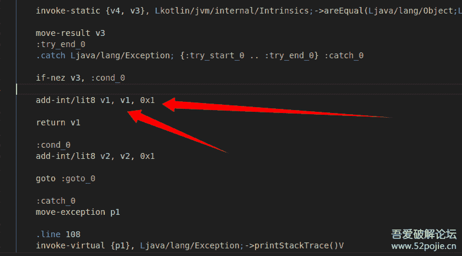

`20231004211445.png` (57.85 KB, 下载次数: 3)，2024-1-9 21:57 上传；[附件链接](https://www.52pojie.cn/forum.php?mod=attachment&aid=MjY2ODg5NXxlZmI4YjNmYXwxNzkzNTY4OTQwfDE2ODA4NnwxODc4NjUy&nothumb=yes)

然后我们就可以看到这个页面是什么样子的了


`20231004211546.png` (58.76 KB, 下载次数: 4)，2024-1-9 21:57 上传；[附件链接](https://www.52pojie.cn/forum.php?mod=attachment&aid=MjY2ODg5NnxmOWI0NjM2OHwxNzkzNTY4OTQwfDE2ODA4NnwxODc4NjUy&nothumb=yes)

然后还有一种方式就是我们动态调试一下,然后我们直接改变这个`hash`值

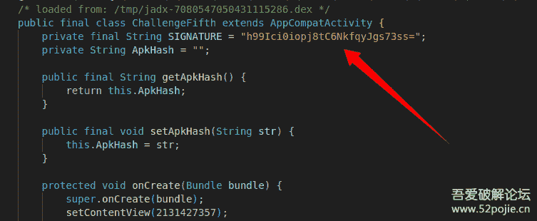

`20231004211853.png` (62.92 KB, 下载次数: 4)，2024-1-9 21:57 上传；[附件链接](https://www.52pojie.cn/forum.php?mod=attachment&aid=MjY2ODg5N3xhNzU4YTEwN3wxNzkzNTY4OTQwfDE2ODA4NnwxODc4NjUy&nothumb=yes)

就是这个`hash`值，这个就是这个软件原来的`hash`，因为我们对这个软件进行了很多修改，所以现在的`hash`和原来的`hash`已经不一样了，所以我们需要改成和现在一样

我们直接在`areEqual`上面这里打一个断点，然后开始一步一步往下走，就可以看到这样：

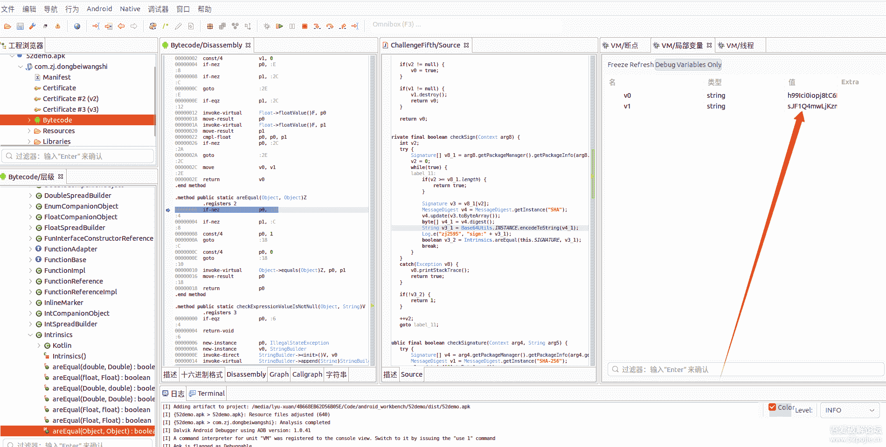

`20231004213430.png` (348.61 KB, 下载次数: 4)，2024-1-9 21:57 上传；[附件链接](https://www.52pojie.cn/forum.php?mod=attachment&aid=MjY2ODg5OHw1MDM1MGNiMXwxNzkzNTY4OTQwfDE2ODA4NnwxODc4NjUy&nothumb=yes)

这很明显就是要进行比较的两个值，然后我们把这个修改一下就可以了

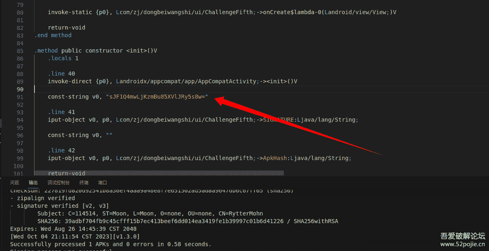

`20231004213554.png` (137.36 KB, 下载次数: 5)，2024-1-9 21:57 上传；[附件链接](https://www.52pojie.cn/forum.php?mod=attachment&aid=MjY2ODg5OXxmNGUxNDVhNXwxNzkzNTY4OTQwfDE2ODA4NnwxODc4NjUy&nothumb=yes)

然后我们打包运行一下（上一个方法的`add-int/lit8 v1, v1, 0x1`代码已经去除了）

发现是可以进行运行的

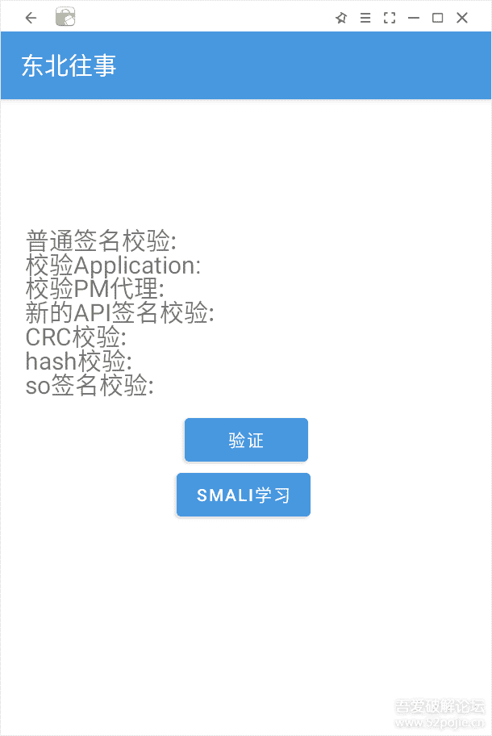

`20231004213918.png` (58.76 KB, 下载次数: 4)，2024-1-9 21:57 上传；[附件链接](https://www.52pojie.cn/forum.php?mod=attachment&aid=MjY2ODkwMHw4Yjc4ODcwYXwxNzkzNTY4OTQwfDE2ODA4NnwxODc4NjUy&nothumb=yes)

### 2. 关于剩余的签名

然后我这里一直有一些bug就是我点击验证总是会出问题，就是程序直接卡死，讲道理不应该这样才对，然后我直接`debug`动态调试发现是`so`校验的时候会卡死，讲道理不应该呀，我用真机测试也会出现这种情况，通过`JEB`进行动态调试之后发现就是在`loadLibrary`的时候会出现这个问题

搞了好久都不知道怎么回事，就只能把这个签名校验直接干掉了（字面意义上的干掉）

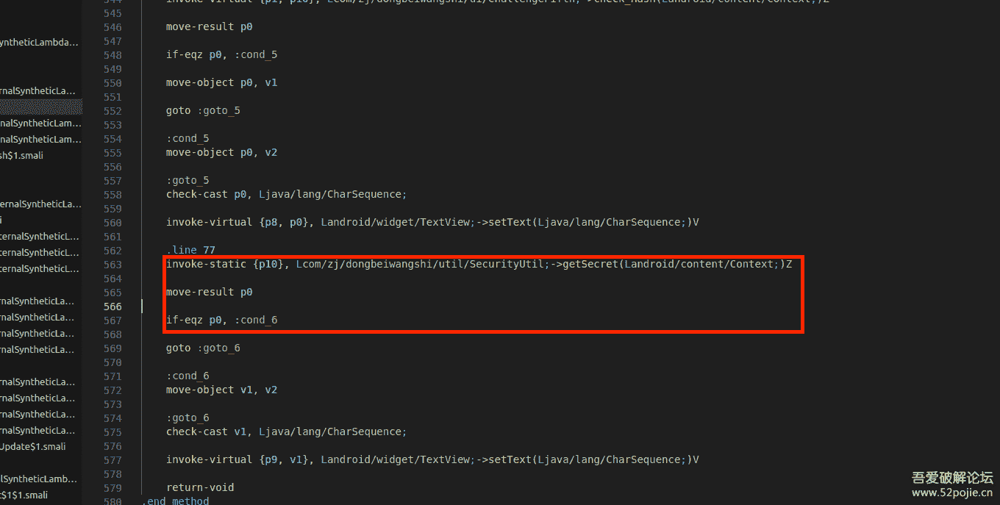

`20231005160820.png` (140.75 KB, 下载次数: 3)，2024-1-9 21:57 上传；[附件链接](https://www.52pojie.cn/forum.php?mod=attachment&aid=MjY2ODkwMXw3Mjk1NGMzZnwxNzkzNTY4OTQwfDE2ODA4NnwxODc4NjUy&nothumb=yes)

就是这三行直接全部消灭掉，当然这样一般肯定是有问题的，`so`文件里面一般都会有一些可能其他进程需要的函数，所以我建议最好不要用这个方法，我是实在没办法了才这样，要是不这样我可能连着好几天都没法更新新的blog，所以请大家见谅

但是不管如何我都会遇到这个问题，难不成因为版本问题？算了不管了先这样。


`20240108204430.png` (79.76 KB, 下载次数: 6)，2024-1-9 21:57 上传；[附件链接](https://www.52pojie.cn/forum.php?mod=attachment&aid=MjY2ODkwMnxhMjBlNDM2MXwxNzkzNTY4OTQwfDE2ODA4NnwxODc4NjUy&nothumb=yes)

后来我想了想，不如反编译`so`文件看看，说不定可以看到哪里有问题，然后我们反编译后是这样

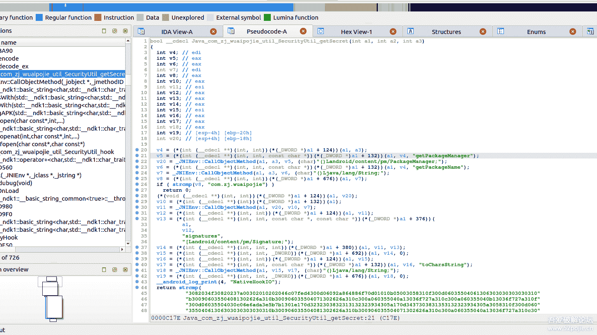

`20240108211748.png` (339.48 KB, 下载次数: 6)，2024-1-9 21:57 上传；[附件链接](https://www.52pojie.cn/forum.php?mod=attachment&aid=MjY2ODkwM3xjMTJjYjJjYXwxNzkzNTY4OTQwfDE2ODA4NnwxODc4NjUy&nothumb=yes)

突然间想到，说不定是因为我把名称改成了东北往事，然后`load`的时候名称对不上

重新把东北往事换成了wuaipojie，结果还是完蛋，点击验证还是闪退，看来跟这个没关系，问题只有天知道了，就删掉继续吧，这样我们需要面对的就是API签名校验，CRC校验和`hash`校验

### 3. 新API校验

我们同样进行一个逆向，直接看源代码


```java
private final boolean useNewAPICheck() {
    String str;
    Signature[] signatureArr;
    try {
        if (Build.VERSION.SDK_INT >= 28) {
            signatureArr = getPackageManager().getPackageInfo(getPackageName(), 134217728).signingInfo.getApkContentsSigners();
        } else {
            signatureArr = getPackageManager().getPackageInfo(getPackageName(), 64).signatures;
        }
        str = MD5Utils.INSTANCE.MD5(Base64Utils.INSTANCE.encodeToString(signatureArr[0].toByteArray()));
    } catch (PackageManager.NameNotFoundException e) {
        e.printStackTrace();
        str = "";
    }
    Log.e("zj2595", "newsign:" + str);
    return Intrinsics.areEqual("074f64af5821ae6aa1ac1779ad5687ad", str);
}
```

这个就是新API校验的函数，当然按照正己大大的教程，我们是可以得到这个`Log.e`中的这个信息，那我们就先按照正己大大的教程，查看一下这个log就行了，我采用的方法是直接用`adb`看。

首先打开终端，`adb`连接后打开`shell`，然后使用`logcat`关键词查询，就可以看到这个。

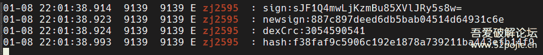

`20240108220253.png` (35.83 KB, 下载次数: 2)

[论坛附件](https://www.52pojie.cn/forum.php?mod=attachment&aid=MjY2ODkwNHxiMjYxZTMwZHwxNzkzNTY4OTQwfDE2ODA4NnwxODc4NjUy&nothumb=yes)

2024-1-9 21:57 上传

这个然后复制过去，替换掉就可以了，就像这样

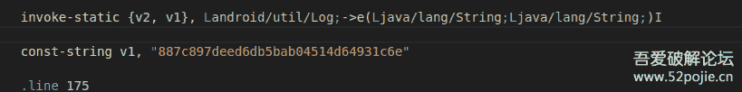

`20240108220314.png` (23 KB, 下载次数: 5)

[论坛附件](https://www.52pojie.cn/forum.php?mod=attachment&aid=MjY2ODkwNXxlYTQ3ZmVkNHwxNzkzNTY4OTQwfDE2ODA4NnwxODc4NjUy&nothumb=yes)

2024-1-9 21:57 上传

但是这就有一个问题了，一半正常情况下是不会有人专门log出来，所以这个方法在实战中是没有用处的，所以一般来说，我们的操作有：

- 动态调试找到这个`str`
- 直接强行修改返回值，永远返回一个`true`

这两招是比较实用的

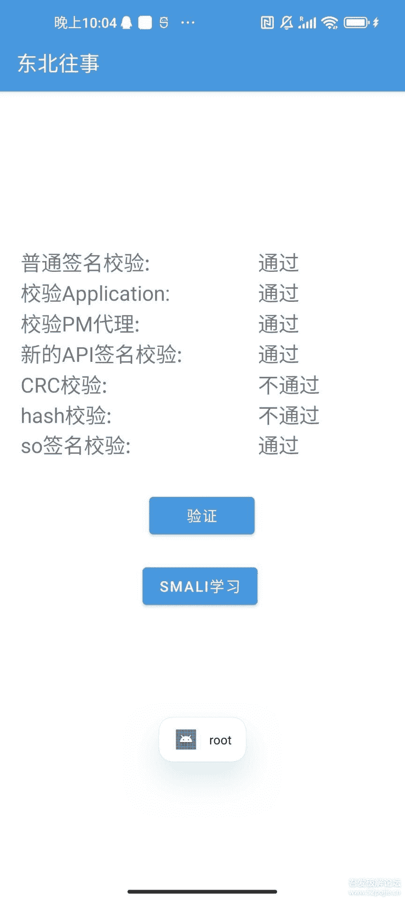

`20240108220447.png` (81.94 KB, 下载次数: 5)

[论坛附件](https://www.52pojie.cn/forum.php?mod=attachment&aid=MjY2ODkwNnwzNjNlYWVmY3wxNzkzNTY4OTQwfDE2ODA4NnwxODc4NjUy&nothumb=yes)

2024-1-9 21:57 上传

## 4. CRC校验（有问题，请先看完再实际操作）

这个方法也差不多，首先看一下crc校验的代码

```java
public final boolean check_crc(long j) {
    try {
        ZipEntry entry = new ZipFile(getPackageCodePath()).getEntry("classes.dex");
        Log.e("zj2595", "dexCrc:" + entry.getCrc());
        return entry.getCrc() == j;
    } catch (Exception e) {
        e.printStackTrace();
        return true;
    }
}
```

关于这个`j`我也看到了，我把相关代码摘出来。我们可以看到相关的代码有一个`j`：

```java
textView5.setText(challengeFifth.check_crc(j) ? "通过" : "不通过");
```

然后我们找到这个函数的参数

（`TextView textView, ChallengeFifth challengeFifth, TextView textView2, TextView textView3, TextView textView4, TextView textView5, long j, TextView textView6, TextView textView7, View view`）

顺藤摸瓜往上找，找到了

```java
long parseLong = Long.parseLong(getString(2131755055));
button.setOnClickListener(new ChallengeFifth$.ExternalSyntheticLambda0(textView, this, textView2, textView3, textView6, textView4, parseLong, textView5, textView7));
```

这时候就比较难办了，修改也不好修改（强行修改返回值我不讲了，这个方法算作弊了，我们就学习一种新的破解方法）

原教程io重定向写的有点简略了，然后这个其实用`frida`可以很方便，我们在后面会详细讲到`frida`，这里我觉得我们就直接写，先对`frida`有个了解。

`frida`的安装我在之前的博客写过了，就是`camodroid`和`tracedroid`那篇，这里我们就直接使用，根据代码分析是`getPackageCodePath()`获得的地址，我们查看一下这个代码

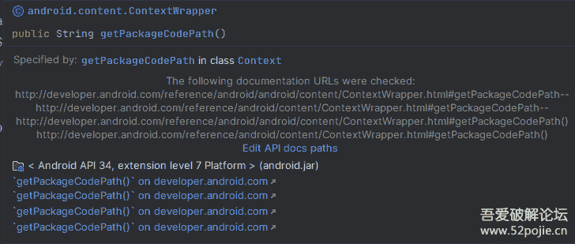

`20240109120111.png` (65.62 KB, 下载次数: 4)

[论坛附件](https://www.52pojie.cn/forum.php?mod=attachment&aid=MjY2ODkwN3wyY2Y1N2FiOXwxNzkzNTY4OTQwfDE2ODA4NnwxODc4NjUy&nothumb=yes)

2024-1-9 21:57 上传

这个是在`android.content.ContextWrapper`下面，之后我们就hook一下试一试

```python
import sys
import frida

def on_message(messages, data):
    if messages["type"] == "send":
        print("[+] {}".format(messages["payload"]))
        print("[+] {}".format(messages))
    else:
        for name in messages:
            print("[+] {}".format(messages[name]))

process = frida.get_usb_device().attach('东北往事')

with open("frida.js") as f:
    script = process.create_script(f.read())
    # 这是将frida 的脚本给读取进来了

script.on("message", on_message)
script.load()
sys.stdin.read()
```

下面是`frida`的js脚本

```javascript
Java.perform(function () {
    Java.use("android.content.ContextWrapper").getPackageCodePath.implementation = function () {
        var result = this.getPackageCodePath();
        send(result);
        return result;
    }
})
```

我们运行的结果是

> `/data/app/~~VEf27Hz4Vx9zDMiZ-UPXZQ==/com.zj.wuaipojie-Qpx1v_KIH3iiBblSp6vvtg==/base.apk`

这就是运行的路径了

所以我们目前的思路就是更改这个获取路径方法的返回值，将它定位到其他地方，我们当然可以直接hook `check_crc`的函数，但是这样还是一种作弊的方式吧，因为我写这个博客不是为了完成52的作业，而是学习更多的技术，如果是hook `check_crc`方法的话用下面这个脚本。

```javascript
Java.perform(function () {
    Java.use("com.zj.wuaipojie.ui.ChallengeFifth").check_crc.overload('long').implementation = function (j) {
        var result = this.check_crc(j);
        send(result);
        return true;
    }
})
```

如果按我们之前的思路，那就开始更改路径

我们的方法就是，将这个返回值，给修改成我们放入原始包的地址，这样它检测的地址就是我们没有修改的包，说干就干。

我们还是首先把这个的apk包，用`adb`工具给发送到手机上

```bash
adb push 52demo.apk /data/local/tmp
cp /data/local/tmp/base.apk /data/user/0/com.zj.wuaipojie/files/
```

然后我们修改返回值为这个地址加apk文件名

```javascript
Java.perform(function () {
    Java.use("android.content.ContextWrapper").getPackageCodePath.implementation = function () {
        var result = this.getPackageCodePath();
        send(result);
        var javaString = Java.use("java.lang.String")
        var newstring = javaString.$new("/data/user/0/com.zj.wuaipojie/files/base.apk")
        send(newstring)
        return newstring;
    }
})
```

然后扯淡的地方来了，这个始终不会出现crc校验通过，我不知道为什么会这样，按照道理来说应该是没问题的才对啊，这个就直接跳过了，不过这个思路是完全没有问题的，我感觉可能是因为版本对不上导致的，所以我直接hook crc函数算了，如果大家知道这个问题的话请联系我（可能是因为我用的第13节课的课件？最多只到7关的那个，可能是这个原因，等以后我换换试试）

这个就先这样过了吧

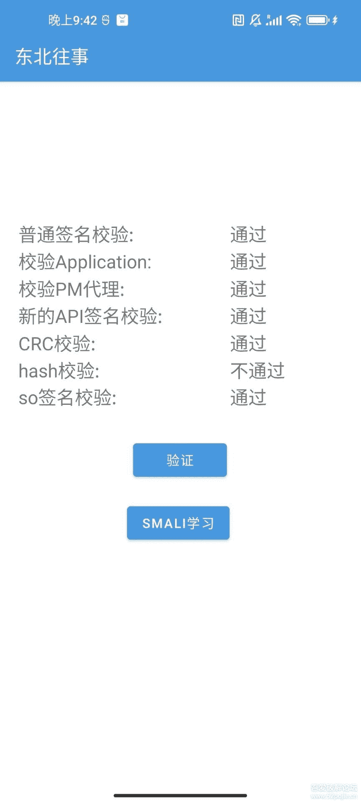

`20240109214318.png` (78.43 KB, 下载次数: 5)

[论坛附件](https://www.52pojie.cn/forum.php?mod=attachment&aid=MjY2ODkwOHw1NjRhNTk1MXwxNzkzNTY4OTQwfDE2ODA4NnwxODc4NjUy&nothumb=yes)

2024-1-9 21:57 上传

## 三、结尾

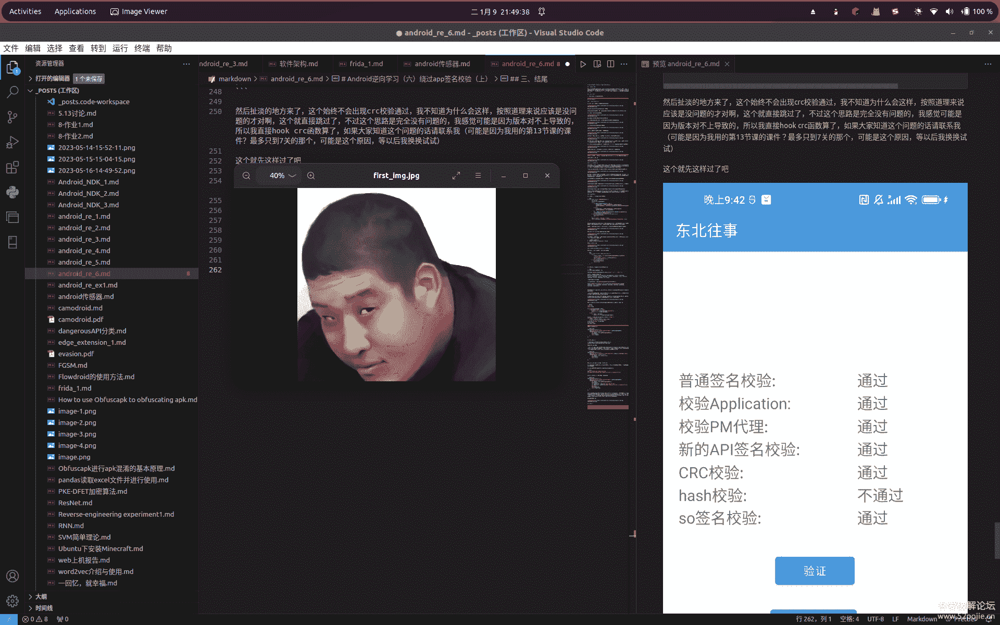

`20240109214942.png` (626.65 KB, 下载次数: 3)

[论坛附件](https://www.52pojie.cn/forum.php?mod=attachment&aid=MjY2ODkwOXxiMWFhZTQ5M3wxNzkzNTY4OTQwfDE2ODA4NnwxODc4NjUy&nothumb=yes)

2024-1-9 21:57 上传

还是虎哥镇楼，作为我csdn博客的封面
