# [Android 原创] 记录逆向某Unity游戏获取资源及代码

- 原帖: https://www.52pojie.cn/forum.php?mod=viewthread&tid=1878931
- 抓取时间: 2026-11-01T21:35:40

准备工具如下

1. frida
2. IDA
3. AssetStudioGUI
4. Il2CppDumper
5. dnSpy

拿到游戏的APK后，先解压看一眼资源文件，发现文件名是MD5加密，而AB包则是在前面填充了不固定的字符，并且无法识别unity版本号。

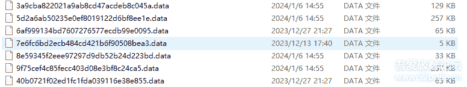

QQ图片20240110142301.png (31.66 KB, 下载次数: 2)

2024-1-10 15:27 上传

先用Il2CppDumper导出dll，通过导出的DLL发现并没有常规的`Assembly-CSharp.dll`，先把导出的DLL丢进dnSpy查看一下函数。

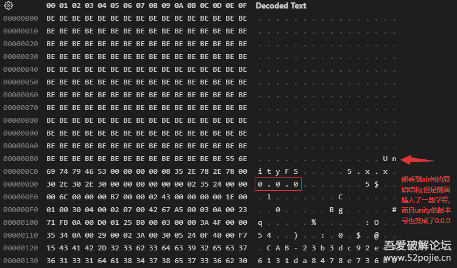

QQ图片20240110142636.png (50.48 KB, 下载次数: 1)

2024-1-10 15:27 上传

查看之后并没有发现有加载assetbundle相关的函数，但是发现在`AOTMainGame.dll`中有一个`loadDLL`的函数，应该就是加载`Assembly-CSharp.dll`的地方。

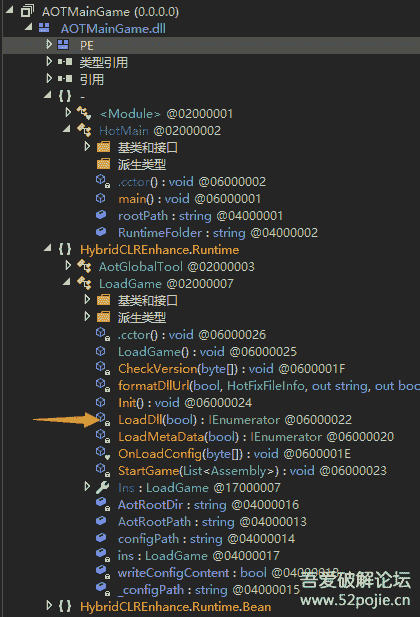

QQ图片20240110143852.png (50.62 KB, 下载次数: 2)

2024-1-10 15:28 上传

打开IDA跟踪一下代码，但是并没有找到相关解密的代码（这里卡了我好久，我一直以为加载dll的时候就应该解密了，但是并没有 ）。后来我用frida hook了看了一下调用过程，发现LoadDLL调用之后会调用上图中`StartGame`方法，在IDA跳转到该方法后找到了解密相关的函数。

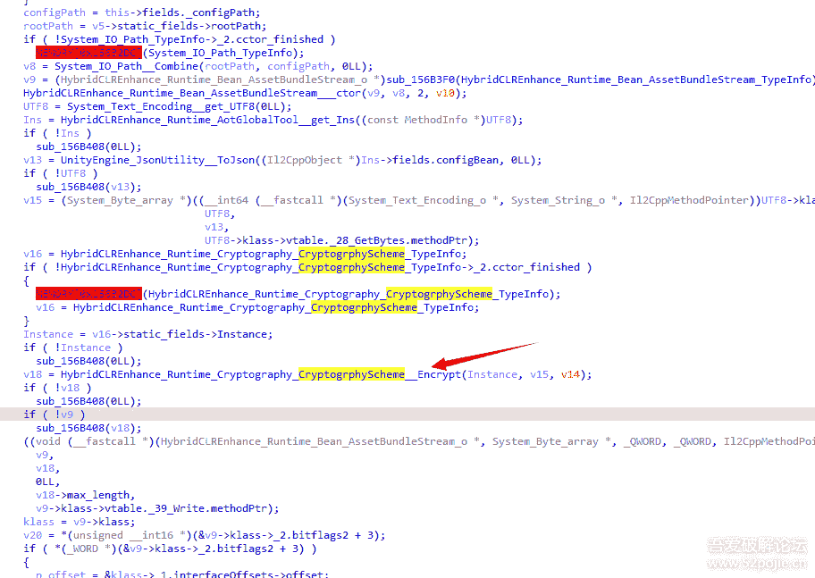

QQ图片20240110153049.png (76.63 KB, 下载次数: 3)

2024-1-10 15:29 上传

虽然这里调用的是`Encrypt`，但是我在frida里hook后并没有调用，回到dnSpy查找这个类，并hook它里面的`Decrypt`函数，发现正常调用。

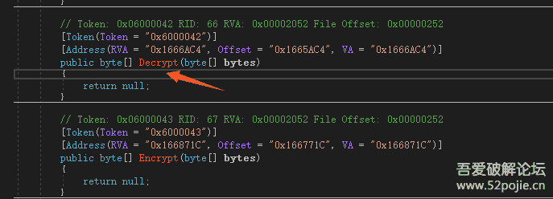

QQ图片20240110153302.png (14.32 KB, 下载次数: 2)

2024-1-10 15:31 上传

剩下的事情就容易很多了，写好frida代码，并将dll导出出来。

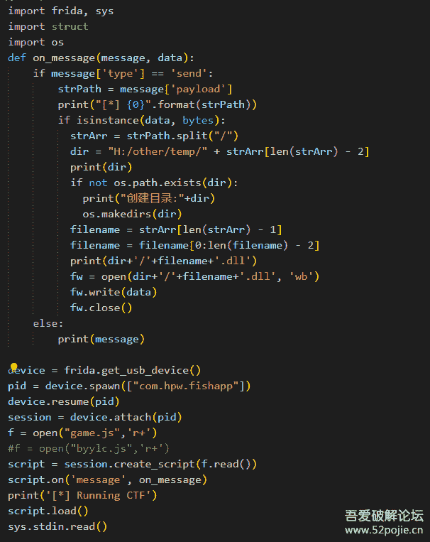

QQ图片20240110153351.png (68.12 KB, 下载次数: 1)

2024-1-10 15:32 上传

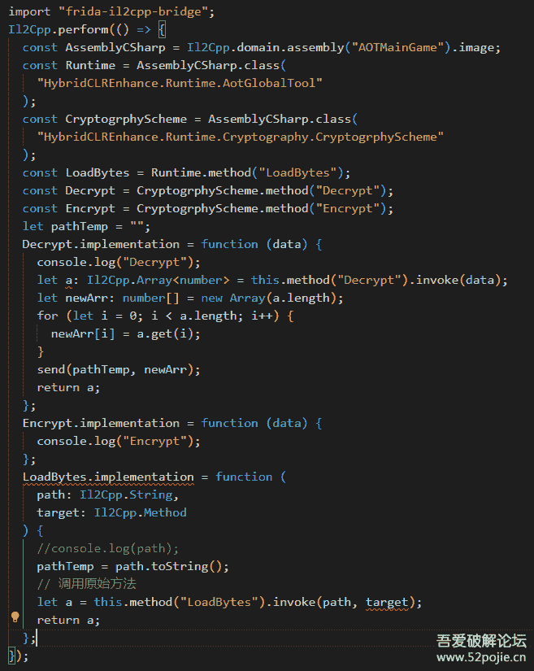

QQ图片20240110153331.png (83.84 KB, 下载次数: 3)

2024-1-10 15:32 上传

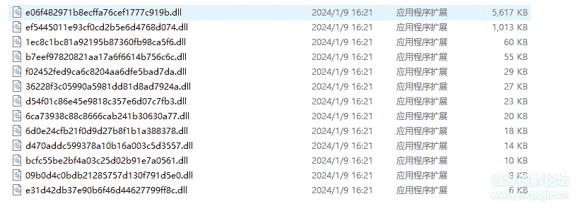

QQ图片20240110153507.png (58.97 KB, 下载次数: 2)

2024-1-10 15:33 上传

把导出的DLL同样丢进dnSpy进行反编译，熟悉的`Assembly-CSharp.dll`就出来了，并且代码也都是明文的。

查找加载assetbundle的地方，最终跟到了`getoffset`方法，这就是往AB包头部插入字节的偏移量了。

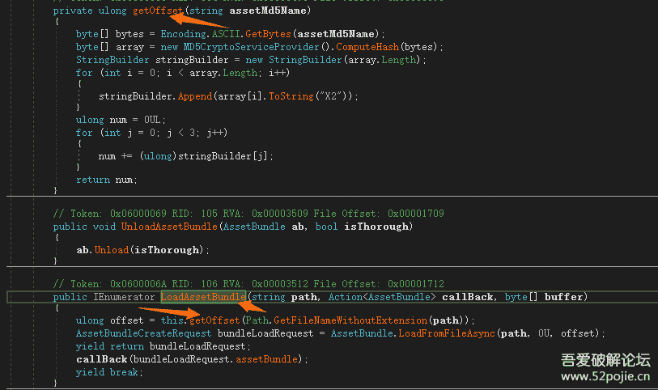

QQ图片20240110153201.png (27.13 KB, 下载次数: 1)

2024-1-10 15:34 上传

代码都知道了，那就写个解密程序吧...c+v大法。

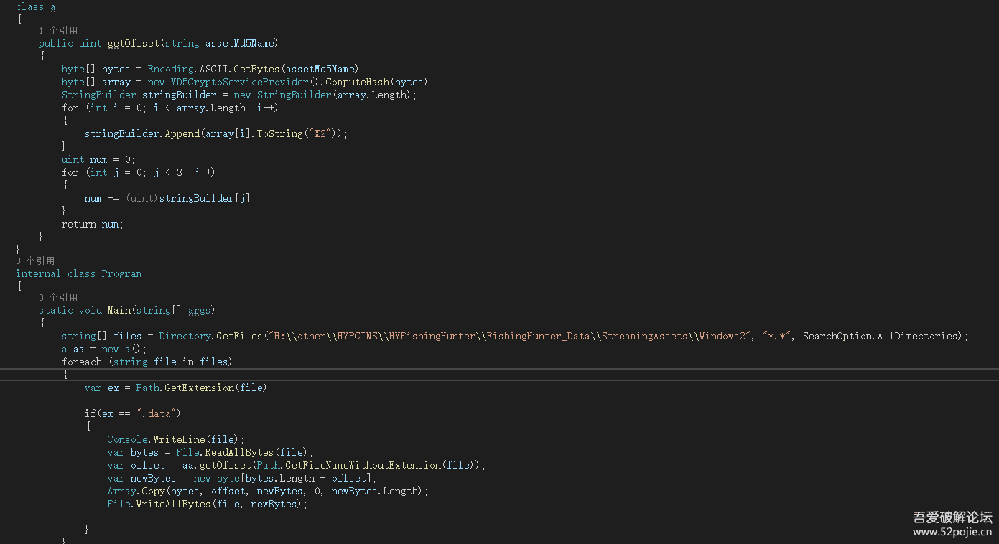

QQ图片20240110153640.png (33.69 KB, 下载次数: 2)

2024-1-10 15:35 上传

解密后随便打开一个ab包查看一下，现在已经正常以`UnityFS`开头了。

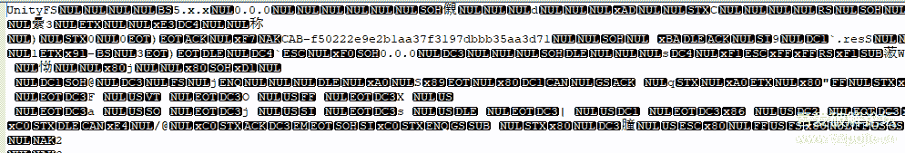

QQ图片20240110153723.png (31.74 KB, 下载次数: 1)

2024-1-10 15:36 上传

最后还有一个问题，那就是ab包的版本号还是0.0.0，这使得AssetStudioGUI无法识别。

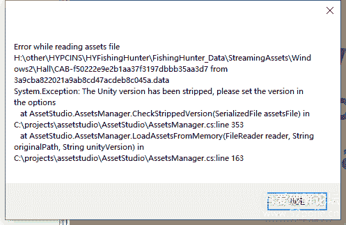

QQ图片20240110153821.png (21.89 KB, 下载次数: 2)

2024-1-10 15:37 上传

只能在github下载AssetStudio源码自己魔改，找到`CheckStrippedVersion`直接把里面的值写死（暴力美学 ）。

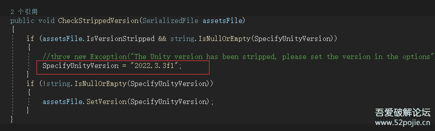

QQ图片20240110153859.png (14.73 KB, 下载次数: 5)

2024-1-10 15:37 上传

成功加载，lua代码、资源、还有前面的c#代码都被我们解出来了~~

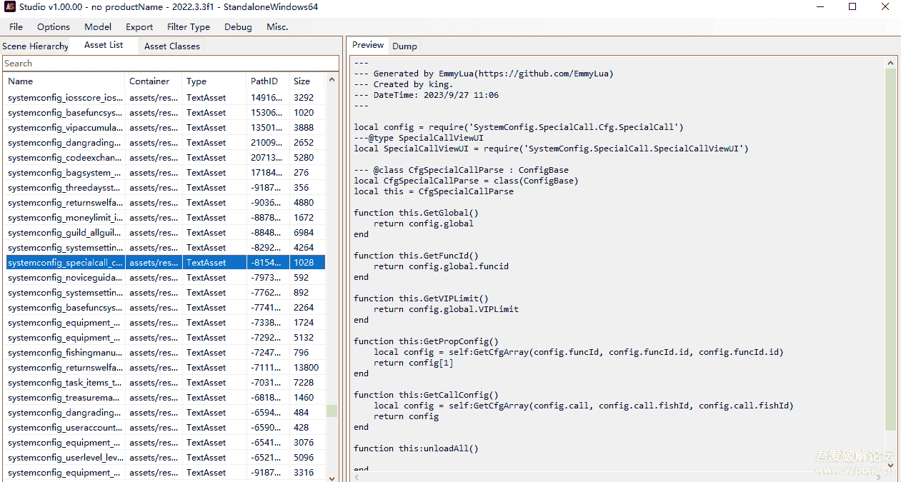

QQ图片20240110153947.png (106.03 KB, 下载次数: 1)

2024-1-10 15:38 上传

声明一下：[https://www.52pojie.cn](https://www.52pojie.cn) 的资源请别用于商业用途~

欢迎大家留言讨论~~谢谢
