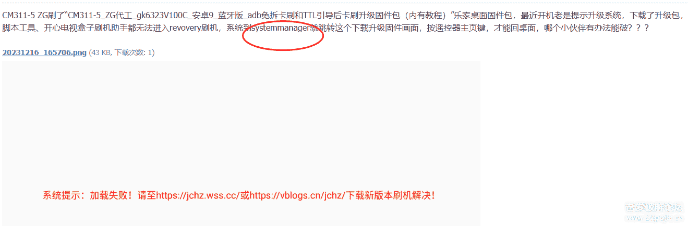
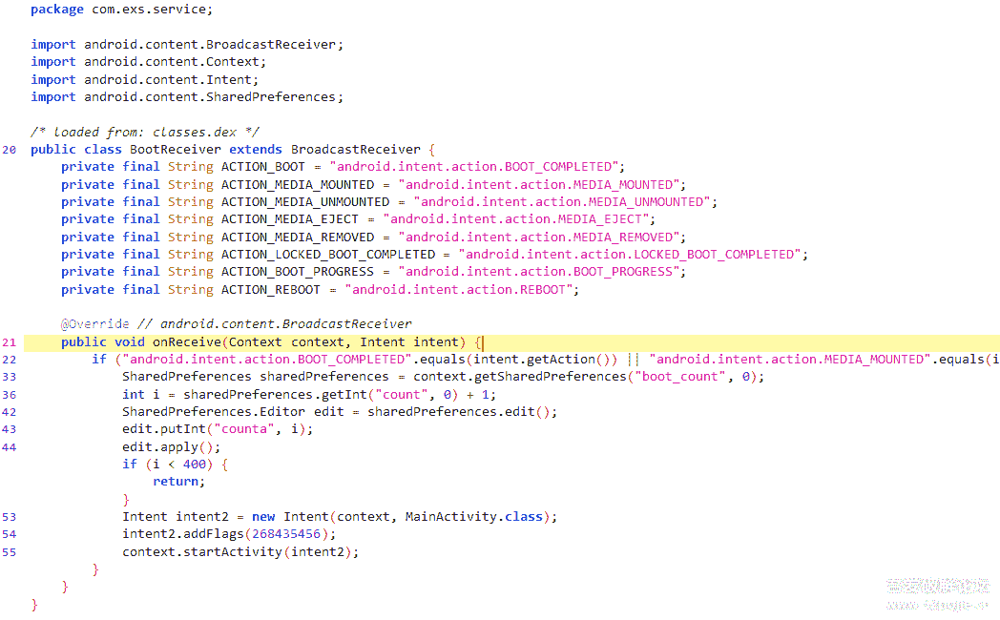
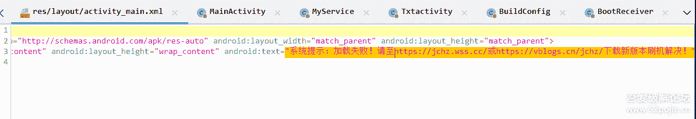

# [Android 分享] 九彩固件升级提示揭秘

- 原帖：https://www.52pojie.cn/forum.php?mod=viewthread&tid=1883700
- 抓取时间：2026-11-01T21:31:41

九彩固件升级提示怎么破？网上都在问，博主刚好也是这个固件，且按照提示重新升级了三次后（被耍猴了三次，后面揭秘）。

最终受不了准备一探究竟。先网上查找下相关资源，结果很失望都没有结果。


`909991705978933645.png` (104.12 KB, 下载次数: 2)

[下载附件](https://www.52pojie.cn/forum.php?mod=attachment&aid=MjY3MTk5N3wwZDk5OGRkMHwxNzkzNTY4Njk5fDE2ODA4NnwxODgzNzAw&nothumb=yes)

2024-1-23 11:14 上传


`951705979517958.png` (50.68 KB, 下载次数: 3)

[下载附件](https://www.52pojie.cn/forum.php?mod=attachment&aid=MjY3MTk5Nnw2ZTBjMTQyZXwxNzkzNTY4Njk5fDE2ODA4NnwxODgzNzAw&nothumb=yes)

2024-1-23 11:14 上传



`941705979556465.png` (56.07 KB, 下载次数: 3)

[下载附件](https://www.52pojie.cn/forum.php?mod=attachment&aid=MjY3MTk5NXwxZWM4ODc4N3wxNzkzNTY4Njk5fDE2ODA4NnwxODgzNzAw&nothumb=yes)

2024-1-23 11:14 上传

上图给了我启发，于是便解开刷机包。反编译这个应用，看看是什么逻辑。



`911705978968946.png` (74.06 KB, 下载次数: 2)

[下载附件](https://www.52pojie.cn/forum.php?mod=attachment&aid=MjY3MTk5M3xiNTVjZWUyOXwxNzkzNTY4Njk5fDE2ODA4NnwxODgzNzAw&nothumb=yes)

2024-1-23 11:14 上传



`931705979005407.png` (25.67 KB, 下载次数: 3)

[下载附件](https://www.52pojie.cn/forum.php?mod=attachment&aid=MjY3MTk5NHw0NWIwOTNhMXwxNzkzNTY4Njk5fDE2ODA4NnwxODgzNzAw&nothumb=yes)

2024-1-23 11:14 上传

好家伙，还真被我找到了。

```java
public void onReceive(Context context, Intent intent) {
        if ("android.intent.action.BOOT_COMPLETED".equals(intent.getAction()) || "android.intent.action.MEDIA_MOUNTED".equals(intent.getAction()) || "android.intent.action.MEDIA_UNMOUNTED".equals(intent.getAction()) || "android.intent.action.MEDIA_EJECT".equals(intent.getAction()) || "android.intent.action.MEDIA_REMOVED".equals(intent.getAction()) || "android.intent.action.LOCKED_BOOT_COMPLETED".equals(intent.getAction()) || "android.intent.action.BOOT_PROGRESS".equals(intent.getAction()) || "android.intent.action.REBOOT".equals(intent.getAction())) {
            SharedPreferences sharedPreferences = context.getSharedPreferences("boot_count", 0);
            int i = sharedPreferences.getInt("count", 0) + 1;
            SharedPreferences.Editor edit = sharedPreferences.edit();
            edit.putInt("counta", i);
            edit.apply();
            if (i 
```

丫的，这不是把用户当猴子耍吗。难怪当差不多一两个月就提示升级，而且我还傻傻的真去升级了。虽然你固件很出色，但是你也不要这样去折磨用户吧。
