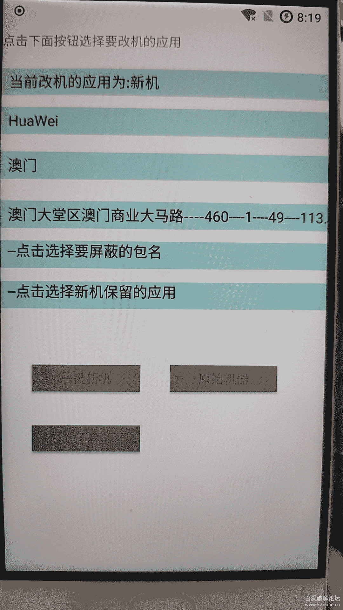

# [Android 原创] 《教我兄弟学Android逆向15 xpose改机开发03-写一款自己的改机软件》

- 原帖: https://www.52pojie.cn/forum.php?mod=viewthread&tid=1885167
- 抓取时间: 2026-11-01T21:30:23

上一篇 《[https://www.52pojie.cn/thread-1800156-1-1.html](https://www.52pojie.cn/thread-1800156-1-1.html)》我带你熟悉了一下改机的流程,搭建了改机的基础代码,改机参数数据储存方面我们用的是`SharedPreferences`存储数据,界面方面写了一个一键新机的按钮,点一键新机的时候会随机生成imei数据存储到xml数据中,然后xpose代码hook到了`getDeviceId`函数会将返回值设置成xml文件读取的值,这样就完成了对imei的修改。

关于界面方面上节课也是粗略的写了一下,你可以根据自己想实现的功能去写自己想要的界面。

前面两节课我们配置了xpose开发的环境并且编写了xpose改机的第一个demo

那么本节课我会给你介绍一下改机的总体,以及改机点的寻找和编写。

要么学！要么不学！学和不学之间没有中间值 不学就放弃，学就要去认真的学！ --致选择

## xpose改机的优缺点

**优点**

易上手,便于使用,所需时间成本比较少。

**缺点**

很容易被检测,只能在java层去操作,Native层,内核层,C库的一些函数无法被修改。

比如libc的函数`open`,`fopen`,`access`,`rename`，Unix的`popen`函数还有一些C层内核层获取设备信息的结构体这些都是无法通过xpose去改的。

那么如果想做一款比较好的改机有什么解决方案呢？

1. 用xpose去配合一些可以hook so层函数的工具比如Inlinehook,frida等。

2. 针对性修改,逆向出协议数据配合xpose模拟数据发包。

3. 自定义安卓系统,全局修改。

## 一、改机点介绍

1. 硬件信息

   手机的唯一标识imei,android,序列号serial,手机品牌,手机机型,制造商,蓝牙名,蓝牙MAC地址,系统版本,系统版本名称,开发代号,源码控制版本号,编译类型,CPU架构,无线电固件版本,设备版本号,主板名称,引导程序版本号,设备参数,设备地址,产品名称,ROM名称,硬件名称,指纹,开发ROM编译用户,设备的ROM生成的时间.....

2. 手机卡信息

3. 蓝牙信息

4. UA信息

5. 电池电量

5. 开机时间

6. 手机内存的信息

7. 屏幕大小

8. 传感器

9. 位置基站信息

10. wifi信息

11. 文件信息

12. 环境检测

13. 设备信息真实性检测

......

看到这么多信息你应该有疑问了,上面说的这些点都是怎么去找到的？

## 二、改机点寻找

1. 从百度google等搜索引擎去搜索xpose改机代码,github上面也有一些开源的xpose改机代码都可以去参考。

2. 逆向一些app去看对方是怎么去获取设备信息的,怎么去检测环境信息的从而针对性的去完善改机代码。

3. 研究分析安卓源码,找到一切可以获取设备信息的点,要知道大厂做安全的都是从研究Android源码开始的。

## 三、改机代码编写

1. 因为改机代码量比较大，所以我们首先写一个抽象类去继承`XC_MethodHook`后面的hook类都可以去继承这个类。

`MethodHook.java`

```java
public abstract class MethodHook extends XC_MethodHook {
        protected String mpackageName;
        protected ClassLoader mclassLoader;
        protected DeviceInfoModel deviceInfoModel;
        public MethodHook(XC_LoadPackage.LoadPackageParam paramLoadPackageParam, DeviceInfoModel deviceInfoModel)
        {
            this.mpackageName = paramLoadPackageParam.packageName;
            this.mclassLoader = paramLoadPackageParam.classLoader;
            this.deviceInfoModel = deviceInfoModel;
        }
    @Override
    protected void afterHookedMethod(MethodHookParam param) throws Throwable {
        super.afterHookedMethod(param);
    }
    public void hookMethodByClassMethodName(String paramString, String paramString2)
    {
        try
        {
            for (Method localMethod : XposedHelpers.findClass(paramString, this.mclassLoader).getDeclaredMethods())
                if ((localMethod.getName().equals(paramString2)) && (!Modifier.isAbstract(localMethod.getModifiers())))
                {
                    localMethod.setAccessible(true);
                    XposedBridge.hookMethod(localMethod, this);
                }
        }
        catch (Throwable localThrowable)
        {
            Log.e("xposed-MethodHook", "hookMethodByClassMethodName Exception " + paramString);
        }
    }
    public void hookMethodByClassMethodName(String paramString1, String paramString2, Object[] paramArrayOfObject)
    {
        try
        {
            Object[] arrayOfObject = new Object[1 + paramArrayOfObject.length];
            for (int i = 0; i < paramArrayOfObject.length; i++)
                arrayOfObject[i] = paramArrayOfObject[i];
            XposedHelpers.findAndHookMethod(paramString1, this.mclassLoader, paramString2, paramArrayOfObject);
        }
        catch (Throwable localThrowable)
        {
            Log.e("xposed-MethodHook", "hookMethodByClassMethodName Exception " + paramString1);
        }
    }
}
```

2. `BuildHook.java`

这里包含手机的一些硬件信息的修改和android系统属性的修改，但是缺点的话`SystemProperties`的`get`方法很多大厂都是通过native去调用底层的`native_get`方法检测，这样就要配合其他方式去修改了。

```java
public class BuildHook extends MethodHook

{

    public BuildHook(XC_LoadPackage.LoadPackageParam paramLoadPackageParam, DeviceInfoModel deviceInfoModel, final Context context) {

        super(paramLoadPackageParam, deviceInfoModel);

        hookMethodByClassMethodName("android.os.SystemProperties", "set");

        hookMethodByClassMethodName("android.os.SystemProperties", "get");

        //hookMethodByClassMethodName("android.os.SystemProperties", "getString");

        hookMethodByClassMethodName(Settings.System.class.getName(), "putStringForUser");

        if (Build.VERSION.SDK_INT >= Build.VERSION_CODES.CUPCAKE) {

            hookMethodByClassMethodName(Settings.Secure.class.getName(), "putStringForUser");

        }

        if (Build.VERSION.SDK_INT >= Build.VERSION_CODES.JELLY_BEAN_MR1) {

            hookMethodByClassMethodName(Settings.Global.class.getName(), "putStringForUser");

        }

        hookMethodByClassMethodName(Settings.System.class.getName(), "getStringForUser");

        if (Build.VERSION.SDK_INT >= Build.VERSION_CODES.CUPCAKE) {

            hookMethodByClassMethodName(Settings.Secure.class.getName(), "getStringForUser");

        }

        if (Build.VERSION.SDK_INT >= Build.VERSION_CODES.JELLY_BEAN_MR1) {

            hookMethodByClassMethodName(Settings.Global.class.getName(), "getStringForUser");

        }

        hookMethodByClassMethodName("android.provider.Settings$NameValueCache", "getStringForUser");

    }

    @SuppressLint("SuspiciousIndentation")

    private void setBuilds() {

        XposedHelpers.setStaticObjectField(Build.class, "BOOTLOADER", "unkown");

        if (!TextUtils.isEmpty(this.deviceInfoModel.getBuildBrand()))

            XposedHelpers.setStaticObjectField(Build.class, "BRAND", this.deviceInfoModel.getBuildBrand());

        if (!TextUtils.isEmpty(this.deviceInfoModel.getBuildBoard()))

            XposedHelpers.setStaticObjectField(Build.class, "BOARD", this.deviceInfoModel.getBuildBoard());

        if (!TextUtils.isEmpty(this.deviceInfoModel.getBuildModel()))

            XposedHelpers.setStaticObjectField(Build.class, "MODEL", this.deviceInfoModel.getBuildModel());

        if (!TextUtils.isEmpty(this.deviceInfoModel.getDisplayId()))

            XposedHelpers.setStaticObjectField(Build.class, "DISPLAY", this.deviceInfoModel.getDisplayId());

        if (!TextUtils.isEmpty(this.deviceInfoModel.getBuildProduct()))

            XposedHelpers.setStaticObjectField(Build.class, "PRODUCT", this.deviceInfoModel.getBuildProduct());

        if (!TextUtils.isEmpty(this.deviceInfoModel.getBuildManufacturer()))

            XposedHelpers.setStaticObjectField(Build.class, "MANUFACTURER", this.deviceInfoModel.getBuildManufacturer());

        if (!TextUtils.isEmpty(this.deviceInfoModel.getBuildDevice()))

            XposedHelpers.setStaticObjectField(Build.class, "DEVICE", this.deviceInfoModel.getBuildDevice());

        if (!TextUtils.isEmpty(this.deviceInfoModel.getBuildRelease()))

            XposedHelpers.setStaticObjectField(Build.VERSION.class, "RELEASE", this.deviceInfoModel.getBuildRelease());

        if (!TextUtils.isEmpty(this.deviceInfoModel.getBuildSdk()))

            XposedHelpers.setStaticObjectField(Build.VERSION.class, "SDK", this.deviceInfoModel.getBuildSdk());

        if (!TextUtils.isEmpty(this.deviceInfoModel.getBuildFingerprint()))

            XposedHelpers.setStaticObjectField(Build.class, "FINGERPRINT", this.deviceInfoModel.getBuildFingerprint());

        if (!TextUtils.isEmpty(this.deviceInfoModel.getBuildHardware()))

            XposedHelpers.setStaticObjectField(Build.class, "HARDWARE", this.deviceInfoModel.getBuildHardware());

        if (!TextUtils.isEmpty(this.deviceInfoModel.getBuildCodename()))

            XposedHelpers.setStaticObjectField(Build.VERSION.class, "CODENAME", this.deviceInfoModel.getBuildCodename());

        if (!TextUtils.isEmpty(this.deviceInfoModel.getBuildIncremental()))

            XposedHelpers.setStaticObjectField(Build.VERSION.class, "INCREMENTAL", this.deviceInfoModel.getBuildIncremental());

        if (!TextUtils.isEmpty(this.deviceInfoModel.getBuildHost()))

            XposedHelpers.setStaticObjectField(Build.class, "HOST", this.deviceInfoModel.getBuildHost());

        if (!TextUtils.isEmpty(this.deviceInfoModel.getBuildId()))

            XposedHelpers.setStaticObjectField(Build.class, "ID", this.deviceInfoModel.getBuildId());

        if (!TextUtils.isEmpty(this.deviceInfoModel.getBuildType()))

            XposedHelpers.setStaticObjectField(Build.class, "TYPE", this.deviceInfoModel.getBuildType());

        if (!TextUtils.isEmpty(this.deviceInfoModel.getBuildUser()))
}
```


# 代码片段

```
XposedHelpers.setStaticObjectField(Build.class, "USER", this.deviceInfoModel.getBuildUser());
if (!TextUtils.isEmpty(this.deviceInfoModel.getBuildSerialno()))
    XposedHelpers.setStaticObjectField(Build.class, "SERIAL", this.deviceInfoModel.getBuildSerialno());
if (!TextUtils.isEmpty(this.deviceInfoModel.getBuildTags()))
    XposedHelpers.setStaticObjectField(Build.class, "TAGS", this.deviceInfoModel.getBuildTags());
if (this.deviceInfoModel.getBuildUtc() > 0L)
    XposedHelpers.setStaticObjectField(Build.class, "TIME", Long.valueOf(this.deviceInfoModel.getBuildUtc()));
if (!TextUtils.isEmpty(this.deviceInfoModel.getBuildAbi())){
    XposedHelpers.setStaticObjectField(Build.class, "CPU_ABI", this.deviceInfoModel.getBuildAbi());
}
if (!TextUtils.isEmpty(this.deviceInfoModel.getBuildAbi2())){
    XposedHelpers.setStaticObjectField(Build.class, "CPU_ABI2", this.deviceInfoModel.getBuildAbi2());
}
if (!TextUtils.isEmpty(this.deviceInfoModel.getBuildSdk())){
    if(Integer.parseInt(this.deviceInfoModel.getBuildSdk()) 0) {
        return Long.valueOf(arg4.getBuildUtc());
    }
}
else if("gsm.operator.numeric".equals(arg5)) {
    if(!TextUtils.isEmpty(arg4.getSimOperator())) {
        return arg4.getSimOperator();
    }
}
else if(!TextUtils.isEmpty(((CharSequence)arg5)) && (arg5.contains("recovery_id"))) {
    return arg4.getRecoveryId();
}
else if(("gsm.operator.numeric".equals(arg5)) || ("gsm.sim.operator.numeric".equals(arg5)) || ("gsm.apn.sim.operator.numeric".equals(arg5))) {
    if(TextUtils.isEmpty(arg4.getSimOperator())) {
        return arg4.getSimOperator();
    }
}
else if("gsm.operator.iso-country".equals(arg5) || "gsm.sim.operator.iso-country".equals(arg5)) {
    if(TextUtils.isEmpty(arg4.getSimCountryIso())) {
        return arg4.getSimCountryIso();
    }
}
else if("gsm.operator.alpha".equals(arg5) || "gsm.operator.orig.alpha".equals(arg5)) {
    if(TextUtils.isEmpty(arg4.getSimOperatorName())) {
        return arg4.getSimOperatorName();
    }
}
else if("ro.build.brand".equals(arg5)) {
    if(!TextUtils.isEmpty(arg4.getBuildBrand())) {
        return arg4.getBuildBrand();
    }
}
else if("ro.build.board".equals(arg5)) {
    if(!TextUtils.isEmpty(arg4.getBuildBoard())) {
        return arg4.getBuildBoard();
    }
}
else if("net.hostname".equals(arg5)) {
    if(!TextUtils.isEmpty(arg4.getNetHostname())) {
        return arg4.getNetHostname();
    }
}
else if("dalvik.vm.heapsize".equals(arg5)) {
    return arg4.getVmHeapSize();
}
else if("ro.build.selinux".equals(arg5)) {
    return "1";
}
else if("ro.board.platform".equals(arg5)) {
    if(!TextUtils.isEmpty(arg4.getBoardPlat())) {
        return arg4.getBoardPlat();
    }
}
else if("ro.product.cpu.abi".equals(arg5)) {
    if(!TextUtils.isEmpty(arg4.getBuildAbi())) {
        return arg4.getBuildAbi();
    }
}
else if("ro.product.cpu.abi2".equals(arg5)) {
    if(TextUtils.isEmpty(arg4.getBuildAbi2())) {
        arg4.setBuildAbi2("armeabi");
    }
    return arg4.getBuildAbi2();
}
else {
    if(!arg5.contains("gsm.version.baseband") && !arg5.contains("ro.baseband") && !arg5.contains("ro.boot.baseband")) {
        return null;
    }
    if(TextUtils.isEmpty(arg4.getBuildRadioVersion())) {
        return null;
    }
    return arg4.getBuildRadioVersion();
}
return null;
}
@Override
protected void afterHookedMethod(final XC_MethodHook.MethodHookParam xc_MethodHook$MethodHookParam) throws Throwable {
int v3 = 3;
Object v0_1;
String name = xc_MethodHook$MethodHookParam.method.getName();
String v1 = xc_MethodHook$MethodHookParam.method.getDeclaringClass().getName();
if ("get".startsWith(name)) {
    v0_1 = this.IIl1lIIlll(this.deviceInfoModel, (String) xc_MethodHook$MethodHookParam.args[0]);
    if (v0_1 != null) {
        xc_MethodHook$MethodHookParam.setResult(v0_1);
    }
    if ("android.provider.Settings$NameValueCache".equals(v1)) {
        this.setAccessible(xc_MethodHook$MethodHookParam.thisObject, "mValues");
        v0_1 = XposedHelpers.getObjectField(xc_MethodHook$MethodHookParam.thisObject, "mValues");
        if ("android_id".equals(xc_MethodHook$MethodHookParam.args[0])) {
            ((HashMap) v0_1).put("android_id", this.deviceInfoModel.getAndroidId());
            xc_MethodHook$MethodHookParam.setResult(this.deviceInfoModel.getAndroidId());
        }
        if ("accessibility_enabled".equals(xc_MethodHook$MethodHookParam.args[0])) {
            ((HashMap) v0_1).put("accessibility_enabled", "0");
            name = "0";
            xc_MethodHook$MethodHookParam.setResult(name);
        }
        if ("enabled_accessibility_services".equals(xc_MethodHook$MethodHookParam.args[0])) {
            super.afterHookedMethod(xc_MethodHook$MethodHookParam);
            ((HashMap) v0_1).put("enabled_accessibility_services", null);
            xc_MethodHook$MethodHookParam.setResult(null);
        }
    }
    if ("android_id".equals(xc_MethodHook$MethodHookParam.args[0])) {
        xc_MethodHook$MethodHookParam.setResult((Object) this.deviceInfoModel.getAndroidId());
    }
    if ("adb_enabled".equals(xc_MethodHook$MethodHookParam.args[0])) {
        xc_MethodHook$MethodHookParam.setResult((Object) 0);
    }
    if ("data_roaming".equals(xc_MethodHook$MethodHookParam.args[0])) {
        xc_MethodHook$MethodHookParam.setResult((Object) 0);
    }
   /* if ("wifi_on".equals(xc_MethodHook$MethodHookParam.args[0])) {
        if (this.DeviceInfoModel.getType() != 1) {
            v3 = 0;
        }
        RLog.m("Test---get--othier2:wifi_on");
        xc_MethodHook$MethodHookParam.setResult(v3);
    }*/
    if ("bluetooth_address".equals(xc_MethodHook$MethodHookParam.args[0])) {
        if (TextUtils.isEmpty(this.deviceInfoModel.getBtAddress())) {
            super.afterHookedMethod(xc_MethodHook$MethodHookParam);
            xc_MethodHook$MethodHookParam.setResult(this.deviceInfoModel.getBtAddress());
        }
    }
    if ("bluetooth_name".equals(xc_MethodHook$MethodHookParam.args[0])) {
        if (TextUtils.isEmpty(this.deviceInfoModel.getBtName())) {
            super.afterHookedMethod(xc_MethodHook$MethodHookParam);
            xc_MethodHook$MethodHookParam.setResult(this.deviceInfoModel.getBtName());
        }
    }
    if ("accessibility_enabled".equals(xc_MethodHook$MethodHookParam.args[0])) {
        xc_MethodHook$MethodHookParam.setResult(0);
    }
    if ("enabled_accessibility_services".equals(xc_MethodHook$MethodHookParam.args[0])) {
        xc_MethodHook$MethodHookParam.setResult(null);
        super.afterHookedMethod(xc_MethodHook$MethodHookParam);
    }
```


```java
            if (xc_MethodHook$MethodHookParam.args[0].toString().contains("accessibility")) {
                xc_MethodHook$MethodHookParam.setResult(null);
            }
        }
        else {
            if("getStringForUser".equals(name)) {
                if ("android.provider.Settings$NameValueCache".equals(v1)) {
                    //RLog.m("Test---get--othier:enter android.provider.Settings$NameValueCache222");
                    this.setAccessible(xc_MethodHook$MethodHookParam.thisObject, "mValues");
                    v0_1 = XposedHelpers.getObjectField(xc_MethodHook$MethodHookParam.thisObject, "mValues");
                    if ("android_id".equals(xc_MethodHook$MethodHookParam.args[1])) {
                        ((HashMap) v0_1).put("android_id", this.deviceInfoModel.getAndroidId());
                        xc_MethodHook$MethodHookParam.setResult(this.deviceInfoModel.getAndroidId());
                    }
                    if ("accessibility_enabled".equals(xc_MethodHook$MethodHookParam.args[1])) {
                        ((HashMap) v0_1).put("accessibility_enabled", "0");
                        name = "0";
                        xc_MethodHook$MethodHookParam.setResult(name);
                    }
                    if ("enabled_accessibility_services".equals(xc_MethodHook$MethodHookParam.args[1])) {
                        ((HashMap) v0_1).put("enabled_accessibility_services", null);
                        xc_MethodHook$MethodHookParam.setResult(null);
                    }
                    super.afterHookedMethod(xc_MethodHook$MethodHookParam);
                }
                if ("android_id".equals(xc_MethodHook$MethodHookParam.args[1])) {
                    xc_MethodHook$MethodHookParam.setResult((Object)this.deviceInfoModel.getAndroidId());
                }
                if ("adb_enabled".equals(xc_MethodHook$MethodHookParam.args[1])) {
                    xc_MethodHook$MethodHookParam.setResult((Object) 0);
                }
                if ("data_roaming".equals(xc_MethodHook$MethodHookParam.args[1])) {
                    xc_MethodHook$MethodHookParam.setResult((Object) 0);
                }
                if ("bluetooth_address".equals(xc_MethodHook$MethodHookParam.args[1])) {
                    if (TextUtils.isEmpty(this.deviceInfoModel.getBtAddress())) {
                        super.afterHookedMethod(xc_MethodHook$MethodHookParam);
                        xc_MethodHook$MethodHookParam.setResult(this.deviceInfoModel.getBtAddress());
                    }
                }
                if ("bluetooth_name".equals(xc_MethodHook$MethodHookParam.args[1])) {
                    if (TextUtils.isEmpty(this.deviceInfoModel.getBtName())) {
                        super.afterHookedMethod(xc_MethodHook$MethodHookParam);
                        xc_MethodHook$MethodHookParam.setResult(this.deviceInfoModel.getBtName());
                    }
                }
                if ("accessibility_enabled".equals(xc_MethodHook$MethodHookParam.args[1])) {
                    xc_MethodHook$MethodHookParam.setResult(0);
                }
                if ("enabled_accessibility_services".equals(xc_MethodHook$MethodHookParam.args[1])) {
                    xc_MethodHook$MethodHookParam.setResult(null);
                    super.afterHookedMethod(xc_MethodHook$MethodHookParam);
                }
                if (xc_MethodHook$MethodHookParam.args[1].toString().contains("accessibility")) {
                    xc_MethodHook$MethodHookParam.setResult(null);
                }
            }
            if("set".equals(name)) {
                Log.i("SysPropertyHook", "SystemProperties set : " + xc_MethodHook$MethodHookParam.args[0] + " , " + xc_MethodHook$MethodHookParam.args[1]);
            }
            if(!"getInt".equals(name)) {
            }
            if("ro.build.version.sdk".equals(xc_MethodHook$MethodHookParam.args[0])) {
                xc_MethodHook$MethodHookParam.setResult(this.deviceInfoModel.getBuildSdk());
            }
        }
    }

    @Override
   protected void beforeHookedMethod(XC_MethodHook.MethodHookParam paramMethodHookParam) throws Throwable {
        super.beforeHookedMethod(paramMethodHookParam);
        String str1 = paramMethodHookParam.method.getName();
        Class localClass = paramMethodHookParam.method.getDeclaringClass();
        if ("putStringForUser".equals(str1)) {
            Class[] arrayOfClass = new Class[3];
            arrayOfClass[0] = ContentResolver.class;
            arrayOfClass[1] = String.class;
            arrayOfClass[2] = Integer.TYPE;
            Method localMethod = localClass.getDeclaredMethod("getStringForUser", arrayOfClass);
            Object[] arrayOfObject = new Object[3];
            arrayOfObject[0] = paramMethodHookParam.args[0];
            arrayOfObject[1] = paramMethodHookParam.args[1];
            arrayOfObject[2] = paramMethodHookParam.args[3];
            String str2 = (String) localMethod.invoke(localClass, arrayOfObject);
            String str3 = localClass.getSimpleName() + "," + paramMethodHookParam.args[1] + "," + paramMethodHookParam.args[2] + "," + str2;
            Log.i("SysPropertyHook"," Settings putStringForUser : "+str3);
        }else if("get".equals(str1)){
            setBuilds();
        }
    }
    }
```

## 3. `RobuildHook.java`

这里会通过`Build`类的`getString()`获取到一些系统属性的值。

[Java] 纯文本查看 复制代码


```java
public class RobuildHook extends MethodHook {
    public RobuildHook(XC_LoadPackage.LoadPackageParam paramLoadPackageParam, DeviceInfoModel deviceInfoModel) {
        super(paramLoadPackageParam, deviceInfoModel);
        hookMethodByClassMethodName("android.os.Build", "getString");
        hookMethodByClassMethodName("android.os.Build", "getRadioVersion");
    }

    @Override
    protected void afterHookedMethod(XC_MethodHook.MethodHookParam paramMethodHookParam) throws Throwable {
        final String name = paramMethodHookParam.method.getName();
        if ("getRadioVersion".equals(name)) {
            if (!TextUtils.isEmpty((CharSequence)this.deviceInfoModel.getBuildRadioVersion())) {
                paramMethodHookParam.setResult((Object)this.deviceInfoModel.getBuildRadioVersion());
            }
        }
        else if ("getString".equals(name)) {
            final String s = (String)paramMethodHookParam.args[0];
            if ("net.hostname".equals(s)) {
                paramMethodHookParam.setResult("android-" + this.deviceInfoModel.getBuildHost());
            }

            if ("ro.product.model".equals(s)) {
                if (!TextUtils.isEmpty((CharSequence)this.deviceInfoModel.getBuildModel())) {
                    //FileUtil.writeContent2FileForceUtf8(FilePathCommon.phoneTagPath,createfile.getRgPhoneNo());//标记是否hook成功
                    paramMethodHookParam.setResult((Object)this.deviceInfoModel.getBuildModel());
                }
            }
            else if ("ro.build.id".equals(s)) {
                if (!TextUtils.isEmpty((CharSequence)this.deviceInfoModel.getBuildId())) {
                    paramMethodHookParam.setResult((Object)this.deviceInfoModel.getBuildId());
                }
            }
            else if ("ro.build.display.id".equals(s)) {
                if (!TextUtils.isEmpty((CharSequence)this.deviceInfoModel.getDisplayId())) {
                    paramMethodHookParam.setResult((Object)this.deviceInfoModel.getDisplayId());
                }
            }
            else if ("ro.build.type".equals(s)) {
                if (!TextUtils.isEmpty((CharSequence)this.deviceInfoModel.getBuildType())) {
                    paramMethodHookParam.setResult((Object)this.deviceInfoModel.getBuildType());
                }
            }
            else if ("ro.build.user".equals(s)) {
                if (!TextUtils.isEmpty((CharSequence)this.deviceInfoModel.getBuildUser())) {
                    paramMethodHookParam.setResult((Object)this.deviceInfoModel.getBuildUser());
                }
            }
            else if ("ro.build.host".equals(s)) {
                if (!TextUtils.isEmpty((CharSequence)this.deviceInfoModel.getBuildHost())) {
                    paramMethodHookParam.setResult((Object)this.deviceInfoModel.getBuildHost());
                }
            }
            else if ("ro.build.tags".equals(s)) {
                if (!TextUtils.isEmpty((CharSequence)this.deviceInfoModel.getBuildTags())) {
                    paramMethodHookParam.setResult((Object)this.deviceInfoModel.getBuildTags());
                }
            }
            else if ("ro.product.brand".equals(s)) {
                if (!TextUtils.isEmpty((CharSequence)this.deviceInfoModel.getBuildTags())) {
                    paramMethodHookParam.setResult((Object)this.deviceInfoModel.getBuildBrand());
                }
            }
            else if ("ro.product.device".equals(s)) {
                if (!TextUtils.isEmpty((CharSequence)this.deviceInfoModel.getBuildDevice())) {
                    paramMethodHookParam.setResult((Object)this.deviceInfoModel.getBuildDevice());
                }
            }
            else if ("ro.product.board".equals(s)) {
                if (!TextUtils.isEmpty((CharSequence)this.deviceInfoModel.getBuildBoard())) {
                    paramMethodHookParam.setResult((Object)this.deviceInfoModel.getBuildBoard());
                }
            }
            else if ("ro.product.name".equals(s)) {
                if (!TextUtils.isEmpty((CharSequence)this.deviceInfoModel.getBuildName())) {
                    paramMethodHookParam.setResult((Object)this.deviceInfoModel.getBuildName());
                }
            }
            else if ("ro.product.manufacturer".equals(s)) {
                if (!TextUtils.isEmpty((CharSequence)this.deviceInfoModel.getBuildManufacturer())) {
                    paramMethodHookParam.setResult((Object)this.deviceInfoModel.getBuildManufacturer());
                }
            }
            else if ("ro.hardware".equals(s)) {
                if (!TextUtils.isEmpty((CharSequence)this.deviceInfoModel.getBuildHardware())) {
                    paramMethodHookParam.setResult((Object)this.deviceInfoModel.getBuildHardware());
                }
            }
            else if ("ro.serialno".equals(s)) {
                if (!TextUtils.isEmpty((CharSequence)this.deviceInfoModel.getBuildSerialno())) {
                    paramMethodHookParam.setResult((Object)this.deviceInfoModel.getBuildSerialno());
                }
            }
            else if ("ro.build.version.incremental".equals(s)) {
                if (!TextUtils.isEmpty((CharSequence)this.deviceInfoModel.getBuildIncremental())) {
                    paramMethodHookParam.setResult((Object)this.deviceInfoModel.getBuildIncremental());
                }
            }
            else if ("ro.build.version.release".equals(s)) {
                if (!TextUtils.isEmpty((CharSequence)this.deviceInfoModel.getBuildRelease())) {
                    paramMethodHookParam.setResult((Object)this.deviceInfoModel.getBuildRelease());
                }
            }
            else if ("ro.build.version.sdk".equals(s)) {
                if (!TextUtils.isEmpty((CharSequence)this.deviceInfoModel.getBuildSdk())) {
                    paramMethodHookParam.setResult((Object)this.deviceInfoModel.getBuildSdk());
                }
            }
            else if ("ro.build.version.codename".equals(s)) {
                if (!TextUtils.isEmpty((CharSequence)this.deviceInfoModel.getBuildCodename())) {
                    paramMethodHookParam.setResult((Object)this.deviceInfoModel.getBuildCodename());
                }
            }
            else if ("ro.build.fingerprint".equals(s)) {
                if (!TextUtils.isEmpty((CharSequence)this.deviceInfoModel.getBuildFingerprint())) {
                    paramMethodHookParam.setResult((Object)this.deviceInfoModel.getBuildFingerprint());
                }
            }
            else if ("ro.build.date.utc".equals(s) && this.deviceInfoModel.getBuildUtc() > 0L) {
                paramMethodHookParam.setResult((Object)this.deviceInfoModel.getBuildUtc());
            }
        }
        super.afterHookedMethod(paramMethodHookParam);
    }

    @Override
    protected void beforeHookedMethod(MethodHookParam param) throws Throwable {
        super.beforeHookedMethod(param);
    }
```

### 4. `ScreenHook.java`

屏幕信息数据的修改

```java
public class ScreenHook extends MethodHook
{
    public ScreenHook(XC_LoadPackage.LoadPackageParam xc_LoadPackage$LoadPackageParam, DeviceInfoModel deviceInfoModel) {
        super(xc_LoadPackage$LoadPackageParam, deviceInfoModel);
        this.hookMethodByClassMethodName(Display.class.getName(), "getMetrics", new Object[] { DisplayMetrics.class.getName() });
        this.hookMethodByClassMethodName(Display.class.getName(), "getWidth", new Object[0]);
        this.hookMethodByClassMethodName(Display.class.getName(), "getHeight", new Object[0]);
        this.hookMethodByClassMethodName(Resources.class.getName(), "getDisplayMetrics", new Object[0]);
    }
}

    @Override
    protected void afterHookedMethod(XC_MethodHook.MethodHookParam xc_MethodHook$MethodHookParam) {
        final String name = xc_MethodHook$MethodHookParam.method.getName();
        if ("getWidth".equals(name)) {
            if (this.deviceInfoModel.getWidth() > 0) {
```


```
                xc_MethodHook$MethodHookParam.setResult((Object)this.deviceInfoModel.getWidth());

            }

        }

        else if ("getHeight".equals(name)) {

            if (this.deviceInfoModel.getHeight() > 0) {

                xc_MethodHook$MethodHookParam.setResult((Object)this.deviceInfoModel.getHeight());

            }

        }

        else if ("getDisplayMetrics".equals(name)) {

            if (this.deviceInfoModel.getWidth() > 0 && this.deviceInfoModel.getHeight() > 0) {

                final DisplayMetrics result = (DisplayMetrics)xc_MethodHook$MethodHookParam.getResult();

                result.heightPixels = this.deviceInfoModel.getHeight();

                result.widthPixels = this.deviceInfoModel.getWidth();

                result.densityDpi = this.deviceInfoModel.getDensityDpi();

                xc_MethodHook$MethodHookParam.setResult((Object)result);

            }

        }

        else if ("getMetrics".equals(name)) {

            final Object o = xc_MethodHook$MethodHookParam.args[0];

            if (this.deviceInfoModel.getWidth() > 0 && this.deviceInfoModel.getHeight() > 0) {

                ((DisplayMetrics)o).widthPixels = this.deviceInfoModel.getWidth();

                ((DisplayMetrics)o).heightPixels = this.deviceInfoModel.getHeight();

                ((DisplayMetrics)o).densityDpi = this.deviceInfoModel.getDensityDpi();

            }

        }

        if(Filec.readToString("/sdcard/.hm_diamond/zhuce").length()>3){

            //if(true){

            final String name = xc_MethodHook$MethodHookParam.method.getName();

            if ("getWidth".equals(name)) {

                if (this.deviceInfoModel.getWidth() > 0) {

                    xc_MethodHook$MethodHookParam.setResult((Object)this.deviceInfoModel.getWidth());

                }

            }

            else if ("getHeight".equals(name)) {

                if (this.deviceInfoModel.getHeight() > 0) {

                    xc_MethodHook$MethodHookParam.setResult((Object)this.deviceInfoModel.getHeight());

                }

            }

            else if ("getDisplayMetrics".equals(name)) {

                if (this.deviceInfoModel.getWidth() > 0 && this.deviceInfoModel.getHeight() > 0) {

                    final DisplayMetrics result = (DisplayMetrics)xc_MethodHook$MethodHookParam.getResult();

                    result.heightPixels = this.deviceInfoModel.getHeight();

                    result.widthPixels = this.deviceInfoModel.getWidth();

                    result.densityDpi = this.deviceInfoModel.getDensityDpi();

                    xc_MethodHook$MethodHookParam.setResult((Object)result);

                }

            }

            else if ("getMetrics".equals(name)) {

                final Object o = xc_MethodHook$MethodHookParam.args[0];

                if (this.deviceInfoModel.getWidth() > 0 && this.deviceInfoModel.getHeight() > 0) {

                    ((DisplayMetrics)o).widthPixels = this.deviceInfoModel.getWidth();

                    ((DisplayMetrics)o).heightPixels = this.deviceInfoModel.getHeight();

                    ((DisplayMetrics)o).densityDpi = this.deviceInfoModel.getDensityDpi();

                }

            }

        }

    }

}
```

## 5. `PhoneSubInfoHook.java`

这里修改了手机卡相关的一些信息。


```java
public class PhoneSubInfoHook extends MethodHook
{
    private static  XC_LoadPackage.LoadPackageParam lpp;
    public PhoneSubInfoHook(XC_LoadPackage.LoadPackageParam paramLoadPackageParam, DeviceInfoModel deviceInfoModel)
    {
        super(paramLoadPackageParam, deviceInfoModel);
        lpp = paramLoadPackageParam;
        hookMethodByClassMethodName(TelephonyManager.class.getName(), "getDeviceId", new Object[0]);
        hookMethodByClassMethodName(TelephonyManager.class.getName(), "getSimSerialNumber", new Object[0]);
        hookMethodByClassMethodName(TelephonyManager.class.getName(), "getSubscriberId", new Object[0]);
        hookMethodByClassMethodName(TelephonyManager.class.getName(), "getLine1Number", new Object[0]);
        hookMethodByClassMethodName(TelephonyManager.class.getName(), "hasIccCard", new Object[0]);
        hookMethodByClassMethodName(TelephonyManager.class.getName(), "isSmsCapable", new Object[0]);
        hookMethodByClassMethodName(TelephonyManager.class.getName(), "getDataState", new Object[0]);
        hookMethodByClassMethodName(TelephonyManager.class.getName(), "getIsimImpi", new Object[0]);
        hookMethodByClassMethodName(TelephonyManager.class.getName(), "getIsimDomain", new Object[0]);
        hookMethodByClassMethodName(TelephonyManager.class.getName(), "getIsimImpu", new Object[0]);
        hookMethodByClassMethodName(TelephonyManager.class.getName(), "getLine1AlphaTag", new Object[0]);
        hookMethodByClassMethodName(TelephonyManager.class.getName(), "getMsisdn", new Object[0]);
        hookMethodByClassMethodName(TelephonyManager.class.getName(), "getVoiceMailAlphaTag");
        hookMethodByClassMethodName(TelephonyManager.class.getName(), "getMmsUserAgent");
        hookMethodByClassMethodName(TelephonyManager.class.getName(), "getMmsUAProfUrl");
        hookMethodByClassMethodName(TelephonyManager.class.getName(), "getDeviceSoftwareVersion");
        hookMethodByClassMethodName(TelephonyManager.class.getName(), "getProccmdline");
        hookMethodByClassMethodName("com.android.internal.telephony.PhoneSubInfo", "getDeviceId");
        hookMethodByClassMethodName("com.android.internal.telephony.PhoneSubInfo", "getImei");
        hookMethodByClassMethodName("com.android.internal.telephony.PhoneSubInfo", "getDeviceSvn");
        hookMethodByClassMethodName("com.android.internal.telephony.PhoneSubInfo", "getIccSerialNumber");
        hookMethodByClassMethodName("com.android.internal.telephony.PhoneSubInfo", "getLine1Number");
        hookMethodByClassMethodName("com.android.internal.telephony.PhoneSubInfo", "getSubscriberId");
        hookMethodByClassMethodName("com.android.internal.telephony.PhoneSubInfo", "getLine1AlphaTag");
        hookMethodByClassMethodName("android.telephony.MSimTelephonyManager", "getDeviceId");
        hookMethodByClassMethodName("android.telephony.MSimTelephonyManager", "getSubscriberId");
        hookMethodByClassMethodName(TelephonyManager.class.getName(), "getCallState", new Object[0]);*/
        hookMethodByClassMethodName(TelephonyManager.class.getName(), "getPhoneType", new Object[0]);
        hookMethodByClassMethodName(TelephonyManager.class.getName(), "getNetworkClass", new Object[] { Integer.TYPE.getName() });
        hookMethodByClassMethodName(TelephonyManager.class.getName(), "getSimCountryIso", new Object[0]);
        hookMethodByClassMethodName(TelephonyManager.class.getName(), "getSimOperator", new Object[0]);
        hookMethodByClassMethodName(TelephonyManager.class.getName(), "getSimOperatorName", new Object[0]);
        hookMethodByClassMethodName(TelephonyManager.class.getName(), "getNetworkCountryIso", new Object[0]);
        hookMethodByClassMethodName(TelephonyManager.class.getName(), "getNetworkOperator", new Object[0]);
        hookMethodByClassMethodName(TelephonyManager.class.getName(), "getNetworkOperatorName", new Object[0]);
    }

    @Override
    protected void afterHookedMethod(XC_MethodHook.MethodHookParam paramMethodHookParam) throws Throwable {
        String str1 = paramMethodHookParam.method.getName();
        String str2 = paramMethodHookParam.method.getDeclaringClass().getName();
        System.out.println("getString-->str0"+str1);
        if("asInterface".equals(str1)) {
            paramMethodHookParam.setResult(null);
        }

        if ("hasIccCard".equals(str1)){
            paramMethodHookParam.setResult(Boolean.valueOf(true));
        }
        if ("isSmsCapable".equals(str1))
        {
            paramMethodHookParam.setResult(Boolean.valueOf(true));
        }
        if ("getDataState".equals(str1))
        {
            paramMethodHookParam.setResult(Integer.valueOf(2));
        }
        if ("getCallState".equals(str1))
        {
            paramMethodHookParam.setResult(Integer.valueOf(0));
        }

        if (("getLine1AlphaTag".equals(str1)) || ("getMsisdn".equals(str1)))
        {
            paramMethodHookParam.setResult(this.deviceInfoModel.getLine1Number());
        }
        if ("getLine1Number".equals(str1))
        {
            paramMethodHookParam.setResult(this.deviceInfoModel.getLine1Number());
        }
        if ("getState".equals(str1))
        {
            paramMethodHookParam.setResult(Integer.valueOf(0));
        }
        if ("getDataActivity".equals(str1))
        {
            paramMethodHookParam.setResult(Integer.valueOf(0));
        }
        if (("getVoiceMailAlphaTag".equals(str1)) || ("getVoiceMailNumber".equals(str1)))
        {
            paramMethodHookParam.setResult(this.deviceInfoModel.getLine1Number());
        }

        if ("getDeviceSoftwareVersion".equals(str1))
        {
            paramMethodHookParam.setResult("00");
        }
        if ("getProccmdline".equals(str1))
        {
            String str =  Filec.readToString(PathFileUtil.ownPath+"proccmdline");
            paramMethodHookParam.setResult(str);
        }

        if ("getImei".equals(str1))
        {
            paramMethodHookParam.setResult(this.deviceInfoModel.getDeviceId());
        }
        if ("getDeviceId".equals(str1))
        {
            paramMethodHookParam.setResult(this.deviceInfoModel.getDeviceId());
        }
        if ("getIccSerialNumber".equals(str1))
        {
            paramMethodHookParam.setResult(this.deviceInfoModel.getSimSerialNumber());
        }
        super.afterHookedMethod(paramMethodHookParam);
    }
}
```

## 6.CellIdentityGsmHook.java

基站和位置的信息修改,这里需要注意的是基站信息的真实性,附近基站的模拟。

```java
public class CellIdentityGsmHook extends MethodHook
{
    public CellIdentityGsmHook(XC_LoadPackage.LoadPackageParam paramLoadPackageParam, DeviceInfoModel deviceInfoModel)
    {
        super(paramLoadPackageParam, deviceInfoModel);
        hookMethodByClassMethodName("android.telephony.CellIdentityCdma", "getSystemId"); //mnc
        hookMethodByClassMethodName("android.telephony.CellIdentityCdma", "getNetworkId"); //lac
        hookMethodByClassMethodName("android.telephony.CellIdentityCdma", "getLongitude");  //getLongitude
        hookMethodByClassMethodName("android.telephony.CellIdentityCdma", "getLatitude");  //getLatitude
        hookMethodByClassMethodName("android.telephony.CellIdentityCdma", "getBaseStationId"); //ci
        hookMethodByClassMethodName("android.telephony.CellIdentityGsm", "getLac");
        hookMethodByClassMethodName("android.telephony.CellIdentityGsm", "getCid");
        hookMethodByClassMethodName("android.telephony.CellIdentityGsm", "getMcc");
        hookMethodByClassMethodName("android.telephony.CellIdentityGsm", "getMnc");
        hookMethodByClassMethodName("android.telephony.CellIdentityLte", "getTac");
        hookMethodByClassMethodName("android.telephony.CellIdentityLte", "getCi");
        hookMethodByClassMethodName("android.telephony.CellIdentityLte", "getMcc");
```


```java
        hookMethodByClassMethodName("android.telephony.CellIdentityLte", "getMnc");
        hookMethodByClassMethodName("android.telephony.CellIdentityWcdma", "getLac");
        hookMethodByClassMethodName("android.telephony.CellIdentityWcdma", "getCid");
        hookMethodByClassMethodName("android.telephony.CellIdentityWcdma", "getMcc");
        hookMethodByClassMethodName("android.telephony.CellIdentityWcdma", "getMnc");
    }

    protected void afterHookedMethod(XC_MethodHook.MethodHookParam paramMethodHookParam)
    {
        paramMethodHookParam.method.getDeclaringClass().getName();
        String str = paramMethodHookParam.method.getName();
        if ("getSystemId".equals(str))
        {
            paramMethodHookParam.setResult(this.deviceInfoModel.getMnc());
        }
        if ("getNetworkId".equals(str))
        {
            paramMethodHookParam.setResult(Integer.valueOf(this.deviceInfoModel.getLac()));
            return;
        }
        if ("getLongitude".equals(str))
        {
            paramMethodHookParam.setResult(Double.valueOf(this.deviceInfoModel.getLongitude()));
            return;
        }
        if ("getLatitude".equals(str))
        {
            paramMethodHookParam.setResult(Double.valueOf(this.deviceInfoModel.getLatitude()));
            return;
        }
        if ("getBaseStationId".equals(str))
        {
            paramMethodHookParam.setResult(Integer.valueOf(this.deviceInfoModel.getCi()));
            return;
        }
        if (("getLac".equals(str)) || ("getTac".equals(str)))
        {
            paramMethodHookParam.setResult(Integer.valueOf(this.deviceInfoModel.getLac()));
            return;
        }
        if (("getCid".equals(str)) || ("getCi".equals(str)))
        {
            paramMethodHookParam.setResult(Integer.valueOf(this.deviceInfoModel.getCi()));
            return;
        }
        if ("getMcc".equals(str)) {
            paramMethodHookParam.setResult(Integer.valueOf(460));
            return;
        }
        if (!"getMnc".equals(str));
            paramMethodHookParam.setResult(this.deviceInfoModel.getMnc());
    }
}
```

### 7. `StorageHook.java`

这里修改了设备内存的一些数据,包括一些xpose的防检测代码，native层也有一些内存的检测,还有一些C层的结构体也会检测手机存储这些信息


```java
public StorageHook(XC_LoadPackage.LoadPackageParam paramLoadPackageParam, DeviceInfoModel deviceInfoModel) {
        super(paramLoadPackageParam, deviceInfoModel);
        Object[] arrayOfObject1 = new Object[1];
        arrayOfObject1[0] = ActivityManager.MemoryInfo.class.getName();

        if(true){
            hookMethodByClassMethodName("android.app.ActivityManager", "getMemoryInfo", arrayOfObject1);  //内存
            hookMethodByClassMethodName("android.content.pm.ApplicationInfo", "getApplicationInfo", new Object[0]);
            hookMethodByClassMethodName("com.android.internal.os.PowerProfile", "getAveragePower");
            hookMethodByClassMethodName("com.google.android.gles_jni.GLImpl", "glGetString");
            hookMethodByClassMethodName("android.net.TrafficStats", "getMobileRxBytes");
            hookMethodByClassMethodName("android.net.TrafficStats", "getMobileTxBytes");
            hookMethodByClassMethodName("android.net.TrafficStats", "getTotalTxBytes");
            hookMethodByClassMethodName("android.net.TrafficStats", "getTotalRxBytes");
            String str = Intent.class.getName();
            Object[] arrayOfObject2 = new Object[2];
            arrayOfObject2[0] = String.class;
            arrayOfObject2[1] = Integer.TYPE;
            hookMethodByClassMethodName(str, "getIntExtra", arrayOfObject2);
            hookMethodByClassMethodName(Window.class.getName(), "getAttributes", new Object[0]);
            this.hookMethodByClassMethodName(WebView.class.getName(), "loadUrl");
            this.hookMethodByClassMethodName(URLConnection.class.getName(), "getInputStream");
            this.hookMethodByClassMethodName(HttpURLConnection.class.getName(), "getResponseCode");
        }

        XposedHelpers.findAndHookMethod("android.os.Debug", paramLoadPackageParam.classLoader, "isDebuggerConnected", XC_MethodReplacement.returnConstant(false));
        hookMethodByClassMethodName(Thread.class.getName(), "getStackTrace", new Object[0]);
        hookMethodByClassMethodName(Throwable.class.getName(), "getStackTrace", new Object[0]);
        this.hookMethodByClassMethodName(Modifier.class.getName(), "isNative");
        hookMethodByClassMethodName(File.class.getName(), "lastModified", new Object[0]);
        hookMethodByClassMethodName("com.google.android.gms.ads.identifier.AdvertisingIdClient.Info", "getId");
        hookMethodByClassMethodName(SystemClock.class.getName(), "elapsedRealtime", new Object[0]);
        hookMethodByClassMethodName("java.lang.System", "getProperty");
    }

    @Override
    protected void afterHookedMethod(XC_MethodHook.MethodHookParam xc_MethodHook$MethodHookParam) throws Throwable {
        int i = 0;
        int v0_2 = 0;
        super.afterHookedMethod(xc_MethodHook$MethodHookParam);
        final String name = xc_MethodHook$MethodHookParam.method.getName();
        if ("getMemoryInfo".equals(name)) {
            final ActivityManager.MemoryInfo activityManager$MemoryInfo = (ActivityManager.MemoryInfo)xc_MethodHook$MethodHookParam.args[0];
            if (this.deviceInfoModel.getMemTotal() > 0L && this.deviceInfoModel.getMemAvailable() > 0L) {
                XposedHelpers.setLongField((Object)activityManager$MemoryInfo, "totalMem", this.deviceInfoModel.getMemTotal());
                XposedHelpers.setLongField((Object)activityManager$MemoryInfo, "availMem", this.deviceInfoModel.getMemAvailable());
            }
        }

        else {
            if ("glGetString".equals(name)) {
              final int intValue = (int)xc_MethodHook$MethodHookParam.args[0];

                String[] v1_1 = IIl1lIIlll[new Random().nextInt(IIl1lIIlll.length)].split("|");
                if(intValue == 7937) {
                    xc_MethodHook$MethodHookParam.setResult(v1_1[0]);
                }
                if(intValue != 7936) {
                    return;
                }
            }
            else {
                if ("getIntExtra".equals(name)) {
                    final Intent intent = (Intent)xc_MethodHook$MethodHookParam.thisObject;
                    if (!TextUtils.isEmpty((CharSequence)intent.getAction()) && "android.intent.action.BATTERY_CHANGED".equals(intent.getAction()) && "level".equals(xc_MethodHook$MethodHookParam.args[0])) {
                        xc_MethodHook$MethodHookParam.setResult((Object)this.deviceInfoModel.getBatteryLevel());
                    }
                }
    
                else if ("getProperty".equals(name)) {
                    final String s = (String)xc_MethodHook$MethodHookParam.args[0];
          
                    if (s.equals("user.name")) {
                        xc_MethodHook$MethodHookParam.setResult((Object)"");
                    }
                    if (s.equals("java.class.path")) {
                        xc_MethodHook$MethodHookParam.setResult((Object)((String)xc_MethodHook$MethodHookParam.getResult()).replaceAll("XposedBridge.jar", ""));
                    }
                }
                else {
                    if ("getAttributes".equals(name)) {
                        final WindowManager.LayoutParams result2 = (WindowManager.LayoutParams)xc_MethodHook$MethodHookParam.getResult();
                        result2.screenBrightness = (float)(0.01 + 0.01 * Math.random());

                        //result2.screenBrightness = (float)0.07;
                        xc_MethodHook$MethodHookParam.setResult((Object)result2);
                        return;
                    }
                    if ("elapsedRealtime".equals(name)) { 
                        xc_MethodHook$MethodHookParam.setResult((Object)(1990000L + (System.currentTimeMillis() - this.deviceInfoModel.getBuildUtc())));
                        return;
                    }
                

                    if ("isNative".equals(name)) {
                        xc_MethodHook$MethodHookParam.setResult(false);
                        return;
                    }

                    if ("getStackTrace".equals(name) && xc_MethodHook$MethodHookParam.getResult() instanceof StackTraceElement[]) {
                        final StackTraceElement[] array = (StackTraceElement[])xc_MethodHook$MethodHookParam.getResult();
                        final LinkedHashMap linkedHashMap = new LinkedHashMap();
                        final int length = array.length;
                        int j = 0;
                        int n = 0;
                        int n2 = 0;
                        while (j
```

## 8.WifiHook.java

手机wifi信息的修改,包括名称,地址,速度,是否开启wifi等

```java
hookMethodByClassMethodName(NetworkInfo.class.getName(), "getDetailedState", new Object[0]);
hookMethodByClassMethodName(NetworkInfo.class.getName(), "getExtraInfo", new Object[0]);
hookMethodByClassMethodName(NetworkInfo.class.getName(), "getTypeName", new Object[0]);
hookMethodByClassMethodName(NetworkInfo.class.getName(), "getType", new Object[0]);
hookMethodByClassMethodName(NetworkInfo.class.getName(), "isRoaming", new Object[0]);
hookMethodByClassMethodName(NetworkInfo.class.getName(), "isConnected", new Object[0]);
hookMethodByClassMethodName(NetworkInfo.class.getName(), "isAvailable", new Object[0]);
hookMethodByClassMethodName(NetworkInfo.class.getName(), "isConnectedOrConnecting", new Object[0]);
hookMethodByClassMethodName(NetworkInfo.class.getName(), "getSubtypeName");
hookMethodByClassMethodName(NetworkInfo.class.getName(), "getSubtype");
hookMethodByClassMethodName(ConnectivityManager.class.getName(), "getNetworkInfo", new Object[] { Integer.TYPE.getName() });
hookMethodByClassMethodName(ConnectivityManager.class.getName(), "getMobileDataEnabled", new Object[0]);
//hookMethodByClassMethodName(ConnectivityManager.class.getName(), "getActiveNetworkInfo", new Object[0]);
hookMethodByClassMethodName(NetworkInterface.class.getName(), "getHardwareAddress", new Object[0]);
```


```
hookMethodByClassMethodName(NetworkInterface.class.getName(), "getInetAddresses", new Object[0]);
hookMethodByClassMethodName(NetworkInterface.class.getName(), "getInterfaceAddresses", new Object[0]);
hookMethodByClassMethodName(NetworkInterface.class.getName(), "getNetworkInterfaces");
hookMethodByClassMethodName(NetworkInterface.class.getName(), "getName");
hookMethodByClassMethodName(InetAddress.class.getName(), "getHostAddress", new Object[0]);
hookMethodByClassMethodName("android.net.wifi.WifiInfo", "getLinkSpeed");
hookMethodByClassMethodName("android.net.wifi.WifiInfo", "getNetworkId");
hookMethodByClassMethodName("android.net.wifi.WifiInfo", "getRssi");
hookMethodByClassMethodName("android.net.wifi.WifiInfo", "getBSSID");
hookMethodByClassMethodName("android.net.wifi.WifiInfo", "getMacAddress");
hookMethodByClassMethodName("android.net.wifi.WifiInfo", "getSSID");
hookMethodByClassMethodName("android.net.wifi.WifiInfo", "getIpAddress");
hookMethodByClassMethodName("android.net.wifi.WifiManager", "getWifiState");
hookMethodByClassMethodName("android.net.wifi.WifiManager", "isWifiEnabled");
hookMethodByClassMethodName("android.net.wifi.WifiManager", "getDhcpInfo");
```

### 9. `HideHook.java`

xpose防检测等一些代码。

```
    XposedHelpers.findAndHookMethod(classLoaderClazz, "loadClass", String.class, new XC_MethodHook() {
            @Override
            protected void beforeHookedMethod(MethodHookParam param) throws Throwable {
                if ("org.apache.pog.qianxun.XposedBridge".equals(param.args[0])) {
                    isHookComing = true;
                    //Hide
                    param.args[0] = null;
                }
            }
        });
        XposedHelpers.findAndHookMethod(classClazz, "getDeclaredField", String.class, new XC_MethodHook() {
            @Override
            protected void beforeHookedMethod(XC_MethodHook.MethodHookParam param) throws Throwable {
                if ("disableHooks".equals(param.args[0])) {
                    Log.d(TAG, "\"disableHooks\" found.");
                    if (isHookComing) {
                        param.args[0] = null;
                        isHookComing = false;
                    }
                }
            }
        });

        XposedHelpers.findAndHookMethod(classClazz, "getDeclaredFields", new XC_MethodHook() {
            @Override
            protected void afterHookedMethod(MethodHookParam param) throws Throwable {
                if (XposedBridge.class.equals(param.thisObject)) {
                    param.setResult(null);
                }
            }
        });
        Class clazz = null;
        try {
            clazz = Runtime.getRuntime().exec("echo").getClass();
        } catch (IOException ignore) {
        }
        if (clazz != null) {
            XposedHelpers.findAndHookMethod(
                    clazz,
                    "getInputStream",
                    new XC_MethodHook() {
                        @Override
                        protected void afterHookedMethod(MethodHookParam param) {
                            InputStream is = (InputStream) param.getResult();
                            if (is instanceof FilterXpInputStream) {
                                param.setResult(is);
                            } else {
                                param.setResult(new FilterXpInputStream(is));
                            }
                        }
                    }
            );
        }

        XposedHelpers.findAndHookMethod(
                Throwable.class,
                "getStackTrace",
                hookStack
        );
        XposedHelpers.findAndHookMethod(
                Thread.class,
                "getStackTrace",
                hookStack
        );
        XC_MethodHook hookClass = new XC_MethodHook() {
            @Override
            protected void beforeHookedMethod(MethodHookParam param) {
                String packageName = (String) param.args[0];
                if (packageName.matches("de\\.robv\\.android\\.xposed\\.Xposed+.+")) {
                    param.setThrowable(new ClassNotFoundException(packageName));
                }
            }
        };
        // FIXME: 18-6-23 w568w: It's very dangerous to hook these methods, thinking to replace them.
        XposedHelpers.findAndHookMethod(
                ClassLoader.class,
                "loadClass",
                String.class,
                boolean.class,
                hookClass
        );
        XposedHelpers.findAndHookMethod(
                Class.class,
                "forName",
                String.class,
                boolean.class,
                ClassLoader.class,
                hookClass
        );
    }
    XC_MethodHook hookStack = new XC_MethodHook() {
        @Override
        protected void afterHookedMethod(MethodHookParam param) {
            StackTraceElement[] elements = (StackTraceElement[]) param.getResult();
            List clone = new ArrayList<>();
            for (StackTraceElement element : elements) {
                if (!element.getClassName().toLowerCase().contains("xposed")) {
                    clone.add(element);
                }if (!element.getClassName().toLowerCase().contains("ZygoteInit")) {
                    clone.add(element);
                }
            }
            param.setResult(clone.toArray(new StackTraceElement[0]));
        }
    };
```

### 10. `BatteryManagerHook.java`

电池电量相关的代码

```
public class BatteryManagerHook extends MethodHook

{

    public BatteryManagerHook(XC_LoadPackage.LoadPackageParam paramLoadPackageParam, DeviceInfoModel deviceInfoModel)

    {

        super(paramLoadPackageParam, deviceInfoModel);

        //电池电量

        hookMethodByClassMethodName("android.os.BatteryManager", "getIntProperty");

    }

    @Override

    protected void afterHookedMethod(XC_MethodHook.MethodHookParam xc_MethodHook$MethodHookParam) throws Throwable {

        if ("getIntProperty".equals(xc_MethodHook$MethodHookParam.method.getName())) {

            final int intValue = (int)xc_MethodHook$MethodHookParam.args[0];

            if (intValue == 2) {

                xc_MethodHook$MethodHookParam.setResult((Object)(-306394));

            }

            else if (intValue == 4) {

                xc_MethodHook$MethodHookParam.setResult((Object)this.deviceInfoModel.getBatteryLevel());

            }

        }

        super.afterHookedMethod(xc_MethodHook$MethodHookParam);

    }

    protected void beforeHookedMethod(XC_MethodHook.MethodHookParam paramMethodHookParam) throws Throwable {

        super.beforeHookedMethod(paramMethodHookParam);

    }

}
```

还有一些代码就不贴了,部分代码放到附件了,可自行参考。

最终效果



[`WechatIMG7.png` (217.41 KB, 下载次数: 4)](https://www.52pojie.cn/forum.php?mod=attachment&aid=MjY3MjgwN3w4ODZmMWE2ZnwxNzkzNTY4NjIwfDE2ODA4NnwxODg1MTY3&nothumb=yes)

2024-1-27 03:22 上传

## 四. 总结

本节课我们讲解了xpose改机的优缺点,介绍了改机常用的三种方案，包括一些xpose的改机点以及这些改机点如何去寻找,由于本节课代码量比较多,希望你课下好好去消化一下,想做一款好的改机每一个hook点最好都去看一下对应的Android源码,看一下代码底层是怎么实现的,有没有其他更好的方式去修改它。

### 课后作业

1. 利用xpose开发一款自己的改机软件
2. 分析每一个改机点的源代码


[点击文件名下载附件](https://www.52pojie.cn/forum.php?mod=attachment&aid=MjY3MjgxOHxmYmIyYzA1NnwxNzkzNTY4NjIwfDE2ODA4NnwxODg1MTY3)

(31.31 KB, 下载次数: 249)

2024-1-27 04:15 上传

下载积分: 吾爱币 -1 CB
