# [Android 原创] 通过Frida创建API进行爬取内容——记一次爬取某视频App直播源的过程

- 原帖: https://www.52pojie.cn/forum.php?mod=viewthread&tid=1888018
- 抓取时间: 2026-11-01T21:30:14

## 0. 写在前面

马上要过年了，过年了肯定是需要有电视作为背景音乐的，但是否有稳定的直播源呢？

这时突然想到了“某视频App”里的电视功能，虽然也可以一键投屏到电视上，但突然想，是否可以抓包获取它的直播源？

毕竟它在不登录的情况下，也是可以观看几十个频道的直播（虽然大部分只有720P的清晰度）。

因为自己也是第一次尝试去解包App，很多内容都是现查现学的，所以便做此记录，一是分享二是备忘。

此次分享只面向和我一样的小白们，当然，也希望大佬们给予一些指导呀~

## 1. 尝试抓包

工具：Charles、ApiPost7、Android手机、IPhone

首先要做的，肯定是抓包，看看他们之间都做了哪些勾当，我选用的是Charles。

毫不意外，在抓包的时候就遇到了各种问题。:rggrg

### 使用Android手机抓包

在使用Android手机抓包的过程中，最开始遇到的是安装证书后，App提示无网络。

查了各种资料，发现Android7以上的系统，App可能不再信任用户自己添加的凭证，所以需要root手机后将凭证移到系统目录下。

这部分网上的资料很多，不做过多介绍。

在这里只提一点，如果你的Charles很长时间没用了(一年多)，一定要看一下证书的过期时间，如果证书已经过期了，那最好重置一下证书。

不然就像我一样，折腾了半天发现证书是过期的…… :'(weeqw

这时候会发现安装了证书后，打开网页或使用其他App都可以正常抓包，但打开某视频App，依旧是没有网络。

之后又查资料，有可能某视频App使用了SSL Pinning技术，就是开发者只信任自己的证书。

于是又在手机上安装了LSPosed以及JustTrustMe模块并启用，但问题依旧，App还是提示无网络。

### 使用IPhone抓包

Android手机行不通，那试试IPhone？

IPhone上安装证书的方式与Android不同，将证书文件下载到手机内后，在设置的“VPN与设备管理”中，先安装描述文件。

然后再去 通用 → 关于本机 → 证书信任设置 中，启用证书。

相对来说，iPhone的安装便简单了很多，并且打开某视频App后一切正常，Charles中也出现了各种请求。

但这时会发现，Charles拦截的请求中，几乎全部都是乱码。

所幸有一条 `https://liveinfo.ysp.cctv.cn` 的请求是可以被正常被解码的，

而这条请求也正包含了我们需要的直播源信息。

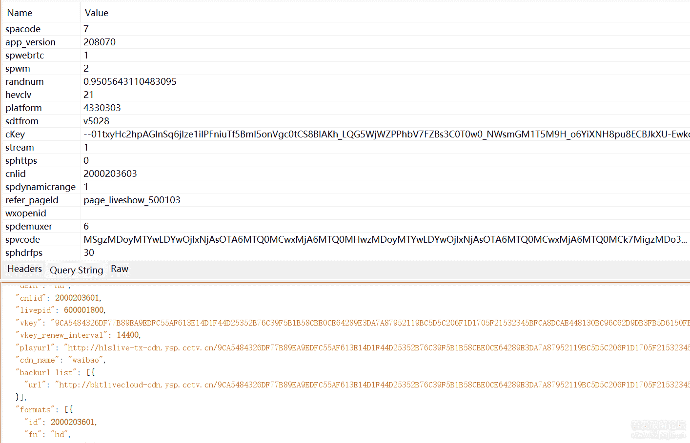

v2-ebf2f90aca94c97e239ba4fa4d436254_1440w.png (93.23 KB, 下载次数: 2)

[href="forum.php?mod=attachment&aid=MjY3NDU1MnxiZTVlMzVjOXwxNzkzNTY4NjEyfDE2ODA4NnwxODg4MDE4&nothumb=yes" target="_blank"](https://www.52pojie.cn/forum.php?mod=attachment&aid=MjY3NDU1MnxiZTVlMzVjOXwxNzkzNTY4NjEyfDE2ODA4NnwxODg4MDE4&nothumb=yes)

2024-2-4 20:25 上传

多尝试几次，并分析一下请求的参数，从直觉上来看，最重要的就是 `cKey` 这个值。

再使用ApiPost，反复测试大概猜出了 `defn`、`cnlid`、`livepid` 等几个参数代表的意义，

也得知了 `platform`、`sdtfrom`、`appVer`、`encryptVer`、`cmd`、`cnlid`、`cKey` 等几个值为必填，所幸的是必填项里，也只有 `cKey` 是动态的，

所以接下来我们就要看看怎么获取这个 `cKey` 值。

## 2. 获取cKey

工具：`jadx` 、Frida

如果是在网页端，那直接用开发者工具进行断点调试就可以了。

但是如果是App端该如何呢？不论如何，从逻辑上来讲，总归的思路是需要反编译App。

查了些资料，反编译Android App比iOS App要方便些，所以便从Android入手。

使用 `jadx` 反编译App，映入眼帘的都是 a、b、c、d、e、f、g 啥的。

虽然不懂，但很明显已经是被混淆过的，可能这个已经是App的标配了吧，还好 `jadx` 有反混淆功能。

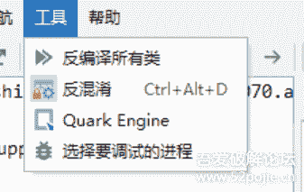

微信图片_20240204124259.png (36.02 KB, 下载次数: 2)

[href="forum.php?mod=attachment&aid=MjY3NDU1M3xiZTliNGVjN3wxNzkzNTY4NjEyfDE2ODA4NnwxODg4MDE4&nothumb=yes" target="_blank"](https://www.52pojie.cn/forum.php?mod=attachment&aid=MjY3NDU1M3xiZTliNGVjN3wxNzkzNTY4NjEyfDE2ODA4NnwxODg4MDE4&nothumb=yes)

2024-2-4 20:26 上传

反混淆之后，至少一切稍微可读性高了些{:1_907:}

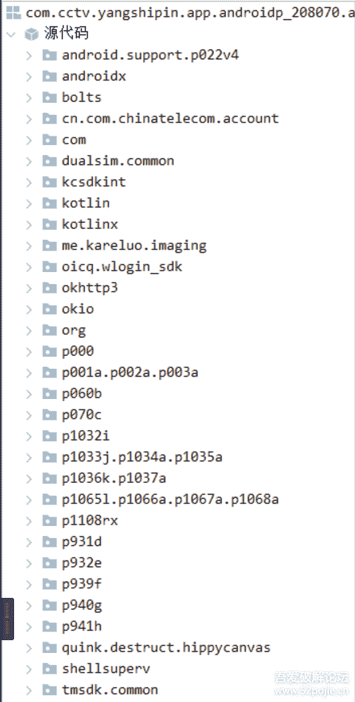

微信图片_20240204124525.png (125.15 KB, 下载次数: 4)

[href="forum.php?mod=attachment&aid=MjY3NDU1NHw4YzYyOTJhZHwxNzkzNTY4NjEyfDE2ODA4NnwxODg4MDE4&nothumb=yes" target="_blank"](https://www.52pojie.cn/forum.php?mod=attachment&aid=MjY3NDU1NHw4YzYyOTJhZHwxNzkzNTY4NjEyfDE2ODA4NnwxODg4MDE4&nothumb=yes)

2024-2-4 20:27 上传

### 找到cKey相关的方法

既然请求的关键字是 `cKey`，那么代码中总归是有和 `cKey` 相关的字眼吧？尝试全局搜索一下。

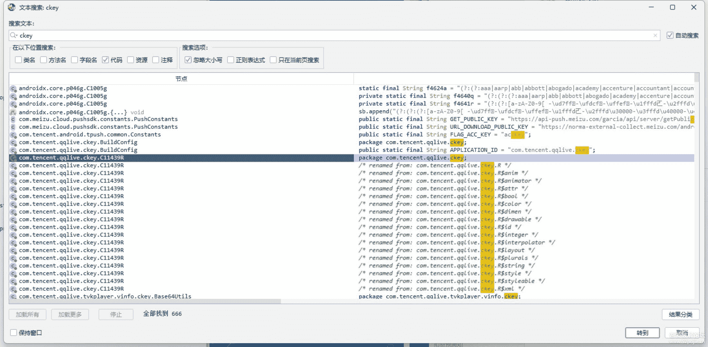

微信截图_20240204125512.png (369.34 KB, 下载次数: 3)

[href="forum.php?mod=attachment&aid=MjY3NDU1NXw4NjVlNjNmNXwxNzkzNTY4NjEyfDE2ODA4NnwxODg4MDE4&nothumb=yes" target="_blank"](https://www.52pojie.cn/forum.php?mod=attachment&aid=MjY3NDU1NXw4NjVlNjNmNXwxNzkzNTY4NjEyfDE2ODA4NnwxODg4MDE4&nothumb=yes)

2024-2-4 20:27 上传

能找到很多，甚至可以找到名为 `com.tencent.qqlive.tvkplayer.vinfo.ckey` 的包，但说实话看不到什么明确的思路。

再尝试搜索下抓包到的域名 `liveinfo.ysp.cctv.cn`

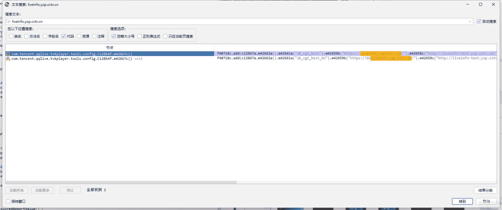

微信截图_20240204125747.png (159.46 KB, 下载次数: 3)

[href="forum.php?mod=attachment&aid=MjY3NDU1Nnw4YWY5YzgxYnwxNzkzNTY4NjEyfDE2ODA4NnwxODg4MDE4&nothumb=yes" target="_blank"](https://www.52pojie.cn/forum.php?mod=attachment&aid=MjY3NDU1Nnw4YWY5YzgxYnwxNzkzNTY4NjEyfDE2ODA4NnwxODg4MDE4&nothumb=yes)

2024-2-4 20:28 上传

这次相对目标就明确了一些，进去看一看

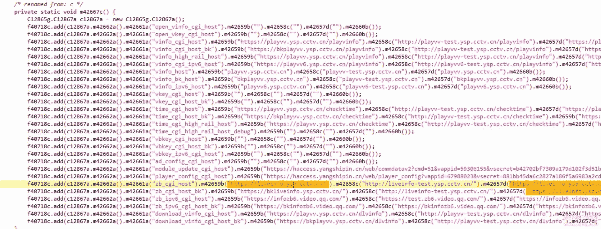

微信截图_20240204125919.png (434 KB, 下载次数: 2)

[href="forum.php?mod=attachment&aid=MjY3NDU1N3w4MTMzOGM0ZHwxNzkzNTY4NjEyfDE2ODA4NnwxODg4MDE4&nothumb=yes" target="_blank"](https://www.52pojie.cn/forum.php?mod=attachment&aid=MjY3NDU1N3w4MTMzOGM0ZHwxNzkzNTY4NjEyfDE2ODA4NnwxODg4MDE4&nothumb=yes)

2024-2-4 20:29 上传

虽然不太懂Java，但看包名（`com.tencent.qqlive.tvkplayer.tools.config`）以及这段的大概意思应该是建立了一个索引，

其他地方只要引用 `zb_cgi_host` 便代表着要对这条url搞点什么事。再继续搜索 `zb_cgi_host`。

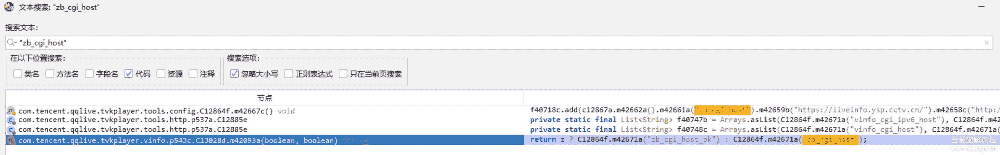

微信截图_20240204132127.png (122.43 KB, 下载次数: 3)

[href="forum.php?mod=attachment&aid=MjY3NDU1OHxlMmQxNWI0YnwxNzkzNTY4NjEyfDE2ODA4NnwxODg4MDE4&nothumb=yes" target="_blank"](https://www.52pojie.cn/forum.php?mod=attachment&aid=MjY3NDU1OHxlMmQxNWI0YnwxNzkzNTY4NjEyfDE2ODA4NnwxODg4MDE4&nothumb=yes)

2024-2-4 20:29 上传

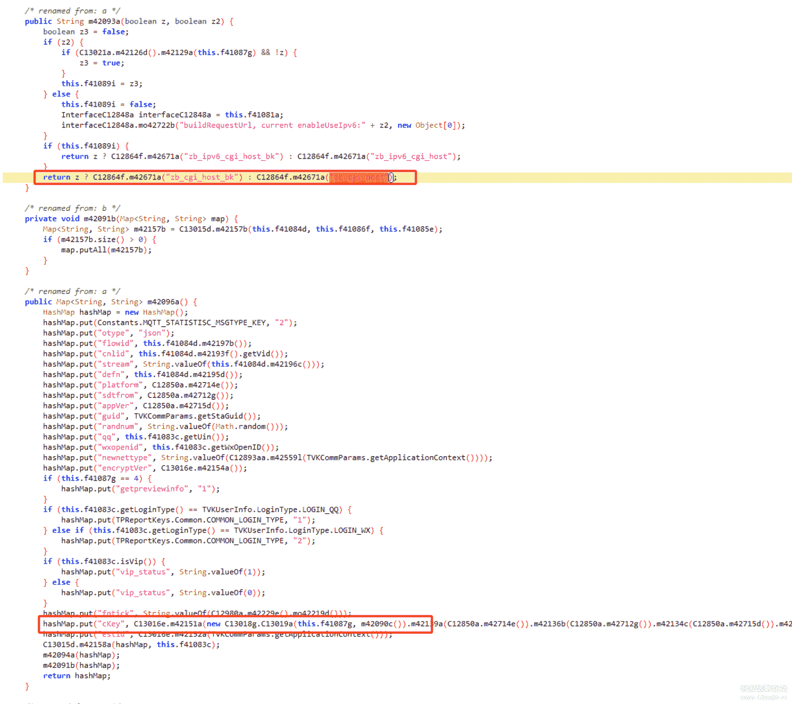

微信图片_20240204132402.png (514.5 KB, 下载次数: 2)

[href="forum.php?mod=attachment&aid=MjY3NDU1OXxlN2U4NjNiZHwxNzkzNTY4NjEyfDE2ODA4NnwxODg4MDE4&nothumb=yes" target="_blank"](https://www.52pojie.cn/forum.php?mod=attachment&aid=MjY3NDU1OXxlN2U4NjNiZHwxNzkzNTY4NjEyfDE2ODA4NnwxODg4MDE4&nothumb=yes)

2024-2-4 20:30 上传

这就有意思了，确实搜索到了有地方在使用 `zb_cgi_host`，看大概得意思就是判断是使用主地址还是备用地址，

随手向下一翻，就看到了一个 `HashMap`，简单理解这个就是Python里的字典，类似于键值对。

下面建立了一个 `cKey` 的键值对，跟着这个赋值，我们进去 `C13016e.m42151a()` 看看。

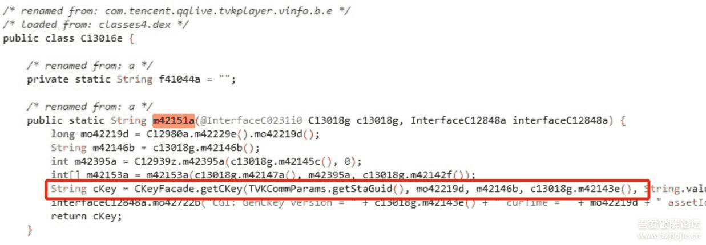

微信截图_20240204132754.png (81.67 KB, 下载次数: 3)

[href="forum.php?mod=attachment&aid=MjY3NDU2MHwzM2VhZjg5YXwxNzkzNTY4NjEyfDE2ODA4NnwxODg4MDE4&nothumb=yes" target="_blank"](https://www.52pojie.cn/forum.php?mod=attachment&aid=MjY3NDU2MHwzM2VhZjg5YXwxNzkzNTY4NjEyfDE2ODA4NnwxODg4MDE4&nothumb=yes)

2024-2-4 20:31 上传

这里的代码没有进行混淆，意思也很明显了，我们跟进去再看看。

来到 `com.tencent.qqlive.tvkplayer.vinfo.ckey.CKeyFacade` 这个类下面。

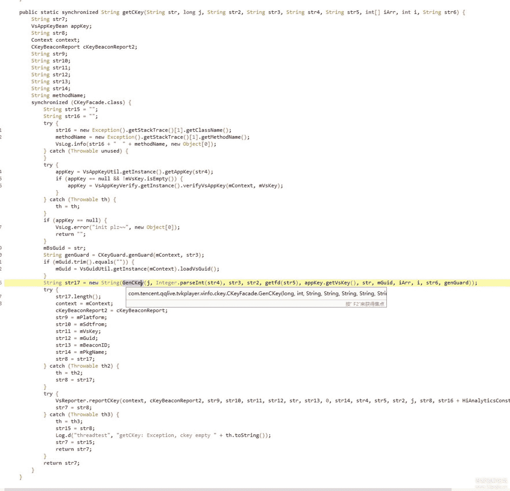

微信截图_20240204133222.png (227.91 KB, 下载次数: 3)

[href="forum.php?mod=attachment&aid=MjY3NDU2MXw0MTI5YThjN3wxNzkzNTY4NjEyfDE2ODA4NnwxODg4MDE4&nothumb=yes" target="_blank"](https://www.52pojie.cn/forum.php?mod=attachment&aid=MjY3NDU2MXw0MTI5YThjN3wxNzkzNTY4NjEyfDE2ODA4NnwxODg4MDE4&nothumb=yes)

2024-2-4 20:31 上传

这大段的代码，对于毫无经验的我来说，看着确实有些吃力，

但其实可以借助chatGPT的力量来进行分析，直接让GPT告诉你答案就行。

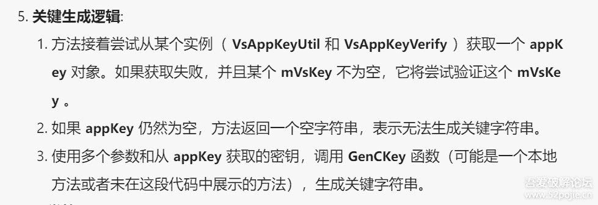

微信截图_20240204133455.png (60.52 KB, 下载次数: 1)

[href="forum.php?mod=attachment&aid=MjY3NDU2MnxlYjdhNmNiNHwxNzkzNTY4NjEyfDE2ODA4NnwxODg4MDE4&nothumb=yes" target="_blank"](https://www.52pojie.cn/forum.php?mod=attachment&aid=MjY3NDU2MnxlYjdhNmNiNHwxNzkzNTY4NjEyfDE2ODA4NnwxODg4MDE4&nothumb=yes)

2024-2-4 20:32 上传

所以跟着GPT的指引，我们去看一下 `GenCKey` 函数。

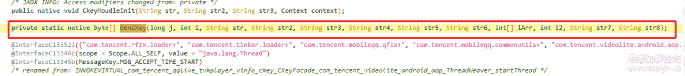

v2-c85bd4706269ac0313f9161a125eacd9_1440w.png (156.23 KB, 下载次数: 2)

[href="forum.php?mod=attachment&aid=MjY3NDU2M3w1NTg1MTYwOHwxNzkzNTY4NjEyfDE2ODA4NnwxODg4MDE4&nothumb=yes" target="_blank"](https://www.52pojie.cn/forum.php?mod=attachment&aid=MjY3NDU2M3w1NTg1MTYwOHwxNzkzNTY4NjEyfDE2ODA4NnwxODg4MDE4&nothumb=yes)

2024-2-4 20:32 上传

这里说明了这是一个原生方法，简单理解就是这个方法是包含在App引用的so库中，

也确实在资源文件里找到了 `libckeygenerator.so` 文件，用IDA反编译后，确实也能找到一个 `GenCKey` 的方法。

那么是否可以调用 `libckeygenerator.so` 文件里的 `GenCKey` 方法呢？

从理论上来说应该是可以的，但这里面会涉及到处理器架构不同、so依赖等问题。

我也尝试过在树莓派上调用、在手机里调用以及用 AndroidNativeEmu 库来调用，均遇到了不同的问题……

奈何水平及知识储备不足，只能放弃这个方法。

（不知大佬们是否有可以直接调用的思路？）

### 使用Frida Hook getCKey方法

后续又在查资料的时候，了解到了 Frida 这个神器，

它可以 hook App 在运行中使用的方法，并进行修改。

那么我们是否可以用它做点什么呢？

答案当然是肯定的，Frida 功能很强大，作为初学者我也只能针对这个案例去逐步了解 Frida。

Frida 的原理很简单，其实就是会在手机上运行一个 server，然后可以在电脑上使用 frida 与之进行沟通。

沟通的方式有两种，一种就是直接命令行用命令把 JavaScript 脚本发送到手机上，

另外一种方式就是用 Python 脚本将 JavaScript 脚本发送到手机上。（目前我只了解这两种方式）

所以我们分别需要“服务端”与“客户端”。

#### 服务端

在 Frida 的 Github 页面上直接下载对应的 `frida-server` 就行。

在下载之前，可以使用 `adb` 命令查一下手机的 cpu 架构

```
> adb shell uname -a
Linux localhost 4.14.180-perf-gb24d113 #2 SMP PREEMPT Thu Nov 25 13:06:04 CST 2021 aarch64
```

将下载的文件解压出来，得到可执行文件，并复制到手机里运行。

为了方便，我将下载的可执行文件重命名为 `frida-server64`

```
```

# 先把文件传到 `/sdcard` 目录下，所以后续还需要将它移动到其他文件夹内


> `adb push frida-server64 /sdcard/Download`
> `adb shell`
`cepheus:/ $ su`
`cepheus:/ # mv /sdcard/Download/frida-server64 /data/local/tmp`
`cepheus:/ # cd /data/local/tmp`

### 记得需要给可执行文件增加执行权限
`cepheus:/data/local/tmp # chmod +x frida-server64`
`cepheus:/data/local/tmp # ./frida-server64`

如果没有报错那么 `frida server` 就已经启动了

## 客户端
可以使用 Python 的 `pip` 工具来安装，安装 `frida` 和 `frida-tools`

```
> pip install frida frida-tools
```

如果服务端和客户端都准备完毕了，那么就可以用一个简单的命令来使用 `frida`
```
> frida-ps -U
```
其中 `frida-ps` 是 `frida` 的工具之一， `-U` 指的是使用 USB 连接的设备。

通过该命令，就可以看到手机中当前正在运行的进程。

一切都准备好了，我们结合前面反编译的结果，来准备一个 `hook` 脚本。

根据之前的分析结果，我们猜测 `cKey` 是由 `com.tencent.qqlive.tvkplayer.vinfo.ckey.CKeyFacade` 类下面的 `getCKey` 方法生成的，
这个方法接受 9 个参数，并返回 1 个字符串，这个返回的字符串很可能就是我们需要的 `cKey`。

那么这 9 个参数分别是什么呢？
有两种方式，一种方式使通过 `jadx` 一点点去分析，
另外一种方式就是通过 Frida Hook `getCKey` 方法，来直接看下这 9 个参数都是什么。

根据以上，我们准备一个脚本，并命名为 `test.js`。

```
// 注入的函数需要包含在 Java.perform() 内 
Java.perform(function () {
    // 先让 Frida 找到 CKeyFacade 类
    var CKeyFacade = Java.use("com.tencent.qqlive.tvkplayer.vinfo.ckey.CKeyFacade");
    // getCKey 是 CKeyFacade 类下的方法， overload 内填写方法接受参数的类型
    CKeyFacade.getCKey
        .overload('java.lang.String', 'long', 'java.lang.String', 'java.lang.String', 'java.lang.String', 'java.lang.String', '[I', 'int', 'java.lang.String')
        .implementation = function (val1, val2, val3, val4, val5, val6, val7, val8, val9) {
        console.log(" getCKey() got called!");
        // 将输入的几个参数打印出来
        console.log(
            `str: ${val1}; j: ${val2}; str2: ${val3}; str3: ${val4}; str4: ${val5}; str5: ${val6}; iArr: ${val7}; i: ${val8}; str6: ${val9}; `
        )
        var result =  this.getCKey(val1, val2, val3, val4, val5, val6, val7, val8, val9);
        // 将结果打印出来
        console.log('ckey:'+result)
        // 记得将结果返回给App，不然可能会导致App崩溃
        return result
    };
});
```

脚本中 `getCkey` 中的 `overload()` 里的参数如果不知道怎么填，可以先不填。
然后 Frida 会报错，报错信息中会包括几种可能的参数，选择对应的复制进去即可。

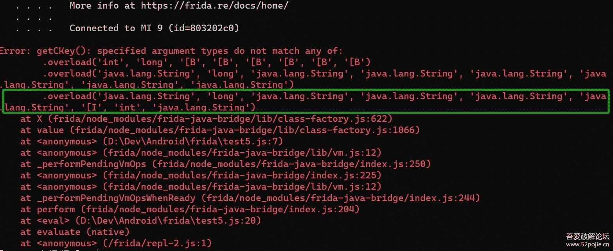
微信截图_20240204161542.png (186.8 KB, 下载次数: 2)
[href="forum.php?mod=attachment&aid=MjY3NDU2NHwxOTVmZTNjZHwxNzkzNTY4NjEyfDE2ODA4NnwxODg4MDE4&nothumb=yes" target="_blank"](https://www.52pojie.cn/forum.php?mod=attachment&aid=MjY3NDU2NHwxOTVmZTNjZHwxNzkzNTY4NjEyfDE2ODA4NnwxODg4MDE4&nothumb=yes)
2024-2-4 20:36 上传

然后我们可以将脚本注入程序中，试一下。
```
> frida -U 某视频 -l test.js
```
其中“某视频”为进程名，可以通过 `frida-ps -U` 来查看进程
（不知道为什么有的时候进程是包名，有的时候是中文的 App 名……）

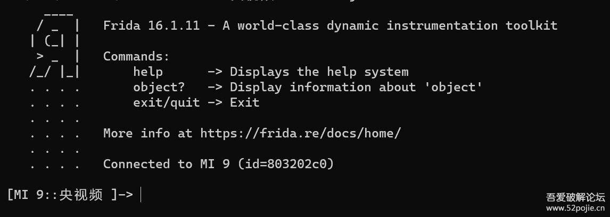
微信截图_20240204162012.png (48.3 KB, 下载次数: 2)
[href="forum.php?mod=attachment&aid=MjY3NDU2NXw4YjJlYTY1YnwxNzkzNTY4NjEyfDE2ODA4NnwxODg4MDE4&nothumb=yes" target="_blank"](https://www.52pojie.cn/forum.php?mod=attachment&aid=MjY3NDU2NXw4YjJlYTY1YnwxNzkzNTY4NjEyfDE2ODA4NnwxODg4MDE4&nothumb=yes)
2024-2-4 20:37 上传

如果没什么报错，那就说明 Frida 已经注入成功了，接着在手机上刷新下页面，或者切换直播流试试。

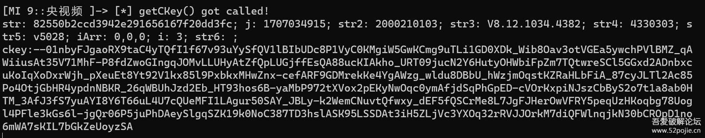
微信截图_20240204162211.png (150.19 KB, 下载次数: 2)
[href="forum.php?mod=attachment&aid=MjY3NDU2NnxmNGU0MTUwMXwxNzkzNTY4NjEyfDE2ODA4NnwxODg4MDE4&nothumb=yes" target="_blank"](https://www.52pojie.cn/forum.php?mod=attachment&aid=MjY3NDU2NnxmNGU0MTUwMXwxNzkzNTY4NjEyfDE2ODA4NnwxODg4MDE4&nothumb=yes)
2024-2-4 20:37 上传

紧接着，我们就可以看到控制台中有 log 输出了，得到了我们想要的东西，并且这输出的内容很可能就是我们需要的 `cKey`。
同时我们也可以多试几次以及根据反编译的结果分别得出这输入的 9 个参数分别是什么。

```
val1：设备的guid
val2：10位时间戳
val3：cnlid，就是直播流的id
val4：appVersion，固定值
val5：platform，固定值
val6：sdtfrom，固定值
val7：[0,0,0]，固定值
val8：3，固定值
val9：空字符串，固定值
```

到此为止，我们已经通过 Frida Hook 了 `getCKey` 方法，获得了其输入以及输出。

## 3. 使用 Frida Hook 请求和响应
其实 `jadx` 可以直接生成 `frida` 脚本，找到最开始找到的那个名为 `m42096a()` 的那个方法，鼠标右键，复制为 `frida` 片段。

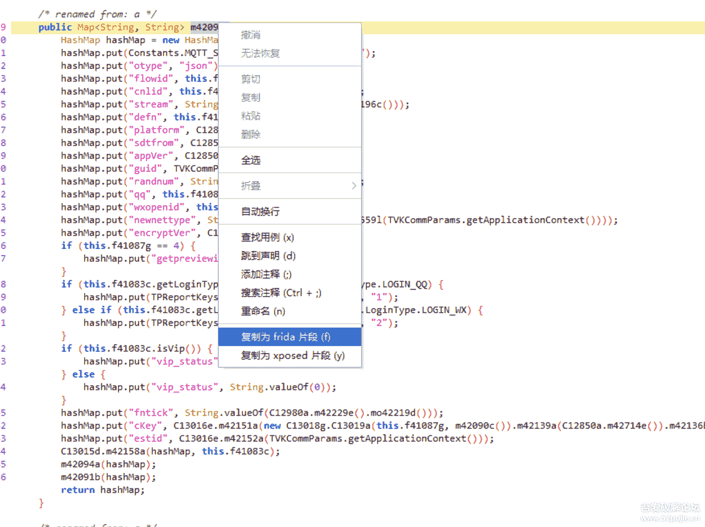
微信图片_20240204164505.png (338.92 KB, 下载次数: 2)
[href="forum.php?mod=attachment&aid=MjY3NDU2N3wxMjcyNzhiMnwxNzkzNTY4NjEyfDE2ODA4NnwxODg4MDE4&nothumb=yes" target="_blank"](https://www.52pojie.cn/forum.php?mod=attachment&aid=MjY3NDU2N3wxMjcyNzhiMnwxNzkzNTY4NjEyfDE2ODA4NnwxODg4MDE4&nothumb=yes)
2024-2-4 20:38 上传

```
//jadx生成的片段不包括 Java.perform(function(){}) ,需要自行添加
let C13028d = Java.use("com.tencent.qqlive.tvkplayer.vinfo.c.d");
C13028d["a"].overload().implementation = function () {
    console.log(`C13028d.m42096a is called`);
    let result = this["a"]();
    console.log(`C13028d.m42096a result=${result}`);
    return result;
};
```

要注意的是，`m42096a()` 这个是 `jadx` 反混淆后的方法名，
实际上 App 运行的时候这个方法名为 `a()` ，
`jadx` 在注释中也会注明原方法名，并且在自动生成的 `frida` 片段 中也都进行了替换。

实际上运行这个脚本会发现，没有什么输出。
其实是因为这个方法的输出是一个 `hashMap`，我们需要把代码片段再加工一下，使控制台可以输出 `hashMap` 里的内容。

```
Java.perform(function () {
    var Gson = Java.use('com.google.gson.Gson').$new();
    let C13028d = Java.use("com.tencent.qqlive.tvkplayer.vinfo.c.d");
    C13028d["a"].overload().implementation = function () {
        console.log(`C13028d.m42096a is called`);
        let result = this["a"]();
        var json_str = Gson.toJsonTree(result).getAsJsonObject();
        var json_obj = JSON.parse(json_str)
        console.log(`C13028d.m42096a result=${json_obj}`);
        return result;
    };
});
```

如此，我们便可以获得所有的请求参数，然后进行分析了。

那么，是否能获取到服务器响应的内容呢？
回到 `jadx`，来继续碰碰运气。
试想一下，从逻辑上讲，直播源的请求与解析应该属于同一个模块
，我们现在找到了请求的代码，那么解析的代码应该就在请求的代码附近。

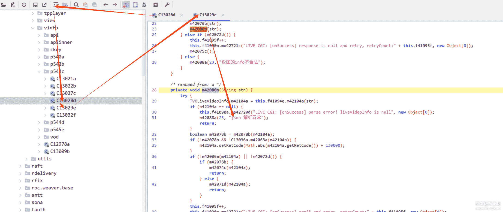
微信图片_20240204170428.png (325.7 KB, 下载次数: 2)
[href="forum.php?mod=attachment&aid=MjY3NDU2OHxmNGVhN2E4MHwxNzkzNTY4NjEyfDE2ODA4NnwxODg4MDE4&nothumb=yes" target="_blank"](https://www.52pojie.cn/forum.php?mod=attachment&aid=MjY3NDU2OHxmNGVhN2E4MHwxNzkzNTY4NjEyfDE2ODA4NnwxODg4MDE4&nothumb=yes)
2024-2-4 20:39 上传

还是 `com.tencent.qqlive.tvkplayer.vinfo.p543c.C13028d` 这个类，我们找到这个类的文件位置。
然后在同文件夹下翻一翻，很幸运地，我们翻到了 `C13029e` 这个类，在这个类里，我们又看到了类似于 `json` 解析的日志输出。
那么，我们有理由相信 `com.tencent.qqlive.tvkplayer.vinfo.p543c.C13029e.m42080a()` 方法的作用就是解析响应 `json` 字符串的。

根据以上的内容，我们替换成反混淆前的方法名，整理成脚本变为：

```
Java.perform(function () {
    var Gson = Java.use('com.google.gson.Gson').$new();
    var reqHashMapClass = Java.use("com.tencent.qqlive.tvkplayer.vinfo.c.d");
    var repJsonClass = Java.use("com.tencent.qqlive.tvkplayer.vinfo.c.e");
    reqHashMapClass.a.overload().implementation = function () {
        var result =  this.a();
        console.log("==============================");
        console.log("↓↓↓↓↓↓↓↓↓请求数据-START↓↓↓↓↓↓↓↓");
        var json_str = Gson.toJsonTree(result).getAsJsonObject();
        var json_obj = JSON.parse(json_str)
        const date = new Date();
        console.log(`json: ${json_str}`);
        console.log(date.toLocaleString('zh-CN', { timeZone: 'Asia/Shanghai' }));
        console.log(`cnlid: ${json_obj.cnlid}`);
        console.log(`livepid: ${json_obj.livepid}`);
        console.log(`defn: ${json_obj.defn}`);
        console.log(`vip_status: ${json_obj.vip_status}`);
        console.log("↑↑↑↑↑↑↑↑↑请求数据-END↑↑↑↑↑↑↑↑↑↑");
        console.log("==============================");
        return result
    };
    repJsonClass.a.overload('java.lang.String').implementation = function (str) {
        var result =  this.a(str);
        console.log("==============================");
        console.log("↓↓↓↓↓↓↓↓↓响应数据-START↓↓↓↓↓↓↓↓");
        var json_obj = JSON.parse(str)
        const date = new Date();
        console.log(date.toLocaleString('zh-CN', { timeZone: 'Asia/Shanghai' }));
        console.log(`errinfo: ${json_obj.errinfo}`);
        console.log(`cnlid: ${json_obj.cnlid}`);
        console.log(`defn: ${json_obj.defn}`);
        console.log(`livepid: ${json_obj.livepid}`);
        console.log(`playurl: ${json_obj.playurl}`);
        // console.log(str)
        console.log("↑↑↑↑↑↑↑↑↑响应数据-END↑↑↑↑↑↑↑↑↑↑");
        console.log("==============================");
        return result
    };
});
```

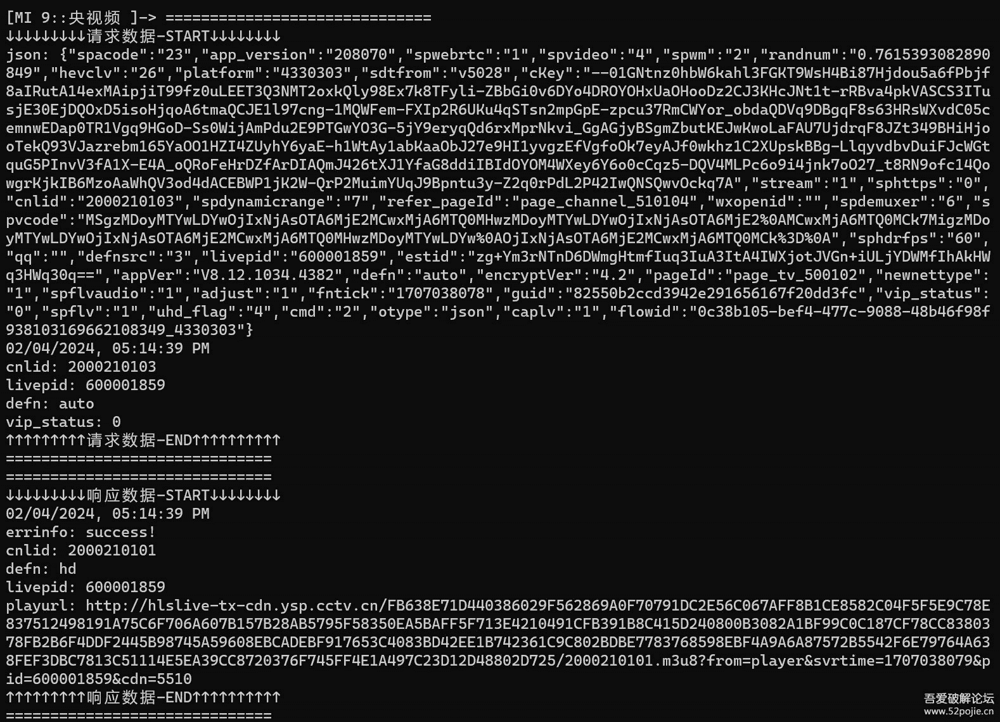
微信截图_20240204171451.png (423.71 KB, 下载次数: 1)


https://www.52pojie.cn/forum.php?mod=attachment&aid=MjY3NDU2OXwxM2Q5MWNjMnwxNzkzNTY4NjEyfDE2ODA4NnwxODg4MDE4&nothumb=yes

2024-2-4 20:39 上传

到此为止，我们已经通过使用 Frida Hook 了请求和响应，现在我们就可以很方便地进行分析了。

通过同样的方法，我们也可以获得请求直播源地址时所有参数的含义了。

也许这时候有人会说，为什么不直接 Hook App 中常用的 `okhttp` 模块来进行抓包呢？其实我也尝试过……

只要 Hook `okhttp` 的模块，就和上面提到的 Android 抓包一样，提示无网络 :'(weeqw ，不知道是否有大佬能解答下{:1_889:}

## 4. 通过 Frida 创建 `getCKey` API

上面的所有案例中，Frida 都是通过被动调用的方式来执行的，那么它可以主动调用对应的方法吗？

这样就可以直接使用 Frida 创建一个 `api` 来获取 `cKey`，然后使用 Python 来进行更多操作。

Frida 官方也提供了这样一个案例：

https://github.com/frida/frida-python/blob/ebd797e4bc248b8d895d68ebf244a34744cb3ea9/examples/rpc.py

简单说，就是通过 frida 提供的 `rpc.exports`，来导出方法，以方便 python 可以随时调用。

`getCkey.js`

```javascript
// getCkey.js 只需要输入时间戳和cnlid即可
function ckey(timestamp, cnlid){
    var result = '';
    Java.perform(function(){
        var CKeyFacade = Java.use("com.tencent.qqlive.tvkplayer.vinfo.ckey.CKeyFacade");
        var guid = '9d3644141c7047acb072f6343cfaa433';
        var appVer = 'V8.12.1034.4382';
        var platform = '4330303';
        var sdtfrom = 'v5028';
        var _iArr = [0,0,0];
        var _i = 3;
        var _str6 = '';

        result = CKeyFacade.getCKey(guid, timestamp, cnlid, appVer, platform, sdtfrom, _iArr, _i, _str6);

    });
    return result
}

rpc.exports = {
    ckey: ckey
}
```

Python 脚本：

```python
import frida, sys, time

# 读取js脚本，也可以直接以字符串的形式写在python脚本中
with open('getCkey.js', 'r+') as f:
    js_code = f.read()

# 通过USB获取设备
device = frida.get_usb_device()

# attach进程
session = device.attach('某视频')

# 加载脚本
script = session.create_script(js_code)
script.load()

# 获取frida导出的函数
api = script.exports_sync

# 可以直接调用ckey函数，来获取CKey
result = api.ckey(int(time.time()), '2000210103')
print(result)
```

### 远程调用 Frida

在实际应用的环境中，手机一直用 USB 连着电脑似乎也不太靠谱，而 Frida 也提供了远程调用的方式。

让 `frida-server` 监听 `0.0.0.0`：

```shell
./frida-server64 -l 0.0.0.0
```

那么之前注入脚本的命令也变成了：

```shell
frida -H 10.10.10.170 -n 某视频 -l test.js
```

在 python 中调用的方式，也变成了：

```python
device = frida.get_device_manager().add_remote_device('10.10.10.170')
session = device.attach('某视频')
script = session.create_script(js_code)
script.load()
```

甚至也可以在[相关帖子](https://www.52pojie.cn/thread-661779-1-1.html)或者树莓派等设备中安装安卓系统作为专门的 `api` 服务器。

### 非实体 Android 系统

若在树莓派中的 Android 系统，主要有两种选择：

- EmteriaOS（注册账户后即可下载安装程序，通过安装程序可刷写系统到 TF 卡中，非商业版 8 小时重启一次）
- LineageOS（由 konstakang 大佬魔改而来，下载镜像刷写到 TF 卡中即可）

其他方案也可以参考大佬分享的安卓容器化部署方案。

不管使用哪种方式，都需要自动启动应用以及 frida，可以使用 Script Manager 来实现。

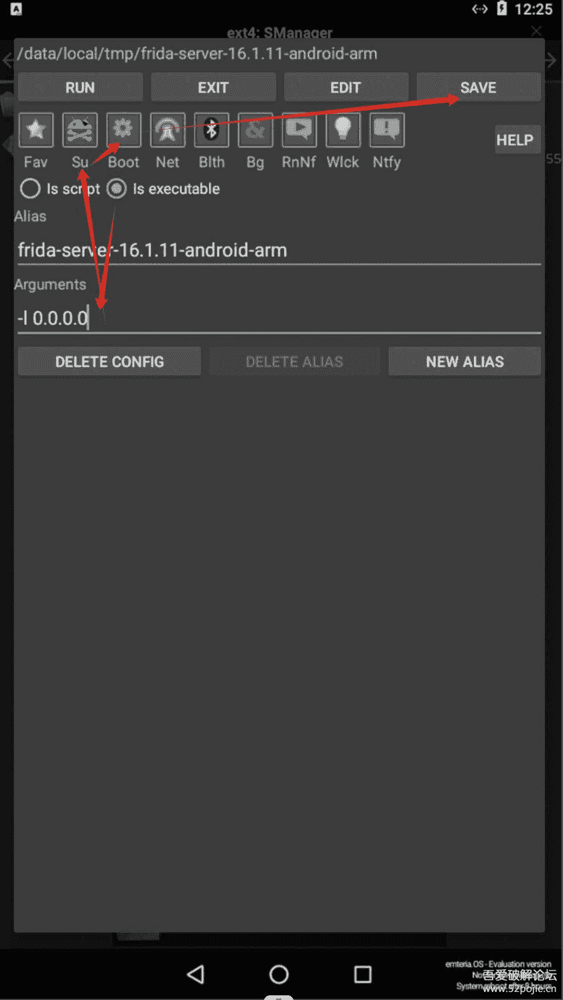

`微信截图_20240204193413.png` (74.33 KB, 下载次数: 2)

https://www.52pojie.cn/forum.php?mod=attachment&aid=MjY3NDU3MXxjMmQ4YWE0ZXwxNzkzNTY4NjEyfDE2ODA4NnwxODg4MDE4&nothumb=yes

2024-2-4 20:43 上传

## 5. 整理脚本

最后可以将上述所有的整理成脚本即可根据自己的需求去获取各个直播流的地址了。

`WaterRequests.py`

```python
import requests, time, logging
from functools import wraps
from requests.exceptions import ConnectTimeout, ConnectionError

class WaterRequest():
    def __init__(
        self, 
        headers={}, 
        config={}, 
        logger=logging.getLogger(__name__),
        retry_times=5,
        **kwargs
    ):
        self.session = requests.Session()
        self.headers = {
            'User-Agent': 'Mozilla/5.0 (Windows NT 10.0; Win64; x64) AppleWebKit/537.36 (KHTML, like Gecko) Chrome/94.0.4606.61 Safari/537.36',
            **headers
        }
        self.config = {
            'timeout': 300,
            'verify': True,
            **config
        }
        self.logger = logger
        self.session.headers.update({**self.headers})
        self.retry_times = retry_times

    def __enter__(self):
        return self

    def __exit__(self, exc_type, exc_val, exc_tb):
        self.close()

    def retry_decorator(func):
        @wraps(func)
        def wrapped_function(*args, **kwargs):
            _self = [*args][0]
            result = None
            for i in range(_self.retry_times):
                if i > 0:
                    _self.logger.warning(f'正在进行第 {i} 次重试...')
                try:
                    result = func(*args, **kwargs)
                    break
                except (ConnectionError, ConnectTimeout) as e:
                    _url = {**kwargs}.get('url', None)
                    if _url is None:
                        if len([*args])>1:
                            _url = [*args][1]
                    if _url is not None and len(_url)>20:
                        _url = f'{_url[:10]}...{_url[-10:]}'
                    if type(e) == ConnectionError:
                        _self.logger.warning(f'[ConnectionError][URL:{_url}]')
                    elif type(e) == ConnectTimeout:
                        _self.logger.warning(f'[ConnectTimeout][URL:{_url}]')
                    else:
                        _self.logger.warning(f'[未知错误][URL:{_url}]')
                    if i == _self.retry_times-1:
                        _self.logger.error(f'已重试 {i+1} 次，达到最大重试次数，访问失败')
                        break
                    else:
                        _self.logger.info(f'3秒后进行第 {i+1} 次重试')
                        time.sleep(3)
                        continue
            return result
        return wrapped_function

    def updateHeaders(self, new_header:dict):
        self.headers.update({**new_header})
        _s = self.session
        _s.headers.update({**new_header})

    @retry_decorator
    def get(self, url, query:dict=None, data:dict=None):
        _s = self.session
        _r = _s.get(url, params=query, data=data, **self.config)
        return _r.json()

    @retry_decorator
    def post(self, url, json:dict=None, query:dict=None, data:dict=None):
        _post_data = {}
        if data is not None:
            _post_data = {
                'data': data
            }
        if json is not None:
            _post_data = {
                'json': json
            }
        _s = self.session
        _r = _s.post(url, params=query, **_post_data, **self.config)
        return _r.json()

    @retry_decorator
    def delete(self, url, json:dict=None, query:dict=None, data:dict=None):
        _s = self.session
        _r = _s.delete(url, json=json, params=query, data=data, **self.config)
        return _r.json()

    def close(self):
        return self.session.close()
```

`config.py`


# 直播源配置与脚本

## 配置

```python
ANDROID_IP = '10.10.10.170'

LIVEINFO_URL = 'https://liveinfo.ysp.cctv.cn/'

REQUEST_HEADER = {
    'Host': 'liveinfo.ysp.cctv.cn',
    'Accept-Encoding': 'gzip',
    'User-Agent': 'qqlive'
}

# 参数已脱敏处理
REQUEST_QUERY = {
    'platform': '',
    'sdtfrom': '',
    'appVer': '',
    'encryptVer': '',
    'cmd': '',
    'spacode': '',
    'app_version': '',
    'spwebrtc': '',
    'spwm': '',
    'hevclv': '',
    'stream': '',
    'sphttps': '',
    'spdynamicrange': '',
    'wxopenid': '',
    'spdemuxer': '',
    'spvcode': '',
    'sphdrfps': '',
    'qq': '',
    'defnsrc': '',
    'estid': '',
    'newnettype': '',
    'spflvaudio': '',
    'adjust': '',
    'guid': '',
    'vip_status': '',
    'spflv': '',
    'uhd_flag': '',
    'otype': '',
    'caplv': ''
}

# 仅保留两条作为示例
CHANNELS = [{'type': 'CCTV',
  'name': '超高清4K',
  'livepid': '600002264',
  'cnlid': '2000266303',
  'icon': 'https://jietufengmian.yangshipin.cn/20230915/1859032628044/a9b31c00c575f5e3a5ca0e27fa8ff208.webp',
  'tvg-name': 'noepg',
  'tvg-id': '9999'},
 {'type': 'CCTV',
  'name': '1 综合',
  'livepid': '600001859',
  'cnlid': '2000210103',
  'icon': 'https://jietufengmian.yangshipin.cn/20230915/1857389472656/1e5dbbb13283991e8f443cfb5f229f06.webp',
  'tvg-name': 'CCTV1',
  'tvg-id': '1'}]
```

## `getCkey.js`

```javascript
function ckey(timestamp, cnlid){

    var result = '';

    Java.perform(function(){

        var CKeyFacade = Java.use("com.tencent.qqlive.tvkplayer.vinfo.ckey.CKeyFacade");

        var guid = '9d3644141c7047acb072f6343cfaa433';

        var appVer = 'V8.12.1034.4382';

        var platform = '4330303';

        var sdtfrom = 'v5028';

        var _iArr = [0,0,0];

        var _i = 3;

        var _str6 = '';

        result = CKeyFacade.getCKey(guid, timestamp, cnlid, appVer, platform, sdtfrom, _iArr, _i, _str6);

    });

    return result

}

rpc.exports = {

    ckey: ckey

}
```

## `m3u8.j2`

```jinja
#EXTM3U

#EXTINF:-1 tvg-id="{{ ch.get('tvg-id', '9999') }}" tvg-name="{{ ch.get('tvg-name', 'noepg') }}" tvg-logo="{{ ch.get('icon', '') }}" group-title="{{ ch.get('type', '其他') }}",{{ ch.get('type') }}-{{ ch.get('name') }}[{{ ch.get('defn') }}]
{{ ch.get('playurl') }}

```

## `main.py`

```python
import time, frida, sys, logging, \

    subprocess, re, os, random, uuid, datetime

from config import CHANNELS, ANDROID_IP, \

    REQUEST_QUERY, LIVEINFO_URL, REQUEST_HEADER

from WaterRequests import WaterRequest

from jinja2 import Environment, FileSystemLoader, select_autoescape

logger = logging.getLogger(__name__)

logger.setLevel(level=logging.DEBUG)

formatter = logging.Formatter(

    '%(asctime)s - %(levelname)s:  %(message)s'

)

console = logging.StreamHandler()

console.setLevel(logging.INFO)

console.setFormatter(formatter)

logger.addHandler(console)

handler = logging.FileHandler('getYSPLive.log', encoding='utf8')

handler.setLevel(logging.DEBUG)

handler.setFormatter(formatter)

logger.addHandler(handler)

class CkeyGenerator():

    def __init__(self, android_ip: str) -> None:

        self.android_ip = android_ip

        self.pid = 0

        self.process_name = ''

        self.js_code = ''

        self.device = None

        self.session = None

        self.script = None

        self.api = None

        self.pattern = re.compile(

            r'(\d+)\s*(com\.cctv\.yangshipin\.app\.androidp|央视频)\s+', 

            re.MULTILINE

        )

        if self._checkFrida():

            self._loadJsCode()

            self._attachProcess()

    def _checkFrida(self) -> bool:

        logger.info('开始检查与Android的连接...')

        run = subprocess.run(

            f'frida-ps -H {self.android_ip}', shell=True, stdout=subprocess.PIPE, 

            stderr=subprocess.PIPE, text=True, encoding='utf8'

        )

        matches = self.pattern.findall(run.stdout)

        if len(matches)  str:

        if os.path.exists('getCkey.js'):

            with open('getCkey.js', 'r+') as f:

                self.js_code = f.read()

            logger.info('已加载JavaScript脚本 getCkey.js')

            return self.js_code

        else:

            logger.warning('未找到 getCkey.js 文件！退出脚本。')

            sys.exit()

    def _attachProcess(self):

        try:

            self.device = frida.get_device_manager().add_remote_device(self.android_ip)

            self.session = self.device.attach(self.pid)

            self.script = self.session.create_script(self.js_code)

            self.script.load()

            self.api = self.script.exports_sync

            logger.info(f'attach进程 [{self.pid}]{self.process_name} 成功')

        except Exception as e:

            logger.warning(f'attach进程失败，退出脚本。Error:{e}')

            sys.exit()

    def createCKey(self, timestamp: int, cnlid: str) -> str:

        ckey = self.api.ckey(timestamp, cnlid)

        logger.debug(f'成功获取CKey:[{timestamp}][{cnlid}][{ckey}]')

        return ckey

class LiveInfo():

    def __init__(

            self, 

            channel_info: dict, 

            url: str,

            query: dict,

            request_class: WaterRequest, 

            ckey_class: CkeyGenerator

    ) -> None:

        self.url = url

        self.query = query

        self.channel_info = channel_info

        self.get_ckey = ckey_class

        self.request = request_class

        self.defn = self._getDefn()

        self.flowid = self._getFlowID()

        self.fntick = self._getTimeStamp()

        self.pageId = self._getPageID()

        self.refer_pageId = self._getReferPageID()

        self.randnum = self._getRandNum()

        self.livepid = self._getLivePid()

        self.cnlid = self._getCnlid()

        self.cKey = self._getCkey(self.fntick, self.cnlid)

    @property

    def channel_type(self):

        return self.channel_info.get('type')

    @property

    def channel_name(self):

        if self.channel_info.get('type') == 'CCTV':

            return f"{self.channel_info.get('type')}-{self.channel_info.get('name')}"

        return self.channel_info.get('name')

    def _getDefn(self) -> str:

        if self.channel_info.get('livepid') == '600156816':

            return 'fhd'

        return 'fhd'

    def _getFlowID(self) -> str:

        unique_id = str(uuid.uuid4())

        nano_timestamp = str(int(time.time() * 1e3))

        return unique_id + nano_timestamp + '_4330303'

    def _getRandNum(self) -> int:

        return round(random.uniform(0, 1), 16)

    def _getTimeStamp(self) -> int:

        self.timestamp = int(time.time())

        return self.timestamp

    def _getCkey(self, timestamp: int, cnlid:str) -> str:

        return self.get_ckey.createCKey(timestamp, cnlid)

    def _getReferPageID(self) -> str:

        if self.channel_info.get('type', 'CCTV') == 'CCTV':

            return 'page_channel_510104'

        else:

            return 'page_tv_500102'

    def _getPageID(self) -> str:

        if self.channel_info.get('type', 'CCTV') == 'CCTV':

            return 'page_tv_500102'

        else:

            return 'page_tv_500105'

    def _getLivePid(self) -> str:

        return self.channel_info.get('livepid')

    def _getCnlid(self) -> str:

        return self.channel_info.get('cnlid')

    def getLiveInfo(self) -> dict:

        self.query['defn'] = self.defn

        self.query['flowid'] = self.flowid

        self.query['fntick'] = self.fntick

        self.query['pageId'] = self.pageId

        self.query['refer_pageId'] = self.refer_pageId

        self.query['randnum'] = self.randnum

        self.query['livepid'] = self.livepid

        self.query['cnlid'] = self.cnlid

        self.query['cKey'] = self.cKey

        rep = self.request.get(self.url, self.query)

        if rep is None:

            return None

        errinfo = rep.get('errinfo', 'no errinfo')

        if errinfo == 'success!':

            rep_defn = rep.get('defn').upper()
```


```python
rep_playurl = rep.get('playurl')

logger.info(f'{self.channel_type} - {self.channel_name}[{rep_defn}]: {rep_playurl}')

return {

    'type': self.channel_type,

    'name': self.channel_name,

    'defn': rep_defn,

    'playurl': rep_playurl,

    'icon': self.channel_info.get('icon'),

    'tvg-id': self.channel_info.get('tvg-id', '9999'),

    'tvg-name': self.channel_info.get('tvg-name', 'noepg')

}

else:

    logger.warning(self.query)

    logger.warning(f'[{self.channel_type} - {self.channel_name}] 获取播放地址失败，原因：{errinfo}')

    return None

def createM3U8(channel_list:list):

    env = Environment(

        loader=FileSystemLoader(os.getcwd()), 

        autoescape=select_autoescape()

    )

    template = env.get_template('m3u8.j2')

    m3u8 = template.render(channel_list=channel_list)

    if not os.path.exists('m3u8'):

        os.mkdir('m3u8')

    filename = f"{datetime.datetime.now().strftime('%Y_%m_%d_%H%M%S')}.m3u8"

    filepath = os.path.join(os.getcwd(), 'm3u8', filename )

    try:

        with open(filepath, 'w+') as f:

            f.write(m3u8)

        logger.info(f'成功生成m3u8文件，文件路径：{filepath}')

    except Exception as e:

        logger.warning(f'写入m3u8文件失败！ERROR: {e}')

        sys.exit()

def main():

    logger.info('脚本开始执行...')

    request = WaterRequest(REQUEST_HEADER,logger=logger)

    ckeyGen = CkeyGenerator(ANDROID_IP)

    channel_list = []

    for channel in CHANNELS:

        liveinfo = LiveInfo(

            channel, LIVEINFO_URL, REQUEST_QUERY,

            request, ckeyGen

        )

        _info = liveinfo.getLiveInfo()

        if not _info is None:

            channel_list.append(_info)

    logger.info(f'直播地址获取完毕，共获取 {len(channel_list)} 条信息')

    if len(channel_list) > 0:

        createM3U8(channel_list)

    logger.info('脚本执行结束...')

if __name__ == '__main__':

    main()
```

## 6. 总结

最早在测试的时候，发现每个直播流的地址有效期大概是4小时左右，但后面开始批量获取直播流地址的时候每个直播流地址的有效期时间变得很短，大概十几分钟就失效了，猜测有可能和请求参数里的`guid`短时间内发送大量请求有关，但这些现在已经不重要了，更重要的是通过这次实践了解到的App爬虫思路。

在我以往的应用中，一般只是爬取网页端的内容，所以下意识会认为如果要爬取App里的内容，需要分析大量的网络请求，甚至要分析各种加密算法。但通过这次实践，了解到了Frida神器，便完全可以换一种思路来爬取App中的内容，让App自己来成为核心算法的API服务器，借助这些api再去爬取App的内容，这样便可以省去很大一部分精力。

另外，众所周知，某视频App本质上是由鹅厂的团队来开发的，所以在反编译过程中看到了大量的鹅厂使用的算法和框架。之所以Charles抓包的时候请求和响应都是乱码，也是因为其使用是`jce`协议，也就是使用的腾讯`tars`框架。在`com.tencent.videolite.android.datamodel.cctvjce`能看到大量的请求和响应的结构体，所有的请求数据都会经过这些结构体进行序列化成二进制流与服务器沟通，响应数据也同样经过结构体的反序列化后呈现在App中。
