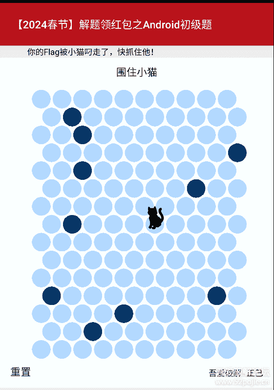
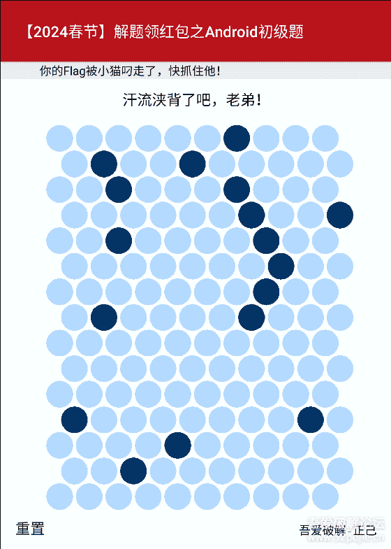
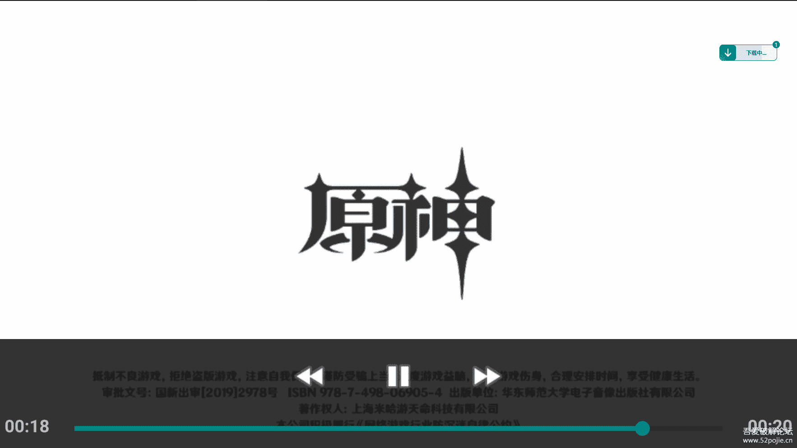
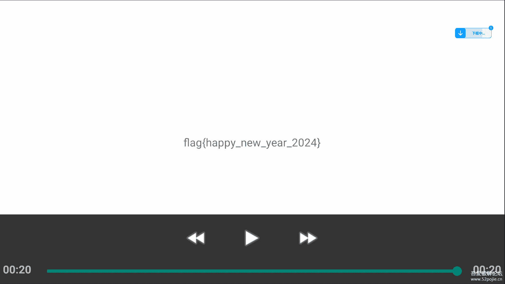
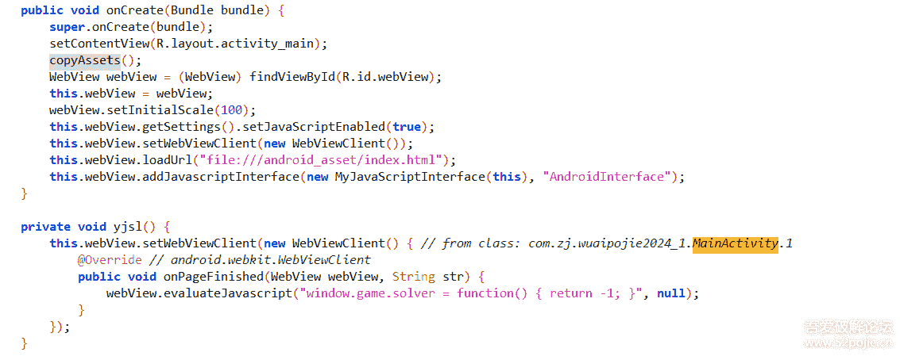
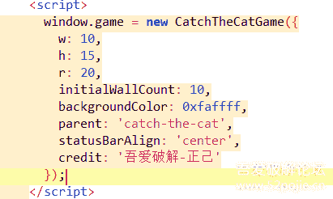
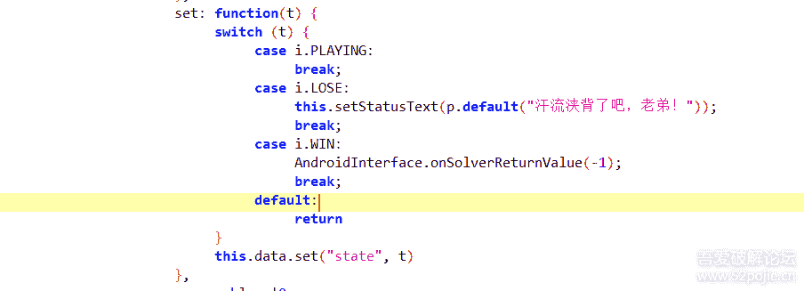
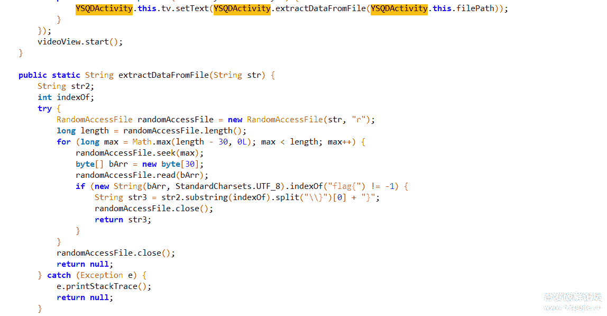

# [Android CTF] 春节解题领红包第三题 Android初级题几种解法及心路历程

- 原帖: https://www.52pojie.cn/forum.php?mod=viewthread&tid=1893005
- 抓取时间: 2026-11-01T21:29:56

## 1. 做题想法

image-20240212120540664.png (3.58 KB, 下载次数: 0)
[href="forum.php?mod=attachment&aid=MjY3NzA1MHxiZTg3MWIwOXwxNzkzNTY4NTk0fDE2ODA4NnwxODkzMDA1&nothumb=yes" target="_blank"](https://www.52pojie.cn/forum.php?mod=attachment&aid=MjY3NzA1MHxiZTg3MWIwOXwxNzkzNTY4NTk0fDE2ODA4NnwxODkzMDA1&nothumb=yes)
2024-2-24 20:16 上传
和去年一样也叫做Android初级题，那应该是和去年一样简单的过个判断就可以了，下好题目做一下吧，应该问题不大。。。

image-20240212120826834.png (78.63 KB, 下载次数: 3)
[href="forum.php?mod=attachment&aid=MjY3NzA1MXw1Y2I2NmJiMHwxNzkzNTY4NTk0fDE2ODA4NnwxODkzMDA1&nothumb=yes" target="_blank"](https://www.52pojie.cn/forum.php?mod=attachment&aid=MjY3NzA1MXw1Y2I2NmJiMHwxNzkzNTY4NTk0fDE2ODA4NnwxODkzMDA1&nothumb=yes)
2024-2-24 20:16 上传
这个样子不是丢失网页的游戏吗，应该是网址搞错，需要反编译改一下网址，然后我就试着点了几下

image-20240212121017382.png (82.89 KB, 下载次数: 1)
[href="forum.php?mod=attachment&aid=MjY3NzA1MnwwYjg3ZGJlY3wxNzkzNTY4NTk0fDE2ODA4NnwxODkzMDA1&nothumb=yes" target="_blank"](https://www.52pojie.cn/forum.php?mod=attachment&aid=MjY3NzA1MnwwYjg3ZGJlY3wxNzkzNTY4NTk0fDE2ODA4NnwxODkzMDA1&nothumb=yes)
2024-2-24 20:16 上传
好，汗流浃背了~,感觉游戏挺简单的啊，反正也拿不到首杀，就先玩玩这个游戏吧，经过一两把的角逐，哦吼~！

image-20240212121153114.png (184.2 KB, 下载次数: 0)
[href="forum.php?mod=attachment&aid=MjY3NzA1M3w0ZDM1YThiMXwxNzkzNTY4NTk0fDE2ODA4NnwxODkzMDA1&nothumb=yes" target="_blank"](https://www.52pojie.cn/forum.php?mod=attachment&aid=MjY3NzA1M3w0ZDM1YThiMXwxNzkzNTY4NTk0fDE2ODA4NnwxODkzMDA1&nothumb=yes)
2024-2-24 20:16 上传
这是干啥，没明白，看到

image-20240212121219813.png (52.78 KB, 下载次数: 1)
[href="forum.php?mod=attachment&aid=MjY3NzA1NHw4YTRjMTE0ZXwxNzkzNTY4NTk0fDE2ODA4NnwxODkzMDA1&nothumb=yes" target="_blank"](https://www.52pojie.cn/forum.php?mod=attachment&aid=MjY3NzA1NHw4YTRjMTE0ZXwxNzkzNTY4NTk0fDE2ODA4NnwxODkzMDA1&nothumb=yes)
2024-2-24 20:16 上传
哦这个码和去年的码格式是一样的啊，行那应该是这个，那这跟逆向有什么关系啊，不会是陷阱吧，然后我就去提交了这个码（这里讲一下，确实不好意思，我正在用百度网盘下东西，导致网速被占用太多，提交了两次没有提交成功，让我汗流浃背了~）。那我就老老实实分析一下源码吧

image-20240212121501256.png (48.9 KB, 下载次数: 2)
[href="forum.php?mod=attachment&aid=MjY3NzA1NXw3YTlmMTI2ZXwxNzkzNTY4NTk0fDE2ODA4NnwxODkzMDA1&nothumb=yes" target="_blank"](https://www.52pojie.cn/forum.php?mod=attachment&aid=MjY3NzA1NXw3YTlmMTI2ZXwxNzkzNTY4NTk0fDE2ODA4NnwxODkzMDA1&nothumb=yes)
2024-2-24 20:16 上传
这是`mainactivity`的创造函数以及主要功能，注意到主要是一个`webview`看一下链接地址是 `file:///android_asset/index.html`，去apk包里打开一下

image-20240212121833079.png (20 KB, 下载次数: 0)
[href="forum.php?mod=attachment&aid=MjY3NzA0MXw1YWFmODRiZnwxNzkzNTY4NTk0fDE2ODA4NnwxODkzMDA1&nothumb=yes" target="_blank"](https://www.52pojie.cn/forum.php?mod=attachment&aid=MjY3NzA0MXw1YWFmODRiZnwxNzkzNTY4NTk0fDE2ODA4NnwxODkzMDA1&nothumb=yes)
2024-2-24 20:16 上传
这不是我正己大神吗，再看一下`initialWallCount`: 10这是代表墙的数量，我就改个100吧，本来想改1000.我怕爆掉。

image-20240212121959449.png (15.27 KB, 下载次数: 1)
[href="forum.php?mod=attachment&aid=MjY3NzA0MnwyYzhjYmI2MnwxNzkzNTY4NTk0fDE2ODA4NnwxODkzMDA1&nothumb=yes" target="_blank"](https://www.52pojie.cn/forum.php?mod=attachment&aid=MjY3NzA0MnwyYzhjYmI2MnwxNzkzNTY4NTk0fDE2ODA4NnwxODkzMDA1&nothumb=yes)
2024-2-24 20:16 上传
此外主函数也有提示`window.game.solver`返回-1什么的，这不就对应上一张图的`window.game`吗，但是没有`solver`属性啊，再进

image-20240212122120715.png (8.96 KB, 下载次数: 0)
[href="forum.php?mod=attachment&aid=MjY3NzA0M3wwMGYzYmM5OHwxNzkzNTY4NTk0fDE2ODA4NnwxODkzMDA1&nothumb=yes" target="_blank"](https://www.52pojie.cn/forum.php?mod=attachment&aid=MjY3NzA0M3wwMGYzYmM5OHwxNzkzNTY4NTk0fDE2ODA4NnwxODkzMDA1&nothumb=yes)
2024-2-24 20:16 上传
同文件夹`catch-the-cat.js`看一眼

image-20240212122221212.png (21.69 KB, 下载次数: 1)
[href="forum.php?mod=attachment&aid=MjY3NzA0NHw3ZDA1YzQ1YXwxNzkzNTY4NTk0fDE2ODA4NnwxODkzMDA1&nothumb=yes" target="_blank"](https://www.52pojie.cn/forum.php?mod=attachment&aid=MjY3NzA0NHw3ZDA1YzQ1YXwxNzkzNTY4NTk0fDE2ODA4NnwxODkzMDA1&nothumb=yes)
2024-2-24 20:16 上传
改一下这个`case`应该也是可以过的，但是第一次发帖子哪能这么水，咱们还是去分析一下解密的部分，进入`YSQDActivity`这个UI类里

image-20240212122327843.png (49.37 KB, 下载次数: 2)
[href="forum.php?mod=attachment&aid=MjY3NzA0NXxjMzJlYzkwNHwxNzkzNTY4NTk0fDE2ODA4NnwxODkzMDA1&nothumb=yes" target="_blank"](https://www.52pojie.cn/forum.php?mod=attachment&aid=MjY3NzA0NXxjMzJlYzkwNHwxNzkzNTY4NTk0fDE2ODA4NnwxODkzMDA1&nothumb=yes)
2024-2-24 20:16 上传
这个地方有最后的设置文本，大概就是`extractDataFromFile`用于提取红包码，分析一下这个函数

image-20240212122510579.png (11.6 KB, 下载次数: 1)
[href="forum.php?mod=attachment&aid=MjY3NzA0Nnw4ODdmMTczYXwxNzkzNTY4NTk0fDE2ODA4NnwxODkzMDA1&nothumb=yes" target="_blank"](https://www.52pojie.cn/forum.php?mod=attachment&aid=MjY3NzA0Nnw4ODdmMTczYXwxNzkzNTY4NTk0fDE2ODA4NnwxODkzMDA1&nothumb=yes)
2024-2-24 20:16 上传
主要是从这个`ys.mp4`里利用`flag{`和`}`作为标识去提取红包码，哦吼~！视频还能这样吗？涨知识，视频隐写术吗，我就试着去文本方式打开这个视频

让大家见笑了，一个010eitor咱也没有，那就记事本打开看看呗
搜了一下" `flag{` "，嘿嘿，见笑了大家，搜到了（这里以为会出现编码不一致搜不到，就是顺手搜一下），至此这个码肯定是这个没有毛病。

## 2. 解题的几种思路

1. 纯玩游戏过关
2. 修改`assets` `index.html`初始化墙的数量，简单通关
3. 修改`catch-the-cat.js`，将`switch case`进行修改，保证失败后也可以通关
4. 修改程序主窗口，在`AndroidManifest.xml`中直接修改`com.zj.wuaipojie2024_1.MainActivity`为 `com.zj.wuaipojie2024_1.YSQDActivity`
5. 解析红包码出处，可以使用`java`直接复现红包码的解析函数，或者直接去记事本打开、搜索，哈哈！

给大家看我围住了它，思路就是让猫多走几步废路，这样你就有更多机会了。
衷心祝愿大家元旦快乐，阖家幸福，跟着正己大神，破界驰骋。这里督促一下正己大神，两个月没出新视频了，学生已经磨刀霍霍了。
