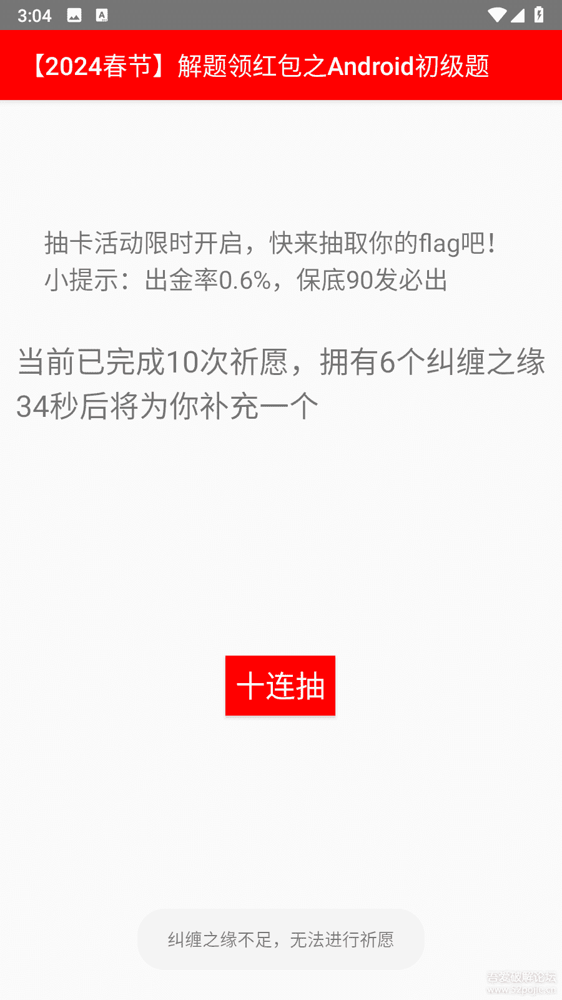
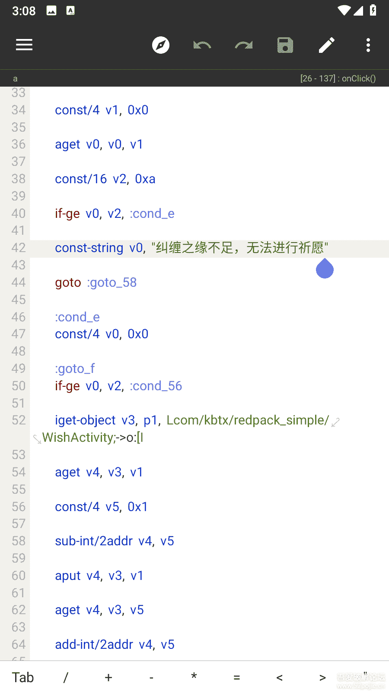
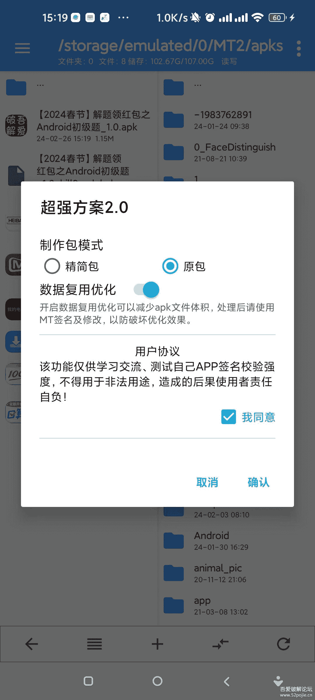
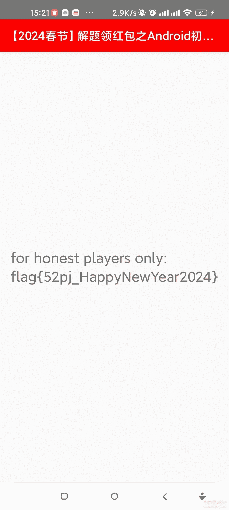

# [Android CTF] 【2024春节】解题领红包之Android初级题二

- 原帖: https://www.52pojie.cn/forum.php?mod=viewthread&tid=1893595
- 抓取时间: 2026-11-01T21:29:40

去年才开始学习安卓逆向，在论坛里面学习各位大佬的技术，也自己动手试试。中级的不会，初级的应该可以试试，于是参加一下本次活动。打开抽卡的活动，直接点击十连抽，提示“纠缠之缘不足，无法进行祈愿”，也就是说先找这个提示看在什么位置。

`Screenshot_20240226-150412.png` (104.57 KB, 下载次数: 0)  
[附件下载](https://www.52pojie.cn/forum.php?mod=attachment&aid=MjY3Nzk1N3xiOTU4MGFiMHwxNzkzNTY4NTc4fDE2ODA4NnwxODkzNTk1&nothumb=yes)  
2024-2-26 15:07 上传

于是就开始看源代码，定位到

`Screenshot_20240226-150807.png` (162.03 KB, 下载次数: 1)  
[附件下载](https://www.52pojie.cn/forum.php?mod=attachment&aid=MjY3Nzk2MHxhNTg1OWYwNnwxNzkzNTY4NTc4fDE2ODA4NnwxODkzNTk1&nothumb=yes)  
2024-2-26 15:12 上传

往下翻页发现一个好东西：恭喜你十连出金了，奖品为 flag 提示。于是试试吧，`if-gez` 改为 `if-ltz` 保存打包。

再次运行程序

`Screenshot_20240226-151448.png` (53.96 KB, 下载次数: 1)  
[附件下载](https://www.52pojie.cn/forum.php?mod=attachment&aid=MjY3Nzk2MXw3ODlmZGZhM3wxNzkzNTY4NTc4fDE2ODA4NnwxODkzNTk1&nothumb=yes)  
2024-2-26 15:15 上传

出现的乱码，再三咨询发现是没有去除签名导致，于是重新用未签名软件先用 np 管理器做签名去除，最后重复上面的步骤后就得出了正确答案。

`微信图片_20240226152436.jpg` (207.63 KB, 下载次数: 1)  
[附件下载](https://www.52pojie.cn/forum.php?mod=attachment&aid=MjY3Nzk2MnwyNzA5OGRlOXwxNzkzNTY4NTc4fDE2ODA4NnwxODkzNTk1&nothumb=yes)  
2024-2-26 15:25 上传

`微信图片_20240226152430.jpg` (99.7 KB, 下载次数: 2)  
[附件下载](https://www.52pojie.cn/forum.php?mod=attachment&aid=MjY3Nzk2M3wxZGIzOGViYXwxNzkzNTY4NTc4fDE2ODA4NnwxODkzNTk1&nothumb=yes)  
2024-2-26 15:26 上传

以上就是全部思路了，感觉比那个抓小猫的要简单一些。
