# [Android CTF] 2024春节解题{Android 中级题} 解题思路

- 原帖：[https://www.52pojie.cn/forum.php?mod=viewthread&tid=1894030](https://www.52pojie.cn/forum.php?mod=viewthread&tid=1894030)
- 抓取时间：`2026-11-01T21:29:35`

## 一、闲言

52论坛又开启一年一度的解题得红包的活动，大年初七，闲着没事，就把题下载下来解题了一波，现在活动结束了，可以分享解题思路，我就分享一下我的思路，俗话说的好，条条大路通罗马，解题思路也不止一条，欢迎大佬们把其他解题思路讨论分享一波。

## 二、开始

下载好`apk`后，装入手机运行了一波


`1.png` (396.79 KB, 下载次数: 3) | [下载](https://www.52pojie.cn/forum.php?mod=attachment&aid=MjY3ODE1NnxhN2NjYTIzOHwxNzkzNTY4NTczfDE2ODA4NnwxODk0MDMw&nothumb=yes) | 2024-2-27 15:22 上传

引入眼帘的就是一个解锁，那么直接拖入`jadx-gui`看看代码

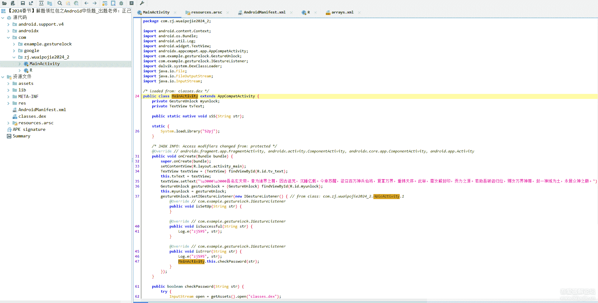
`2.png` (114.58 KB, 下载次数: 2) | [下载](https://www.52pojie.cn/forum.php?mod=attachment&aid=MjY3ODE1N3xkNWVjM2RiY3wxNzkzNTY4NTczfDE2ODA4NnwxODk0MDMw&nothumb=yes) | 2024-2-27 15:22 上传

发现收到密码后，进入了`checkPassword`方法

```java
public boolean checkPassword(String str) {
    try {
        InputStream open = getAssets().open("classes.dex");
        byte[] bArr = new byte[open.available()];
        open.read(bArr);
        File file = new File(getDir("data", 0), "1.dex");
        FileOutputStream fileOutputStream = new FileOutputStream(file);
        fileOutputStream.write(bArr);
        fileOutputStream.close();
        open.close();

        String str2 = (String) new DexClassLoader(file.getAbsolutePath(), getDir("dex", 0).getAbsolutePath(), null, getClass().getClassLoader()).loadClass("com.zj.wuaipojie2024_2.C").getDeclaredMethod("isValidate", Context.class, String.class, int[].class).invoke(null, this, str, getResources().getIntArray(R.array.A_offset));
        if (str2 == null || !str2.startsWith("唉!")) {
            return false;
        }

        this.tvText.setText(str2);
        this.myunlock.setVisibility(8);
        return true;
    } catch (Exception e) {
        e.printStackTrace();
        return false;
    }
}
```

代码逻辑也很清晰，将`assets`目录下的`classes.dex`打开，读取写入到软件`data`目录`app_data`下名字`1.dex`文件，然后加载该`dex`，再使用反射的调用的方式，调用`com.zj.wuaipojie2024_2.C`类、`isValidate`方法，并传入了`int`数组。

## 三、发现问题

在随便输入一组密码后，在日志中发现了`dex`加载有问题，发现了报错

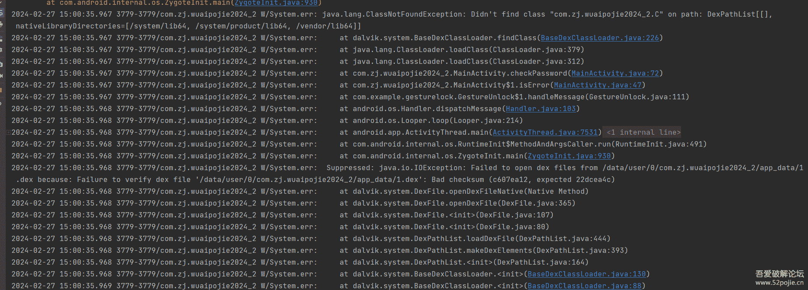
`3.png` (275.9 KB, 下载次数: 1) | [下载](https://www.52pojie.cn/forum.php?mod=attachment&aid=MjY3ODE1OHw0NjkyZjk2NnwxNzkzNTY4NTczfDE2ODA4NnwxODk0MDMw&nothumb=yes) | 2024-2-27 15:22 上传

说`dex`的`checksum`有问题，将`classes.dex`拖入`jadx-gui`中提示报错，打不开。

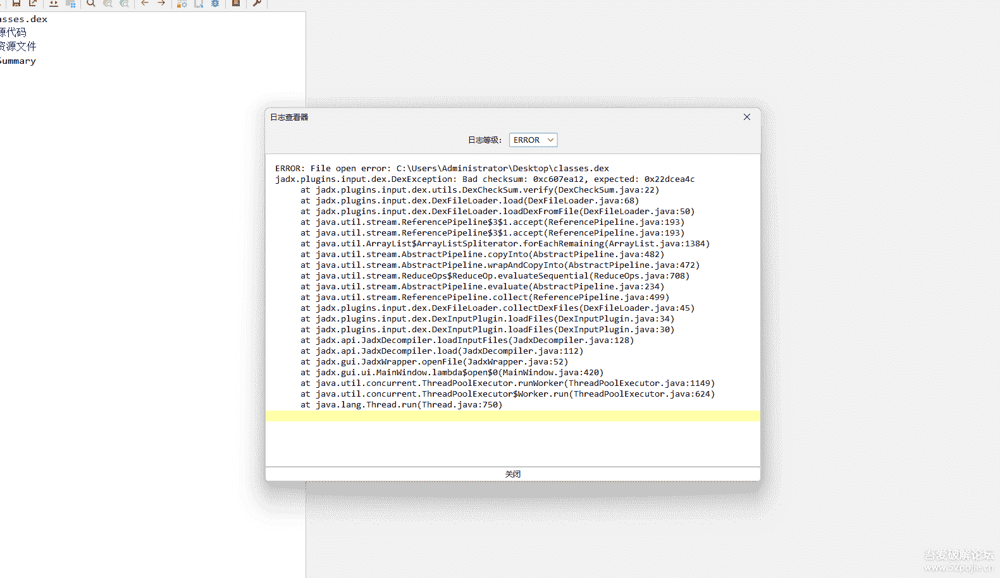
`4.png` (78.55 KB, 下载次数: 3) | [下载](https://www.52pojie.cn/forum.php?mod=attachment&aid=MjY3ODE1OXwxMmMxZTBmOXwxNzkzNTY4NTczfDE2ODA4NnwxODk0MDMw&nothumb=yes) | 2024-2-27 15:22 上传

那就上`010Editor`，拖入后

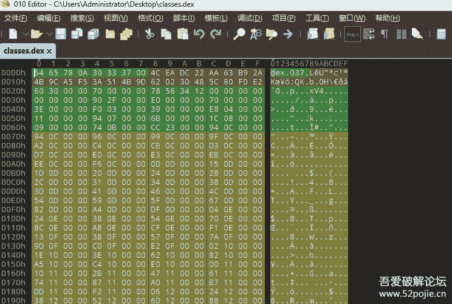
`5.png` (68.97 KB, 下载次数: 1) | [下载](https://www.52pojie.cn/forum.php?mod=attachment&aid=MjY3ODE2MHwyOWNmMDAwN3wxNzkzNTY4NTczfDE2ODA4NnwxODk0MDMw&nothumb=yes) | 2024-2-27 15:22 上传

发现`checksum`和`sha1 signature`的值确实被篡改过，那么我们使用代码计算出来，重新填回就行了。在这片文章有对`dex`文件的介绍：[ctf-wiki.org](https://ctf-wiki.org/android/basic_operating_mechanism/java_layer/dex/dex/#dex_5)

`dex`头部中`checksum`和`signature`的介绍

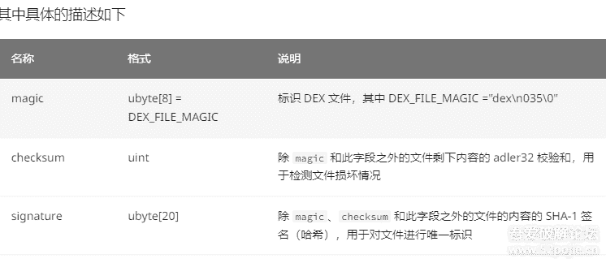
`6.png` (39.35 KB, 下载次数: 2) | [下载](https://www.52pojie.cn/forum.php?mod=attachment&aid=MjY3ODE2MXxiMTMwYzUzNHwxNzkzNTY4NTczfDE2ODA4NnwxODk0MDMw&nothumb=yes) | 2024-2-27 15:22 上传

那直接使用`python`计算出正确的值即可

```python
def repairChecksum(dex_file):
  self = open(dex_file, "rb")
  self.seek(8)
  sourceData = self.read(4)
  self.seek(12)
  checkdata = self.read()
  checksum =  format(zlib.adler32(checkdata), 'x')
  print ("头部原checksum:",sourceData )
  print ("计算checksum:",checksum)

def repairSignature(dex_file):
  self = open(dex_file, "rb")
  self.seek(12)
  sourceData = self.read(20)
  self.seek(32)
  sigdata = self.read()
  sha1 = hashlib.sha1()
  sha1.update(sigdata)
  sha0 = sha1.hexdigest()
  print ("计算signature:",sha0)
  print ("现在signature:",sourceData.hex())
```

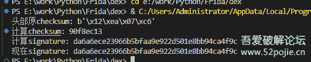
`7.png` (19.61 KB, 下载次数: 2) | [下载](https://www.52pojie.cn/forum.php?mod=attachment&aid=MjY3ODE2Mnw4NmNkZDBmMHwxNzkzNTY4NTczfDE2ODA4NnwxODk0MDMw&nothumb=yes) | 2024-2-27 15:22 上传

重新填入后：

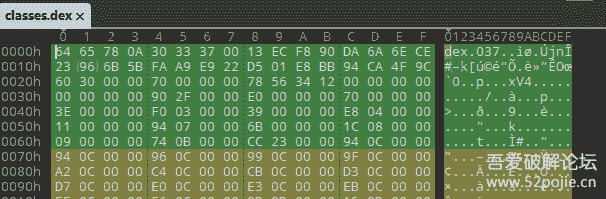
`8.png` (30.87 KB, 下载次数: 1) | [下载](https://www.52pojie.cn/forum.php?mod=attachment&aid=MjY3ODE2M3w1ZWRjNTJhN3wxNzkzNTY4NTczfDE2ODA4NnwxODk0MDMw&nothumb=yes) | 2024-2-27 15:22 上传

重新使用`jadx-gtui`打开

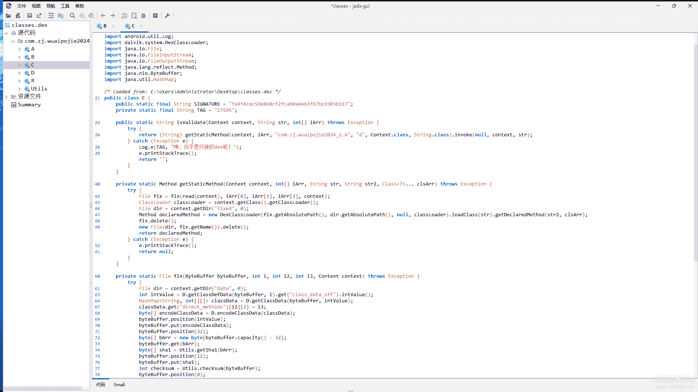
`9.png` (139.33 KB, 下载次数: 2) | [下载](https://www.52pojie.cn/forum.php?mod=attachment&aid=MjY3ODE2NHw4MDYxNGNmY3wxNzkzNTY4NTczfDE2ODA4NnwxODk0MDMw&nothumb=yes) | 2024-2-27 15:22 上传

没问题，将修好的`dex`放回`apk`中，重启应用，重新输入密码，发现了新的报错：

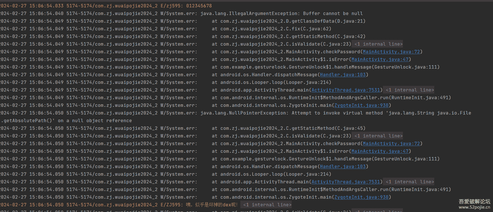
`10.png` (286.98 KB, 下载次数: 1) | [下载](https://www.52pojie.cn/forum.php?mod=attachment&aid=MjY3ODE2NXw2ZTI1NTM0MXwxNzkzNTY4NTczfDE2ODA4NnwxODk0MDMw&nothumb=yes) | 2024-2-27 15:23 上传

这个报错，说明有`1.dex`已经被成功加载进去。经过排查代码发现报错点在这里

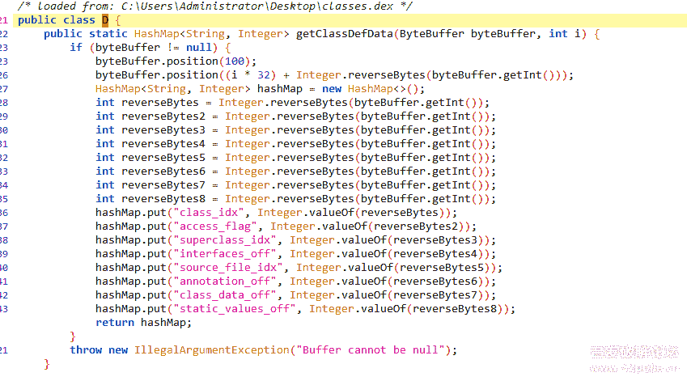
`11.png` (66.32 KB, 下载次数: 2) | [下载](https://www.52pojie.cn/forum.php?mod=attachment&aid=MjY3ODE3N3w2MjIxZDY5Y3wxNzkzNTY4NTczfDE2ODA4NnwxODk0MDMw&nothumb=yes) | 2024-2-27 15:25 上传

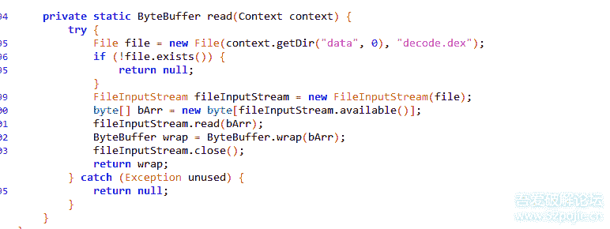
`12.png` (24.77 KB, 下载次数: 2) | [下载](https://www.52pojie.cn/forum.php?mod=attachment&aid=MjY3ODE2Nnw1ODdkY2VmMHwxNzkzNTY4NTczfDE2ODA4NnwxODk0MDMw&nothumb=yes) | 2024-2-27 15:23 上传

也就是读取这个`decode.dex`转为`ByteBuffer`时出的问题，我们进到这个目录查看文件。那么现在将`1.dex`也移动到这个目录。

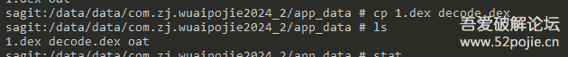
`13.png` (16.83 KB, 下载次数: 3) | [下载](https://www.52pojie.cn/forum.php?mod=attachment&aid=MjY3ODE2N3w3ZmU4ZTQ5MXwxNzkzNTY4NTczfDE2ODA4NnwxODk0MDMw&nothumb=yes) | 2024-2-27 15:23 上传

重新启动`APP`，发现还是有问题，那是因为移动的`decode.dex`的用户组没有修改，所以不能被加载，我们使用命令修改用户组。

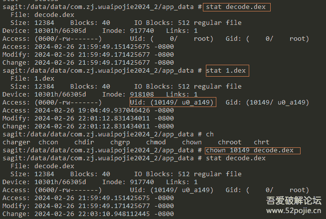
`14.png` (112.23 KB, 下载次数: 2) | 2024-2-27 15:22 上传


[href="forum.php?mod=attachment&aid=MjY3ODE2OHwxNjdiOTljMXwxNzkzNTY4NTczfDE2ODA4NnwxODk0MDMw&nothumb=yes" target="_blank"](https://www.52pojie.cn/forum.php?mod=attachment&aid=MjY3ODE2OHwxNjdiOTljMXwxNzkzNTY4NTczfDE2ODA4NnwxODk0MDMw&nothumb=yes)

2024-2-27 15:23 上传

再次启动APP，输入密码，发现没有报错，那证明代码中。

## 四：分析代码逻辑

那么现在我们就来仔细读读代码逻辑

apk 首次加载`1.dex`调用类`C` `isValidate`方法，传入`int`数组

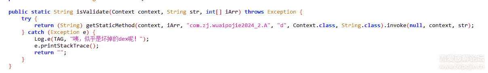

15.png (20.12 KB, 下载次数: 2)

[href="forum.php?mod=attachment&aid=MjY3ODE2OXw0ZDRjMzk4M3wxNzkzNTY4NTczfDE2ODA4NnwxODk0MDMw&nothumb=yes" target="_blank"](https://www.52pojie.cn/forum.php?mod=attachment&aid=MjY3ODE2OXw0ZDRjMzk4M3wxNzkzNTY4NTczfDE2ODA4NnwxODk0MDMw&nothumb=yes)

2024-2-27 15:23 上传

问：`isValidate`方法里面又做了什么？

答：简述就是根据`decode.dex`生成了`2.dex`，然后加载`2.dex`，然后反射调用类`com.zj.wuaipojie2024_2.A`方法`d`，并传入字符串，显而易见这个`str`就是九宫格密码

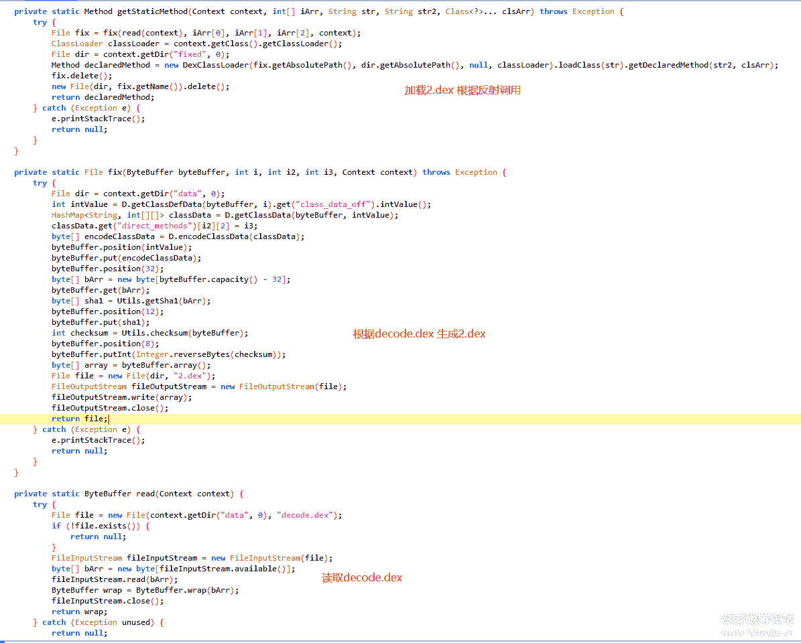

16.png (86.96 KB, 下载次数: 2)

[href="forum.php?mod=attachment&aid=MjY3ODE3MHxjZWY1MzNjY3wxNzkzNTY4NTczfDE2ODA4NnwxODk0MDMw&nothumb=yes" target="_blank"](https://www.52pojie.cn/forum.php?mod=attachment&aid=MjY3ODE3MHxjZWY1MzNjY3wxNzkzNTY4NTczfDE2ODA4NnwxODk0MDMw&nothumb=yes)

2024-2-27 15:23 上传

那么我们现在使用代码，把这个`2.dex`生成出来看看代码逻辑。

```
private static ByteBuffer read() {

        try {

            File file = new File("C:\\Users\\Administrator\\Desktop\\1.dex");

            if (!file.exists()) {

                return null;

            }

            FileInputStream fileInputStream = new FileInputStream(file);

            byte[] bArr = new byte[fileInputStream.available()];

            fileInputStream.read(bArr);

            ByteBuffer wrap = ByteBuffer.wrap(bArr);

            fileInputStream.close();

            return wrap;

        } catch (Exception unused) {

            unused.printStackTrace();

            return null;

        }

    }

    private static File fix(ByteBuffer byteBuffer, int i, int i2, int i3) throws Exception {

        try {

            File dir = new File("C:\\Users\\Administrator\\Desktop");

            int intValue = D.getClassDefData(byteBuffer, i).get("class_data_off").intValue();

            HashMap classData = D.getClassData(byteBuffer, intValue);

            classData.get("direct_methods")[i2][2] = i3;

            byte[] encodeClassData = D.encodeClassData(classData);

            byteBuffer.position(intValue);

            byteBuffer.put(encodeClassData);

            byteBuffer.position(32);

            byte[] bArr = new byte[byteBuffer.capacity() - 32];

            byteBuffer.get(bArr);

            byte[] sha1 = Utils.getSha1(bArr);

            byteBuffer.position(12);

            byteBuffer.put(sha1);

            int checksum = Utils.checksum(byteBuffer);

            byteBuffer.position(8);

            byteBuffer.putInt(Integer.reverseBytes(checksum));

            byte[] array = byteBuffer.array();

            File file = new File(dir, "2.dex");

            FileOutputStream fileOutputStream = new FileOutputStream(file);

            fileOutputStream.write(array);

            fileOutputStream.close();

            return file;

        } catch (Exception e) {

            e.printStackTrace();

            return null;

        }

    }
```

`ByteBuffer` `read` = `read`();

`File` `fix` = `fix`(`read`, 0, 3, 7908);

`fix`方法3个`int`值就是一开始传入的`int`数组

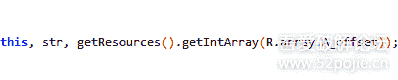

17.png (8.48 KB, 下载次数: 2)

[href="forum.php?mod=attachment&aid=MjY3ODE3OHw5MDUyNDJhMnwxNzkzNTY4NTczfDE2ODA4NnwxODk0MDMw&nothumb=yes" target="_blank"](https://www.52pojie.cn/forum.php?mod=attachment&aid=MjY3ODE3OHw5MDUyNDJhMnwxNzkzNTY4NTczfDE2ODA4NnwxODk0MDMw&nothumb=yes)

2024-2-27 15:27 上传

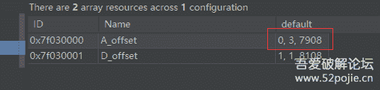

18.png (13.95 KB, 下载次数: 3)

[href="forum.php?mod=attachment&aid=MjY3ODE3MXw3MTlmNjJlMnwxNzkzNTY4NTczfDE2ODA4NnwxODk0MDMw&nothumb=yes" target="_blank"](https://www.52pojie.cn/forum.php?mod=attachment&aid=MjY3ODE3MXw3MTlmNjJlMnwxNzkzNTY4NTczfDE2ODA4NnwxODk0MDMw&nothumb=yes)

2024-2-27 15:23 上传

生成的`2.dex`直接拖入`jadx-gui`，直接到`A.d`方法

```
    public static String d(Context context, String str) {

        MainActivity.sSS(str);

        String signInfo = Utils.getSignInfo(context);

        if (signInfo == null || !signInfo.equals(C.SIGNATURE)) {

            return "";

        }

        StringBuffer stringBuffer = new StringBuffer();

        int i = 0;

        while (stringBuffer.length() 
```

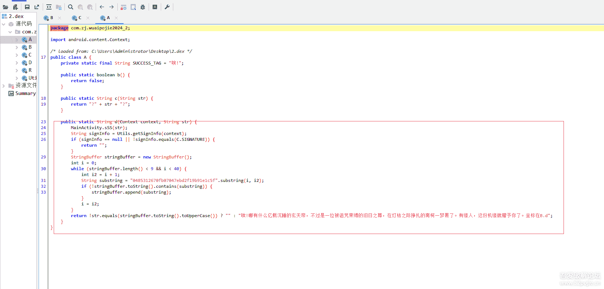

19.png (64.84 KB, 下载次数: 2)

[href="forum.php?mod=attachment&aid=MjY3ODE3MnwzYzFmNzQ2YXwxNzkzNTY4NTczfDE2ODA4NnwxODk0MDMw&nothumb=yes" target="_blank"](https://www.52pojie.cn/forum.php?mod=attachment&aid=MjY3ODE3MnwzYzFmNzQ2YXwxNzkzNTY4NTczfDE2ODA4NnwxODk0MDMw&nothumb=yes)

2024-2-27 15:23 上传

可以看到，把密码进行了对比，那我们把代码运行一次，看看密码时多少。

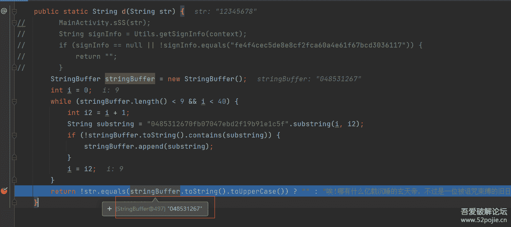

20.png (84.92 KB, 下载次数: 2)

[href="forum.php?mod=attachment&aid=MjY3ODE3M3w3YmI2NTQ5YnwxNzkzNTY4NTczfDE2ODA4NnwxODk0MDMw&nothumb=yes" target="_blank"](https://www.52pojie.cn/forum.php?mod=attachment&aid=MjY3ODE3M3w3YmI2NTQ5YnwxNzkzNTY4NTczfDE2ODA4NnwxODk0MDMw&nothumb=yes)

2024-2-27 15:23 上传

可以看到正确的九宫格密码是：`048531267`

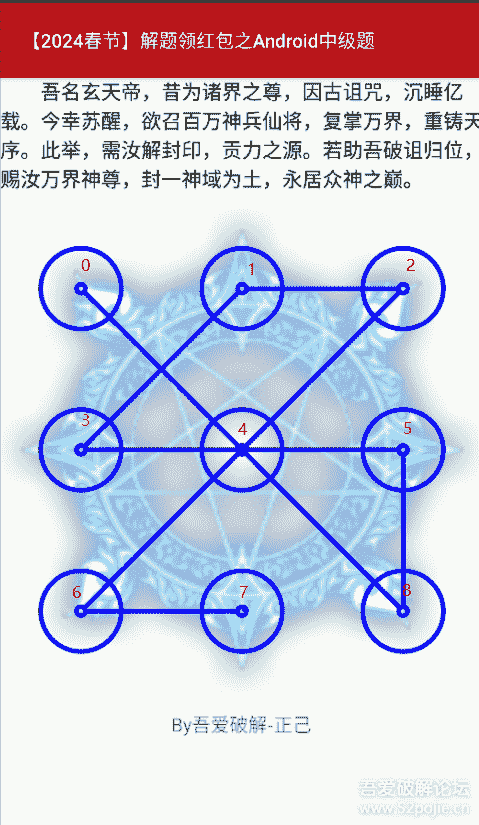

QQ截图20240227152917.png (348.48 KB, 下载次数: 2)

[href="forum.php?mod=attachment&aid=MjY3ODE4MHxlM2YyY2ZlMHwxNzkzNTY4NTczfDE2ODA4NnwxODk0MDMw&nothumb=yes" target="_blank"](https://www.52pojie.cn/forum.php?mod=attachment&aid=MjY3ODE4MHxlM2YyY2ZlMHwxNzkzNTY4NTczfDE2ODA4NnwxODk0MDMw&nothumb=yes)

2024-2-27 15:29 上传

密码正常，成功跳转

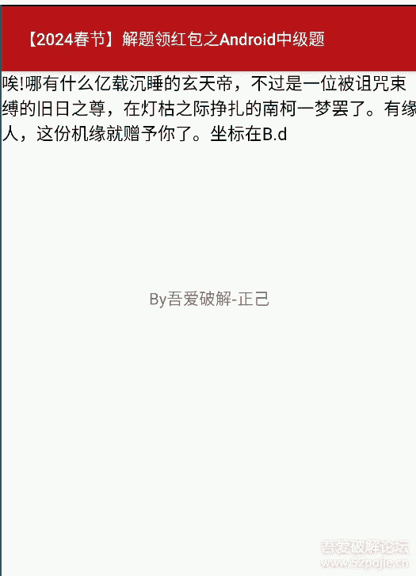

21.png (103.05 KB, 下载次数: 2)

[href="forum.php?mod=attachment&aid=MjY3ODE3NHxmMTMzYjVhZXwxNzkzNTY4NTczfDE2ODA4NnwxODk0MDMw&nothumb=yes" target="_blank"](https://www.52pojie.cn/forum.php?mod=attachment&aid=MjY3ODE3NHxmMTMzYjVhZXwxNzkzNTY4NTczfDE2ODA4NnwxODk0MDMw&nothumb=yes)

2024-2-27 15:23 上传

这个是发现`2.dex`类`B`方法`d`

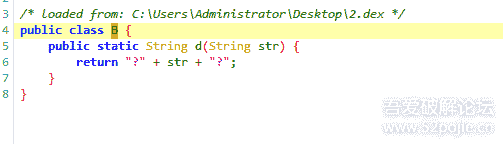

22.png (11.58 KB, 下载次数: 2)

[href="forum.php?mod=attachment&aid=MjY3ODE3NXwyYTMwYjliMnwxNzkzNTY4NTczfDE2ODA4NnwxODk0MDMw&nothumb=yes" target="_blank"](https://www.52pojie.cn/forum.php?mod=attachment&aid=MjY3ODE3NXwyYTMwYjliMnwxNzkzNTY4NTczfDE2ODA4NnwxODk0MDMw&nothumb=yes)

2024-2-27 15:23 上传

这显示不是正确的flag。

这时细心的小伙伴就发现，上面的数组还有一组数组`D- 1，1，8108`，那

我们再用这组数组生成一个新的`3.dex`

将`3.dex`拖入`jadx-gui`查看代码：

打开`B.d`方法

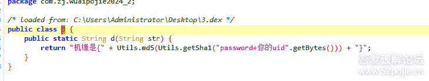

24.png (14.86 KB, 下载次数: 4)

[href="forum.php?mod=attachment&aid=MjY3ODE3NnxjZGYyYWVkYXwxNzkzNTY4NTczfDE2ODA4NnwxODk0MDMw&nothumb=yes" target="_blank"](https://www.52pojie.cn/forum.php?mod=attachment&aid=MjY3ODE3NnxjZGYyYWVkYXwxNzkzNTY4NTczfDE2ODA4NnwxODk0MDMw&nothumb=yes)

2024-2-27 15:23 上传

```
public class B {

    public static String d(String str) {

        return "机缘是{" + Utils.md5(Utils.getSha1("password+你的uid".getBytes())) + "}";

    }

}
```

那么这个算法生成出来的结果就是flag

## 五：结束

自此这道题就算解题成功，200cb到手。 本地难度适中，掌握`dex`的结构和代码分析能力就能很快解题。
