# [Android CTF] 【2024春节】解题领红包题解 Android3~5题

- 原帖: https://www.52pojie.cn/forum.php?mod=viewthread&tid=1894578
- 抓取时间: 2026-11-01T21:29:31

## 【2024春节】解题领红包题解 3-Android初级题

### GDA分析

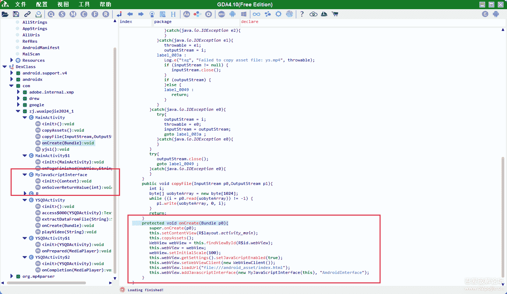
202402140212109.png (155.5 KB, 下载次数: 1)
[href="forum.php?mod=attachment&aid=MjY3ODQ5N3xlYjBhNWZmYXwxNzkzNTY4NTY5fDE2ODA4NnwxODk0NTc4&nothumb=yes" target="_blank"](https://www.52pojie.cn/forum.php?mod=attachment&aid=MjY3ODQ5N3xlYjBhNWZmYXwxNzkzNTY4NTY5fDE2ODA4NnwxODk0NTc4&nothumb=yes)
2024-2-28 16:37 上传
一眼`webview` `js`交互
打开`apk`
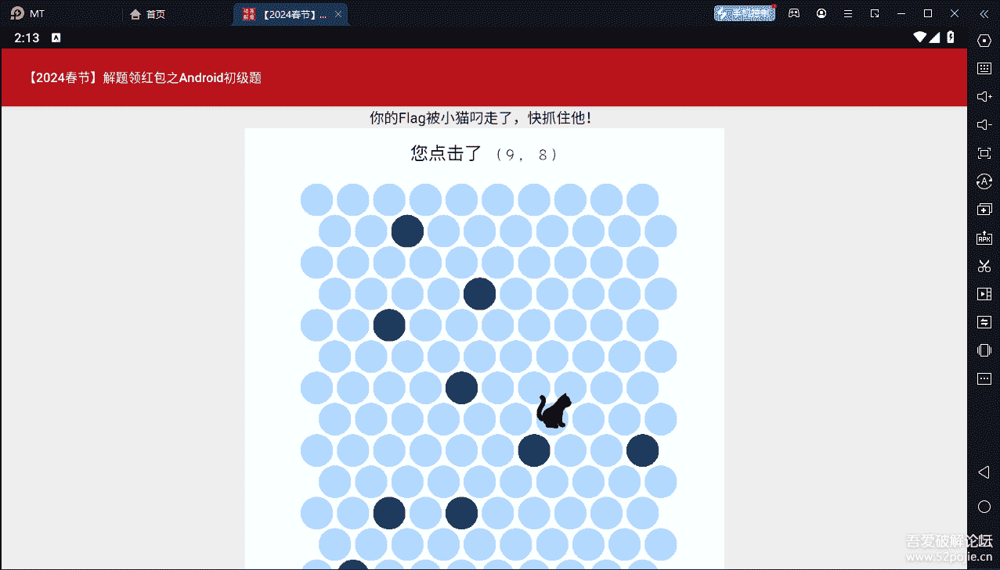
202402140213615.png (104.27 KB, 下载次数: 2)
[href="forum.php?mod=attachment&aid=MjY3ODQ3NnwzNjdkODMxY3wxNzkzNTY4NTY5fDE2ODA4NnwxODk0NTc4&nothumb=yes" target="_blank"](https://www.52pojie.cn/forum.php?mod=attachment&aid=MjY3ODQ3NnwzNjdkODMxY3wxNzkzNTY4NTY5fDE2ODA4NnwxODk0NTc4&nothumb=yes)
2024-2-28 16:35 上传
经典404页面,盲猜成功后返回`flag`
偷偷看一眼`ys.mp4`
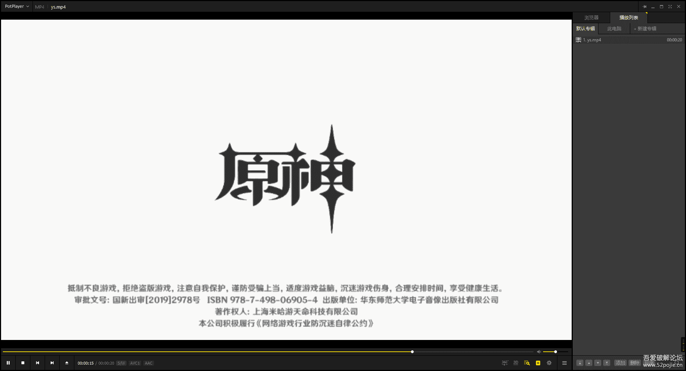
202402140216886.png (231.51 KB, 下载次数: 2)
[href="forum.php?mod=attachment&aid=MjY3ODQ4NHw4OGJmODg4N3wxNzkzNTY4NTY5fDE2ODA4NnwxODk0NTc4&nothumb=yes" target="_blank"](https://www.52pojie.cn/forum.php?mod=attachment&aid=MjY3ODQ4NHw4OGJmODg4N3wxNzkzNTY4NTY5fDE2ODA4NnwxODk0NTc4&nothumb=yes)
2024-2-28 16:35 上传
典!!!

### 题解

既然是`webview`交互`js`,还是个抓小猫游戏,那肯定是赢了出结果
那就看`JavaScriptInterface`实现在哪

```
this.webView.addJavascriptInterface(new MyJavaScriptInterface(this), "AndroidInterface");

public class MyJavaScriptInterface
{
    private Context mContext;

    public void MyJavaScriptInterface(Context p0){
       super();
       this.mContext = p0;
    }
    public void onSolverReturnValue(int p0){
       if (p0 == -1) {
          this.mContext.startActivity(new Intent(this.mContext, YSQDActivity.class));
       }
       return;
    }
}
```

启动了新的界面`YSQDActivity`

```
protected void onCreate(Bundle p0){

   super.onCreate(p0);

   this.setContentView(R$layout.activity_ysqdactivity);

   this.setRequestedOrientation(0);

   this.tv = this.findViewById(R$id.textView);

   this.playVideo(this.filePath);

}
```

```
public void playVideo(String p0){

   this.getWindow().setFlags(1024, 1024);

   if (this.getSupportActionBar() != null) {

      this.getSupportActionBar().hide();

   }

   VideoView videoView = this.findViewById(R$id.videoView);

   videoView.setVideoURI(Uri.parse(p0));

   videoView.setMediaController(new MediaController(this));

   videoView.setOnPreparedListener(new YSQDActivity$1(this));

   videoView.setOnCompletionListener(new YSQDActivity$2(this));//结束动作

   videoView.start();

   return;

}
```

`OnCompletionListener` => `onCompletion`

```
public void onCompletion(MediaPlayer p0){
   YSQDActivity.access$000(this.this$0).setText(YSQDActivity.extractDataFromFile(this.this$0.filePath));
}
```

```
public static String extractDataFromFile(String p0){
   int i;
   try{
      RandomAccessFile randomAccess = new RandomAccessFile(p0, "r");
      long l = randomAccess.length();
      p0 = "flag{";
      long l1 = Math.max((l - (long)30), 0);
      while (true) {
         if ((l1 - l) 
```

废话不多说,直接启动`Activity`

```
adb shell su -c am start-activity -n com.zj.wuaipojie2024_1/.YSQDActivity
```

或`frida`主动调用

```
function checkClass(targetClass){
        try{
                Java.use(targetClass);
        }catch(error){
                Java.enumerateClassLoaders({onMatch: function (loader) {
                try{
                        if(loader.findClass(targetClass)) {
                                Java.classFactory.loader = loader;
                        }
                }catch(error){
                        console.log('classloader failed' + error);
                }},onComplete: function () {}
        });}
}
Java.perform(function() {
        var targetClass=decodeURIComponent('com.zj.wuaipojie2024%5f1.YSQDActivity');
        checkClass(targetClass);
        var gclass = Java.use(targetClass);
        var ret=gclass['extractDataFromFile']("/data/user/0/com.zj.wuaipojie2024_1/files/ys.mp4");
        console.log(ret);
})

//  flag{happy_new_year_2024}
```

## 【2024春节】解题领红包题解 4-Android初级题

### 原!妙不可言


202402140248246.png (91.83 KB, 下载次数: 1)
[href="forum.php?mod=attachment&aid=MjY3ODQ4M3xlNzAxYmY3MHwxNzkzNTY4NTY5fDE2ODA4NnwxODk0NTc4&nothumb=yes" target="_blank"](https://www.52pojie.cn/forum.php?mod=attachment&aid=MjY3ODQ4M3xlNzAxYmY3MHwxNzkzNTY4NTY5fDE2ODA4NnwxODk0NTc4&nothumb=yes)
2024-2-28 16:35 上传
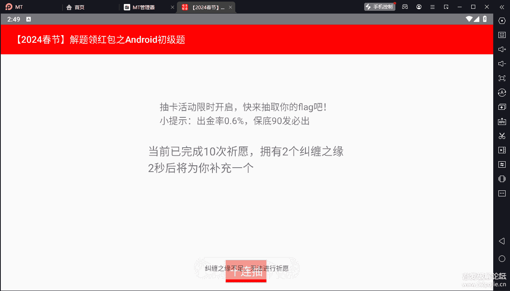
202402140249026.png (89.37 KB, 下载次数: 1)
[href="forum.php?mod=attachment&aid=MjY3ODQ4MXw2ZTA0NzllY3wxNzkzNTY4NTY5fDE2ODA4NnwxODk0NTc4&nothumb=yes" target="_blank"](https://www.52pojie.cn/forum.php?mod=attachment&aid=MjY3ODQ4MXw2ZTA0NzllY3wxNzkzNTY4NTY5fDE2ODA4NnwxODk0NTc4&nothumb=yes)
2024-2-28 16:35 上传
抽卡小游戏,盲猜出金(`flag`)
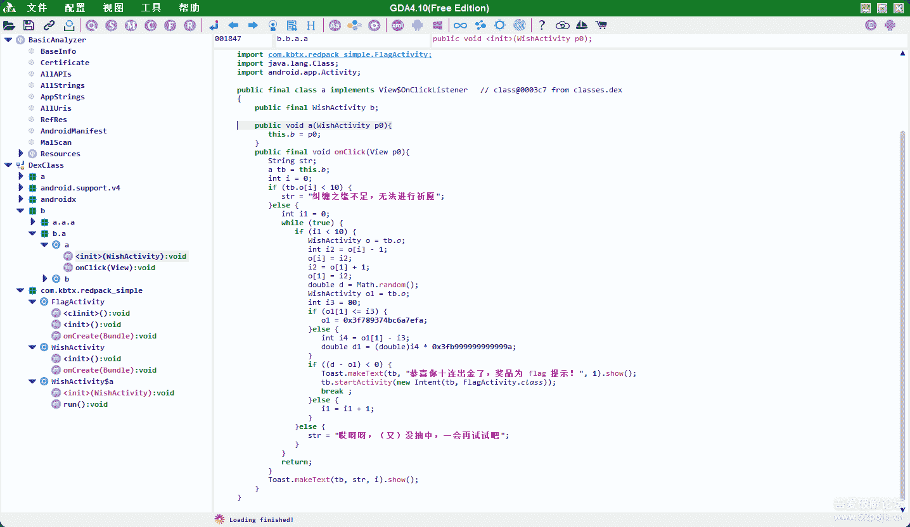
202402140251500.png (119.33 KB, 下载次数: 3)
[href="forum.php?mod=attachment&aid=MjY3ODQ3N3xiZjQ3ODQ2YnwxNzkzNTY4NTY5fDE2ODA4NnwxODk0NTc4&nothumb=yes" target="_blank"](https://www.52pojie.cn/forum.php?mod=attachment&aid=MjY3ODQ3N3xiZjQ3ODQ2YnwxNzkzNTY4NTY5fDE2ODA4NnwxODk0NTc4&nothumb=yes)
2024-2-28 16:35 上传
这不直接改倍率?????

### 题解

先查看文本
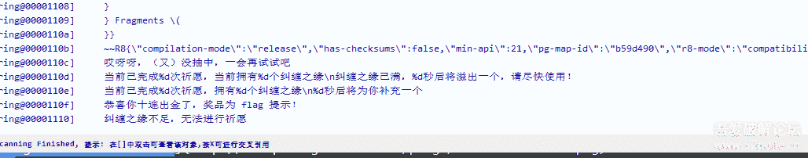
202402140253855.png (36.25 KB, 下载次数: 2)
[href="forum.php?mod=attachment&aid=MjY3ODQ4MHw0MDYyMzEzZXwxNzkzNTY4NTY5fDE2ODA4NnwxODk0NTc4&nothumb=yes" target="_blank"](https://www.52pojie.cn/forum.php?mod=attachment&aid=MjY3ODQ4MHw0MDYyMzEzZXwxNzkzNTY4NTY5fDE2ODA4NnwxODk0NTc4&nothumb=yes)
2024-2-28 16:35 上传
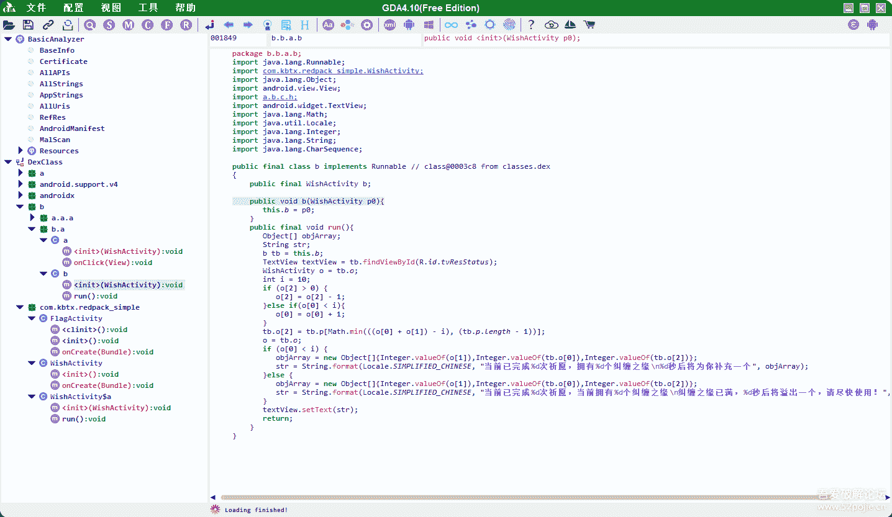
202402140253890.png (131.89 KB, 下载次数: 3)
[href="forum.php?mod=attachment&aid=MjY3ODQ5OXw1ZjIyN2M0OHwxNzkzNTY4NTY5fDE2ODA4NnwxODk0NTc4&nothumb=yes" target="_blank"](https://www.52pojie.cn/forum.php?mod=attachment&aid=MjY3ODQ5OXw1ZjIyN2M0OHwxNzkzNTY4NTY5fDE2ODA4NnwxODk0NTc4&nothumb=yes)
2024-2-28 16:37 上传
`WishActivity`祈愿界面,点击事件

```
package com.kbtx.redpack_simple.WishActivity;

import a.b.c.h;

import java.util.Timer;

import b.b.a.b;

import android.os.Bundle;

import com.kbtx.redpack_simple.WishActivity$a;

import java.util.TimerTask;

import android.view.View;

import b.b.a.a;

import android.view.View$OnClickListener;

public class WishActivity extends h        // class@0003cb from classes.dex

{

    public int[] o;

    public int[] p;

    public Timer q;

    public Runnable r;

    public void WishActivity(){

       super();

       this.o = new int[3]{10,0,0};

       this.p = new int[8]{1,2,4,8,16,32,64,128};

       this.q = new Timer();

       this.r = new b(this);

    }

    public void onCreate(Bundle p0){

       super.onCreate(p0);

       this.setContentView(R.layout.activity_wish);

       //计时器

       this.q.schedule(new WishActivity$a(this), 1000, 1000);

       //点击事件

       this.findViewById(R.id.btn_action).setOnClickListener(new a(this));

    }

}
```

`b.b.a.a`

```
public final void run() {
    WishActivity wishActivity = this.b;
    TextView textView = (TextView) wishActivity.findViewById(0x7f0700f1);
    int[] iArr = wishActivity.o;
    if (iArr[2] > 0) {
        iArr[2] = iArr[2] - 1;
    } else {
        if (iArr[0] 
```

`b.b.a.a`

```
public final void onClick(View view) {

    String str;

    WishActivity wishActivity = this.b;

    if (wishActivity.o[0] ) FlagActivity.class));

                return;

            }

        }

        str = "哎呀呀，（又）没抽中，一会再试试吧";

    }

    Toast.makeText((Context) wishActivity, (CharSequence) str, 0).show();

}
```

`FlagActivity`
嘿嘿,还有`signature`签名校验


```
public class FlagActivity extends h {
    public static byte[] o = {86, -18, 98, 103, 75, -73, 51, -104, 104, 94, 73, 81, 125, 118, 112, 100, -29, 63, -33, -110, 108, 115, 51, 59, 55, 52, 77};

    /* JADX WARN: Multi-variable type inference failed */
    public void onCreate(Bundle bundle) {
        byte[] bArr;
        Signature[] signatureArr;
        super.onCreate(bundle);
        setContentView(0x7f0a001c);
        byte[] bArr2 = o;
        try {
            signatureArr = getPackageManager().getPackageInfo(getPackageName(), 64).signatures;
        } catch (PackageManager.NameNotFoundException unused) {
            bArr = new byte[0];
        }
        if (signatureArr != null && signatureArr.length >= 1) {
            byte[] byteArray = signatureArr[0].toByteArray();
            ByteBuffer allocate = ByteBuffer.allocate(bArr2.length);
            for (int i = 0; i 
```

#### 关联分析

`WishActivity.o[3] = [纠缠之缘个数, 已祈愿次数, 倒计时]`

#### 解题思路很宽泛

- 原神,启动!!!(~bushi)
- 直接启动 `FlagActivity`

```
adb shell am start-activity -n com.kbtx.redpack_simple/.FlagActivity
```

- 炸! 直接拉满抽奖次数
- 修改 `o` 数组初始值

```
// this.o = new int[3]{10,0,0};
this.o = new int[3]{999999,0,0};

//Smali
new-array v0, v0, [I
fill-array-data v0, :array_24
iput-object v0, p0, Lcom/kbtx/redpack_simple/WishActivity;->o:[I

:array_24
.array-data 4
  0x3b9ac9ff
  0x0
  0x0
.end array-data
```


`202402140324056.png` (94.77 KB, 下载次数: 1)

[href="forum.php?mod=attachment&aid=MjY3ODQ5OHw5MDIyZDVhMnwxNzkzNTY4NTY5fDE2ODA4NnwxODk0NTc4&nothumb=yes" target="_blank"](https://www.52pojie.cn/forum.php?mod=attachment&aid=MjY3ODQ5OHw5MDIyZDVhMnwxNzkzNTY4NTY5fDE2ODA4NnwxODk0NTc4&nothumb=yes)

2024-2-28 16:37 上传

- 我要暗改倍率!!!!
- `0.006d`??? 不存在的,我要 `1.0`

```
// if (random 
```

- 硬算

```
byte[] bArr2 = {86, -18, 98, 103, 75, -73, 51, -104, 104, 94, 73, 81, 125, 118, 112, 100, -29, 63, -33, -110, 108, 115, 51, 59, 55, 52, 77};
String a = "30820300308201e8020101300d06092a864886f70d01010b050030463110300e06035504030c076b6274787765723110300e060355040b0c073532706f6a69653110300e060355040a0c073532706f6a6965310e300c06035504070c054368696e61301e170d3234303131363036333332335a170d3439303130393036333332335a30463110300e06035504030c076b6274787765723110300e060355040b0c073532706f6a69653110300e060355040a0c073532706f6a6965310e300c06035504070c054368696e6130820122300d06092a864886f70d01010105000382010f003082010a0282010100804804135f57c1539809a9f6291dd0da83c5f9fc57caf199a48cfe37b9a0cc46a1052132a6344e309a31b80ee715dffcbd207f84b07e620c8bc3232b093050473f829ecb74a545ee8fd429feae8480e4284c35bc69dc43d3c130ebf7b0a16c6d10857613c224202ae77126fcfdc9642144158287fe7a196963bc52a47bb942f0f75eb059236bfa64c52718c73547a4c362f1174ec642b98a31a4d7cbe8e991dfa27db70035d451c879b5def12dbb7db19fd5ab211110256c4156cd0be73d22d2c0603144dea18e657a12c0c0146ba5c5eba6b973a227b815fc8efed4c4a2754771854bd3c044686ecbe6505a540e7afaa0999339410b5a9feb826407452c288b0203010001300d06092a864886f70d01010b050003820101005e1024ed95992cd8d88334eaf360fd5699ed7d2333634dded65e9cda6222bb5ae68189db6afb5898ca9f3437959db2e50ce6d19fc3b982ede7e9ed5dd92488ded66928ad5939fdf318b17b4a95f0205bb6da27a3de4f7b69700d94a25e80767d256b630014e254648b2a37d689959ef47293a772c1509db31b0dded377964fe93366d8ef808e207d1b238bbbd51b6a1d38330e0c29bee1afdd0674e5003b4cd2555d25a0cf523f11791d2a97ff7d13235432fef0b44fb7a34c690ab51de4d54ba7876812eb1f6919d2bd2df97c37e9e927ce0d0f41a84f533e010fc8e1a7fa203c1c7c3e5d0873b2b9fc6cd74d9e538132c6d725c305bc5f760b0fb87101a8a2";//原始签名(可通过frida hook)
byte[] byteArray = new BigInteger(a, 16).toByteArray();
ByteBuffer allocate = ByteBuffer.allocate(bArr2.length);
for (int i = 0; i 
```

- `frida` 脚本

```
function bytesToHex(arr) {
    var str = "";
    var _split = "";
    var k, j;
    for (var i = 0; i 
```

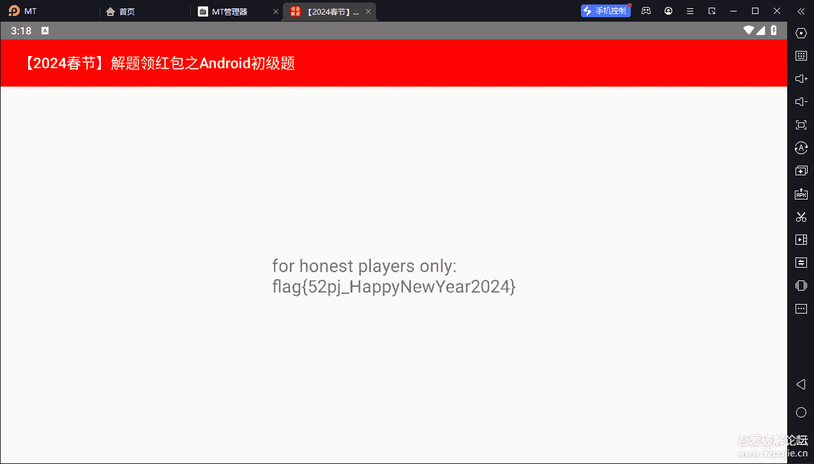

`202402140318258.png` (55.55 KB, 下载次数: 2)

[href="forum.php?mod=attachment&aid=MjY3ODQ5MHxhNTMxMTQ5YXwxNzkzNTY4NTY5fDE2ODA4NnwxODk0NTc4&nothumb=yes" target="_blank"](https://www.52pojie.cn/forum.php?mod=attachment&aid=MjY3ODQ5MHxhNTMxMTQ5YXwxNzkzNTY4NTY5fDE2ODA4NnwxODk0NTc4&nothumb=yes)

2024-2-28 16:36 上传

## 【2024春节】解题领红包题解 5-Android中级题

### 分析

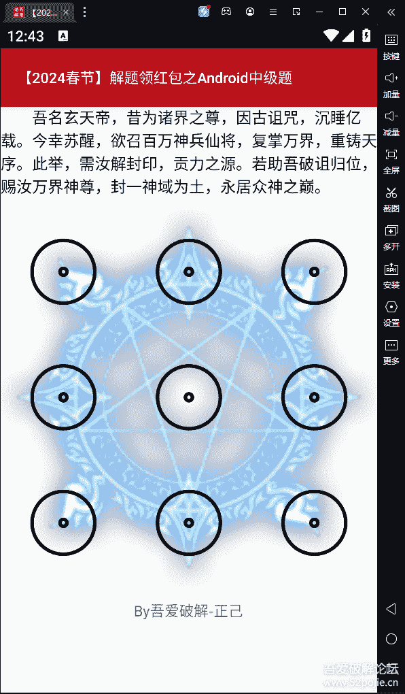

`202402141243500.png` (348.74 KB, 下载次数: 2)

[href="forum.php?mod=attachment&aid=MjY3ODQ4Nnw4NzlmNTFmYXwxNzkzNTY4NTY5fDE2ODA4NnwxODk0NTc4&nothumb=yes" target="_blank"](https://www.52pojie.cn/forum.php?mod=attachment&aid=MjY3ODQ4Nnw4NzlmNTFmYXwxNzkzNTY4NTY5fDE2ODA4NnwxODk0NTc4&nothumb=yes)

2024-2-28 16:35 上传

`GestureUnlock` 密码界面，`isError(密码)` 做验证回调

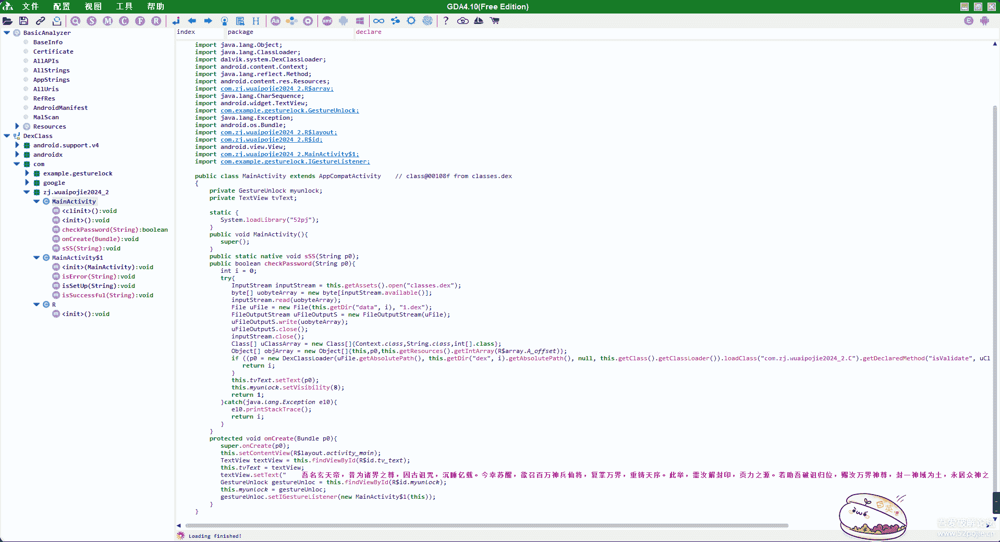

`202402141247114.png` (203.08 KB, 下载次数: 1)

[href="forum.php?mod=attachment&aid=MjY3ODQ3NXwyYjdiMDBiZXwxNzkzNTY4NTY5fDE2ODA4NnwxODk0NTc4&nothumb=yes" target="_blank"](https://www.52pojie.cn/forum.php?mod=attachment&aid=MjY3ODQ3NXwyYjdiMDBiZXwxNzkzNTY4NTY5fDE2ODA4NnwxODk0NTc4&nothumb=yes)

2024-2-28 16:35 上传

`DexClassLoader` 加载了一个外置 `dex` 来判断和解密文本


`202402141250899.png` (203.08 KB, 下载次数: 1)

[href="forum.php?mod=attachment&aid=MjY3ODQ4MnxlOWJkY2VlM3wxNzkzNTY4NTY5fDE2ODA4NnwxODk0NTc4&nothumb=yes" target="_blank"](https://www.52pojie.cn/forum.php?mod=attachment&aid=MjY3ODQ4MnxlOWJkY2VlM3wxNzkzNTY4NTY5fDE2ODA4NnwxODk0NTc4&nothumb=yes)

2024-2-28 16:35 上传

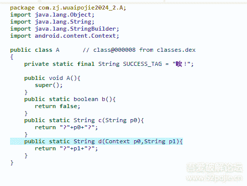

`202402141251049.png` (24.47 KB, 下载次数: 1)

[href="forum.php?mod=attachment&aid=MjY3ODQ4N3wyNzA0OTIwNnwxNzkzNTY4NTY5fDE2ODA4NnwxODk0NTc4&nothumb=yes" target="_blank"](https://www.52pojie.cn/forum.php?mod=attachment&aid=MjY3ODQ4N3wyNzA0OTIwNnwxNzkzNTY4NTY5fDE2ODA4NnwxODk0NTc4&nothumb=yes)

2024-2-28 16:36 上传

不像是正常的东西，`getStaticMethod` 方法中还有对 `dex` 的修复

```
Class[] uClassArray = new Class[]{Context.class,String.class,int[].class};
Object[] objArray = new Object[]{this,p0,this.getResources().getIntArray(R$array.A_offset)};// this,密码,数据
isValidate(Context p0,String p1,int[] p2)

C.getStaticMethod(p0, p2, "com.zj.wuaipojie2024_2.A", "d", uClassArray).invoke(null, objArray) 
private static Method getStaticMethod(Context p0,int[] p1,String p2,String p3,Class[] p4){
   String str = null;
   try{
      File uFile = C.fix(C.read(p0), p1[0], p1[1], p1[2], p0);//修复dex
      File dir = p0.getDir("fixed", 0);
      uFile.delete();
      new File(dir, uFile.getName()).delete();
      return new DexClassLoader(uFile.getAbsolutePath(), dir.getAbsolutePath(), str, p0.getClass().getClassLoader()).loadClass(p2).getDeclaredMethod(p3, p4);
   }catch(java.lang.Exception e6){
      e6.printStackTrace();
      return str;
   }
}
private static ByteBuffer read(Context p0){
   ByteBuffer uByteBuffer = null;
   try{
      File uFile = new File(p0.getDir("data", 0), "decode.dex");
      if (!uFile.exists()) {
         return uByteBuffer;
      }
      FileInputStream uFileInputSt = new FileInputStream(uFile);
      byte[] uobyteArray = new byte[uFileInputSt.available()];
      uFileInputSt.read(uobyteArray);
      uFileInputSt.close();
      return ByteBuffer.wrap(uobyteArray);
   }catch(java.lang.Exception e0){
      return e0;
   }
}
```

看来还是得看解密后的 `dex`

### 题解

#### 1. 分析进入的 `checkPassword()` 函数

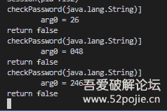

`202402141311878.png` (19.91 KB, 下载次数: 2)

[href="forum.php?mod=attachment&aid=MjY3ODQ4OHw1ZGZkNmViMHwxNzkzNTY4NTY5fDE2ODA4NnwxODk0NTc4&nothumb=yes" target="_blank"](https://www.52pojie.cn/forum.php?mod=attachment&aid=MjY3ODQ4OHw1ZGZkNmViMHwxNzkzNTY4NTY5fDE2ODA4NnwxODk0NTc4&nothumb=yes)

2024-2-28 16:36 上传

hook `checkPassword()`，看看入参是啥

```
setImmediate(function () {
    Java.perform(function () {
        var targetClass = decodeURIComponent("com.zj.wuaipojie2024%5f2.MainActivity");
        var methodName = "checkPassword";
        var gclass = Java.use(targetClass);
```


```javascript
gclass[methodName].overload("java.lang.String").implementation = function (arg0) {
    console.log("checkPassword(java.lang.String)" + "\n\targ0 = " + arg0);
    var i = this[methodName](arg0);
    console.log("return " + i);
    return i;
};
});
});
```

```
checkPassword(java.lang.String)
        arg0 = 012345678
return false
```

## 即九宫格

```
0 1 2
3 4 5
6 7 8
```

此处应有暴力解!!!!!

## 2. 分析解密函数 `getStaticMethod`

重新审视 `getStaticMethod` 方法,发现 `fix` 仅与传入的 `int[] p2` 有关

即 `this.getResources().getIntArray(R$array.A_offset)`

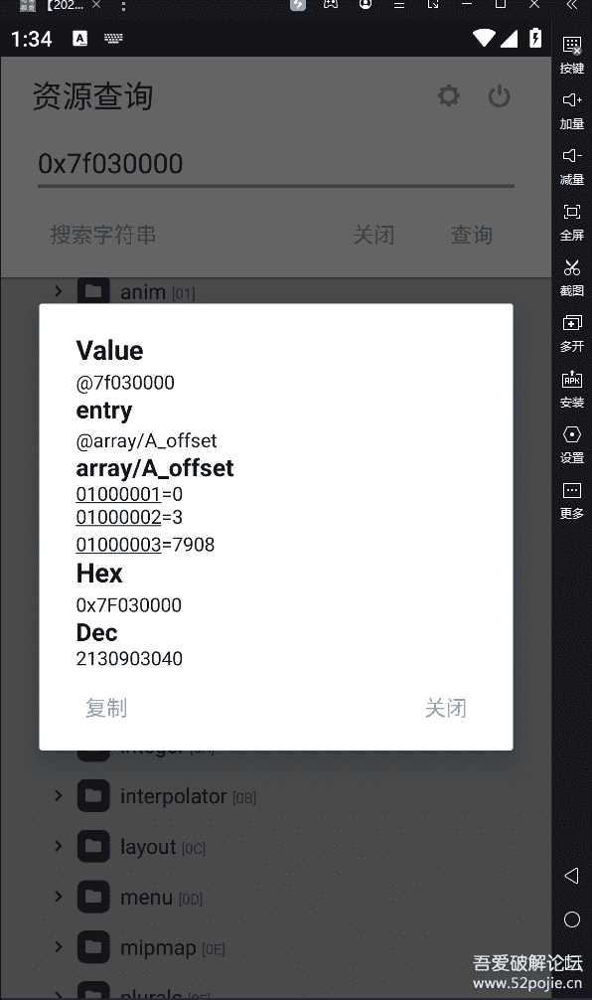

202402141334467.png (87.84 KB, 下载次数: 3)

[href="forum.php?mod=attachment&aid=MjY3ODQ5MXxkOTcxOTUyMnwxNzkzNTY4NTY5fDE2ODA4NnwxODk0NTc4&nothumb=yes" target="_blank"](https://www.52pojie.cn/forum.php?mod=attachment&aid=MjY3ODQ5MXxkOTcxOTUyMnwxNzkzNTY4NTY5fDE2ODA4NnwxODk0NTc4&nothumb=yes)

2024-2-28 16:36 上传

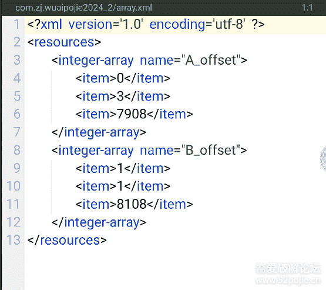

202402141336148.png (78.88 KB, 下载次数: 1)

[href="forum.php?mod=attachment&aid=MjY3ODQ5NXw4OGUwZjIwYnwxNzkzNTY4NTY5fDE2ODA4NnwxODk0NTc4&nothumb=yes" target="_blank"](https://www.52pojie.cn/forum.php?mod=attachment&aid=MjY3ODQ5NXw4OGUwZjIwYnwxNzkzNTY4NTY5fDE2ODA4NnwxODk0NTc4&nothumb=yes)

2024-2-28 16:37 上传

```java
int[] p2 = [0,3,7908]
```

要不,修好的文件直接拦截删除?

但是!!!! 这 `dex` 载不进去啊

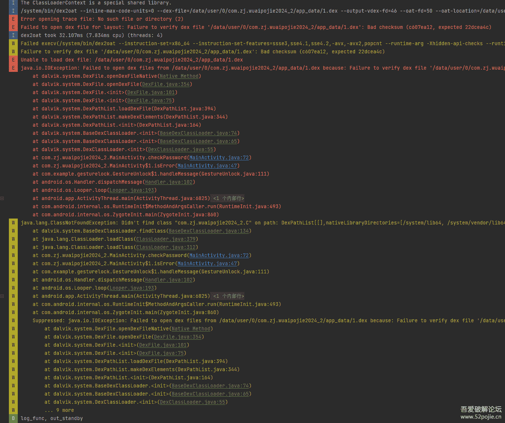

202402210922324.png (280.84 KB, 下载次数: 2)

[href="forum.php?mod=attachment&aid=MjY3ODQ5Mnw2MDJhZGFlMXwxNzkzNTY4NTY5fDE2ODA4NnwxODk0NTc4&nothumb=yes" target="_blank"](https://www.52pojie.cn/forum.php?mod=attachment&aid=MjY3ODQ5Mnw2MDJhZGFlMXwxNzkzNTY4NTY5fDE2ODA4NnwxODk0NTc4&nothumb=yes)

2024-2-28 16:37 上传

索性直接 `JEB` 导出 `gradle` 项目,自己解看看了

## 3. 手动构建解密

先 `MT` 修复 `dex`,使用 `JEB` 打开,导出 `com.zj.wuaipojie2024_2.*` 的 `java`

新建一个 `Android` 项目,导入 `java` 文件,如下

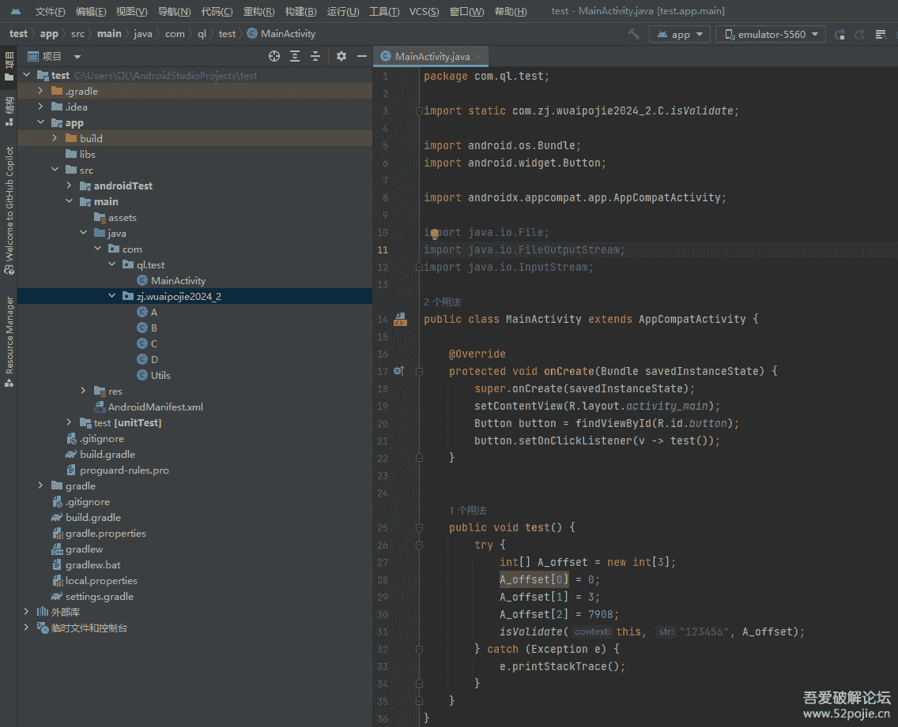

202402210925185.png (156.43 KB, 下载次数: 1)

[href="forum.php?mod=attachment&aid=MjY3ODQ5NnwxZjU5ZmZmMXwxNzkzNTY4NTY5fDE2ODA4NnwxODk0NTc4&nothumb=yes" target="_blank"](https://www.52pojie.cn/forum.php?mod=attachment&aid=MjY3ODQ5NnwxZjU5ZmZmMXwxNzkzNTY4NTY5fDE2ODA4NnwxODk0NTc4&nothumb=yes)

2024-2-28 16:37 上传

运行,发现 `decode.dex` 不存在

`apk` 搜索,发现只有 `com.zj.wuaipojie2024_2.C#read` 有使用,盲猜就是这个 `assets/classes.dex`

改名,放到对应的路径 `/data/data/包名/app_data/decode.dex`

删除 `getStaticMethod` 方法中的删除操作

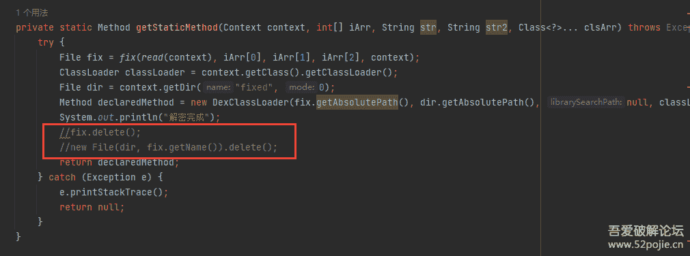

202402210929584.png (58.21 KB, 下载次数: 2)

[href="forum.php?mod=attachment&aid=MjY3ODQ5M3w4YmZlZTAxNXwxNzkzNTY4NTY5fDE2ODA4NnwxODk0NTc4&nothumb=yes" target="_blank"](https://www.52pojie.cn/forum.php?mod=attachment&aid=MjY3ODQ5M3w4YmZlZTAxNXwxNzkzNTY4NTY5fDE2ODA4NnwxODk0NTc4&nothumb=yes)

2024-2-28 16:37 上传

运行!!!

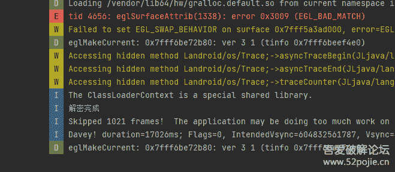

202402210930949.png (60.21 KB, 下载次数: 2)

[href="forum.php?mod=attachment&aid=MjY3ODQ5NHxjM2VhZmMyMHwxNzkzNTY4NTY5fDE2ODA4NnwxODk0NTc4&nothumb=yes" target="_blank"](https://www.52pojie.cn/forum.php?mod=attachment&aid=MjY3ODQ5NHxjM2VhZmMyMHwxNzkzNTY4NTY5fDE2ODA4NnwxODk0NTc4&nothumb=yes)

2024-2-28 16:37 上传

`2.dex` 成功导出!!!

已知,`isValidate` 调用 `com.zj.wuaipojie2024_2.A.d(Context, 密码)`

```java
// 2.dex com.zj.wuaipojie2024_2.A.d
public static String d(Context context, String str) {
    MainActivity.sSS(str);//frida检测
    String signInfo = Utils.getSignInfo(context);//签名校验
    if (signInfo == null || !signInfo.equals("fe4f4cec5de8e8cf2fca60a4e61f67bcd3036117")) {
        return "";
    }
    StringBuffer stringBuffer = new StringBuffer();
    int i = 0;
    while (stringBuffer.length() 
```

这时候就得灵机一动了,这玩意卡了我好几天,在查看 `dex` 时发现有如下字样

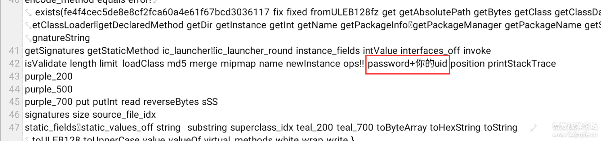

202402211122328.png (240.33 KB, 下载次数: 1)

[href="forum.php?mod=attachment&aid=MjY3ODQ4NXxiZTI0ZGY3Y3wxNzkzNTY4NTY5fDE2ODA4NnwxODk0NTc4&nothumb=yes" target="_blank"](https://www.52pojie.cn/forum.php?mod=attachment&aid=MjY3ODQ4NXxiZTI0ZGY3Y3wxNzkzNTY4NTY5fDE2ODA4NnwxODk0NTc4&nothumb=yes)

2024-2-28 16:35 上传

说明 `B.d` 方法肯定是没解出来,`fix` 是根据 `int[3]` 数组进行修复的,这想起了另一个数组 `B_offset = [1,1,8108]`,解密得

```java
public static String d(String str) {
    return "机缘是{" + Utils.md5(Utils.getSha1("password+你的uid".getBytes())) + "}";
}
```

## 安卓代码

```java
package com.ql.test;

import static com.zj.wuaipojie2024_2.C.isValidate;

import android.os.Bundle;
import android.widget.Button;

import androidx.appcompat.app.AppCompatActivity;

import com.zj.wuaipojie2024_2.Utils;

public class MainActivity extends AppCompatActivity {

    @Override
    protected void onCreate(Bundle savedInstanceState) {
        super.onCreate(savedInstanceState);
        setContentView(R.layout.activity_main);
        Button button = findViewById(R.id.button);
        button.setOnClickListener(v -> test());
        System.out.println(test2("048531267"));
        System.out.println(test3("048531267", "838695"));
    }

    public void test() {
        try {
            int[] A_offset = new int[3];
            A_offset[0] = 0;
            A_offset[1] = 3;
            A_offset[2] = 7908;
            isValidate(this, "123456", A_offset);

            A_offset[0] = 1;
            A_offset[1] = 1;
            A_offset[2] = 8108;
            isValidate(this, "123456", A_offset);
        } catch (Exception e) {
            e.printStackTrace();
        }
    }

    public String test2(String str) {
        StringBuffer stringBuffer = new StringBuffer();
        int i = 0;
        while (stringBuffer.length() 
```

## 花絮

`sSS` 方法是个 `frida` 检测,有简单的 `/proc/self/maps` 检测

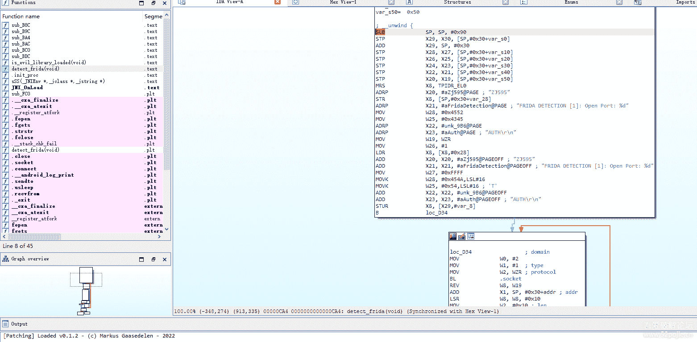

202402141413822.png (111.09 KB, 下载次数: 2)

[href="forum.php?mod=attachment&aid=MjY3ODQ4OXxmODNjOTZkOXwxNzkzNTY4NTY5fDE2ODA4NnwxODk0NTc4&nothumb=yes" target="_blank"](https://www.52pojie.cn/forum.php?mod=attachment&aid=MjY3ODQ4OXxmODNjOTZkOXwxNzkzNTY4NTY5fDE2ODA4NnwxODk0NTc4&nothumb=yes)

2024-2-28 16:36 上传

密码的样子

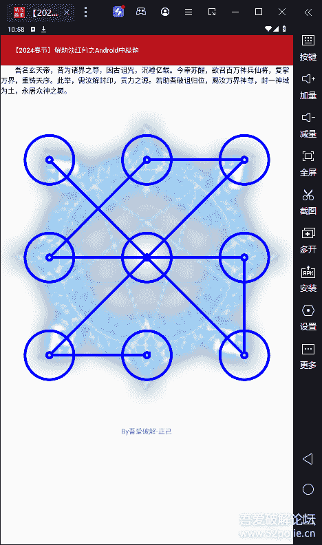

202402211128320.png (209.64 KB, 下载次数: 2)

[href="forum.php?mod=attachment&aid=MjY3ODQ3OHwzYThhNGU5MnwxNzkzNTY4NTY5fDE2ODA4NnwxODk0NTc4&nothumb=yes" target="_blank"](https://www.52pojie.cn/forum.php?mod=attachment&aid=MjY3ODQ3OHwzYThhNGU5MnwxNzkzNTY4NTY5fDE2ODA4NnwxODk0NTc4&nothumb=yes)

2024-2-28 16:35 上传


[href="forum.php?mod=attachment&aid=MjY3ODQ3OXw3YWNiODMzN3wxNzkzNTY4NTY5fDE2ODA4NnwxODk0NTc4" target="_blank"](https://www.52pojie.cn/forum.php?mod=attachment&aid=MjY3ODQ3OXw3YWNiODMzN3wxNzkzNTY4NTY5fDE2ODA4NnwxODk0NTc4)

(13.06 KB, 下载次数: 24)

2024-2-28 16:35 上传

点击文件名下载附件
下载积分: 吾爱币 -1 CB
