# [Android 原创] 某APP的`sDjcSign`加密

- 原帖：https://www.52pojie.cn/forum.php?mod=viewthread&tid=1897636
- 抓取时间：2026-11-01T21:29:27

最近沉迷游戏，每天要兑换交易牌有时候也会忘搞的签到全勤都没有了，一气之下做个自动化去。

## 1. 抓包

经过多次抓包以后得到 `sDjcSign` 每次加密结果都不一样，初步怀疑 `RSA`


image (6).png (16.14 KB, 下载次数: 1)
[附件下载](https://www.52pojie.cn/forum.php?mod=attachment&aid=MjY4MDE3OXwzOGJkYTJkZXwxNzkzNTY4NTY1fDE2ODA4NnwxODk3NjM2&nothumb=yes)
2024-3-7 10:16 上传

## 2. 反编译搜索

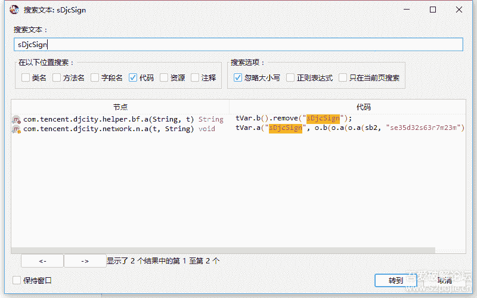
image (7).png (36.1 KB, 下载次数: 2)
[附件下载](https://www.52pojie.cn/forum.php?mod=attachment&aid=MjY4MDE4MHw4NzA5YzI1M3wxNzkzNTY4NTY1fDE2ODA4NnwxODk3NjM2&nothumb=yes)
2024-3-7 10:16 上传

这结果简单明了啊，就两个，那第一个 `remove` 肯定不是了，那就看看第二个。

## 3. 正式开始逆向之旅

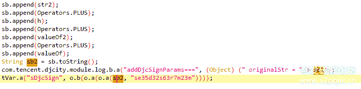
image (8).png (21.68 KB, 下载次数: 1)
[附件下载](https://www.52pojie.cn/forum.php?mod=attachment&aid=MjY4MDE4MXw1M2M0NWQ1MHwxNzkzNTY4NTY1fDE2ODA4NnwxODk3NjM2&nothumb=yes)
2024-3-7 10:17 上传

可以看到这个 `sb2` 是上面 `sb.toString` 得来的，那具体内容不知道是什么一会用 `frida` 看看，我们先看 `o.a(sb2, "se35d32s63r7m23m")` 这个函数是干什么的。

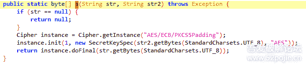
image (9).png (17.9 KB, 下载次数: 2)
[附件下载](https://www.52pojie.cn/forum.php?mod=attachment&aid=MjY4MDE4MnxkZWUzMjllM3wxNzkzNTY4NTY1fDE2ODA4NnwxODk3NjM2&nothumb=yes)
2024-3-7 10:17 上传

好消息，这就是一个 `aes` 加密，那我们先翻译一下代码，现在的代码不就是这样的么

```java
tVar.a("sDjcSign", o.b(o.a(AES(sb2, "se35d32s63r7m23m"))));
```

那还有两个参数不知道干什么的对不对，重复刚才的操作，接着看 `o.a`

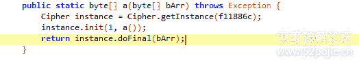
image (10).png (12.66 KB, 下载次数: 2)
[附件下载](https://www.52pojie.cn/forum.php?mod=attachment&aid=MjY4MDE4M3w2N2IwMWJkYnwxNzkzNTY4NTY1fDE2ODA4NnwxODk3NjM2&nothumb=yes)
2024-3-7 10:18 上传

这个 `o.a` 进来以后还调用了一个 `a`，那就继续进这个 `a`

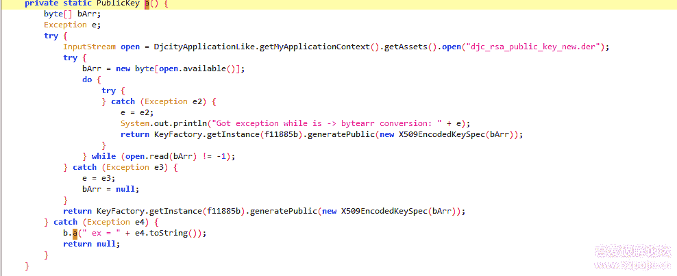
image (11).png (34.77 KB, 下载次数: 2)
[附件下载](https://www.52pojie.cn/forum.php?mod=attachment&aid=MjY4MDE4NHxmN2UzZGI2NHwxNzkzNTY4NTY1fDE2ODA4NnwxODk3NjM2&nothumb=yes)
2024-3-7 10:20 上传

果然啊，果然是 `RSA`，就是从文件打开么，那就去找找这个文件

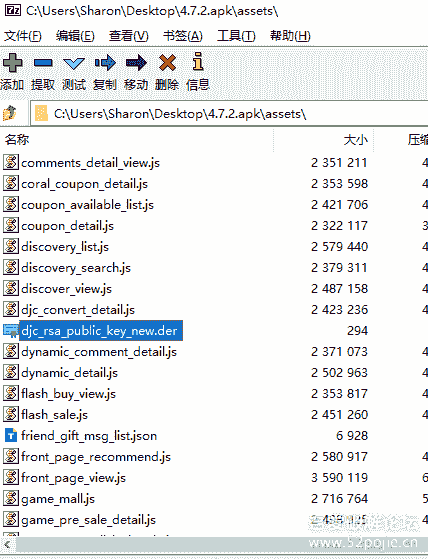
image (12).png (43.63 KB, 下载次数: 2)
[附件下载](https://www.52pojie.cn/forum.php?mod=attachment&aid=MjY4MDE4N3w1NGU3NjRjNnwxNzkzNTY4NTY1fDE2ODA4NnwxODk3NjM2&nothumb=yes)
2024-3-7 10:20 上传

那这就很清晰明了了，现在的加密代码为

```java
tVar.a("sDjcSign", o.b(RSA(AES(sb2, "se35d32s63r7m23m"))));
```

就剩一个 `o.b` 了。最后一个了，继续往下看

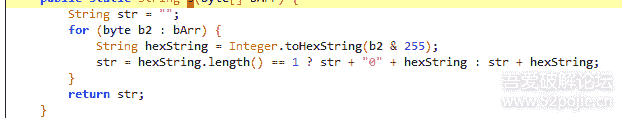
image (13).png (13.51 KB, 下载次数: 1)
[附件下载](https://www.52pojie.cn/forum.php?mod=attachment&aid=MjY4MDE4OHxkZGExMjQ5Y3wxNzkzNTY4NTY1fDE2ODA4NnwxODk3NjM2&nothumb=yes)
2024-3-7 10:21 上传

这个如果看不懂没关系，我们使用 `frida` hook，正好这个 `sb2` 这个值也需要用 `frida` 去看一下对吧。

```javascript
function b() {
  Java.perform(function() {
    var i = Java.use("com.tencent.djcity.util.o");
    i.b.overload('[B').implementation = function (arg1) {
      console.log('b.arg1 = ' + ByteString.of(arg1).hex())
      // console.log('arg2 = ' + arg2)
      var ret = this.b(arg1)
      console.log('b.ret = ' + ret)
      return ret
    }
  });

}
function AES() {
  Java.perform(function() {
    var i = Java.use("com.tencent.djcity.util.o");
    i.a.overload('java.lang.String','java.lang.String').implementation = function (arg1,arg2) {
      console.log('AES.arg1 = ' + arg1)
      console.log('AES.arg2 = ' + arg2)
      var ret = this.a(arg1,arg2)
      console.log('AES.ret = ' + ByteString.of(ret).hex())
      return ret
    }
  });

}

function main() {
  AES()
  b()
}

main()
```

```text
AES.arg1 = 8C571443167953BCC67294D143B97FDA+5d73310d28a1a02929aea12667e64edb0dd356c592261249d47bf75e134efe2a+1709772579610+148

AES.arg2 = se35d32s63r7m23m

AES.ret = 778e7eb1fbad4a871b360bf31dbc5502b3d3c8fcfe60f34b6d7d6f7f1a91fabd04132463e13bc07364588f7a84118593bdb207adefd92823c81d0483319b8b88009c2905303978d2c8fa58480957eb005a73d5cb79a338b9c43fafe0de6c06bde254f1d3ce9d09a723d30c2337be860cb144864c4c69eeb190f1f19b4b6f3196

b.arg1 = 20b7bf49b0c8979e04a41474bc74d5acf6efa672a06fe78ea2e415bb929ea20e25a14316f7706e870664b95ba116b35448628b75c776188546b7291c27e05d7d963375c8a8a22e95ab6833a957e75a0f515f1b012f9e1ae6bf49c815c9b09afa1aabea8bb8df1651c073bec595cb235b6f3c6e0f385f291d242c6e2fd185af8d4336b33c2a5d24f7239a4a5d9587dc53acc686e0a2ede36c1d892d804f65d540474256902eca1fd7847fee066c5e2d70371b4e99015afb3c69b7dddfbeac87cc311654dd71ec220b54b84e76ccd46b08b16c71fce279f32a1d9cdb761a00383a8b17b6bb7b36602ffcc4fb2dd1b705530bdb379c3532d2cb22b6fbd89f0aabfa

b.ret = 20b7bf49b0c8979e04a41474bc74d5acf6efa672a06fe78ea2e415bb929ea20e25a14316f7706e870664b95ba116b35448628b75c776188546b7291c27e05d7d963375c8a8a22e95ab6833a957e75a0f515f1b012f9e1ae6bf49c815c9b09afa1aabea8bb8df1651c073bec595cb235b6f3c6e0f385f291d242c6e2fd185af8d4336b33c2a5d24f7239a4a5d9587dc53acc686e0a2ede36c1d892d804f65d540474256902eca1fd7847fee066c5e2d70371b4e99015afb3c69b7dddfbeac87cc311654dd71ec220b54b84e76ccd46b08b16c71fce279f32a1d9cdb761a00383a8b17b6bb7b36602ffcc4fb2dd1b705530bdb379c3532d2cb22b6fbd89f0aabfa
```

我们先看 `AES.arg1` 这个是什么意思。这个要结合抓包看，当时我研究了很久这个是啥意思

`8C571443167953BCC67294D143B97FDA`，这个意思是 `openid`，自己无法生成，系统生成给你的

`5d73310d28a1a02929aea12667e64edb0dd356c592261249d47bf75e134efe2a`，这个是你的 `sDeviceID`，都是固定的。

`1709772579610`，这个很明显吧，时间戳 `148`，这个嘛，忘记当时怎么找的了，但是测试的时候感觉所有都可以，那干脆就当他是随机数了。

在看 `b.arg1` 和 `b.ret`，注意在 `frida` 的 `js` 文件中写的脚本，`arg1` 是 `'[B'`，`ret` 是 `string`，那这个函数就是 `byte2string` 函数。

## 4. 复现加密

我们从前面知道了这个参数的各个意思，因为他经过了一个读文件进行 `rsa` 加密嘛，所以我选择直接用 `java` 写。


# 签到协议分析

## 加密实现

```java
public class test {
    private static PublicKey RSA() {
        String baseDir = System.getProperty("user.dir");
        byte[] bArr;
        Exception e;
        try {
            InputStream open = new FileInputStream(baseDir + "\\djc_rsa_public_key_new.der");
            try {
                bArr = new byte[open.available()];
                do {
                    try {
                    } catch (Exception e2) {
                        e = e2;
                        System.out.println("Got exception while is -> bytearr conversion: " + e);
                        return KeyFactory.getInstance("RSA").generatePublic(new X509EncodedKeySpec(bArr));
                    }
                } while (open.read(bArr) != -1);
            } catch (Exception e3) {
                e = e3;
                bArr = null;
            }
            return KeyFactory.getInstance("RSA").generatePublic(new X509EncodedKeySpec(bArr));
        } catch (Exception e4) {
            System.out.println("cuole");
            return null;
        }
    }

    public static byte[] AES(String str, String str2) throws Exception {
        if (str == null) {
            return null;
        }
        Cipher instance = Cipher.getInstance("AES/ECB/PKCS5Padding");
        instance.init(1, new SecretKeySpec(str2.getBytes(StandardCharsets.UTF_8), "AES"));
        return instance.doFinal(str.getBytes(StandardCharsets.UTF_8));
    }

    public static byte[] toRSA(byte[] bArr) throws Exception {
        Cipher instance = Cipher.getInstance("RSA/ECB/PKCS1Padding");
        instance.init(1, RSA());
        return instance.doFinal(bArr);
    }
    public static String bytesToHex(byte[] bytes) {
        StringBuilder buf = new StringBuilder(bytes.length * 2);
        for(byte b : bytes) { // 使用String的format方法进行转换
            buf.append(String.format("%02x", Integer.valueOf(b & 0xff)));
        }

        return buf.toString();
    }

    public static void main(){
         String time = String.valueOf(System.currentTimeMillis());
         System.out.println(bytesToHex3(toRSA(AES(openid + "+5d73310d28a1a02929aea12667e64edb0dd356c592261249d47bf75e134efe2a+" + time + "+" + new Random().nextInt(1000),"se35d32s63r7m23m"))));
    }
}
```

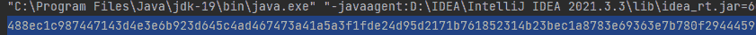

`image (1).png` (11.39 KB, 下载次数: 2)

[附件](https://www.52pojie.cn/forum.php?mod=attachment&aid=MjY4MDE5MHwwYWE5OTBlM3wxNzkzNTY4NTY1fDE2ODA4NnwxODk3NjM2&nothumb=yes)

2024-3-7 10:22 上传

## 抓包验证

这时候我们得到了一条加密因为存在`RSA`了，我们需要发包验证才行，先对比一下长度对不对吧。

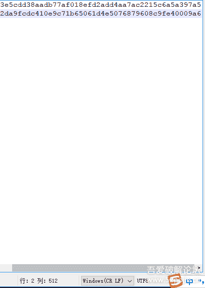

`image (2).png` (16.21 KB, 下载次数: 1)

[附件](https://www.52pojie.cn/forum.php?mod=attachment&aid=MjY4MDE5MXw5MzMyNDE0N3wxNzkzNTY4NTY1fDE2ODA4NnwxODk3NjM2&nothumb=yes)

2024-3-7 10:22 上传

经过做个对比，长度是一样的，那我们直接复现一下签到协议吧，看看对不对

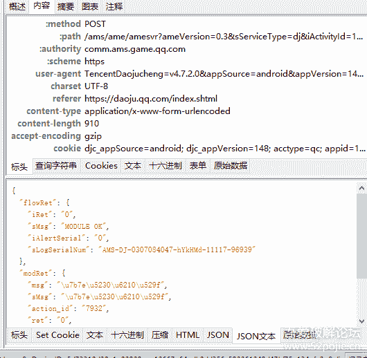

`image (3).png` (46.3 KB, 下载次数: 1)

[附件](https://www.52pojie.cn/forum.php?mod=attachment&aid=MjY4MDE5Mnw4MTZmZTBmNHwxNzkzNTY4NTY1fDE2ODA4NnwxODk3NjM2&nothumb=yes)

2024-3-7 10:22 上传

这个是签到包。

### 签到请求包

```http
:method: POST

:path: /ams/ame/amesvr?ameVersion=0.3&sServiceType=dj&iActivityId=11117&sServiceDepartment=djc&set_info=newterminals&&appSource=android&appVersion=148&ch=10010&sDeviceID=5d73310d28a1a02929aea12667e64edb0dd356c592261249d47bf75e134efe2a&osVersion=Android-29&p_tk=1713520954&sVersionName=v4.7.2.0

:authority: comm.ams.game.qq.com

:scheme: https

user-agent: TencentDaojucheng=v4.7.2.0&appSource=android&appVersion=148&ch=10010&sDeviceID=5d73310d28a1a02929aea12667e64edb0dd356c592261249d47bf75e134efe2a&firmwareVersion=10&phoneBrand=Xiaomi&phoneVersion=MI+8&displayMetrics=1080 * 2115&cpu=AArch64 Processor rev 13 (aarch64)&net=wifi&sVersionName=v4.7.2.0&plNo=133

charset: UTF-8

referer: https://daoju.qq.com/index.shtml

content-type: application/x-www-form-urlencoded

content-length: 910

accept-encoding: gzip

cookie: djc_appSource=android; djc_appVersion=148; acctype=qc; appid=1101958653; openid=8C571443167953BCC67294D143B97FDA; access_token=1348438E26324A8A76C19222FF57A062

djcRequestId=5d73310d28a1a02929aea12667e64edb0dd356c592261249d47bf75e134efe2a-1709772046351-874&appVersion=148&sign_version=1.0&ch=10010&iActivityId=11117&sDjcSign=0ff184ac0b2b6b7c0ee76f7daf9c4f6bbafd7d1610d58eee92add748bd1af18e644ba8d2766393017c928e0f1193d19b8c5d7d08c2a6071e229c2a62cd8b0434ec5b0d068b9f0cbe880fb74580408632eb2f28f5daec685aa37d7685fd5b2cfb42bea5615d86396c9f128096292b10e4ad5077caaa6bd1642d03ebb5f1e8f9e9b982ec96415d24b335a73f5ad09d4859fb6af45b404e71db7a4fbda9e0a49862192a35935cdbab75612eea8707dafb2f2380f3e2a5e67587f162b2bb3456ca00a63c4b12c47d7ad59914d3910d4f83ca6462d48a4030a66ac695255d5f6de1bc2077383ec6bbe00f52f7a881365977228658401a0f256417b04e7785d258b1ee&sDeviceID=5d73310d28a1a02929aea12667e64edb0dd356c592261249d47bf75e134efe2a&p_tk=1713520954&month=202403&osVersion=Android-29&iFlowId=96939&sVersionName=v4.7.2.0&sServiceDepartment=djc&sServiceType=dj&appSource=android&g_tk=1842395457
```

### 返回结果

```json
{
        "flowRet": {
                "iRet": "0",
                "sMsg": "MODULE OK",
                "iAlertSerial": "0",
                "sLogSerialNum": "AMS-DJ-0307084047-hYkHMd-11117-96939"
        },
        "modRet": {
                "msg": "\u7b7e\u5230\u6210\u529f",
                "sMsg": "\u7b7e\u5230\u6210\u529f",
                "action_id": "7932",
                "ret": "0",
                "iRet": "0"
        },
        "ret": "0",
        "msg": ""
}
```

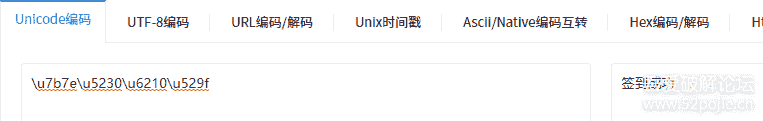

`image (4).png` (18.59 KB, 下载次数: 1)

[附件](https://www.52pojie.cn/forum.php?mod=attachment&aid=MjY4MDE5M3xjNWM3NjI1ZnwxNzkzNTY4NTY1fDE2ODA4NnwxODk3NjM2&nothumb=yes)

2024-3-7 10:23 上传

### POST Body

我们看这个包吧。先看`post body`。

```http
djcRequestId=5d73310d28a1a02929aea12667e64edb0dd356c592261249d47bf75e134efe2a-1709772046351-874

&appVersion=148

&sign_version=1.0

&ch=10010

&iActivityId=11117

&sDjcSign=0ff184ac0b2b6b7c0ee76f7daf9c4f6bbafd7d1610d58eee92add748bd1af18e644ba8d2766393017c928e0f1193d19b8c5d7d08c2a6071e229c2a62cd8b0434ec5b0d068b9f0cbe880fb74580408632eb2f28f5daec685aa37d7685fd5b2cfb42bea5615d86396c9f128096292b10e4ad5077caaa6bd1642d03ebb5f1e8f9e9b982ec96415d24b335a73f5ad09d4859fb6af45b404e71db7a4fbda9e0a49862192a35935cdbab75612eea8707dafb2f2380f3e2a5e67587f162b2bb3456ca00a63c4b12c47d7ad59914d3910d4f83ca6462d48a4030a66ac695255d5f6de1bc2077383ec6bbe00f52f7a881365977228658401a0f256417b04e7785d258b1ee

&sDeviceID=5d73310d28a1a02929aea12667e64edb0dd356c592261249d47bf75e134efe2a

&p_tk=1713520954

&month=202403

&osVersion=Android-29

&iFlowId=96939

&sVersionName=v4.7.2.0

&sServiceDepartment=djc

&sServiceType=dj

&appSource=android

&g_tk=1842395457
```

`djcRequestId`：这个我们不就发现这不就是`AES`加密的时候那个参数么。在外面拼接一下`Openid`在做一层`RSA`不就得到`sDjcSign`。

剩下的参数`p_tk`同样也是根据`openid`还有`access_token`得来的，我们要是想实现签到，那就先抓包，得到`openid`，`access_token`，`p_tk`。好像这几个有效期是三个月。再看`url`中的参数

### URL 参数

```text
/ams/ame/amesvr?ameVersion=0.3
&sServiceType=dj
&iActivityId=11117
&sServiceDepartment=djc
&set_info=newterminals
&&appSource=android
&appVersion=148
&ch=10010
&sDeviceID=5d73310d28a1a02929aea12667e64edb0dd356c592261249d47bf75e134efe2a
&osVersion=Android-29
&p_tk=1713520954
&sVersionName=v4.7.2.0
```

`url`中没有什么特别的参数，就是`p_tk`要跟`post body`中一致

## 签到代码

终于到了最后一步，签到代码

```java
public class test {

    private static PublicKey RSA() {

        String baseDir = System.getProperty("user.dir");
```


```
byte[] bArr;

Exception e;

try {

    InputStream open = new FileInputStream(baseDir + "\\djc_rsa_public_key_new.der");

    try {

        bArr = new byte[open.available()];

        do {

            try {

            } catch (Exception e2) {

                e = e2;

                System.out.println("Got exception while is -> bytearr conversion: " + e);

                return KeyFactory.getInstance("RSA").generatePublic(new X509EncodedKeySpec(bArr));

            }

        } while (open.read(bArr) != -1);

    } catch (Exception e3) {

        e = e3;

        bArr = null;

    }

    return KeyFactory.getInstance("RSA").generatePublic(new X509EncodedKeySpec(bArr));

} catch (Exception e4) {

    System.out.println("cuole");

    return null;

}

}

public static byte[] AES(String str, String str2) throws Exception {

    if (str == null) {

        return null;

    }

    Cipher instance = Cipher.getInstance("AES/ECB/PKCS5Padding");

    instance.init(1, new SecretKeySpec(str2.getBytes(StandardCharsets.UTF_8), "AES"));

    return instance.doFinal(str.getBytes(StandardCharsets.UTF_8));

}

public static byte[] toRSA(byte[] bArr) throws Exception {

    Cipher instance = Cipher.getInstance("RSA/ECB/PKCS1Padding");

    instance.init(1, RSA());

    return instance.doFinal(bArr);

}

public static String bytesToHex(byte[] bytes) {

    StringBuilder buf = new StringBuilder(bytes.length * 2);

    for(byte b : bytes) { // 使用String的format方法进行转换

        buf.append(String.format("%02x", Integer.valueOf(b & 0xff)));

    }

    return buf.toString();

}

public static String sendPost() {

//        获取年月

    Calendar instance = Calendar.getInstance();

    String year = String.valueOf(instance.get(Calendar.YEAR));

    int month = instance.get(Calendar.MONTH) + 1;

    String months = "";

    if (month
```

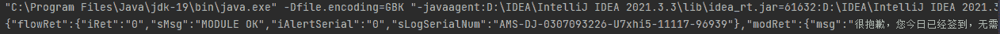

image (5).png (16.61 KB, 下载次数: 1)

[href="forum.php?mod=attachment&aid=MjY4MDE5NHxlNDU5MTVlNXwxNzkzNTY4NTY1fDE2ODA4NnwxODk3NjM2&nothumb=yes" target="_blank"](https://www.52pojie.cn/forum.php?mod=attachment&aid=MjY4MDE5NHxlNDU5MTVlNXwxNzkzNTY4NTY1fDE2ODA4NnwxODk3NjM2&nothumb=yes)

2024-3-7 10:23 上传

我今天已经签到过了，所以提示签到过了，剩下的请求都是一样的，就是体力活搬砖，这个app没有涉及到so，没有涉及到抓包检测，反调试也没有，加密也不是那么难，很适合练手啊。
