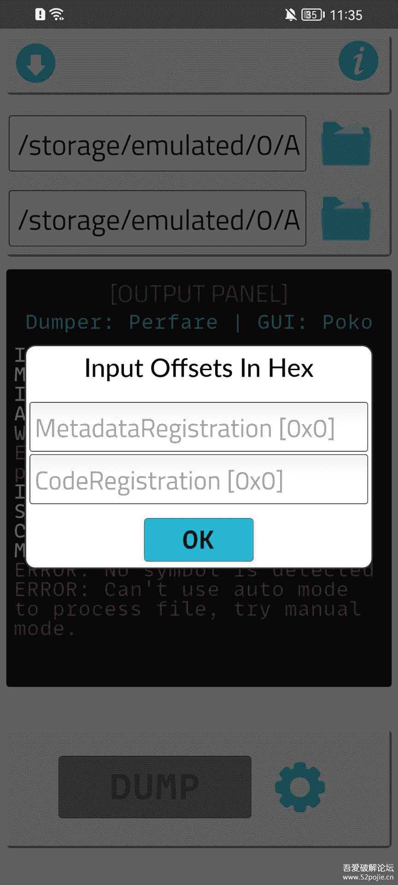
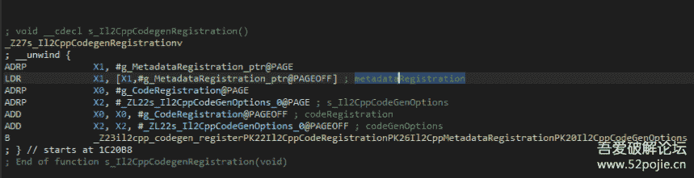
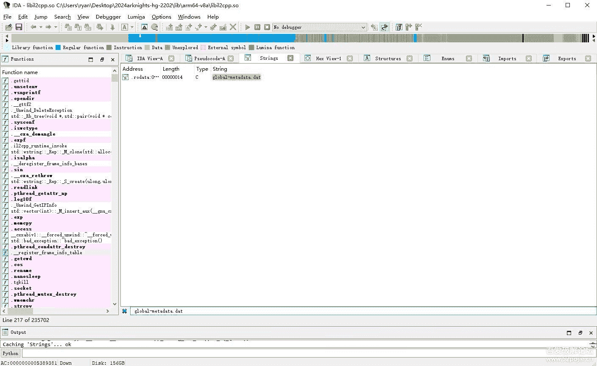
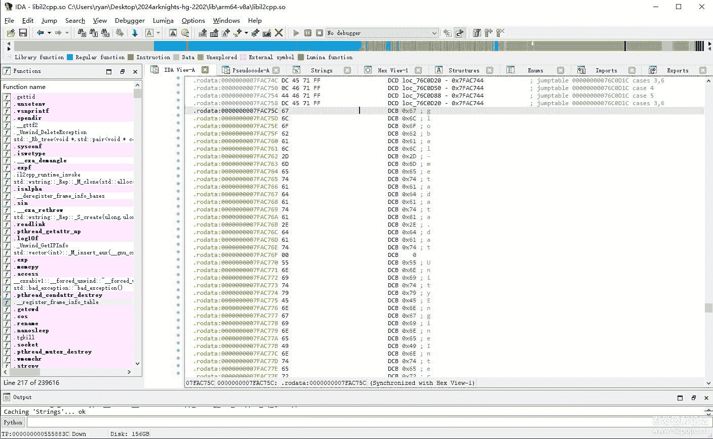
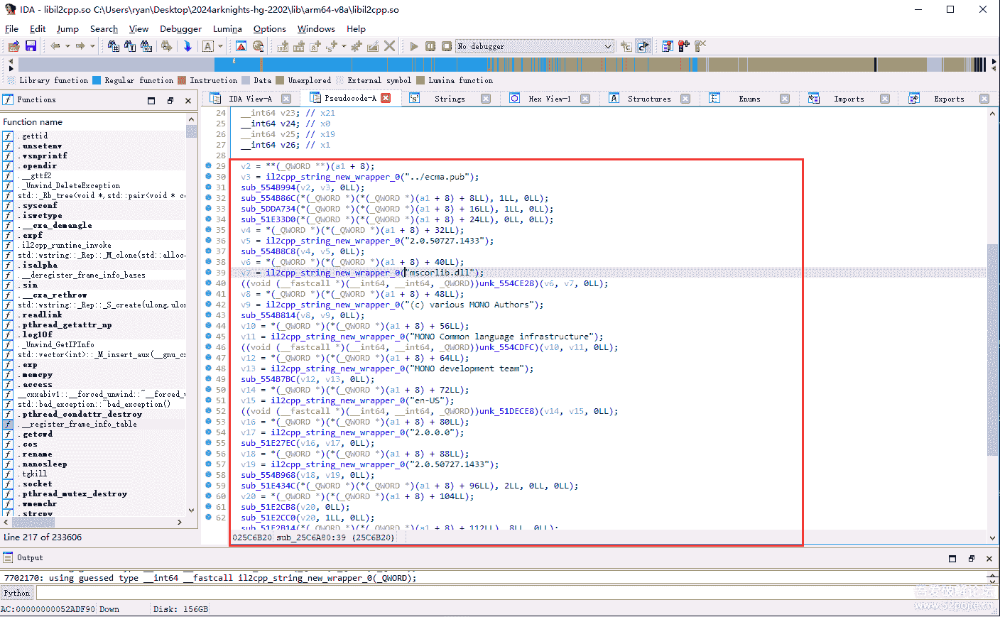
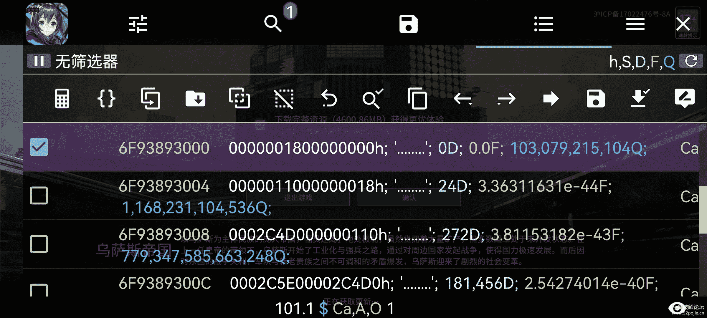
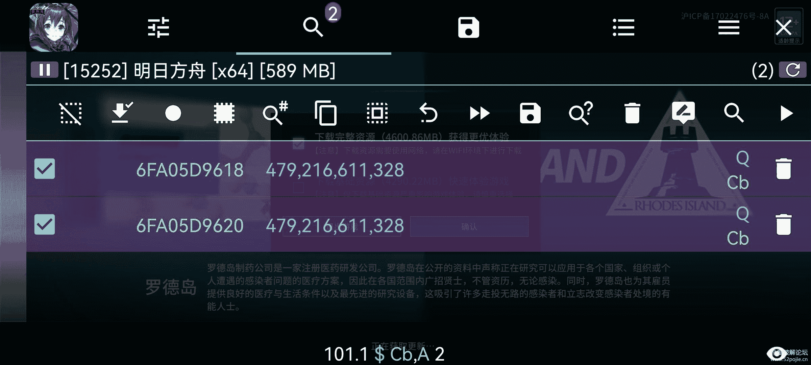
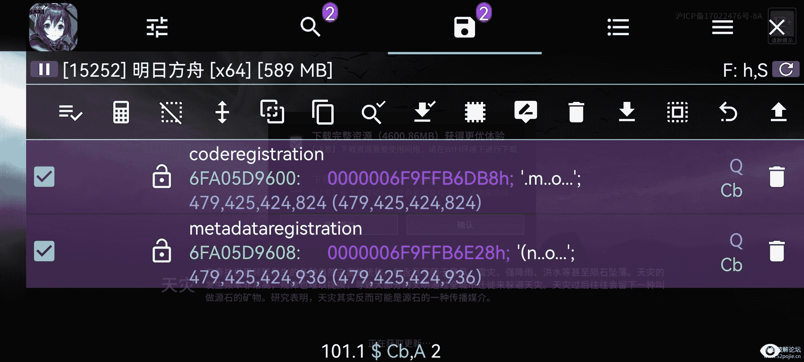

# [Android 原创] 【Dump那点事】内存一键定位`coderegistration`和`metadataregistration`的方法

- 原帖: https://www.52pojie.cn/forum.php?mod=viewthread&tid=1900493
- 抓取时间: 2026-11-02T01:16:05

## 说明

经常Dump的同学可能会碰到以下情况，本文提供一种简便的内存获取此值的方法。

BF0CA9BFC020BD0800EF2E93D08CE592.jpg (121.64 KB, 下载次数: 0)
[href="forum.php?mod=attachment&aid=MjY4MTc1OXwzYzYyYzM3ZHwxNzkzNTgyMTY1fDE2ODA4NnwxOTAwNDkz&nothumb=yes" target="_blank"](https://www.52pojie.cn/forum.php?mod=attachment&aid=MjY4MTc1OXwzYzYyYzM3ZHwxNzkzNTgyMTY1fDE2ODA4NnwxOTAwNDkz&nothumb=yes)
2024-3-14 13:30 上传

## 前言

网上已有很多关于使用IDA来查找`coderegistration`和`metadataregistration`的文章，略作总结如下（此文不做额外延申）：

1、通过字符串交叉引用最终定位`il2cpp::vm::Runtime::Init`，找到 `s_Il2CppCodeGenRegistration`中包含的`coderegistration`和`metadataregistration`。

企业微信截图_20240314123015.png (90.35 KB, 下载次数: 0)
[href="forum.php?mod=attachment&aid=MjY4MTc2MHw3MTE0ZDJlMXwxNzkzNTgyMTY1fDE2ODA4NnwxOTAwNDkz&nothumb=yes" target="_blank"](https://www.52pojie.cn/forum.php?mod=attachment&aid=MjY4MTc2MHw3MTE0ZDJlMXwxNzkzNTgyMTY1fDE2ODA4NnwxOTAwNDkz&nothumb=yes)
2024-3-14 13:31 上传

【搜字符串如“`global-metadata.dat`”，“`mscorlib.dll`”等），交叉引用路径如下`il2cpp::vm::GlobalMetadata::Initialize` → `il2cpp::vm::MetadataCache::Initialize` → `il2cpp::vm::Runtime::Init` → `s_Il2CppCodeGenRegistration`】

2、通过 `il2cpp_init` 定位找到 `il2cpp::vm::Runtime::Init`

由于很多游戏对于常用字符串或结构等进行了加密处理，操作者在使用IDA进行定位时需要对源码以及工具有一定程度了解。比如以下情况（游戏案例: XX方舟）

①字符串`global-metadata.dat`无交叉引用

global72DE3178B9052065678049C64E.jpg (144.78 KB, 下载次数: 0)
[href="forum.php?mod=attachment&aid=MjY4MTc2MXxiYjhkMDg3MXwxNzkzNTgyMTY1fDE2ODA4NnwxOTAwNDkz&nothumb=yes" target="_blank"](https://www.52pojie.cn/forum.php?mod=attachment&aid=MjY4MTc2MXxiYjhkMDg3MXwxNzkzNTgyMTY1fDE2ODA4NnwxOTAwNDkz&nothumb=yes)
2024-3-14 13:31 上传

无D84333AE67B82737DCC15D529.jpg (247.88 KB, 下载次数: 1)
[href="forum.php?mod=attachment&aid=MjY4MTc2MnwzMDQ0ZmRiYXwxNzkzNTgyMTY1fDE2ODA4NnwxOTAwNDkz&nothumb=yes" target="_blank"](https://www.52pojie.cn/forum.php?mod=attachment&aid=MjY4MTc2MnwzMDQ0ZmRiYXwxNzkzNTgyMTY1fDE2ODA4NnwxOTAwNDkz&nothumb=yes)
2024-3-14 13:32 上传

②字符串`mscorlib.dll`交叉引用结构混乱（对照源码）

结构混乱.jpg (164.55 KB, 下载次数: 0)
[href="forum.php?mod=attachment&aid=MjY4MTc2NXwzZDMzZjZmNHwxNzkzNTgyMTY1fDE2ODA4NnwxOTAwNDkz&nothumb=yes" target="_blank"](https://www.52pojie.cn/forum.php?mod=attachment&aid=MjY4MTc2NXwzZDMzZjZmNHwxNzkzNTgyMTY1fDE2ODA4NnwxOTAwNDkz&nothumb=yes)
2024-3-14 13:33 上传

针对不熟悉IDA工具以及il2cpp源码的同学，我们可以从内存结构中直接获取`coderegistration`和`metadataregistration`。

## 正文

工具：GG修改器
案例游戏：XX方舟 （截止发帖3.14最新版 64bit）

### 一、打开游戏，打开GG修改器，选择好游戏进程。内存范围选择 Ca/A/O 。

### 二、字符串搜索 `get_fieldOfView` 定位内存解密后的 `global-metadata.dat` 模块 ，随之获取该模块头地址，即metadata文件魔术字头地址（此案例已抹掉了魔术字头，可直接内存修改”`AF1BB1FAr` “进行还原）

FB427EB0BE22788FF79A7FE7871D2A5E.jpg (351.36 KB, 下载次数: 1)
[href="forum.php?mod=attachment&aid=MjY4MTc2NnxhNWM4ZjQ4NnwxNzkzNTgyMTY1fDE2ODA4NnwxOTAwNDkz&nothumb=yes" target="_blank"](https://www.52pojie.cn/forum.php?mod=attachment&aid=MjY4MTc2NnxhNWM4ZjQ4NnwxNzkzNTgyMTY1fDE2ODA4NnwxOTAwNDkz&nothumb=yes)
2024-3-14 13:33 上传

### 三、更改内存范围为 Cb/A。对metadata魔术字头地址进行指针搜索，得到偏移量为" 8 "的两个指针。

6424984C15803B7E14A68E5C56B932D6.jpg (225.43 KB, 下载次数: 0)
[href="forum.php?mod=attachment&aid=MjY4MTc2N3xmOGQ2YzM2MHwxNzkzNTgyMTY1fDE2ODA4NnwxOTAwNDkz&nothumb=yes" target="_blank"](https://www.52pojie.cn/forum.php?mod=attachment&aid=MjY4MTc2N3xmOGQ2YzM2MHwxNzkzNTgyMTY1fDE2ODA4NnwxOTAwNDkz&nothumb=yes)
2024-3-14 13:34 上传

### 四、分别对得到的两个指针做偏移" -18 "（十六进制），即可得到`coderegistration` 和 `metadataregistration`的指针，所得指针中包含的十六进制地址值即为所需数值, 此例为：

`coderegistration` ： 6F9FFB6DB8
`metadataregistration`： 6F9FFB6E28

F47A6E872626A7817429C00D7B91EB1F.jpg (253.75 KB, 下载次数: 0)
[href="forum.php?mod=attachment&aid=MjY4MTc2OHxiOTJkZTBmMXwxNzkzNTgyMTY1fDE2ODA4NnwxOTAwNDkz&nothumb=yes" target="_blank"](https://www.52pojie.cn/forum.php?mod=attachment&aid=MjY4MTc2OHxiOTJkZTBmMXwxNzkzNTgyMTY1fDE2ODA4NnwxOTAwNDkz&nothumb=yes)
2024-3-14 13:34 上传

## 注意

由于内存指针地址变动，所获数值需要对应当次内存dump出的`global-metadata.dat`和`libil2cpp.so`使用。

内存结构对应源码数据，如按本文方法无法获取所需数值，则需要进一步查看对应的内存结构，本文不在延申。
