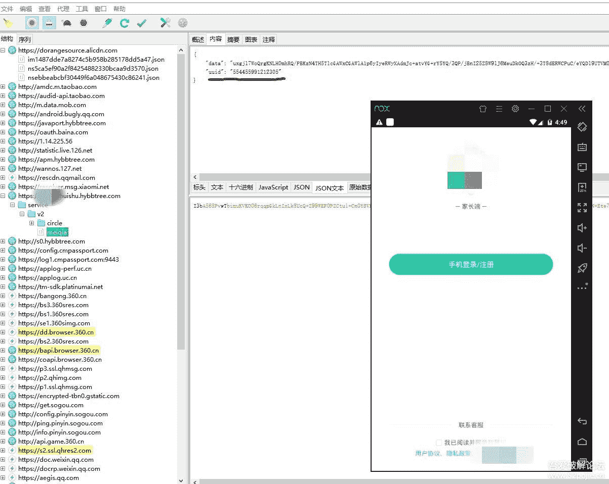
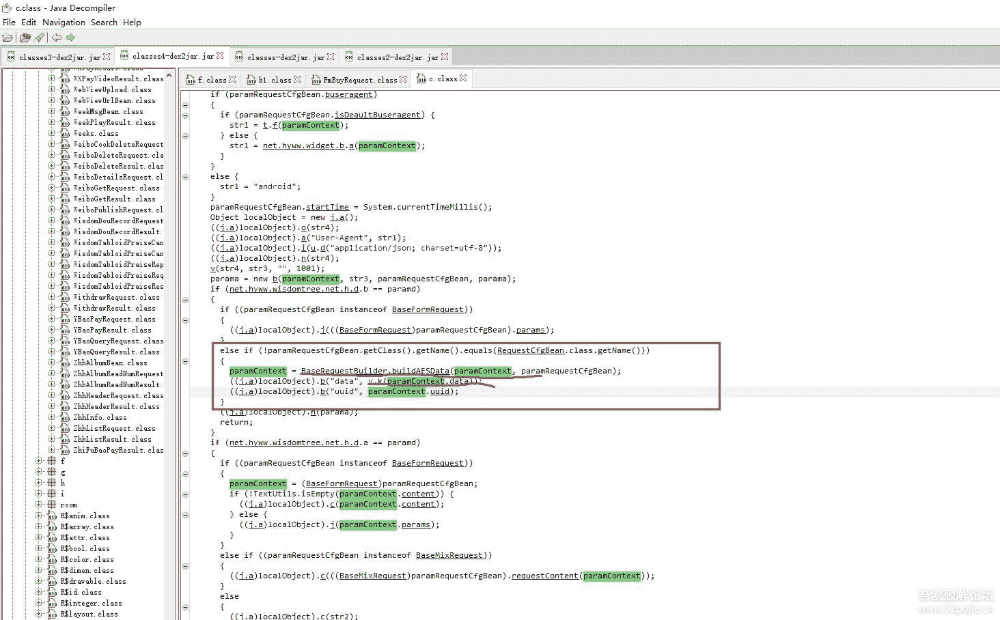
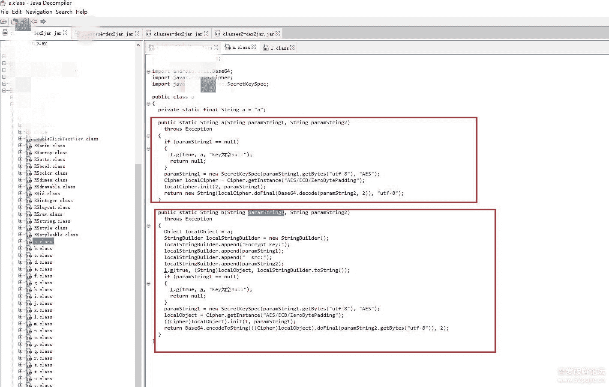

# [Android 原创] 快速破解某app接口加解密算法

- 原帖：https://www.52pojie.cn/forum.php?mod=viewthread&tid=1900731
- 抓取时间：2026-11-02T01:16:03

## 操作步骤

1. 在模拟器上安装app，使用Charles抓包；

   

   360截图20240314164911721.jpg（155.17 KB，下载次数：1）

   [forum.php?mod=attachment&aid=MjY4MTk0M3wxNGU4Y2Y2NHwxNzkzNTgyMTYzfDE2ODA4NnwxOTAwNzMx&nothumb=yes](https://www.52pojie.cn/forum.php?mod=attachment&aid=MjY4MTk0M3wxNGU4Y2Y2NHwxNzkzNTgyMTYzfDE2ODA4NnwxOTAwNzMx&nothumb=yes)

   2024-3-14 17:33 上传

2. 在接口数据中上传参数包含`uuid`、`date`，这个是切入点，非常关键。使用`dex2jar-2.0`工具反编译`dex`文件得到`jar`文件；

3. 搜索`uuid`，找到接口上传参数加密位置；

   

   360截图20240314170455587.jpg（224.52 KB，下载次数：1）

   [forum.php?mod=attachment&aid=MjY4MTk0NHxkYjQ2ZjA2OHwxNzkzNTgyMTYzfDE2ODA4NnwxOTAwNzMx&nothumb=yes](https://www.52pojie.cn/forum.php?mod=attachment&aid=MjY4MTk0NHxkYjQ2ZjA2OHwxNzkzNTgyMTYzfDE2ODA4NnwxOTAwNzMx&nothumb=yes)

   2024-3-14 17:33 上传

4. 可以看到代码是这样的：

```
paramContext = BaseRequestBuilder.buildAESData(paramContext, paramRequestCfgBean);

((j.a)localObject).b("data", v.k(paramContext.data)); ((j.a)localObject).b("uuid", paramContext.uuid);
```

这就是上传加密的算法，大致就是将json试用AES加密，ASE加密后一般是16进制或者是base64；顺藤摸瓜找到加密算法；



360截图20240314171923111.jpg（176.01 KB，下载次数：0）

[forum.php?mod=attachment&aid=MjY4MTk0NXwzZmJkMjRjZnwxNzkzNTgyMTYzfDE2ODA4NnwxOTAwNzMx&nothumb=yes](https://www.52pojie.cn/forum.php?mod=attachment&aid=MjY4MTk0NXwzZmJkMjRjZnwxNzkzNTgyMTYzfDE2ODA4NnwxOTAwNzMx&nothumb=yes)

2024-3-14 17:33 上传

## 加密算法分析

分析得出是AES加密，`ecb`模式，填充`ZeroBytePadding`，即`AES/ECB/ZeroBytePadding`；`ecb`模式不需要`iv`，只需要`key`，结果是`bast64`；

## 总结

一般能抓包并且能反编译看到代码的被[//www.52pojie.cn](https://www.52pojie.cn)就很简单，基本是也是在防抓包和加壳这两个方面上对app进行防护，防抓包和加固技术不断增强，只有不断学习提升自己的技术；
