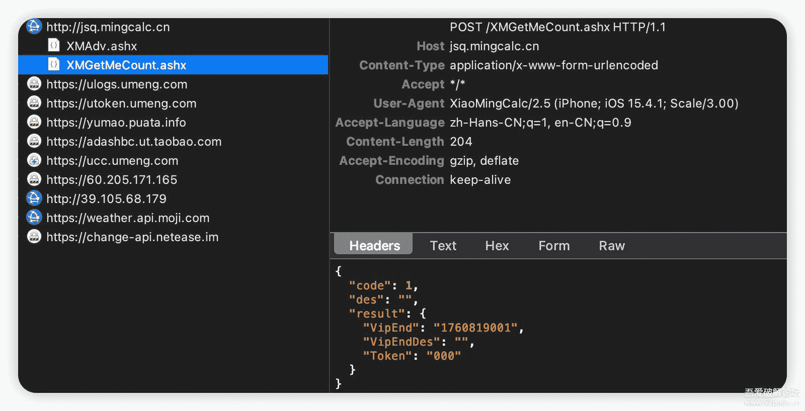
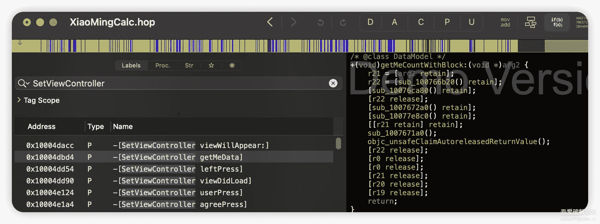
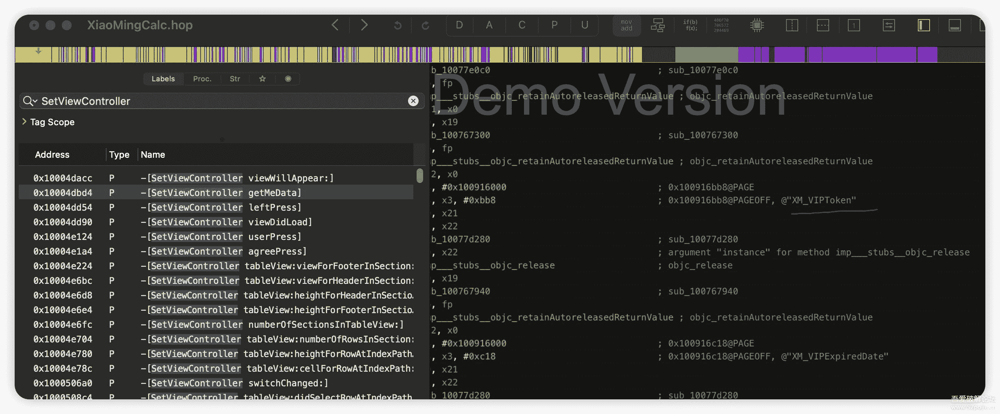
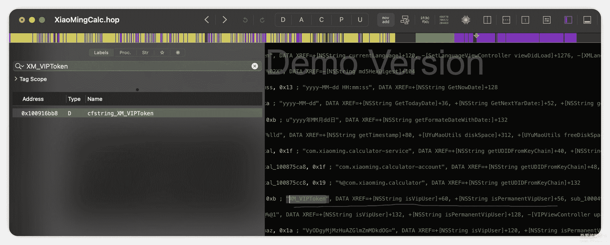
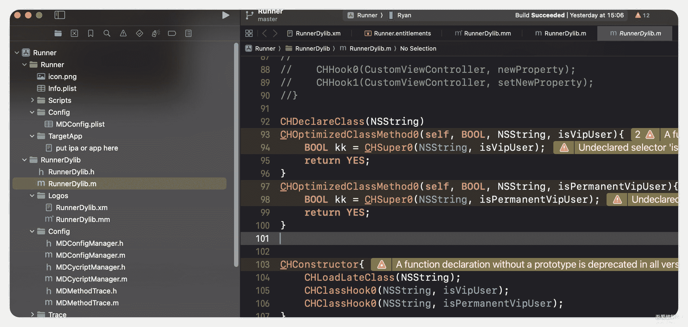

# [iOS 原创] 某iOS计算器vip破解

- 原帖: https://www.52pojie.cn/forum.php?mod=viewthread&tid=1902971
- 抓取时间: 2026-11-02T01:15:59

使用`monkeydev`测试，小明计算器 vip [//www.52pojie.cn" target="_blank" class="relatedlink"](https://www.52pojie.cn:href="https)

[Objective-C] 纯文本查看 复制代码

```
CHDeclareClass(NSString)
CHOptimizedClassMethod0(self, BOOL, NSString, isVipUser){
    BOOL kk = CHSuper0(NSString, isVipUser);
    return YES;
}
CHOptimizedClassMethod0(self, BOOL, NSString, isPermanentVipUser){
    BOOL kk = CHSuper0(NSString, isPermanentVipUser);
    return YES;
}

CHConstructor{
    CHLoadLateClass(NSString);
    CHClassHook0(NSString, isVipUser);
    CHClassHook0(NSString, isPermanentVipUser);
}
```

## 补充下分析过程

计算器虽然很多，但是都不咋好用，没有历史记录，有广告等等，下面说下分析过程：
1. 手机需要越狱，然后使用`frida-ios-dump`，导出砸壳的包。`frida-ios-dump`安装教程如下：https://iosgods.com/topic/171082-frida-server-rootless-binary-dumpdecrypt/#comments
2. `Charles`抓包发现调用了`XMGetMeCount()`接口，推测和vip有关。发现每次打开设置页面，都会调用这个接口，使用`FLEXList`越狱插件，查看设置页面控制器名称是`SetViewController`。

iShot_2024-03-20_09.45.56.jpg (139.84 KB, 下载次数: 2)
[href="forum.php?mod=attachment&aid=MjY4MzkxMnw0YWZmOGE1Y3wxNzkzNTgyMTYwfDE2ODA4NnwxOTAyOTcx&nothumb=yes" target="_blank"](https://www.52pojie.cn/forum.php?mod=attachment&aid=MjY4MzkxMnw0YWZmOGE1Y3wxNzkzNTgyMTYwfDE2ODA4NnwxOTAyOTcx&nothumb=yes)
2024-3-20 09:46 上传
3. 使用`Hopper Disassembler`，导入ipa可执行文件，搜索`SetViewController`，查看伪代码，找到了调用`XMGetMeCount()`接口的位置`getMeData()`。

iShot_2024-03-20_10.01.17.jpg (170.58 KB, 下载次数: 1)
[href="forum.php?mod=attachment&aid=MjY4MzkxNXw4OWY4MjY0ZnwxNzkzNTgyMTYwfDE2ODA4NnwxOTAyOTcx&nothumb=yes" target="_blank"](https://www.52pojie.cn/forum.php?mod=attachment&aid=MjY4MzkxNXw4OWY4MjY0ZnwxNzkzNTgyMTYwfDE2ODA4NnwxOTAyOTcx&nothumb=yes)
2024-3-20 10:01 上传
4. 查看`SetViewController` `getMeData()`的反汇编代码，在接口的block回调里，使用了`XM_VIPToken`字段，

iShot_2024-03-20_10.05.41.jpg (330.8 KB, 下载次数: 1)
[href="forum.php?mod=attachment&aid=MjY4MzkxNnw1OWRkYTY2MnwxNzkzNTgyMTYwfDE2ODA4NnwxOTAyOTcx&nothumb=yes" target="_blank"](https://www.52pojie.cn/forum.php?mod=attachment&aid=MjY4MzkxNnw1OWRkYTY2MnwxNzkzNTgyMTYwfDE2ODA4NnwxOTAyOTcx&nothumb=yes)
2024-3-20 10:06 上传
5. 搜索`XM_VIPToken`，发现了`NSString`的两个类方法`isVipUser()`、`isPermanentVipUser()`。

iShot_2024-03-20_09.49.05.jpg (250.87 KB, 下载次数: 0)
[href="forum.php?mod=attachment&aid=MjY4MzkyMnxiY2NhMzNjOXwxNzkzNTgyMTYwfDE2ODA4NnwxOTAyOTcx&nothumb=yes" target="_blank"](https://www.52pojie.cn/forum.php?mod=attachment&aid=MjY4MzkyMnxiY2NhMzNjOXwxNzkzNTgyMTYwfDE2ODA4NnwxOTAyOTcx&nothumb=yes)
2024-3-20 10:10 上传
6. `monkeydev`运行项目，hook这两个方法`isVipUser()`、`isPermanentVipUser()`，完成破解。 https://github.com/AloneMonkey/MonkeyDev/wiki

iShot_2024-03-20_10.14.11.jpg (341.61 KB, 下载次数: 0)
[href="forum.php?mod=attachment&aid=MjY4MzkyNnwyMDQ3MDc3NXwxNzkzNTgyMTYwfDE2ODA4NnwxOTAyOTcx&nothumb=yes" target="_blank"](https://www.52pojie.cn/forum.php?mod=attachment&aid=MjY4MzkyNnwyMDQ3MDc3NXwxNzkzNTgyMTYwfDE2ODA4NnwxOTAyOTcx&nothumb=yes)
2024-3-20 10:15 上传
