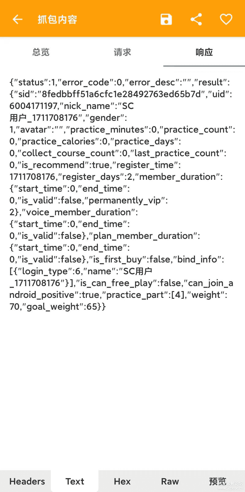
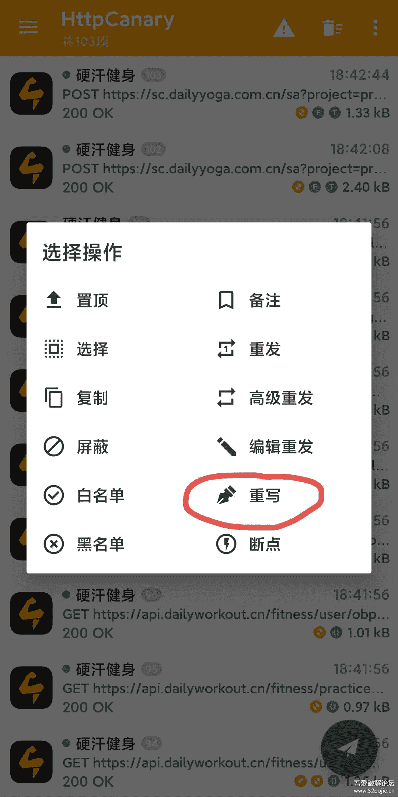
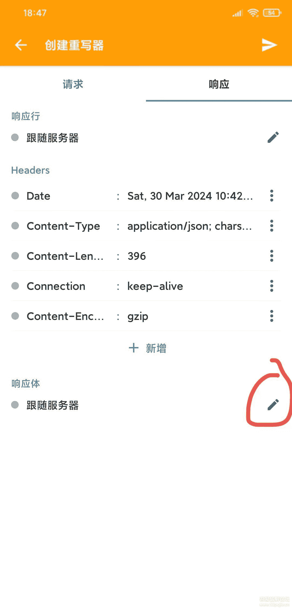
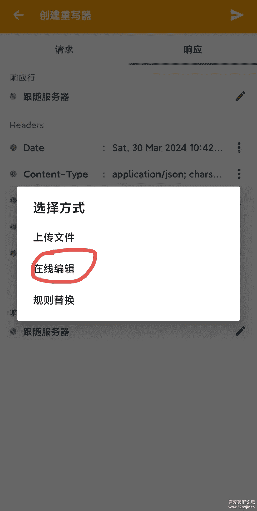
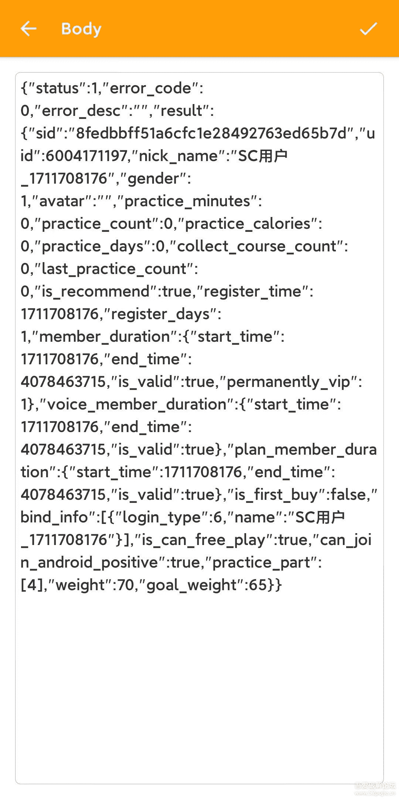
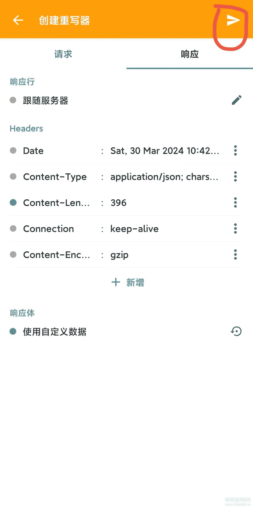
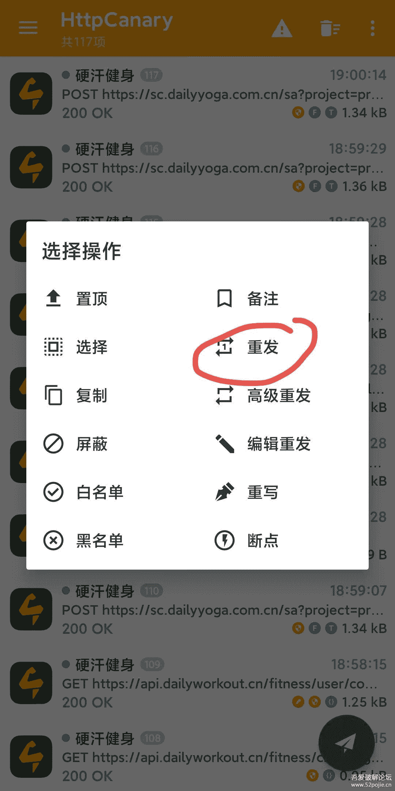
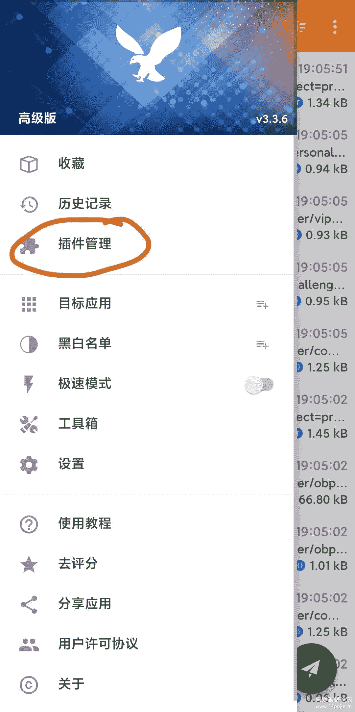

# [Android 原创] 用小黄鸟破解某健身APP

- 原帖: https://www.52pojie.cn/forum.php?mod=viewthread&tid=1907989
- 抓取时间: 2026-11-02T01:15:46

## 一、准备对象APP：56Gs5rGX5YGl6Lqr

工具：`HttpCanary` 小黄鸟（我用的这篇帖子里提供的版本：https://www.52pojie.cn/forum.php?mod=viewthread&tid=1718317 小黄鸟配置教程参考这篇帖子 https://www.52pojie.cn/thread-1592529-1-1.html）

## 二、上手

软件本身没有加固，传输数据也没有加密，只是代码有混淆，所以用小黄鸟抓包改一下就好了，非常简单。

任意应用商店下载安装

首次启动会自动进入一套问卷调查，随便点，最后生成定制方案，跳到开通会员界面，点右上角的 × 退出，再前往个人中心。

图片1.jpg (153.05 KB, 下载次数: 3)

首次启动未登录账号的个人中心界面

可以看出软件自动创建了一个账号，用小黄鸟抓一抓看看服务器返回的这个账号的信息

图片3.jpg (275.51 KB, 下载次数: 1)

小黄鸟抓到未登录状态下账号信息包

这一条有标识`user`，可能是账号信息，点进去看看响应

85A0AB2A0BDA93C37FD35B74AC22ECC4.jpg (243.4 KB, 下载次数: 2)

响应

果然是，包括`uid`、昵称、性别、训练分钟数、训练次数、消耗卡路里等等，最关键的是`member_duration`、`voice_member_duration`、`plan_member_duration`以及他们各自对应的的`start_time`、`end_time`、`is_valid`等，我们就可以开始修改了。其中各种time的值是时间戳，用这个在线工具转换一下就行 https://tool.lu/timestamp/

修改步骤：

回到抓包列表，找到刚才那条长按，点击重写，如果有弹窗询问，点已授权即可。

7884C89EB892B986CD81E8EF70F288AD.jpg (177.21 KB, 下载次数: 2)

命好名点右上角箭头

F2189727D50DED12C00223B6B290A339.jpg (63.88 KB, 下载次数: 3)

切换到响应栏，点“跟随服务器”旁边的笔

11F771580CE57E63EEFA3634AB58BFE2.jpg (111.83 KB, 下载次数: 2)

再选择“在线编辑”

8CB62F77B84322E9C592286FC8D09659.jpg (93.84 KB, 下载次数: 3)

B223742845AAA926B3034BD59B40445E.jpg (270.51 KB, 下载次数: 4)

我主要把各种`start_time`改为同`register_time`一样，`end_time`改为2099-03-29 18:35:15，对应的时间戳4078463715，以及把`is_valid`后面的false改为true，改好后，点一下右上角√

F6419C72779C3983DD1D7ABF0E02488E.jpg (107.93 KB, 下载次数: 0)

再点一下右上角纸飞机就创建好重写器了，创建好的同时默认开启重写器，去软件看看生效没

BAB9FCF7257632A7A47D96399232D8A7.jpg (149.56 KB, 下载次数: 2)

好了，修改成功。如果没生效，就在小黄鸟里找到刚刚那条标识`user`的，再长按，选择重发一下就行

A52E99CC79065831C1BE43D9315F6DE6.jpg (181.43 KB, 下载次数: 3)

但是，现在到软件首页点击开始第一次训练会跳到登录界面，不能直接开始使用，原因是必须要登录账号记录训练数据，目前的状态是没有登录我们自己的账号的，只是有一个软件自动创建的号，那我们注册登录后再修改。

到小黄鸟关闭刚才创建的重写器

48758DD40C73F6FEDBB811024B500282.jpg (285.06 KB, 下载次数: 4)

B18A3F476D6F187930041062CA4A5A7B.jpg (181.55 KB, 下载次数: 4)

9A247E9580B719675152ED3B03780E7C.jpg (27.28 KB, 下载次数: 2)

在软件注册登录后，到小黄鸟里找到新的标识了`user`的一条，长按，进入重写，重复上面的修改步骤，需要注意的是`end_time`不能改太久远了，改成最近2年的，比如2025-03-29 18:35:15 对应时间戳是1743244515，改得太久远的话，不知道为什么服务器会返回“参数错误”、“账号未登录”的数据，强制重新登录。改好后就能正常在首页点训练课跟练了

DF0B38F66C2351352F0D3F0C0FDA36B3.jpg (207.06 KB, 下载次数: 3)

01C57ABB97706C3CD298CB3FEAF55208.jpg (93.47 KB, 下载次数: 3)

## 三、一些想法

小黄鸟抓包修改固然比较快速简单，但每次都要先打开小黄鸟开启抓包，再开软件才有效，个人感觉比较繁琐，而且还要登录账号，暴露个人信息给服务商了，不是很满意这种破解方式。想通过修改代码逻辑的方式破解，但是怎么在混淆的代码中去寻找关键代码，还望大佬指点迷津
