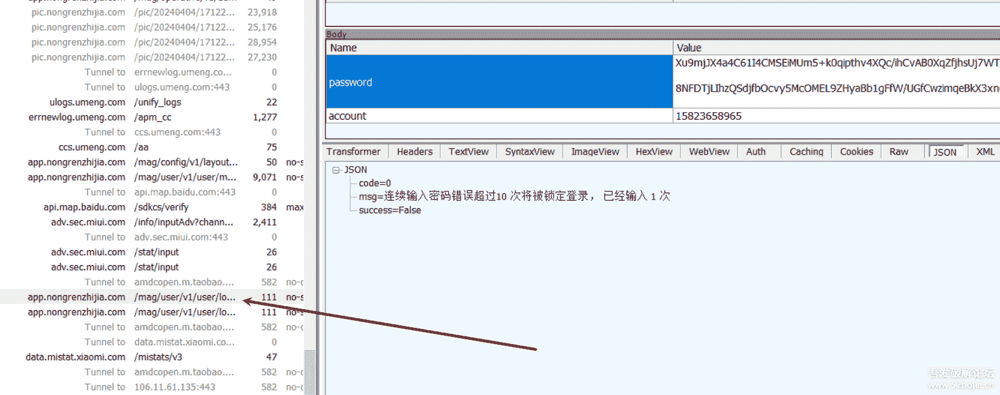
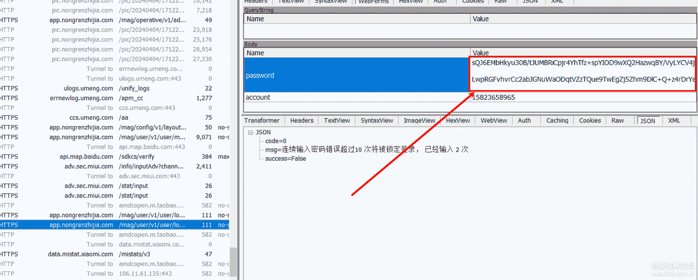
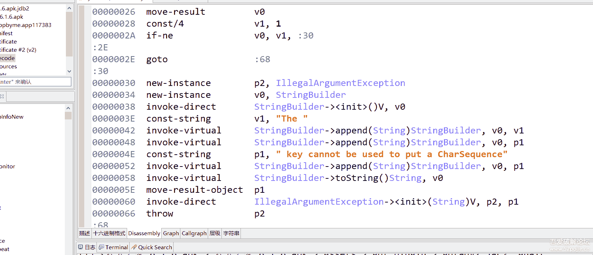
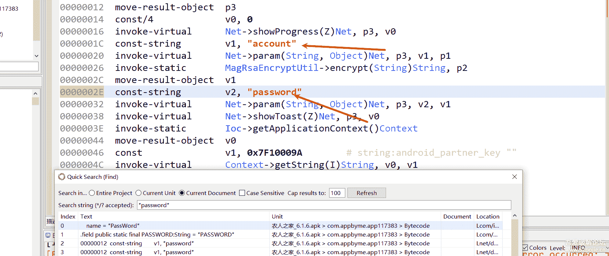
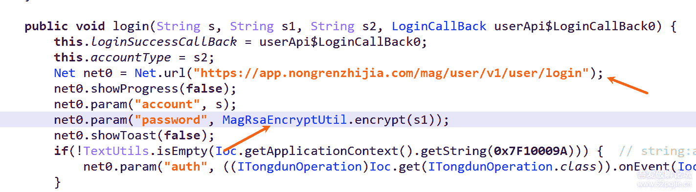
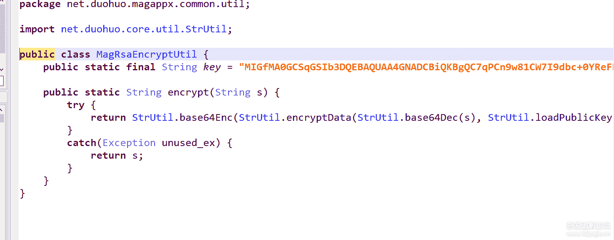
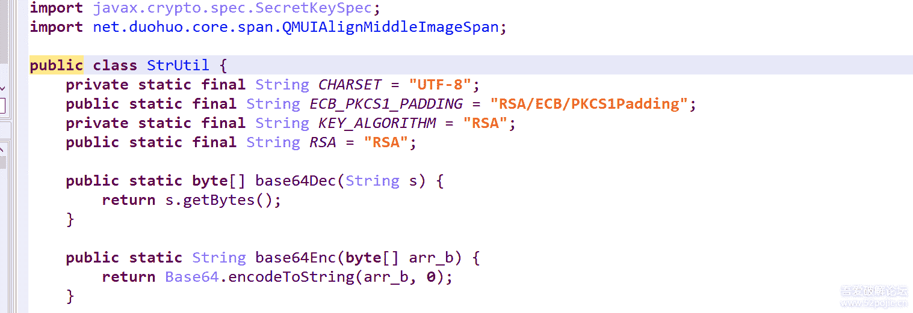
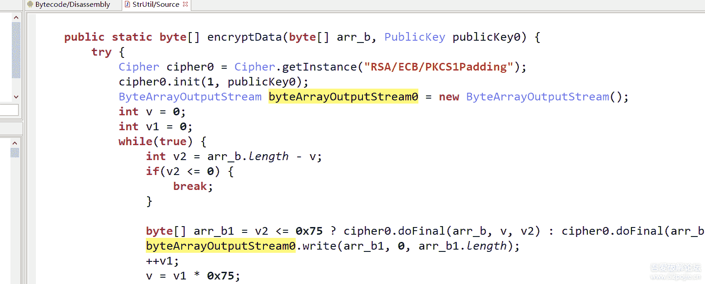

# [Android 原创] 某人之家登陆逆向分析，初学者记录！

- 原帖：https://www.52pojie.cn/forum.php?mod=viewthread&tid=1909851
- 抓取时间：2026-11-02T01:15:40

> 自学逆向，第一次发帖，有不妥的话欢迎大佬指出

样本：`5Yac5Lq65LmL5a62`（小米商城下载）

工具：Eclipse (4.30.0)、JEB 4.20.0、Fiddler、MT管理器

## 一、初窥门径

打开 fiddler，配置好代{过}{滤}理抓包，在 app 里选择账号密码登录，抓到如下包。



`image-20240404222355763.png`（255.57 KB，下载次数：0）

[附件下载](https://www.52pojie.cn/forum.php?mod=attachment&aid=MjY4NzQxNHwwNGJhYjQwNXwxNzkzNTgyMTQwfDE2ODA4NnwxOTA5ODUx&nothumb=yes)

2024-4-4 23:11 上传

可以看到抓到了登录包，点进去发现账号是明文，密码被加密了，再抓一次试试看。



`image-20240404222617499.png`（310.95 KB，下载次数：0）

[附件下载](https://www.52pojie.cn/forum.php?mod=attachment&aid=MjY4NzQxNXxlN2RlZWFiYXwxNzkzNTgyMTQwfDE2ODA4NnwxOTA5ODUx&nothumb=yes)

2024-4-4 23:12 上传

第二次使用相同密码发现再抓包发现密码的密文改变了，刚开始猜测是不是加了时间戳，后来发现是 RSA 加密，且是 `RSA/ECB/PKCS1Padding` 模式，由于填充，所以密文不一样，并查阅了资料，链接：https://blog.csdn.net/guyongqiangx/article/details/74930951

## 二、崭露头角

使用 MT 管理器提取 apk，发现未加固，扔进 JEB 反编译。



`image-20240404223226467.png`（110.5 KB，下载次数：1）

[附件下载](https://www.52pojie.cn/forum.php?mod=attachment&aid=MjY4NzQxNnwyZDFhYWEyZHwxNzkzNTgyMTQwfDE2ODA4NnwxOTA5ODUx&nothumb=yes)

2024-4-4 23:12 上传

根据技巧搜 `password` 搜索到好几个结果，一个个点进去看，发现可疑点。



`image-20240404223452156.png`（134.54 KB，下载次数：1）

[附件下载](https://www.52pojie.cn/forum.php?mod=attachment&aid=MjY4NzQxN3wwZDI1YmViN3wxNzkzNTgyMTQwfDE2ODA4NnwxOTA5ODUx&nothumb=yes)

2024-4-4 23:12 上传

转化为 Java 查看。



`image-20240404223631194.png`（72.66 KB，下载次数：0）

[附件下载](https://www.52pojie.cn/forum.php?mod=attachment&aid=MjY4NzQxOHxlOTUyNjU5MHwxNzkzNTgyMTQwfDE2ODA4NnwxOTA5ODUx&nothumb=yes)

2024-4-4 23:12 上传

看到这，我大致就觉得应该就是 RSA 加密了，这里正是登陆的 `Url`，跟踪函数进去。

## 三、渐入佳境



`image-20240404223832101.png`（53.32 KB，下载次数：0）

[附件下载](https://www.52pojie.cn/forum.php?mod=attachment&aid=MjY4NzQxOXxmNGQ0OTI0OXwxNzkzNTgyMTQwfDE2ODA4NnwxOTA5ODUx&nothumb=yes)

2024-4-4 23:12 上传

发现了 `key`，可以看出是公钥，跟踪进去 `StrUtil` 类看看。



`image-20240404224231003.png`（69.88 KB，下载次数：1）

[附件下载](https://www.52pojie.cn/forum.php?mod=attachment&aid=MjY4NzQyMHxmM2ZkODZmNnwxNzkzNTgyMTQwfDE2ODA4NnwxOTA5ODUx&nothumb=yes)

2024-4-4 23:12 上传

可以看到了加密模式，这里就是将密码和公钥一起加密。



`image-20240404224522038.png`（68.93 KB，下载次数：1）

[附件下载](https://www.52pojie.cn/forum.php?mod=attachment&aid=MjY4NzQyMXxlNGI3ZmQ1NXwxNzkzNTgyMTQwfDE2ODA4NnwxOTA5ODUx&nothumb=yes)

2024-4-4 23:12 上传

自己练手就写了一下 Java 自己实现一下。

```java
package com.frank;

import java.security.KeyFactory;
import java.security.PublicKey;
import java.security.spec.X509EncodedKeySpec;
import java.util.Base64;
import javax.crypto.Cipher;

public class RSA {
   
    public static String str_pubK = "MIGfMA0GCSqGSIb3DQEBAQUAA4GNADCBiQKBgQC7qPCn9w81CW7I9dbc+0YReFNEkiP/x7nTs5lAw+hLXmLsxNZtE/2kFN2XK3jcFOw6TSq/EbGhC9CD51q6n1B4AyfId+aGgB52ejRUrxvK+JOEWJrzXCbIOZg0QLfai+tFkmTi5jK91mQpX2di6xhiMk18gwnBmmNQQrSlEr1YgwIDAQAB";
    public static String data = "a12345678";
   
    public static PublicKey getPublicKey(String key) throws Exception {
        byte[] arr_b = Base64.getDecoder().decode(key);
        X509EncodedKeySpec keySpec = new X509EncodedKeySpec(arr_b);
        KeyFactory keyFactory = KeyFactory.getInstance("RSA");
        PublicKey publicKey= keyFactory.generatePublic(keySpec);
        return publicKey;
    }
   
    public static byte[] encryptByPublicKey(String data, PublicKey publicKey) throws Exception {
        
        Cipher cipher = Cipher.getInstance("RSA");
        cipher.init(1, publicKey);
        return cipher.doFinal(data.getBytes());
    }
   
    public static void main(String[] args) throws Exception {
        byte[] arr_b = encryptByPublicKey(data, getPublicKey(str_pubK));
        System.out.println(Base64.getEncoder().encodeToString(arr_b));
    }
}
```

由于每次加密都是随机的，又获取不到私钥解密，所以加密过程中有没有动过其他手脚未知。
