# [Android 原创] 某车类软件登录逆向分析，初学者记录通杀过程！

- 原帖: https://www.52pojie.cn/forum.php?mod=viewthread&tid=1910104
- 抓取时间: 2026-11-02T01:15:38

此次逆向分析过程复刻B站沐阳大佬的过程，视频链接：(https://www.bilibili.com/video/BV1uj411x7GV)

样本：`6L2m5pm66LWiKw==`（应用宝下载）

工具：`JADX` 1.4.4、`Fiddler`、`MT管理器`、`APK Helper`、`frida` 14、`VS Code`

## 一、初窥门径

### 1、
安装好app，使用MT管理器提取安装包，发到电脑等待分析。手机配置好网络，电脑打开fiddler开始抓包
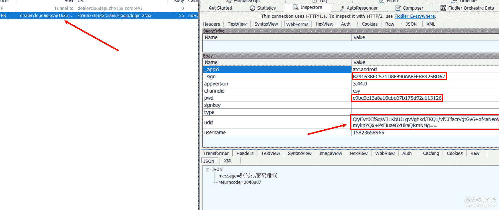
image-20240405152957683.png (188.25 KB, 下载次数: 2)
[href="forum.php?mod=attachment&aid=MjY4NzY5NHw3NjY0NDg1ZHwxNzkzNTgyMTM4fDE2ODA4NnwxOTEwMTA0&nothumb=yes" target="_blank"](https://www.52pojie.cn/forum.php?mod=attachment&aid=MjY4NzY5NHw3NjY0NDg1ZHwxNzkzNTgyMTM4fDE2ODA4NnwxOTEwMTA0&nothumb=yes)
2024-4-6 13:56 上传

### 2、
发现`_sign`、`pwd`、`udid`参数被加密了，再抓一次看看参数是否有变化
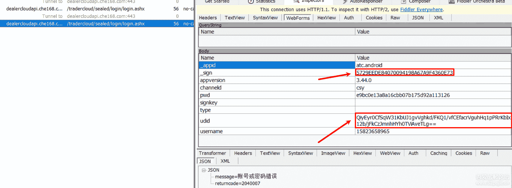
image-20240405153158667.png (182.48 KB, 下载次数: 2)
[href="forum.php?mod=attachment&aid=MjY4NzY5NXw4Nzc5MWU2NnwxNzkzNTgyMTM4fDE2ODA4NnwxOTEwMTA0&nothumb=yes" target="_blank"](https://www.52pojie.cn/forum.php?mod=attachment&aid=MjY4NzY5NXw4Nzc5MWU2NnwxNzkzNTgyMTM4fDE2ODA4NnwxOTEwMTA0&nothumb=yes)
2024-4-6 13:57 上传

### 3、
发现`_sign`、`udid`是变换的，`pwd`无变化，因为输入的密码是“a12345678”，其实这里已经猜到了是`MD5`加密

image-20240405153426877.png (16.37 KB, 下载次数: 1)
[href="forum.php?mod=attachment&aid=MjY4NzY5Nnw1ZGE5ZTZiZHwxNzkzNTgyMTM4fDE2ODA4NnwxOTEwMTA0&nothumb=yes" target="_blank"](https://www.52pojie.cn/forum.php?mod=attachment&aid=MjY4NzY5Nnw1ZGE5ZTZiZHwxNzkzNTgyMTM4fDE2ODA4NnwxOTEwMTA0&nothumb=yes)
2024-4-6 13:57 上传

## 二、崭露头角

### 1、
打开VSCode和frida，准备使用自吐脚本先梭哈一下
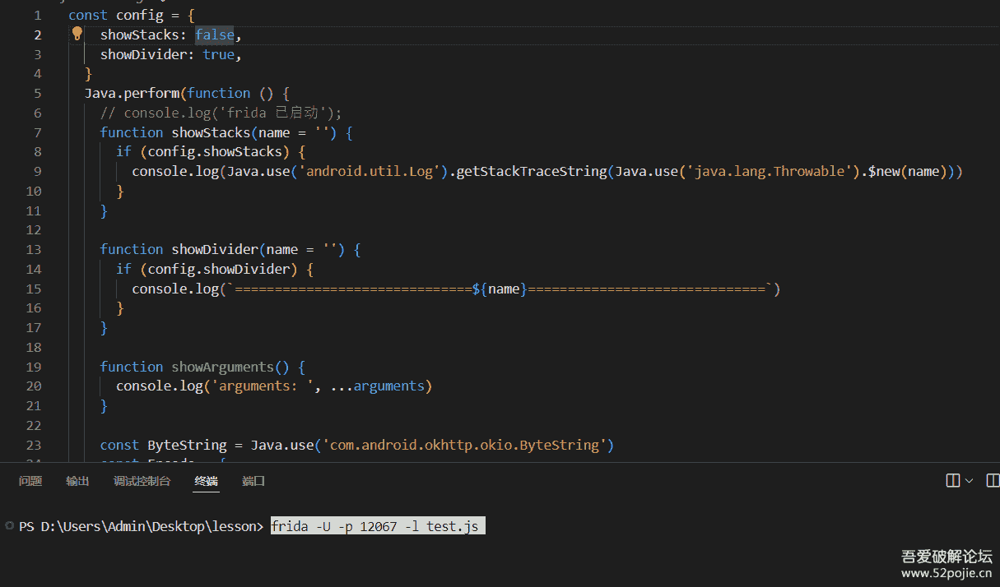
image-20240405154136731.png (69.21 KB, 下载次数: 2)
[href="forum.php?mod=attachment&aid=MjY4NzY5N3w0ZGM1MjI2YnwxNzkzNTgyMTM4fDE2ODA4NnwxOTEwMTA0&nothumb=yes" target="_blank"](https://www.52pojie.cn/forum.php?mod=attachment&aid=MjY4NzY5N3w0ZGM1MjI2YnwxNzkzNTgyMTM4fDE2ODA4NnwxOTEwMTA0&nothumb=yes)
2024-4-6 13:57 上传

### 2、
发现这里`pwd`果然是`MD5`加密，然后`udid`的值也被打印出来，跟本次抓包一致，还有一个`_sign`参数我们搜索一下，接下来继续进行分析
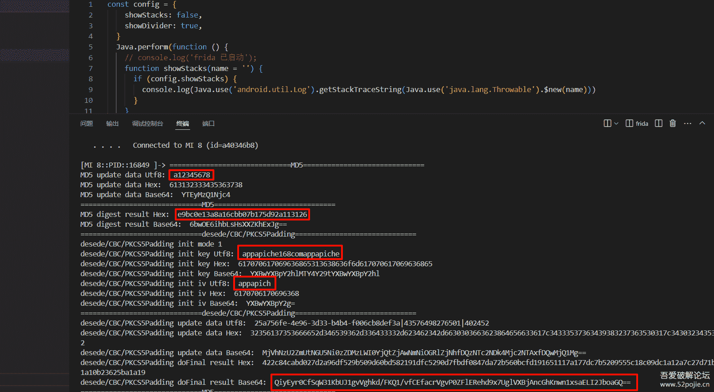
image-20240405154901742.png (111.82 KB, 下载次数: 3)
[href="forum.php?mod=attachment&aid=MjY4NzY5OHwzZmUzYTFlNXwxNzkzNTgyMTM4fDE2ODA4NnwxOTEwMTA0&nothumb=yes" target="_blank"](https://www.52pojie.cn/forum.php?mod=attachment&aid=MjY4NzY5OHwzZmUzYTFlNXwxNzkzNTgyMTM4fDE2ODA4NnwxOTEwMTA0&nothumb=yes)
2024-4-6 13:57 上传

### 3、
搜索到了，发现`_sign`也是`MD5`加密，我们继续分析明文的构成，因为其明文里有`udid`，所以直接拿`sign`开涮
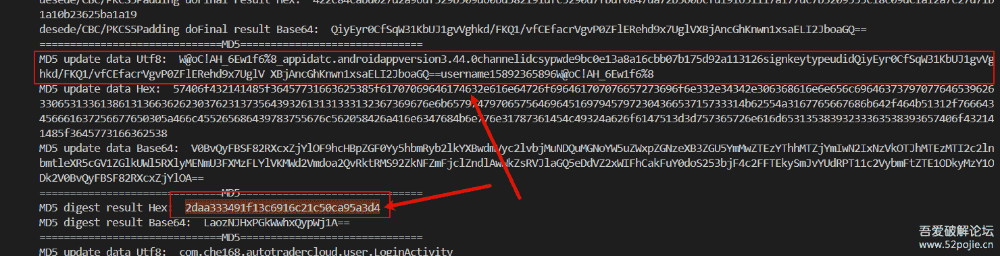
image-20240405155208516.png (76.13 KB, 下载次数: 1)
[href="forum.php?mod=attachment&aid=MjY4NzY5OXw0MjcwYzlhNnwxNzkzNTgyMTM4fDE2ODA4NnwxOTEwMTA0&nothumb=yes" target="_blank"](https://www.52pojie.cn/forum.php?mod=attachment&aid=MjY4NzY5OXw0MjcwYzlhNnwxNzkzNTgyMTM4fDE2ODA4NnwxOTEwMTA0&nothumb=yes)
2024-4-6 13:57 上传

### 4、
拆分`sign`的明文发现其结构如下，其前后由一个固定的字符串`W@oC!AH_6Ew1f6%8`构成，唯一变化的是`udid`，那我们就可以直接分析`udid`了
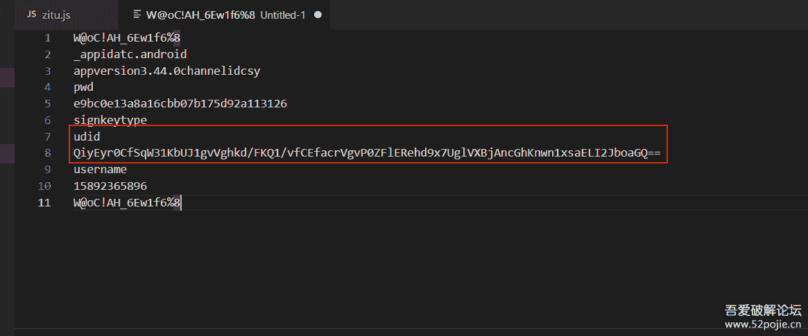
image-20240405155931905.png (37.28 KB, 下载次数: 2)
[href="forum.php?mod=attachment&aid=MjY4NzcwMHxjZjhiYzI1MXwxNzkzNTgyMTM4fDE2ODA4NnwxOTEwMTA0&nothumb=yes" target="_blank"](https://www.52pojie.cn/forum.php?mod=attachment&aid=MjY4NzcwMHxjZjhiYzI1MXwxNzkzNTgyMTM4fDE2ODA4NnwxOTEwMTA0&nothumb=yes)
2024-4-6 13:58 上传

## 三、略有小成

### 1、
直接把`apk`扔进`jadx`分析，搜索`udid`，发现有很多处，这样一个个看效率太慢了，当然你也可以使用搜索技巧“‘`udid`“，但这次我们使用一个新的方法，堆栈定位
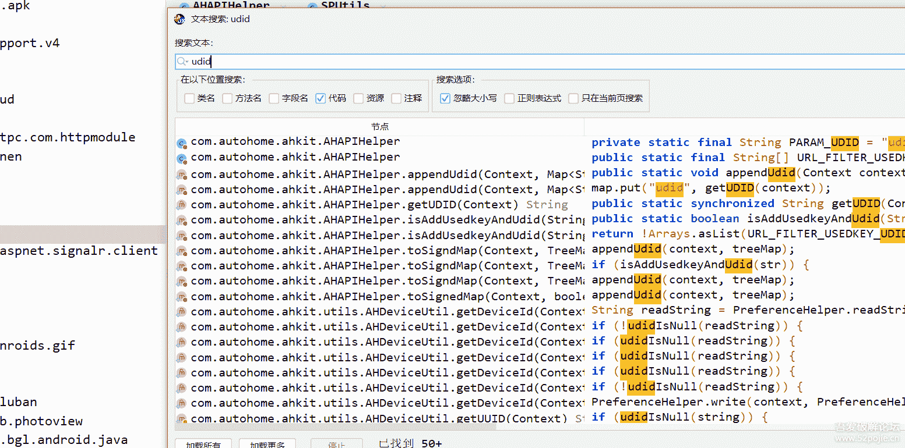
image-20240405161613568.png (161.66 KB, 下载次数: 2)
[href="forum.php?mod=attachment&aid=MjY4NzcwMXw1ZDRkYjJiMXwxNzkzNTgyMTM4fDE2ODA4NnwxOTEwMTA0&nothumb=yes" target="_blank"](https://www.52pojie.cn/forum.php?mod=attachment&aid=MjY4NzcwMXw1ZDRkYjJiMXwxNzkzNTgyMTM4fDE2ODA4NnwxOTEwMTA0&nothumb=yes)
2024-4-6 14:00 上传

### 2、
可以看到使用了`3des`加密，继续在`jadx`搜这个类进去看
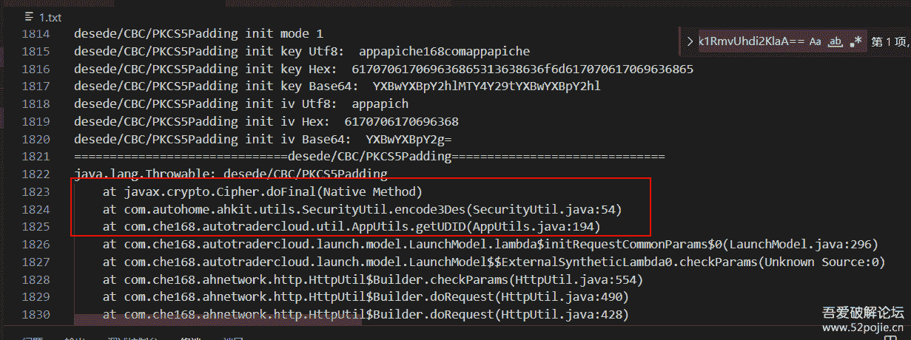
image-20240405161939726.png (93.52 KB, 下载次数: 2)
[href="forum.php?mod=attachment&aid=MjY4NzcwMnwyOTM5Yjg5MXwxNzkzNTgyMTM4fDE2ODA4NnwxOTEwMTA0&nothumb=yes" target="_blank"](https://www.52pojie.cn/forum.php?mod=attachment&aid=MjY4NzcwMnwyOTM5Yjg5MXwxNzkzNTgyMTM4fDE2ODA4NnwxOTEwMTA0&nothumb=yes)
2024-4-6 14:02 上传
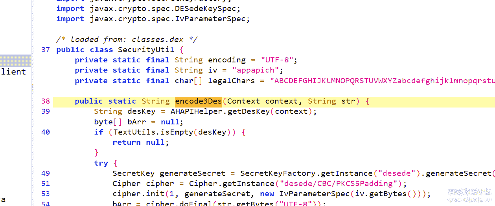
image-20240405163227082.png (70.67 KB, 下载次数: 2)
[href="forum.php?mod=attachment&aid=MjY4NzcwNXwyZmZhMWM4Y3wxNzkzNTgyMTM4fDE2ODA4NnwxOTEwMTA0&nothumb=yes" target="_blank"](https://www.52pojie.cn/forum.php?mod=attachment&aid=MjY4NzcwNXwyZmZhMWM4Y3wxNzkzNTgyMTM4fDE2ODA4NnwxOTEwMTA0&nothumb=yes)
2024-4-6 14:03 上传

### 3、
按x查看交叉引用，可以看到第一个参数是`context`，这个其实是`key`，然后是第二个参数是获取手机`IMEI`，这个参数是不变的，追踪进去发现是`sharepreference`，其实可以在手机文件里查看
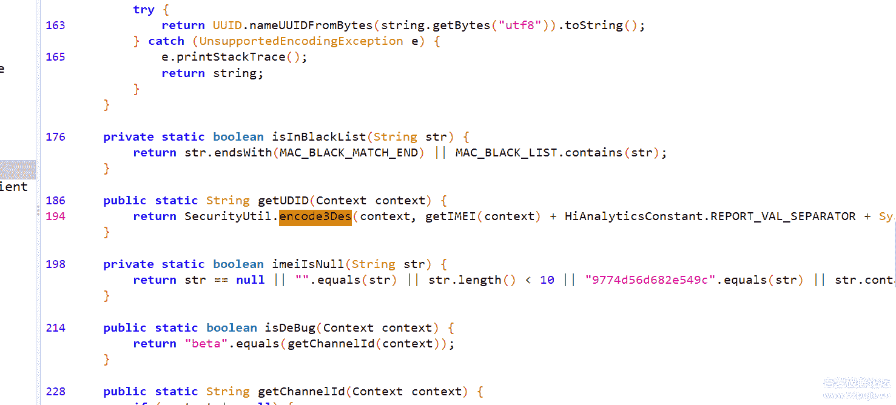
image-20240405163458859.png (71.09 KB, 下载次数: 3)
[href="forum.php?mod=attachment&aid=MjY4NzcwNnxiM2ZiYWUyOHwxNzkzNTgyMTM4fDE2ODA4NnwxOTEwMTA0&nothumb=yes" target="_blank"](https://www.52pojie.cn/forum.php?mod=attachment&aid=MjY4NzcwNnxiM2ZiYWUyOHwxNzkzNTgyMTM4fDE2ODA4NnwxOTEwMTA0&nothumb=yes)
2024-4-6 14:03 上传
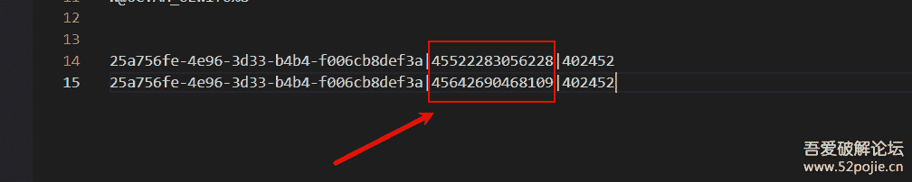
image-20240405163850229.png (19 KB, 下载次数: 1)
[href="forum.php?mod=attachment&aid=MjY4NzcwN3wxMTA2NjQyMHwxNzkzNTgyMTM4fDE2ODA4NnwxOTEwMTA0&nothumb=yes" target="_blank"](https://www.52pojie.cn/forum.php?mod=attachment&aid=MjY4NzcwN3wxMTA2NjQyMHwxNzkzNTgyMTM4fDE2ODA4NnwxOTEwMTA0&nothumb=yes)
2024-4-6 14:03 上传
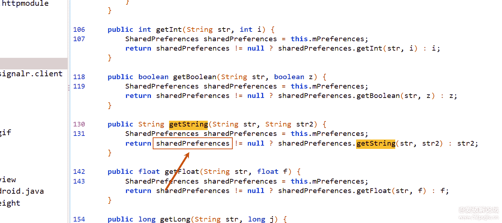
image-20240405222720961.png (66.33 KB, 下载次数: 2)
[href="forum.php?mod=attachment&aid=MjY4NzcwOHwyNDQ3MTM4NnwxNzkzNTgyMTM4fDE2ODA4NnwxOTEwMTA0&nothumb=yes" target="_blank"](https://www.52pojie.cn/forum.php?mod=attachment&aid=MjY4NzcwOHwyNDQ3MTM4NnwxNzkzNTgyMTM4fDE2ODA4NnwxOTEwMTA0&nothumb=yes)
2024-4-6 14:03 上传

### 4、
追踪进去可以看见`IMEI`，对比发现一致，这里惊喜注意到`KEY_DEVICE_ID`也跟最后一个参数一样的
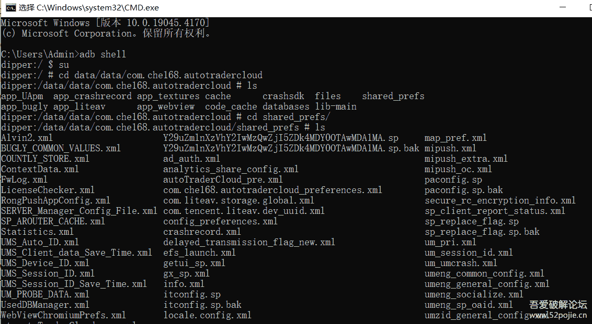
image-20240405222923340.png (109.89 KB, 下载次数: 2)
[href="forum.php?mod=attachment&aid=MjY4NzcwOXxlYzk1YThhZHwxNzkzNTgyMTM4fDE2ODA4NnwxOTEwMTA0&nothumb=yes" target="_blank"](https://www.52pojie.cn/forum.php?mod=attachment&aid=MjY4NzcwOXxlYzk1YThhZHwxNzkzNTgyMTM4fDE2ODA4NnwxOTEwMTA0&nothumb=yes)
2024-4-6 14:03 上传
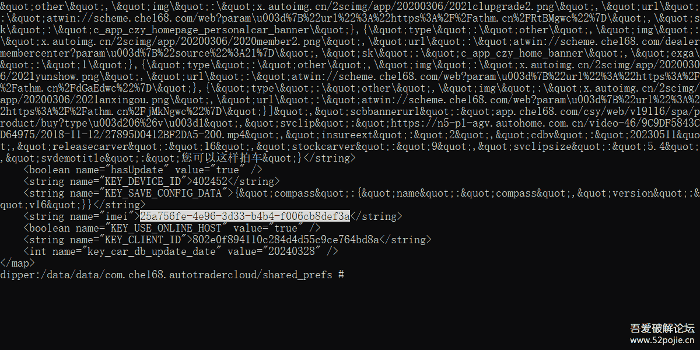
image-20240405222945297.png (117.49 KB, 下载次数: 2)
[href="forum.php?mod=attachment&aid=MjY4NzcxMHw4NjljZTM1ZnwxNzkzNTgyMTM4fDE2ODA4NnwxOTEwMTA0&nothumb=yes" target="_blank"](https://www.52pojie.cn/forum.php?mod=attachment&aid=MjY4NzcxMHw4NjljZTM1ZnwxNzkzNTgyMTM4fDE2ODA4NnwxOTEwMTA0&nothumb=yes)
2024-4-6 14:03 上传

### 5、
第三个参数变化的那个是`nanoTime`，是从开机到目前时间的时间差，至此加密参数已经分析完，最后感谢沐阳大佬给的自吐脚本
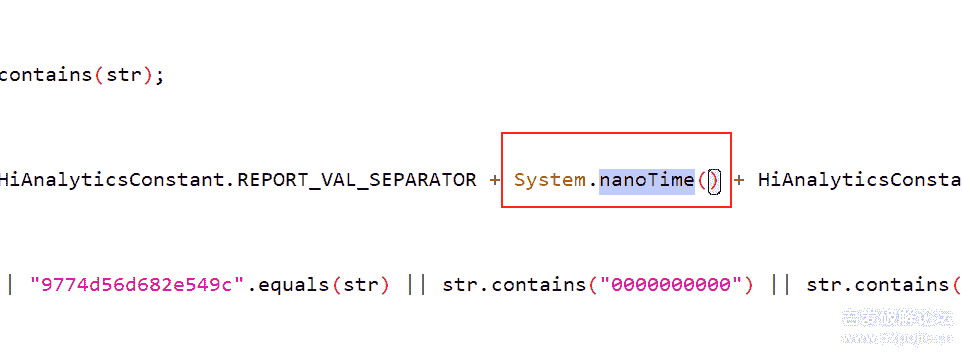
image-20240405223144049.png (19.86 KB, 下载次数: 3)
[href="forum.php?mod=attachment&aid=MjY4NzcwM3wxNjAxMjQ3OHwxNzkzNTgyMTM4fDE2ODA4NnwxOTEwMTA0&nothumb=yes" target="_blank"](https://www.52pojie.cn/forum.php?mod=attachment&aid=MjY4NzcwM3wxNjAxMjQ3OHwxNzkzNTgyMTM4fDE2ODA4NnwxOTEwMTA0&nothumb=yes)
2024-4-6 14:03 上传
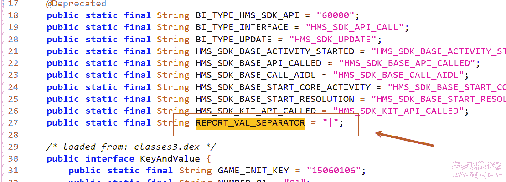
image-20240405223204445.png (80.52 KB, 下载次数: 3)
[href="forum.php?mod=attachment&aid=MjY4NzcwNHxmNzNlYTMyNnwxNzkzNTgyMTM4fDE2ODA4NnwxOTEwMTA0&nothumb=yes" target="_blank"](https://www.52pojie.cn/forum.php?mod=attachment&aid=MjY4NzcwNHxmNzNlYTMyNnwxNzkzNTgyMTM4fDE2ODA4NnwxOTEwMTA0&nothumb=yes)
2024-4-6 14:03 上传
