# [Android 原创] 对《用小黄鸟破解某利说英语APP》破解方式的补充

- 原帖：https://www.52pojie.cn/forum.php?mod=viewthread&tid=1912175
- 抓取时间：2026-11-02T01:15:31

## 一、前言

[《用小黄鸟破解某利说英语APP》](https://www.52pojie.cn/thread-1909641-1-1.html)的作者通过小黄鸟修改返回 `json` 的方式，破解了该 App“情境实战”功能部分内容付费查看限制。作者也提到此帖是以我的[《用小黄鸟破解某健身APP》](https://www.52pojie.cn/thread-1907989-1-1.html)作为模板所写的。身为小白的我倍感惊喜，因为那篇帖子是我在论坛发的第一篇实战分享帖，居然能够被借鉴，很意外；同时也感到一点不踏实，因为我在我的帖子里所用到的破解方法是比较简单的方法，不足之处在于要使破解生效，必须在每次打开软件时开启小黄鸟抓包重写数据才行，有点麻烦。尝试过用修改代码的方法去破解，可惜功底太薄，能力不足，那款健身软件代码被混淆了，看不懂一点，就暂时放弃了。但是我看完这位作者的帖子去复现的时候，发现这款 app 有些代码是没有被混淆的，那就可以尝试通过修改代码逻辑去破解。

## 二、破解过程

### 2.1 整理逻辑

在已登录账号，已完成等级测试的前提下，点击情境实战，出现关卡列表，部分免费无锁，可以直接点击查看，往上翻就是收费有锁的了。

`093126qhz2aka8dd691ga2.jpg`（190.1 KB，下载次数：0，2024-4-10 22:54 上传）[附件](https://www.52pojie.cn/forum.php?mod=attachment&aid=MjY4ODYzNHw4YmE1MTg5ZnwxNzkzNTgyMTMxfDE2ODA4NnwxOTEyMTc1&nothumb=yes)

那么此时有两种思路：一是修改用户身份，改为付费用户，点击这个功能自然就能畅享所有内容了；二是将付费有锁内容改为免费无锁内容，不论用户身份如何都能畅享所有内容。那么我们如何去找判断用户身份的代码？如何去找判断关卡是收费免费、是有所无锁的代码呢？原帖作者用小黄鸟抓包返回的数据给出了线索。

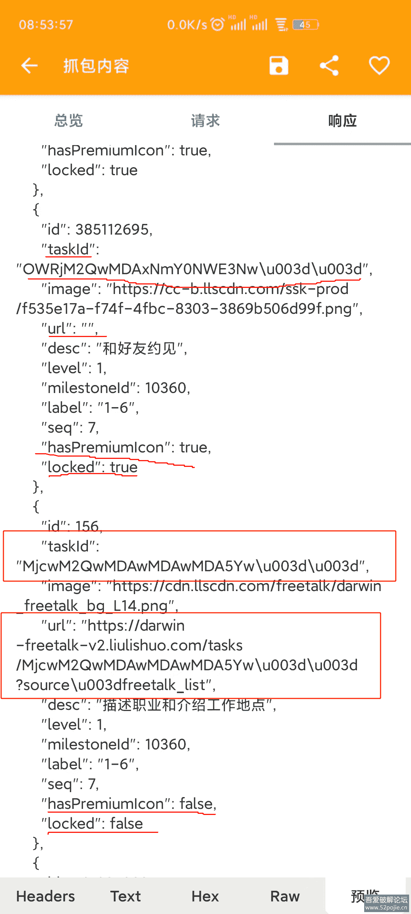

`091103zcnhinuc0kop8l16.jpg`（223.52 KB，下载次数：0，2024-4-10 23:00 上传）[附件](https://www.52pojie.cn/forum.php?mod=attachment&aid=MjY4ODYzNXxhY2RhNmQwMnwxNzkzNTgyMTMxfDE2ODA4NnwxOTEyMTc1&nothumb=yes)

从服务器返回的数据可以看到，这是关卡列表，每一关有它的 `id`、`taskId`、`image` 等属性。而收费有锁关卡跟免费无锁关卡的不同之处在于：收费有锁关卡的 `url` 是没有的，`hasPremiumIcon` 的值为 `true`，`locked` 的值为 `true`；免费无锁的关卡则在这三处与之相反。那么将收费有锁关卡这三处进行修改，就可以使它们变得像免费无锁关卡，也就能无偿使用了。这样我们就先用第二种思路，修改收费有锁关卡为免费无锁关卡。

### 2.2 寻找代码

观察关卡列表里的内容，每一关都有各自不同的 `id`、`taskId` 等属性，那么必然存在对应的函数方法，如 `getId()`、`getTaskId()` 等。那我们选择最具代表性的 `hasPremiumIcon`，到 NP管理器 搜索方法名 `getHasPremiumIcon`。

（插一句：要先提取安装包，看 app 有没有壳；有壳要先脱壳，站内外有很多[脱壳教程](https://www.52pojie.cn/forum-5-1.html)，在此不赘述；幸运的是此 app 无壳。）

点击 安装包 > 查看 > 点击任一 `classes` 文件 > 选择 `Dex编辑Plus` > 全选 > 确定 > 点击“搜索”选项卡 > 发起新搜索 > 查找内容输入 `gethaspremiumicon`，搜索类型选择“方法名” > 确定。

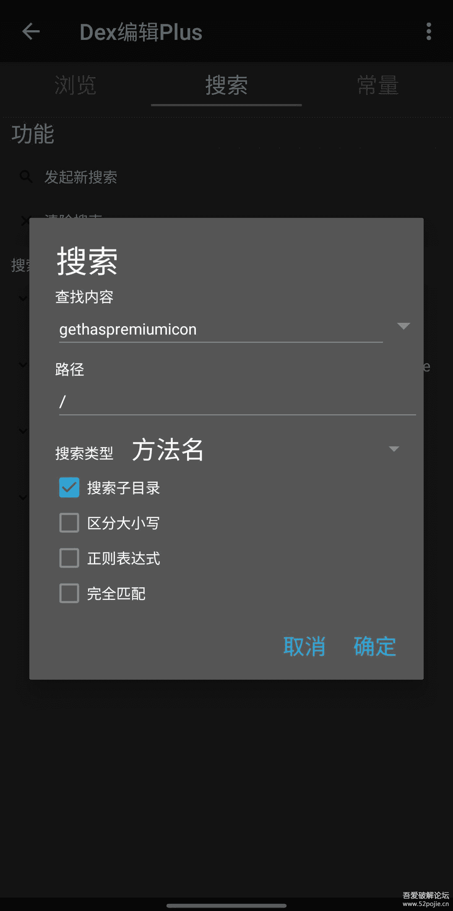

`qq_pic_merged_1712763611492.jpg`（97.08 KB，下载次数：0，2024-4-10 23:40 上传）[附件](https://www.52pojie.cn/forum.php?mod=attachment&aid=MjY4ODY0MXwyZjdiODA0MnwxNzkzNTgyMTMxfDE2ODA4NnwxOTEyMTc1&nothumb=yes)

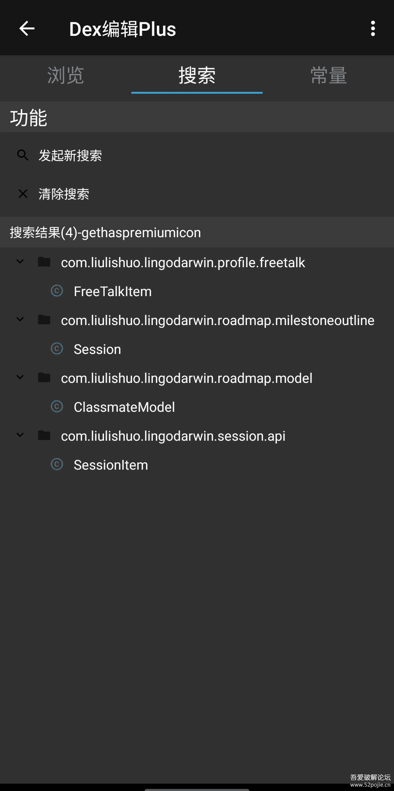

`qq_pic_merged_1712763675289.jpg`（121.06 KB，下载次数：0，2024-4-10 23:41 上传）[附件](https://www.52pojie.cn/forum.php?mod=attachment&aid=MjY4ODY0MnwzMWQyYzRiNXwxNzkzNTgyMTMxfDE2ODA4NnwxOTEyMTc1&nothumb=yes)

出现了四项结果，选择哪一个才对？再看看原帖有没有线索。

`090500njnuudbbj0n1jlhf.jpg`（109.47 KB，下载次数：0，2024-4-10 23:42 上传）[附件](https://www.52pojie.cn/forum.php?mod=attachment&aid=MjY4ODY0M3w4NDNkNzBlM3wxNzkzNTgyMTMxfDE2ODA4NnwxOTEyMTc1&nothumb=yes)

原帖作者画线所指的抓包数据网址有一个关键词 `freetal...`，我想应该是跟搜索结果里的 `FreeTalkItem` 对应吧。点它，看看它是不是有获取关卡各项属性的方法，点击指南针导航。

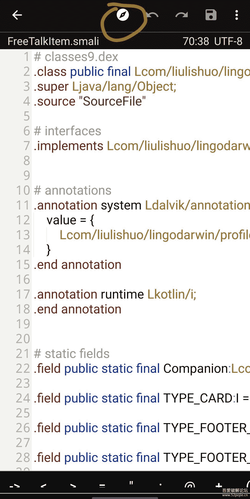

`qq_pic_merged_1712764454751.jpg`（239.89 KB，下载次数：1，2024-4-10 23:54 上传）[附件](https://www.52pojie.cn/forum.php?mod=attachment&aid=MjY4ODY0N3xmMTIzY2U3OHwxNzkzNTgyMTMxfDE2ODA4NnwxOTEyMTc1&nothumb=yes)

往下翻，可以看出确实存在获取关卡各项属性的方法。

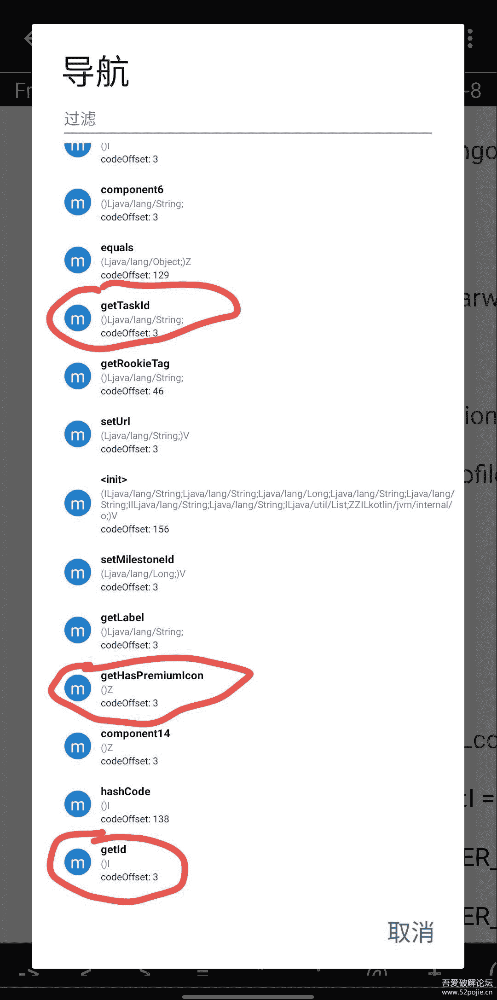

`qq_pic_merged_1712764610667.jpg`（174.94 KB，下载次数：0，2024-4-10 23:56 上传）[附件](https://www.52pojie.cn/forum.php?mod=attachment&aid=MjY4ODY0OHw5OTFiOGY0M3wxNzkzNTgyMTMxfDE2ODA4NnwxOTEyMTc1&nothumb=yes)

这种在 `smali` 语法下查看不够快，方法比较分散无序的话，可以转 `java` 看。

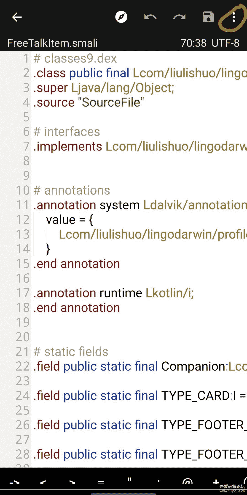

`qq_pic_merged_1712764777604.jpg`（253.06 KB，下载次数：0，2024-4-11 00:00 上传）[附件](https://www.52pojie.cn/forum.php?mod=attachment&aid=MjY4ODY1MHw0MDBmOTEwMnwxNzkzNTgyMTMxfDE2ODA4NnwxOTEyMTc1&nothumb=yes)

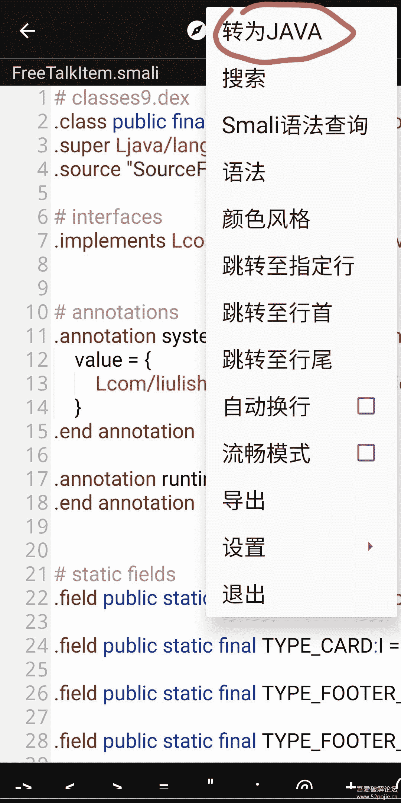

`qq_pic_merged_1712764804637.jpg`（270.6 KB，下载次数：0，2024-4-11 00:00 上传）[附件](https://www.52pojie.cn/forum.php?mod=attachment&aid=MjY4ODY1MXwwZDFlYjc2Y3wxNzkzNTgyMTMxfDE2ODA4NnwxOTEyMTc1&nothumb=yes)

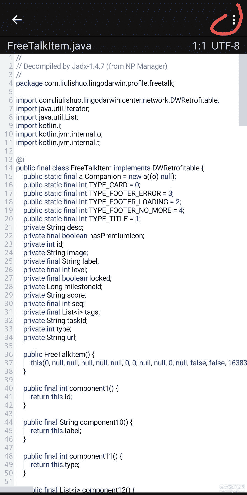

`qq_pic_merged_1712764993425.jpg`（284.61 KB，下载次数：0，2024-4-11 00:07 上传）[附件](https://www.52pojie.cn/forum.php?mod=attachment&aid=MjY4ODY1MnxkMmRkY2NhNnwxNzkzNTgyMTMxfDE2ODA4NnwxOTEyMTc1&nothumb=yes)

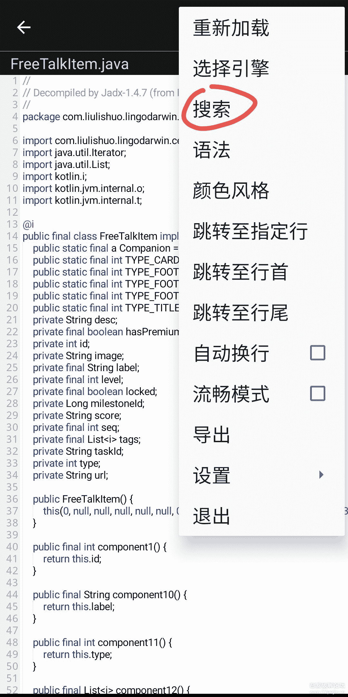

`qq_pic_merged_1712765009197.jpg`（310.88 KB，下载次数：0，2024-4-11 00:07 上传）[附件](https://www.52pojie.cn/forum.php?mod=attachment&aid=MjY4ODY1M3xmNjcwMzcyOHwxNzkzNTgyMTMxfDE2ODA4NnwxOTEyMTc1&nothumb=yes)

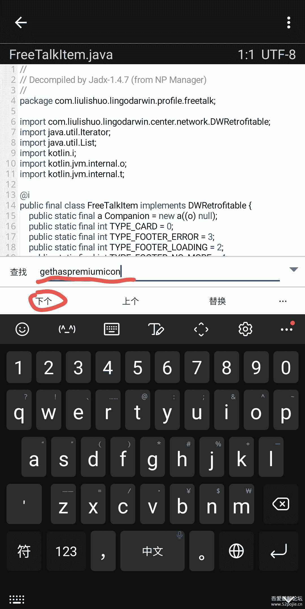

`qq_pic_merged_1712765035339.jpg`（234.1 KB，下载次数：1，2024-4-11 00:07 上传）[附件](https://www.52pojie.cn/forum.php?mod=attachment&aid=MjY4ODY1NHwyZmRjYWYxNHwxNzkzNTgyMTMxfDE2ODA4NnwxOTEyMTc1&nothumb=yes)

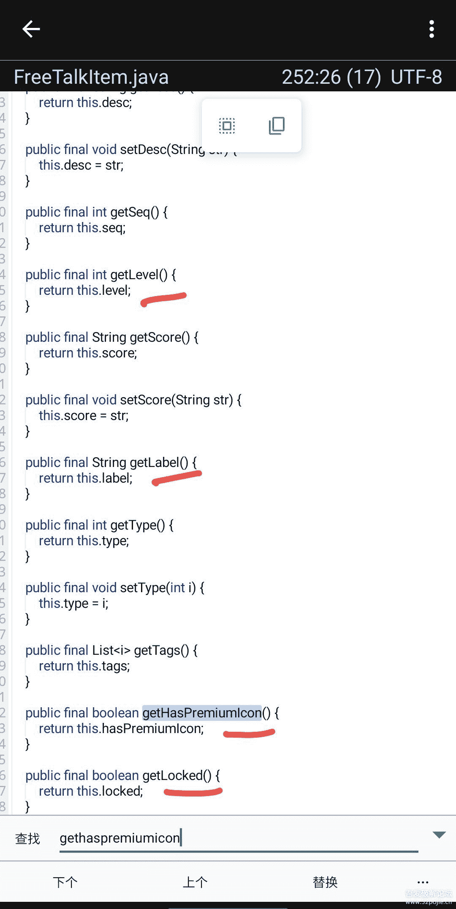

`qq_pic_merged_1712765228405.jpg`（189.34 KB，下载次数：0，2024-4-11 00:07 上传）[附件](https://www.52pojie.cn/forum.php?mod=attachment&aid=MjY4ODY1NXw0ZTY2OGVhMnwxNzkzNTgyMTMxfDE2ODA4NnwxOTEyMTc1&nothumb=yes)

### 2.3 代码修改

方法借鉴这篇帖子：[https://www.52pojie.cn/thread-1747613-1-1.html](https://www.52pojie.cn/thread-1747613-1-1.html)

代码已经找到，前面也知道了收费有锁关卡跟免费无锁关卡的不同在于 `url` 是否有内容，`haspremiumicon` 为 `true` 还是 `false`，`locked` 为 `true` 还是 `false`。那么我们让服务器返回的关卡都变为免费无锁关卡，先把 `haspremiumicon` 和 `locked` 都改为 `false`。它们俩的方法都是返回 `boolean` 类型的真假值，那就强行赋 `false`。从 `java` 返回到 `smali` 语法下修改。

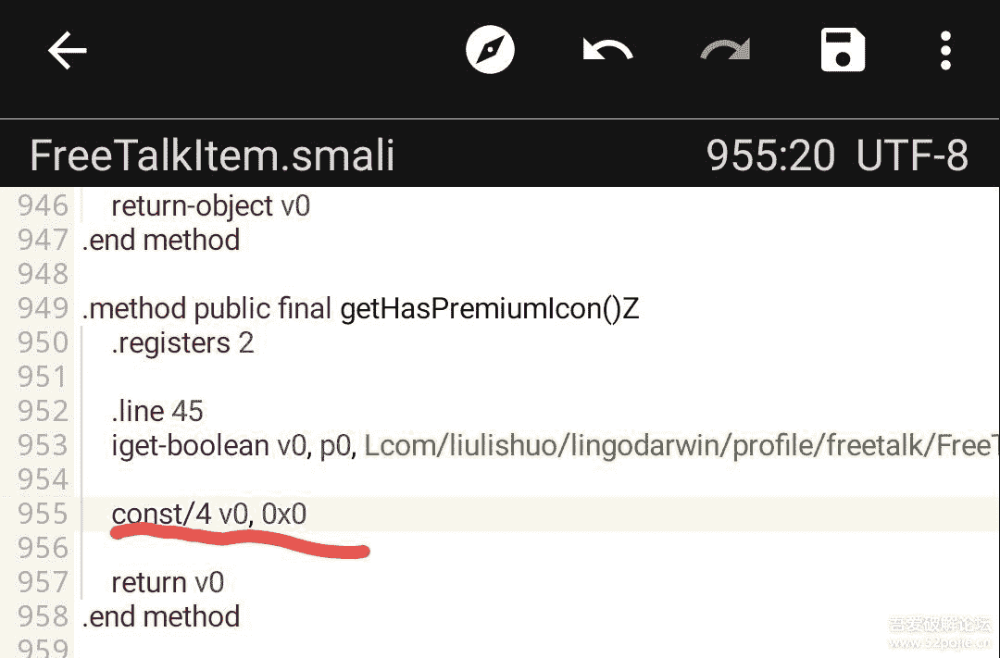

`qq_pic_merged_1712766451900.jpg`（77.5 KB，下载次数：0，2024-4-11 00:28 上传）[附件](https://www.52pojie.cn/forum.php?mod=attachment&aid=MjY4ODY1OXwyY2E5MGFiZHwxNzkzNTgyMTMxfDE2ODA4NnwxOTEyMTc1&nothumb=yes)

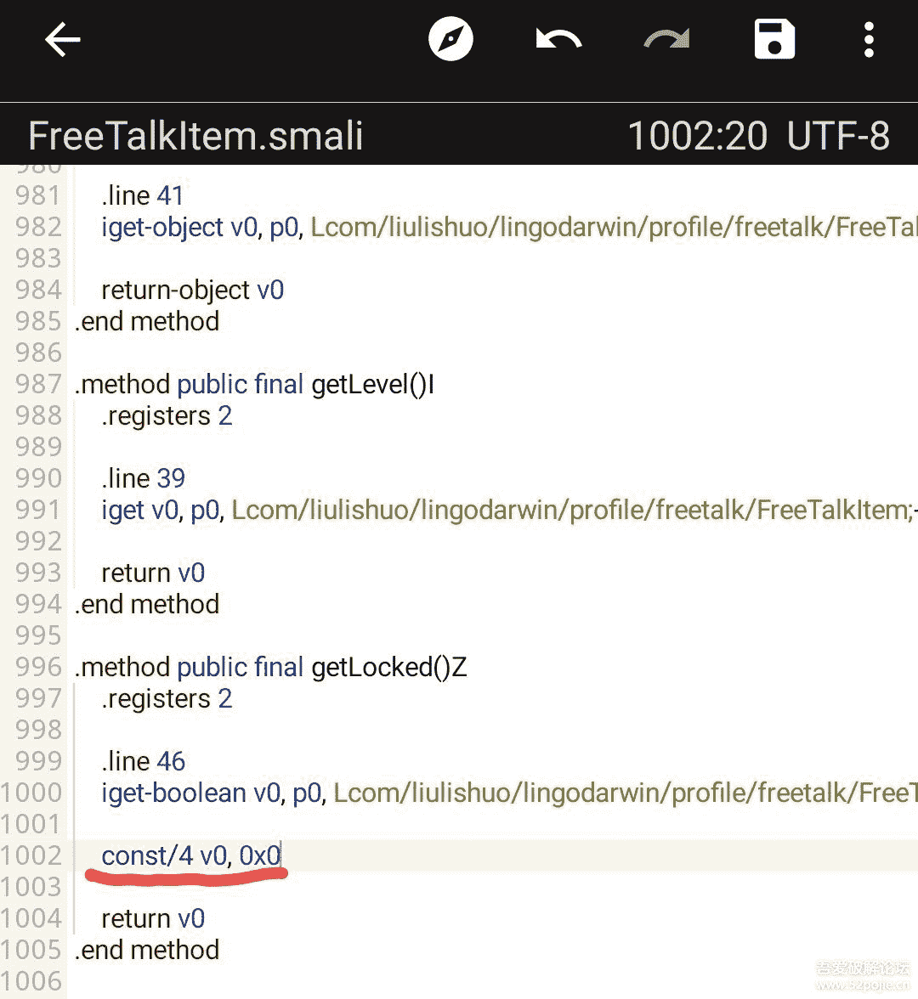

`qq_pic_merged_1712766490428.jpg`（127.87 KB，下载次数：1，2024-4-11 00:28 上传）[附件](https://www.52pojie.cn/forum.php?mod=attachment&aid=MjY4ODY2MHxlMjNmMTA5NnwxNzkzNTgyMTMxfDE2ODA4NnwxOTEyMTc1&nothumb=yes)

这样从服务器返回的关卡都是免费无锁的了。

# 修改收费有锁关卡URL的思路

重点来了，`url`这个地方怎么改？原帖作者已经为我们解释了，免费无锁的关卡的`url`是有内容的，收费有锁的关卡的`url`是没有内容的，而且这个`url`的形成有一个规律，每个关卡对应的`url`只有中间部分不同，中间部分恰好是各个关卡对应的`taskId`，那么`url`的格式就是`url = 统一开头 + taskId + 统一结尾`。

也就是`url = https://darwin-freetalk-v2.liulishuo.com/tasks/ + "taskId" + ?source=freetalk_list`，同时注意到每个关卡的`taskId`都是有的，那我们就可以写代码创建`url`，补齐收费有锁关卡的`url`。

## 修改思路

我们修改思路也清晰了，先看服务器返回的`url`是不是空的，如果是空的，我们就创建一条`url`再作为方法的返回结果，如果不是空的，直接将服务器返回的`url`作为方法的返回结果。

先找到`getUrl`这一方法。

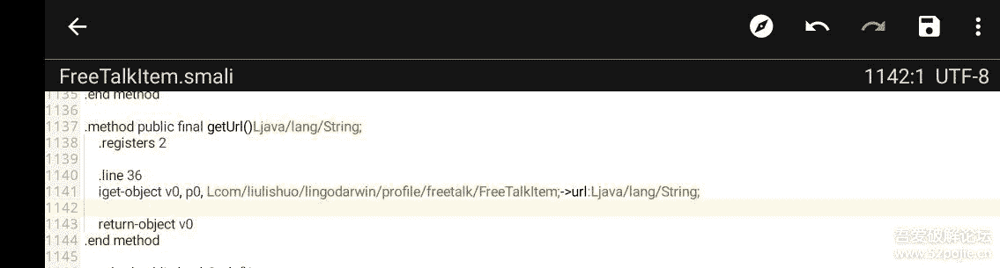

`qq_pic_merged_1712767675486.jpg`（32.29 KB，下载次数：1；2024-4-11 00:47 上传）[下载附件](https://www.52pojie.cn/forum.php?mod=attachment&aid=MjY4ODY2M3wxZDdmOTFkMnwxNzkzNTgyMTMxfDE2ODA4NnwxOTEyMTc1&nothumb=yes)

## 判断URL是否为空

怎么写判断`url`是否为空的代码？这里是`smali`语法，我也不太清楚该怎么写，但是我知道`smali`语句有其对应的`java`语句，我们可以先写`java`再转`smali`，复制粘贴进来就可以。

这里用到NP管理器的`java`转`smali`功能。

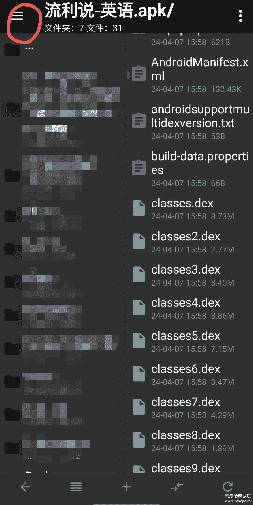

`qq_pic_merged_1712767977652.jpg`（194.54 KB，下载次数：0；2024-4-11 00:53 上传）[下载附件](https://www.52pojie.cn/forum.php?mod=attachment&aid=MjY4ODY2NHwwNWU0Yjk0YXwxNzkzNTgyMTMxfDE2ODA4NnwxOTEyMTc1&nothumb=yes)

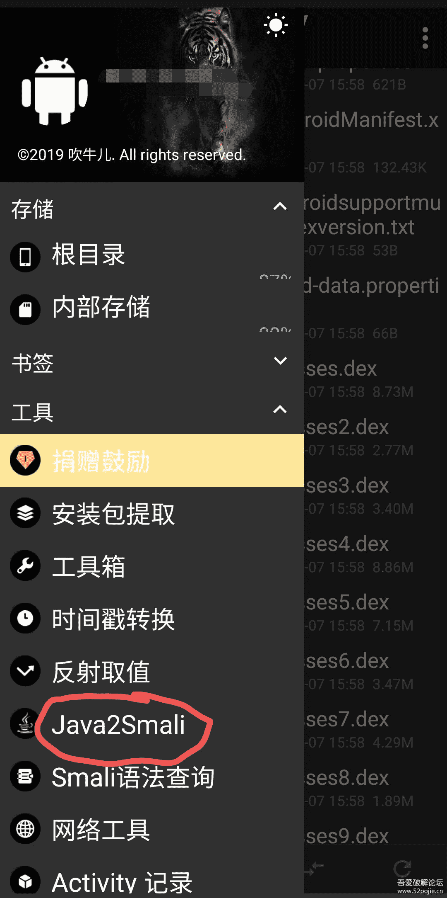

`qq_pic_merged_1712768030991.jpg`（198.05 KB，下载次数：2；2024-4-11 00:53 上传）[下载附件](https://www.52pojie.cn/forum.php?mod=attachment&aid=MjY4ODY2NXwxNjgzYmFmNXwxNzkzNTgyMTMxfDE2ODA4NnwxOTEyMTc1&nothumb=yes)

先定义一个字符串类型的变量并赋值，用`isEmpty`方法去判断并获取结果，写好后点击右上角保存图标右边的转换图标，获取到`smali`语法的`isEmpty`语句，复制过去。

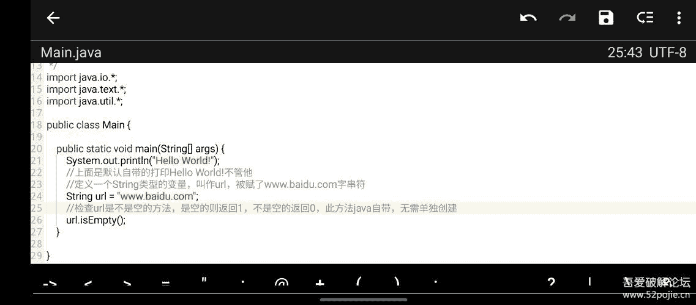

`qq_pic_merged_1712768731998.jpg`（57.09 KB，下载次数：1；2024-4-11 01:08 上传）[下载附件](https://www.52pojie.cn/forum.php?mod=attachment&aid=MjY4ODY2Nnw4ZmJmYzRkN3wxNzkzNTgyMTMxfDE2ODA4NnwxOTEyMTc1&nothumb=yes)

`qq_pic_merged_1712768807318.jpg`（46.48 KB，下载次数：0；2024-4-11 01:08 上传）[下载附件](https://www.52pojie.cn/forum.php?mod=attachment&aid=MjY4ODY2N3wyNTdkMzY0NnwxNzkzNTgyMTMxfDE2ODA4NnwxOTEyMTc1&nothumb=yes)

复制到获取`url`的语句下面，再加上判断`isEmpty`结果的语句和跳转。

每一句的含义看它上面的注释。

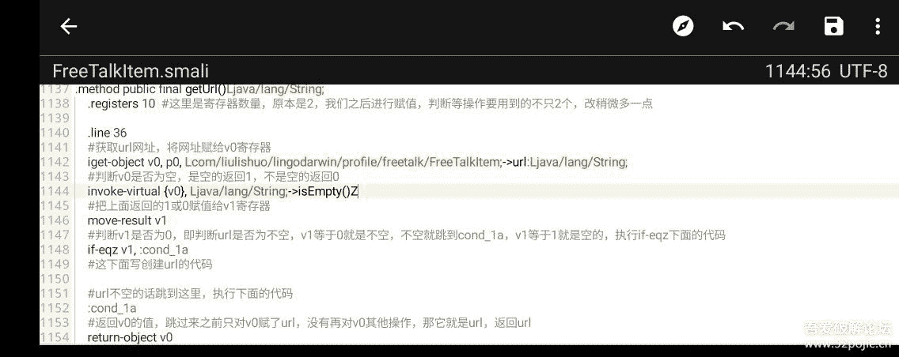

`qq_pic_merged_1712770302606.jpg`（68.93 KB，下载次数：0；2024-4-11 01:33 上传）[下载附件](https://www.52pojie.cn/forum.php?mod=attachment&aid=MjY4ODY3Nnw1Y2U3NTBjZnwxNzkzNTgyMTMxfDE2ODA4NnwxOTEyMTc1&nothumb=yes)

## 创建URL的代码

再来看创建`url`的代码怎么写，先要获取`taskId`，我们可以调用`getTaskId`这个方法，把这个方法返回的结果赋给一个变量，再定义两个变量，分别赋`统一开头`和`统一结尾`，最后再按照次序把`统一开头`变量、`taskId`变量、`统一结尾`变量拼接起来，把拼接的结果赋给另一个变量，作为`getUrl`这个方法的返回结果。

还是一样，我不会写`smali`语句，先写`java`再转。

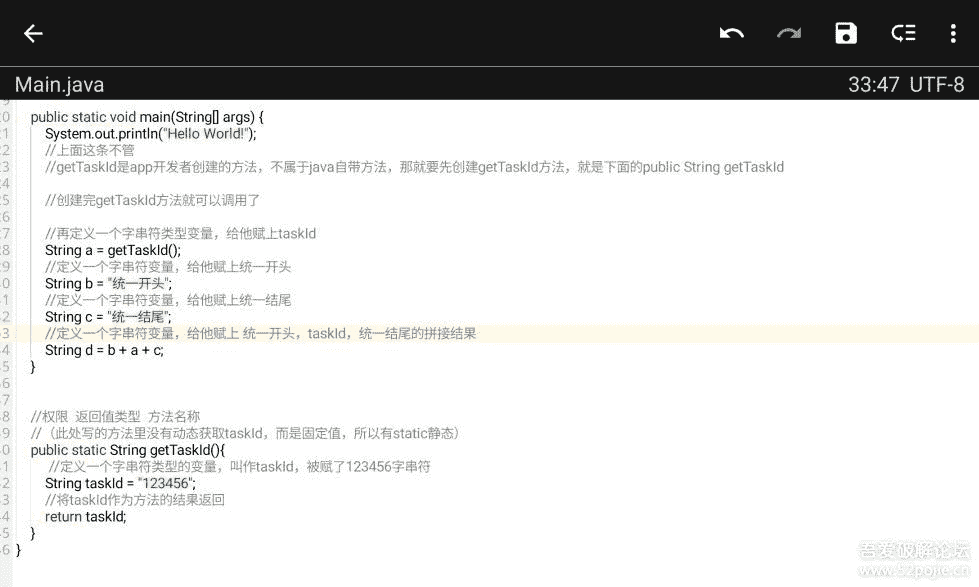

`qq_pic_merged_1712773178837.jpg`（57.32 KB，下载次数：0；2024-4-11 02:20 上传）[下载附件](https://www.52pojie.cn/forum.php?mod=attachment&aid=MjY4ODY4MHw4ZjhhNmYxZnwxNzkzNTgyMTMxfDE2ODA4NnwxOTEyMTc1&nothumb=yes)

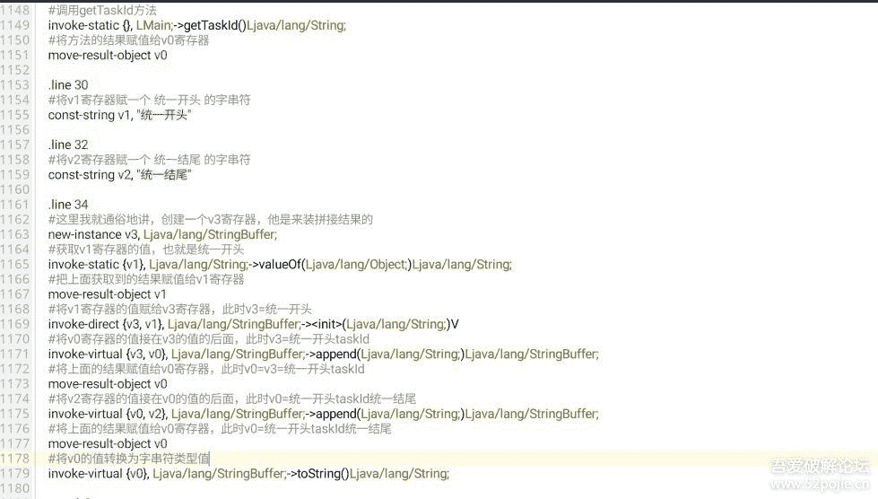

`qq_pic_merged_1712774314138.jpg`（80.67 KB，下载次数：1；2024-4-11 02:38 上传）[下载附件](https://www.52pojie.cn/forum.php?mod=attachment&aid=MjY4ODY4MXw1NGMzNzYxNnwxNzkzNTgyMTMxfDE2ODA4NnwxOTEyMTc1&nothumb=yes)

## 修改smali语句

看懂代码意思后就复制过去，再做修改。注意两个地方，一是我在`java`里写的`getTaskId`方法要由静态改为动态，因为我自己写的版本没有动态获取`taskId`，所以那时候必须用`static`修饰方法名，修改时要将`getTaskId`那句`smali`语句的`invoke-static {}`改为`invoke-virtual {p0}`。

二是全类名修改，还是定位到`getTaskId`这句`smali`语句，修改前的全类名是`LMain;`要改为`Lcom/liulishuo/lingodarwin/profile/freetalk/FreeTalkItem;`。

调用`getTaskId`的`smali`语句修改前后对比：

### 修改前

`qq_pic_merged_1712775093848.jpg`（29.63 KB，下载次数：0；2024-4-11 02:53 上传）[下载附件](https://www.52pojie.cn/forum.php?mod=attachment&aid=MjY4ODY4MnwyZjFiMTNiM3wxNzkzNTgyMTMxfDE2ODA4NnwxOTEyMTc1&nothumb=yes)

### 修改后

`qq_pic_merged_1712775129493.jpg`（23.78 KB，下载次数：0；2024-4-11 02:53 上传）[下载附件](https://www.52pojie.cn/forum.php?mod=attachment&aid=MjY4ODY4M3xmNDI1ZDYyNnwxNzkzNTgyMTMxfDE2ODA4NnwxOTEyMTc1&nothumb=yes)

此外还要修改`统一开头`、`统一结尾`这些字符串的值，改为实际网址，并且要调整寄存器的编号，从`getUrl`这一方法从前往后逐行逐个看，调整至符合逻辑。

修改好后完整代码如下：

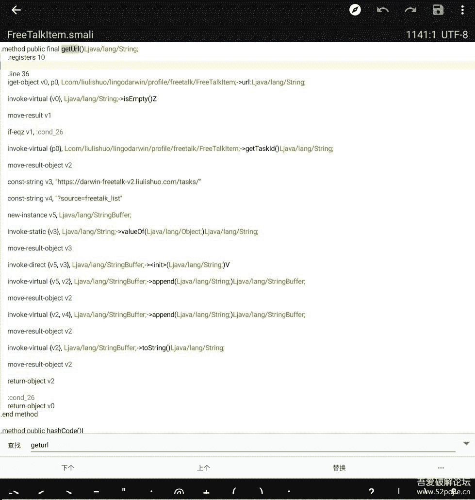

`qq_pic_merged_1712776559164.jpg`（103.85 KB，下载次数：0；2024-4-11 03:16 上传）[下载附件](https://www.52pojie.cn/forum.php?mod=attachment&aid=MjY4ODY4NHxhYzM1YWYzOXwxNzkzNTgyMTMxfDE2ODA4NnwxOTEyMTc1&nothumb=yes)

## 验证

修改完后保存，签名，一气呵成，没有签名校验，成功启动。再登录账号，点击情境实战，已全部解锁，有效可用。

`Screenshot_20240411-031928_-.jpg`（318.05 KB，下载次数：1；2024-4-11 03:19 上传）[下载附件](https://www.52pojie.cn/forum.php?mod=attachment&aid=MjY4ODY4NXxhY2M0Y2JiOHwxNzkzNTgyMTMxfDE2ODA4NnwxOTEyMTc1&nothumb=yes)
