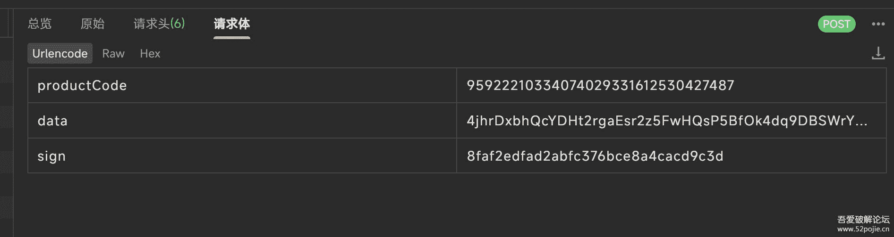
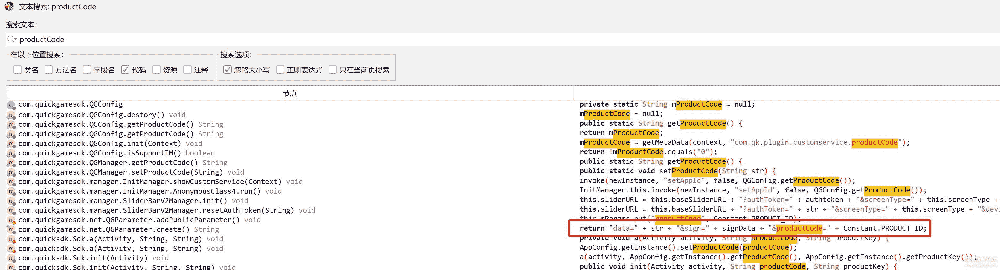
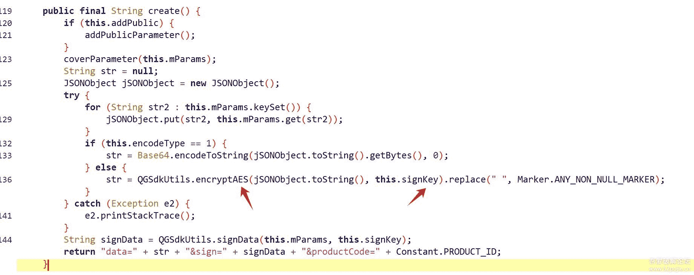
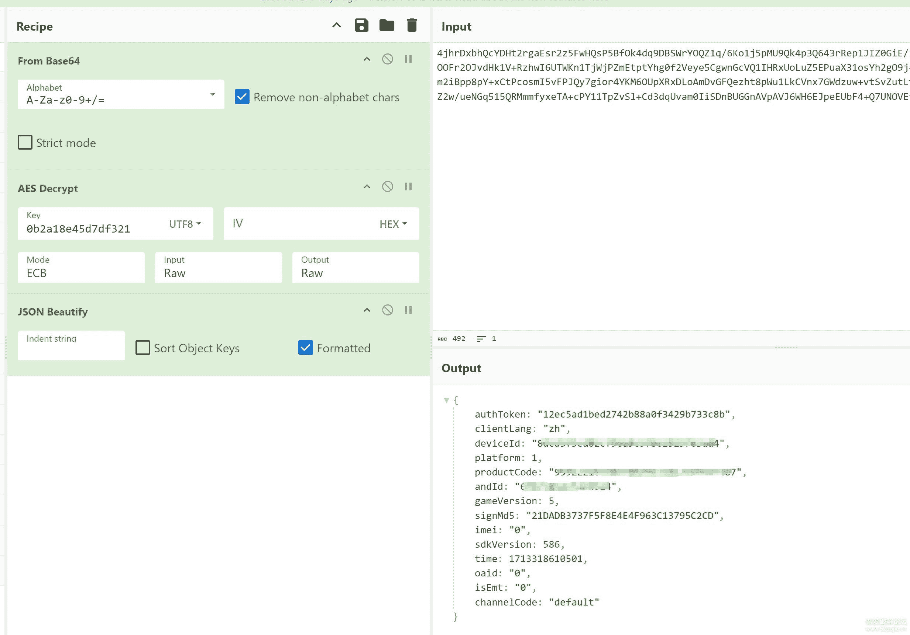
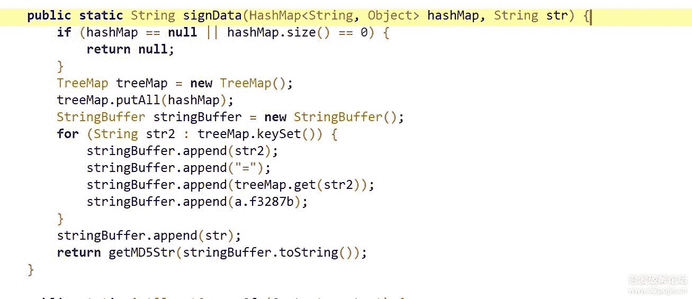
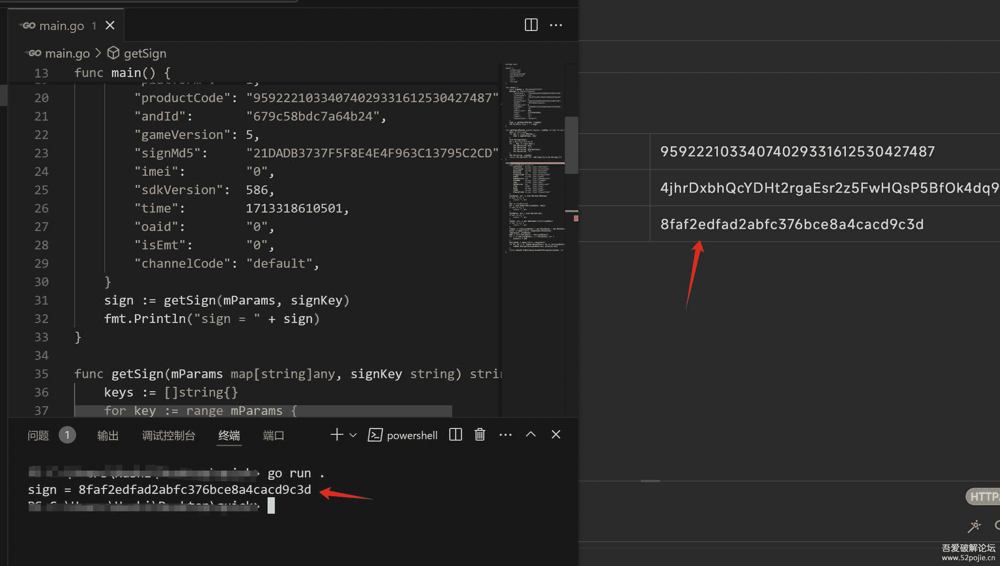

# [Android 原创] 某手游登录SDK接口解密

- 原帖: https://www.52pojie.cn/forum.php?mod=viewthread&tid=1915146
- 抓取时间: 2026-11-02T01:15:21

最近在玩某手游，对这个接入的登录SDK有点兴趣，抓包发现接口加密了，分析后发现比较简单，apk也没有加密，适合入门练习。

## 1、抓包

多次抓包后发现，请求体的`productCode`是不变的，`data`和`sign`每次都在变化，第一眼会察觉`data`是base64/aes，`sign`是md5

  
微信截图_20240418163214.png (69.38 KB, 下载次数: 0)  
[href="forum.php?mod=attachment&aid=MjY5MDE2NHw2ZDE4ZWFiMHwxNzkzNTgyMTIxfDE2ODA4NnwxOTE1MTQ2&nothumb=yes" target="_blank"](https://www.52pojie.cn/forum.php?mod=attachment&aid=MjY5MDE2NHw2ZDE4ZWFiMHwxNzkzNTgyMTIxfDE2ODA4NnwxOTE1MTQ2&nothumb=yes)  
2024-4-18 16:34 上传

## 2、分析

`data`和`sign`关键字太大众了，`productCode`倒是一个很好的切入点，apk拖入jadx，分析完后直接搜索`productCode`，一下就看到要找的地方了

  
微信截图_20240418163653.png (481.29 KB, 下载次数: 0)  
[href="forum.php?mod=attachment&aid=MjY5MDE2N3w3ZGIxMzczM3wxNzkzNTgyMTIxfDE2ODA4NnwxOTE1MTQ2&nothumb=yes" target="_blank"](https://www.52pojie.cn/forum.php?mod=attachment&aid=MjY5MDE2N3w3ZGIxMzczM3wxNzkzNTgyMTIxfDE2ODA4NnwxOTE1MTQ2&nothumb=yes)  
2024-4-18 16:37 上传

可以看到`productCode`是一个常量，符合之前不变化的特征，点进去看看`data`和`sign`是怎么来的吧

先看`data`，函数很简单，就是一个json字符串然后aes加密一下

  
微信截图_20240418164215.png (142.45 KB, 下载次数: 0)  
[href="forum.php?mod=attachment&aid=MjY5MDE2OHw4NTQzZjVmNnwxNzkzNTgyMTIxfDE2ODA4NnwxOTE1MTQ2&nothumb=yes" target="_blank"](https://www.52pojie.cn/forum.php?mod=attachment&aid=MjY5MDE2OHw4NTQzZjVmNnwxNzkzNTgyMTIxfDE2ODA4NnwxOTE1MTQ2&nothumb=yes)  
2024-4-18 16:42 上传

点开`key`看看是啥

  
微信截图_20240418164343.png (32.31 KB, 下载次数: 0)  
[href="forum.php?mod=attachment&aid=MjY5MDE2OXxiNDYwNWVmNHwxNzkzNTgyMTIxfDE2ODA4NnwxOTE1MTQ2&nothumb=yes" target="_blank"](https://www.52pojie.cn/forum.php?mod=attachment&aid=MjY5MDE2OXxiNDYwNWVmNHwxNzkzNTgyMTIxfDE2ODA4NnwxOTE1MTQ2&nothumb=yes)  
2024-4-18 16:43 上传

有了`key`就直接逆向之友CyberChef跑跑看，请求体一下就出来了

  
微信截图_20240418164533.png (264 KB, 下载次数: 0)  
[href="forum.php?mod=attachment&aid=MjY5MDE3MHw0MGY4ZDA1NXwxNzkzNTgyMTIxfDE2ODA4NnwxOTE1MTQ2&nothumb=yes" target="_blank"](https://www.52pojie.cn/forum.php?mod=attachment&aid=MjY5MDE3MHw0MGY4ZDA1NXwxNzkzNTgyMTIxfDE2ODA4NnwxOTE1MTQ2&nothumb=yes)  
2024-4-18 16:45 上传

再看看`sign`怎么来的

  
微信截图_20240418164729.png (92.38 KB, 下载次数: 0)  
[href="forum.php?mod=attachment&aid=MjY5MDE3MnxkZjM0YjgwZHwxNzkzNTgyMTIxfDE2ODA4NnwxOTE1MTQ2&nothumb=yes" target="_blank"](https://www.52pojie.cn/forum.php?mod=attachment&aid=MjY5MDE3MnxkZjM0YjgwZHwxNzkzNTgyMTIxfDE2ODA4NnwxOTE1MTQ2&nothumb=yes)  
2024-4-18 16:47 上传

简单点说就是把json的`key`排了个序，然后按照`key=value`和`&`拼字符串，最后还跟了个`signKey`，再取md5，我们用算法还原下

  
微信截图_20240418165502.png (205.28 KB, 下载次数: 0)  
[href="forum.php?mod=attachment&aid=MjY5MDE3OHxkODRjMTQ4NnwxNzkzNTgyMTIxfDE2ODA4NnwxOTE1MTQ2&nothumb=yes" target="_blank"](https://www.52pojie.cn/forum.php?mod=attachment&aid=MjY5MDE3OHxkODRjMTQ4NnwxNzkzNTgyMTIxfDE2ODA4NnwxOTE1MTQ2&nothumb=yes)  
2024-4-18 16:55 上传

搞定收工
