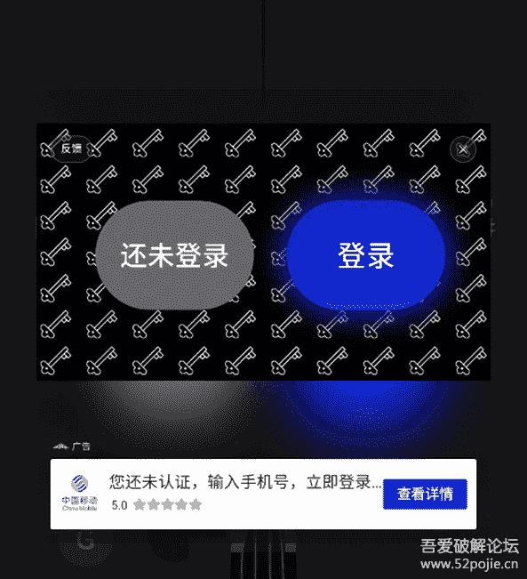
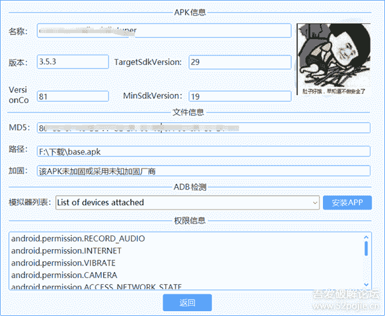
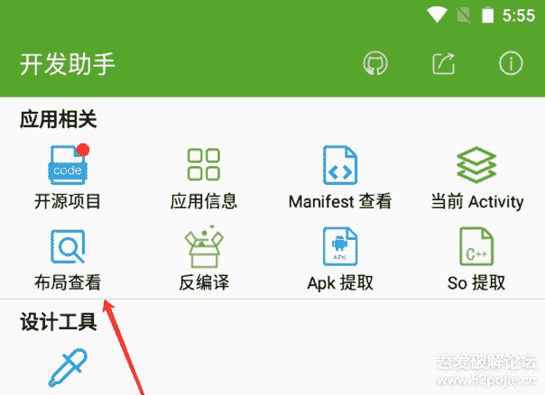
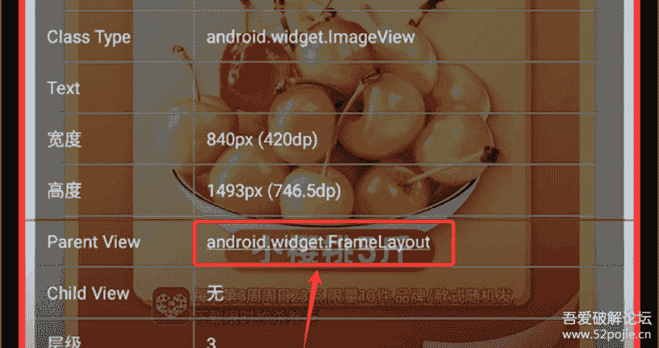
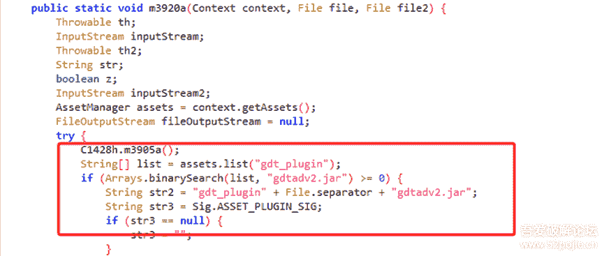
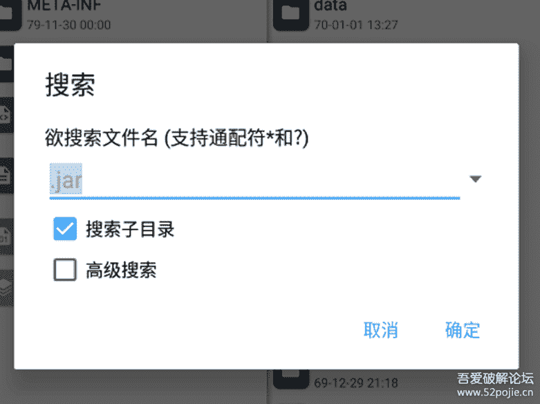
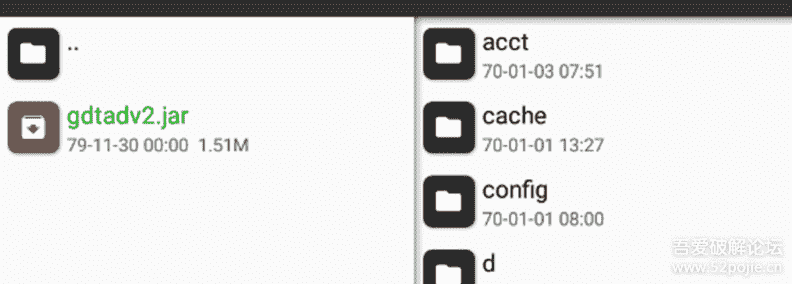
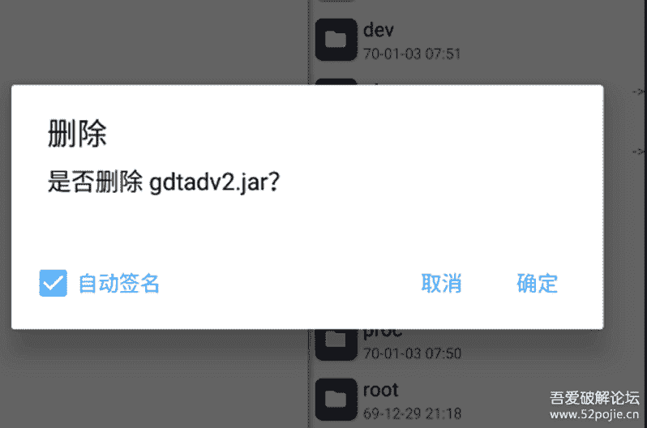
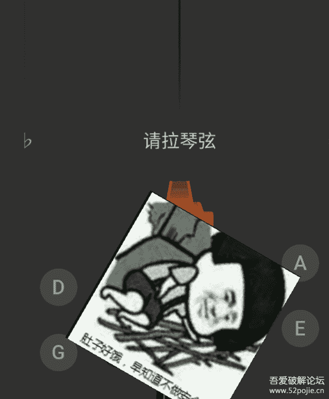

# [Android 原创] 【简单教程】去除某调音APP的广告

- 原帖：https://www.52pojie.cn/forum.php?mod=viewthread&tid=1917124
- 抓取时间：2026-11-02T01:15:09

## 前言

第一次发论坛，思路很简单，希望大佬们不要喷。身为一名吉他爱好者，调音器是刚需，但是市场上调音APP五花八门，某款调音器就是每次打开界面都会弹出广告，都需要手动进行关闭，很是麻烦。

`image.png`（201.77 KB，下载次数：2）  
[附件原图链接](https://www.52pojie.cn/forum.php?mod=attachment&aid=MjY5MTYzOHxmZmU4M2VmY3wxNzkzNTgyMTA5fDE2ODA4NnwxOTE3MTI0&nothumb=yes)  
上传时间：2024-4-24 10:47

## 分析过程

先丢到自己写的查壳工具看一下有没有壳，发现没加壳，感觉能去除成功。

`image.png`（129.02 KB，下载次数：3）  
[附件原图链接](https://www.52pojie.cn/forum.php?mod=attachment&aid=MjY5MTYzOXw1YWRkMmQxN3wxNzkzNTgyMTA5fDE2ODA4NnwxOTE3MTI0&nothumb=yes)  
上传时间：2024-4-24 10:48

本来想使用开发助手定位到广告 `xml` 然后删除掉。

`image.png`（84.98 KB，下载次数：2）  
[附件原图链接](https://www.52pojie.cn/forum.php?mod=attachment&aid=MjY5MTY0MHxmNzJmMDIzYXwxNzkzNTgyMTA5fDE2ODA4NnwxOTE3MTI0&nothumb=yes)  
上传时间：2024-4-24 10:49

`image.png`（317.4 KB，下载次数：2）  
[附件原图链接](https://www.52pojie.cn/forum.php?mod=attachment&aid=MjY5MTY0MXwxZTNmNzU0NnwxNzkzNTgyMTA5fDE2ODA4NnwxOTE3MTI0&nothumb=yes)  
上传时间：2024-4-24 10:49

但是感觉很麻烦，想到 `SDK` 是个包，于是尝试在代码中搜索 `.zip`、`.gz`、`.rar` 等压缩文件（代码没有进行加壳，但是做了混淆，不妨碍我们进行搜索）。经过搜索都没有搜索到，尝试搜索 `jar` 包，搜索到 `jar` 包，看了下代码应该是加载第三方 `SDK` 广告的。

`image.png`（115.19 KB，下载次数：3）  
[附件原图链接](https://www.52pojie.cn/forum.php?mod=attachment&aid=MjY5MTY0MnxjN2FkMTM4MHwxNzkzNTgyMTA5fDE2ODA4NnwxOTE3MTI0&nothumb=yes)  
上传时间：2024-4-24 10:50

## 操作步骤

通过 mt管理器 搜索这个 `jar` 包。

`image.png`（81.9 KB，下载次数：2）  
[附件原图链接](https://www.52pojie.cn/forum.php?mod=attachment&aid=MjY5MTY0NHw5YmQ1Mzg4NXwxNzkzNTgyMTA5fDE2ODA4NnwxOTE3MTI0&nothumb=yes)  
上传时间：2024-4-24 10:52

`image.png`（50.78 KB，下载次数：3）  
[附件原图链接](https://www.52pojie.cn/forum.php?mod=attachment&aid=MjY5MTY0NXxjYmMyN2JiMnwxNzkzNTgyMTA5fDE2ODA4NnwxOTE3MTI0&nothumb=yes)  
上传时间：2024-4-24 10:53

删除这个 `jar` 包并且重新签名安装。

`image.png`（60.7 KB，下载次数：2）  
[附件原图链接](https://www.52pojie.cn/forum.php?mod=attachment&aid=MjY5MTY0NnwxM2I0OWU1MnwxNzkzNTgyMTA5fDE2ODA4NnwxOTE3MTI0&nothumb=yes)  
上传时间：2024-4-24 10:53

## 结果

除去广告成功！！！（身为新手非常激动）

`image.png`（240.16 KB，下载次数：2）  
[附件原图链接](https://www.52pojie.cn/forum.php?mod=attachment&aid=MjY5MTY0N3wxYmE3NmIxMnwxNzkzNTgyMTA5fDE2ODA4NnwxOTE3MTI0&nothumb=yes)  
上传时间：2024-4-24 10:54
