# [Android 原创] ebpf在Android安全上的应用：结合binder完成一个行为检测沙箱(下篇)

- 原帖: https://www.52pojie.cn/forum.php?mod=viewthread&tid=1917351
- 抓取时间: 2026-11-02T01:15:05

## ebpf在Android安全上的应用：结合binder完成一个行为检测沙箱(下篇)

### 一、IPC简单介绍

`IPC`是`Inter-Process Communication`的缩写，含义为进程间通信或者跨进程通信，是指两个进程之间进行数据交换的过程。

Android在什么时候会有跨进程通信的需要？Android在请求系统服务的时候会有跨进程通信的需求，例如访问手机通讯录、获取定位等等行为，本文的目标即是实现一个简易的捕捉这些行为的沙箱

### 二、binder简单介绍

`Binder`是Android中的一种跨进程通信方式，可以理解为是`IPC`的一种具体实现方式

### 三、ServiceManager简单介绍

`ServiceManager`是Android中一个及其重要的系统服务，从它的名称上就可以知道，它是用于管理系统服务的

`ServiceManager`由`init`进程启动

`ServiceManager`负责了以下的一些功能：服务的注册与查找、进程间通信、系统服务的启动与唤醒、提供系统服务的清单实例

`binder`驱动决定了底层的通信详情，那么`ServiceManager`则相当于导航，告诉具体的通信该怎么走，达到那里等

### 四、通信分析

#### 4.1 客户端调用JAVA层分析

以`WifiManager`类的`getConnectInfo`函数(该函数获取wifi信息)为例进行分析

`ctrl+左键`查看引用，可以发现该函数定义在`android.net.wifi.WifiManager`类中，如下图所示：


7.png (4.63 KB, 下载次数: 0)

[href="forum.php?mod=attachment&aid=MjY5MTc0NHxhZjMwMDg0MHwxNzkzNTgyMTA1fDE2ODA4NnwxOTE3MzUx&nothumb=yes" target="_blank"](https://www.52pojie.cn/forum.php?mod=attachment&aid=MjY5MTc0NHxhZjMwMDg0MHwxNzkzNTgyMTA1fDE2ODA4NnwxOTE3MzUx&nothumb=yes)

2024-4-24 19:03 上传

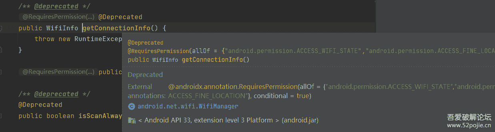

8.png (67.62 KB, 下载次数: 0)

[href="forum.php?mod=attachment&aid=MjY5MTc0NXxkOTJhYjYxN3wxNzkzNTgyMTA1fDE2ODA4NnwxOTE3MzUx&nothumb=yes" target="_blank"](https://www.52pojie.cn/forum.php?mod=attachment&aid=MjY5MTc0NXxkOTJhYjYxN3wxNzkzNTgyMTA1fDE2ODA4NnwxOTE3MzUx&nothumb=yes)

2024-4-24 19:03 上传

从上图可以看到，`getConnectInfo`函数具体代码只有一句`throw new RuntimeException("Stub!");`，这告诉我们这个函数是由rom中相同的类去替代执行，该函数在这被定义是编译所需要(PS:可以参考[//blog.csdn.net/ttkatrina/article/details/76180641" target="_blank" rel="noopener noreferrer nofollow"](https://blog.csdn.net/ttkatrina/article/details/76180641:rel="nofollow noopener" href="https))，在android源码中的目录`frameworks/base/wifi/java/amdroid/net/wifi`下我们可以找到该类，然后找到该函数的具体实现，如下图所示：

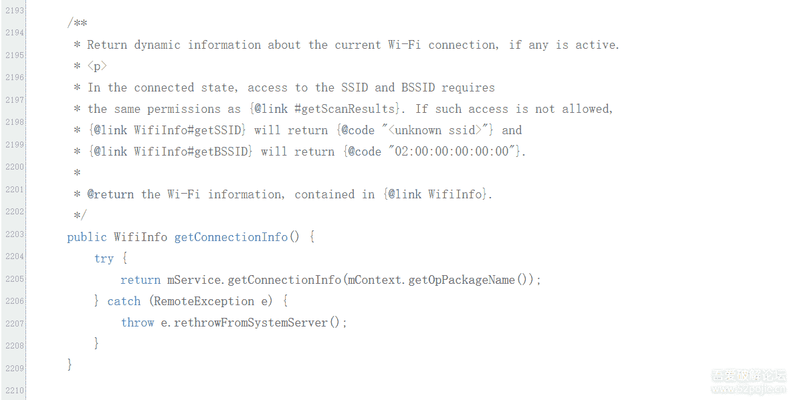

9.png (68.7 KB, 下载次数: 0)

[href="forum.php?mod=attachment&aid=MjY5MTc0NnwzNWYxNjhkY3wxNzkzNTgyMTA1fDE2ODA4NnwxOTE3MzUx&nothumb=yes" target="_blank"](https://www.52pojie.cn/forum.php?mod=attachment&aid=MjY5MTc0NnwzNWYxNjhkY3wxNzkzNTgyMTA1fDE2ODA4NnwxOTE3MzUx&nothumb=yes)

2024-4-24 19:04 上传

可以发现该函数调用了`IWifiManager`的`getConnectionInfo`函数，在`frameworks/base/wifi/java/amdroid/net/wifi`目录下可以找到`IWifiManager.aidl`文件，该`aidl`中定义了`getConnectionInfo`函数，如下图所示：

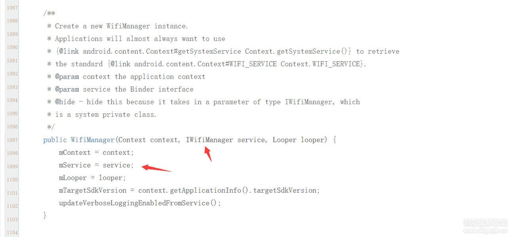

10.png (72.82 KB, 下载次数: 0)

[href="forum.php?mod=attachment&aid=MjY5MTc0N3w4MTMxMzZkOHwxNzkzNTgyMTA1fDE2ODA4NnwxOTE3MzUx&nothumb=yes" target="_blank"](https://www.52pojie.cn/forum.php?mod=attachment&aid=MjY5MTc0N3w4MTMxMzZkOHwxNzkzNTgyMTA1fDE2ODA4NnwxOTE3MzUx&nothumb=yes)

2024-4-24 19:04 上传


11.png (12.54 KB, 下载次数: 0)

[href="forum.php?mod=attachment&aid=MjY5MTc0OXwwMTgxZmVlM3wxNzkzNTgyMTA1fDE2ODA4NnwxOTE3MzUx&nothumb=yes" target="_blank"](https://www.52pojie.cn/forum.php?mod=attachment&aid=MjY5MTc0OXwwMTgxZmVlM3wxNzkzNTgyMTA1fDE2ODA4NnwxOTE3MzUx&nothumb=yes)

2024-4-24 19:04 上传

这里需要引入一个概念 --- `AIDL`，`AIDL`是android的一种接口语言，用于公开android服务的接口，以此来实现跨进程的函数调用。`AIDL`在编译时会生成两个类，即`Stub`和`Proxy`两个类，`Stub`类是服务端抽象层的体现，`Proxy`是客户端获取的实例，android通过`proxy-stub`这种设计模式实现了`IPC`

下面写一个`aidl`文件然后生成相应的`java`代码来看看是怎么实现调用的，首先，我们在`android studio`中随便找一个项目，然后新建一个`aidl`文件，如下图所示：

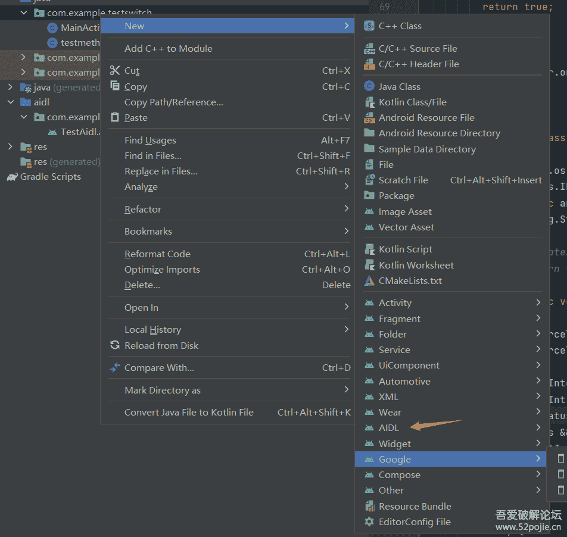

12.png (104.43 KB, 下载次数: 0)

[href="forum.php?mod=attachment&aid=MjY5MTc1MHwzYWNmYWYzY3wxNzkzNTgyMTA1fDE2ODA4NnwxOTE3MzUx&nothumb=yes" target="_blank"](https://www.52pojie.cn/forum.php?mod=attachment&aid=MjY5MTc1MHwzYWNmYWYzY3wxNzkzNTgyMTA1fDE2ODA4NnwxOTE3MzUx&nothumb=yes)

2024-4-24 19:04 上传

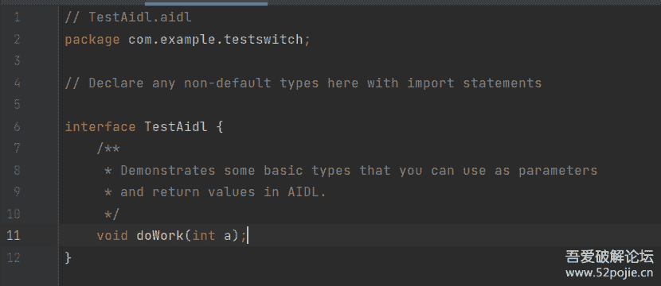

13.png (36.47 KB, 下载次数: 0)

[href="forum.php?mod=attachment&aid=MjY5MTc1MXxlN2M4YTkxZHwxNzkzNTgyMTA1fDE2ODA4NnwxOTE3MzUx&nothumb=yes" target="_blank"](https://www.52pojie.cn/forum.php?mod=attachment&aid=MjY5MTc1MXxlN2M4YTkxZHwxNzkzNTgyMTA1fDE2ODA4NnwxOTE3MzUx&nothumb=yes)

2024-4-24 19:04 上传

然后`Build`->`Make Probject`即可生成，生成的路径位于`build/generated/aidl_source_output_dir/debug/out/`包名，如下图所示：

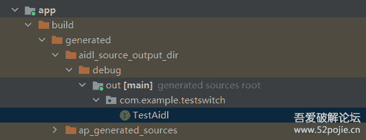

14.png (20.7 KB, 下载次数: 0)

[href="forum.php?mod=attachment&aid=MjY5MTc1Mnw0YjQzZGI2NXwxNzkzNTgyMTA1fDE2ODA4NnwxOTE3MzUx&nothumb=yes" target="_blank"](https://www.52pojie.cn/forum.php?mod=attachment&aid=MjY5MTc1Mnw0YjQzZGI2NXwxNzkzNTgyMTA1fDE2ODA4NnwxOTE3MzUx&nothumb=yes)

2024-4-24 19:04 上传

观察生成后的`java`文件可发现，`Proxy`类已经生成，在`Proxy`类中我们可以找到我们定义的函数，如下图所示：

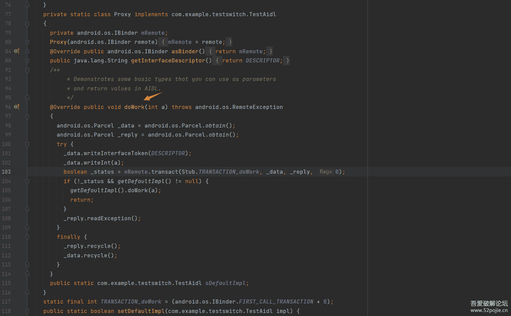

15.png (169.35 KB, 下载次数: 0)

[href="forum.php?mod=attachment&aid=MjY5MTc1M3w0ZDNlYzJhMnwxNzkzNTgyMTA1fDE2ODA4NnwxOTE3MzUx&nothumb=yes" target="_blank"](https://www.52pojie.cn/forum.php?mod=attachment&aid=MjY5MTc1M3w0ZDNlYzJhMnwxNzkzNTgyMTA1fDE2ODA4NnwxOTE3MzUx&nothumb=yes)

2024-4-24 19:05 上传

具体分析一下该函数，首先通过`obtain`函数生成了一个`Parcel`实例，然后调用`Parcel`的`write`系列函数进行写入，其实就是一个序列化的过程，然后调用了`IBinder`的`transact`函数，跟踪分析一下该函数，在目录`frameworks/base/core/java/android/os`下可以找到该`java`文件，如下图所示：

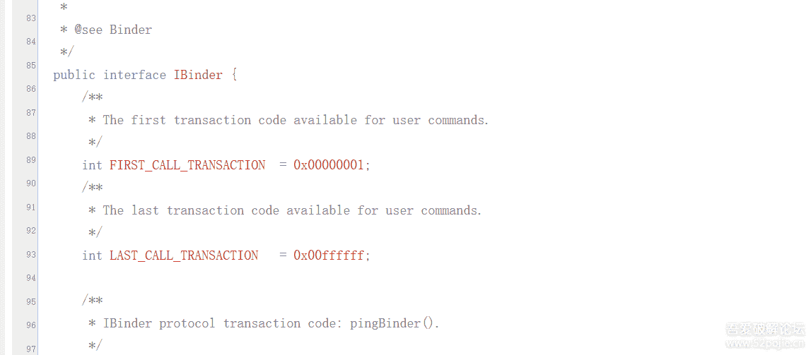

16.png (40.17 KB, 下载次数: 0)

[href="forum.php?mod=attachment&aid=MjY5MTc1NHxlYTU3ZjAyNnwxNzkzNTgyMTA1fDE2ODA4NnwxOTE3MzUx&nothumb=yes" target="_blank"](https://www.52pojie.cn/forum.php?mod=attachment&aid=MjY5MTc1NHxlYTU3ZjAyNnwxNzkzNTgyMTA1fDE2ODA4NnwxOTE3MzUx&nothumb=yes)

2024-4-24 19:05 上传

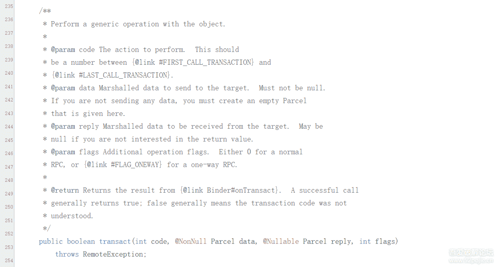

17.png (89.78 KB, 下载次数: 0)

[href="forum.php?mod=attachment&aid=MjY5MTc1NXxkOThlYmNmMnwxNzkzNTgyMTA1fDE2ODA4NnwxOTE3MzUx&nothumb=yes" target="_blank"](https://www.52pojie.cn/forum.php?mod=attachment&aid=MjY5MTc1NXxkOThlYmNmMnwxNzkzNTgyMTA1fDE2ODA4NnwxOTE3MzUx&nothumb=yes)

2024-4-24 19:05 上传

可以发现，`IBinder`仅仅是一个接口，其中定义了`transact`方法，该方法有4个参数，第一个参数`code`在我们的远程调用中为函数编号，服务端接受到这个编号后，会去寻找`Stub`类中的静态变量，从而解析出是调用那个函数，第二个和第三个参数`_data`、`_reply`为传入的参数和返回的值，都是经过序列化后的数据，最后一个参数`flags`为指示是否需要阻塞等待结果，0为阻塞等待，1为立即返回。

全局搜索一下，可以发现同目录下的`BinderProxy`类实现了该接口(PS:值得注意的是，同目录下面还存在一个`Binder`类，也实现了该接口，但`Binder`类是服务端的实现，而不是客户端的实现)，如下图所示：

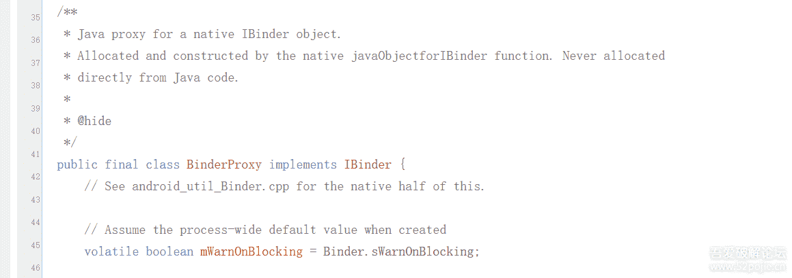

18.png (46.28 KB, 下载次数: 0)

[href="forum.php?mod=attachment&aid=MjY5MTc1NnwxYWM3OTU1NXwxNzkzNTgyMTA1fDE2ODA4NnwxOTE3MzUx&nothumb=yes" target="_blank"](https://www.52pojie.cn/forum.php?mod=attachment&aid=MjY5MTc1NnwxYWM3OTU1NXwxNzkzNTgyMTA1fDE2ODA4NnwxOTE3MzUx&nothumb=yes)

2024-4-24 19:05 上传

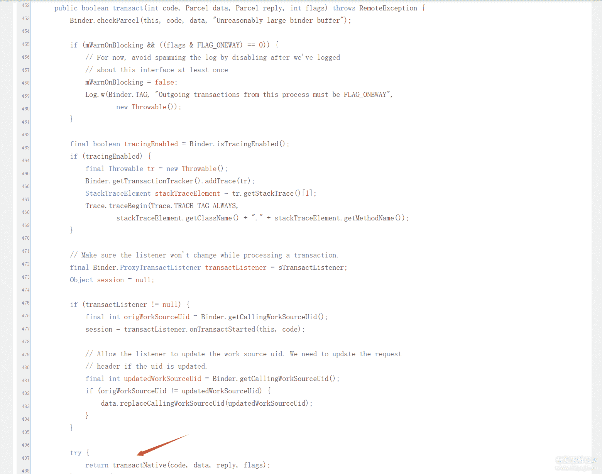

19.png (164.76 KB, 下载次数: 0)

[href="forum.php?mod=attachment&aid=MjY5MTc1N3w0MzZhODMzYnwxNzkzNTgyMTA1fDE2ODA4NnwxOTE3MzUx&nothumb=yes" target="_blank"](https://www.52pojie.cn/forum.php?mod=attachment&aid=MjY5MTc1N3w0MzZhODMzYnwxNzkzNTgyMTA1fDE2ODA4NnwxOTE3MzUx&nothumb=yes)

2024-4-24 19:05 上传

分析该函数，可以发现最后走向了`transactNative`函数，到此为止，进行`IPC`通信客户端`java`层已经分析完毕

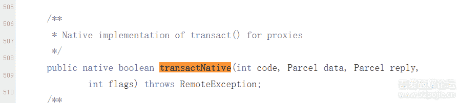

20.png (24.34 KB, 下载次数: 0)

[href="forum.php?mod=attachment&aid=MjY5MTc1OHw1MmMwOThiZHwxNzkzNTgyMTA1fDE2ODA4NnwxOTE3MzUx&nothumb=yes" target="_blank"](https://www.52pojie.cn/forum.php?mod=attachment&aid=MjY5MTc1OHw1MmMwOThiZHwxNzkzNTgyMTA1fDE2ODA4NnwxOTE3MzUx&nothumb=yes)

2024-4-24 19:05 上传

#### 4.2 客户端调用Native层分析

全局搜索一下`transactNative`函数，可以发现该函数在`native`层中注册信息，如下图所示：

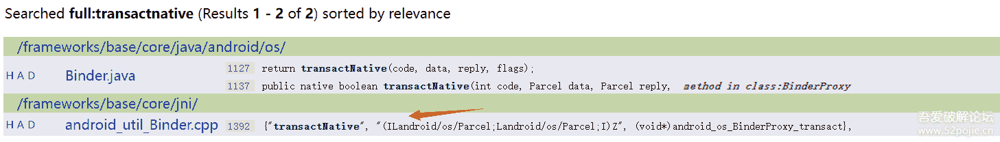

21.png (31.28 KB, 下载次数: 0)

[href="forum.php?mod=attachment&aid=MjY5MTc1OXw2OWUxMTNiOHwxNzkzNTgyMTA1fDE2ODA4NnwxOTE3MzUx&nothumb=yes" target="_blank"](https://www.52pojie.cn/forum.php?mod=attachment&aid=MjY5MTc1OXw2OWUxMTNiOHwxNzkzNTgyMTA1fDE2ODA4NnwxOTE3MzUx&nothumb=yes)

2024-4-24 19:05 上传


跟踪一下`android_os_BinderProxy_transact`函数，可以发现该函数首先通过`getBPNativeData(env, obj)->mObject.get()`获取到了一个`BpBinder`对象，然后调用了`BpBinder`的`transact()`函数，如下图所示：

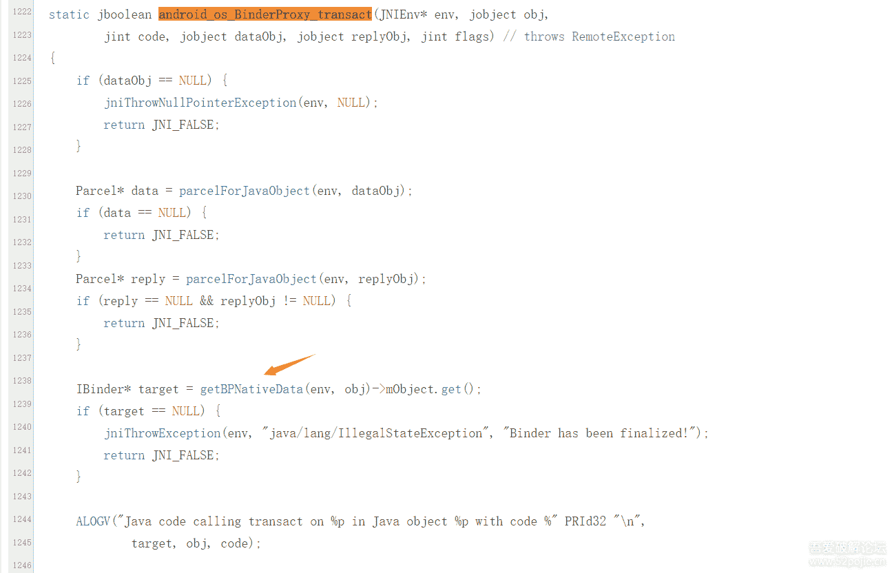

22.png (95.16 KB, 下载次数: 0)

[href="forum.php?mod=attachment&aid=MjY5MTc2MHw5N2Q3MjRkNHwxNzkzNTgyMTA1fDE2ODA4NnwxOTE3MzUx&nothumb=yes" target="_blank"](https://www.52pojie.cn/forum.php?mod=attachment&aid=MjY5MTc2MHw5N2Q3MjRkNHwxNzkzNTgyMTA1fDE2ODA4NnwxOTE3MzUx&nothumb=yes)

2024-4-24 19:06 上传

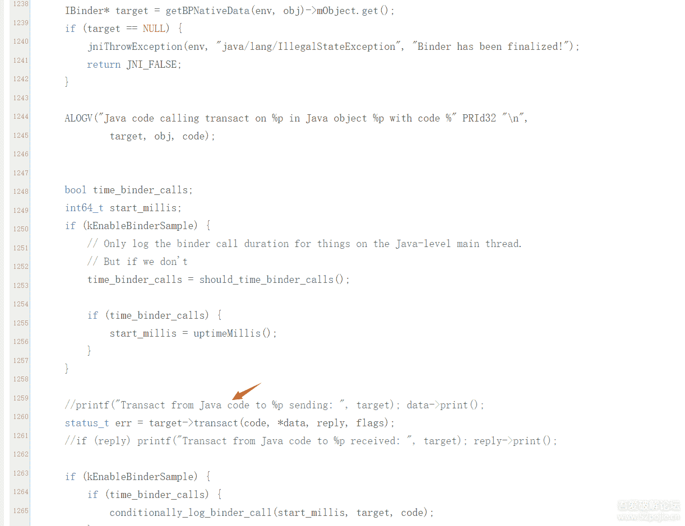

23.png (106.15 KB, 下载次数: 0)

[href="forum.php?mod=attachment&aid=MjY5MTc2MXw0OWVjZmJjN3wxNzkzNTgyMTA1fDE2ODA4NnwxOTE3MzUx&nothumb=yes" target="_blank"](https://www.52pojie.cn/forum.php?mod=attachment&aid=MjY5MTc2MXw0OWVjZmJjN3wxNzkzNTgyMTA1fDE2ODA4NnwxOTE3MzUx&nothumb=yes)

2024-4-24 19:06 上传

继续跟进下去，可以发现进入了`IPCThreadState`的`transact()`函数，如下图所示：

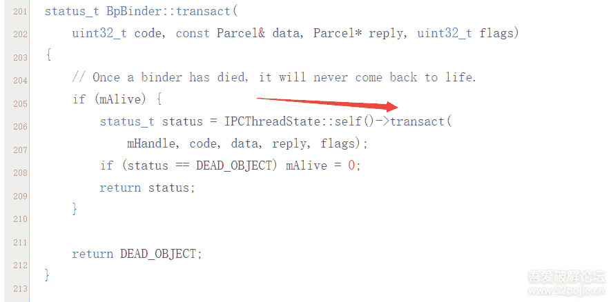

24.png (43.31 KB, 下载次数: 0)

[href="forum.php?mod=attachment&aid=MjY5MTc2Mnw5M2E5MDQ2ZHwxNzkzNTgyMTA1fDE2ODA4NnwxOTE3MzUx&nothumb=yes" target="_blank"](https://www.52pojie.cn/forum.php?mod=attachment&aid=MjY5MTc2Mnw5M2E5MDQ2ZHwxNzkzNTgyMTA1fDE2ODA4NnwxOTE3MzUx&nothumb=yes)

2024-4-24 19:06 上传

接着跟进，可以发现首先调用`writeTransactionData()`函数，该函数作用为填充`binder_transaction_data`结构体，为发送到`binder`驱动做准备，然后调用`waitForResponse()`等待返回，如下图所示：

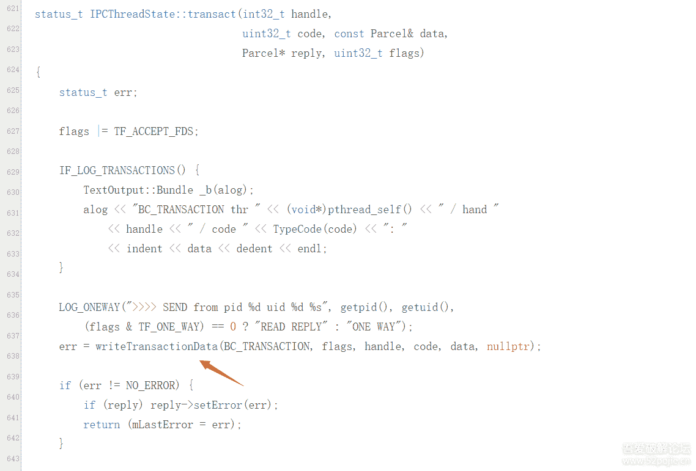

25.png (85.17 KB, 下载次数: 0)

[href="forum.php?mod=attachment&aid=MjY5MTc2M3xkOGEzZTU2YnwxNzkzNTgyMTA1fDE2ODA4NnwxOTE3MzUx&nothumb=yes" target="_blank"](https://www.52pojie.cn/forum.php?mod=attachment&aid=MjY5MTc2M3xkOGEzZTU2YnwxNzkzNTgyMTA1fDE2ODA4NnwxOTE3MzUx&nothumb=yes)

2024-4-24 19:06 上传

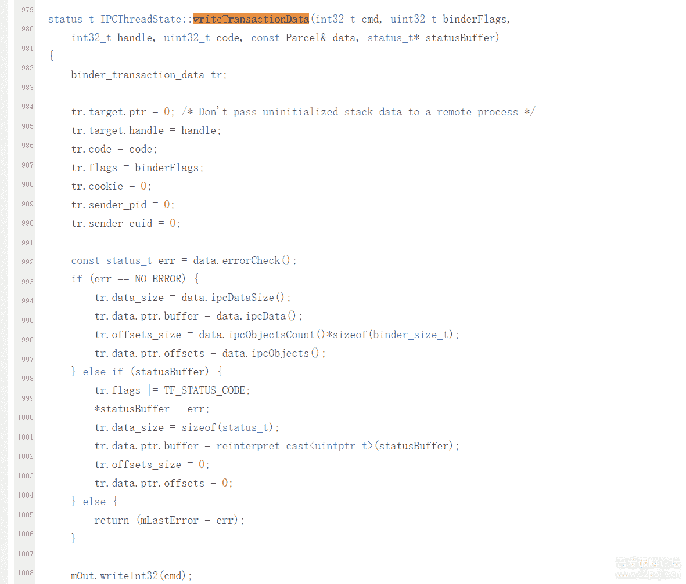

26.png (107.54 KB, 下载次数: 0)

[href="forum.php?mod=attachment&aid=MjY5MTc2NHxlODRhMjAyMHwxNzkzNTgyMTA1fDE2ODA4NnwxOTE3MzUx&nothumb=yes" target="_blank"](https://www.52pojie.cn/forum.php?mod=attachment&aid=MjY5MTc2NHxlODRhMjAyMHwxNzkzNTgyMTA1fDE2ODA4NnwxOTE3MzUx&nothumb=yes)

2024-4-24 19:06 上传

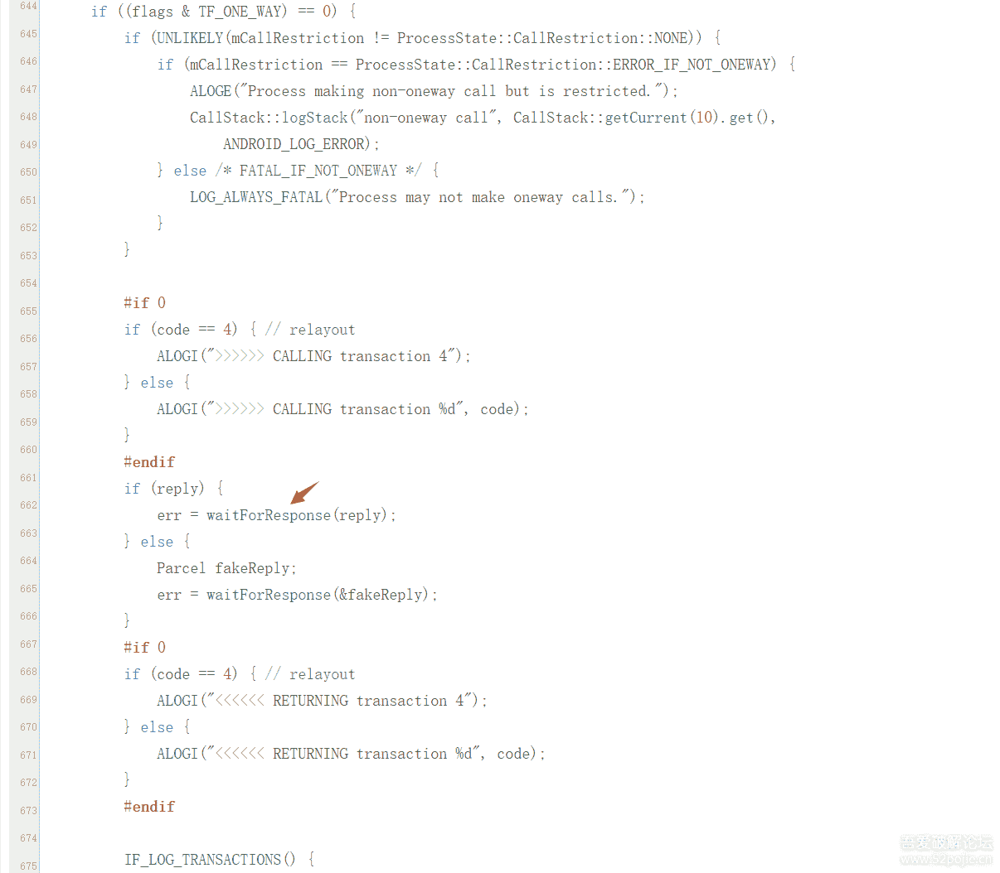

27.png (111.77 KB, 下载次数: 0)

[href="forum.php?mod=attachment&aid=MjY5MTc2NXwwMDkzYzE2M3wxNzkzNTgyMTA1fDE2ODA4NnwxOTE3MzUx&nothumb=yes" target="_blank"](https://www.52pojie.cn/forum.php?mod=attachment&aid=MjY5MTc2NXwwMDkzYzE2M3wxNzkzNTgyMTA1fDE2ODA4NnwxOTE3MzUx&nothumb=yes)

2024-4-24 19:07 上传

跟进`waitForResponse()`函数，可以发现该函数最重要的就是调用`talkWithDriver()`函数，分析一下`talkWithDriver()`函数，可以发现最终调用了`ioctl()`，如下图所示：

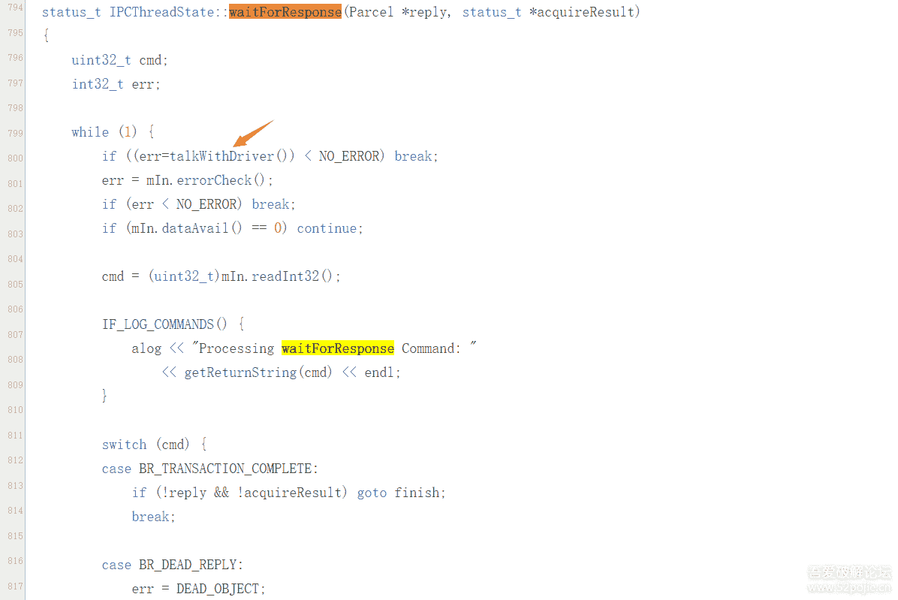

28.png (78.88 KB, 下载次数: 0)

[href="forum.php?mod=attachment&aid=MjY5MTc2NnxlZDZkNGYzY3wxNzkzNTgyMTA1fDE2ODA4NnwxOTE3MzUx&nothumb=yes" target="_blank"](https://www.52pojie.cn/forum.php?mod=attachment&aid=MjY5MTc2NnxlZDZkNGYzY3wxNzkzNTgyMTA1fDE2ODA4NnwxOTE3MzUx&nothumb=yes)

2024-4-24 19:07 上传

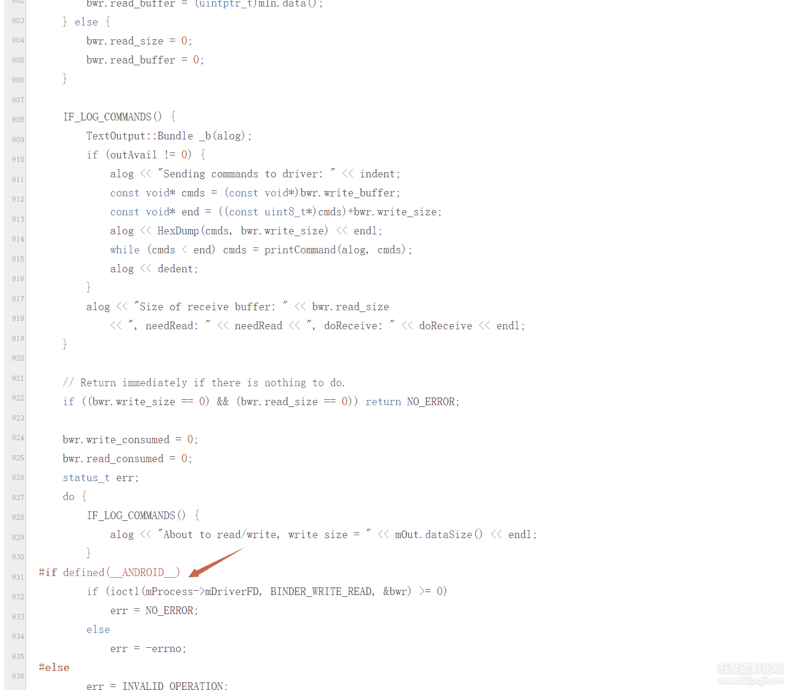

29.png (122.52 KB, 下载次数: 0)

[href="forum.php?mod=attachment&aid=MjY5MTc2N3xlZTI4M2M4MnwxNzkzNTgyMTA1fDE2ODA4NnwxOTE3MzUx&nothumb=yes" target="_blank"](https://www.52pojie.cn/forum.php?mod=attachment&aid=MjY5MTc2N3xlZTI4M2M4MnwxNzkzNTgyMTA1fDE2ODA4NnwxOTE3MzUx&nothumb=yes)

2024-4-24 19:07 上传

到处为止，客户端native层分析完毕

## 4.3 内核层分析(binder驱动分析)

到此处，我们的`ebpf`程序就可以开始捕捉然后解析数据格式了

当用户层调用`ioctl()`时，会进入内核态，进入`binder_ioctl()`内核函数(ps:可在内核设备源码中的`binder.c`找到相应的描述符)，分析一下`binder_ioctl()`函数，可发现该函数主要作用为在两个进程之间首发数据，我们的通信数据`ioctl()`命令是`BINDER_WRITE_READ`，当遇到该命令的时候，会调用`binder_ioctl_write_read()`函数，如下图所示：

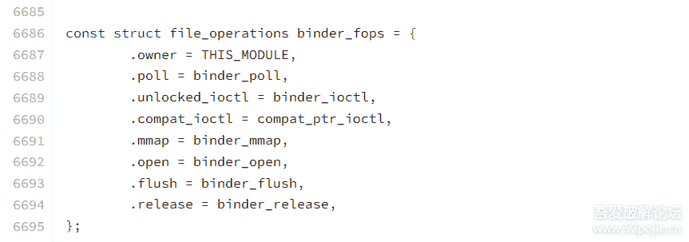

30.png (36.31 KB, 下载次数: 0)

[href="forum.php?mod=attachment&aid=MjY5MTc2OHwzNDczZmI2ZnwxNzkzNTgyMTA1fDE2ODA4NnwxOTE3MzUx&nothumb=yes" target="_blank"](https://www.52pojie.cn/forum.php?mod=attachment&aid=MjY5MTc2OHwzNDczZmI2ZnwxNzkzNTgyMTA1fDE2ODA4NnwxOTE3MzUx&nothumb=yes)

2024-4-24 19:07 上传

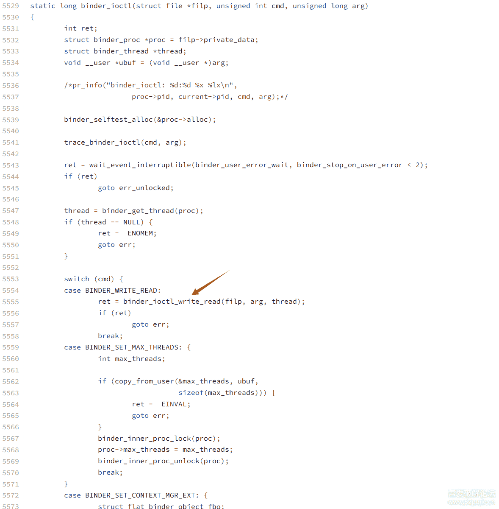

31.png (139.61 KB, 下载次数: 0)

[href="forum.php?mod=attachment&aid=MjY5MTc2OXwzNWY2MTU0ZHwxNzkzNTgyMTA1fDE2ODA4NnwxOTE3MzUx&nothumb=yes" target="_blank"](https://www.52pojie.cn/forum.php?mod=attachment&aid=MjY5MTc2OXwzNWY2MTU0ZHwxNzkzNTgyMTA1fDE2ODA4NnwxOTE3MzUx&nothumb=yes)

2024-4-24 19:07 上传

跟进`binder_ioctl_write_read()`函数，可以发现，该函数首先将`unsigned long`类型的`arg`参数指向的地址的值读取到结构体`binder_write_read`中，说明当`ioctl()`命令为`BINDER_WRITE_READ`时，传递进来的参数为指向结构的`binder_write_read`的指针，如下图所示：

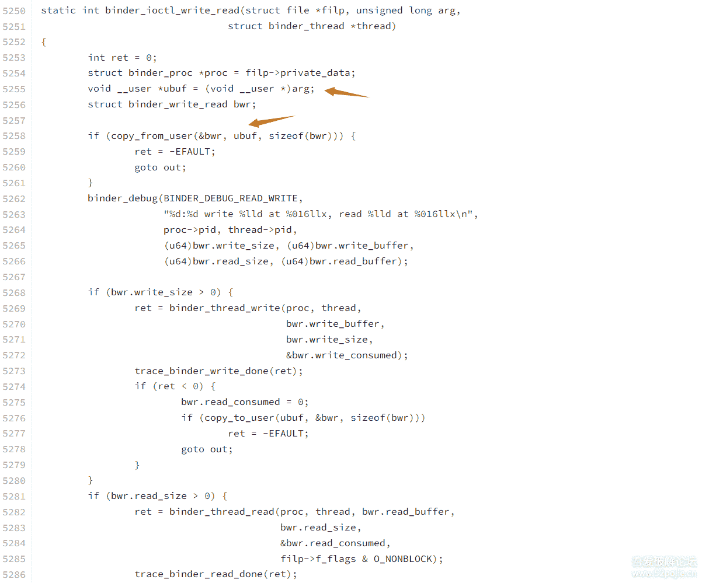

32.png (137.64 KB, 下载次数: 0)

[href="forum.php?mod=attachment&aid=MjY5MTc3MHxlZWZmMGUyOXwxNzkzNTgyMTA1fDE2ODA4NnwxOTE3MzUx&nothumb=yes" target="_blank"](https://www.52pojie.cn/forum.php?mod=attachment&aid=MjY5MTc3MHxlZWZmMGUyOXwxNzkzNTgyMTA1fDE2ODA4NnwxOTE3MzUx&nothumb=yes)

2024-4-24 19:07 上传

到这里其实我们内核态的分析已经可以结束了，我们已经观察到了我们想要的数据了，即`binder_write_read`结构体，可以看一下该结构体的定义，如下所示：

```
struct binder_write_read {
    binder_size_t write_size; /* 写内容的数据总大小 */
    binder_size_t write_consumed; /* 记录了从缓冲区读取写内容的大小 */
    binder_uintptr_t write_buffer; /* 写内容的数据的虚拟地址 */
    binder_size_t read_size; /* 读内容的数据总大小 */
    binder_size_t read_consumed; /* 记录了从缓冲区读取读内容的大小 */
    binder_uintptr_t read_buffer; /* 读内容的数据的虚拟地址 */
};
```

这个结构体是用来描述进程间通信过程中所传输的数据，我们读取从客户端发送到服务端的通信包只需要关注`write_size`、`write_consumed`、`write_buffer`，其中，`write_buffer`指向的是一个数组，这个数组中就包含了`binder_transaction_data`结构体，这个结构体在native层`writeTransactionData()`函数填充的，我们的目标通信包即是这个结构体，其中，`write_buffer`和`read_buffer`指向的数据结构大致如下：


33.png (11.77 KB, 下载次数: 0)

[href="forum.php?mod=attachment&aid=MjY5MTc3MXw4NGMwNThlOXwxNzkzNTgyMTA1fDE2ODA4NnwxOTE3MzUx&nothumb=yes" target="_blank"](https://www.52pojie.cn/forum.php?mod=attachment&aid=MjY5MTc3MXw4NGMwNThlOXwxNzkzNTgyMTA1fDE2ODA4NnwxOTE3MzUx&nothumb=yes)

2024-4-24 19:08 上传

一般来说，驱动会一次性传递多条命令和地址的组合，而我们要在其中找到`binder_transaction_data`结构体对应的指令，在`binder.h`头文件中我们可以找到驱动定义的所有指令([//android.googlesource.com/kernel/common/+/refs/heads/android-mainline/include/uapi/linux/android/binder.h" target="_blank" rel="noopener noreferrer nofollow"](https://android.googlesource.com/kernel/common/+/refs/heads/android-mainline/include/uapi/linux/android/binder.h:rel="nofollow noopener" href="https))，如下图所示：

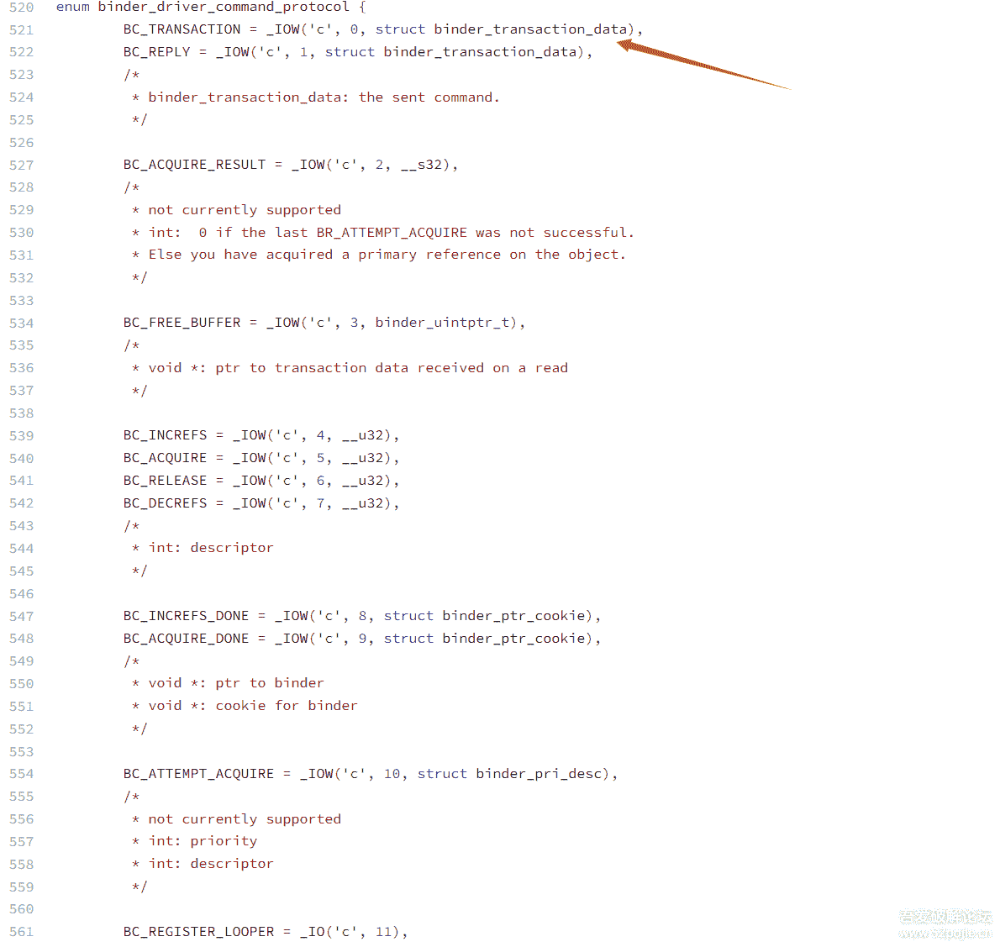

34.png (137.68 KB, 下载次数: 0)

[href="forum.php?mod=attachment&aid=MjY5MTc3MnxlNTU3NzA1MXwxNzkzNTgyMTA1fDE2ODA4NnwxOTE3MzUx&nothumb=yes" target="_blank"](https://www.52pojie.cn/forum.php?mod=attachment&aid=MjY5MTc3MnxlNTU3NzA1MXwxNzkzNTgyMTA1fDE2ODA4NnwxOTE3MzUx&nothumb=yes)

2024-4-24 19:08 上传

可以发现，`BC_TRANSACTION`和`BC_REPLY`指令都对应着`binder_transaction_data`结构体参数，但我们只需要客户端发往驱动的数据包，所以我们只需要`BC_TRANSACTION`指令对应的参数即可

经过上面的分析，我们找到了我们需要的核心数据---`binder_transaction_data`结构体，现在来看一下该结构体的定义，定义如下：

```
struct binder_transaction_data {

    union {

        __u32 handle;

        binder_uintptr_t ptr;

    } target; /* 该事务的目标对象 */

    binder_uintptr_t cookie; /* 只有当事务是由Binder驱动传递给用户空间时，cookie才有意思，它的值是处理该事务的Server位于C++层的本地Binder对象 */

    __u32 code; /* 方法编号 */

    __u32 flags;

    pid_t sender_pid;

    uid_t sender_euid;

    binder_size_t data_size; /* 数据长度 */

    binder_size_t offsets_size; /* 若包含对象，对象的数据大小 */

    union {

        struct {

            binder_uintptr_t buffer; /* 参数地址 */

            binder_uintptr_t offsets; /* 参数对象地址 */

        } ptr;

        __u8 buf[8];

    } data; /* 数据 */

};
```

有了该数据结构，我们就可以知道客户端调用服务端的函数的函数、参数等数据了

## 五、实现效果

PS：整套系统用于商业，就不做开源处理了，这里只给出核心结构体打印的截图，就不再发前端的截图了

读取手机通讯录(ps:这里读取出来的数据采用了`Toast`打印的，所以将捕捉到的`Toast`相应的通信包也一起打印了出来，下同)：

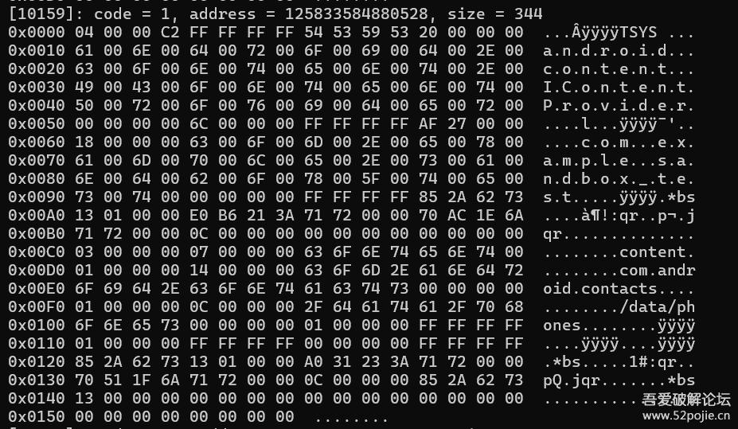

1.png (86.34 KB, 下载次数: 0)


[href="forum.php?mod=attachment&aid=MjY5MTc3M3wwYmI2MDBiY3wxNzkzNTgyMTA1fDE2ODA4NnwxOTE3MzUx&nothumb=yes" target="_blank"](https://www.52pojie.cn/forum.php?mod=attachment&aid=MjY5MTc3M3wwYmI2MDBiY3wxNzkzNTgyMTA1fDE2ODA4NnwxOTE3MzUx&nothumb=yes)
2024-4-24 19:08 上传
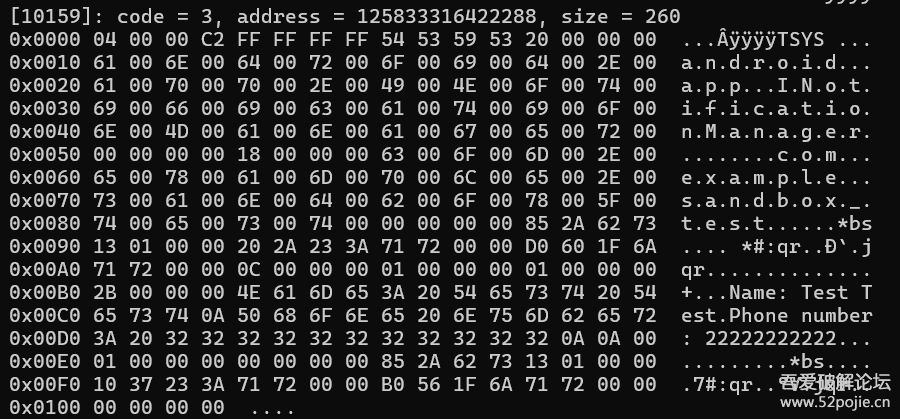
2.png (70.63 KB, 下载次数: 0)

[href="forum.php?mod=attachment&aid=MjY5MTc3NHxiYWU1YzNkNXwxNzkzNTgyMTA1fDE2ODA4NnwxOTE3MzUx&nothumb=yes" target="_blank"](https://www.52pojie.cn/forum.php?mod=attachment&aid=MjY5MTc3NHxiYWU1YzNkNXwxNzkzNTgyMTA1fDE2ODA4NnwxOTE3MzUx&nothumb=yes)
2024-4-24 19:08 上传

## 获取地理位置
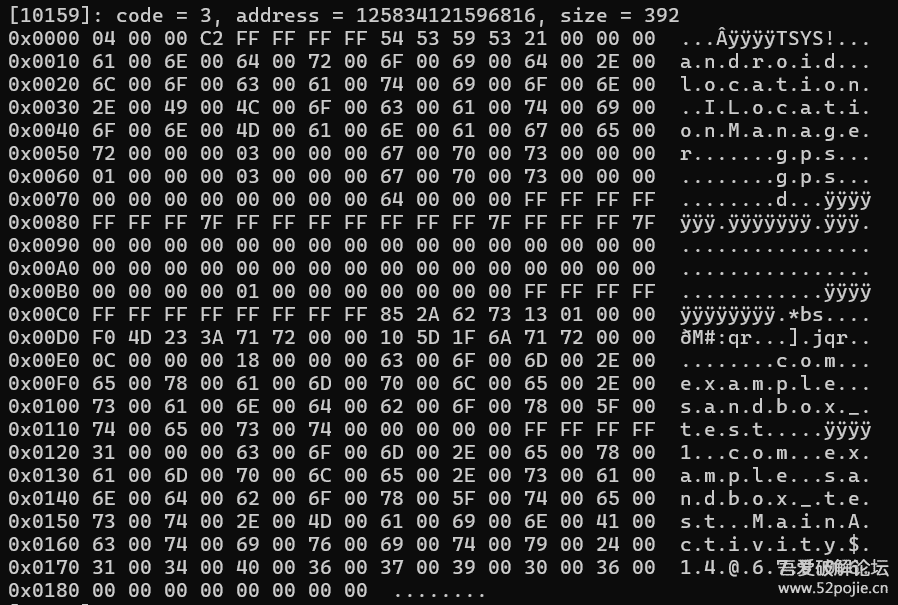
3.png (92.43 KB, 下载次数: 0)

[href="forum.php?mod=attachment&aid=MjY5MTc3NXwwZjljMjZmNHwxNzkzNTgyMTA1fDE2ODA4NnwxOTE3MzUx&nothumb=yes" target="_blank"](https://www.52pojie.cn/forum.php?mod=attachment&aid=MjY5MTc3NXwwZjljMjZmNHwxNzkzNTgyMTA1fDE2ODA4NnwxOTE3MzUx&nothumb=yes)
2024-4-24 19:08 上传
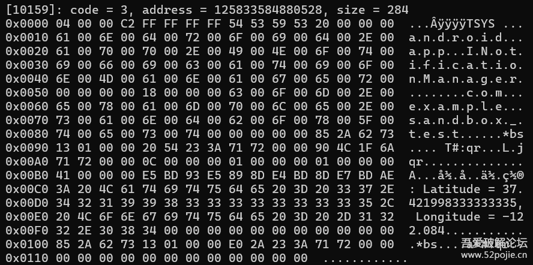
4.png (75.5 KB, 下载次数: 0)

[href="forum.php?mod=attachment&aid=MjY5MTc3Nnw4ZDVmMjRjNnwxNzkzNTgyMTA1fDE2ODA4NnwxOTE3MzUx&nothumb=yes" target="_blank"](https://www.52pojie.cn/forum.php?mod=attachment&aid=MjY5MTc3Nnw4ZDVmMjRjNnwxNzkzNTgyMTA1fDE2ODA4NnwxOTE3MzUx&nothumb=yes)
2024-4-24 19:08 上传

## 获取wifi信息
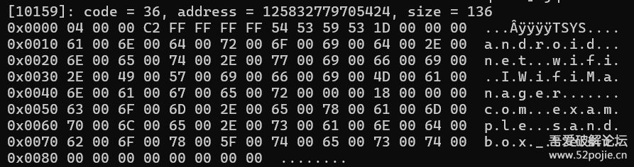
5.png (42.8 KB, 下载次数: 0)

[href="forum.php?mod=attachment&aid=MjY5MTc3N3w0NWRmNWM5Y3wxNzkzNTgyMTA1fDE2ODA4NnwxOTE3MzUx&nothumb=yes" target="_blank"](https://www.52pojie.cn/forum.php?mod=attachment&aid=MjY5MTc3N3w0NWRmNWM5Y3wxNzkzNTgyMTA1fDE2ODA4NnwxOTE3MzUx&nothumb=yes)
2024-4-24 19:08 上传
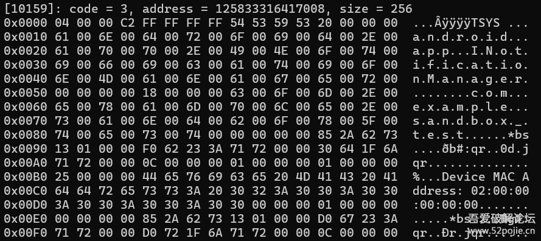
6.png (69.5 KB, 下载次数: 0)

[href="forum.php?mod=attachment&aid=MjY5MTc3OHw1ZWNmNjYyNHwxNzkzNTgyMTA1fDE2ODA4NnwxOTE3MzUx&nothumb=yes" target="_blank"](https://www.52pojie.cn/forum.php?mod=attachment&aid=MjY5MTc3OHw1ZWNmNjYyNHwxNzkzNTgyMTA1fDE2ODA4NnwxOTE3MzUx&nothumb=yes)
2024-4-24 19:09 上传

## 六、其他
上面其实我们只分析到了发送部分，反过来，其实我们也可以读取返回包甚至于修改返回包，就可用于对风控的对抗，例如在内核态中修改APP请求的设备标识信息(当然前提是app走系统提供的驱动通信)，亦或者用于逆向的工作，例如过root检测等等。
这部分验证代码就暂不放出来了，感兴趣的可以自己实现一下
