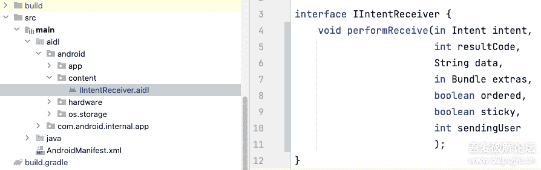
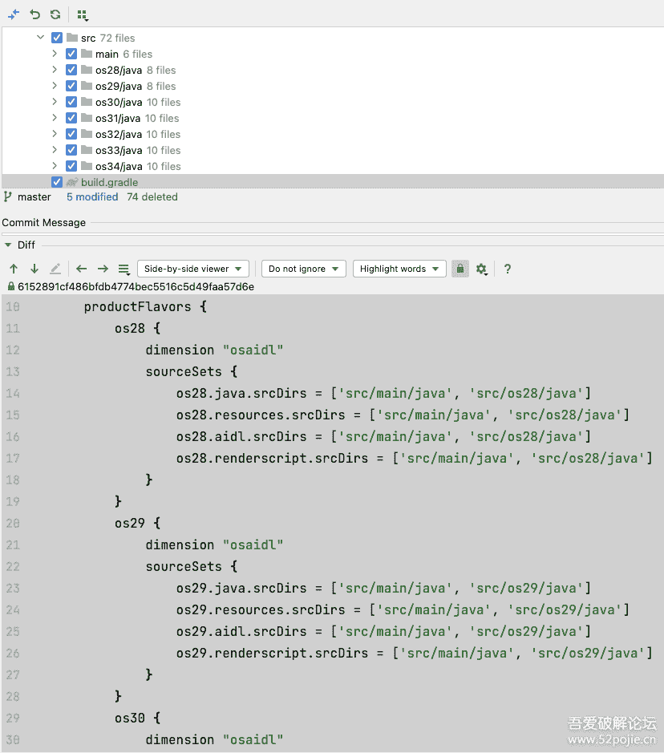
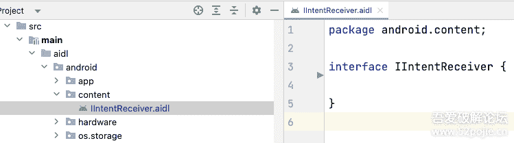

# [Android 原创] 【Android】Binder的Oneway拦截

- 原帖: https://www.52pojie.cn/forum.php?mod=viewthread&tid=1919340
- 抓取时间: 2026-11-02T01:15:00

在某些虚拟化，免安装，打点，环境检测，拦截器等场景，针对Android系统服务接口的拦截是常用的技术方案。通常只是针对正向的接口调用，如果涉及被动的服务回调拦截，则实现起来就有些许麻烦。


topic.jpg (158.75 KB, 下载次数: 2)

[href="forum.php?mod=attachment&aid=MjY5Mjk4MXw2YzU3NDhiN3wxNzkzNTgyMTAwfDE2ODA4NnwxOTE5MzQw&nothumb=yes" target="_blank"](https://www.52pojie.cn/forum.php?mod=attachment&aid=MjY5Mjk4MXw2YzU3NDhiN3wxNzkzNTgyMTAwfDE2ODA4NnwxOTE5MzQw&nothumb=yes)

2024-4-30 12:41 上传

## 说明

由于我们容器产品的特性，需要将应用完整的运行起来，所以必须要对各系统服务（超过100+系统服务）通信进行拦截过滤，修正和还原接口通信的数据。让系统和应用可以无感知运行，实现免安装运行的效果。

整个方案基本上都聚焦在服务模块主动调用的拦截上，系统回调的拦截涉及较少，但随着功能的深入，越来越需要对服务回调的接口（`Binder` for `Oneway`）进行拦截。在这里将整个通用的拦截方案和实现过程分享出来，希望对大家有益。

## 原理

`Binder`的`Oneway`回调机制，即应用进程向系统服务注册回调（通常注册和取消注册成对出现），当服务端有相应时间时，可以直接回调给改`Binder`对象实例。

如常见的`AMS`服务接口：

```java
// source code: /frameworks/base/core/java/android/app/IActivityManager.aidl
interface IActivityManager {
    // ...

    Intent registerReceiver(IApplicationThread caller, 
                          String callerPackage, 
                          IIntentReceiver receiver,
                          IntentFilter filter, 
                          String requiredPermission,
                          int userId, 
                          int flags
                         );
  void unregisterReceiver(in IIntentReceiver receiver);

  // ...
}
```

我们的目标：

- 拦截`AMS`的`registerReceiver`方法，将参数`receiver`通过`Proxy`创建一个新的扩展类对象传递出去。
- 为了参数校验通过，所以对象的类名是合法的（如：`android.content.IIntentReceiver`）
- 服务端实际拿到的是我们扩展的接口对象，因此当服务端，通过`Binder`数据还原成服务端的同名对象。
- 当服务端有事件回调时，则我们扩展的接口对象优先处理，然后再像原对象调用传递。
- 当应用注销回调时，同样需要将我们扩展的对象通知服务端解除。

### 1.0 方案：源码导入

由于通常系统接口类（如：`IActivityManager.aidl`，`IPackageManager.aidl`等）均为隐藏类，因此很自然的想法是将系统的`aidl`源文件导入到工程中。



01.png (54.83 KB, 下载次数: 2)

[href="forum.php?mod=attachment&aid=MjY5Mjk4Mnw5ZWViNWEwOHwxNzkzNTgyMTAwfDE2ODA4NnwxOTE5MzQw&nothumb=yes" target="_blank"](https://www.52pojie.cn/forum.php?mod=attachment&aid=MjY5Mjk4Mnw5ZWViNWEwOHwxNzkzNTgyMTAwfDE2ODA4NnwxOTE5MzQw&nothumb=yes)

2024-4-30 12:41 上传

配置好目录：

```
sourceSets {
    main {
        aidl.srcDirs = ['src/main/aidl']
    }
}
```

编译后我们就可以连接该类，并进行继承扩展了，如：

```java
public class StubIntentReceiver extends IIntentReceiver.Stub {
    Object mOrigin;

    protected StubIntentReceiver(Object org) {
        this.mOrigin = org;
    }

    private static Method sMethod_performReceive;
    public void performReceive(Intent intent, int resultCode, String data, Bundle extras, boolean ordered, boolean sticky, int sendingUser) throws RemoteException {
        // TODO something here ...

        if (null == sMethod_performReceive) {
            sMethod_performReceive = ReflectUtils.getDeclaredMethod(
                    mOrigin, "performReceive",
                    Intent.class, int.class, String.class, Bundle.class, boolean.class, boolean.class, int.class
            );
        }
        sMethod_performReceive.invoke(mOrigin, intent, resultCode, data, extras, ordered, sticky, sendingUser);
    }
}
```

对于`IIntentReceiver.aidl`的回调接口来说，这样就可以解决了，因为他满足了几个特性：

- 足够简单，就只有一个函数。
- 足够稳定，从9.0 ~ 14.0接口名和参数都一致。

然而更多的接口并非如此，接口类函数不仅仅是多个，而且不同版本类方法各异，同函数参数也都不相同，这才是常态，所以我们自然的解决方案就是：`flavor`。

### 2.0 方案：Flavor

既然每个版本可能不一致，那就编译多版本就可以解决了，如：



02.png (148.1 KB, 下载次数: 3)

[href="forum.php?mod=attachment&aid=MjY5Mjk4M3wyNDVhMDQ4OXwxNzkzNTgyMTAwfDE2ODA4NnwxOTE5MzQw&nothumb=yes" target="_blank"](https://www.52pojie.cn/forum.php?mod=attachment&aid=MjY5Mjk4M3wyNDVhMDQ4OXwxNzkzNTgyMTAwfDE2ODA4NnwxOTE5MzQw&nothumb=yes)

2024-4-30 12:41 上传

这样确实能解决多版本系统接口变化的问题，但同时带来了新的问题：

- 多版本的编译，维护，加载运行导致工作量成倍增加，是个灾难。
- 通常接口中我们感兴趣的只是其中一部分，其他的接口则是直接放过。
- 很多系统接口参数又是继承于`Parcelable`的对象，而该对象又为隐藏类，因此又需要继续导入关联的类确保编译运行正常，导致越来越臃肿。
- 某些接口厂商还会在该类定制新的接口，无法做到默认兼容。

### 3.0 方案：接口模板

我们对于复杂的方案生来恐惧，越复杂越做不稳定，所以我们的目标：

- 无需多版本编译，一套代码适配所有版本。
- 仅需处理我们关心的接口，对于其他接口默认可放过。

于是我们通过编译后的源码我们目标锁定在`Binder`的`onTransact`函数，如：

```java
public interface IIntentReceiver extends android.os.IInterface
{
  /** Local-side IPC implementation stub class. */
  public static abstract class Stub extends android.os.Binder implements android.content.IIntentReceiver
  {
    private static final java.lang.String DESCRIPTOR = "android.content.IIntentReceiver";
    /** Construct the stub at attach it to the interface. */
    public boolean onTransact(int code, 
                              android.os.Parcel data,
                              android.os.Parcel reply,
                              int flags
                             ) throws android.os.RemoteException
    {
      java.lang.String descriptor = DESCRIPTOR;
      switch (code)
      {
        case TRANSACTION_performReceive:
        {
            data.enforceInterface(DESCRIPTOR);
            Intent _arg0;
            if (0 != data.readInt()) {
                _arg0 = Intent.CREATOR.createFromParcel(data);
            } else {
                _arg0 = null;
            }
            int _arg1 = data.readInt();
            String _arg2 = data.readString();
            Bundle _arg3;
            if (0 != data.readInt()) {
                _arg3 = (Bundle)Bundle.CREATOR.createFromParcel(data);
            } else {
                _arg3 = null;
            }
            boolean _arg4 = 0 != data.readInt();
            boolean _arg5 = 0 != data.readInt();
            int _arg6 = data.readInt();
            // call function here !!!
            this.performReceive(_arg0, _arg1, _arg2, _arg3, _arg4, _arg5, _arg6);
            reply.writeNoException();
            return true;
        }
        default:
        {
          return super.onTransact(code, data, reply, flags);
        }
      }
    }
  }
}
```

于是我们的方案：



03.png (32.41 KB, 下载次数: 0)

[href="forum.php?mod=attachment&aid=MjY5Mjk4NHwzNzlkMTYyNXwxNzkzNTgyMTAwfDE2ODA4NnwxOTE5MzQw&nothumb=yes" target="_blank"](https://www.52pojie.cn/forum.php?mod=attachment&aid=MjY5Mjk4NHwzNzlkMTYyNXwxNzkzNTgyMTAwfDE2ODA4NnwxOTE5MzQw&nothumb=yes)

2024-4-30 12:41 上传

- 定义目标接口类（如：`IIntentReceiver.aidl`），该接口无方法，仅保持名字一致，目的只是为了编译出`IIntentReceiver.class`类。
- 定义扩展类继承于接口代{过}{滤}理类。
- 重载实现`onTransact`方法，仅处理感兴趣的`code`（`aidl`文件编译后函数对应的编号），其他的默认调用原对象方法。

于是我们扩展实现类为：

```java
import android.content.IIntentReceiver;
import android.content.Intent;
import android.os.Bundle;
import android.os.IBinder;
import android.os.Parcel;
import android.text.TextUtils;

public class OnewayIIntentReceiver extends IIntentReceiver.Stub {
    private final Object mArgument;
    private static int TRANSACTION_performReceive = -1;

    public OnewayIIntentReceiver(Object org) {
        mArgument = org;
        if (TRANSACTION_performReceive 
```

至此，我们找到了相对简单，兼容性好的系统接口回调的拦截方案。

如果该服务为`Native`实现，则需要参考我们的另一篇文章 [//www.52pojie.cn/thread-1866468-1-1.html" target="_blank" rel="noopener noreferrer nofollow"](https://www.52pojie.cn/thread-1866468-1-1.html:href="https) 来解决。
