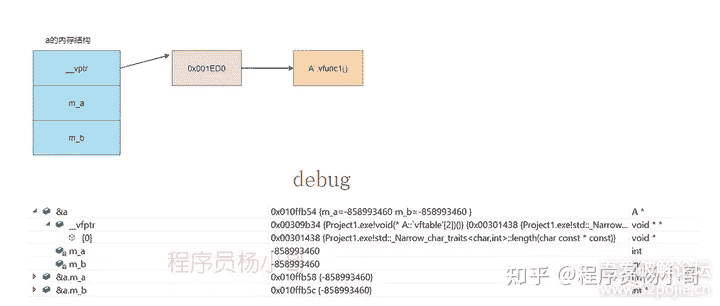
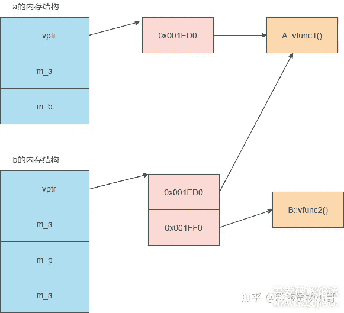
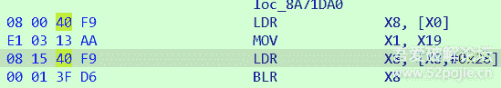
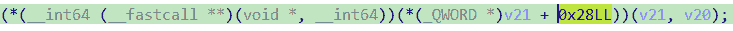

# [Android 原创] 安卓虚表hook的简单实现

- 原帖: https://www.52pojie.cn/forum.php?mod=viewthread&tid=1922560
- 抓取时间: 2026-11-02T01:13:41

## 0x0 虚表的简单介绍

虚表（`Virtual Table`）是一种在面向对象编程中常见的概念，特别是在使用`C++`等支持多态性（`Polymorphism`）的编程语言中。它是一种数据结构，用于实现类的动态绑定（`Dynamic Binding`）和多态性。在`C++`中，虚表通常与虚函数（`Virtual Function`）一起使用。在具有继承关系的类中，当一个基类指针或引用指向一个派生类对象时，如果基类声明了虚函数，那么通过这个指针或引用调用虚函数时，将会根据实际对象的类型来确定调用的是哪个函数。这种确定发生在运行时，被称为动态绑定。虚表的作用就是为实现动态绑定提供支持。每个带有虚函数的类都有一个虚表，其中存储了指向各个虚函数的指针。当通过基类指针或引用调用虚函数时，实际上是通过虚表来确定应该调用哪个函数。在编译时，编译器会根据类的虚函数情况生成虚表，并在每个对象的内存布局中添加一个指向该虚表的指针。这个指针被称为虚表指针（`vptr`）。当调用虚函数时，实际上是通过对象的虚表指针找到对应的虚表，然后再根据函数在虚表中的位置来调用正确的函数。总的来说，虚表是一种实现多态性和动态绑定的机制，它使得在面向对象编程中能够以更灵活的方式使用继承和多态性。

## 0x1 虚表的正向逆向示例

虚表的一个简单示例源码：

```cpp
class A
{
public:
    void func1() { cout 
```



`image.png` (84.83 KB, 下载次数: 0)

[forum.php?mod=attachment&aid=MjY5NDk1OXw2NWQzYWUxN3wxNzkzNTgyMDIyfDE2ODA4NnwxOTIyNTYw&nothumb=yes](https://www.52pojie.cn/forum.php?mod=attachment&aid=MjY5NDk1OXw2NWQzYWUxN3wxNzkzNTgyMDIyfDE2ODA4NnwxOTIyNTYw&nothumb=yes)

2024-5-10 15:16 上传

多继承中源码：

```cpp
class A

{

public:

    void func1() { cout 
```



`image.png` (72.88 KB, 下载次数: 0)

[forum.php?mod=attachment&aid=MjY5NDk2MHwxMTdmZDdhZXwxNzkzNTgyMDIyfDE2ODA4NnwxOTIyNTYw&nothumb=yes](https://www.52pojie.cn/forum.php?mod=attachment&aid=MjY5NDk2MHwxMTdmZDdhZXwxNzkzNTgyMDIyfDE2ODA4NnwxOTIyNTYw&nothumb=yes)

2024-5-10 15:16 上传

> https://zhuanlan.zhihu.com/p/353260837

在`ida`中逆向分析时里的虚表例子：



`image.png` (16.82 KB, 下载次数: 1)

[forum.php?mod=attachment&aid=MjY5NDk2MXxkZGYxZjZlZnwxNzkzNTgyMDIyfDE2ODA4NnwxOTIyNTYw&nothumb=yes](https://www.52pojie.cn/forum.php?mod=attachment&aid=MjY5NDk2MXxkZGYxZjZlZnwxNzkzNTgyMDIyfDE2ODA4NnwxOTIyNTYw&nothumb=yes)

2024-5-10 15:17 上传



`image.png` (4.33 KB, 下载次数: 0)

[forum.php?mod=attachment&aid=MjY5NDk2Mnw0ODhiNzkzMXwxNzkzNTgyMDIyfDE2ODA4NnwxOTIyNTYw&nothumb=yes](https://www.52pojie.cn/forum.php?mod=attachment&aid=MjY5NDk2Mnw0ODhiNzkzMXwxNzkzNTgyMDIyfDE2ODA4NnwxOTIyNTYw&nothumb=yes)

2024-5-10 15:17 上传

`*(_QWORD *)v21`为读取虚表，`+0x28LL`为虚表偏移（`i * 0x8`）

## 0x2 虚表hook的实现

综上所示，我们想要实现虚表`hook`的方式就很明了了，内存加载后虚表的位置是不会改变的，只需要用`mprotect`把想要`hook`的虚表所在内存页的属性修改为`rw`，然后把`hook`函数的地址写入指定虚表地址，写入后还原页属性即可

```cpp
void VFuncHook(uintptr_t VFunc, uintptr_t hookAddr)
{
    // 假设 PAGE_SIZE 是系统的页面大小
    size_t page_size = sysconf(_SC_PAGESIZE);
    // 计算 addr 所在页的起始地址
    void *page_start = (void *)((uintptr_t)VFunc & ~(page_size - 1));
    // 计算要修改的地址的偏移量
    size_t offset = (uintptr_t)VFunc - (uintptr_t)page_start;
    // 新的权限：不可读写可执行
    int prot = PROT_READ | PROT_WRITE;
    // 使用 mprotect 修改内存权限
    if (mprotect(page_start, page_size, prot) == -1)
    {
        LOGD("[-] mprotect Erro");
        exit(EXIT_FAILURE);
    }
    Write(VFunc, hookAddr);
    if (mprotect(page_start, page_size, PROT_READ) == -1)
    {
        LOGD("[-] mprotect Erro");
        exit(EXIT_FAILURE);
    }
    // LOGD("[+] Hook");
}
```

```cpp
void hookFunc(){

 LOGD("FuncHooked");

}
```

```c
void *main_thread(){
VFuncHook(VFuncPtr,(uintptr_t)hookFunc);
}
```

## 0x3 小结

虚表`hook`相较于`inlinehook`来说没有修改代码段，无法通过对代码段`crc`校验来检测，一般检测的话需要分析类虚表中有哪些引用，通过`so`地址+偏移计算出虚表函数中的地址并通过算法生成一个校验值，然后需要检测的时候可以选择比对整个虚表的校验值或者校验某些函数地址是否被修改。还可以通过`hook mprotect`，判断当前修改的地址是否合法，回溯调用栈，看调用的地址是否有异常。

说起`mprotect`，还有一种可以通过`mprotect`实现基于页面异常的`hook`（其实就是软件断点）这种`hook`可以实现不会触发`crc`校验。虽然`linux mprotect`只能修改整个页面，但是发生异常的时候`handler`接收的`siginfo`里会有发生异常的地址信息，能准确的对某个地方进行`hook`。这个东西后面有空的时候可以作为学习记录一下在自己实现的过程中发现的一些小技巧和坑。
