# [Android 原创] 某灰产收费虚拟定位APP逆向破解教程之弹窗强制更新

- 原帖: https://www.52pojie.cn/forum.php?mod=viewthread&tid=1923766
- 抓取时间: 2026-11-02T01:13:37

## 写在前面

声明：本文仅供学习交流使用，所涉及的技术请勿用于非法活动，否则所带来的一切后果自负。

## 环境工具

### 环境

- Windows 10
- Android 13
- JDK 17

### 工具

- NP管理器(MT管理器) ---- 用于修改代码，签名APK
- jadx-1.5.0-iyue ---- 主要手机篇幅有限，查看反编译代码

## 破解过程

打开就看见更新弹窗，不可取消状态，点击更新跳转到浏览器打开网盘下载链接

分析可以直接搜索“更新”或者`android.intent.action.VIEW`定位代码入口

因为Android中打开浏览器要使用`Intent`

```
Intent intent = new Intent();
intent.setAction("android.intent.action.VIEW");
Uri content_url = Uri.parse("http://www.example.com"); // 替换为你想打开的URL
intent.setData(content_url);
startActivity(intent);
```

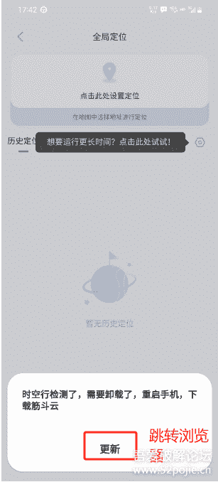

- 没有加固，直接查看

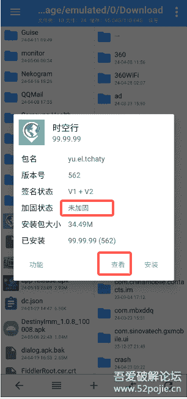

- 选择任意一个dex文件

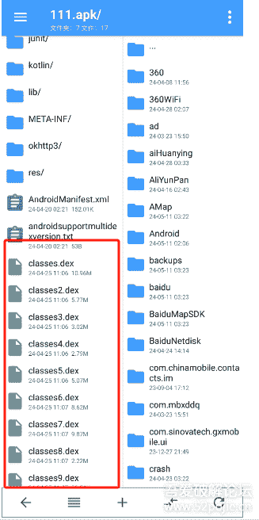

- 选择dex++

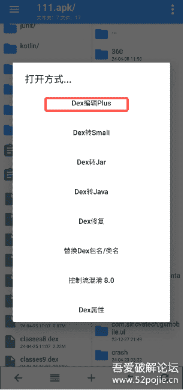

- 点全选，确定

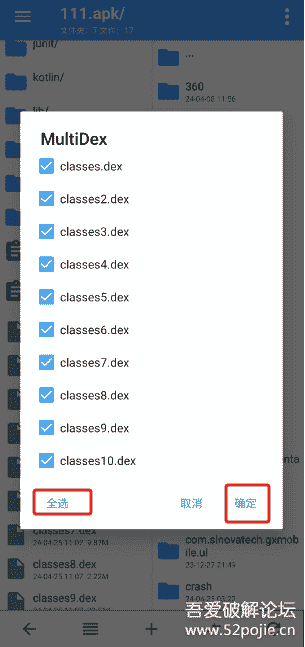

- 依以下发起新搜索，查找“更新”，类型为“代码”，并确定

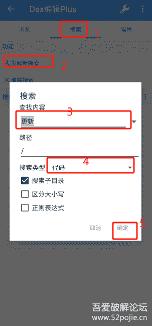

- 直接点击进入搜到的选项

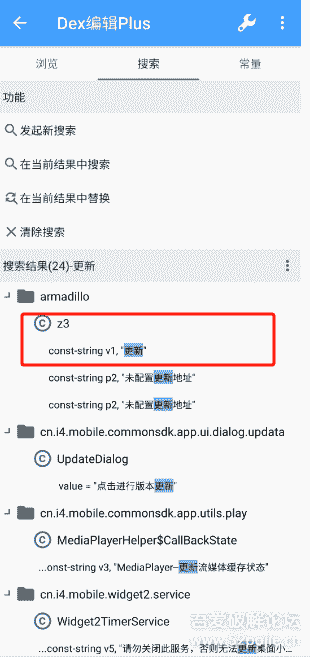

- 右上角菜单选转为Java

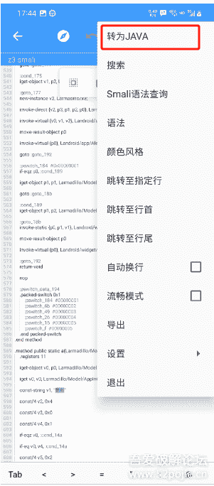

- java代码中定位，手机篇幅受限，所以下面展示Jadex代码

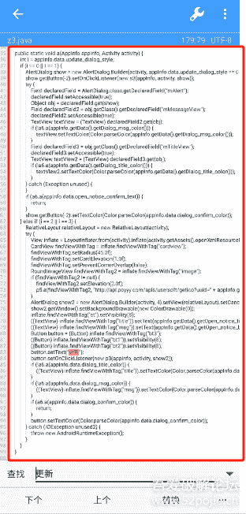

- 其中框选为`AlertDialg`，`show()`方法都在`public static void a(final AppInfo appInfo, final Activity activity)`这个方法中调用，所以我们找到调用该方法的具体代码删掉即可

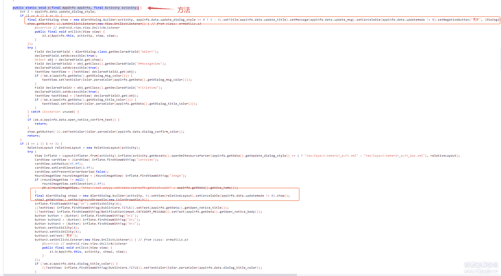

- NP管理器返回`Smali`代码，选择导航

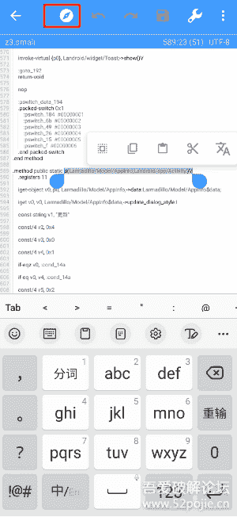

- 定位到`public static void a(final AppInfo appInfo, final Activity activity)`方法的smali代码方法体声明处，复制smali代码

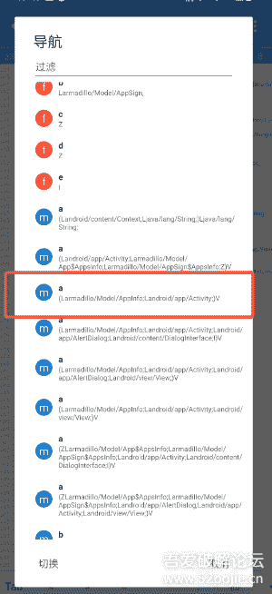

- 复制代码`a(Larmadillo/Model/AppInfo;Landroid/app/Activity;)V`

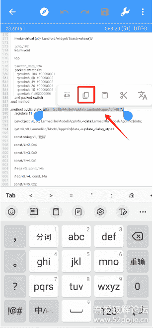

- 右上角菜单选项，选择搜索，搜索刚才复制的代码
`a(Larmadillo/Model/AppInfo;Landroid/app/Activity;)V`
把搜索到的两行代码全部删除，可以对比搜索到的和下图中框选是否一致

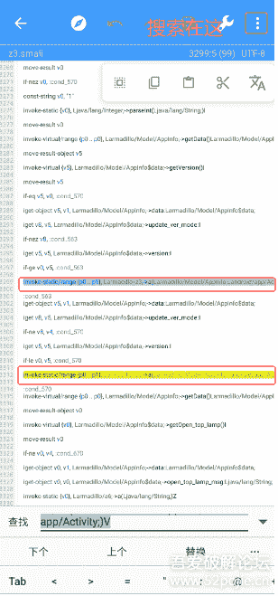

- 然后保存退出，重新安装

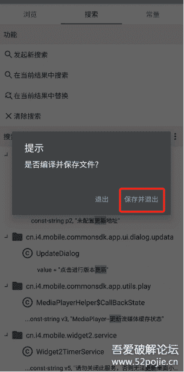

- 验证修改后的安装包，可以直接使用


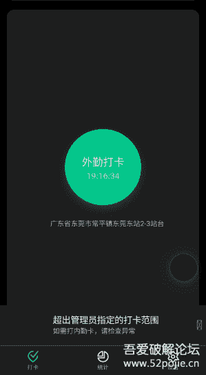

https://www.123pan.com/s/y2B0Vv-2HlW3.html

仅供学习使用
