# [Android CTF] 腾讯游戏安全2024初赛安卓复现

- 原帖: https://www.52pojie.cn/forum.php?mod=viewthread&tid=1930752
- 抓取时间: 2026-11-01T16:56:28.773Z

## UE4逆向简单流程

### dump SDK

这个可能是属于UE4逆向首先要做的事情，网上关于这一步有很多教程，这里便不再详说。

看UE4具体版本：

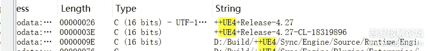

版本是4.27

将`UE4.so`拖入`IDA`，`IDA`分析完后获取三个主要结构的偏移。

`GWorld`：`0x0B32D8A8`

`GName`：`0x0B171CC0`

`GUObjectArray`：`0xB1B5F98`

### 工具

`[//github.com/revercc/UE4Dumper?tab=readme-ov-file](https://github.com/revercc/UE4Dumper?tab=readme-ov-file:https)`

`./Ue4dumper --package com.tencent.ace.match2024 --ptrdec --sdku --gname 0x0B171CC0 --guobj 0x0B1B5F98 --output /data/local/tmp --newue+`

拿到dump下来的SDK后应该就可以通过它来锁定实例对一些属性进行一个修改。

不过这块我要怎么实现呢？写`frida`脚本吗？

是的，写`frida`脚本，但是这和我之前写的一些小小的勾取脚本不同，这次要锁定类的方法是根据地址。

### UE4逆向脚本中一些函数的解析

### 获取so文件地址同时将一些基本的指针赋上值。

下文的代码块中基本都是`JS`代码，实现一些功能的函数。

```
function set(moduleName){
  //获取libUE4的基地址
  moduleBase=Module.findBaseAddress(moduleName);

  //UE4基地址加上在IDA中获取的GName偏移获取GName地址
  GName=moduleBase.add(GName_Offset);

  //同上获取GUObjectArray的地址
  GUObjectArray=moduleBase.add(GUObjectArray_Offset);

//读取GWorld的指针
  GWorld =moduleBase.add(GWorld_Offset).readPointer();

}
function setPlayerHP(hp=1000000){
  //生命值属性的偏移
  getPlayAddr().add(0x510).writeFloat(hp);//写入
}
```

### 获取对象ID及通过ID获取对象的符号

```
getNameId: function(obj){

  console.log("obj:${obj}");

  try{

    var nameId=ptr(obj).add(offset_UObject_FNameIndex).readU32();//读取4字节。

    //console.log("nameId:${nameId}");

    return nameId;

  }catch(e){

    console.log("error")

    return 0;

  }

}

function getFNameFromID(index) {

  // FNamePool相关偏移量和步长

  var FNameStride = 0x2;                   // FNameEntry 的步长，每个FNameEntry占用2字节

  var offset_GName_FNamePool = 0x30;       // GName 到 FNamePool 的偏移量

  var offset_FNamePool_Blocks = 0x10;      // FNamePool 到 Blocks 的偏移量

  // FNameEntry相关偏移量和位

  var offset_FNameEntry_Info = 0;          // FNameEntry 到 Info 的偏移量

  var FNameEntry_LenBit = 6;               // FNameEntry 长度位

  var offset_FNameEntry_String = 0x2;      // FNameEntry 到字符串部分的偏移量

  // 计算块和偏移量

  var Block = index >> 16;                 // 块索引

  var Offset = index & 65535;              // 块内偏移量

  // 获取FNamePool的起始地址

  var FNamePool = GName.add(offset_GName_FNamePool);

  // console.log(`FNamePool: ${FNamePool}`);

  // console.log(`Block: ${Block}`);

  // 获取特定块的地址

  var NamePoolChunk = FNamePool.add(offset_FNamePool_Blocks + Block * 8).readPointer();

  // console.log(`NamePoolChunk: ${NamePoolChunk}`);

  // 计算FNameEntry的地址

  var FNameEntry = NamePoolChunk.add(FNameStride * Offset);

  // console.log(`FNameEntry: ${FNameEntry}`);

  try {

      // 读取FNameEntry的Header

      if (offset_FNameEntry_Info !== 0) {

          var FNameEntryHeader = FNameEntry.add(offset_FNameEntry_Info).readU16();     

      } else {

          var FNameEntryHeader = FNameEntry.readU16();

      }

  } catch(e) {

      // 捕捉读取异常并返回空字符串

      // console.log(e);

      return "";

  }

  // console.log(`FNameEntryHeader: ${FNameEntryHeader}`);

  // 获取字符串地址

  var str_addr = FNameEntry.add(offset_FNameEntry_String);

  // console.log(`str_addr: ${str_addr}`);

  // 计算字符串长度和宽度

  var str_length = FNameEntryHeader >> FNameEntry_LenBit; // 计算字符串长度

  var wide = FNameEntryHeader & 1;                       // 判断字符串是否为宽字符

  // 如果是宽字符，返回 "widestr"

  if (wide) return "widestr";

  // 如果字符串长度合理，读取并返回UTF-8字符串

  if (str_length > 0 && str_length 
```

### 获取所有Actor的实例地址

```
function getActorsAddr(){
  var Level_Offset=0x30//偏移
  var Actors_Offset=0x98
  var Level=GWorld.add(Level_Offset).readPointer()//读取GWorld的level指针
  var Actors=Level.add(Actors_Offset).readPointer()//读取Actors的指针
  var Actors_Num=Level.add(Actors_Offset).add(8).readU32()//获取Actor的数量
  var actorsAddr={};//空对象，下面的实现类似字典
  for(var index=0;index
```

### 对题目复现的正式开始

### 出门

### 实现篡改血量

```
function getActorAddr(str){//根据对象名字获取对象地址

  var player_addr;

  var actorsAddr=getActorsAddr();

  for(var key in actorsAddr){

    if(key==str){

      //console.log(actorsAddr[key]);

      player_addr=actorsAddr[key];

    }

  }

  if(player_addr==null)

    {

      console.log("null pointer!");

    }

  return player_addr;

}

function setPlayerHP(hp=1000000){

  //生命值属性的偏移

  getAcotrAddr(playerName).add(0x510).writeFloat(hp);//通过偏移定位到生命值的变量并写入值

}
```
```
//main:
set("libUE4.so")
setPlayerHP();
```

### 瞬移

这里有一步操作是我们可以从`SDK_dump`文件中获取到很多函数及类的偏移。

将`K2_GetActorLocation`函数的偏移传入构造`JavaScript`函数，然后将玩家的类地址和移动到的坐标作为参数即可调用我们自定义的函数。

```
function getActorLocation(actor_addr){

  GWorld = moduleBase.add(GWorld_Offset).readPointer();

  actor_addr = ptr(actor_addr)

  var buf = Memory.alloc(0x100);

  var f_addr = moduleBase.add(0x965ddf8);//这个地址可在dump下的SDK文件里找到

    // 将目标函数地址转换为JavaScript函数

  var getLocationFunc = new NativeFunction(f_addr, 'void', ['pointer','pointer','pointer']);

  // 调用目标函数并传递内存地址作为参数

  try{

      getLocationFunc(actor_addr,buf,buf);

      dumpVector(buf);

      //info(ptr(actor_addr).add(0x130).readPointer().add(0x14c).readU8()&32 != 0);

  }

  catch (e){

  }

}
```

将获取到的坐标进行一个搜索


冻结后实现一个方向无法移动，证实该坐标的正确。

从之前的`SDK_dump`中获取函数的偏移

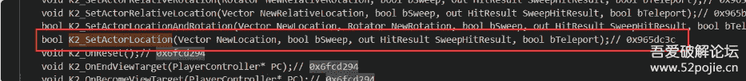

构建`setActorLocation`函数

```
function setActorLocation(actor_addr,x,y,z){
  GWorld = moduleBase.add(GWorld_Ptr_Offset).readPointer();
  actor_addr = ptr(actor_addr)
  var f_addr = moduleBase.add(0x8C3181C);//加上偏移获取目标函数的偏移
  // 将目标函数地址转换为JavaScript函数
  var setLocationFunc = new NativeFunction(f_addr, 'bool', ['pointer','bool','pointer','bool','float','float','float']);
  // 调用目标函数并传递内存地址作为参数
  setLocationFunc(actor_addr,0,ptr(0),0,x,y,z);
  //dumpVector(buf);

}
```

这里只要调用该函数即可实现坐标的变化。

瞬移到此结束。

虽然瞬移到此结束，但是这里我要说明一下这里有关函数类封装性的分析。

### 小重点：定位正确函数地址

这里拿`SetActorLocation`来做个例子。

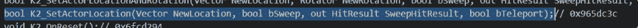

dump下的SDK中相关的该函数地址为`0x965dc3c`。转到该地址后

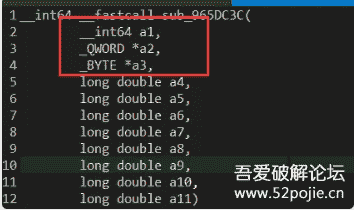

实际参数只有三个。

这里的话，要关联一些关于SDK的知识。SDK中看到的函数地址是中转函数。

这里的三个参数数量是正确的，分别是类指针，存放参数用来解析的结构体，存放返回值的指针，它是一个中转函数。

在下文的`return`这里的这个函数才是实际和我们源码看到的相符的。

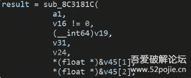

而我们再进入这个函数时，可以看到和源码中被`return`的那个函数相符的部分。

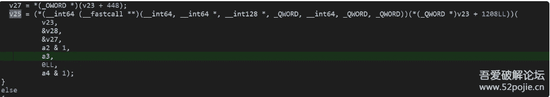

所以`sub_8C3181C`这里才是我们实际要调用的函数。

### Section1：空中的Flag字段

通过改变玩家高度大概锁定了天上的`flag`在高度3000左右往上。

这里就是对所有高度大于3000的对象实例尽可能调用`SetVisibility`函数来使得`Actor`可见。

第一个参数为`Component`型

所以传入`Actor`对象实例的`0x130`偏移为指针。

```
//显示
//void SetVisibility(bool bNewVisibility, bool bPropagateToChildren);
function SetVisibility(Component,bNewVisibility,bPropagateToChildren)
{

var pSetVisibility=moduleBase.add(0x8E619BC);

var callSetVisibility=new NativeFunction(pSetVisibility,"void",['pointer','int','int']);

  callSetVisibility(ptr(Component).add(0x130).readPointer(),bNewVisibility,bPropagateToChildren);

}
```

### Section2：使得方块不可碰撞

### 构建有关碰撞的函数

```
//碰撞
function setActorEnableCollision(actor_addr,bNewActorEnableCollision=1){
  var f_addr = moduleBase.add(0x8C21320);
  let CallFunc = new NativeFunction(f_addr, 'void', ['pointer','char']);
  CallFunc(ptr(actor_addr),bNewActorEnableCollision);
}
```

然后试图对所有对象进行调用。

这里发现问题似乎在于函数的使用，这里使用类本身的`setStaticMeshActorCollisionEnabled()`可以实现立方体可碰撞，但是我选用上面的更为全局的碰撞函数`setActorEnableCollision()`时却无法实现。这里不太清楚为什么，把`section3`搞完再去搜一下。

解读一下第二种碰撞函数：对`actor`加上`0x220`的偏移，定位到`StaticMeshComponent* StaticMeshComponent`，读取指针定位到`StaticMeshComponent`对象，再读取一次指针定位到`StaticMeshComponent`对象的虚函数表。然后加上`0x660`的偏移读取`SetCollisionEnable`虚函数地址。

```
function setStaticMeshActorCollisionEnabled(actor_addr,NewType=3){

  actor_addr = ptr(actor_addr)

  var f_addr = actor_addr.add(0x220).readPointer().readPointer().add(0x660).readPointer();

  var getActorCollisionEnabled = new NativeFunction(f_addr, 'char', ['pointer','char']);

  let ret = getActorCollisionEnabled(actor_addr.add(0x220).readPointer(),NewType);

  info(ret);

}
```

碰撞了所有的三个立方体后天上又出现`flag`的一部分。


第三个是直接找到了`SetCollisionEnabled`的地址然后构建函数。

```
function SetCollisionEnable(actor_addr,dr=3) {
  var f_addr=moduleBase.add(0x933b300);
  let CallFunc=new NativeFunction(f_addr,'void',['pointer','int']);
  CallFunc(ptr(actor_addr).add(0x130).readPointer(),dr);
}
```

第一个无法实现，第二个和第三个本质上是一样的，可以实现功能。

## Section3：黄色球体

这个类的方法直接猜了下和`getflag`这种字符串有关，直接在`sdkdump`中搜到了。但是正解我还需要再学习一下。

找到该函数后直接到目标地址。

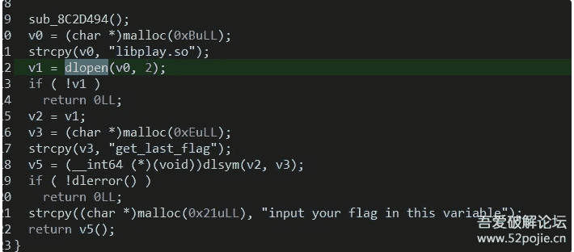

`dlopen`是一个`UE4.so`中专门的函数。

调用了`libplay`中的`get_last_flag`函数。

再次进入后发现一堆异或。

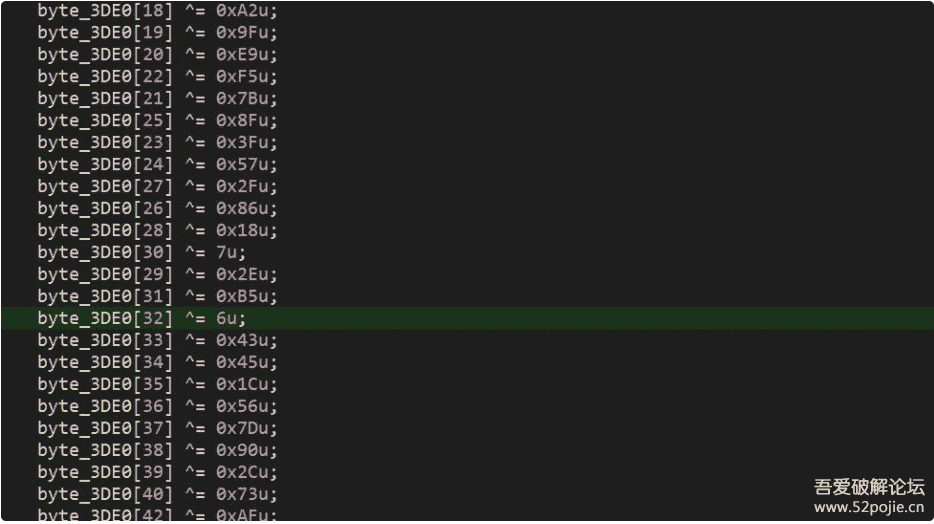

这段异或尝试后发现是base64的码表。

打算通过动调理清这段加密流程。

在手机端启动`idaserver`。

然后以该命令以调试状态启动目标app

```
adb shell am start -D -n com.tencent.ace.match2024/com.epicgames.ue4.SplashActivity
```

可以Attach到进程，但是F9之后没有任何反应，手机显示`wait for debug`，电脑直接跑飞。

看来动调并不太行，于是转而去读汇编。

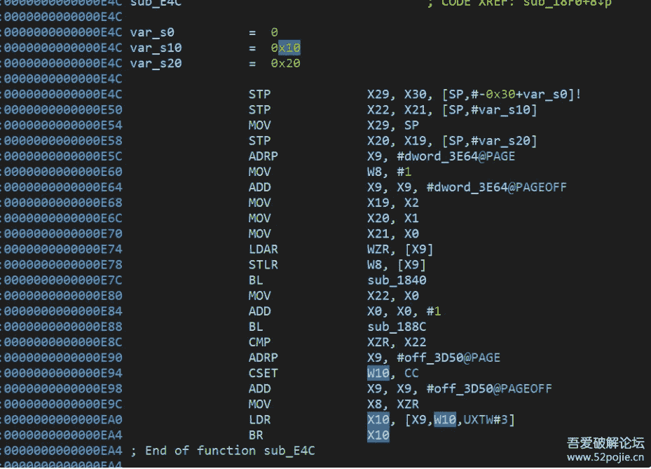

`E4C`这一段下面的`BR`会根据一些比较来决定跳转到下面的`EA8`还是`ED8`，这个让gpt就可以分析出来。

大致分析`EA8`是主要加密段，进行一个异或操作，下面的`ED8`类似`RET`，进行一个结束处理。(分析不一定准确，因为不会ARM汇编，只能结合AI)

再分析下面的函数，进入后发现`EEC`

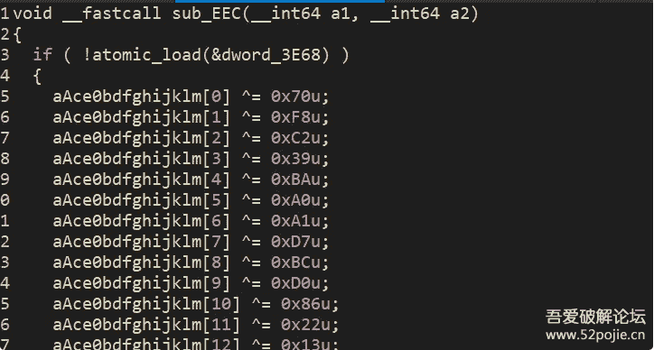

这个数组异或完后猜测是base64变表，那这个函数大抵就是base64了。

再往下的部分大概就是比较了。

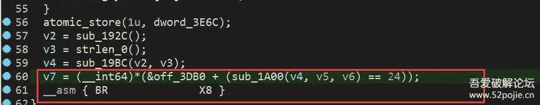

汇编喂给GPT后分析出大致是24个字节的比较。

这里就能推断出上文其中一个进行异或的数组是密文

异或后：

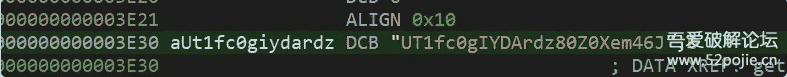

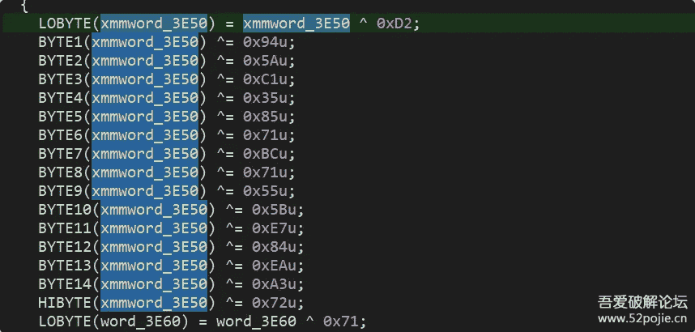

这段数组应该就是作为`EA8`段异或操作的`key`数组。

根据这些写出脚本：

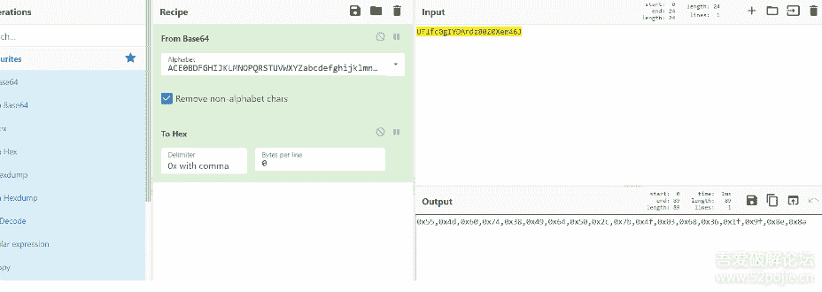

```
#include
int main()
{
        char encode[] = { 0x55,0x4d,0x60,0x74,0x38,0x49,0x64,0x50,0x2c,0x7b,0x4f,0x03,0x68,0x36,0x1f,0x9f,0x8e,0x8a,0,0};
        char key[] = { 0x0A, 0x0C, 0x0E, 0x00, 0x51, 0x16, 0x27, 0x38, 0x49, 0x1A, 0x3B, 0x5C, 0x2D, 0x4E, 0x6F, 0xFA,
        0xFC, 0xFE};
        for (int i = 0; i 
```

拿到最后一部分flag：`_Anti_Cheat_Expert`


## 最终结果

flag：`FLAG{8939008_Anti_Cheat_Expert}`

在复习的过程中还是学了不少东西的，也多亏了有两位师傅的无私解疑和指导，写的文章还很粗糙，需要时间打磨。

最后在这里贴上`frida`的脚本供于参考。

```
var GWorld_Offset=0x0B32D8A8

var GName_Offset=0x0B171CC0

var GUObjectArray_Offset=0xB1B5F98

var playerName="FirstPersonCharacter_C"

var moduleBase

var GWorld

var GName

var GUObjectArray

//Class: UObject

//对象的内部索引，用于唯一标识对象。

 var offset_UObject_InternalIndex = 0xC;

 //指向描述对象类的 UClass 对象

 var offset_UObject_ClassPrivate = 0x10;

 //对象名称在 FName 表中的索引

 var offset_UObject_FNameIndex = 0x18;

 //指向包含该对象的外部对象，表示层次关系。

 var offset_UObject_OuterPrivate = 0x20;

 var UObject={

  getClass: function(obj){

    var classPrivate=ptr(obj).add(offset_UObject_ClassPrivate).readPointer();//读取指针

    //console.log(`classPrivate: ${classPrivate}`);

    return classPrivate;

  },

getNameId: function(obj){

  //console.log(`obj:${obj}`);

  try{

    var nameId=ptr(obj).add(offset_UObject_FNameIndex).readU32();//读取4字节。

    //console.log(`nameId:${nameId}`);

    return nameId;

  }catch(e){

    console.log("error")

    return 0;

  }

},

getName: function(obj) {

  if (this.isValid(obj)){

      return getFNameFromID(this.getNameId(obj));

  } else {

      return "None";

  }

},

getClassName: function(obj) {

  if (this.isValid(obj)) {

      var classPrivate = this.getClass(obj);

      return this.getName(classPrivate);

  } else {

      return "None";

  }

},

isValid: function(obj) {

  var isValid = (ptr(obj) > 0 && this.getNameId(obj) > 0 && this.getClass(obj) > 0);

  // console.log(`isValid: ${isValid}`);

  return isValid;

}

 }

 function getFNameFromID(index) {

  // FNamePool相关偏移量和步长

  var FNameStride = 0x2;                   // FNameEntry 的步长，每个FNameEntry占用2字节

  var offset_GName_FNamePool = 0x30;       // GName 到 FNamePool 的偏移量

  var offset_FNamePool_Blocks = 0x10;      // FNamePool 到 Blocks 的偏移量

  // FNameEntry相关偏移量和位

  var offset_FNameEntry_Info = 0;          // FNameEntry 到 Info 的偏移量

  var FNameEntry_LenBit = 6;               // FNameEntry 长度位

  var offset_FNameEntry_String = 0x2;      // FNameEntry 到字符串部分的偏移量

  // 计算块和偏移量

  var Block = index >> 16;                 // 块索引

  var Offset = index & 65535;              // 块内偏移量

  // 获取FNamePool的起始地址

  var FNamePool = GName.add(offset_GName_FNamePool);

  // console.log(`FNamePool: ${FNamePool}`);

  // console.log(`Block: ${Block}`);

  // 获取特定块的地址

  var NamePoolChunk = FNamePool.add(offset_FNamePool_Blocks + Block * 8).readPointer();

  // console.log(`NamePoolChunk: ${NamePoolChunk}`);

  // 计算FNameEntry的地址

  var FNameEntry = NamePoolChunk.add(FNameStride * Offset);

  // console.log(`FNameEntry: ${FNameEntry}`);

  try {

      // 读取FNameEntry的Header

      if (offset_FNameEntry_Info !== 0) {

          var FNameEntryHeader = FNameEntry.add(offset_FNameEntry_Info).readU16();     

      } else {

          var FNameEntryHeader = FNameEntry.readU16();

      }

  } catch(e) {

      // 捕捉读取异常并返回空字符串

      // console.log(e);

      return "";

  }

  // console.log(`FNameEntryHeader: ${FNameEntryHeader}`);

  // 获取字符串地址

  var str_addr = FNameEntry.add(offset_FNameEntry_String);

  // console.log(`str_addr: ${str_addr}`);

  // 计算字符串长度和宽度

  var str_length = FNameEntryHeader >> FNameEntry_LenBit; // 计算字符串长度

  var wide = FNameEntryHeader & 1;                       // 判断字符串是否为宽字符

  // 如果是宽字符，返回 "widestr"

  if (wide) return "widestr";

  // 如果字符串长度合理，读取并返回UTF-8字符串

  if (str_length > 0 && str_length  {

  await GetActorVrtualAdress();

})();

//主要实现作弊的hanshu

function dumpActorInstances(){

  GWorld = moduleBase.add(GWorld_Offset).readPointer();//找到GWorld这个类并储存它的地址作为指针

  var Level_Offset = 0x30

  var Actors_Offset = 0x98

  var Level = GWorld.add(Level_Offset).readPointer()//关卡的指针

  var Actors = Level.add(Actors_Offset).readPointer()//Actor的指针

  var Actors_Num = Level.add(Actors_Offset).add(8).readU32()//Actors的数量

  var actorsInstances = {};

  for(var index =0; index 3000)//高度大于3000则执行

    {              

      try{

          //setActorHidden(actor_addr)

          //setActorCollisionEnabled(actor_addr,1)

          SetVisibility(actor_addr,1,0);

      }

      catch(e){}

    }

  }

}

set("libUE4.so")

setPlayerHP();

//GetActorVrtualAdress();

var b=getActorAddr(playerName);

//getActorLocation(b);

//getActorLocation(b);

dumpActorInstances();

//(-1569.0198974609375, -415.2847595214844, 268.3680725097656)

//setActorLocation(b,-1500,-400,3000);

  //下面这一句代码是指定要Hook的so文件名和要Hook的函数名，函数名就是上面IDA导出表中显示的那个函数
```

以及我学习中有看的一些文章

不错文章：[//www.yxfzedu.com/article/670](http://www.yxfzedu.com/article/670:http)

不错文章：[//iosre.com/t/%E8%AE%B0%E5%BD%95%E4%B8%80%E6%AC%A1%E8%99%9A%E5%B9%BB4ue4%E6%89%8B%E6%B8%B8%E9%80%86%E5%90%91/19808](https://iosre.com/t/%E8%AE%B0%E5%BD%95%E4%B8%80%E6%AC%A1%E8%99%9A%E5%B9%BB4ue4%E6%89%8B%E6%B8%B8%E9%80%86%E5%90%91/19808:https)

好文章：[//www.yxfzedu.com/article/10613](http://www.yxfzedu.com/article/10613:http)
