# [Android 原创] FakeLocation国际版去除时区和语言弹窗验证验证-NP(MT)管理器

- 原帖：https://www.52pojie.cn/forum.php?mod=viewthread&tid=1938690
- 抓取时间：2026-11-01T23:59:48

## 前言

声明：本文仅供学习交流使用，所涉及的技术请勿用于非法活动，否则所带来的一切后果自负。

## 环境工具

- Android 13
- NP管理器(MT管理器)

## 文件下载

123云盘：[https://www.123pan.com/s/y2B0Vv-jWlW3.html](https://www.123pan.com/s/y2B0Vv-jWlW3.html)

## 破解过程

### 1. 安装原始包分析

安装打开后显示弹窗，点击OK自动退出

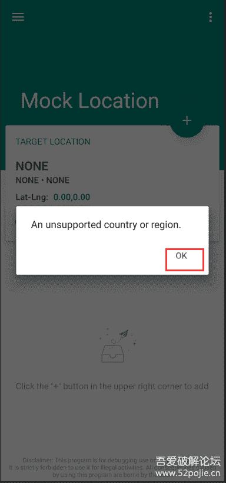

附件下载：[点击下载](https://www.52pojie.cn/forum.php?mod=attachment&aid=MjcwNDE0NHw0MTQxZWZkNHwxNzkzNTc3NTg2fDE2ODA4NnwxOTM4Njkw&nothumb=yes)（附件名：原始包分析.png，大小：60.8 KB，下载次数：2，上传时间：2024-6-27 12:20）

### 2. 管理器打开apk

选中`Fakelocation.apk`

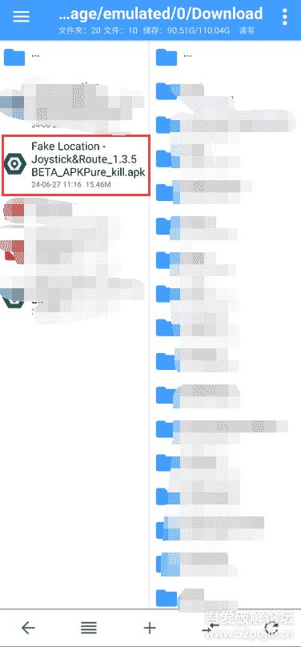

附件下载：[点击下载](https://www.52pojie.cn/forum.php?mod=attachment&aid=MjcwNDE1OXxjZWJiOTI3NnwxNzkzNTc3NTg2fDE2ODA4NnwxOTM4Njkw&nothumb=yes)（附件名：分析apk.png，大小：50.91 KB，下载次数：2，上传时间：2024-6-27 13:11）

### 3. 查看apk

点击查看

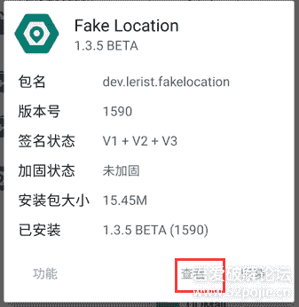

附件下载：[点击下载](https://www.52pojie.cn/forum.php?mod=attachment&aid=MjcwNDE2MHxjZDk4NjYwNnwxNzkzNTc3NTg2fDE2ODA4NnwxOTM4Njkw&nothumb=yes)（附件名：查看.png，大小：43.02 KB，下载次数：3，上传时间：2024-6-27 13:13）

### 4. 选择dex

选中`classes.dex`

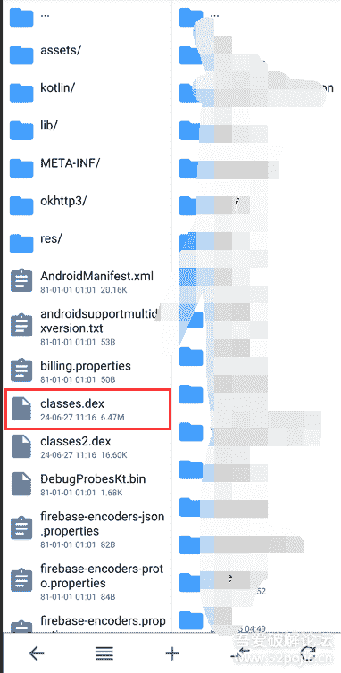

附件下载：[点击下载](https://www.52pojie.cn/forum.php?mod=attachment&aid=MjcwNDE2MXw2NjljMmQ2ZHwxNzkzNTc3NTg2fDE2ODA4NnwxOTM4Njkw&nothumb=yes)（附件名：A(7\]\`ZJSAPM@Y5Q67N{ZSDU.png，大小：79.94 KB，下载次数：3，上传时间：2024-6-27 13:17）

### 5. 打开dex++

然后确定

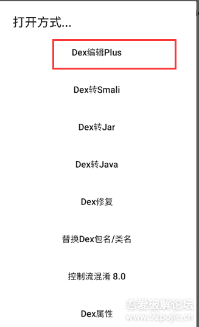

附件下载：[点击下载](https://www.52pojie.cn/forum.php?mod=attachment&aid=MjcwNDE3OXxhYmU0OGVjNnwxNzkzNTc3NTg2fDE2ODA4NnwxOTM4Njkw&nothumb=yes)（附件名：CTFM\]W~G\`\[@ADERC)8RX@\]A.png，大小：30.22 KB，下载次数：2，上传时间：2024-6-27 13:44）

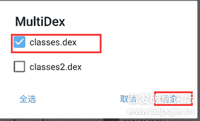

附件下载：[点击下载](https://www.52pojie.cn/forum.php?mod=attachment&aid=MjcwNDE5MnxhNzM5YzYzY3wxNzkzNTc3NTg2fDE2ODA4NnwxOTM4Njkw&nothumb=yes)（附件名：E6CNLLE@$HBB%5Y2FU5752T.png，大小：18.03 KB，下载次数：1，上传时间：2024-6-27 13:50）

### 6. 搜索代码

- 搜索内容：`GMT+08:00`
- 搜索类型：代码
- 子目录搜索：勾选
- 区分大小写：无
- 正则表达式：无

然后确定，等待搜索结束

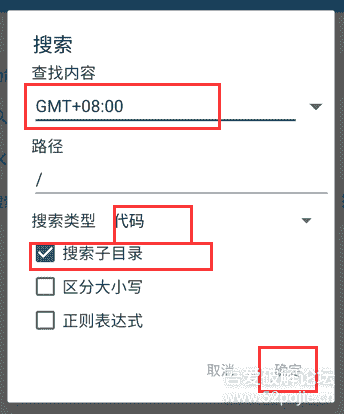

附件下载：[点击下载](https://www.52pojie.cn/forum.php?mod=attachment&aid=MjcwNDE3M3xjMWE2MmMyNnwxNzkzNTc3NTg2fDE2ODA4NnwxOTM4Njkw&nothumb=yes)（附件名：0WK~0YJYK\`0J9HR9NHJETUU.png，大小：33.03 KB，下载次数：2，上传时间：2024-6-27 13:44）

### 7. 打开进入smali代码

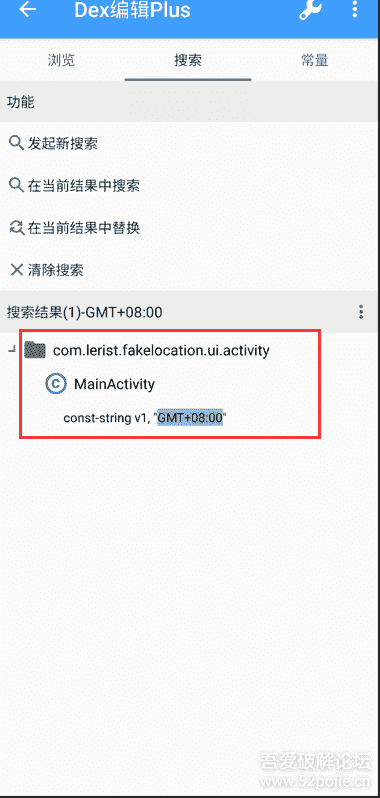

附件下载：[点击下载](https://www.52pojie.cn/forum.php?mod=attachment&aid=MjcwNDE5NHxjYmI2NDBhNHwxNzkzNTc3NTg2fDE2ODA4NnwxOTM4Njkw&nothumb=yes)（附件名：V0ED\[3K@Z)U~ICC\`73~G)IY.png，大小：57.89 KB，下载次数：2，上传时间：2024-6-27 13:57）

### 8. smali转java分析

右上角菜单选中转为java

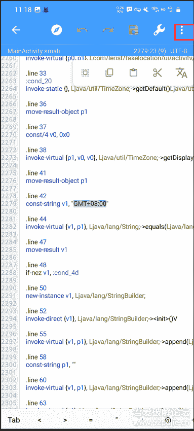

附件下载：[点击下载](https://www.52pojie.cn/forum.php?mod=attachment&aid=MjcwNDE3Nnw4OThhNDM4OHwxNzkzNTc3NTg2fDE2ODA4NnwxOTM4Njkw&nothumb=yes)（附件名：08D\`QM86}\]6{({GOXKX.png，大小：170.96 KB，下载次数：2，上传时间：2024-6-27 13:44）

搜索`GMT+08:00`跳转到具体代码

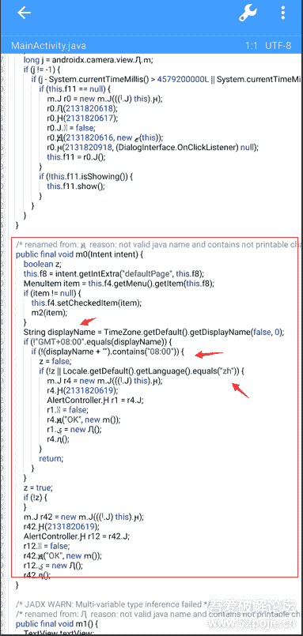

附件下载：[点击下载](https://www.52pojie.cn/forum.php?mod=attachment&aid=MjcwNDE3NXwyN2IwYmUzMHwxNzkzNTc3NTg2fDE2ODA4NnwxOTM4Njkw&nothumb=yes)（附件名：4)(UHYC8(IPO'WM0\[U2J2.png，大小：153.28 KB，下载次数：5，上传时间：2024-6-27 13:44）

分析：

- 获取本地时区：`TimeZone.getDefault().getDisplayName(false, 0);`
- 获取本地语言：`Locale.getDefault().getLanguage()`

所以把图中框选代码修改为随意字符串即可

### 9. 修改smali代码

将`GMT+08:00`、`08:00`、`zh`修改为任意字符串

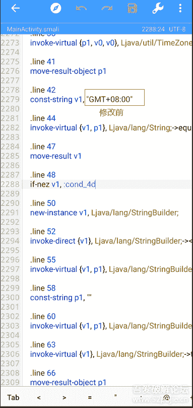

附件下载：[点击下载](https://www.52pojie.cn/forum.php?mod=attachment&aid=MjcwNDE5NXwzYjY1YWRiZXwxNzkzNTc3NTg2fDE2ODA4NnwxOTM4Njkw&nothumb=yes)（附件名：O6FP\[9@L(LQ\]AZR~NOB6.png，大小：161.3 KB，下载次数：2，上传时间：2024-6-27 13:58）

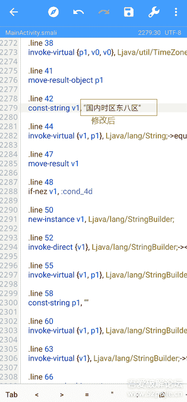

附件下载：[点击下载](https://www.52pojie.cn/forum.php?mod=attachment&aid=MjcwNDE5Nnw0MzYzODU3OXwxNzkzNTc3NTg2fDE2ODA4NnwxOTM4Njkw&nothumb=yes)（附件名：OCKK8XG3)C\`9WVP~A8TZ{IE.png，大小：155.61 KB，下载次数：1，上传时间：2024-6-27 13:58）

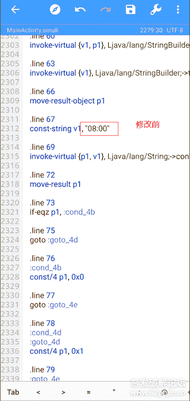

附件下载：[点击下载](https://www.52pojie.cn/forum.php?mod=attachment&aid=MjcwNDE5OHw0NmU1NDYxMXwxNzkzNTc3NTg2fDE2ODA4NnwxOTM4Njkw&nothumb=yes)（附件名：\]DIF7\]52TXCCJ66I~JTGD.png，大小：133.14 KB，下载次数：2，上传时间：2024-6-27 13:59）

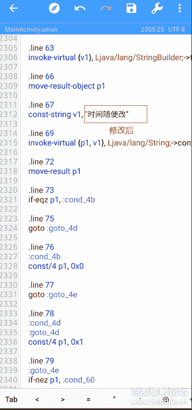

附件下载：[点击下载](https://www.52pojie.cn/forum.php?mod=attachment&aid=MjcwNDE2OXw2MGZkODVlMHwxNzkzNTc3NTg2fDE2ODA4NnwxOTM4Njkw&nothumb=yes)（附件名：\[3LU{E0Y3S%G)\`}6CGHCG)E.png，大小：125.43 KB，下载次数：5，上传时间：2024-6-27 13:44）

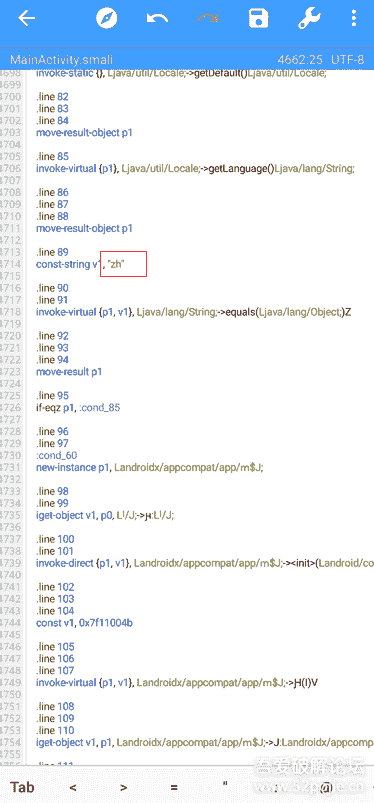

附件下载：[点击下载](https://www.52pojie.cn/forum.php?mod=attachment&aid=MjcwNDE3NHxhODcyNzM1OXwxNzkzNTc3NTg2fDE2ODA4NnwxOTM4Njkw&nothumb=yes)（附件名：3N_J)%\[RJ6NUN\[Q(@4_G16W.png，大小：137.95 KB，下载次数：2，上传时间：2024-6-27 13:44）

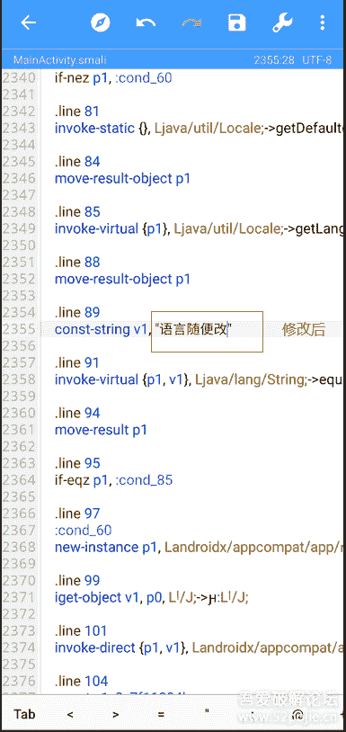

附件下载：[点击下载](https://www.52pojie.cn/forum.php?mod=attachment&aid=MjcwNDE4MHw2ODU5MTBiM3wxNzkzNTc3NTg2fDE2ODA4NnwxOTM4Njkw&nothumb=yes)（附件名：DNKK\`DSRC\[WAOH9C%%J3\]~J.png，大小：152.58 KB，下载次数：3，上传时间：2024-6-27 13:45）

### 10. 保存代码

不保存修改不生效

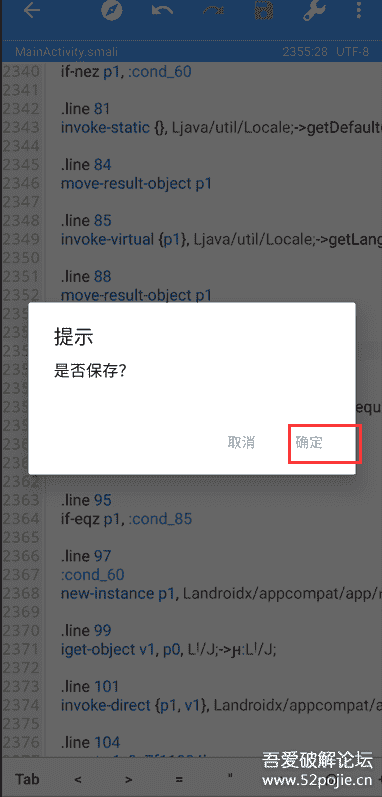

附件下载：[点击下载](https://www.52pojie.cn/forum.php?mod=attachment&aid=MjcwNDE3OHw4MDRhMmVjOHwxNzkzNTc3NTg2fDE2ODA4NnwxOTM4Njkw&nothumb=yes)（附件名：BU9)W)\[}50\`_QT5Q23PSBFT.png，大小：127.98 KB，下载次数：3，上传时间：2024-6-27 13:44）

### 11. 保存dex并签名

不签名可能安装不了

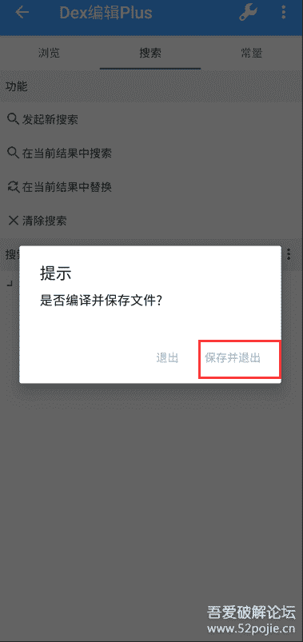

附件下载：[点击下载](https://www.52pojie.cn/forum.php?mod=attachment&aid=MjcwNDIwMHw3N2E3MjZmYnwxNzkzNTc3NTg2fDE2ODA4NnwxOTM4Njkw&nothumb=yes)（附件名：\~\~V_62CI7}HYV9ZPX4\`31LK.png，大小：46.31 KB，下载次数：2，上传时间：2024-6-27 14:01）

### 12. 安装apk测试效果

可以直接使用

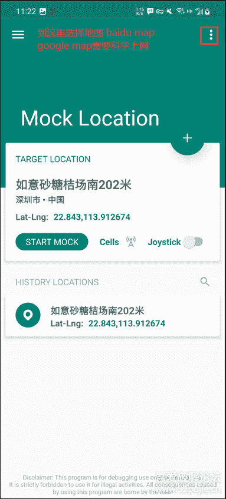


`QMX[SR]%{$DS_[O}58)]}9Q.png` (99.57 KB, 下载次数: 2)

[href="forum.php?mod=attachment&aid=MjcwNDIwMXwyOTkxOGM3MXwxNzkzNTc3NTg2fDE2ODA4NnwxOTM4Njkw&nothumb=yes" target="_blank"](https://www.52pojie.cn/forum.php?mod=attachment&aid=MjcwNDIwMXwyOTkxOGM3MXwxNzkzNTc3NTg2fDE2ODA4NnwxOTM4Njkw&nothumb=yes)

2024-6-27 14:02 上传

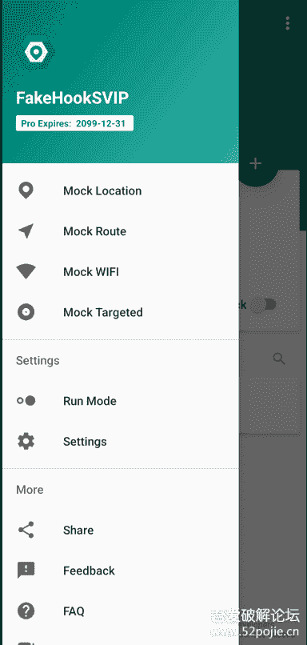

``BL_CA[%OUZBYI}%C`NCMDP.png`` (88.56 KB, 下载次数: 2)

[href="forum.php?mod=attachment&aid=MjcwNDE3MXwyOWY2NzQ4YnwxNzkzNTc3NTg2fDE2ODA4NnwxOTM4Njkw&nothumb=yes" target="_blank"](https://www.52pojie.cn/forum.php?mod=attachment&aid=MjcwNDE3MXwyOWY2NzQ4YnwxNzkzNTc3NTg2fDE2ODA4NnwxOTM4Njkw&nothumb=yes)

2024-6-27 13:44 上传


`I3E)65)35Q~@}ZOJZ1)%5TY.png` (46.01 KB, 下载次数: 2)

[href="forum.php?mod=attachment&aid=MjcwNDIwMnw2MWI5ZmEzMnwxNzkzNTc3NTg2fDE2ODA4NnwxOTM4Njkw&nothumb=yes" target="_blank"](https://www.52pojie.cn/forum.php?mod=attachment&aid=MjcwNDIwMnw2MWI5ZmEzMnwxNzkzNTc3NTg2fDE2ODA4NnwxOTM4Njkw&nothumb=yes)

2024-6-27 14:02 上传

### 备注

```
不要咨询为什么我的某钉不会被检测的，而你的又被检测，我的手机已经Root并且隐藏，有些App直接调用了Location.isFromMockProvider()方法检测是否来自模拟提供者，所以会失效
```
