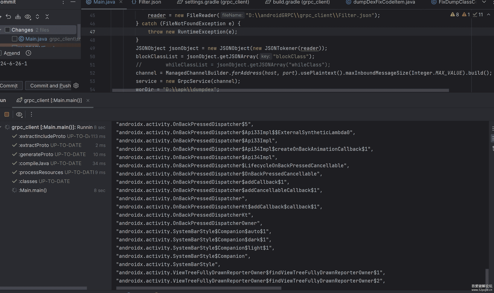
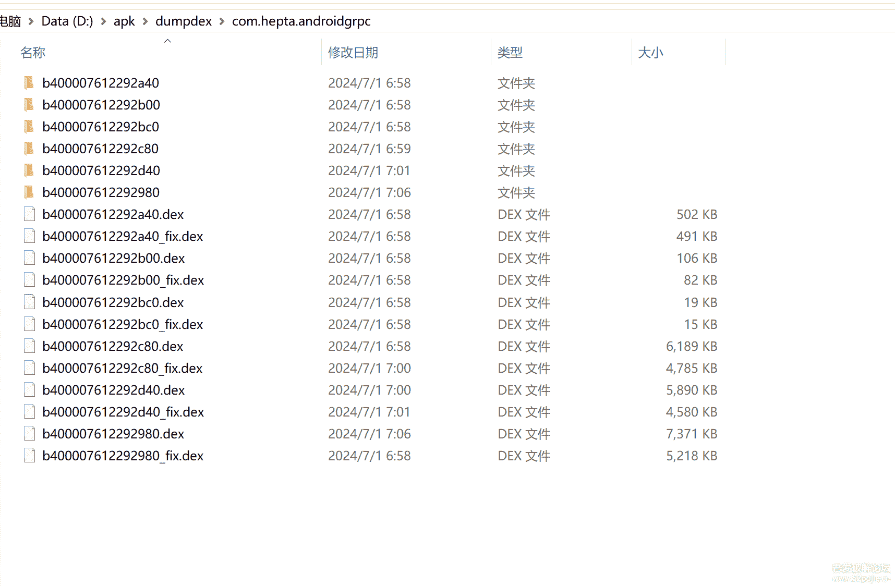

# [Android 脱壳] android脱壳日记3-一键自动脱修

- 原帖: https://www.52pojie.cn/forum.php?mod=viewthread&tid=1939665
- 抓取时间: 2026-11-01T16:55:58.756Z

## androidGRPC

### 废话

上个周发现关注项目的人变少了，然后最近又没什么产出想起来有个脱壳项目，搞一下。前天搞到晚上4点半，发现被单防了，然后第二天又搞了搞，真忍不住，发现好像搞错了，我这个心情啊。今天又修了一下发现确实有一定的防御。。有效果，效果不大。这次其实没什么新技术的更新，只是把原来的项目整合到一起了。

### 项目相关

#### 项目说明

- 一键`dexdump` + 主动类加载调用+修复 `methodCodeItem`
- 主要用于修复`methodCodeItem`的偏移进行过处理，从内存中直接把二进制`dump`出来然后修复进去
- 不能修复方法需要真正调用才能还原指令的加固
- 不能修复`dex vmp`，指令偏移表
- 不能修复格式有问题，被破坏的`dex`文件，还有`cdex`文件不支持
- 同时支持类回调和方法回调，如果想对单个方法处理也可以

#### 提供功能

`FixDexMethodCodeItem` 单个`dex`文件修复，回直接从手机上用`grpc`拉去`codeItem`修这个文件
`OnlyDumpDexFile(OutDexDir);` 只进行`dex`文件的`dump`
`dumpWholeDexFileAndFix(OutDexDir);` 一键`dump dex` + 自动`dump codeItem` +修复
`dumpDexByClassAndFix` `dump`传入的某个类的`dex`文件
`OutDexDir` 和 `worDir` `OutDexDir = worDir + 包名`，会`dump`到 `OutDexDir`
`blockClassList` 搞了个黑名单，我没试，群友提供的，是谁自己认领
`jobs` 线程个数单个线程跑非常慢，多个线程可能有问题，没专门做兼容，慢慢跑吧

#### 建议和可能出现的问题

- 不能`usb`，`grpc`需要局域网
- `dump`这东西，很多时候你也不知道对抗在哪里，所以需要不断调试，提供了很多个`dump`方法，配合使用
- `dumpDexByClassAndFix`这个，本来是没有的，但是后来发现有对抗，有的类明明存在但是`dump`的`dex`中不存在，然后我就去验证这个类确实存在，但是`dump`不出来，应该是被对抗了，对象全局遍历的函数估计是被处理了导致有些类加载器不返回
- 满，极慢，需要有耐心，每个`classloader`进行一次`grpc`调用
- 崩溃，可能有各种崩溃，不要慌，再试试
- `dump`运行中报错，别慌，有些类修复可能出问题，但是会继续跑

### 一些技术问题

#### 解决的问题

- 以前`dex`的`dump`都是需要到内存里去拦截`dex`加载，但是我通过全局的对象遍历获取`dex`（`frida-dexdump`也可以）
- `codeitem`偏移超出`dex`文件内存修复
- 提供了一个修改的`smali`项目，你可以在这个基础上直接通过字节对`dex`文件进行修复

#### 未解决问题

- `dex`文件不能损坏，如果损坏可能导致`baksmali`无法识别，或者文件格式不规范导致反编译失败
- 需要真正调用才恢复`CodeItem`的方法的`dump`
- `dex vmp`，这个其实不属于`dump`的访问
- 类对象遍历接口`VisitClassLoaders`被对抗或者某些位置被对抗，导致类加载器不能找到

### 使用

- 这个是一个`rxposed`模块，通过`rxposed`注入到目标进程中
- 当进程启动以后会自动运行，然后用`idea`打开`grpc_client`，进行设置和`dump`
- 没有打包成工具，而是通过`idea`来运行，因为脱壳本身就可能遇到各种问题，我提供了尽可能多的接口
- 如果你使用的是`lsposed`，需要你自己修改接口，完成注入

### 测试

测试效果就不说了，目前还可以使用

### android dex文件和类加载器结构

```
ClassLoader{         对应java classloader 
     DexPathList pathList;{     这个应该是版本遗留问题，可以可以是apk ，甚至可以是apk列表，多个apk，和下面含义重合
         Element[] dexElements;{     单个对应一个apk 或者多个apk，
            DexFile dexFile;{        是dex列表
                private Object mCookie;  实际是long[] ,这个一个实际的dex文件列表
            }
         }
    }
}
```

项目地址

[//github.com/Thehepta/androidGRPC](https://github.com/Thehepta/androidGRPC:https)

[//github.com/Thehepta/FixDexSmali](https://github.com/Thehepta/FixDexSmali:https)

### 最后

有什么问题直接提出来，文档发现没什么需要写的，后续可以改一改




